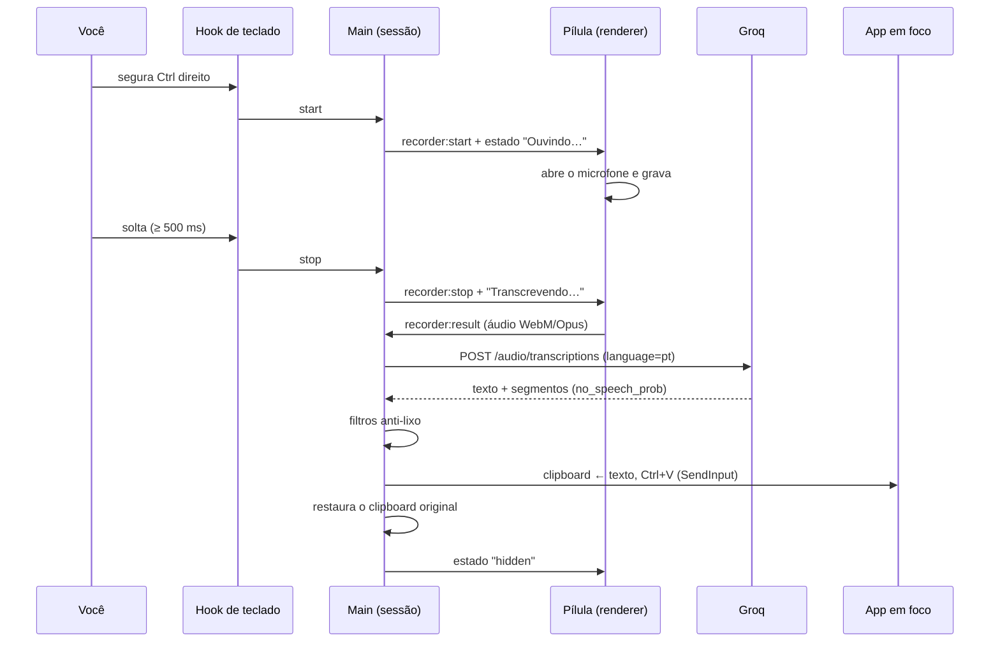
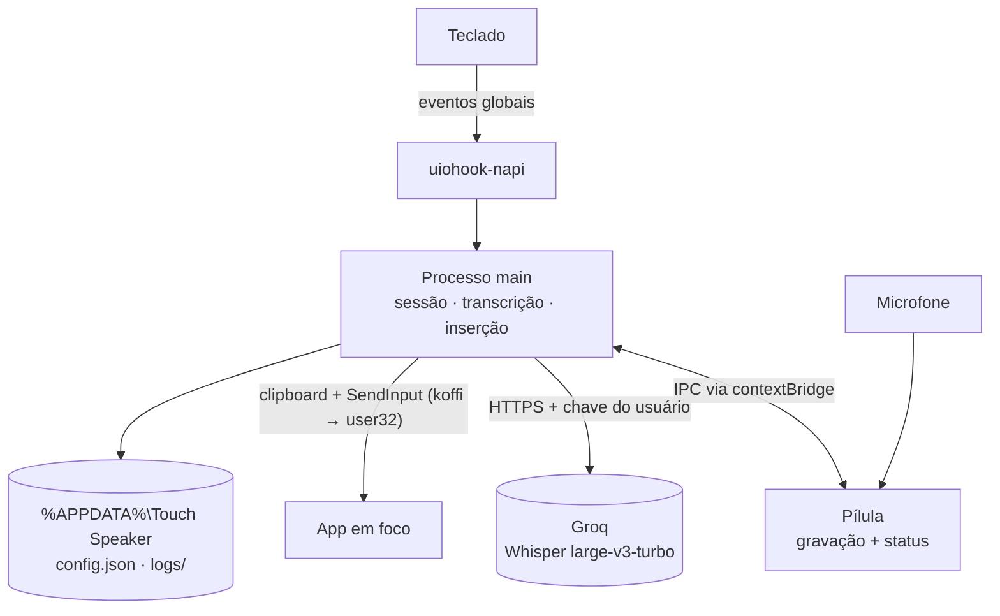

# 🎙️ Touch Speaker — ditado por voz para Windows: fale e o texto aparece onde está o cursor

<p align="center">
  
</p>


> 🗣️ O **Touch Speaker** é um app de bandeja para Windows que transforma fala em texto digitado no app em foco. Você **segura o Ctrl direito**, fala e solta — em menos de um segundo o texto aparece no cursor do VS Code, do navegador, do WhatsApp ou de qualquer outro app, como se tivesse sido digitado. A transcrição em português é feita pelo Whisper (via Groq, plano gratuito) e o que você tinha copiado no clipboard volta ao lugar depois.

Contexto de negócio (o "porquê"): [`PROJECT_CONTEXT.md`](PROJECT_CONTEXT.md) · Requisitos: [`docs/PRD.md`](docs/PRD.md) · Contrato de engenharia: [`docs/spec/spec-driven-development.md`](docs/spec/spec-driven-development.md)

**📅 Estágio:** **Fase 1 (MVP) implementada e funcionando de ponta a ponta** no Windows do mantenedor desde 17/out/2026 (commit inicial `bb7364a`). Medido nos primeiros ditados reais: **0,66–0,88 s** do fim da fala até o texto inserido e microfone aberto em 75–270 ms. Falta concluir o roteiro de verificação manual V1–V13 da [spec da feature](docs/spec/features/ditado-por-voz.md) (segurar, `Esc`, clipboard, outros apps, janela de administrador). Não há instalador: roda em modo de desenvolvimento, com a chave Groq do próprio usuário.

---

## 🧭 Visão geral

| Componente                                               | O que é                                                                                                             | Status                                                                     |
| -------------------------------------------------------- | -------------------------------------------------------------------------------------------------------------------- | -------------------------------------------------------------------------- |
| **Atalho global** (`hotkey.ts`, `keyboard.ts`) | Hook de teclado (`uiohook-napi`); segurar ≥ 500 ms = falar segurando, toque curto = mãos livres, `Esc` cancela | ✅ Funciona — lógica coberta por 10 testes                               |
| **Pílula** (`pill-window.ts`, `renderer/`)    | Janela flutuante que não rouba foco; grava o microfone (WebM/Opus) e mostra ouvindo / transcrevendo / erro          | ✅ Funciona                                                                |
| **Transcrição** (`transcribe/`)                | `GroqTranscriber` com filtros contra alucinações do Whisper em silêncio                                         | ✅ Funciona — 14 testes                                                   |
| **Inserção** (`insert/`)                       | Clipboard + Ctrl+V via `SendInput` (`koffi`), restaura o clipboard, fallback para janelas de administrador       | ✅ Colagem comprovada; fallback de admin ainda não verificado manualmente |
| **Sessão** (`session.ts`)                       | Máquina de estados, dono único do estado do ditado                                                                 | ✅ Funciona                                                                |
| **Bandeja, config e log**                          | Ícone, `config.json`, log só com metadados                                                                       | ✅ Funciona                                                                |
| **Limpeza por IA** (`refine.ts`)                 | Interface `Refiner` — hoje devolve o texto como veio                                                              | 🟡 Encaixe pronto; implementação na Fase 2                               |
| **`database/`**                                  | Histórico e dicionário em SQLite local                                                                             | ⏳ Fase 2                                                                  |
| **`backend/`**                                   | API própria, contas, streaming                                                                                      | ⏳ Fase 4                                                                  |

**Fluxo do produto:** segura Ctrl direito → a pílula aparece "Ouvindo…" e o microfone abre → você fala → solta → "Transcrevendo…" → o áudio vai à Groq → o texto passa pelos filtros anti-lixo → é colado no cursor do app em foco → o clipboard volta ao que era → a pílula some. Em mãos livres, um toque começa e outro termina.

**Regras inegociáveis:**
🔒 **Privacidade por padrão** — microfone aberto só durante o ditado, áudio nunca vai para disco, texto ditado, clipboard e teclas nunca vão para log (C1). 🎯 **Nunca roubar o foco** — o texto vai para o app em que você está (C2). 🗑️ **Nunca digitar lixo** — toque acidental ou silêncio não inserem nada (C3). 🧼 **Sala limpa** — nada copiado de outro produto (C7). Princípios completos no [SDD §1](docs/spec/spec-driven-development.md#1-constituição).

---

## ✅ Pré-requisitos

| Ferramenta                 | Versão                                    | Para quê                             | Verificar                                               |
| -------------------------- | ------------------------------------------ | ------------------------------------- | ------------------------------------------------------- |
| 🪟 **Windows**       | 10 ou 11, 64 bits                          | Único sistema suportado na Fase 1    | `winver`                                              |
| 🟩 **Node.js**       | **24 LTS** (conferido com 24.20.0)   | Build e execução em desenvolvimento | `node --version`                                      |
| 📦 **npm**           | o que vem com o Node (conferido com 11.21) | Dependências                         | `npm --version`                                       |
| 🔧 **Git**           | atual                                      | Versionamento                         | `git --version`                                       |
| 🎤 **Microfone**     | qualquer                                   | Captura da voz                        | Configurações → Sistema → Som                       |
| 🔑 **Chave da Groq** | gratuita                                   | Transcrição                         | [console.groq.com](https://console.groq.com) → API Keys |

> O plano gratuito da Groq cobre com folga o uso de uma pessoa (números públicos de set/2026: 2.000 requisições e 8 h de áudio por dia; o console da Groq é a fonte oficial). Não há banco, fila nem servidor para subir na Fase 1.

---

## 🏗️ Arquitetura

Decisões estruturais e ADRs em [`docs/ARCHITECTURE.md`](docs/ARCHITECTURE.md). O resumo visual:

```text
Teclado ──► uiohook-napi (hook global, thread própria)
                │ só "tecla de ditado / Esc / outra" — nenhum código de tecla segue adiante
                ▼
Processo main (Electron 44 · Node)
├── HotkeyController   segurar vs. tocar, auto-repetição, atalho vs. ditado
├── SessionController  idle → recording → transcribing → inserting → idle
├── GroqTranscriber    POST multipart → Whisper large-v3-turbo (pt) + filtros anti-lixo
├── Refiner            identidade na Fase 1 (LLM na Fase 2)
├── TextInserter       backup do clipboard → texto → Ctrl+V (SendInput via koffi) → restaura
└── Tray · Config · Logger
                │ IPC mínimo via contextBridge (sandbox)
                ▼
Renderer "pílula" — getUserMedia + MediaRecorder (WebM/Opus 32 kbps) · medidor de nível · sons
```

**Um ditado, ponta a ponta:**



**Quem fala com quem:**



A única integração externa é a Groq; contrato em [`docs/API.md §2`](docs/API.md#2-api-externa-groq-transcription).

---

## 🧱 Stack

- 🖥️ **App:** **Electron 44.9.0** · TypeScript 7.0.2 estrito · build com `tsc` (CommonJS no main, script clássico no renderer), sem bundler (ADR-01)
- ⌨️ **Teclado global:** `uiohook-napi` 1.5.5 — keydown/keyup globais, que o `globalShortcut` do Electron não oferece (ADR-02)
- 🧩 **Win32:** `koffi` 3.3.3 chamando `user32`/`kernel32`/`advapi32` — `SendInput`, detecção de janela elevada (ADR-03)
- 🎙️ **Áudio:** `getUserMedia` + `MediaRecorder` em WebM/Opus 32 kbps mono, com cancelamento de eco, supressão de ruído e ganho automático
- 🧠 **Transcrição:** Groq · `whisper-large-v3-turbo`, `language=pt`, `temperature=0`, `verbose_json` (ADR-04)
- 🔐 **Segurança:** `contextIsolation` + `sandbox`, CSP restrita, permissão de mídia só de áudio e só para a pílula, IPC validado no main
- 🧪 **Qualidade:** `node:test` (30 testes) · TypeScript com `strict` e `noUncheckedIndexedAccess`

`koffi` e `uiohook-napi` trazem binários prontos para win32-x64; os scripts de instalação deles ficam negados no `allowScripts` do `package.json`.

---

## 📂 Estrutura de pastas

```text
touch-speaker/
├── frontend/                       # o app desktop (Electron) — rode os comandos daqui
│   ├── package.json · package-lock.json
│   ├── tsconfig.main.json          # main + preload + shared + testes
│   ├── tsconfig.renderer.json      # renderer (script clássico, DOM)
│   ├── .env.example                # GROQ_API_KEY= (copie para .env)
│   ├── scripts/                    # start.mjs (abre o Electron) · copy-static.mjs
│   └── src/
│       ├── main/                   # sessão, atalho, transcrição, inserção, bandeja, config, log
│       ├── preload/pill.ts         # API mínima exposta à pílula
│       ├── renderer/               # pill.html · pill.css · pill.ts
│       ├── shared/ipc.ts           # contrato de IPC
│       └── test/                   # hotkey · filters · groq · config
├── backend/                        # API própria — Fase 4
├── database/                       # migrations SQLite — Fase 2
├── docs/                           # PRD, arquitetura, API, dados, design, segurança, specs, referência
└── README.md · PROJECT_CONTEXT.md · CLAUDE.md · SECURITY.md · LICENSE.md
```

---

## ⚙️ Setup local detalhado

> Objetivo: do `git clone` ao primeiro ditado sem perguntar nada. Os comandos rodam **dentro de `frontend/`**.

### 1️⃣ Clone

```powershell
git clone https://github.com/Victorkaue333/touch-speaker.git
cd touch-speaker\frontend
```

### 2️⃣ Dependências

```powershell
npm install
```

O npm avisa que os scripts de instalação de `koffi` e `uiohook-napi` não rodaram — **é esperado**: os dois já trazem o binário pronto.

### 3️⃣ Chave da Groq

```powershell
copy .env.example .env
notepad .env        # cole a chave: GROQ_API_KEY=gsk_...
```

O `.env` está no `.gitignore`. **Nunca** faça commit dele.

### 4️⃣ Abrir o app

```powershell
npm run dev
```

Compila e abre o app. Na primeira vez baixa o binário do Electron (~100 MB, verificado por checksum). O ícone de microfone verde-azulado aparece na bandeja (talvez escondido na setinha `^`).

### 5️⃣ Primeiro ditado

Abra o Bloco de Notas, clique dentro, **segure o Ctrl direito**, fale "teste de ditado" e solte. O texto aparece em menos de um segundo.

| Gesto                                    | Resultado                                         |
| ---------------------------------------- | ------------------------------------------------- |
| Segurar Ctrl direito ≥ 0,5 s e soltar   | Grava enquanto segura; solta → transcreve e cola |
| Toque rápido no Ctrl direito            | Mãos livres: grava até o próximo toque         |
| `Esc` durante a gravação             | Cancela, nada é inserido                         |
| Ctrl direito + outra tecla (ex.: Ctrl+C) | Tratado como atalho normal, não como ditado      |

### 6️⃣ Configuração (opcional)

`%APPDATA%\Touch Speaker\config.json`, criado na primeira execução. Dá para trocar a tecla (`RightCtrl`, `RightAlt`, `RightShift`, `CapsLock`, `F13`–`F24`), o microfone, o idioma, a posição da pílula e os sons. Campos e limites em [`docs/DATABASE.md`](docs/DATABASE.md#configjson). Reinicie o app depois de editar.

### 7️⃣ Verificação

```powershell
npm test            # compila e roda os 30 testes
npm run typecheck   # TypeScript estrito, sem emitir
```

---

## 🧪 Testes e verificação

| Item                      | Estado                                                                                                                                         |
| ------------------------- | ---------------------------------------------------------------------------------------------------------------------------------------------- |
| `npm test`              | ✅ 30/30 — `HotkeyController` (10), filtros anti-lixo (8), `GroqTranscriber` (9, com `fetch` simulado), config (3)                      |
| `npm run typecheck`     | ✅ Sem erros                                                                                                                                   |
| App sobe no Electron 44   | ✅ Hook de teclado e `koffi` carregados (`app_ready` no log)                                                                               |
| Colagem via `SendInput` | ✅ Comprovada isoladamente e em ditado real                                                                                                    |
| Roteiro manual V1–V13    | 🟡 Em andamento — V2 (mãos livres) aprovado; lista completa na [§12 da spec](docs/spec/features/ditado-por-voz.md#12-plano-de-verificação) |

Não há testes de interface automatizados: gravação, colagem e pílula são verificadas à mão pelo roteiro da spec.

---

## 📋 Comandos úteis

Todos de dentro de `frontend/`.

| Comando               | O que faz                            |
| --------------------- | ------------------------------------ |
| `npm run dev`       | Compila e abre o app                 |
| `npm start`         | Abre sem recompilar                  |
| `npm run build`     | Só compila (`dist/`)              |
| `npm test`          | Compila e roda os testes             |
| `npm run typecheck` | Checagem de tipos sem gerar arquivos |

---

## 🩺 Problemas comuns

| Sintoma                                    | Causa e solução                                                                                                   |
| ------------------------------------------ | ------------------------------------------------------------------------------------------------------------------- |
| O app abre e fecha na hora, sem erro       | Variável `ELECTRON_RUN_AS_NODE` herdada do VS Code. Abra sempre por `npm run dev`/`npm start`, que a removem |
| Pílula "Falta a chave da Groq"            | `frontend/.env` ausente ou vazio — passo 3️⃣                                                                   |
| Pílula "Texto copiado — cole com Ctrl+V" | O app em foco roda como administrador e o Windows bloqueia colagem simulada; o texto ficou no clipboard             |
| Dois apps reagem ao atalho                 | Feche o Typeless ou outro app de ditado com atalho parecido                                                         |
| Nada acontece ao segurar a tecla           | Veja `%APPDATA%\Touch Speaker\logs\main.log` — `keyboard_hook` deve estar `true` no `app_ready`            |

O log guarda só tempos, tamanhos e códigos de erro — nunca o que você ditou.

---

## 🔌 Contratos

O Touch Speaker não expõe API própria na Fase 1. Contratos completos em [`docs/API.md`](docs/API.md).

| Contrato                                                                         | Entre           | Resumo                                                                                                                                                                  |
| -------------------------------------------------------------------------------- | --------------- | ----------------------------------------------------------------------------------------------------------------------------------------------------------------------- |
| `POST https://api.groq.com/openai/v1/audio/transcriptions`                     | main → Groq    | Multipart com `file`, `model`, `language=pt`, `temperature=0`, `response_format=verbose_json`; 401 → chave inválida, 429 → limite, 5xx → 1 nova tentativa |
| `recorder:start` · `recorder:stop` · `recorder:cancel` · `pill:state` | main → pílula | Comandos de gravação e estado visual, sempre com `sessionId`                                                                                                        |
| `recorder:started` · `recorder:result` · `recorder:error`                | pílula → main | Confirmação, áudio (≤ 25 MB) e erros de microfone — validados no main                                                                                              |

Códigos de erro e mensagens da pílula: [`docs/API.md §4`](docs/API.md#4-códigos-de-erro).

---

## 📖 Documentação

| Documento                                                                            | Conteúdo                                                |
| ------------------------------------------------------------------------------------ | -------------------------------------------------------- |
| [`PROJECT_CONTEXT.md`](PROJECT_CONTEXT.md)                                          | Problema, público, fases e métricas                    |
| [`CLAUDE.md`](CLAUDE.md)                                                            | Regras para a IA atuar no repositório                   |
| [`docs/PRD.md`](docs/PRD.md)                                                        | Requisitos (FR-DICT-01…13, NFR-01…07) e roadmap        |
| [`docs/spec/spec-driven-development.md`](docs/spec/spec-driven-development.md)      | SDD — princípios, fluxo de trabalho e template de spec |
| [`docs/spec/features/ditado-por-voz.md`](docs/spec/features/ditado-por-voz.md)      | Spec da Fase 1, tarefas e roteiro de verificação       |
| [`docs/ARCHITECTURE.md`](docs/ARCHITECTURE.md)                                      | Componentes, fluxo e ADR-01…07                          |
| [`docs/API.md`](docs/API.md)                                                        | Contratos com a Groq, IPC e códigos de erro             |
| [`docs/DATABASE.md`](docs/DATABASE.md)                                              | `config.json` e o SQLite planejado para a Fase 2       |
| [`docs/DESIGN.md`](docs/DESIGN.md)                                                  | Pílula, cores, sons e bandeja                           |
| [`SECURITY.md`](SECURITY.md) · [`docs/Security-Guide.md`](docs/Security-Guide.md) | Política e guia de segurança                           |
| [`docs/referencia/estudo-typeless.md`](docs/referencia/estudo-typeless.md)          | Estudo do produto de referência e o que adotamos        |

**Ordem de leitura sugerida:** `CLAUDE.md` → `PROJECT_CONTEXT.md` → `docs/PRD.md` → SDD → spec da feature.

---

## 🗺️ Roadmap

| Fase        | Entrega                                                                                                | Status                            |
| ----------- | ------------------------------------------------------------------------------------------------------ | --------------------------------- |
| **1** | Ditado básico: atalho, gravação, Groq, colagem no app em foco                                       | 🟡 Implementada, em verificação |
| **2** | Limpeza do texto com IA (Claude Haiku), dicionário pessoal, histórico local, tela de configurações | ⏳ Próxima                       |
| **3** | Contexto do app em foco (UI Automation), Ask Anything, tradução, aprendizado com as correções      | ⏳                                |
| **4** | Backend próprio, contas, streaming de áudio, instalador assinado e atualização automática         | ⏳                                |

Detalhes no [PRD](docs/PRD.md#roadmap). Feature nova começa sempre por uma spec ([SDD §2](docs/spec/spec-driven-development.md#2-fluxo-de-trabalho)).

---

**Dúvida de escopo** → o PRD e a spec respondem. **Divergência** → alinhe com o Victor antes de implementar; não invente regra de negócio.

## 📄 Licença

Software **proprietário** — todos os direitos reservados. Veja [`LICENSE.md`](LICENSE.md). © 2026 Victor Alves.

<small>Última atualização: 17/out/2026 · Mantenedor: Victor Alves</small>
