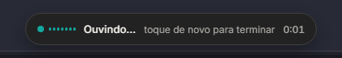
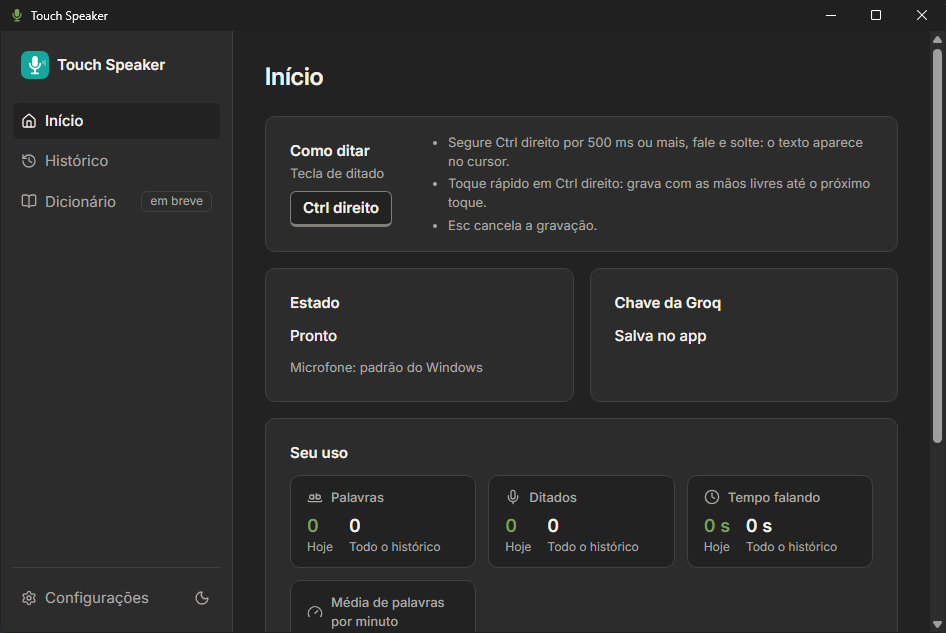
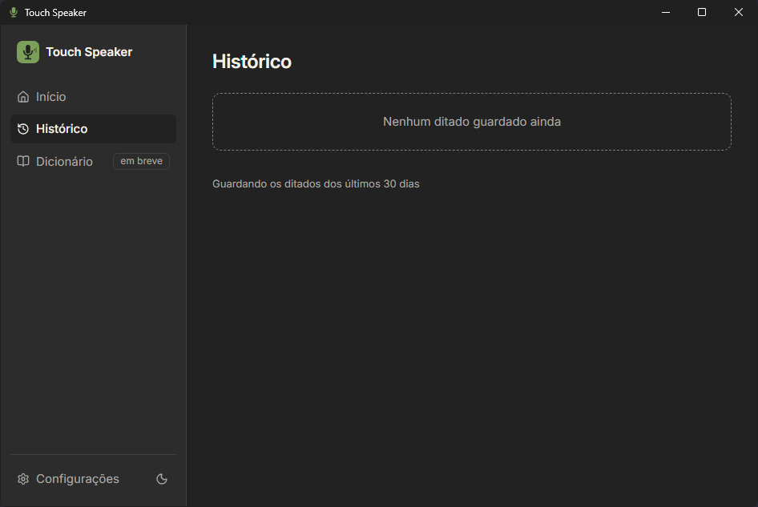
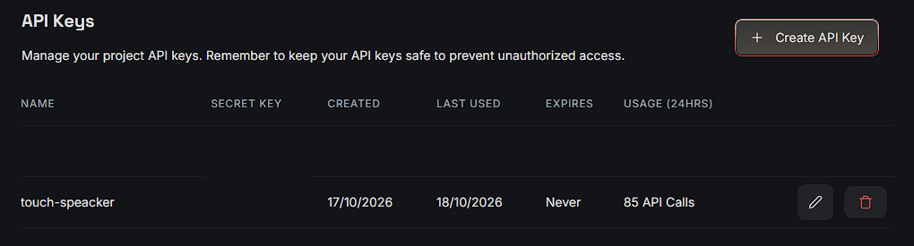
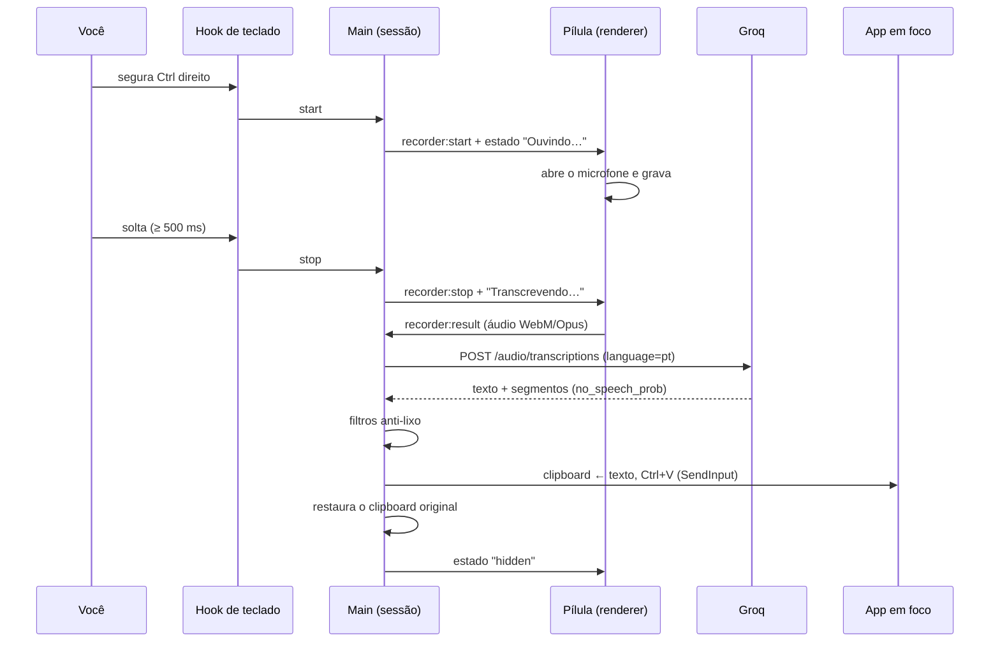
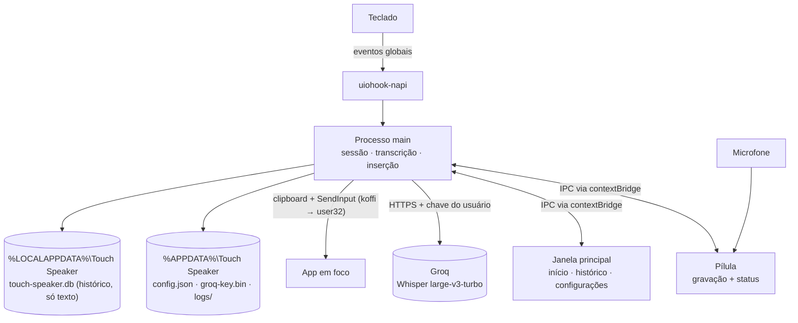

# 🎙️ Touch Speaker — ditado por voz para Windows e macOS: fale e o texto aparece onde está o cursor

<p align="center">
  
</p>


> 🗣️ O **Touch Speaker** é um app de bandeja para Windows e macOS que transforma fala em texto digitado no app em foco. Você **segura o Ctrl direito** (no Mac, o **Command direito**), fala e solta — em menos de um segundo o texto aparece no cursor do VS Code, do navegador, do WhatsApp ou de qualquer outro app, como se tivesse sido digitado. A transcrição em português é feita pelo Whisper (via Groq, plano gratuito) e o que você tinha copiado no clipboard volta ao lugar depois.

Contexto de negócio (o "porquê"): [`PROJECT_CONTEXT.md`](PROJECT_CONTEXT.md) · Requisitos: [`docs/PRD.md`](docs/PRD.md) · Contrato de engenharia: [`docs/spec/spec-driven-development.md`](docs/spec/spec-driven-development.md) · Decisões: [`docs/DECISIONS.md`](docs/DECISIONS.md)

<a id="download"></a>

## ⬇️ Download

Para usar o Touch Speaker você **não precisa de terminal, Node nem do código**: baixe o instalador da última versão em **[Releases → última versão](https://github.com/Victorkaue333/touch-speaker/releases/latest)**. Cada pessoa usa a **própria chave da Groq** (gratuita), colada no app.

| Sistema | Arquivo para baixar | Requisitos |
| --- | --- | --- |
| 🪟 **Windows** | `Touch-Speaker-Setup-<versão>-win-x64.exe` | Windows 10 ou 11, 64 bits |
| 🍎 **macOS** | `Touch-Speaker-<versão>-mac-arm64.dmg` | macOS 13 (Ventura) ou mais novo, em **Mac com Apple Silicon** (M1 ou mais novo). Não abre em Mac Intel |

Para conferir se o arquivo chegou inteiro (opcional), o Release traz o `SHA256SUMS.txt`: compare com `Get-FileHash <arquivo>` no Windows ou `shasum -a 256 <arquivo>` no Mac.

### 🪟 Windows

1. Baixe o `.exe` em [Releases](https://github.com/Victorkaue333/touch-speaker/releases/latest) e abra.
2. O instalador ainda **não é assinado**, então o Windows mostra **"O Windows protegeu o computador"** (SmartScreen). Clique em **Mais informações** → **Executar assim mesmo**.
3. No assistente, escolha se quer o **atalho na área de trabalho** e se o Touch Speaker **inicia com o Windows**, e clique em **Instalar**. Ele instala só para o seu usuário e não pede senha de administrador.
4. Na última tela, deixe marcada a opção de abrir o Touch Speaker e conclua. O ícone de microfone aparece na bandeja, perto do relógio (às vezes escondido na setinha `^`).

Se o aviso não tiver **Executar assim mesmo**, o Controle Inteligente de Aplicativos (Smart App Control) do Windows está ligado e bloqueia app sem assinatura — por enquanto o instalador não passa por ele.

**Atualizar:** baixe a versão nova e instale por cima (feche o Touch Speaker antes, pelo menu da bandeja → **Sair**); configuração, chave e histórico ficam. **Desinstalar:** Configurações do Windows → Aplicativos → Aplicativos instalados → Touch Speaker → Desinstalar. Seus dados ficam em `%APPDATA%\Touch Speaker` e `%LOCALAPPDATA%\Touch Speaker`; apague as duas pastas se quiser tirar tudo.

### 🍎 macOS (Apple Silicon)

1. Baixe o `.dmg`, abra e **arraste o Touch Speaker para a pasta Aplicativos**. Abra sempre de Aplicativos — não de dentro do `.dmg` nem de Downloads, ou as permissões podem não valer.
2. **Primeira abertura de cada versão.** O app tem só assinatura ad-hoc (sem a notarização paga da Apple), e o macOS bloqueia a primeira abertura:
   - **macOS 13 ou 14:** em Aplicativos, clique com o **botão direito** (ou Control + clique) no Touch Speaker → **Abrir** → **Abrir**.
   - **macOS 15 ou mais novo:** tente abrir uma vez e feche o aviso; vá em **Ajustes do Sistema → Privacidade e Segurança**, role até a mensagem sobre o Touch Speaker e clique em **Abrir Mesmo Assim**; confirme com a sua senha.
3. **Acessibilidade.** Na primeira abertura o macOS pede: clique em **Abrir Ajustes do Sistema** → **Privacidade e Segurança → Acessibilidade** → ligue o **Touch Speaker**. Depois, clique no ícone do Touch Speaker na **barra de menus** (no alto da tela) → **Tentar de novo**; se não funcionar, **Reabrir o Touch Speaker**. É essa permissão que deixa o app ouvir a tecla de ditado e colar o texto.
4. **Microfone.** No primeiro ditado (ou logo depois da Acessibilidade) o macOS pergunta: **Permitir**. Se negou sem querer: Ajustes do Sistema → Privacidade e Segurança → **Microfone** → ligue o Touch Speaker.
5. A tecla de ditado no Mac é o **Command direito** (⌘, à direita da barra de espaço); dá para trocar em Configurações.

O Touch Speaker fica só na barra de menus, sem ícone no Dock. Em campos de senha e no Terminal com "Entrada Segura de Teclado", o macOS esconde as teclas dos outros apps: ali a tecla de ditado pode não responder e o texto fica no clipboard — cole com ⌘V.

**Atualizar no Mac:** saia pelo menu da barra de menus (**Sair**), arraste a versão nova para Aplicativos e substitua. O macOS pode pedir a liberação do passo 2 de novo, e a Acessibilidade pode aparecer ligada sem valer: em Acessibilidade, remova o Touch Speaker (botão **−**), adicione de novo (**+**) e use **Tentar de novo**. Se a chave da Groq não for lida, salve-a de novo em Configurações.

### Depois de instalar: a chave da Groq

1. Abra a janela do Touch Speaker. **Windows:** botão direito no ícone da bandeja → **Abrir Touch Speaker** (ou duplo clique no ícone). **Mac:** clique no ícone da barra de menus → **Abrir Touch Speaker**. Na primeira vez ela abre sozinha.
2. Vá em **Configurações**, cole a chave em **Chave da Groq** e clique em **Salvar chave**. Ainda não tem a chave? Veja [Como obter sua chave da Groq](#-como-obter-sua-chave-da-groq-gratuita) — é gratuita.
3. Pronto: clique num campo de texto de qualquer app, **segure a tecla de ditado** (Ctrl direito no Windows, Command direito no Mac), fale e solte.

**O que sai do seu computador:** só o áudio de cada ditado, para a Groq, com a **sua** chave. Não há conta, servidor do Touch Speaker nem telemetria. Se algo der errado, o log (`main.log`, só metadados — nunca o texto ditado) fica em `%APPDATA%\Touch Speaker\logs` no Windows e em `~/Library/Application Support/Touch Speaker/logs` no Mac; mande-o ao Victor.

🐧 **Linux:** planejado para depois, sem data.

> 🛠️ Quer mexer no código ou rodar sem instalar? Veja [Rodar pelo código (desenvolvedores)](#desenvolvimento).

## 📸 Como é

A pílula aparece enquanto você fala, sem tirar o foco do app em que você está:



A janela principal abre pela bandeja. No **Início** ficam a tecla de ditado, o estado e o seu uso; no **Histórico**, os ditados guardados neste computador; em **Configurações** você cola a chave da Groq (não precisa de `.env`):






---

## 🧭 Visão geral

| Componente                                               | O que é                                                                                                             | Status                                                                     |
| -------------------------------------------------------- | -------------------------------------------------------------------------------------------------------------------- | -------------------------------------------------------------------------- |
| **Atalho global** (`hotkey.ts`, `keyboard.ts`) | Hook de teclado (`uiohook-napi`); segurar ≥ 500 ms = falar segurando, toque curto = mãos livres, `Esc` cancela | ✅ Funciona — lógica coberta por 10 testes                               |
| **Pílula** (`pill-window.ts`, `renderer/`)    | Janela flutuante que não rouba foco; grava o microfone (WebM/Opus) e mostra ouvindo / transcrevendo / erro          | ✅ Funciona                                                                |
| **Transcrição** (`transcribe/`)                | `GroqTranscriber` com filtros contra alucinações do Whisper em silêncio                                         | ✅ Funciona — 17 testes (filtros 8 + `GroqTranscriber` 9)                |
| **Inserção** (`insert/`)                       | Clipboard + Ctrl+V via `SendInput` (`koffi`) no Windows, ⌘V via `CGEventPost` (`koffi`) no Mac; restaura o clipboard; fallback para janelas de administrador (Windows) e para falta de Acessibilidade ou entrada segura (Mac) | ✅ Colagem comprovada no Windows; fallback de admin e o Mac ainda não verificados manualmente |
| **Plataforma** (`platform.ts`, `permissions.ts`) | Escolhe na abertura o que muda entre Windows e macOS; no Mac, Acessibilidade antes do hook, Microfone, barra de menus e menu de edição | 🟡 No código desde 18/out/2026; roteiro no Mac (VDM) pendente |
| **Distribuição** (`electron-builder.yml`, `.github/workflows/`) | Instalador `.exe` (Windows) e `.dmg` arm64 (Mac), verificação do pacote, Release no GitHub | 🟡 Instalador do Windows gerado e conferido; primeiro Release e roteiros VDW/VDM pendentes |
| **Sessão** (`session.ts`)                       | Máquina de estados, dono único do estado do ditado                                                                 | ✅ Funciona                                                                |
| **Bandeja, config e log**                          | Ícone, `config.json`, log só com metadados                                                                       | ✅ Funciona                                                                |
| **Janela principal** (`main-window.ts`, `renderer/main-window/`) | Aberta pela bandeja: Início (tecla, como ditar, estado, ditados recentes e seu uso), Histórico (busca, copiar de novo, apagar), Configurações (chave da Groq cifrada, preferências, guardar histórico, aparência, iniciar com o Windows); Dicionário "em breve"; botão de tema claro/escuro | 🟡 Implementada no código em 18/out/2026 (M2); roteiros VJ1–VJ27 pendentes |
| **Limpeza por IA** (`refine.ts`)                 | Interface `Refiner` — hoje devolve o texto como veio                                                              | 🟡 Encaixe pronto; implementação na Fase 2                               |
| **Histórico** (`history/`, `database/local/`)   | Texto dos ditados em SQLite local (`node:sqlite`, em `%LOCALAPPDATA%`), sem áudio, com retenção; o dicionário vem na Fase 2 | 🟡 Implementado no código em 18/out/2026 (M2); roteiro VH1–VH13 pendente |
| **`backend/`**                                   | API própria, contas, streaming                                                                                      | ⏳ Fase 4                                                                  |

**Fluxo do produto:** segura Ctrl direito → a pílula aparece "Ouvindo…" e o microfone abre → você fala → solta → "Transcrevendo…" → o áudio vai à Groq → o texto passa pelos filtros anti-lixo → é colado no cursor do app em foco → o clipboard volta ao que era → a pílula some. Em mãos livres, um toque começa e outro termina.

**Regras inegociáveis:**
🔒 **Privacidade por padrão** — microfone aberto só durante o ditado, áudio nunca vai para disco, texto ditado, clipboard e teclas nunca vão para log (C1). 🎯 **Nunca roubar o foco** — o texto vai para o app em que você está (C2). 🗑️ **Nunca digitar lixo** — toque acidental ou silêncio não inserem nada (C3). 🧼 **Sala limpa** — nada copiado de outro produto (C7). Princípios completos no [SDD §1.5](docs/spec/spec-driven-development.md#15-princípios-do-produto--constituição-c1c8).

---

## ✅ Pré-requisitos

> Para **usar** o app basta o sistema e a chave da Groq — veja [Download](#download). Node, npm e Git só servem para quem roda pelo código.

| Ferramenta                 | Versão                                    | Para quê                             | Verificar                                               |
| -------------------------- | ------------------------------------------ | ------------------------------------- | ------------------------------------------------------- |
|  **Windows**       | 10 ou 11, 64 bits                          | Sistema suportado                     | `winver`                                              |
|  **macOS**         | 13 (Ventura) ou mais novo, Apple Silicon   | Sistema suportado desde a M2 — no código, ainda não verificado num Mac ([ADR-11](docs/DECISIONS.md#adr-11--macos-como-plataforma-suportada-e-distribuição-restrita-antes-da-fase-4)) | Menu Apple → Sobre este Mac |
|  **Node.js**       | **24 LTS** (conferido com 24.20.0)   | Build e execução em desenvolvimento | `node --version`                                      |
|  **npm**           | o que vem com o Node (conferido com 11.21) | Dependências                         | `npm --version`                                       |
|  **Git**           | atual                                      | Versionamento                         | `git --version`                                       |
|  **Microfone**     | qualquer                                   | Captura da voz                        | Configurações → Sistema → Som                       |
|  **Chave da Groq** | gratuita                                   | Transcrição                         | [Passo a passo logo abaixo](#-como-obter-sua-chave-da-groq-gratuita) |

> Não há banco, fila nem servidor para subir: o banco do histórico é um arquivo local que o próprio app cria na primeira abertura.

---

## 🔑 Como obter sua chave da Groq (gratuita)

O Touch Speaker não tem servidor próprio: o áudio vai do seu computador direto para a Groq, autenticado com a **sua** chave. A Groq tem um **plano gratuito** que basta para o ditado de uma pessoa (veja os [limites](#limites-do-plano-gratuito) abaixo).

> ⚠️ **Groq não é Grok.** A **Groq** ([groq.com](https://groq.com)) é a empresa que roda o Whisper usado aqui. O **Grok** é o assistente de IA da xAI: outra empresa, outro produto. A chave do Grok não serve para o Touch Speaker.

### Passo 1 — Crie sua conta ou entre

Abra [console.groq.com](https://console.groq.com) e crie uma conta. Se já tiver uma, só entre.

### Passo 2 — Abra a página API Keys

No menu do console, abra **API Keys**. Se preferir, vá direto em [console.groq.com/keys](https://console.groq.com/keys).

[](https://console.groq.com/keys)

### Passo 3 — Crie uma chave nova

Clique em **Create API Key** e dê à chave um nome que lembre para que ela serve, por exemplo `touch-speaker`. Confirme.

### Passo 4 — Copie a chave na hora

A chave aparece na tela (ela começa com `gsk_`). **Copie agora**: o console pode não mostrá-la de novo. Se você perder a chave, não tem problema: apague essa e crie outra (passo 3).

### Passo 5 — Coloque a chave no Touch Speaker (em Configurações)

Abra o Touch Speaker instalado (veja [Download](#download)). Se você roda pelo código, faça antes os passos 1️⃣ (clone) e 2️⃣ (dependências) de [Rodar pelo código](#desenvolvimento) e abra o app com `npm run dev`, dentro da pasta `frontend/`.

Na primeira vez (sem `config.json` e sem chave salva), a janela do Touch Speaker abre sozinha em **Configurações**. Nas outras vezes, clique com o botão direito no ícone do Touch Speaker na bandeja (talvez escondido na setinha `^`) e escolha **Abrir Touch Speaker** — ou dê duplo clique no ícone — e vá em **Configurações**. No Mac, o ícone fica na barra de menus, no alto da tela: clique nele → **Abrir Touch Speaker**.

Cole a chave no campo **Chave da Groq** e clique em **Salvar chave**. O campo se esvazia e aparece **"Chave salva"**. A chave fica **cifrada neste computador** pelo `safeStorage` do Electron (no Windows, a proteção de dados do sistema, por usuário, em `%APPDATA%\Touch Speaker\groq-key.bin`; no Mac, as Chaves do macOS, em `~/Library/Application Support/Touch Speaker/groq-key.bin`) e vale a partir do próximo ditado, sem reiniciar. Ela nunca volta para a tela nem vai para o log ([ADR-08](docs/DECISIONS.md#adr-08--chave-da-groq-no-safestorage-do-electron-com-o-env-só-como-reserva-de-desenvolvimento)).

> 🛠️ **Só em desenvolvimento, alternativa:** a chave também pode ficar em `frontend/.env` (`copy .env.example .env`, depois `notepad .env` e cole a chave logo depois do `=` na linha `GROQ_API_KEY=`, sem espaços e sem aspas). O `.env` só é lido com o app rodando por `npm run dev`/`npm start`, só quando o app abre e só quando **não** há chave salva em Configurações; o app instalado nunca o lê. Detalhes em [`docs/ENVIRONMENT.md`](docs/ENVIRONMENT.md#o-arquivo-env).

### Passo 6 — Confira

Passe o mouse sobre o ícone do Touch Speaker na bandeja ou clique nele com o botão direito. Deve aparecer **"Touch Speaker — pronto"**; o **Início** da janela mostra o mesmo estado e de onde vem a chave ("Salva no app" ou "Vinda do .env de desenvolvimento"). Se aparecer **"Touch Speaker — falta a chave da Groq"**, abra o Touch Speaker pela bandeja e salve a chave em Configurações.

Para trocar a chave, salve a nova em Configurações (vale no próximo ditado). Para apagá-la, **Remover chave** → **Confirmar remoção**; em desenvolvimento, o app volta a usar o `.env`, se houver.

### Cuidados com a chave

- A chave é pessoal, como uma senha: quem tiver a sua usa a sua cota.
- **Nunca** faça commit do `.env`. Ele já está no `.gitignore` (`.env` e `.env.*`; só o `.env.example`, sem chave, é versionado).
- Não cole a chave em issue, chat, e-mail ou print. Num print, borre a chave antes.
- **Vazou?** Na mesma página [API Keys](https://console.groq.com/keys), apague (revogue) a chave, crie outra e salve a nova em Configurações (ou no `.env`, se é ele que você usa em desenvolvimento).
- O app usa a chave só no processo principal, guarda cifrada a que você salva e nunca a escreve no log nem no `config.json`. A proteção é por usuário do Windows: outro programa rodando na sua conta conseguiria decifrá-la, como acontece com qualquer app pessoal (RISK-021). Detalhes em [`docs/Security-Guide.md` §10](docs/Security-Guide.md#10-segredos-e-configuração).

### Limites do plano gratuito

Para o modelo `whisper-large-v3-turbo`, em out/2026:

| Limite | Plano gratuito | No Touch Speaker |
| --- | --- | --- |
| Requisições por minuto | 20 | Cada ditado é uma requisição |
| Requisições por dia | 2.000 | — |
| Áudio por hora | 7.200 s (2 h) | Soma da duração dos ditados |
| Áudio por dia | 28.800 s (8 h) | Soma da duração dos ditados |
| Tamanho do arquivo | até 25 MB | O app grava no máximo 5 min por ditado, em Opus, bem abaixo disso |

Os limites valem por **organização** (a sua conta da Groq), não por chave: criar mais chaves não aumenta a cota. Se passar do limite, a pílula mostra "Limite gratuito da Groq atingido — tente em instantes" e aquele ditado não é inserido; é só esperar um pouco.

Esses números podem mudar. A fonte oficial é a página de limites da sua conta, [console.groq.com/settings/limits](https://console.groq.com/settings/limits) (documentação: [console.groq.com/docs/rate-limits](https://console.groq.com/docs/rate-limits)).

### E se um dia precisar de mais?

O uso pago do `whisper-large-v3-turbo` custa **US$ 0,04 por hora de áudio**, com cobrança mínima de 10 s por requisição. Preços atualizados em [groq.com/pricing](https://groq.com/pricing).

---

## 🏗️ Arquitetura

Componentes, fluxo e fronteiras em [`docs/ARCHITECTURE.md`](docs/ARCHITECTURE.md); as decisões (ADR-01…12) em [`docs/DECISIONS.md`](docs/DECISIONS.md). O resumo visual:

```text
Teclado ──► uiohook-napi (hook global, thread própria)
                │ só "tecla de ditado / Esc / outra" — nenhum código de tecla segue adiante
                ▼
Processo main (Electron 44 · Node)
├── HotkeyController   segurar vs. tocar, auto-repetição, atalho vs. ditado
├── SessionController  idle → recording → transcribing → inserting → idle
├── GroqTranscriber    POST multipart → Whisper large-v3-turbo (pt) + filtros anti-lixo
├── Refiner            identidade na Fase 1 (LLM na Fase 2)
├── TextInserter       backup do clipboard → texto → Ctrl+V (SendInput via koffi) → restaura
├── CredentialStore    chave da Groq: groq-key.bin (safeStorage) → .env só em dev → nenhuma
├── SettingsStore      preferências da tela → config.json (fila única, gravação atômica)
├── HistoryService     texto de cada ditado → SQLite local (node:sqlite) em %LOCALAPPDATA%, com retenção
└── Tray · MainWindow · ThemeSetting · Config · Logger
                │ IPC mínimo via contextBridge (sandbox), uma ponte por janela
                ▼
Renderer "pílula" — getUserMedia + MediaRecorder (WebM/Opus 32 kbps) · medidor de nível · sons
Renderer "janela principal" — Início · Histórico · Dicionário · Configurações (aberta pela bandeja)
```

**Um ditado, ponta a ponta:**



**Quem fala com quem?:**



A única integração externa é a Groq: visão da integração (fluxo, nova tentativa, limites, riscos) em [`docs/INTEGRATION.md`](docs/INTEGRATION.md) e contrato campo a campo em [`docs/API.md` — Transcrição (Groq)](docs/API.md#transcrição-groq).

---

## 🧱 Stack

-  **App:** **Electron 44.9.0** · TypeScript 7.0.2 estrito · build com `tsc` (CommonJS no main, script clássico no renderer), sem bundler (ADR-01)
-  **Teclado global:** `uiohook-napi` 1.5.5 — keydown/keyup globais, que o `globalShortcut` do Electron não oferece (ADR-02)
-  **Win32 / macOS:** `koffi` 3.3.3 chamando `user32`/`kernel32`/`advapi32` no Windows — `SendInput`, detecção de janela elevada (ADR-03) — e CoreGraphics no Mac — ⌘V por `CGEventPost`, entrada segura (ADR-11); cada sistema só carrega as suas bibliotecas
-  **Empacotamento:** `electron-builder` 26.15.3 — instalador NSIS do Windows, `.dmg`/`.zip` do Mac, Electron Fuses e verificação do pacote; Release pelo GitHub Actions (ADR-10)
-  **Áudio:** `getUserMedia` + `MediaRecorder` em WebM/Opus 32 kbps mono, com cancelamento de eco, supressão de ruído e ganho automático
-  **Transcrição:** Groq · `whisper-large-v3-turbo`, `language=pt`, `temperature=0`, `verbose_json` (ADR-04)
-  **Segurança:** `contextIsolation` + `sandbox` nas duas janelas, CSP restrita, permissão de mídia só de áudio e só para a pílula, IPC validado no main (com o remetente conferido), chave da Groq cifrada pelo `safeStorage` (ADR-08)
-  **Histórico:** SQLite pelo `node:sqlite` que já vem no Electron (SQLite 3.53.4) — nenhuma dependência nova (ADR-09)
-  **Fonte:** Inter 4.1 embutida (ADR-12), sobre os tokens do design system "Sálvia" (tema claro ou escuro: segue o sistema ou a escolha feita no botão da janela)
- 🧪 **Qualidade:** `node:test` (390 testes) · TypeScript com `strict` e `noUncheckedIndexedAccess` · typecheck e testes no Windows e no macOS a cada release (GitHub Actions)

`koffi` e `uiohook-napi` trazem binários prontos para win32-x64 e darwin-arm64; os scripts de instalação deles ficam negados no `allowScripts` do `package.json`.

---

## 📂 Estrutura de pastas

```text
touch-speaker/
├── frontend/                       # o app desktop (Electron) — rode os comandos daqui
│   ├── package.json · package-lock.json
│   ├── tsconfig.main.json          # main + preload + shared + testes
│   ├── tsconfig.renderer.json      # renderer da pílula (script clássico, DOM)
│   ├── tsconfig.main-window.json   # renderer da janela principal (script clássico, DOM)
│   ├── .env.example                # GROQ_API_KEY= (só para desenvolvimento; copie para .env)
│   ├── electron-builder.yml        # empacotamento: instalador do Windows e app do macOS (ADR-10)
│   ├── build/                      # ícones do app, installer.nsh (opções do instalador), entitlements do Mac
│   ├── scripts/                    # start.mjs (abre o Electron) · copy-static.mjs · verify-package.mjs ·
│   │                               # package-rules.mjs (+ teste) · make-icons.mjs · clean.mjs
│   └── src/
│       ├── main/                   # sessão, atalho, transcrição, inserção (Windows e Mac), bandeja, janela
│       │                           # principal, plataforma e permissões, chave (credentials), preferências
│       │                           # (settings), tema (theme-setting), histórico (history/), config, log
│       ├── preload/                # pill.ts e main-window.ts — a API mínima de cada janela
│       ├── renderer/               # pílula (pill.*), tokens.css, fonts/ e main-window/ (a janela principal)
│       ├── shared/                 # ipc.ts (contratos de IPC) · palette.ts · contrast.ts · theme.ts
│       └── test/                   # hotkey · filters · groq · config · tokens · icon · credentials ·
│                                   # settings · main-window-ipc · history-* · session-history · theme · controls ·
│                                   # platform · strings
├── .github/workflows/release.yml   # build e Release (tag v*): .exe no Windows, .dmg/.zip no macOS
├── backend/                        # API própria — Fase 4
├── database/                       # migrations SQLite: local/0001_init.sql (histórico)
├── docs/                           # PRD, arquitetura, decisões, API, integração, dados, ambiente, design,
│                                   # segurança, estilo de código, changelog, specs, templates, referência
└── README.md · PROJECT_CONTEXT.md · CLAUDE.md · AGENTS.md · SECURITY.md · LICENSE.md
```

---

<a id="desenvolvimento"></a>

## ⚙️ Rodar pelo código (desenvolvedores)

> Para quem vai mexer no código. Para só usar o app, veja [Download](#download). Objetivo: do `git clone` ao primeiro ditado sem perguntar nada. Os comandos rodam **dentro de `frontend/`**; abaixo, no Windows (no Mac, os mesmos comandos num terminal — [`docs/ENVIRONMENT.md`](docs/ENVIRONMENT.md#linux-e-macos)).

### 1️⃣ Clone

```powershell
git clone https://github.com/Victorkaue333/touch-speaker.git
cd touch-speaker\frontend
```

### 2️⃣ Dependências

```powershell
npm install
```

O npm avisa que os scripts de instalação de `koffi` e `uiohook-napi` não rodaram — **é esperado**: os dois já trazem o binário pronto.

### 3️⃣ Abrir o app

```powershell
npm run dev
```

Compila e abre o app. Na primeira vez baixa o binário do Electron (~100 MB, verificado por checksum). O ícone de microfone aparece na bandeja — verde musgo com a barra de tarefas escura, verde ardósia com a clara — (talvez escondido na setinha `^`). Para abrir a janela do Touch Speaker: botão direito no ícone → **Abrir Touch Speaker**, ou duplo clique no ícone. Fechar a janela (X) não encerra o app; ele continua na bandeja ("Sair" fica no menu do ícone).

### 4️⃣ Chave da Groq

Ainda não tem a chave? Siga [Como obter sua chave da Groq](#-como-obter-sua-chave-da-groq-gratuita) (é gratuita). Com ela copiada, abra a janela do Touch Speaker (na primeira execução ela abre sozinha), vá em **Configurações**, cole a chave em **Chave da Groq** e clique em **Salvar chave**. Ela fica cifrada neste computador e vale no próximo ditado, sem reiniciar.

Só em desenvolvimento, a alternativa é o `frontend/.env` (`copy .env.example .env` e `notepad .env`, colando a chave logo depois de `GROQ_API_KEY=`): ele só vale quando não há chave salva no app e o app instalado nunca o lê. O `.env` está no `.gitignore` — **nunca** faça commit dele. Variáveis e o `.env` em detalhe: [`docs/ENVIRONMENT.md`](docs/ENVIRONMENT.md#variáveis).

### 5️⃣ Primeiro ditado

Abra o Bloco de Notas, clique dentro, **segure o Ctrl direito**, fale "teste de ditado" e solte. O texto aparece em menos de um segundo.

| Gesto                                    | Resultado                                         |
| ---------------------------------------- | ------------------------------------------------- |
| Segurar Ctrl direito ≥ 0,5 s e soltar   | Grava enquanto segura; solta → transcreve e cola |
| Toque rápido no Ctrl direito            | Mãos livres: grava até o próximo toque         |
| `Esc` durante a gravação             | Cancela, nada é inserido                         |
| Ctrl direito + outra tecla (ex.: Ctrl+C) | Tratado como atalho normal, não como ditado      |

### 6️⃣ Configuração (opcional)

Em **Configurações**, na janela do Touch Speaker: a tecla de ditado (`RightCtrl`, `RightAlt`, `RightShift`, `CapsLock`, `F13`–`F24`), o tempo para segurar, a duração máxima da gravação, o idioma, o modelo, a posição da pílula e os sons. **Salvar preferências** grava em `%APPDATA%\Touch Speaker\config.json` (criado na primeira execução) e as mudanças valem depois de reiniciar — o botão **Reiniciar agora** faz isso. O microfone aparece só para leitura; para escolher outro, ainda é editando o `microphoneDeviceId` do `config.json` à mão. "Iniciar com o Windows" só funciona no app instalado. Campos e limites em [`docs/DATABASE.md`](docs/DATABASE.md#configjson).

### 7️⃣ Histórico, Início e tema

Todo ditado que termina com texto fica guardado **só como texto, neste computador** (`%LOCALAPPDATA%\Touch Speaker\touch-speaker.db`) — nunca o áudio, nunca o app em que você ditou. Se a colagem foi para a janela errada ou o texto sumiu do clipboard, abra a janela do Touch Speaker:

- **Histórico:** os ditados por dia, do mais novo para o mais antigo. **Buscar no histórico** acha pelo texto, sem ligar para maiúsculas, acentos e pontuação; **Copiar** põe o texto de novo no clipboard (cole com Ctrl+V); **Apagar** tira um; **Apagar tudo** tira todos, com confirmação.
- **Configurações → Guardar histórico:** **Nunca guardar**, **Por N dias** (1 a 3650; 30 por padrão) ou **Para sempre**, e **Salvar**. Vale na hora, sem reiniciar; reduzir os dias apaga na hora os ditados mais antigos.
- **Início:** além de como ditar, os 3 ditados mais recentes (com **Copiar** e **Ver todos**) e **Seu uso** — palavras, ditados e tempo falando, hoje e em todo o histórico, e a média de palavras por minuto.
- **Tema:** o botão de sol/lua na barra lateral troca entre claro e escuro, e a pílula acompanha; em **Configurações → Aparência**, **Seguir o sistema** volta ao tema do Windows.

O texto do histórico nunca vai para o log nem sai do computador. Para apagar tudo à mão, feche o app e apague `touch-speaker.db`, `touch-speaker.db-wal` e `touch-speaker.db-shm` dessa pasta ([Security Guide §11](docs/Security-Guide.md#11-dados-em-disco)).

### 8️⃣ Verificação

```powershell
npm test            # compila e roda os 390 testes
npm run typecheck   # TypeScript estrito, sem emitir (três programas do tsc)
```

---

## 📋 Comandos úteis

Todos de dentro de `frontend/`.

| Comando               | O que faz                            |
| --------------------- | ------------------------------------ |
| `npm run dev`       | Compila e abre o app                 |
| `npm start`         | Abre sem recompilar                  |
| `npm run build`     | Só compila (`dist/`)              |
| `npm test`          | Compila e roda os testes             |
| `npm run typecheck` | Checagem de tipos sem gerar arquivos |
| `npm run dist:win`  | Gera o instalador do Windows em `release/` (só no Windows) |
| `npm run dist:mac`  | Gera o `.dmg` e o `.zip` do Mac em `release/` (só num Mac; na prática, pelo GitHub Actions) |
| `npm run verify:package` | Confere o pacote em `release/` (o `dist:*` já confere antes de gerar o instalador) |

Detalhes do empacotamento em [`docs/ENVIRONMENT.md` — Empacotar e publicar](docs/ENVIRONMENT.md#empacotar-e-publicar).

---

## 📦 Como publicar uma versão

Para o Victor. O workflow [`.github/workflows/release.yml`](.github/workflows/release.yml) faz o resto no GitHub Actions, sem segredo nenhum (só o `GITHUB_TOKEN`).

1. Atualize a `"version"` em `frontend/package.json` (por exemplo, `0.1.0` → `0.2.0`), registre a versão no [`docs/CHANGELOG.md`](docs/CHANGELOG.md), faça o commit e o push no `main`. Para a primeira versão, a `0.1.0` já está no `package.json`.
2. Crie a tag com o **mesmo número** e envie:

   ```powershell
   git tag v0.1.0
   git push origin v0.1.0
   ```

   (No Git Bash ou no PowerShell 7, numa linha só: `git tag v0.1.0 && git push origin v0.1.0`.)
3. Acompanhe em **Actions → Release**: typecheck e testes no Windows e no macOS, o `.exe` (Windows) e o `.dmg` + `.zip` (Mac arm64, assinatura ad-hoc), a verificação do pacote e o Release com o `SHA256SUMS.txt`. Se a tag não for igual à versão do `package.json`, o build para.
4. Passe o link [github.com/Victorkaue333/touch-speaker/releases/latest](https://github.com/Victorkaue333/touch-speaker/releases/latest). O repositório é público: o Release também é, e qualquer pessoa com o link baixa.

**Ensaio sem publicar:** Actions → Release → **Run workflow** gera os mesmos arquivos como artefatos da execução, sem criar Release — bom para testar um build do Mac antes da tag. Errou a tag? Apague o Release e a tag no GitHub (`git push origin :refs/tags/v0.1.0` e `git tag -d v0.1.0`), corrija e crie de novo.

---

## 📖 Documentação

| Documento                                                                            | Conteúdo                                                |
| ------------------------------------------------------------------------------------ | -------------------------------------------------------- |
| [`PROJECT_CONTEXT.md`](PROJECT_CONTEXT.md)                                          | Problema, público, fases e métricas                    |
| [`CLAUDE.md`](CLAUDE.md)                                                            | Regras para a IA atuar no repositório                   |
| [`AGENTS.md`](AGENTS.md)                                                            | Ponto de entrada para agentes de IA: projeto, docs canônicos e fonte normativa |
| [`docs/PRD.md`](docs/PRD.md)                                                        | Requisitos (FR-DICT-01…13, NFR-01…07) e roadmap        |
| [`docs/spec/spec-driven-development.md`](docs/spec/spec-driven-development.md)      | SDD — contrato de engenharia: princípios (C1–C8), requisitos, regras, riscos, pendências e roadmap |
| [`docs/DECISIONS.md`](docs/DECISIONS.md)                                            | ADR-01…12: contexto, decisão, consequências e implementação |
| [`docs/spec/features/ditado-por-voz.md`](docs/spec/features/ditado-por-voz.md)      | Spec da Fase 1, tarefas e roteiro de verificação (formato anterior ao template) |
| [`docs/templates/`](docs/templates/README.md)                                       | Como nasce uma feature (Spec → Gate → Execução) e os templates de spec, milestone e migração |
| [`docs/ARCHITECTURE.md`](docs/ARCHITECTURE.md)                                      | Componentes, fluxo, fronteiras e evolução por fase      |
| [`docs/API.md`](docs/API.md)                                                        | Contratos com a Groq, IPC e códigos de erro             |
| [`docs/INTEGRATION.md`](docs/INTEGRATION.md)                                        | Integração com a Groq: fluxo, nova tentativa, garantias, limites e riscos |
| [`docs/DATABASE.md`](docs/DATABASE.md)                                              | `config.json` e o SQLite local do histórico            |
| [`docs/ENVIRONMENT.md`](docs/ENVIRONMENT.md)                                        | Node.js e Electron, variáveis (`GROQ_API_KEY`), `.env`, log e problemas comuns |
| [`docs/DESIGN.md`](docs/DESIGN.md)                                                  | Pílula, janela principal, cores, sons e bandeja         |
| [`docs/Code-Style.md`](docs/Code-Style.md)                                          | Estilo de código TypeScript, testes e commits            |
| [`SECURITY.md`](SECURITY.md) · [`docs/Security-Guide.md`](docs/Security-Guide.md) | Política e guia de segurança                           |
| [`docs/CHANGELOG.md`](docs/CHANGELOG.md)                                            | O que mudou e por quê                                    |
| [`docs/referencia/estudo-typeless.md`](docs/referencia/estudo-typeless.md)          | Estudo do produto de referência e o que adotamos (não normativo) |

**Ordem de leitura sugerida:** `CLAUDE.md` (ou `AGENTS.md`) → `PROJECT_CONTEXT.md` → `docs/PRD.md` → SDD → `docs/DECISIONS.md` → spec da feature.

**Em conflito entre documentos**, vale a ordem da [política de prevalência do SDD](docs/spec/spec-driven-development.md#01-política-de-prevalência-documental): `docs/DECISIONS.md` → SDD → `CLAUDE.md`/`AGENTS.md` → docs específicos → spec da feature → READMEs. O código em `frontend/` é a fonte de fato sobre o que existe.

---

## 🗺️ Roadmap

| Fase        | Entrega                                                                                                | Status                            |
| ----------- | ------------------------------------------------------------------------------------------------------ | --------------------------------- |
| **1** | Ditado básico: atalho, gravação, Groq, colagem no app em foco                                       | 🟡 Implementada, em verificação |
| **2** | Limpeza do texto com IA (Claude Haiku), dicionário pessoal, histórico local, tela de configurações | 🟡 Tela de configurações, chave no `safeStorage` e **histórico local** adiantados pela M2 — no código desde 18/out/2026, verificação manual pendente; limpeza por IA e dicionário ⏳ |
| **3** | Contexto do app em foco (UI Automation), Ask Anything, tradução, aprendizado com as correções      | ⏳                                |
| **4** | Backend próprio, contas, streaming de áudio, instalador assinado e atualização automática         | ⏳                                |

**Plataformas:** Windows 10/11 x64 e macOS 13+ em Apple Silicon, com instalador ([Download](#download); spec [`distribuicao-windows-macos`](docs/spec/features/distribuicao-windows-macos.md) — no código desde 18/out/2026, roteiros no Windows e no Mac pendentes); Linux depois, sem data; mobile fora ([ADR-11](docs/DECISIONS.md#adr-11--macos-como-plataforma-suportada-e-distribuição-restrita-antes-da-fase-4)).

Detalhes no [PRD](docs/PRD.md#roadmap). Feature nova começa sempre por uma spec ([os três estágios](docs/templates/README.md#os-três-estágios)).

---

**Dúvida de escopo** → o PRD e a spec respondem. **Divergência** → alinhe com o Victor antes de implementar; não invente regra de negócio.

## 📄 Licença

Software **proprietário** — todos os direitos reservados. Veja [`LICENSE.md`](LICENSE.md). © 2026 Victor Alves.

<small>Última atualização: 18/out/2026 · Mantenedor: Victor Alves</small>
