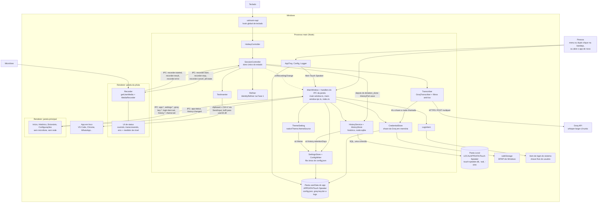

# ARCHITECTURE — Touch Speaker

> Última atualização: 18/out/2026 · Mantenedor: Victor Alves

## Visão geral

Touch Speaker é um app **Electron** que roda na bandeja do Windows. Na Fase 1 não existe servidor próprio: o app chama a API da Groq direto com a chave do próprio usuário ([ADR-01](DECISIONS.md#adr-01--electron--typescript), [ADR-06](DECISIONS.md#adr-06--sem-backend-na-fase-1)). Este documento cobre em detalhe a Fase 1 — implementada em `frontend/` (T1–T8, 17/out/2026) — e o que a M2 já trouxe ao código: o design system Sálvia; a **janela principal**, com a chave da Groq guardada pelo `safeStorage` ([ADR-08](DECISIONS.md#adr-08--chave-da-groq-no-safestorage-do-electron-com-o-env-só-como-reserva-de-desenvolvimento); spec [`janela-principal`](spec/features/janela-principal.md), roteiro VJ1–VJ24 pendente — PEND-007) e o **tema claro/escuro** escolhido nela (FR-UI-39…42, roteiro VJ25–VJ27 pendente — PEND-010); e o **histórico de ditados** num SQLite local pelo `node:sqlite` embutido ([ADR-09](DECISIONS.md#adr-09--sqlite-local-pelo-nodesqlite-embutido-para-o-histórico-de-ditados); specs [`historico`](spec/features/historico.md) e [`historico-dados-v1`](spec/features/historico-dados-v1.md), roteiro VH1–VH13 e ensaio com dado real pendentes — PEND-009). Tudo isso implementado em 18/out/2026 e ainda não commitado. Marca também o que é planejado para as fases seguintes. As âncoras `arquivo.ts:linha` são relativas a `frontend/src/` e foram conferidas em 18/out/2026 sobre esse código não commitado (base `0c0aa5b`).



Como as peças se encaixam:

- **Processos** — o main (Node) concentra tudo o que toca o sistema: teclado, rede, clipboard, Win32, cifra, arquivos e o banco do histórico (`main/`). Há **dois renderers**. A janela da pílula (`renderer/`) é a única que grava, porque `getUserMedia` só existe num renderer e a permissão de microfone é só dela (`main/pill-window.ts:1-3`). A janela principal (`renderer/main-window/`) é criada sob demanda e não tem mídia nem rede. Cada renderer tem o seu preload em sandbox e a sua ponte: `preload/pill.ts` expõe só `window.touchSpeaker` — quatro assinaturas e três envios, os sete canais da pílula (`shared/ipc.ts:12-18`); `preload/main-window.ts` expõe só `window.touchSpeakerApp` — dez funções e o grupo `history` (oito: `list`, `copy`, `delete`, `clear`, `getRetention`, `setRetention`, `stats`, `onChanged`) sobre os canais `app:*`, `settings:*`, `groq-key:*`, `login-item:set`, `history:*` e `theme:set` (`shared/ipc.ts:19-39`). Nenhuma ponte expõe o que é da outra. Contrato em [`API.md`](API.md#contratos).
- **Hook de teclado** — `uiohook-napi` sobe em `main/keyboard.ts:11-19` e cada evento vira `hotkey`, `escape` ou `other` antes de sair do hook (BR-007). O módulo nativo só é carregado dentro de `startKeyboardHook`, em tempo de execução (`main/keyboard.ts:12-13`), para um binário ausente ou quebrado cair no `try` de quem chama. O `HotkeyController` (`main/hotkey.ts`) decide segurar × tocar pelo `holdThresholdMs` (500 ms), filtra a auto-repetição (`repeatGapMs` 1,5 s) e trata outra tecla em até `shortcutWindowMs` (1 s) como atalho (BR-001…003). Se o hook não carregar, o app abre mesmo assim, registra `keyboard_hook_unavailable` (`main/index.ts:264-270`) e o Início da janela principal mostra "A tecla de ditado não está funcionando — reinicie o app" ([ADR-02](DECISIONS.md#adr-02--hook-global-com-uiohook-napi-não-globalshortcut)).
- **Sessão** — o `SessionController` (`main/session.ts`) é o único dono do estado: `idle → recording → transcribing → inserting → idle`; falha e aviso viram mensagem `error`/`notice` na pílula, por 4 s, e a sessão volta a `idle`. Cada sessão tem um `sessionId` (`randomUUID`); o main descarta evento que não é da sessão atual (BR-014). Avisa 30 s antes do `maxRecordingMs` e encerra sozinho no limite (BR-011); se o áudio não chegar 5 s depois do `stop`, falha com `recorder_failed`. Quando um ditado termina com texto, entrega-o à `HistoryPort` (dependência opcional `history`, `main/session.ts:47`) **depois** de registrar o `dictation_done` — ou o `session_exception`, se a inserção quebrou depois de o texto existir (`record`, `main/session.ts:240-249`); a porta nunca lança, e o ditado não espera o banco.
- **Gravação** — no renderer (`renderer/pill.ts`): `getUserMedia` + `MediaRecorder` em `audio/webm;codecs=opus` (ou `audio/webm`, se o primeiro não for suportado), medidor de nível e sons por Web Audio. O microfone só fica aberto entre `recorder:start` e `stop`/`cancel` (BR-015). O áudio volta ao main pela IPC, em memória; nunca vai para disco.
- **Transcrição** — `GroqTranscriber` (`main/transcribe/groq.ts`) atrás da interface `Transcriber`: um único `POST` multipart ao soltar a tecla ([ADR-04](DECISIONS.md#adr-04--groq-whisper-large-v3-turbo-áudio-inteiro-ao-soltar)), timeout de 20 s e uma nova tentativa só em 5xx. A chave é lida a cada chamada por uma função (`getApiKey`, `main/transcribe/groq.ts:9-19`) que o `index.ts` liga ao `CredentialStore` (`main/index.ts:179`): uma chave salva ou removida na janela vale a partir do próximo ditado, sem reiniciar. Antes do upload, gravação com menos de 500 ms é descartada (BR-005); depois, `isNoSpeech` descarta silêncio e alucinações conhecidas (BR-006). Política completa em [`INTEGRATION.md`](INTEGRATION.md#garantias-e-limites).
- **Refino** — `IdentityRefiner` (`main/refine.ts`) devolve o texto sem mudança; é o encaixe da limpeza por IA da Fase 2 ([ADR-05](DECISIONS.md#adr-05--sem-limpeza-por-ia-na-fase-1-mas-com-o-encaixe-pronto)).
- **Inserção** — `TextInserter` (`main/insert/inserter.ts`): espera a tecla física soltar (até 2 s); se o app em foco roda elevado e o Touch Speaker não, deixa o texto no clipboard e a pílula avisa `paste_blocked` (BR-009). Senão faz o backup do clipboard, escreve o texto, manda Ctrl+V por `SendInput` (`main/insert/win32.ts`) e restaura o clipboard 250 ms depois, só se ele ainda contiver o texto ditado (BR-008, BR-010) ([ADR-03](DECISIONS.md#adr-03--inserção-por-clipboard--ctrlv-via-sendinput)).
- **Bandeja** — `AppTray` (`main/tray.ts`) com o ícone desenhado em código (`main/icon-bitmap.ts`, montado em `main/icon.ts`) na variante de cor do modo do Windows (barra de tarefas), lido e acompanhado pelo `nativeTheme.shouldUseDarkColorsForSystemIntegratedUI` (`main/icon.ts`; spec [`design-system`](spec/features/design-system.md)) — que no Windows ignora o `themeSource`, então a bandeja **não** segue o tema escolhido na janela (FR-UI-39) —, e o menu: status, microfone em uso, "Abrir Touch Speaker", "Abrir pasta de configuração" e "Sair" (`main/tray.ts:58-67`; textos em `main/strings.ts`). O duplo clique no ícone também abre a janela principal; o clique simples fica livre (`main/tray.ts:32`). O status e a dica mudam quando a chave é salva ou removida, sem reiniciar (`setGroqKeyState`, `main/tray.ts:43-46`). "Sair" encerra a sessão, o hook de teclado, fecha o banco do histórico e o processo (`main/index.ts:272-281`).
- **Janela principal** — `MainWindow` (`main/main-window.ts`) cria a `BrowserWindow` sob demanda — 960 × 640 px, mínimo 760 × 520, centralizada na tela onde está o mouse, escondida até `ready-to-show` —, mostra, restaura e dá foco a ela, e a **destrói ao fechar**: o app, o hook e uma gravação em andamento seguem (FR-UI-05, NFR-03). Abre pela bandeja (menu ou duplo clique), pela segunda instância e, sozinha, uma única vez: na primeira execução sem chave salva, em Configurações (`main/index.ts:449`). Segue o `nativeTheme.themeSource` — o sistema por padrão, ou o tema escolhido (ver **Tema**, abaixo): o `backgroundColor` acompanha o `nativeTheme.shouldUseDarkColors` e o conteúdo, o `data-theme` e a `prefers-color-scheme` dos tokens (FR-UI-34, FR-UI-39). Só observa a sessão: recebe a gravação por `onRecordingChange` (`main/index.ts:236-240`) e o estado pronto em `app:status`. Os handlers do IPC dela são registrados uma vez, no `index.ts` (`main/index.ts:283-413`).
- **Chave da Groq** — `CredentialStore` (`main/credentials.ts`), montado depois do `ready`, porque o `safeStorage` só funciona a partir daí (`main/index.ts:164-177`). Ordem: `groq-key.bin` decifrado pelo `safeStorage` (DPAPI no Windows); senão, só com o app não empacotado, a `GROQ_API_KEY` do `.env`; senão, nenhuma. Arquivo que não decifra deixa o app sem chave em uso (`unreadable`), sem cair no `.env` ([ADR-08](DECISIONS.md#adr-08--chave-da-groq-no-safestorage-do-electron-com-o-env-só-como-reserva-de-desenvolvimento), BR-016). Salvar ou remover atualiza a bandeja e o Início na hora (`main/index.ts:297-300`). A chave fica só no main: nunca volta ao renderer, ao log nem ao `config.json`.
- **Configuração** — `config.json` em `%APPDATA%\Touch Speaker\` (`userData`, `main/index.ts:52`), criado com os defaults no primeiro uso; campo inválido cai no default com aviso `config_invalid_field` no log, e o app nunca deixa de abrir por causa da config (`main/config.ts`, BR-012). Toda gravação passa pela fila única `ConfigWriter` (`main/config.ts:194-222`), montada uma vez no `index.ts` (`main/index.ts:120`), com gravação atômica e os outros campos preservados. São três gravadores, cada um com os seus campos: o `SettingsStore` (`main/settings.ts`) com os sete campos editáveis, que só valem ao reiniciar ("Reiniciar agora"); o `HistoryService` com `history.retentionDays` (`withRetention`) e o `ThemeSetting` com `theme` (`withTheme`), que valem na hora, depois da gravação ok. Os dois campos novos são aditivos: `version` continua `1`. Campos, faixas e gravação em [`DATABASE.md`](DATABASE.md#configjson).
- **Histórico** — `main/history/` (spec [`historico`](spec/features/historico.md), [ADR-09](DECISIONS.md#adr-09--sqlite-local-pelo-nodesqlite-embutido-para-o-histórico-de-ditados)): o texto de cada ditado que terminou com texto, num SQLite em `%LOCALAPPDATA%\Touch Speaker\touch-speaker.db` — a pasta Local, lida da variável `LOCALAPPDATA` (`paths.ts`), nunca a Roaming. O `index.ts` abre o banco depois do `loadConfig` e antes de montar a sessão (`main/index.ts:185-199`): `openHistory` (`service.ts`) localiza o arquivo, aplica as migrations de `dist/database/local/` (`migrations.ts`), purga com a retenção em uso e registra `history_ready`; qualquer falha vira `history_unavailable` e o histórico fica indisponível, com o ditado igual (FR-HIST-16). O `HistoryService` é a `HistoryPort` da sessão e responde os canais `history:*`; guarda a retenção em uso e a contagem de gravações que falharam, só em memória. O `HistoryStore` (`store.ts`) é o único que fala SQL, com `migrations.ts`: uma conexão, `journal_mode=WAL`, `secure_delete=ON`, `INSERT … ON CONFLICT (id) DO NOTHING` e purga na mesma transação, checkpoint do WAL depois de apagar e `VACUUM` em "Apagar tudo". O driver `node:sqlite` é carregado só dentro de `openSqliteHistory`, para um runtime sem ele não impedir a abertura. A busca normaliza caixa, acento e pontuação (`search.ts`), registrada no SQLite como `ts_normalize`; os rótulos de dia, hora, duração e retenção saem prontos do main (`format.ts`, `Intl` pt-BR no fuso do sistema); "Copiar" escreve o clipboard no main. A cada mudança, o main avisa a janela por `history:changed`. Formato em [`DATABASE.md`](DATABASE.md#touch-speakerdb).
- **Tema** — `ThemeSetting` (`main/theme-setting.ts`; FR-UI-39…42) lê o `theme` do `config.json` (`system` por padrão, `light` ou `dark`) e o aplica como `nativeTheme.themeSource` ao ser montado, no `index.ts`, antes de qualquer janela (`main/index.ts:121-128`; a pílula nasce em `:136`) — então janela principal, moldura nativa e pílula já abrem no tema certo. `theme:set` grava só `theme` pela fila única e só então troca o `themeSource`; gravação que falha deixa o tema em uso e responde `write_failed`. A janela troca o `data-theme` do `<html>` na hora, dentro de uma View Transition, e volta se a gravação falhar. A bandeja continua seguindo a barra de tarefas.
- **Início com o sistema** — `LoginItem` (`main/login-item.ts`) lê e grava o item de login do sistema por `app.getLoginItemSettings`/`setLoginItemSettings`, só com o app empacotado; em `npm run dev` responde `unavailable` sem tocar no sistema (RISK-029).
- **Log** — `logs\main.log` (`main/logger.ts`): uma linha JSON por evento, só com valores primitivos, rotação em 5 MB com três arquivos. Nunca grava texto ditado (que vai só para o banco do histórico), áudio, clipboard, teclas, a chave, valor de campo das preferências, o termo de busca nem a mensagem do console da janela principal ([`DATABASE.md`](DATABASE.md#log)).
- **Permissões** — o Electron só concede `media`, só áudio e só à janela da pílula (`main/index.ts:145-152`). A janela principal não herda o microfone: o handler compara o `webContents` com o da pílula, e um `getUserMedia` dela é negado.
- **IPC validado** — todo renderer é tratado como não confiável. Na pílula, o main confere o remetente (só a pílula), os tipos, `durationMs` finito ≥ 0, `mimeType` `audio/*`, áudio ≤ 25 MB e o código de erro numa lista fechada; `recorder:result` recusado gera `ipc_rejected` no log (`main/index.ts:76-107`, `:249-262`). Na janela principal, cada mensagem só passa se o remetente for o `webContents` da janela aberta agora, do quadro principal, com URL `file:` do `index.html` do app, e se o payload tiver exatamente a forma do contrato (`main/main-window-ipc.ts`, que inclui `asThemeInput`; `main/history/ipc.ts` para os `history:*` — termo de busca de até 200 caracteres, cursor opaco, `id` UUID v4, `{ confirmed: true }` exato no "Apagar tudo", retenção de 0 a 3650 ou `null`; `main/main-window.ts:52-57`); senão, `ipc_rejected` com o canal e o `invoke` rejeita, sem tocar no banco, no clipboard nem no `config.json` (`main/index.ts:284-296`).
- **Endurecimento** — toda janela nega `window.open` e navegação (`main/index.ts:130-134`). A pílula roda com `contextIsolation`, `sandbox`, `nodeIntegration: false` e `webSecurity` (`main/pill-window.ts:38-48`) e com CSP própria (`renderer/pill.html`). A janela principal, com as mesmas quatro, mais `spellcheck: false` e DevTools só com o app não empacotado (`main/main-window.ts:90-98`), e CSP própria sem rede nem `'unsafe-inline'` (`renderer/main-window/index.html:5-8`). Checklist em [`Security-Guide.md`](Security-Guide.md#9-cabeçalhos-transporte-e-endurecimento-do-electron).
- **Memória** — `app.disableHardwareAcceleration()` (`main/index.ts:55`): a pílula não precisa de GPU, e isso economiza memória (NFR-03). A janela principal só existe enquanto está aberta.
- **Instância única** — `app.requestSingleInstanceLock()` (`main/index.ts:67-74`): uma segunda cópia sai na hora, e a primeira registra `second_instance_focus` e mostra a janela principal (`main/index.ts:424-427`).

O fluxo principal, de ponta a ponta: a pessoa está num campo de texto em qualquer app; segura o Ctrl direito, a pílula aparece "Ouvindo…" sem tirar o foco do app e o microfone abre; ela fala e solta a tecla; a pílula passa a "Transcrevendo…", o áudio inteiro vai à Groq, os filtros descartam o que não é fala, e o texto é colado no cursor do app em foco; a pílula some e o clipboard volta ao que era; logo depois, o texto entra no histórico local. Um toque curto troca o segurar pelo modo mãos livres, e o `Esc` cancela. Fora do ditado, a pessoa abre a janela principal pela bandeja para ver como ditar, o estado do app, o seu uso e os ditados recentes; para recuperar ou apagar um ditado no Histórico; e para configurar a chave da Groq, as preferências, quanto tempo guardar o histórico, o tema e o início com o Windows. Os requisitos estão em [`PRD.md`](PRD.md); as regras (BR-001 a BR-019), os fluxos (FLOW-001 a FLOW-009) e o detalhamento por módulo, no SDD ([`spec/spec-driven-development.md`](spec/spec-driven-development.md)).

### Diagrama de componentes

| Componente | Processo | Arquivo | Responsabilidade |
| --- | --- | --- | --- |
| `HotkeyController` | main | `main/hotkey.ts` | Recebe eventos do `uiohook-napi`, filtra auto-repetição, decide segurar vs. toque (limite 500 ms) e emite `start` / `stop` / `cancel` |
| Ponte do teclado | main | `main/keyboard.ts` | Liga o `uiohook-napi` ao `HotkeyController`, reduzindo cada tecla a `hotkey`, `escape` ou `other` |
| `SessionController` | main | `main/session.ts` | Máquina de estados da sessão de ditado (`idle → recording → transcribing → inserting → idle`; erro e aviso como mensagem na pílula). Um único dono do estado. Depois do `dictation_done` (ou do `session_exception` com texto), entrega a entrada à `HistoryPort` opcional (TEST-014) |
| `Recorder` | renderer (pílula) | `renderer/pill.ts` | Abre o microfone no `start`, grava `audio/webm;codecs=opus`, mede nível, fecha o microfone no `stop` e devolve o áudio por IPC |
| `Transcriber` | main | `main/transcribe/` | Interface com um adapter por provedor. Fase 1: `GroqTranscriber`, que lê a chave a cada chamada (`getApiKey`). Aplica os filtros anti-lixo (FR-DICT-08) |
| `Refiner` | main | `main/refine.ts` | Interface com implementação "identidade" na Fase 1 (`refine(text) => text`). Ponto de entrada da limpeza por IA na Fase 2 |
| `TextInserter` | main | `main/insert/` | Backup do clipboard → escreve texto → Ctrl+V via `SendInput` → restaura clipboard. Detecta falha e aciona o fallback (FR-DICT-10) |
| `PillWindow` | main | `main/pill-window.ts` | Cria a janela da pílula (420 × 72 px, nunca focável, ignora o mouse), posiciona na tela do cursor e repassa o `pill:state` |
| `MainWindow` | main | `main/main-window.ts` | Cria a janela principal sob demanda (960 × 640, mínimo 760 × 520), mostra/restaura/foca, destrói ao fechar, segue o `nativeTheme.themeSource` (o sistema por padrão), encaminha o console ao log **sem** a mensagem, confere o remetente do IPC (`isSender`) e repassa `app:status` e `history:changed` (`send`) |
| Validadores do IPC da janela | main | `main/main-window-ipc.ts` | `asGroqKeyInput`, `asSettingsInput`, `asLoginItemInput`, `asThemeInput`, `isEmptyPayload`, `isPlainRecord` e a checagem de remetente `isMainWindowSender` / `isPageUrl`; lógica pura, sem `electron` (TEST-009, TEST-018) |
| `CredentialStore` | main | `main/credentials.ts` | Carrega, salva, remove e guarda em memória a chave da Groq; estado `stored` / `env` / `none` / `unreadable`; arquivo `groq-key.bin` cifrado, gravado de forma atômica. Cifra e disco entram por porta (`CipherPort`, `FilePort`), sem `electron` (TEST-007) |
| `SettingsStore` | main | `main/settings.ts` | Lê o `config.json` do disco para Configurações sem aviso, valida a entrada com as regras do `normalizeConfig`, mescla só os sete campos editáveis, calcula o reinício pendente e decide a abertura da primeira execução (`shouldOpenOnFirstRun`); sem `electron` (TEST-008) |
| `ConfigWriter` | main | `main/config.ts` | Fila única de gravação do `config.json`: cada gravação relê o arquivo, troca só os seus campos e grava de forma atômica, uma de cada vez; JSON inválido nunca é sobrescrito. Três gravadores: as preferências (`mergeSettings`), a retenção (`withRetention`, só `history.retentionDays`) e o tema (`withTheme`, só `theme`) |
| `HistoryService` · `openHistory` | main | `main/history/service.ts` | `openHistory` abre o banco, aplica as migrations, purga com a retenção em uso e registra `history_ready` ou `history_unavailable`. O `HistoryService` é a `HistoryPort` da sessão (`save` nunca lança) e responde os `history:*`: lista com rótulos prontos, copiar (o main escreve o clipboard), apagar, apagar tudo, ler e gravar a retenção (pela fila do `config.json`, com purga na hora) e o resumo do Início. Retenção em uso e `unsavedCount` em memória. Clipboard, aviso à janela e fila entram por injeção, sem `electron` (TEST-017) |
| `HistoryStore` | main | `main/history/store.ts` | A implementação SQLite (`openSqliteHistory`): uma conexão, WAL, `secure_delete`, gravação com purga na mesma transação, lista paginada por cursor, busca com `ts_normalize`, apagar com checkpoint, "Apagar tudo" com `VACUUM`. Carrega o `node:sqlite` só ao abrir. Com `migrations.ts`, o único que toca o driver (TEST-015, SQLite real em pasta temporária) |
| Migrations | main | `main/history/migrations.ts` | `readMigrations` lê `dist/database/local/NNNN_*.sql`; `applyMigrations` cria `schema_migrations`, aplica as pendentes, cada uma numa transação, e recusa banco mais novo (`schema_too_new`) |
| Local do banco | main | `main/history/paths.ts` | `historyLocation`: `LOCALAPPDATA` + `Touch Speaker\touch-speaker.db` no Windows, nunca a Roaming; plataforma, ambiente e `appData` injetados (TEST-016) |
| Retenção, rótulos, busca e validadores do histórico | main | `main/history/retention.ts`, `format.ts`, `search.ts`, `ipc.ts` | Corte da retenção (`0`, 1–3650 dias, `null`); rótulos de dia, hora, duração, resultado e retenção em pt-BR no fuso do sistema; normalização de caixa, acento e pontuação; validadores dos payloads `history:*` e o cursor opaco. Lógica pura (TEST-010 a TEST-013) |
| `ThemeSetting` | main | `main/theme-setting.ts` | Tema em uso (`system`, `light`, `dark`): aplica o `nativeTheme.themeSource` ao ser montado, antes de qualquer janela, e em `theme:set`, só depois de gravar `theme` pela fila; falha → `write_failed` com o tema que continua. O `apply` e a fila entram por injeção, sem `electron` (TEST-018) |
| `LoginItem` | main | `main/login-item.ts` | "Iniciar com o Windows": lê e grava o item de login do sistema; `unavailable` com o app não empacotado. O `app` entra por porta (`LoginItemApp`), sem `electron` (TEST-009) |
| Gravação atômica | main | `main/atomic-file.ts` | `writeFileAtomic` (temporário `.tmp` na mesma pasta + renomear), a porta `FilePort` e `errorName` (só o código errno ou o nome do erro, nunca a mensagem) |
| Preload da janela | preload | `preload/main-window.ts` | `contextBridge` com `window.touchSpeakerApp` (dez funções e o grupo `history`, com oito); cópia própria dos nomes de canal; nada da pílula |
| Janela principal (UI) | renderer (janela principal) | `renderer/main-window/` | Barra lateral, com o botão de tema ao lado de Configurações; Início (como ditar, "Seu uso" e "Ditados recentes"); Histórico (busca, grupos por dia, Copiar, Apagar, "Apagar tudo", "Carregar mais"); Dicionário ("em breve"); Configurações (chave, preferências, "Guardar histórico", "Aparência", início com o sistema). Sem texto próprio: tudo chega por `app:get-strings` (ou pronto numa resposta) e entra por `textContent` — o texto ditado inclusive. Nada guardado no navegador |
| `Tray` | main | `main/tray.ts`, `main/icon.ts` | Ícone, menu ("Abrir Touch Speaker", pasta de configuração, sair), duplo clique que abre a janela, status da chave atualizado sem reiniciar |
| `Config` | main | `main/config.ts` | Lê/valida `config.json` em `%APPDATA%\Touch Speaker\` com defaults; diz se o criou nesta abertura (sinal de primeira execução) |
| `Logger` | main | `main/logger.ts` | Log local em arquivo, **sem** texto ditado nem áudio (só tempos, tamanhos e códigos de erro) |

### Fluxo de um ditado

Caminho feliz do segurar para falar (FLOW-001). Os demais fluxos — mãos livres, cancelamento, erro, fallback de colagem, limite de 5 min e descarte silencioso — estão no SDD (§11 e §15).

```text
Usuário        uiohook     Hotkey      Session      Pílula/Recorder     Groq        Inserter
  │ segura RCtrl │           │            │                 │             │             │
  │────────────►│ keydown   │            │                 │             │             │
  │             │──────────►│ 1º down    │                 │             │             │
  │             │           │──start────►│ recording       │             │             │
  │             │           │            │──show + start──►│ getUserMedia│             │
  │  fala…      │           │            │                 │ grava webm  │             │
  │ solta RCtrl │ keyup     │            │                 │             │             │
  │────────────►│──────────►│ ≥500ms     │                 │             │             │
  │             │           │──stop─────►│ transcribing    │             │             │
  │             │           │            │──stop──────────►│ fecha mic   │             │
  │             │           │            │◄──áudio (IPC)───│             │             │
  │             │           │            │──POST multipart──────────────►│             │
  │             │           │            │◄──texto + segments────────────│             │
  │             │           │            │ filtros anti-lixo             │             │
  │             │           │            │──insert(texto)───────────────────────────►│
  │             │           │            │                 │             │ backup clip │
  │             │           │            │                 │             │ writeText   │
  │             │           │            │                 │             │ SendInput   │
  │             │           │            │                 │             │ Ctrl+V      │
  │             │           │            │◄──ok / falha──────────────────────────────│
  │             │           │            │ idle            │ esconde     │ restaura    │
```

Depois da inserção, a gravação no histórico (FLOW-008; spec [`historico`](spec/features/historico.md) §8, §11). Ela vem sempre **depois** da linha do log que fecha o ditado, e nenhuma falha dela muda o ditado:

```text
TextInserter → inserted | copied            (exceção depois de o texto existir → failed)
  → log dictation_done, total_ms fechado    (ou session_exception)
  → HistoryPort.save(id = sessionId, createdAt, text, audioMs, status)
      retenção 0 ("Nunca guardar") ou banco indisponível → nada a gravar
      → HistoryStore.save: BEGIN IMMEDIATE · INSERT … ON CONFLICT (id) DO NOTHING · purga da retenção · COMMIT
      → log history_saved (write_ms) [+ history_purged (count)]
      → history:changed { reason: 'saved' } → janela principal, se aberta, recarrega Histórico e Início
      falha → log history_write_failed + 1 no unsavedCount (só em memória)
```

E na abertura (FLOW-009; spec [`historico-dados-v1`](spec/features/historico-dados-v1.md) §6.8): `loadConfig` (lê `history.retentionDays` e `theme`) → `ThemeSetting` aplica o `themeSource` → pílula → chave → `openHistory` (local por `historyLocation`, migrations, purga, `history_ready` ou `history_unavailable`) → `SessionController` com a `HistoryPort`. A sessão não espera nada além disso; com o banco indisponível, ela abre igual.

### Fronteiras e direção de dependência

- **Lógica pura, sem `electron`:** `main/hotkey.ts`, `main/transcribe/filters.ts`, `main/config.ts`, `main/transcribe/groq.ts` (com `fetch` injetável), `main/icon-bitmap.ts`, `main/credentials.ts`, `main/settings.ts`, `main/main-window-ipc.ts`, `main/atomic-file.ts`, `main/login-item.ts`, `main/theme-setting.ts`, `shared/theme.ts` e todo o `main/history/` — `paths.ts`, `retention.ts`, `format.ts`, `search.ts`, `ipc.ts` e `service.ts` sem driver; `store.ts` e `migrations.ts` só com o `node:sqlite`, que é do Node, não do Electron. Cifra, disco, `app`, clipboard, relógio, fuso e o `nativeTheme` entram por porta ou injeção (`CipherPort`, `FilePort`, `LoginItemApp`, `HistoryServiceDeps`, `ThemeSettingDeps`). Por isso os testes rodam em `node:test` sem abrir o Electron (TEST-001 a TEST-019; o banco com SQLite real em pasta temporária ou `:memory:`). No main, só `main-window.ts`, `tray.ts`, `icon.ts`, `pill-window.ts`, `insert/inserter.ts` e `index.ts` importam o `electron`.
- **`main/index.ts` monta tudo:** cria os componentes e os liga por portas. O `HotkeyController` só conhece a interface `HotkeyHost`; o `SessionController` fala com a pílula, o inserter, o transcriber, o refiner e o histórico por `PillPort`, `InserterPort`, `Transcriber`, `Refiner` e `HistoryPort` (`main/session.ts:24-48`). O `ConfigWriter`, o `ThemeSetting`, o `CredentialStore`, a `MainWindow`, o `SettingsStore`, o `LoginItem` e o `HistoryService` são montados no mesmo lugar (`main/index.ts:120-199`).
- **Um dono de estado:** só o `SessionController` muda o estado da sessão; os outros componentes recebem ordens ou devolvem resultado. A janela principal não comanda a sessão: o `AppStatus` que ela recebe é montado no main a partir do `CredentialStore`, do resultado do hook, do `onRecordingChange` e do tema em uso (`main/index.ts:206-220`), e os canais dela não levam `sessionId` — o remetente é conferido pela identidade do `webContents`. O histórico não é estado da sessão: a sessão só entrega a entrada pronta, e o `HistoryService` cuida do resto.
- **Provedores atrás de interface:** transcrição (`Transcriber`) e limpeza (`Refiner`) trocam de implementação sem mexer no fluxo (C5). O banco fica atrás de `HistoryStore`: trocar o driver é reescrever `store.ts` e `migrations.ts` (ADR-09).
- **Renderers sem textos próprios:** na pílula, os textos chegam prontos no `pill:state` (`message`, `hint`); na janela principal, por `app:get-strings` (as linhas com valores, prontas em `AppStatus.howTo`; os rótulos do histórico — dia, hora, duração, retenção, totais —, prontos nas respostas `history:*`). Tudo vem de `main/strings.ts`.
- **Preloads mínimos:** nenhum expõe `ipcRenderer` genérico. Como o preload em sandbox não pode importar módulos locais, cada um repete os nomes dos seus canais de `shared/ipc.ts`, e o `.d.ts` do renderer espelha os tipos. São **dois conjuntos de três arquivos** que mudam juntos: `shared/ipc.ts` + `preload/pill.ts` + `renderer/global.d.ts` (pílula) e `shared/ipc.ts` + `preload/main-window.ts` + `renderer/main-window/global.d.ts` (janela principal). O TEST-009 confere que o preload da janela usa exatamente os canais da janela de `shared/ipc.ts` e que o da pílula não expõe nada da janela; o resto fica com a revisão (RISK-027).

### Decisões-chave (ADRs)

Texto completo, com contexto, consequências e implementação, em [`DECISIONS.md`](DECISIONS.md). Mudar uma decisão = ADR nova que substitui a anterior.

| ADR | Decisão em uma linha | Registro |
| --- | --- | --- |
| ADR-01 | Electron 44 + TypeScript estrito, `tsc` para CommonJS, sem bundler na Fase 1 | [DECISIONS.md](DECISIONS.md#adr-01--electron--typescript) |
| ADR-02 | Hook global com `uiohook-napi` (keydown e keyup), não `globalShortcut` | [DECISIONS.md](DECISIONS.md#adr-02--hook-global-com-uiohook-napi-não-globalshortcut) |
| ADR-03 | Inserção por clipboard + Ctrl+V via `SendInput`, com restauração do clipboard | [DECISIONS.md](DECISIONS.md#adr-03--inserção-por-clipboard--ctrlv-via-sendinput) |
| ADR-04 | Groq Whisper `whisper-large-v3-turbo`, áudio inteiro num `POST` ao soltar a tecla | [DECISIONS.md](DECISIONS.md#adr-04--groq-whisper-large-v3-turbo-áudio-inteiro-ao-soltar) |
| ADR-05 | Sem limpeza por IA na Fase 1; `Refiner` identidade como encaixe | [DECISIONS.md](DECISIONS.md#adr-05--sem-limpeza-por-ia-na-fase-1-mas-com-o-encaixe-pronto) |
| ADR-06 | Sem backend na Fase 1; chave em `frontend/.env`; não distribuir o app (a chave no app passou à ADR-08) | [DECISIONS.md](DECISIONS.md#adr-06--sem-backend-na-fase-1) |
| ADR-07 | Sala limpa: do estudo do Typeless saem ideias, nunca código nem assets | [DECISIONS.md](DECISIONS.md#adr-07--sala-limpa-em-relação-ao-typeless) |
| ADR-08 | Chave da Groq no `safeStorage` do Electron (`groq-key.bin`), com o `.env` só como reserva de desenvolvimento | [DECISIONS.md](DECISIONS.md#adr-08--chave-da-groq-no-safestorage-do-electron-com-o-env-só-como-reserva-de-desenvolvimento) |
| ADR-09 | Histórico num SQLite local (`%LOCALAPPDATA%`) pelo `node:sqlite` embutido no Electron, sem dependência nova; migrations em `database/local/` | [DECISIONS.md](DECISIONS.md#adr-09--sqlite-local-pelo-nodesqlite-embutido-para-o-histórico-de-ditados) |
| ADR-12 | Fonte Inter embutida no app | [DECISIONS.md](DECISIONS.md#adr-12--fonte-inter-embutida-no-app) |

### Evolução por fase

| Fase | Mudança na arquitetura |
| --- | --- |
| 2 | `Refiner` com Claude Haiku; dicionário pessoal (`dictionary_terms`) no mesmo SQLite. **Já no código (M2, 18/out/2026, não commitado):** janela principal com Configurações e chave em `safeStorage` (DPAPI), com o `.env` só em desenvolvimento — roteiro VJ1–VJ24 pendente (PEND-007); histórico em `database/local` — SQLite pelo `node:sqlite` embutido no Electron, não `better-sqlite3` (ADR-09), em `%LOCALAPPDATA%\Touch Speaker\touch-speaker.db` — roteiro VH1–VH13 e ensaio pendentes (PEND-009); tema claro/escuro com `nativeTheme.themeSource` — roteiro VJ25–VJ27 pendente (PEND-010) |
| 3 | Helper nativo de contexto (UI Automation) para app/campo em foco e texto ao redor do cursor; comandos por voz |
| 4 | `backend/` com contas e proxy das chaves; streaming de áudio por WebSocket; instalador assinado e auto-update |

## Estrutura

```text
.
├── frontend/              o app desktop inteiro (Electron: main, preload, renderer), o "cliente" do produto — Fase 1
├── backend/               só README.md: API própria (contas, proxy das chaves de IA, cotas, sync) — vazia até a Fase 4
├── database/              README.md e local/ (migrations do SQLite do histórico: 0001_init.sql, ADR-09);
│                          server/ (Fase 4) ainda não criada
├── docs/                  PRD, ARCHITECTURE, API, INTEGRATION, DATABASE, DESIGN, DECISIONS, ENVIRONMENT,
│                          CHANGELOG, Code-Style, Security-Guide; spec/, templates/, referencia/ (estudo
│                          do Typeless, não normativo), assets/ (logo)
├── README.md
├── PROJECT_CONTEXT.md
├── CLAUDE.md
├── AGENTS.md
├── SECURITY.md
├── LICENSE.md
└── .gitignore             node_modules/, dist/, .env; e targets/, analysis/, rea/ como trava da sala limpa
```

Estrutura de `frontend/` (implementada em 17/out/2026; design system Sálvia, janela principal, tema e histórico em 18/out/2026):

```text
frontend/
  package.json              Electron 44.9, TypeScript 7.0, koffi 3.3, uiohook-napi 1.5 (versões exatas); o SQLite
                            é o node:sqlite do Electron, sem pacote
  tsconfig.main.json        main + preloads + shared + testes → CommonJS, strict
  tsconfig.renderer.json    renderer da pílula → script clássico (sem módulos), lib DOM; exclui main-window/
  tsconfig.main-window.json renderer da janela principal → script clássico, programa do tsc próprio
  .env / .env.example       GROQ_API_KEY, reserva de desenvolvimento (.env fora do git; ignorado no app empacotado)
  scripts/
    copy-static.mjs         copia HTML/CSS/TXT (topo e main-window/) e a pasta fonts/ do renderer para dist/, e
                            ../database/local/*.sql para dist/database/local/
    start.mjs               abre o Electron sem ELECTRON_RUN_AS_NODE (ver abaixo)
  src/
    shared/ipc.ts           canais e payloads do IPC da pílula e da janela principal (docs/API.md, "Contratos")
    shared/theme.ts         ThemePreference (system/light/dark) e a resolução do tema (lógica pura)
    shared/palette.ts       cores da Sálvia que o main desenha (ícone da bandeja, fundo da janela), espelho de tokens.css
    shared/contrast.ts      razão de contraste do WCAG 2.x (lógica pura, usada pelos testes)
    main/
      index.ts              bootstrap, ciclo de vida, permissões de mídia, handlers e validação do IPC
      config.ts             config.json com defaults e validação; ConfigWriter (fila única de gravação),
                            withRetention e withTheme
      theme-setting.ts      ThemeSetting: tema em uso e nativeTheme.themeSource
      history/              paths.ts (pasta Local) · retention.ts · format.ts (rótulos pt-BR) · search.ts ·
                            ipc.ts (validadores e cursor) · migrations.ts · store.ts (HistoryStore, node:sqlite) ·
                            service.ts (HistoryService = HistoryPort, e openHistory)
      credentials.ts        CredentialStore: chave da Groq (groq-key.bin pelo safeStorage, .env em dev)
      settings.ts           SettingsStore: as preferências de Configurações
      atomic-file.ts        gravação atômica (.tmp + renomear) e a porta FilePort
      login-item.ts         LoginItem: "Iniciar com o Windows"
      main-window.ts        MainWindow: a janela principal
      main-window-ipc.ts    validadores do IPC da janela e checagem de remetente
      logger.ts             log rotativo só com metadados
      strings.ts            todos os textos da interface (pt-BR), da pílula, da bandeja e da janela
      errors.ts             códigos de erro
      keys.ts               códigos de tecla do libuiohook
      hotkey.ts             HotkeyController (lógica pura, testada)
      keyboard.ts           ponte uiohook-napi → HotkeyController (carrega o módulo nativo ao iniciar o hook)
      session.ts            SessionController (dono único do estado; entrega o ditado à HistoryPort)
      pill-window.ts        janela da pílula
      tray.ts · icon.ts     bandeja (segue o modo do Windows pelo nativeTheme) e ícones da bandeja e da janela
      icon-bitmap.ts        pixels do ícone desenhados em código, sem electron (testado)
      refine.ts             Refiner (identidade na Fase 1)
      transcribe/           transcriber.ts (interface) · groq.ts · filters.ts (anti-lixo)
      insert/               inserter.ts (clipboard + Ctrl+V + restauração) · win32.ts (koffi)
    preload/pill.ts         contextBridge com a API mínima da pílula (window.touchSpeaker)
    preload/main-window.ts  contextBridge com a API da janela principal (window.touchSpeakerApp)
    renderer/               pill.html · tokens.css (design system Sálvia) · pill.css · pill.ts (gravação, medidor,
                            sons) · global.d.ts · fonts/ (Inter + OFL.txt, ADR-12)
    renderer/main-window/   index.html · main-window.css · main-window.ts · global.d.ts · LICENSE-lucide.txt
                            (janela principal)
    test/                   hotkey · filters · groq · config · tokens · icon · credentials · settings ·
                            main-window-ipc · history-retention · history-format · history-search · history-ipc ·
                            session-history · history-store · history-paths · history-service · theme ·
                            controls (node:test; history-fakes.ts é apoio)
```

Estrutura de `database/` (18/out/2026):

```text
database/
  README.md                 o que cada pasta guarda e quem aplica as migrations
  local/
    0001_init.sql           dictations + idx_dictations_created_at (o aplicador cria schema_migrations antes)
```

**Notas de implementação:**

- O host de extensões do VS Code exporta `ELECTRON_RUN_AS_NODE=1`, que faz o `electron.exe` rodar como Node puro e sair na hora. `npm run dev` / `npm start` passam por `scripts/start.mjs`, que remove essa variável.
- `app.disableHardwareAcceleration()`: a pílula não precisa de GPU; economiza memória (NFR-03).
- Clipboard do Electron 44 é assíncrono e baseado em `ClipboardItem` (modelo W3C): o backup lê todos os tipos de cada item e a restauração grava de volta numa chamada atômica.
- `koffi` 3 traz o binário pelo pacote opcional `@koromix/koffi-win32-x64` e `uiohook-napi` traz `prebuilds/win32-x64`. Os scripts de instalação dos dois ficam negados (`allowScripts: false`).

A milestone aberta é a M2 — doc-pai em [`milestones/M2-app-com-interface.md`](milestones/M2-app-com-interface.md); a M1 (Fase 1) só ganha doc quando a T9 e a T10 fecharem. As fases estão no SDD §29.

## Integração

Na Fase 1 a única integração externa é a **Groq Cloud**, para a transcrição (`whisper-large-v3-turbo`): o processo main faz um `POST` multipart por ditado, com a chave do próprio usuário — hoje vinda do `CredentialStore` (`groq-key.bin` ou, em desenvolvimento, `.env`). A integração — papéis, fluxos, garantias, limites e riscos — está em [`INTEGRATION.md`](INTEGRATION.md), e o contrato campo a campo em [`API.md`](API.md#transcrição-groq). O IPC main ⇄ pílula e o IPC main ⇄ janela principal são contratos internos do app, também em [`API.md`](API.md#contratos).

| Serviço | Uso | Fase | Contrato |
| --- | --- | --- | --- |
| **Groq Cloud** | Transcrição (`whisper-large-v3-turbo`) | 1 | [`API.md`](API.md#transcrição-groq) · [`INTEGRATION.md`](INTEGRATION.md) |
| **Anthropic** | Limpeza do texto (Claude Haiku) | 2 | A definir na spec da Fase 2 ([`INTEGRATION.md`](INTEGRATION.md#integrações-planejadas)) |
| **Backend próprio** | Contas, proxy das chaves, cotas, streaming | 4 | Rascunho em [`API.md`](API.md#api-própria-fase-4--rascunho) |

---

API: [`API.md`](API.md) · Dados: [`DATABASE.md`](DATABASE.md) · Integração: [`INTEGRATION.md`](INTEGRATION.md) · Decisões: [`DECISIONS.md`](DECISIONS.md) · Contexto: [`PROJECT_CONTEXT.md`](../PROJECT_CONTEXT.md) · Visão geral do repositório: [`README.md`](../README.md)
