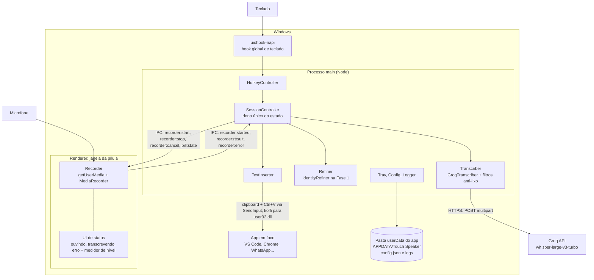

# ARCHITECTURE — Touch Speaker

> Última atualização: 17/out/2026 · Mantenedor: Victor Alves

## Visão geral

Touch Speaker é um app **Electron** que roda na bandeja do Windows. Na Fase 1 não existe servidor próprio: o app chama a API da Groq direto com a chave do próprio usuário ([ADR-01](DECISIONS.md#adr-01--electron--typescript), [ADR-06](DECISIONS.md#adr-06--sem-backend-na-fase-1)). Este documento cobre a Fase 1 em detalhe — implementada em `frontend/` (T1–T8, 17/out/2026) — e marca o que é planejado para as fases seguintes. As âncoras `arquivo.ts:linha` são relativas a `frontend/src/` e foram conferidas em `ed0a1f5`.



Como as peças se encaixam:

- **Processos** — o main (Node) concentra tudo o que toca o sistema: teclado, rede, clipboard, Win32 e arquivos (`main/`). O único renderer é a janela da pílula (`renderer/`), e é ele que grava, porque `getUserMedia` só existe num renderer (`main/pill-window.ts:1-2`). Entre os dois fica um preload em sandbox (`preload/pill.ts`), que expõe só `window.touchSpeaker`: quatro assinaturas e três envios, os sete canais de `shared/ipc.ts:5-13`. Contrato em [`API.md`](API.md#contratos).
- **Hook de teclado** — `uiohook-napi` sobe em `main/keyboard.ts:7-13` e cada evento vira `hotkey`, `escape` ou `other` antes de sair do hook (BR-007). O `HotkeyController` (`main/hotkey.ts`) decide segurar × tocar pelo `holdThresholdMs` (500 ms), filtra a auto-repetição (`repeatGapMs` 1,5 s) e trata outra tecla em até `shortcutWindowMs` (1 s) como atalho (BR-001…003). Se o hook não carregar, o app abre mesmo assim e registra `keyboard_hook_unavailable` (`main/index.ts:165-170`) ([ADR-02](DECISIONS.md#adr-02--hook-global-com-uiohook-napi-não-globalshortcut)).
- **Sessão** — o `SessionController` (`main/session.ts`) é o único dono do estado: `idle → recording → transcribing → inserting → idle`; falha e aviso viram mensagem `error`/`notice` na pílula, por 4 s, e a sessão volta a `idle`. Cada sessão tem um `sessionId` (`randomUUID`); o main descarta evento que não é da sessão atual (BR-014). Avisa 30 s antes do `maxRecordingMs` e encerra sozinho no limite (BR-011); se o áudio não chegar 5 s depois do `stop`, falha com `recorder_failed`.
- **Gravação** — no renderer (`renderer/pill.ts`): `getUserMedia` + `MediaRecorder` em `audio/webm;codecs=opus` (ou `audio/webm`, se o primeiro não for suportado), medidor de nível e sons por Web Audio. O microfone só fica aberto entre `recorder:start` e `stop`/`cancel` (BR-015). O áudio volta ao main pela IPC, em memória; nunca vai para disco.
- **Transcrição** — `GroqTranscriber` (`main/transcribe/groq.ts`) atrás da interface `Transcriber`: um único `POST` multipart ao soltar a tecla ([ADR-04](DECISIONS.md#adr-04--groq-whisper-large-v3-turbo-áudio-inteiro-ao-soltar)), timeout de 20 s e uma nova tentativa só em 5xx. Antes do upload, gravação com menos de 500 ms é descartada (BR-005); depois, `isNoSpeech` descarta silêncio e alucinações conhecidas (BR-006). Política completa em [`INTEGRATION.md`](INTEGRATION.md#garantias-e-limites).
- **Refino** — `IdentityRefiner` (`main/refine.ts`) devolve o texto sem mudança; é o encaixe da limpeza por IA da Fase 2 ([ADR-05](DECISIONS.md#adr-05--sem-limpeza-por-ia-na-fase-1-mas-com-o-encaixe-pronto)).
- **Inserção** — `TextInserter` (`main/insert/inserter.ts`): espera a tecla física soltar (até 2 s); se o app em foco roda elevado e o Touch Speaker não, deixa o texto no clipboard e a pílula avisa `paste_blocked` (BR-009). Senão faz o backup do clipboard, escreve o texto, manda Ctrl+V por `SendInput` (`main/insert/win32.ts`) e restaura o clipboard 250 ms depois, só se ele ainda contiver o texto ditado (BR-008, BR-010) ([ADR-03](DECISIONS.md#adr-03--inserção-por-clipboard--ctrlv-via-sendinput)).
- **Bandeja** — `AppTray` (`main/tray.ts`) com o ícone desenhado em código (`main/icon.ts`) e o menu: status, microfone em uso, "Abrir pasta de configuração" e "Sair" (textos em `main/strings.ts`). "Sair" encerra a sessão, o hook de teclado e o processo (`main/index.ts:172-180`).
- **Configuração** — `config.json` em `%APPDATA%\Touch Speaker\` (`userData`, `main/index.ts:28`), criado com os defaults no primeiro uso; campo inválido cai no default com aviso `config_invalid_field` no log, e o app nunca deixa de abrir por causa da config (`main/config.ts`, BR-012). Campos e faixas em [`DATABASE.md`](DATABASE.md#configjson).
- **Log** — `logs\main.log` (`main/logger.ts`): uma linha JSON por evento, só com valores primitivos, rotação em 5 MB com três arquivos. Nunca grava texto ditado, áudio, clipboard, teclas nem a chave ([`DATABASE.md`](DATABASE.md#log)).
- **Permissões** — o Electron só concede `media`, só áudio e só à janela da pílula (`main/index.ts:106-113`).
- **IPC validado** — o renderer é tratado como não confiável: o main confere o remetente (só a pílula), os tipos, `durationMs` finito ≥ 0, `mimeType` `audio/*`, áudio ≤ 25 MB e o código de erro numa lista fechada; `recorder:result` recusado gera `ipc_rejected` no log (`main/index.ts:49-80`, `:150-163`).
- **Endurecimento** — toda janela nega `window.open` e navegação (`main/index.ts:92-95`); a pílula roda com `contextIsolation`, `sandbox`, `nodeIntegration: false` e `webSecurity` (`main/pill-window.ts:37-47`) e com CSP própria (`renderer/pill.html`). Checklist em [`Security-Guide.md`](Security-Guide.md#9-cabeçalhos-transporte-e-endurecimento-do-electron).
- **Memória** — `app.disableHardwareAcceleration()` (`main/index.ts:31`): a pílula não precisa de GPU, e isso economiza memória (NFR-03).
- **Instância única** — `app.requestSingleInstanceLock()` (`main/index.ts:40-47`): uma segunda cópia sai na hora, e a primeira registra `second_instance_ignored`.

O fluxo principal, de ponta a ponta: a pessoa está num campo de texto em qualquer app; segura o Ctrl direito, a pílula aparece "Ouvindo…" sem tirar o foco do app e o microfone abre; ela fala e solta a tecla; a pílula passa a "Transcrevendo…", o áudio inteiro vai à Groq, os filtros descartam o que não é fala, e o texto é colado no cursor do app em foco; a pílula some e o clipboard volta ao que era. Um toque curto troca o segurar pelo modo mãos livres, e o `Esc` cancela. Os requisitos estão em [`PRD.md`](PRD.md); as regras (BR-001 a BR-015), os fluxos (FLOW-001 a FLOW-007) e o detalhamento por módulo, no SDD ([`spec/spec-driven-development.md`](spec/spec-driven-development.md)).

### Diagrama de componentes

| Componente | Processo | Arquivo | Responsabilidade |
| --- | --- | --- | --- |
| `HotkeyController` | main | `main/hotkey.ts` | Recebe eventos do `uiohook-napi`, filtra auto-repetição, decide segurar vs. toque (limite 500 ms) e emite `start` / `stop` / `cancel` |
| Ponte do teclado | main | `main/keyboard.ts` | Liga o `uiohook-napi` ao `HotkeyController`, reduzindo cada tecla a `hotkey`, `escape` ou `other` |
| `SessionController` | main | `main/session.ts` | Máquina de estados da sessão de ditado (`idle → recording → transcribing → inserting → idle`; erro e aviso como mensagem na pílula). Um único dono do estado |
| `Recorder` | renderer (pílula) | `renderer/pill.ts` | Abre o microfone no `start`, grava `audio/webm;codecs=opus`, mede nível, fecha o microfone no `stop` e devolve o áudio por IPC |
| `Transcriber` | main | `main/transcribe/` | Interface com um adapter por provedor. Fase 1: `GroqTranscriber`. Aplica os filtros anti-lixo (FR-DICT-08) |
| `Refiner` | main | `main/refine.ts` | Interface com implementação "identidade" na Fase 1 (`refine(text) => text`). Ponto de entrada da limpeza por IA na Fase 2 |
| `TextInserter` | main | `main/insert/` | Backup do clipboard → escreve texto → Ctrl+V via `SendInput` → restaura clipboard. Detecta falha e aciona o fallback (FR-DICT-10) |
| `PillWindow` | main | `main/pill-window.ts` | Cria a janela da pílula (420 × 72 px, nunca focável, ignora o mouse), posiciona na tela do cursor e repassa o `pill:state` |
| `Tray` | main | `main/tray.ts`, `main/icon.ts` | Ícone, menu, sair |
| `Config` | main | `main/config.ts` | Lê/valida `config.json` em `%APPDATA%\Touch Speaker\` com defaults |
| `Logger` | main | `main/logger.ts` | Log local em arquivo, **sem** texto ditado nem áudio (só tempos, tamanhos e códigos de erro) |

### Fluxo de um ditado

Caminho feliz do segurar para falar (FLOW-001). Os demais fluxos — mãos livres, cancelamento, erro, fallback de colagem, limite de 5 min e descarte silencioso — estão no SDD (§11 e §15).

```text
Usuário        uiohook     Hotkey      Session      Pílula/Recorder     Groq        Inserter
  │ segura RCtrl │           │            │                 │             │             │
  │────────────►│ keydown   │            │                 │             │             │
  │             │──────────►│ 1º down    │                 │             │             │
  │             │           │──start────►│ recording       │             │             │
  │             │           │            │──show + start──►│ getUserMedia│             │
  │  fala…      │           │            │                 │ grava webm  │             │
  │ solta RCtrl │ keyup     │            │                 │             │             │
  │────────────►│──────────►│ ≥500ms     │                 │             │             │
  │             │           │──stop─────►│ transcribing    │             │             │
  │             │           │            │──stop──────────►│ fecha mic   │             │
  │             │           │            │◄──áudio (IPC)───│             │             │
  │             │           │            │──POST multipart──────────────►│             │
  │             │           │            │◄──texto + segments────────────│             │
  │             │           │            │ filtros anti-lixo             │             │
  │             │           │            │──insert(texto)───────────────────────────►│
  │             │           │            │                 │             │ backup clip │
  │             │           │            │                 │             │ writeText   │
  │             │           │            │                 │             │ SendInput   │
  │             │           │            │                 │             │ Ctrl+V      │
  │             │           │            │◄──ok / falha──────────────────────────────│
  │             │           │            │ idle            │ esconde     │ restaura    │
```

### Fronteiras e direção de dependência

- **Lógica pura, sem `electron`:** `main/hotkey.ts`, `main/transcribe/filters.ts`, `main/config.ts` e `main/transcribe/groq.ts` (com `fetch` injetável). Por isso os testes rodam em `node:test` sem abrir o Electron (TEST-001 a TEST-004; relógio e `fetch` injetados).
- **`main/index.ts` monta tudo:** cria os componentes e os liga por portas. O `HotkeyController` só conhece a interface `HotkeyHost`; o `SessionController` fala com a pílula, o inserter, o transcriber e o refiner por `PillPort`, `InserterPort`, `Transcriber` e `Refiner` (`main/session.ts:22-40`).
- **Um dono de estado:** só o `SessionController` muda o estado da sessão; os outros componentes recebem ordens ou devolvem resultado.
- **Provedores atrás de interface:** transcrição (`Transcriber`) e limpeza (`Refiner`) trocam de implementação sem mexer no fluxo (C5).
- **Renderer sem textos próprios:** os textos chegam prontos no `pill:state` (`message`, `hint`), vindos de `main/strings.ts`; a pílula só desenha o estado.
- **Preload mínimo:** nunca expõe `ipcRenderer` genérico. Como o preload em sandbox não pode importar módulos locais, ele repete os nomes dos canais de `shared/ipc.ts`, e `renderer/global.d.ts` espelha os tipos; os três ficam em sincronia por revisão.

### Decisões-chave (ADRs)

Texto completo, com contexto, consequências e implementação, em [`DECISIONS.md`](DECISIONS.md). Mudar uma decisão = ADR nova que substitui a anterior.

| ADR | Decisão em uma linha | Registro |
| --- | --- | --- |
| ADR-01 | Electron 44 + TypeScript estrito, `tsc` para CommonJS, sem bundler na Fase 1 | [DECISIONS.md](DECISIONS.md#adr-01--electron--typescript) |
| ADR-02 | Hook global com `uiohook-napi` (keydown e keyup), não `globalShortcut` | [DECISIONS.md](DECISIONS.md#adr-02--hook-global-com-uiohook-napi-não-globalshortcut) |
| ADR-03 | Inserção por clipboard + Ctrl+V via `SendInput`, com restauração do clipboard | [DECISIONS.md](DECISIONS.md#adr-03--inserção-por-clipboard--ctrlv-via-sendinput) |
| ADR-04 | Groq Whisper `whisper-large-v3-turbo`, áudio inteiro num `POST` ao soltar a tecla | [DECISIONS.md](DECISIONS.md#adr-04--groq-whisper-large-v3-turbo-áudio-inteiro-ao-soltar) |
| ADR-05 | Sem limpeza por IA na Fase 1; `Refiner` identidade como encaixe | [DECISIONS.md](DECISIONS.md#adr-05--sem-limpeza-por-ia-na-fase-1-mas-com-o-encaixe-pronto) |
| ADR-06 | Sem backend na Fase 1; chave em `frontend/.env`; não distribuir o app | [DECISIONS.md](DECISIONS.md#adr-06--sem-backend-na-fase-1) |
| ADR-07 | Sala limpa: do estudo do Typeless saem ideias, nunca código nem assets | [DECISIONS.md](DECISIONS.md#adr-07--sala-limpa-em-relação-ao-typeless) |

### Evolução por fase

| Fase | Mudança na arquitetura |
| --- | --- |
| 2 | `Refiner` com Claude Haiku; `database/local` (SQLite via `better-sqlite3`) para histórico; janela de configurações; chave em `safeStorage` (DPAPI) em vez de `.env` |
| 3 | Helper nativo de contexto (UI Automation) para app/campo em foco e texto ao redor do cursor; comandos por voz |
| 4 | `backend/` com contas e proxy das chaves; streaming de áudio por WebSocket; instalador assinado e auto-update |

## Estrutura

```text
.
├── frontend/              o app desktop inteiro (Electron: main, preload, renderer), o "cliente" do produto — Fase 1
├── backend/               só README.md: API própria (contas, proxy das chaves de IA, cotas, sync) — vazia até a Fase 4
├── database/              só README.md: migrations em local/ (SQLite do histórico, Fase 2) e server/ (Fase 4), ainda não criadas
├── docs/                  PRD, ARCHITECTURE, API, INTEGRATION, DATABASE, DESIGN, DECISIONS, ENVIRONMENT,
│                          CHANGELOG, Code-Style, Security-Guide; spec/, templates/, referencia/ (estudo
│                          do Typeless, não normativo), assets/ (logo)
├── README.md
├── PROJECT_CONTEXT.md
├── CLAUDE.md
├── AGENTS.md
├── SECURITY.md
├── LICENSE.md
└── .gitignore             node_modules/, dist/, .env; e targets/, analysis/, rea/ como trava da sala limpa
```

Estrutura de `frontend/` (implementada em 17/out/2026):

```text
frontend/
  package.json            Electron 44.9, TypeScript 7.0, koffi 3.3, uiohook-napi 1.5 (versões exatas)
  tsconfig.main.json      main + preload + shared + testes → CommonJS, strict
  tsconfig.renderer.json  renderer → script clássico (sem módulos), lib DOM
  .env / .env.example     GROQ_API_KEY (.env fora do git)
  scripts/
    copy-static.mjs       copia HTML/CSS do renderer para dist/
    start.mjs             abre o Electron sem ELECTRON_RUN_AS_NODE (ver abaixo)
  src/
    shared/ipc.ts         canais e payloads do IPC (docs/API.md, "Contratos")
    main/
      index.ts            bootstrap, ciclo de vida, permissões de mídia, validação de IPC
      config.ts           config.json com defaults e validação
      logger.ts           log rotativo só com metadados
      strings.ts          todos os textos da interface (pt-BR)
      errors.ts           códigos de erro
      keys.ts             códigos de tecla do libuiohook
      hotkey.ts           HotkeyController (lógica pura, testada)
      keyboard.ts         ponte uiohook-napi → HotkeyController
      session.ts          SessionController (dono único do estado)
      pill-window.ts      janela da pílula
      tray.ts · icon.ts   bandeja e ícone desenhado em código
      refine.ts           Refiner (identidade na Fase 1)
      transcribe/         transcriber.ts (interface) · groq.ts · filters.ts (anti-lixo)
      insert/             inserter.ts (clipboard + Ctrl+V + restauração) · win32.ts (koffi)
    preload/pill.ts       contextBridge com a API mínima da pílula
    renderer/             pill.html · pill.css · pill.ts (gravação, medidor, sons) · global.d.ts
    test/                 hotkey · filters · groq · config (node:test)
```

**Notas de implementação:**

- O host de extensões do VS Code exporta `ELECTRON_RUN_AS_NODE=1`, que faz o `electron.exe` rodar como Node puro e sair na hora. `npm run dev` / `npm start` passam por `scripts/start.mjs`, que remove essa variável.
- `app.disableHardwareAcceleration()`: a pílula não precisa de GPU; economiza memória (NFR-03).
- Clipboard do Electron 44 é assíncrono e baseado em `ClipboardItem` (modelo W3C): o backup lê todos os tipos de cada item e a restauração grava de volta numa chamada atômica.
- `koffi` 3 traz o binário pelo pacote opcional `@koromix/koffi-win32-x64` e `uiohook-napi` traz `prebuilds/win32-x64`. Os scripts de instalação dos dois ficam negados (`allowScripts: false`).

Não há milestones abertas; `docs/milestones/` é criada quando a primeira abrir (M1 = Fase 1). As fases estão no SDD §29.

## Integração

Na Fase 1 a única integração externa é a **Groq Cloud**, para a transcrição (`whisper-large-v3-turbo`): o processo main faz um `POST` multipart por ditado, com a chave do próprio usuário. A integração — papéis, fluxos, garantias, limites e riscos — está em [`INTEGRATION.md`](INTEGRATION.md), e o contrato campo a campo em [`API.md`](API.md#transcrição-groq). O IPC main ⇄ pílula é contrato interno do app, também em [`API.md`](API.md#contratos).

| Serviço | Uso | Fase | Contrato |
| --- | --- | --- | --- |
| **Groq Cloud** | Transcrição (`whisper-large-v3-turbo`) | 1 | [`API.md`](API.md#transcrição-groq) · [`INTEGRATION.md`](INTEGRATION.md) |
| **Anthropic** | Limpeza do texto (Claude Haiku) | 2 | A definir na spec da Fase 2 ([`INTEGRATION.md`](INTEGRATION.md#integrações-planejadas)) |
| **Backend próprio** | Contas, proxy das chaves, cotas, streaming | 4 | Rascunho em [`API.md`](API.md#api-própria-fase-4--rascunho) |

---

API: [`API.md`](API.md) · Dados: [`DATABASE.md`](DATABASE.md) · Integração: [`INTEGRATION.md`](INTEGRATION.md) · Decisões: [`DECISIONS.md`](DECISIONS.md) · Contexto: [`PROJECT_CONTEXT.md`](../PROJECT_CONTEXT.md) · Visão geral do repositório: [`README.md`](../README.md)
