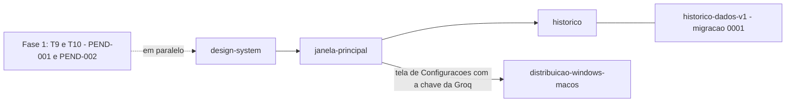

# M2 — O Touch Speaker ganha interface: janela principal, histórico e instalador

> Doc-pai da milestone **M2**. **Status: em execução** — as quatro specs foram aprovadas pelo Victor em
> 18/out/2026 (gate da Definition of Ready de [`docs/templates/README.md`](../templates/README.md)); este
> doc-pai foi aberto antes do gate, por decisão do Victor de 18/out/2026, para ordenar as quatro specs.
> Specs: [`design-system`](../spec/features/design-system.md) ·
> [`janela-principal`](../spec/features/janela-principal.md) · [`historico`](../spec/features/historico.md) ·
> [`distribuicao-windows-macos`](../spec/features/distribuicao-windows-macos.md) · spec de migração companheira
> da `historico`: [`historico-dados-v1`](../spec/features/historico-dados-v1.md)
> Origem: Victor Alves, 18/out/2026 — abrir a M2 agora, com as quatro specs escritas em paralelo, mantendo a
> T9 e a T10 da Fase 1 abertas ao mesmo tempo.
> Relação com ADRs: este doc não abre ADR. Cada spec declara as suas no próprio §0 e §17. Números reservados
> em 18/out/2026 (ADR-08, ADR-09 e ADR-12 já aceitas; ADR-10 e ADR-11 seguem `proposta` até a aprovação final
> da spec dona): **ADR-08** chave da Groq via
> `safeStorage` (`janela-principal` — aceita e em `docs/DECISIONS.md` desde 18/out/2026) · **ADR-09** SQLite local para o histórico (`historico` — proposta com o `better-sqlite3`; **aceita em 18/out/2026 com o `node:sqlite` embutido no Electron**, depois do spike T1 da spec: nenhuma dependência nova; em `docs/DECISIONS.md`) · **ADR-10**
> empacotamento com `electron-builder` (`distribuicao-windows-macos`) · **ADR-11** macOS antes da Fase 4
> (`distribuicao-windows-macos`) · **ADR-12** fonte Inter embutida, com a exceção ao guardrail de binários de
> terceiros (`design-system`). As decisões fixas tocadas pela M2 estão em "Decisões que não são detalhe",
> item 4.

> **Número da milestone:** pela regra do template, `M<N>` = Fase N do PRD. A M2 **não** é a Fase 2 do PRD:
> traz itens da Fase 2 e da Fase 4 e deixa de fora o item central da Fase 2 (limpeza por IA). O número M2 é
> decisão do Victor de 18/out/2026; ajustar a regra, o PRD e o SDD §29 é a PEND-novo-1. `docs/milestones/`
> não tinha nenhuma milestone; a M1 (Fase 1) ganha doc quando a T9 e a T10 fecharem.

> Numeração `-novo-`: os IDs `PEND-novo-N` e `RISK-novo-N` deste documento são locais a ele e ganham número
> do registro do SDD na aprovação. Cada spec tem a sua própria numeração `-novo-`.

---

## O problema, na tela

1. **A única interface é a pílula e o ícone da bandeja.** Configurar é editar o `config.json` aberto por
   "Abrir pasta de configuração" e reiniciar o app (`docs/DESIGN.md` §7.1; SDD §9.2). Não há tela.
2. **A chave da Groq mora num arquivo de desenvolvedor.** Ela fica em `frontend/.env`, lida ao abrir
   (ADR-06; `frontend/src/main/index.ts:33-38`). Sem o arquivo, o menu da bandeja diz "Touch Speaker — falta a
   chave da Groq" e todo ditado termina em "Falta a chave da Groq — veja o README" (BR-013). Só quem compila
   o app consegue usá-lo.
3. **Nada guarda o que foi ditado.** O texto vai para o app em foco e some; se foi colado na janela errada
   (RISK-006) ou se a pessoa precisa dele de novo, não há onde buscar. O log guarda só o tamanho (`chars` em
   `dictation_done`), nunca o texto (C1).
4. **Não há instalador.** O app só roda por `npm run dev`, a partir do repositório (SDD §1.1).
5. **O visual não tem base.** O ponto de "gravando" da bandeja usa o vermelho do erro
   (`frontend/src/main/icon.ts:5` = `--ts-error`), e os tokens de cor só existem dentro de `pill.css`
   (`:2-11`): a primeira janela nova teria de inventar cor e fonte.

---

## A descoberta que barateou tudo

A pílula já é estilizada só por atributo (`data-state`, `data-warn` — `frontend/src/renderer/pill.ts:215-216`)
e a bandeja já recebe "gravando / parado" do `SessionController` pelo `onRecordingChange`
(`frontend/src/main/index.ts:141`). Por isso a reestilização da spec `design-system` não precisa de canal IPC
nem de campo de configuração novo: troca tokens de CSS e as cores do desenho do ícone.

---

## O que entra (planejado)

| Ordem | Spec | O que entrega | Origem no PRD | Depende de | Status |
| --- | --- | --- | --- | --- | --- |
| 1 | [`design-system`](../spec/features/design-system.md) | paleta Sálvia em tokens com tema claro e escuro escolhido pelo sistema, fonte Inter embutida (ADR-12), contraste travado por teste, pílula e bandeja reestilizadas, base visual da janela principal | não consta — decisão do Victor de 18/out/2026 | — | aprovada (18/out/2026 · Victor) — implementada no código em 18/out/2026, não commitada; roteiro V-DS-1…6 pendente |
| 2 | [`janela-principal`](../spec/features/janela-principal.md) | janela principal com Início, Histórico e Dicionário, e Configurações com a entrada da chave da Groq | FR-SET-01 (tela de configurações, Fase 2); a seção Dicionário toca o FR-VOCAB-01 (Fase 2) — o que ela faz na M2 é decidido na própria spec | `design-system` | aprovada (18/out/2026 · Victor) — implementada no código em 18/out/2026, não commitada (ADR-08 aceita); roteiro VJ1–VJ24 pendente (PEND-007). Com a `historico`, a seção Histórico ganhou o conteúdo real, Configurações ganhou "Guardar histórico" e o Início, os cards do histórico; o Dicionário segue "em breve". Pedidos do Victor de 18/out/2026 (tema e controles, abaixo) no código, roteiro VJ25–VJ27 pendente (PEND-010) |
| 3 | [`historico`](../spec/features/historico.md) | histórico só de texto, em SQLite local; tela Histórico com busca, copiar de novo e apagar; retenção em Configurações; cards do Início | FR-HIST-01 (Fase 2), decomposto em FR-HIST-01…26. O PRD citava "texto, app, duração"; o "app" saiu por decisão do Victor de 18/out/2026 e o `docs/PRD.md` já foi corrigido | `janela-principal` (o histórico aparece na seção Histórico) | aprovada (18/out/2026 · Victor) — **implementada no código em 18/out/2026**, não commitada (ADR-09 aceita: `node:sqlite`); `npm test` 326/326; roteiro VH1–VH13 pendente, com o Victor (PEND-009) |
| 3 | [`historico-dados-v1`](../spec/features/historico-dados-v1.md) (spec de migração) | migration `database/local/0001_init.sql` (tabelas `dictations` e `schema_migrations`) e o campo `history.retentionDays` do `config.json`, sem mudar o `version` | FR-HIST-27…31, a partir da spec `historico` §9 e §17.2 | `historico` | **proposta**, com implementação autorizada pelo Victor antes da aprovação (18/out/2026) — já no código; aprova junto com o roteiro VH, com o ensaio da migração (PEND-009). Perguntas abertas no §14 dela (`version` continua `1`? `schema_too_new`?) |
| 3 | [`distribuicao-windows-macos`](../spec/features/distribuicao-windows-macos.md) | instalador `.exe` para Windows e build/porte para macOS | instalador: Fase 4 do PRD; macOS: fora do escopo até a Fase 4 (NFR-06) | a tela de Configurações com a chave, da `janela-principal` | aprovada (18/out/2026 · Victor) |

Ordem por dependência:

Por que essa ordem:

- **`design-system` primeiro:** a janela principal consome os tokens e a fonte (FR-DS-18 da spec); sem eles,
  cada tela nova escolhe cor e fonte por conta própria.
- **`janela-principal` antes de `historico`:** o histórico é mostrado dentro da janela, na seção Histórico.
- **`distribuicao-windows-macos` depois da tela da chave, em paralelo com `historico`:** um app instalado não
  tem `frontend/.env`. Sem a entrada da chave dentro do app (C6: `safeStorage` para uso pessoal), o app
  instalado abriria e responderia `no_api_key` a todo ditado (BR-013). A distribuição não depende do histórico.

---

## Decisões que não são detalhe

**1. O doc-pai nasce antes do gate.** O processo de [`docs/templates/README.md`](../templates/README.md) cria o
doc-pai na execução, depois que a spec passa no gate. Aqui ele nasce na fase de spec, por decisão do Victor,
porque são quatro specs com ordem entre si escritas ao mesmo tempo. Pior caso de não fazer: quatro specs sem um
lugar que diga a ordem e o que ficou de fora. Pior caso de fazer: um doc-pai que diz "em especificação" por
algum tempo — aceito.

**2. A M2 reprioriza o roadmap do PRD.** Pelo PRD (`docs/PRD.md`, "Roadmap"), a Fase 2 é "Limpeza por IA,
dicionário, histórico local, tela de configurações" e a Fase 4 é "Backend próprio, contas, cotas, instalador
assinado, auto-update"; macOS fica fora até a Fase 4 (NFR-06). A M2 traz o histórico e a tela de
configurações da Fase 2, o instalador da Fase 4 e o macOS, e deixa de fora a limpeza por IA (FR-CLEAN-01). A
regra `M<N>` = Fase N deixa de valer. **Não resolvido aqui:** atualizar o roadmap do PRD, o SDD §29 e a regra de
numeração dos templates é a PEND-novo-1, para aval do Victor.

**3. A Fase 1 continua aberta em paralelo.** A T9 (roteiro V1 e V3–V13 e medição de latência — PEND-001) e a T10
(spec `ditado-por-voz` passa a `implementada` — PEND-002) seguem abertas, e o critério de saída da Fase 1 (5
dias úteis só com o Touch Speaker, SDD §1.4) não muda. O risco de projeto "Fase 1 dada como pronta sem o roteiro
manual" (SDD §26.2) cresce com a M2 andando ao lado. Regra de ordem: o **V7** (pílula não rouba foco) e o
**V12** (bandeja, "Sair") rodam **antes** de a spec `design-system` reestilizar a pílula e a bandeja — ou são
refeitos depois, com os dois resultados anotados (RISK-novo-4 da spec `design-system`).

**4. A M2 toca decisões fixas — cada uma resolvida na spec dona, nunca aqui.** Nenhuma spec da M2 vai para a
execução com uma destas abertas:

| Decisão fixa, guardrail ou dependência | Quem toca | Onde se resolve |
| --- | --- | --- |
| "Windows primeiro — nada de macOS/Linux/mobile antes da Fase 4" (`CLAUDE.md`, "Decisões fixas"; NFR-06; SDD §2.4) | `distribuicao-windows-macos` (porte para macOS) | **ADR-11** — PEND-novo-2 |
| ADR-06 — "não distribuir o app" sem backend; C6 — chave só em `.env`, `safeStorage` ou `backend/` | `janela-principal` (chave no app) e `distribuicao-windows-macos` (instalador) | **ADR-08** (chave via `safeStorage`); a distribuição, na spec `distribuicao-windows-macos` — PEND-novo-2 |
| SQLite para o histórico (proposta original: dependência nova `better-sqlite3`) | `historico` | **ADR-09**, aceita em 18/out/2026 com o `node:sqlite` embutido no Electron 44.9.0 — **nenhuma dependência nova** no `package.json` (spike T1 da spec) |
| Dependência nova: `electron-builder` | `distribuicao-windows-macos` | **ADR-10** |
| ADR-01 — "sem bundler na Fase 1"; outro framework de interface exige ADR | `janela-principal`, se escolher framework ou bundler | na spec `janela-principal` |
| Guardrail "nunca trazer para o repositório binários de terceiros" (`CLAUDE.md`) | `design-system` (arquivo da fonte Inter) | **ADR-12**, §17 da spec `design-system` |
| "Instalador assinado e auto-update" na Fase 4 (SDD §2.2) | `distribuicao-windows-macos` | na própria spec |

**5. Pedidos do Victor de 18/out/2026, durante a implementação.** Três acréscimos entraram nas specs donas antes
do código, sem spec nova:

- **Início com os dados do histórico** — os 3 ditados mais recentes, com "Copiar" e "Ver todos", e o card "Seu
  uso" (palavras, ditados e tempo falando, hoje e em todo o histórico, e a média de palavras por minuto):
  FR-HIST-22…26 da `historico`, com o canal novo `history:stats` (só números), na tela da `janela-principal`
  (FR-UI-15). Exceção registrada à regra "texto ditado só na tela Histórico" (RISK-039). Roteiro VH13 (PEND-009).
- **Tema claro/escuro escolhido na janela** — botão de sol/lua na barra lateral, com revelação circular, card
  "Aparência" com "Seguir o sistema", campo `theme` no `config.json` (padrão `"system"`) e canal `theme:set`:
  FR-UI-39…42 da `janela-principal`, que revê a D4 da `design-system` (antes, só o tema do sistema). A bandeja
  continua no tema da barra de tarefas. Roteiro VJ25–VJ26 (PEND-010).
- **Listas suspensas e controles restilizados** — em Configurações, o select personalizável do Chromium
  (`appearance: base-select`), e caixa, interruptor e rádio desenhados nos tokens; sem canal nem campo novo.
  TEST-019 e roteiro VJ27 (PEND-010; RISK-040).

---

## O que muda, por arquivo

Caminhos relativos a `frontend/` (o app desktop). Só o que a spec `design-system` já fixou; as outras três
specs listam os seus arquivos no próprio §8 e §16.

### Main (src/main)

| Arquivo | O quê |
| --- | --- |
| `src/main/icon.ts` | cores do ícone vindas de `shared/palette.ts`; variante por tema da barra de tarefas; desenho em módulo testável sem `electron` (`design-system`) |
| `src/main/tray.ts` | regenera os ícones quando o tema do Windows muda (`design-system`) |
| `src/main/index.ts` | escuta o `nativeTheme` (`design-system`); janela principal (`janela-principal`) |
| `src/main/strings.ts` | sem mudança em `design-system`; textos novos das outras specs |
| `src/main/errors.ts` | sem mudança em `design-system` |

### Preload, shared e renderer

| Arquivo | O quê |
| --- | --- |
| `src/shared/palette.ts` · `src/shared/contrast.ts` | **novos** (`design-system`) |
| `src/shared/ipc.ts` · `src/preload/pill.ts` | sem mudança em `design-system`; canais da janela principal na spec `janela-principal` |
| `src/renderer/tokens.css` · `src/renderer/fonts/` | **novos** (`design-system`) |
| `src/renderer/pill.css` · `pill.html` · `pill.ts` | pílula sobre os tokens e a Inter (`design-system`) |

### Testes (src/test)

| Arquivo | O quê |
| --- | --- |
| `src/test/tokens.test.ts` | paridade dos temas, contraste, nenhuma cor literal — **novo** (`design-system`) |
| `src/test/icon.test.ts` | cores do ícone por variante — **novo** (`design-system`) |

### Configuração e scripts

| Arquivo | O quê |
| --- | --- |
| `scripts/copy-static.mjs` | copia também `fonts/` (`design-system`) |
| `package.json` | sem dependência nova em `design-system`; o que as outras specs trouxerem exige ADR |

### Documentação

`docs/CHANGELOG.md` · `docs/PRD.md` e SDD §29 (PEND-novo-1) · `docs/DESIGN.md` · `docs/DECISIONS.md` (ADRs
aprovadas) · `docs/templates/README.md` (índice de specs, áreas de FR) · `CLAUDE.md` ("Estado atual"; "Decisões
fixas", se alguma mudar). Lista completa no §16 de cada spec.

---

## Como verificar

| # | Critério de aceite | Onde se prova |
| --- | --- | --- |
| 1 | DADO as quatro specs QUANDO cada uma vai ao gate ENTÃO passa na Definition of Ready, sem `[PRECISA ESCLARECER]` aberto e com o aval do Victor | `docs/templates/README.md`, Estágio 2 |
| 2 | DADO a spec `design-system` implementada QUANDO o `npm test` roda ENTÃO os pares de contraste e a paridade dos temas passam | §14 da spec `design-system` |
| 3 | DADO cada spec implementada QUANDO o seu roteiro manual roda ENTÃO cada critério de aceite do §14 dela está marcado | §14 de cada spec |
| 4 | DADO a M2 em execução QUANDO a pílula ou a bandeja mudam ENTÃO o V7 e o V12 da Fase 1 foram rodados antes, ou refeitos depois, com o resultado anotado | spec `ditado-por-voz` §12.2; spec `design-system` V-DS-1 e V-DS-2 |

Comandos (de dentro de `frontend/`): `npm run typecheck` · `npm test`.
Manual: o roteiro de cada spec, com o app aberto por `npm run dev` (nunca pelo `electron.exe` direto, por causa
do `ELECTRON_RUN_AS_NODE`). Ao terminar, encerre o app aberto por agente com `Stop-Process` nos `electron.exe`
cujo caminho contém `touch-speaker`.

---

## Pendências declaradas

1. **PEND-novo-1 — Roadmap reprioritizado sem registro.** O PRD ("Roadmap", "Fora de escopo"), o SDD §2.2,
   §2.3 e §29 e a regra `M<N>` = Fase N (`docs/templates/README.md`, `TEMPLATE-milestone.md`) ainda descrevem a
   ordem antiga. Atualizar depois do aval do Victor à M2 como está neste doc.
2. **PEND-novo-2 — Decisões fixas tocadas.** "Windows primeiro" / NFR-06 (ADR-11), ADR-06 e C6 (chave no app,
   ADR-08; distribuição na spec `distribuicao-windows-macos`) e ADR-01 (se vier framework) — cada uma resolvida
   na spec dona (tabela do item 4 acima). A ADR-08, a ADR-09 e a ADR-12 já estão em `docs/DECISIONS.md`,
   aceitas em 18/out/2026; a ADR-10 e a ADR-11 entram com a `distribuicao-windows-macos`.
3. **PEND-001 e PEND-002 — Fase 1 em paralelo.** T9 e T10 seguem abertas; o doc `M1-ditado-basico.md` é criado
   quando elas fecharem.
4. **PEND-novo-3 — Índices de documentação.** Em 18/out/2026 o índice de specs de `docs/templates/README.md`
   passou a listar as specs da M2 e a de migração `historico-dados-v1`, e a lista de áreas de FR dele já tem `DS`
   e `UI`; falta conferir a lista de áreas do SDD §0.2.
5. **Marcadores das specs.** Os nove `[PRECISA ESCLARECER]` da spec `design-system` foram decididos pelo Victor
   em 18/out/2026 (§17 da spec): paleta de @suraj.dsgn; janelas e pílula seguem o tema do sistema, sem escolha
   manual; pílula opaca; bandeja adaptada ao tema da barra (e *template image* no macOS); erro em terracota;
   aviso no verde derivado; tons derivados aprovados; logo sem mudança. A spec segue `proposta` até a
   aprovação final. As outras três listam os seus; nenhuma passa no gate com marcador aberto.
6. **PEND-009 — Roteiro do histórico.** O VH1–VH13 da spec `historico` e o ensaio da `historico-dados-v1` (T4
   dela), com o Victor; a `historico-dados-v1` passa de `proposta` a `aprovada` junto. Ficam também para ele as
   duas perguntas do §14 dela: o `version` do `config.json` continua `1` com os campos aditivos, e o tratamento de
   um banco com versão mais nova (`schema_too_new`).
7. **PEND-010 — Roteiro do tema e dos controles.** O VJ25–VJ27 da spec `janela-principal` (pedidos do Victor de
   18/out/2026, item 5 acima), com o Victor.

---

## Anexo — task (ferramenta de tarefas: nenhuma — as tarefas vivem no §18 de cada spec)

**M2 — App com interface**

*Objetivo:* dar ao Touch Speaker uma interface própria — base visual, janela principal com a chave da Groq
dentro do app, histórico local de texto e instalador —, sem perder o ditado da Fase 1.

*Requisitos:* FR-DS-01…18 (`design-system`) · FR-UI-01…42 (`janela-principal`, com o FR-SET-01 do PRD como
origem; FR-UI-39…42 desde 18/out/2026) · FR-HIST-01…26 (`historico`, a partir do FR-HIST-01 do PRD) e
FR-HIST-27…31 (`historico-dados-v1`) · requisitos da `distribuicao-windows-macos`

*Resultados:* o app abre uma janela principal no tema do Windows ou no escolhido pela pessoa, guarda o texto dos
ditados na máquina, recebe a chave da Groq sem `.env` e é instalado por `.exe`; pílula e bandeja na paleta Sálvia.

Subtarefas:

1. T1 — Spec `design-system` no gate e implementada (§18 da spec). Aprovada e implementada no código em
   18/out/2026; falta o roteiro V-DS-1…6 (PEND-006).
2. T2 — Spec `janela-principal` no gate e implementada. Aprovada e implementada no código em 18/out/2026 (T1–T6 do
   §18 da spec; T7 parcial: `npm run typecheck` limpo e `npm test` 182/182); falta o roteiro VJ1–VJ24 (PEND-007).
   Depois, no mesmo dia, entraram os pedidos do Victor (tema e controles, item 5 de "Decisões que não são
   detalhe"); falta o roteiro VJ25–VJ27 (PEND-010).
3. T3 — Spec `historico` no gate e implementada. Aprovada e implementada no código em 18/out/2026, com a spec de
   migração `historico-dados-v1` (implementação autorizada pelo Victor antes da aprovação); o spike T1 levou a
   ADR-09 ao `node:sqlite`. `npm run typecheck` limpo e `npm test` 326/326; falta o roteiro VH1–VH13 e o ensaio da
   migração, com o Victor (PEND-009).
4. T4 — Spec `distribuicao-windows-macos` no gate e implementada (pode correr junto da T3, depois da tela da
   chave da T2).
5. T5 — Documentação afetada: PEND-novo-1, PEND-novo-3, `docs/CHANGELOG.md`, `CLAUDE.md` "Estado atual".
6. T6 — Testes + self-review: `npm run typecheck`, `npm test`, roteiros de cada spec, V7 e V12 da Fase 1
   conferidos antes ou depois da reestilização.
