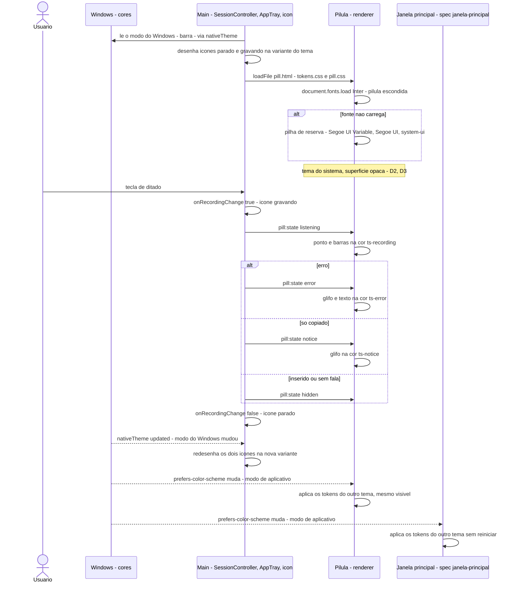
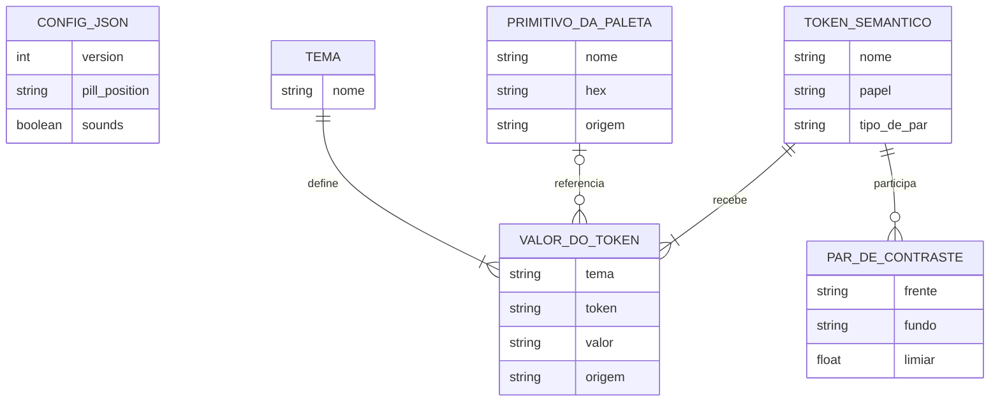
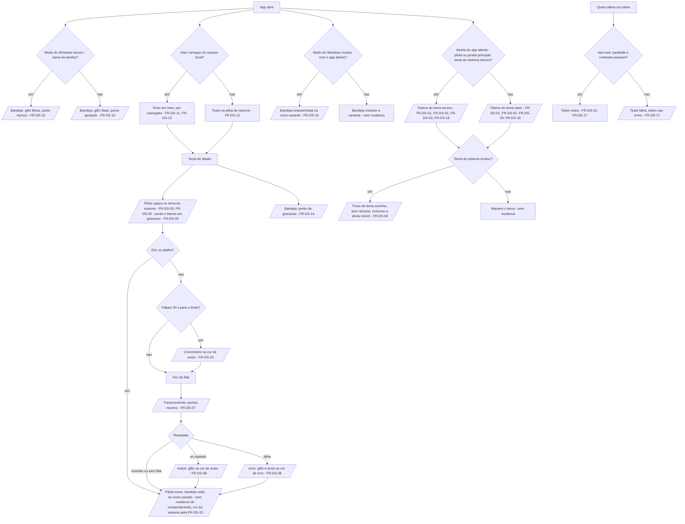

# Design system "Sálvia" — spec

> Criado: 18/out/2026 · Autor: Victor Alves · Status: proposta | **aprovada** (18/out/2026 · Victor) | implementada
> Origem: decisões do Victor de 18/out/2026, ao abrir a M2 — paleta "Sálvia" (baixa saturação, neutra, de
> gosto pastel), fonte Inter embutida e escopo "tokens + reestilização da pílula e da bandeja + base para a
> janela principal"; os pontos abertos D1–D10 foram decididos pelo Victor em 18/out/2026 (§17)
> Fase: M2 — fora do roadmap atual do PRD (a M2 reprioriza o roadmap; aval pendente no
> [doc-pai](../../milestones/M2-app-com-interface.md)) · Requisitos: FR-DS-01 … FR-DS-18
> Contrato: SDD (`docs/spec/spec-driven-development.md`) · Decisões relacionadas: ADR-01, ADR-07; ADR-12
> "Fonte Inter embutida" (aceita em 18/out/2026 com esta spec — [`docs/DECISIONS.md`](../../DECISIONS.md#adr-12--fonte-inter-embutida-no-app))
> Implementação: T1–T5 feitas em 18/out/2026 (ainda não commitadas; `npm run typecheck` limpo, `npm test`
> 113/113); T6 parcial — falta o roteiro manual V-DS-1…6 (PEND-006 no SDD), que o Victor roda (§18)
> **Revisão de 18/out/2026 (Victor):** a D4 mudou — escolha manual claro/escuro na janela principal, com o
> sistema como padrão (§17, D4; requisitos na `janela-principal`, FR-UI-39…42)
> Milestone: M2 — [`docs/milestones/M2-app-com-interface.md`](../../milestones/M2-app-com-interface.md)

O Touch Speaker ganha um design system próprio, a **Sálvia**: uma paleta de seis cores de baixa saturação,
dois temas (claro e escuro) descritos por tokens semânticos em CSS e escolhidos pelo tema do sistema, a fonte
**Inter** embutida no app e uma regra de contraste verificada por teste. A pílula e o ícone da bandeja passam a
usar esses tokens — o estado "gravando" deixa de usar o vermelho do erro e passa ao **Apricot** — e a janela
principal (spec
[`janela-principal`](janela-principal.md)) nasce sobre a mesma base, sem paleta própria. Serve ao Victor no
uso diário (cada ditado mostra a pílula e muda o ícone da bandeja) e a toda tela que vier depois.

---

## 0. Constituição (gate — preencher ANTES de desenhar, reconferir DEPOIS)

| Decisão fixa | Esta feature respeita? | Nota |
| --- | --- | --- |
| ADR-01 — Electron + TypeScript estrito (CommonJS, `tsc`, sem bundler na Fase 1); outro runtime ou framework de interface exige ADR | sim | Tokens em CSS puro (custom properties), sem pré-processador, framework nem bundler; o arquivo de fonte é copiado para `dist/` pelo `scripts/copy-static.mjs` |
| ADR-02 — hook global com `uiohook-napi`, não `globalShortcut`; só a tecla configurada e o `Esc` são identificados, qualquer outra vira `other` antes de sair do hook | sim | Não toca o hook |
| ADR-03 — inserção por clipboard + Ctrl+V via `SendInput` (`koffi`), com o clipboard restaurado e fallback quando o app em foco é elevado; o app nunca pede elevação para contornar UIPI | sim | Não toca a inserção; só a cor do aviso `notice` |
| ADR-04 — Groq Whisper `large-v3-turbo`, áudio inteiro ao soltar; sem streaming antes da Fase 4 | sim | Não toca a transcrição |
| ADR-05 — sem limpeza por IA na Fase 1; `Refiner` identidade como encaixe | sim | — |
| ADR-06 — sem backend na Fase 1; o app não é distribuído com chave | sim | A fonte é arquivo local; nenhuma chamada de rede nova |
| ADR-07 — sala limpa em relação ao Typeless: nada de código, pseudocódigo, strings, constantes, nomes de canal, ícones, sons ou cores dele; o estudo de referência é só referência | sim | A paleta vem de um post público no Instagram de @suraj.dsgn, "Best Luxury Color Palettes for Premium Designs" (22 de setembro), escolhido pelo Victor (D1); a fonte vem de catálogo público (Google Fonts / projeto Inter, licença OFL). Nenhuma cor, fonte, ícone ou nome de fonte sai do estudo; ele não foi consultado para esta spec |
| C1 Privacidade por padrão — áudio nunca vai para disco; texto ditado, clipboard e teclas nunca vão para log | sim | Tokens e fonte não leem conteúdo nenhum; nada novo vai para disco ou log |
| C2 Nunca roubar o foco — nada do Touch Speaker recebe foco durante o ditado | sim | A janela da pílula continua `focusable: false`, `showInactive()` e `setIgnoreMouseEvents(true)` (`frontend/src/main/pill-window.ts:35`, `:50`, `:79-80`) |
| C3 Nunca digitar lixo — na dúvida entre inserir algo errado e não inserir nada, não insere e avisa | sim | Não toca o que é inserido |
| C4 Falha visível — todo erro chega à pessoa com mensagem clara; nada falha em silêncio | sim | Os erros do ditado continuam com texto e glifo próprios. A fonte que não carrega cai na pilha de reserva sem aviso: é degradação cosmética, não falha do ditado (§6, linha "Degradação") |
| C5 Provedores trocáveis — transcrição e limpeza atrás de interface (`Transcriber`, `Refiner`); trocar provedor = adapter novo | N/A | Sem provedor |
| C6 Sem segredo em app distribuído — chave só no `.env` (dev), `safeStorage` (uso pessoal) ou `backend/` (produto) | sim | — |
| C7 Sala limpa — ver ADR-07 | sim | Ver linha da ADR-07 e RISK-005 no §13 |
| C8 Escopo da fase — a spec não puxa funcionalidade de fase seguinte "porque era fácil" | sim, com ressalva | A base visual da janela principal era da Fase 2 (FR-SET-01, tela de configurações); entra na M2 por decisão do Victor de 18/out/2026. A reprioritização do roadmap do PRD é pendência do doc-pai (aval do Victor). Esta spec não desenha a janela principal |
| Windows primeiro — nada de macOS/Linux/mobile antes da Fase 4 | sim | Esta spec não faz porte nenhum. Ela registra duas decisões do Victor de 18/out/2026 que valem quando o porte existir: no macOS, a aparência do sistema escolhe o tema, como no Windows; e o ícone da barra de menus é uma *template image*. O porte e a mudança da decisão fixa são da spec [`distribuicao-windows-macos`](distribuicao-windows-macos.md) (ADR-11) |
| Produto em pt-BR; todo texto de interface em `frontend/src/main/strings.ts` | sim | Nenhum texto novo nem alterado |
| `SessionController` é o único dono do estado da sessão | sim | A bandeja continua recebendo "gravando / parado" pelo `onRecordingChange` de hoje (`frontend/src/main/index.ts:141`) |
| Código em `frontend/` é a fonte de fato; a feature rastreia ao PRD, ao SDD ou ao código — o estudo de referência não é normativo | sim | Rastreia às decisões do Victor de 18/out/2026 e ao código (§1, §3) |
| Nenhum segredo (`GROQ_API_KEY`, conteúdo de `.env`) em doc, código novo ou diff | sim | — |
| Sem dependência, provedor ou serviço novo sem ADR | sim, com ADR-12 (aceita em 18/out/2026) | O arquivo da fonte Inter é ativo de terceiro: entra pela ADR-12 do §17, sem pacote npm novo |
| Guardrail do `CLAUDE.md` — "Nunca trazer para o repositório binários de terceiros" | **não** (literalmente) | O arquivo `.woff2` da Inter é binário de terceiro. Ver a tabela abaixo |

**Violação exige justificativa:**

| O que fura | Por que é necessário | Alternativa rejeitada e por quê | Aval |
| --- | --- | --- | --- |
| Guardrail "Nunca trazer para o repositório binários de terceiros" (`CLAUDE.md`, "Nunca faça") — o arquivo da fonte Inter entra em `frontend/src/renderer/fonts/` | A CSP da pílula é `'self'` (`frontend/src/renderer/pill.html:7`) e a única integração externa do app é a Groq (`docs/INTEGRATION.md`): a fonte só chega à tela se estiver dentro do app. O guardrail foi escrito para o material do estudo do Typeless; a Inter é fonte pública sob OFL, com o texto da licença ao lado | Fonte do sistema (`Segoe UI Variable`, hoje em `frontend/src/renderer/pill.css:20`): zero bytes, mas não é a fonte escolhida pelo Victor e não existe no macOS (porte da spec `distribuicao-windows-macos`). Baixar do Google Fonts em tempo de execução: fura a CSP e abre uma segunda integração externa | Victor — ADR-12, aceita em 18/out/2026 junto com esta spec |

> Sem `[PRECISA ESCLARECER]` aberto desde 18/out/2026. A spec passou no gate em 18/out/2026, e a ADR-12
> "Fonte Inter embutida" (§17) foi aceita junto com ela e está em `docs/DECISIONS.md`.

### 0.1 Diagramas obrigatórios

| # | Diagrama | Seção | Estado |
| --- | --- | --- | --- |
| 1 | Wireframe | §7.1 | presente — pílula por estado, ícone da bandeja por tema e mapa de tokens da base |
| 2 | UML de sequência | §8.1 | presente |
| 3 | ER | §9.1 | presente — campos do `config.json` lidos (sem campo novo) e o modelo de tokens, que é código e não dado persistido |
| 4 | Fluxograma | §11.1 | presente |

---

## 1. O problema, na tela

Quem dita vê a pílula e o ícone da bandeja a cada ditado. Hoje, o sinal de "gravando" na bandeja é o mesmo
vermelho do erro; a cor da marca está copiada à mão em dois arquivos; e a janela principal, que a M2 vai
criar, não teria de onde tirar cor, fonte nem medida — cada tela nova inventaria a sua.

### 1.1 "Gravando" usa a cor do erro

O ponto da variante "gravando" do ícone da bandeja é `#F87171` (`frontend/src/main/icon.ts:5`), o mesmo valor
de `--ts-error` (`frontend/src/renderer/pill.css:9`), usado no glifo e no texto de erro da pílula
(`pill.css:155-157`, `:179-181`). Um mesmo vermelho quer dizer "estou ouvindo" num lugar e "deu errado" no
outro. O próprio PRD descreve o erro como "pílula fica vermelha" (`docs/PRD.md:47`).

### 1.2 Cor duplicada sem trava

O glifo da bandeja repete a cor da marca como constante (`frontend/src/main/icon.ts:4`, comentário
`// --ts-listening`), porque é desenhado pixel a pixel; o token de verdade está em `pill.css:7`. Nada confere
que os dois continuam iguais: só o comentário.

### 1.3 Tokens presos à pílula, tema único

Os tokens de cor existem só no `:root` de `pill.css` (`:2-11`), com nomes de uso da pílula
(`--ts-listening`, `--ts-surface` = fundo da pílula). Há um tema só, escuro (`docs/DESIGN.md` §12), e
`prefers-color-scheme` não é usado. Não há escala tipográfica além de 12 e 13 px (`pill.css:43`, `:66`,
`:76`), nem escala de espaço, raio ou foco — a pílula nunca recebe foco (C2), mas a janela principal recebe.

### 1.4 Fonte do sistema

A pilha `'Segoe UI Variable', 'Segoe UI', system-ui, sans-serif` (`pill.css:20`) é nativa do Windows; no
macOS (porte da spec `distribuicao-windows-macos`) o texto sairia em outra fonte. Nenhuma fonte é embutida
hoje (`docs/DESIGN.md` §4).

### 1.5 Contraste nunca medido

A regra de ≥ 4,5:1 está escrita, mas a medição não foi registrada (SDD §25). Medido para esta spec
(fórmula de luminância relativa do WCAG 2.x, sRGB): o texto de hoje passa com folga (`#F4F4F5` sobre o fundo
da pílula: 17,00:1), mas o glifo da bandeja em `#13A89E` fica em **2,95:1 contra branco** e o ponto
`#F87171` em **2,77:1 contra branco** — abaixo de 3:1 numa barra de tarefas clara. O glifo tem uma cor só
(`icon.ts:4`), sem variante por tema.

> **Problema independente, pré-requisito de ordem:** o roteiro manual da Fase 1 não rodou V7 (pílula não
> rouba foco) nem V12 (bandeja) — PEND-001. Reestilizar a pílula e a bandeja antes disso mistura regressão
> visual com o fechamento da Fase 1 (RISK-novo-4, §13).

---

## 2. Objetivo e não-objetivos

**Objetivo:** toda cor, fonte e medida visual do app sai de um único arquivo de tokens com tema claro e
escuro, o par texto/fundo passa em ≥ 4,5:1 e o par gráfico/fundo em ≥ 3:1 por teste automatizado, e a pílula
e a bandeja mostram "gravando" em Apricot, separado do erro.

**Não-objetivos** (o que esta feature explicitamente NÃO faz):

- Desenhar a janela principal — layout, navegação, seções e componentes são da spec
  [`janela-principal`](janela-principal.md); aqui só nasce a base (tokens) que ela consome.
- Mudar a geometria, os estados, os textos, os sons ou as animações da pílula — tamanho, raio, sombra,
  cronômetro, 7 barras, 3 pontos e durações ficam como em `docs/DESIGN.md` §5–§7; mudam só cor e fonte.
- Estilizar o menu da bandeja e o tooltip — são nativos do Windows (`Menu.buildFromTemplate`,
  `frontend/src/main/tray.ts:26-34`) e não aceitam cor nem fonte do app.
- Ícone do instalador, `.ico` do app e o desenho do ícone da barra de menus do macOS — spec
  [`distribuicao-windows-macos`](distribuicao-windows-macos.md). Esta spec só registra a decisão de 18/out/2026
  de que o ícone do macOS é *template image* (monocromático, colorido pelo próprio sistema).
- Logo do README (`docs/assets/logo.svg`) — fica como está por enquanto (D10, 18/out/2026).
- Escolha manual de tema (claro / escuro / sistema) — **não existe** (D4, 18/out/2026): as janelas e a pílula
  seguem sozinhas o tema do sistema, e o `config.json` não ganha campo de tema. **Revisto pelo Victor no mesmo
  dia:** passa a existir na janela principal (D4 revista; `janela-principal` FR-UI-39…42), com o sistema como padrão.
- Biblioteca de componentes, framework de CSS ou gerador de tokens — fora (ADR-01; §12).

### 2.1 Produto — a quem serve e como se mede

| | |
| --- | --- |
| **Para quem** | Dev multitarefa (Victor) — a persona da Fase 1, que segue sendo o único usuário na M2 |
| **Dor** | O sinal de "estou gravando" na bandeja é o vermelho do erro (§1.1), e a próxima tela não tem base visual (§1.3). *Derivada do código, não é citação do Victor* |
| **Elo do fluxo que fortalece** | **pílula** (estado legível de relance, DESIGN.md §1.3) e a bandeja, que acompanha a gravação |
| **Hipótese** | Acreditamos que uma paleta única de baixa saturação, com "gravando" em Apricot e erro numa cor própria, faz o Victor ler o estado do ditado de relance sem confundir gravação com falha, e saberemos que deu certo quando o roteiro V-DS-1 e V-DS-2 rodar sem nenhuma leitura errada de estado. Não mexe nas hipóteses H1–H4 |
| **Como se mede** | Não dá para medir pelo log: o renderer não escreve log e cor não é evento (C1). Medidas: o teste de contraste (`tokens.test.ts`, pares do §9.4) e o roteiro V-DS-1…6 |
| **Custo de não fazer** | `janela-principal` e `historico` inventam cor e fonte cada uma; o ícone segue mostrando "gravando" com a cor do erro; o porte para macOS sai com outra fonte |
| **Alcance × esforço** | Todo ditado (pílula e bandeja aparecem sempre) × 1 a 2 sessões de trabalho (estimativa do redator, a confirmar) |

> Esta feature não muda gesto nem texto da pílula: `README.md` e `strings.ts` continuam verdadeiros, exceto a
> frase "ícone de microfone verde-azulado" (`README.md:288`), que muda com a D5.

---

## 3. Rastreabilidade

| Origem | Referência |
| --- | --- |
| PRD | **Não consta.** O PRD não tem FR de design system; a base da janela principal se liga ao FR-SET-01 (tela de configurações, Fase 2), trazido para a M2 por decisão do Victor de 18/out/2026 |
| SDD | **Não consta como requisito.** Toca SCREEN-001 e SCREEN-002 (§13), §25 (contraste "medição não registrada"), RISK-005 (§26). A área `DS` não está na lista de áreas de FR do SDD §0.2 nem do `docs/templates/README.md`: registrá-la é parte do §16 |
| Decisões do Victor (18/out/2026) | paleta Sálvia com os seis valores do §9.2; light e dark; Apricot no lugar do vermelho de "gravando"; fonte Inter embutida; escopo tokens + pílula/bandeja + base da janela principal. Depois, os pontos abertos D1–D10 (§17): origem da paleta, tema do sistema para janelas e pílula, pílula opaca, bandeja por tema da barra, terracota de erro, verde derivado de aviso, tons derivados aprovados, logo sem mudança; ícone do macOS como *template image* |
| Código atual | `frontend/src/renderer/pill.css:2-11` (tokens), `:20` (fonte); `frontend/src/main/icon.ts:4-5` (cores do ícone); `frontend/src/main/tray.ts:14-15` (ícones gerados uma vez); `frontend/src/renderer/pill.html:7` (CSP); `frontend/scripts/copy-static.mjs:12-13` (só `.html` e `.css`) |
| Estudo de referência (não normativo) | não usado |
| Milestone | [`docs/milestones/M2-app-com-interface.md`](../../milestones/M2-app-com-interface.md) — primeira spec da ordem |

Como a feature não consta no PRD nem no SDD, o mesmo PR leva: linha no `docs/CHANGELOG.md`, a área `DS` no
SDD §0.2 e no README dos templates, os FR-DS no SDD §4 e os AC no Apêndice C (§16).

---

## 4. Atores e permissões

| Ator | O que pode | Como o código confere |
| --- | --- | --- |
| usuário | dita (a pílula mostra o estado), olha a bandeja, troca o modo claro/escuro nas Configurações do Windows | nada novo: o hook continua só com tecla configurada, `Esc` e `other` (`frontend/src/main/keyboard.ts`) |
| Windows (Personalização > Cores) | define dois modos independentes: o **modo do Windows** (barra de tarefas, bandeja) e o **modo de aplicativo** (o que o Chromium expõe como `prefers-color-scheme`) | o main lê o modo do Windows pelo `nativeTheme` do Electron (propriedade a confirmar na doc do Electron 44 — §8); o renderer lê o modo de aplicativo pela media query. No macOS (quando o porte existir), a aparência do sistema chega pela mesma media query |
| processo main | desenha o ícone da bandeja em código; reage à troca de tema do sistema | `icon.ts` passa a ler as cores de `shared/palette.ts`; `AppTray` regenera os ícones quando o tema muda |
| renderer (pílula) | aplica tokens e fonte; não tem rede (`connect-src 'none'`) | CSP de `pill.html:7` intacta; a fonte entra por `default-src 'self'` |
| renderer (janela principal) | consome os mesmos tokens | spec `janela-principal` |
| quem altera token (pessoa ou agente) | edita `tokens.css` e `shared/palette.ts` | `npm test` falha se um par do §9.4 cair abaixo do limiar ou se os dois arquivos divergirem (FR-DS-17) |

---

## 5. Requisitos funcionais

| # | Requisito | Origem | Prioridade |
| --- | --- | --- | --- |
| FR-DS-01 | QUANDO uma janela do Touch Speaker é desenhada O SISTEMA DEVE tirar toda cor, família de fonte, raio, sombra e duração de animação de tokens de `frontend/src/renderer/tokens.css`, sem valor de cor literal no CSS da janela | Decisão do Victor 18/out/2026 (escopo "tokens"); §1.3 | P1 |
| FR-DS-02 | O SISTEMA DEVE definir em `tokens.css` o mesmo conjunto de tokens semânticos para o tema claro e para o tema escuro, com os valores do §9.3 | Decisão do Victor 18/out/2026 (light e dark) | P1 |
| FR-DS-03 | QUANDO uma janela do app (a pílula ou a janela principal) é desenhada O SISTEMA DEVE aplicar o tema escuro se o tema do sistema é escuro (no Windows, o modo de aplicativo; no macOS, a aparência) e o claro caso contrário, sem escolha manual. (D4 revista em 18/out/2026: é o padrão, "seguir o sistema"; com um tema escolhido na janela principal, vale a escolha — janela-principal FR-UI-39) | D2 e D4 (18/out/2026) | P1 |
| FR-DS-04 | QUANDO o tema do sistema muda com o app aberto O SISTEMA DEVE trocar sozinho o tema das janelas abertas, inclusive da pílula visível, sem reiniciar o app | D2 e D4 (18/out/2026) | P1 |
| FR-DS-05 | ENQUANTO a pílula está visível O SISTEMA DEVE desenhá-la com superfície opaca na cor de fundo do tema em uso (`--ts-pill-surface` = `--ts-bg`) | D2 e D3 (18/out/2026) | P1 |
| FR-DS-06 | ENQUANTO a sessão está em `listening` O SISTEMA DEVE desenhar o ponto e as barras do microfone da pílula em `--ts-recording` (Apricot no tema escuro; o Apricot escurecido `#BB7624` no claro) | Decisão do Victor 18/out/2026 (Apricot = gravando); D8 | P1 |
| FR-DS-07 | ENQUANTO a sessão está em `transcribing` O SISTEMA DEVE desenhar os três pontos em `--ts-working`, um neutro (Candle no escuro, `#61605E` no claro) | `docs/DESIGN.md` §3.1 (neutro de propósito); D8 | P2 |
| FR-DS-08 | QUANDO a pílula entra em `error` O SISTEMA DEVE desenhar o glifo de alerta e o texto em `--ts-error`, cor diferente de `--ts-recording` | §1.1; D6 | P1 |
| FR-DS-09 | QUANDO a pílula entra em `notice` O SISTEMA DEVE desenhar o glifo de clipboard em `--ts-notice` | `docs/DESIGN.md` §3.2; D7 | P1 |
| FR-DS-10 | QUANDO a gravação entra nos últimos 30 s (`warn`) O SISTEMA DEVE desenhar o cronômetro em `--ts-notice` | `pill.css:80-82`; D7 | P2 |
| FR-DS-11 | QUANDO uma janela do app mostra texto O SISTEMA DEVE usar a fonte Inter carregada de arquivo local do app, sem nenhuma requisição de rede | Decisão do Victor 18/out/2026 (Inter embutida); ADR-12 | P1 |
| FR-DS-12 | SE o arquivo da fonte não carrega ENTÃO O SISTEMA DEVE mostrar o texto na pilha de reserva (`Segoe UI Variable`, `Segoe UI`, `system-ui`), sem texto invisível e sem afetar o ditado | `pill.css:20` (pilha de hoje); C4 | P1 |
| FR-DS-13 | QUANDO a pílula aparece pela primeira vez depois de abrir o app O SISTEMA DEVE mostrar o texto já em Inter, sem troca de fonte com a pílula visível | FR-DICT-07 (≤ 150 ms); a pílula é criada escondida ao abrir (`frontend/src/main/index.ts:97`) | P2 |
| FR-DS-14 | QUANDO a sessão começa a gravar O SISTEMA DEVE desenhar o ponto do ícone "gravando" da bandeja na cor de gravação da variante do tema, no lugar de `#F87171` | Decisão do Victor 18/out/2026; `icon.ts:5` | P1 |
| FR-DS-15 | QUANDO o app abre O SISTEMA DEVE desenhar o glifo e o ponto da bandeja na variante de cor que dá ≥ 3:1 contra a barra de tarefas do modo do Windows em uso | §1.5; D5 | P1 |
| FR-DS-16 | QUANDO o modo do Windows muda com o app aberto O SISTEMA DEVE redesenhar os ícones da bandeja (parado e gravando) na variante do novo modo | Decorre de FR-DS-15; `tray.ts:14-15` gera os ícones uma vez só | P2 |
| FR-DS-17 | O SISTEMA DEVE manter cada par texto/fundo do §9.4 em ≥ 4,5:1 e cada par gráfico/fundo (ponto, barras, glifo, anel de foco, limite de campo) em ≥ 3:1, nos dois temas e na pílula, e falhar o `npm test` quando um par cair abaixo do limiar | SDD §25; `docs/DESIGN.md` §13; WCAG 2.x 1.4.3 e 1.4.11 | P1 |
| FR-DS-18 | O SISTEMA DEVE expor em `tokens.css` a base da janela principal — escala tipográfica, pesos, espaçamento, raio, elevação, durações e anel de foco (§9.5) — e nenhuma janela nova define paleta própria | Decisão do Victor 18/out/2026 ("base para a janela principal") | P1 |

**Casos de borda:**

- **Tecla acidental, `Esc`, atalho (BR-003, BR-004):** a pílula some como hoje; a bandeja volta ao ícone
  parado da variante do tema. Nada muda de comportamento.
- **Modo do Windows ≠ modo de aplicativo** (barra escura com apps claros, ou o inverso — o Windows deixa
  escolher os dois separados em "Personalizado"): a bandeja segue o modo do Windows (FR-DS-15); as janelas e a
  pílula seguem o modo de aplicativo (FR-DS-03).
- **Tema troca com a pílula visível:** a pílula troca de tema na hora, sem sumir nem perder o estado
  (FR-DS-04); a bandeja redesenha (FR-DS-16), também no meio de uma gravação — o ícone "gravando" troca de
  variante e continua "gravando".
- **Pílula clara sobre fundo claro:** no tema claro a pílula é Alabaster opaca e pode encostar em janelas
  claras; o contorno vem da borda `--ts-border` e da sombra de hoje (`pill.css:41`) — RISK-novo-6.
- **Fonte ausente ou corrompida em `dist/`:** pilha de reserva (FR-DS-12); `font-display: swap` garante que o
  texto nunca fica invisível esperando a fonte.
- **Alto contraste do Windows** (`forced-colors`): o Chromium substitui as cores do CSS pelas do sistema.
  Fora do escopo desta spec — a pílula segue legível porque todo estado tem glifo e texto (cor nunca é o único
  sinal); o roteiro só anota o resultado (V-DS-6).
- **Duas telas, `pill.position: top-center`, escala de 100% a 200%:** mesmo layout de hoje; nada desta spec
  depende de posição ou escala.
- **Microfone, rede, chave, colagem bloqueada, limite de 5 min:** os estados `error`, `notice` e `warn`
  continuam disparados pelo `SessionController`; só a cor muda (FR-DS-08, 09, 10).

---

## 6. Requisitos não-funcionais

| Categoria | Requisito (com limiar) | Como se verifica |
| --- | --- | --- |
| Performance / latência | A pílula continua aparecendo em ≤ 150 ms depois da tecla (FR-DICT-07, AC-007), já com a fonte; **0** requisições de rede para fonte | V-DS-3 (DevTools do app não empacotado, aba Network) + V7 da spec da Fase 1 |
| Consumo em repouso | Continua ≤ 220 MB de memória privada e ~0% de CPU parado na bandeja (NFR-03; medido 205 MB em 17/out/2026). O tema da bandeja é lido por evento, sem polling | V-DS-5: soma dos `electron.exe` após 10 min parado |
| Privacidade (C1) | Nada lido: tokens e fonte não tocam áudio, texto, clipboard nem teclas; nenhum arquivo novo escrito em disco ou log | Review do diff |
| Segurança Electron | CSP de `pill.html:7` **sem mudança** (a fonte entra por `default-src 'self'`, sem `font-src` nem origem remota); nenhum canal IPC novo; preload sem mudança (NFR-05) | Review: `pill.html:7` e `preload/pill.ts` fora do diff |
| Foco (C2) | A pílula continua sem foco e sem clique (`pill-window.ts:35`, `:50`), também ao trocar de tema | V7 da Fase 1, refeito no V-DS-1 |
| Acessibilidade | Texto ≥ 4,5:1 e gráfico ≥ 3:1 em todos os pares do §9.4, nos dois temas e na pílula; `role="status"` e `aria-live="polite"` mantidos (`pill.html:14`); `prefers-reduced-motion` mantido (`pill.css:187-198`); cor nunca é o único sinal (glifo + texto em todo estado) | `tokens.test.ts` (FR-DS-17) + review + V-DS-1 |
| Observabilidade | N/A — nenhum evento novo de log: o renderer não tem canal de log, e criar um seria IPC novo sem necessidade | — |
| Degradação | Fonte que não carrega → pilha de reserva, sem aviso (cosmético, não é falha do ditado). Propriedade de tema da barra indisponível → glifo neutro `#817F7C` (3,99:1 contra branco, 5,26:1 contra preto) — D5. O app nunca fecha por causa de tema ou fonte | V-DS-4 (fonte renomeada em `dist/`) |
| Tamanho do app | N/A até a distribuição (spec `distribuicao-windows-macos`); o tamanho do arquivo de fonte fica registrado na ADR | — |
| i18n | N/A — nenhum texto novo; textos seguem em `strings.ts` | — |
| Fuso horário | N/A — a interface não mostra data nem hora | — |

---

## 7. Telas e estados

**Onde monta:** pílula — `frontend/src/renderer/pill.html`, `pill.css` (passa a usar `tokens.css`), `pill.ts`
(pré-carga da fonte), estados em `frontend/src/shared/ipc.ts` (`PillStateName`, sem mudança) · bandeja —
`frontend/src/main/icon.ts`, `frontend/src/main/tray.ts` · base da janela principal — `tokens.css`, consumido
pela spec `janela-principal`.
**Onde NÃO aparece:** menu e tooltip da bandeja (nativos); `hidden` (nada na tela).

A pílula segue o tema do sistema (D2) e é opaca (D3): fundo `--ts-pill-surface` = `--ts-bg` (Black Hole no
escuro, Alabaster no claro).

| Estado da pílula | Tema escuro | Tema claro |
| --- | --- | --- |
| `hidden` | nada — a pílula some depois do fade (sem mudança) | idem |
| `listening` | ponto e barras em Apricot `#D78B30`; "Ouvindo…" em Alabaster; cronômetro e dica em `#ABA9A5`; últimos 30 s: cronômetro em Moss Green (D7) | ponto e barras em `#BB7624`; "Ouvindo…" em Black Hole; cronômetro e dica em `#61605E`; últimos 30 s: cronômetro em `#567140` (D7) |
| `transcribing` | três pontos em Candle | três pontos em `#61605E` |
| `notice` | glifo de clipboard em Moss Green (D7), texto em Alabaster | glifo em `#567140`, texto em Black Hole |
| `error` | glifo e texto em `#E08A7A` (D6), mensagem de `strings.ts`, some em 4 s | glifo e texto em `#A84A3A` (D6) |

| Ícone da bandeja (D5) | Barra escura (modo do Windows escuro) | Barra clara (modo do Windows claro) |
| --- | --- | --- |
| parado | glifo Moss Green `#7AA05A` (7,00:1 contra preto) | glifo Slate Green `#2D5A4A` (7,86:1 contra branco) |
| gravando | glifo Moss Green + ponto Apricot `#D78B30` (7,63:1 contra preto) | glifo Slate Green + ponto `#BB7624` (3,67:1 contra branco) |

No macOS, quando o porte existir, o ícone da barra de menus é *template image* (decisão de 18/out/2026): o
sistema pinta o glifo conforme a barra, e as cores desta tabela não se aplicam. O desenho, inclusive o da
variante "gravando", é da spec `distribuicao-windows-macos`.

**Interação:** sem mudança — a pílula nunca recebe foco nem clique; a interação é a tecla de ditado, o `Esc`
e o menu nativo da bandeja.

### 7.1 Wireframe — diagrama 1 de 4

Baixa fidelidade: rótulo e token por parte. Geometria (40 px de altura, raio 20 px, 120–360 px de largura)
igual à de hoje.

```text
fundo --ts-pill-surface (= --ts-bg do tema do sistema, opaca — D2, D3) · borda --ts-pill-border · Inter 13 px / 500
o mesmo desenho nos dois temas; só os valores dos tokens mudam (§7, tabela acima)

listening (segurando)
┌──────────────────────────────────────────────────────────┐
│  ●  ▂▃▅▇▅▃▂   Ouvindo…                             0:07  │   ● e barras: --ts-recording
└──────────────────────────────────────────────────────────┘   0:07: --ts-text-muted, Inter 12 px tabular

listening (mãos livres)
│  ●  ▂▃▅▇▅▃▂   Ouvindo…  toque de novo para terminar  0:12 │  dica: --ts-text-muted, 12 px / 400

listening (últimos 30 s, warn)
│  ●  ▂▃▅▇▅▃▂   Ouvindo…  Termina em 0:30             4:31 │  4:31: --ts-notice (D7)

transcribing
│  ∙ ∙ ∙   Transcrevendo… │                                   pontos: --ts-working

notice
│  [▭]  Texto copiado — cole com Ctrl+V │                     glifo: --ts-notice · texto: --ts-text

error  (o estado mais esquecido)
│  ▲  Sem conexão — tente de novo │                           glifo e texto: --ts-error (D6); some em 4 s
```

```text
bandeja (16/24/32 px, desenhada em código)
  barra escura:  parado [mic Moss]      gravando [mic Moss  + ● Apricot #D78B30]
  barra clara:   parado [mic Slate]     gravando [mic Slate + ● #BB7624]
  sem leitura do tema: [mic #817F7C] e ● #BB7624 (reserva)
  macOS (quando houver porte): template image, pintada pelo sistema
```

Mapa de tokens da base — **não** é o layout da janela principal (que é da spec `janela-principal`), só onde
cada papel de token cai numa janela genérica:

```text
┌ --ts-bg ───────────────────────────────────────────────────────┐
│   ┌ --ts-surface ───────────────────────────────────────────┐  │
│   │  Título             --ts-text · 18 px / 600             │  │
│   │  Texto de apoio     --ts-text-muted · 13 px / 400       │  │
│   │  [ Ação principal ] --ts-accent-fill + --ts-on-accent   │  │
│   │  [ Secundária ]  --ts-secondary-fill/--ts-on-secondary  │  │
│   │  [ campo      ]     borda --ts-border-strong            │  │
│   │       ↳ com foco:   anel 2 px --ts-focus                │  │
│   │  ── divisória ──    --ts-border (decorativa)            │  │
│   └─────────────────────────────────────────────────────────┘  │
└────────────────────────────────────────────────────────────────┘
```

Duas telas ou `pill.position: top-center`: mesmo layout; esta spec não mexe em posição.

---

## 8. Arquitetura — onde isso encaixa

**Lados envolvidos:** renderer (`frontend/src/renderer/` — `tokens.css` novo, `pill.css`, `pill.html`,
`pill.ts`, `fonts/` novo) · processo main (`icon.ts`, `tray.ts`, `icon-bitmap.ts` novo; o `index.ts` acabou sem
mudança, porque o `AppTray` assina o `nativeTheme` sozinho — nota de implementação, 18/out/2026) · tipos compartilhados
(`shared/palette.ts` e `shared/contrast.ts`, novos) · scripts (`copy-static.mjs`). **Nenhum canal IPC novo**:
`shared/ipc.ts`, `preload/pill.ts` e `renderer/global.d.ts` não mudam.

**Componente novo ou existente?**

| Peça | Novo / existente | Por quê |
| --- | --- | --- |
| `src/renderer/tokens.css` | novo | Um lugar só para primitivos, tokens semânticos dos dois temas, `@font-face` e a base da janela principal; `pill.html` o carrega antes de `pill.css` (mesma origem, CSP `'self'`), e a janela principal faz o mesmo |
| `src/renderer/fonts/` | novo | O arquivo variável da Inter e o texto da licença (OFL) ao lado — ADR-12, §17 |
| `src/shared/palette.ts` | novo | Os valores hex que o main precisa para desenhar o ícone (o CSS não é legível pelo main); `icon.ts` deixa de ter constantes próprias (`icon.ts:4-5`) |
| `src/shared/contrast.ts` | novo | Função pura de razão de contraste (WCAG 2.x) usada pelo teste |
| `src/main/icon.ts` | existente | `trayIcon(recording)` passa a receber a variante do tema; a função de desenho pixel a pixel (`render`, `:29-55`) sai para um módulo sem `electron`, testável — implementado como `src/main/icon-bitmap.ts` (`renderTrayBitmap`); `icon.ts` ganhou `readTaskbarTheme()` |
| `src/main/tray.ts` | existente | `AppTray` hoje gera `idleIcon` e `recordingIcon` uma vez (`:14-15`); passa a regenerar os dois quando o tema do sistema muda — implementado no próprio `AppTray`, que escuta o `nativeTheme` `updated` e solta o listener no `destroy()` |
| `scripts/copy-static.mjs` | existente | Hoje só copia `.html` e `.css` do topo de `src/renderer` (`:12-13`); passa a copiar `fonts/` |

**Lógica pura ou presa ao Electron?** Pura: `shared/contrast.ts`, `shared/palette.ts`, a leitura dos tokens de
`tokens.css` no teste e o desenho do ícone em buffer (sem `nativeImage`). Presa ao Electron: só a leitura do
tema (`nativeTheme`) e o `nativeImage` em `icon.ts`.

**Provedor externo?** Nenhum.

**Estado:** o `SessionController` continua dono do estado; a bandeja segue recebendo "gravando" pelo
`onRecordingChange` (`index.ts:141`). O tema do sistema não é estado da sessão: o main só redesenha o ícone.

**Tema do sistema:**

- **Janelas e pílula (renderer):** o tema claro fica no `:root` de `tokens.css` e o escuro em
  `@media (prefers-color-scheme: dark)`; o Chromium atualiza a media query quando o Windows muda o modo de
  aplicativo (ou o macOS muda a aparência), e a janela troca sozinha, sem reiniciar (FR-DS-03, FR-DS-04). A
  pílula usa o mesmo mecanismo, sem atributo de tema fixo (D2), com superfície opaca (D3). Não há escolha
  manual nem campo de tema no `config.json` (D4). O `tokens.test.ts` confere que os dois blocos definem o mesmo
  conjunto de tokens.
- **Bandeja (main):** o main lê o modo do Windows — o da barra de tarefas, que no Windows é separado do modo
  de aplicativo — pelo `nativeTheme` e escuta o evento `updated` para redesenhar. **Qual propriedade do
  `nativeTheme` reflete o modo da barra deve ser confirmada na documentação do Electron 44 no T4** (candidata:
  `shouldUseDarkColorsForSystemIntegratedUI`); se nenhuma servir, vale a reserva neutra `#817F7C`.
  **Confirmado no T4 (18/out/2026):** as tipagens do Electron 44.9.0 (`electron.d.ts`, `NativeTheme`) trazem
  `shouldUseDarkColorsForSystemIntegratedUI` (win32, darwin): "on Windows this property distinguishes between
  system and app light/dark theme". A mesma documentação lista o evento `updated` só para
  `shouldUseDarkColors`, alto contraste e cores invertidas — se ele dispara quando **só** o modo do Windows muda
  fica para o V-DS-2 (RISK-novo-5). A leitura que não devolve booleano cai na reserva neutra. No macOS
  (porte futuro), o ícone é *template image* e o sistema cuida da cor — spec `distribuicao-windows-macos`.

**Fonte:** `@font-face` em `tokens.css`, `src` relativo (`fonts/…`), `font-display: swap`, família
`--ts-font-sans: 'Inter', 'Segoe UI Variable', 'Segoe UI', system-ui, sans-serif`. Para FR-DS-13, o `pill.ts`
pede a fonte ao abrir (`document.fonts.load`), com a pílula ainda escondida.

**Configuração:** nenhum campo novo no `config.json` — o tema vem sempre do sistema (D4, 18/out/2026).

```text
app abre → main lê modo do Windows → icon (variante) → Tray
         → pill.html carrega tokens.css + pill.css → document.fonts.load(Inter)
tecla → SessionController → onRecordingChange(true) → AppTray: ícone "gravando" (ponto de gravação)
      → pill:state listening → CSS: ponto e barras em --ts-recording
      → pill:state transcribing | notice | error | hidden → CSS do estado
Windows muda modo → nativeTheme 'updated' → AppTray redesenha · janelas e pílula trocam pela media query
```

### 8.1 UML de sequência — diagrama 2 de 4



---

## 9. Modelo de dados

**Onde vive:** nenhum dado persistido novo. Os tokens são código (`tokens.css`, `shared/palette.ts`); a fonte é
arquivo estático do app. O `config.json` não ganha campo (§9.1).

**Muda o formato de dado persistido?** **não** — `pill.position` e `sounds` seguem lidos como hoje; `version`
fica em 1.

| Onde | Campo | Tipo | Default | Faixa válida e o que acontece se for inválido |
| --- | --- | --- | --- | --- |
| `config.json` | — | — | — | nenhum campo novo; tema e cor não são configuráveis (D4, 18/out/2026: o tema vem do sistema) |

- **Retenção / privacidade:** nada a reter; nenhum conteúdo do usuário envolvido (C1).

### 9.1 ER — diagrama 3 de 4

O `CONFIG_JSON` mostra os campos existentes que tocam a interface (lidos, sem mudança). As outras entidades
são o **modelo dos tokens**, que vive em código e não é persistido — o desenho prova a regra "cada token
semântico tem um valor por tema, e cada valor vem da paleta ou de um ajuste aprovado".



- **Unicidade:** um `VALOR_DO_TOKEN` por par (tema, token) — o teste falha se um tema tiver token que o outro
  não tem (FR-DS-02).
- **Origem:** `VALOR_DO_TOKEN.origem` é "paleta" ou "derivado"; os dois são DECISÃO do Victor (paleta em
  18/out/2026; derivados aprovados na D8, no mesmo dia).

### 9.2 Primitivos — a paleta Sálvia (DECISÃO, 18/out/2026)

Nomes e valores como o Victor passou. Origem (D1): post público no Instagram de **@suraj.dsgn**, "Best Luxury
Color Palettes for Premium Designs", de 22 de setembro — sem link disponível; não vem do estudo do Typeless.

| Primitivo (nome do designer) | Token primitivo | Hex | HSL | Papel decidido |
| --- | --- | --- | --- | --- |
| Alabaster | `--ts-palette-alabaster` | `#F4F1EB` | 40°, 29%, 94% | fundo claro |
| Candle | `--ts-palette-candle` | `#EFE9D7` | 45°, 43%, 89% | superfície |
| Black Hole | `--ts-palette-black-hole` | `#222222` | 0°, 0%, 13% | texto / fundo escuro |
| Slate Green | `--ts-palette-slate-green` | `#2D5A4A` | 159°, 33%, 26% | acento |
| Moss Green | `--ts-palette-moss-green` | `#7AA05A` | 93°, 28%, 49% | secundário |
| Apricot (suave) | `--ts-palette-apricot` | `#D78B30` | 33°, 68%, 52% | estado gravando (substitui o vermelho de hoje) |

### 9.3 Tokens semânticos por tema

**P** = valor da paleta. **D** = derivado, aprovado pelo Victor em 18/out/2026 (D8; erro na D6, aviso na D7).
Os derivados mantêm o matiz do primitivo de origem ou são misturas de Black Hole com Alabaster.

> **Revisto em 18/out/2026 (D11):** a coluna "Tema claro" abaixo é a aprovada com a spec. O tema claro em vigor é
> o **branco neutro** da D11 — `--ts-bg` `#FFFFFF`, `--ts-surface` `#F7F7F8`, `--ts-card` `#FFFFFF`, `--ts-hover`
> `#F4F4F5`, `--ts-border` `#E4E4E7`, `--ts-text-muted`/`--ts-working` `#65656D`, `--ts-on-accent` `#FFFFFF` — e a
> tabela vigente está no [`docs/DESIGN.md` §3.2](../../DESIGN.md#3-cor).
> O tema escuro não mudou.

| Token | Papel | Tema claro | Tema escuro |
| --- | --- | --- | --- |
| `--ts-bg` | fundo da janela | Alabaster `#F4F1EB` (P) | Black Hole `#222222` (P) |
| `--ts-surface` | superfície (cartão, painel) | Candle `#EFE9D7` (P) | `#2D2C2C` (D: Black Hole + 5% de Alabaster) |
| `--ts-text` | texto principal | Black Hole `#222222` (P) | Alabaster `#F4F1EB` (P) |
| `--ts-text-muted` | texto secundário, cronômetro | `#61605E` (D: Black Hole + 30% de Alabaster) | `#ABA9A5` (D: Alabaster + 35% de Black Hole) |
| `--ts-accent` | texto, ícone e link no tom da marca | Slate Green `#2D5A4A` (P) | Moss Green `#7AA05A` (P) — Slate falha no escuro (§9.4); D8 |
| `--ts-accent-fill` | fundo da ação principal | Slate Green (P) | Moss Green (P) |
| `--ts-on-accent` | texto sobre `--ts-accent-fill` | Alabaster (P) | Black Hole (P) |
| `--ts-secondary-fill` | fundo de destaque secundário | Moss Green (P) | Slate Green (P) |
| `--ts-on-secondary` | texto sobre `--ts-secondary-fill` | Black Hole (P) | Alabaster (P) |
| `--ts-border` | divisória decorativa (sem limiar) | `#DBD8D3` (D: Alabaster + 12% de Black Hole) | `#424140` (D: Black Hole + 15% de Alabaster) |
| `--ts-border-strong` | limite de campo e de controle | `#817F7C` (D) | `#817F7C` (D) |
| `--ts-focus` | anel de foco | Slate Green (P) | Moss Green (P) |
| `--ts-recording` | gravando (ponto, barras, ponto da bandeja) | `#BB7624` (D: Apricot escurecido, mesmo matiz — só gráfico, nunca texto) | Apricot `#D78B30` (P) |
| `--ts-working` | transcrevendo (neutro) | `#61605E` (D, = muted) | Candle `#EFE9D7` (P) |
| `--ts-notice` | aviso e últimos 30 s | `#567140` (D: Moss escurecido, mesmo matiz) | Moss Green `#7AA05A` (P) — D7 |
| `--ts-error` | erro | `#A84A3A` (D: terracota, 9°, 49%, 44%) | `#E08A7A` (D: terracota clara, 9°, 62%, 68%) — D6 |

Só na pílula (segue o tema do sistema — D2):

| Token | Tema claro | Tema escuro | Origem |
| --- | --- | --- | --- |
| `--ts-pill-surface` | Alabaster `#F4F1EB`, **opaca** | Black Hole `#222222`, **opaca** | = `--ts-bg`; opacidade decidida na D3 (hoje `rgba(18, 18, 22, 0.92)`, `pill.css:3`) |
| `--ts-pill-border` | `#DBD8D3` | `#424140` | = `--ts-border` (decorativa); hoje branco a 14% (`pill.css:4`) |

Como a superfície da pílula é o `--ts-bg` do tema, os pares `/ --ts-bg` do §9.4 B valem para ela.

Regras de uso que evitam derivado novo: Moss e Apricot **nunca como texto sobre fundo claro** (§9.4, falham);
no tema claro, Apricot só aparece como preenchimento com texto Black Hole (5,78:1) ou pelo ajuste
`--ts-recording`. O limite de um botão vem do texto ou de `--ts-border-strong`, nunca só do preenchimento.

**De → para** (o que muda em `pill.css` e `icon.ts`):

| Hoje | Onde | Novo token | Valor na pílula: escuro / claro (bandeja: barra escura / clara) |
| --- | --- | --- | --- |
| `--ts-surface` `rgba(18, 18, 22, 0.92)` | `pill.css:3` | `--ts-pill-surface` | Black Hole / Alabaster, opaca (D3) |
| `--ts-border` `rgba(255, 255, 255, 0.14)` | `pill.css:4` | `--ts-pill-border` | `#424140` / `#DBD8D3` |
| `--ts-text` `#F4F4F5` | `pill.css:5` | `--ts-text` | Alabaster / Black Hole |
| `--ts-text-muted` `#A1A1AA` | `pill.css:6` | `--ts-text-muted` | `#ABA9A5` / `#61605E` |
| `--ts-listening` `#13A89E` | `pill.css:7` | `--ts-recording` | Apricot `#D78B30` / `#BB7624` |
| `--ts-working` `#D4D4D8` | `pill.css:8` | `--ts-working` | Candle `#EFE9D7` / `#61605E` |
| `--ts-error` `#F87171` | `pill.css:9` | `--ts-error` | `#E08A7A` / `#A84A3A` (D6) |
| `--ts-notice` `#FBBF24` | `pill.css:10` | `--ts-notice` | Moss Green `#7AA05A` / `#567140` (D7) |
| `font-family` Segoe UI | `pill.css:20` | `--ts-font-sans` | Inter + pilha de reserva |
| `GLYPH` `#13A89E` | `icon.ts:4` | `shared/palette.ts` | Moss (barra escura) / Slate (barra clara) — D5 |
| `DOT` `#F87171` | `icon.ts:5` | `shared/palette.ts` | Apricot (barra escura) / `#BB7624` (barra clara) |

### 9.4 Contraste — pares calculados

Razão de contraste do WCAG 2.x (luminância relativa em sRGB), arredondada em duas casas. Limiar: **4,5:1**
para texto (1.4.3), **3:1** para gráfico e limite de componente (1.4.11). Calculado em 18/out/2026.

**A. A paleta como veio** (o que motivou os ajustes):

| Par (frente sobre fundo) | Razão | Uso | Resultado |
| --- | --- | --- | --- |
| Black Hole sobre Alabaster | 14,11 | texto | passa |
| Black Hole sobre Candle | 13,11 | texto | passa |
| Slate Green sobre Alabaster | 6,97 | texto | passa |
| Slate Green sobre Candle | 6,47 | texto | passa |
| Alabaster sobre Slate Green | 6,97 | texto em botão | passa |
| Black Hole sobre Moss Green | 5,31 | texto em preenchimento | passa |
| Black Hole sobre Apricot | 5,78 | texto em preenchimento | passa |
| Alabaster sobre Black Hole | 14,11 | texto | passa |
| Candle sobre Black Hole | 13,11 | texto / gráfico | passa |
| Moss Green sobre Black Hole | 5,31 | texto | passa |
| Apricot sobre Black Hole | 5,78 | texto / gráfico | passa |
| **Moss Green sobre Alabaster** | **2,66** | texto e gráfico | **falha** (< 3) |
| **Moss Green sobre Candle** | **2,47** | texto e gráfico | **falha** |
| **Apricot sobre Alabaster** | **2,44** | texto e gráfico | **falha** |
| **Apricot sobre Candle** | **2,27** | texto e gráfico | **falha** |
| **Alabaster sobre Moss Green / sobre Apricot** | **2,66 / 2,44** | texto em preenchimento | **falha** |
| **Slate Green sobre Black Hole** | **2,03** | texto e gráfico | **falha** |

Bandeja — a cor real da barra de tarefas não foi medida (a medir no V-DS-2); branco e preto são os extremos:

| Cor do glifo ou ponto | Contra branco | Contra preto | Resultado |
| --- | --- | --- | --- |
| Slate Green `#2D5A4A` | 7,86 | **2,67** | **falha na barra escura** |
| Moss Green `#7AA05A` | **2,9985** | 7,00 | **falha na barra clara** (fica logo abaixo de 3) |
| Apricot `#D78B30` | **2,75** | 7,63 | **falha na barra clara** |
| `#BB7624` (ajuste) | 3,67 | 5,73 | passa |
| `#817F7C` (reserva neutra) | 3,99 | 5,26 | passa |
| hoje: `#13A89E` / `#F87171` | 2,95 / 2,77 | 7,12 / — | o ícone de hoje já falha na barra clara |

Pílula translúcida (hoje, `0.92`): Black Hole a 92% sobre um fundo branco vira `#343434`. Ali o Moss como
texto cai para **4,15 (falha)** e o Apricot para 4,52 (passa por 0,02). Por isso a pílula passa a ser opaca
(D3, 18/out/2026).

**B. Os tokens decididos (§9.3) — todos passam:**

| Par | Claro (vale para a pílula clara) | Escuro | Pílula escura opaca (`#222222`) | Limiar |
| --- | --- | --- | --- | --- |
| `--ts-text` / `--ts-bg` | 14,11 | 14,11 | 14,11 | 4,5 |
| `--ts-text` / `--ts-surface` | 13,11 | 12,35 | — | 4,5 |
| `--ts-text-muted` / `--ts-bg` | 5,57 | 6,78 | 6,78 | 4,5 |
| `--ts-text-muted` / `--ts-surface` | 5,18 | 5,93 | — | 4,5 |
| `--ts-accent` / `--ts-bg` | 6,97 | 5,31 | — | 4,5 |
| `--ts-accent` / `--ts-surface` | 6,47 | 4,64 | — | 4,5 |
| `--ts-on-accent` / `--ts-accent-fill` | 6,97 | 5,31 | — | 4,5 |
| `--ts-on-secondary` / `--ts-secondary-fill` | 5,31 | 6,97 | — | 4,5 |
| `--ts-error` / `--ts-bg` | 5,03 | 6,13 | 6,13 | 4,5 |
| `--ts-error` / `--ts-surface` | 4,67 | 5,36 | — | 4,5 |
| `--ts-notice` / `--ts-bg` (texto: cronômetro) | 4,86 | 5,31 | 5,31 | 4,5 |
| `--ts-notice` / `--ts-surface` | 4,52 | 4,64 | — | 4,5 |
| `--ts-recording` / `--ts-bg` | 3,25 | 5,78 | 5,78 | 3 |
| `--ts-recording` / `--ts-surface` | 3,02 | 5,06 | — | 3 |
| `--ts-working` / `--ts-bg` | 5,57 | 13,11 | 13,11 | 3 |
| `--ts-working` / `--ts-surface` | 5,18 | 11,48 | — | 3 |
| `--ts-focus` / `--ts-bg` | 6,97 | 5,31 | — | 3 |
| `--ts-focus` / `--ts-surface` | 6,47 | 4,64 | — | 3 |
| `--ts-border-strong` / `--ts-bg` | 3,54 | 3,99 | — | 3 |
| `--ts-border-strong` / `--ts-surface` | 3,29 | 3,49 | — | 3 |

Alternativas de ajuste calculadas e **não** adotadas (a D8 manteve os valores acima): Slate clareado para acento
escuro `#56AB8D` (5,76 sobre Black Hole; 4,51 sobre `#343434`) ou `#4B967B` (4,51 sobre Black Hole, margem
mínima); Apricot escurecido para texto no claro `#935D1C` (4,87 / 4,53); Moss para gráfico no claro `#6D8F51`
(3,27 / 3,04).

**Distinção entre cores de estado (sem limiar WCAG, risco de daltonismo):** Apricot × Moss Green têm
luminância quase igual (1,09:1), e Apricot × `#E08A7A` também (1,06:1): para quem não distingue vermelho e
verde, gravando, aviso e erro podem parecer a mesma cor. A pílula nunca mostra dois desses estados ao mesmo
tempo, e cada um tem glifo e texto próprios — a regra "cor nunca é o único sinal" (`docs/DESIGN.md` §3.2)
passa a ser obrigatória para esta paleta (RISK-novo-2).

### 9.5 Base da janela principal (tokens não-cor)

Valores marcados **hoje** já existem em `pill.css`; os **D** são PROPOSTA desta spec — a D8 de 18/out/2026
tratou dos tons de cor, e estas escalas entram com a aprovação final da spec. A pílula mantém suas medidas
próprias (altura 40, padding 14, espaços 10/6/4/2 px) — esta spec não mexe na geometria dela.

| Token | Valor | Origem |
| --- | --- | --- |
| `--ts-font-sans` | `'Inter', 'Segoe UI Variable', 'Segoe UI', system-ui, sans-serif` | Inter: decisão do Victor; reserva: `pill.css:20` |
| `--ts-font-size-xs` | 12 px | hoje (dica e cronômetro, `pill.css:66`, `:76`) |
| `--ts-font-size-sm` | 13 px | hoje (pílula, `pill.css:43`) |
| `--ts-font-size-md` / `-lg` / `-xl` | 15 / 18 / 24 px | D |
| `--ts-font-weight-regular` / `-medium` | 400 / 500 | hoje (`pill.css:67`, `:44`) |
| `--ts-font-weight-semibold` | 600 | D |
| `--ts-space-1` … `--ts-space-6` | 4 / 8 / 12 / 16 / 24 / 32 px | D |
| `--ts-radius-sm` / `-md` | 6 / 10 px | D |
| `--ts-radius-pill` | 20 px | hoje (`pill.css:38`) |
| `--ts-shadow-float` | `0 8px 24px rgba(0, 0, 0, 0.35)` | hoje (`pill.css:41`) |
| `--ts-duration-enter` / `-exit` | 120 / 160 ms | hoje (`pill.css:49-50`, `:56`) |
| `--ts-focus-ring` | 2 px sólido em `--ts-focus`, afastado 2 px | D (contraste no §9.4) |

Números com `font-variant-numeric: tabular-nums`, como hoje (`pill.css:77`).

---

## 10. Contrato

**Canais IPC:** nenhum novo, nenhum alterado. `pill:state` continua `{ state, mode, message?, hint?, warn?,
sounds }` (`docs/API.md`); a cor de cada estado é decidida só no CSS.

**HTTP:** nenhuma chamada nova. A fonte é arquivo local; nada vai ao Google Fonts nem a outro servidor.

**Códigos de erro:** nenhum novo. A fonte que não carrega não vira erro (§6, "Degradação").

**Efeitos colaterais:** o ícone da bandeja muda de cor e passa a ser redesenhado quando o modo do Windows
muda; o main passa a escutar o evento `updated` do `nativeTheme`. Nada mexe no clipboard nem no log.

**Compatibilidade:** `PillStateName` e `PillState` não mudam; renderer e main antigos e novos convivem. O
`config.json` de quem já usa abre igual.

---

## 11. Fluxo ponta a ponta

```text
1. app abre → main lê o modo do Windows → desenha os ícones parado e gravando na variante (FR-DS-15)
2. pill.html carrega tokens.css + pill.css; pill.ts pede a Inter com a pílula escondida (FR-DS-11, 13);
   se a fonte falha, vale a pilha de reserva (FR-DS-12)
3. tecla → SessionController.start → onRecordingChange(true) → ícone gravando com o ponto de gravação (FR-DS-14)
4. pill:state listening → ponto e barras em --ts-recording, no tema do sistema, superfície opaca (FR-DS-03, 05, 06);
   últimos 30 s → cronômetro em --ts-notice (FR-DS-10)
5. pill:state transcribing → pontos em --ts-working (FR-DS-07) → hidden | notice (FR-DS-09) | error (FR-DS-08)
6. Windows muda o modo → bandeja redesenha (FR-DS-16); janelas e pílula trocam de tema sozinhas (FR-DS-04)
7. quem altera token → npm test confere paridade dos temas e contraste (FR-DS-02, 17)
```

### 11.1 Fluxograma — diagrama 4 de 4



Conferência com o §5: cada FR-DS-01…18 aparece em pelo menos um ramo; todo ramo aponta para um FR ou para
o comportamento de hoje (cancelamento, `hidden`), que não muda.

---

## 12. Alternativas consideradas

| Alternativa | Por que foi rejeitada |
| --- | --- |
| Manter `Segoe UI Variable` (fonte do sistema) | Zero bytes e zero licença, mas não é a fonte decidida pelo Victor e não existe no macOS (porte da spec `distribuicao-windows-macos`) |
| Carregar a Inter do Google Fonts em tempo de execução | Fura a CSP (`pill.html:7`, `connect-src 'none'`, sem origem remota), cria uma segunda integração externa além da Groq e revela uso do app a um terceiro; não funciona offline |
| Instalar a Inter por pacote npm (ex.: um pacote `@fontsource`) | Dependência nova no `package.json` só para copiar um arquivo; o arquivo vendorizado com a licença ao lado faz o mesmo com menos peças. Fica registrada como alternativa na ADR-12 |
| Framework de CSS (Tailwind) ou gerador de tokens (Style Dictionary) | Exige build ou bundler (ADR-01: sem bundler) e dependência nova, para duas superfícies |
| Um tema só (escuro, como hoje) | O Victor decidiu claro e escuro; a janela principal fica aberta por mais tempo e convive com o tema do Windows |
| Pílula sempre escura, qualquer que seja o tema (o desenho de hoje, `docs/DESIGN.md` §12) | Rejeitada pelo Victor em 18/out/2026 (D2): a pílula segue o tema do sistema como as janelas. O custo — pílula clara sobre fundo claro — fica no RISK-novo-6 |
| Escolha manual de tema nas Configurações | Rejeitada pelo Victor em 18/out/2026 (D4): o tema vem sempre do sistema, sem campo no `config.json`. **Retomada no mesmo dia** (D4 revista): botão claro/escuro na janela principal, campo `theme` no `config.json` |
| Manter o vermelho em "gravando" | Decisão do Victor de 18/out/2026: Apricot no lugar; o vermelho confunde gravando com erro (§1.1) |
| Tokens em TypeScript enviados à pílula por IPC | Canal IPC novo só para cor; a CSP permite CSSOM, mas o CSS estático é mais simples e testável |
| Usar os seis valores da paleta sem ajuste | Seis pares falham (§9.4 A), entre eles Moss e Apricot sobre fundo claro e Slate sobre fundo escuro — fura a meta de contraste do `docs/DESIGN.md` §13 |
| Glifo da bandeja numa cor só | Nenhuma cor da paleta passa de 3:1 nas barras clara e escura ao mesmo tempo (§9.4); só o neutro `#817F7C` passa, ao custo da cor da marca (fica só como reserva, quando o tema da barra não puder ser lido) |

---

## 13. Riscos

| Risco | Impacto | Mitigação |
| --- | --- | --- |
| RISK-005 — copiar asset do Typeless por engano (sala limpa) | jurídico | **Fica igual.** Cada cor e a fonte têm origem pública registrada (§3, §9.2: post de @suraj.dsgn; Inter sob OFL); o estudo não foi consultado; o checklist do PR confere |
| RISK-novo-1 — `tokens.css` e `shared/palette.ts` divergem (o CSS não é lido pelo main) | ícone da bandeja com cor diferente da pílula | `tokens.test.ts` compara os hex dos dois arquivos e falha na diferença |
| RISK-novo-2 — Apricot, Moss e a terracota de erro têm luminância parecida (1,09:1 e 1,06:1) | pessoa com daltonismo vermelho-verde confunde gravando, aviso e erro pela cor | Glifo e texto próprios em todo estado continuam obrigatórios; review rejeita estado só por cor |
| RISK-novo-3 — licença da fonte (OFL) não acompanha o arquivo | descumprir a licença ao distribuir | `OFL.txt` ao lado do arquivo em `fonts/`, copiado junto para `dist/`; a spec `distribuicao-windows-macos` leva o mesmo arquivo no instalador |
| RISK-novo-4 — reestilizar pílula e bandeja antes do V7 e do V12 da Fase 1 (PEND-001) | regressão visual misturada com o fechamento da Fase 1 | Rodar V7 e V12 antes do T2/T4 desta spec, ou refazê-los no V-DS-1/V-DS-2 e anotar os dois resultados |
| RISK-novo-5 — o Electron 44 não expõe o modo da barra de tarefas separado do modo de aplicativo | glifo invisível numa das barras | Conferir na doc do Electron 44 no T4; sem propriedade, vale a reserva neutra `#817F7C` |
| RISK-novo-6 — pílula clara (Alabaster opaca) sobre janela clara (D2) | a pílula se confunde com o fundo e o estado demora a ser notado | Borda `--ts-border` e a sombra de hoje (`pill.css:41`); conferir no V-DS-1 sobre o Bloco de Notas no tema claro. Se não bastar, a borda vira `--ts-border-strong` (3,54:1), um valor já aprovado |
| Memória em repouso sobe com a fonte (NFR-03, 205 MB de 220 MB) | meta estourada | Medir no V-DS-5; um arquivo de fonte é pequeno perto do Electron, mas a margem é de 15 MB e a janela principal também vai consumir |
| RISK-011 e RISK-013 | — | não mudam |

---

## 14. Critérios de aceite

| # | Critério | Verifica |
| --- | --- | --- |
| 1 | DADO o `pill.css` depois da mudança QUANDO o teste procura cor literal (`#…`, `rgb(`, `rgba(`) ENTÃO não acha nenhuma: toda cor é `var(--ts-…)` | FR-DS-01 |
| 2 | DADO o `tokens.css` QUANDO o teste roda ENTÃO o bloco claro (`:root`) e o bloco escuro (media query) têm exatamente o mesmo conjunto de tokens semânticos, e `--ts-pill-surface` aponta para `--ts-bg` nos dois | FR-DS-02, FR-DS-05 |
| 3 | DADO o modo de aplicativo do Windows escuro (ou claro) QUANDO a pílula aparece ENTÃO ela usa os valores do tema escuro (ou claro) do §9.3; a janela principal, quando existir, idem | FR-DS-03 — V-DS-1 para a pílula; roteiro da spec `janela-principal` para a janela |
| 4 | DADO a pílula visível (gravando em mãos livres) QUANDO a pessoa troca o modo de aplicativo nas Configurações do Windows ENTÃO a pílula troca de tema sem sumir, sem perder o estado e sem reiniciar o app | FR-DS-04 — V-DS-1; a janela principal no roteiro da spec `janela-principal` |
| 5 | DADO qualquer tema QUANDO a pílula aparece sobre uma janela qualquer ENTÃO a superfície é opaca, na cor `--ts-bg` do tema (Black Hole no escuro, Alabaster no claro) | FR-DS-05 — V-DS-1 |
| 6 | DADO uma gravação QUANDO a pílula está em `listening` ENTÃO o ponto e as barras estão em Apricot `#D78B30` no tema escuro e em `#BB7624` no claro | FR-DS-06 — V-DS-1 |
| 7 | DADO o fim da fala QUANDO a pílula está em `transcribing` ENTÃO os três pontos estão em Candle `#EFE9D7` no escuro e em `#61605E` no claro | FR-DS-07 — V-DS-1 |
| 8 | DADO o app sem `GROQ_API_KEY` QUANDO a pessoa tenta ditar ENTÃO o glifo e o texto do erro aparecem em `--ts-error`, de cor diferente do Apricot, e o app continua aberto | FR-DS-08, C4 — V-DS-1 |
| 9 | DADO o Prompt de Comando como administrador em foco QUANDO a pessoa dita ENTÃO a pílula mostra `notice` com o glifo em `--ts-notice` | FR-DS-09 — V-DS-1 (junto do V10 da Fase 1) |
| 10 | DADO `maxRecordingMs: 40000` no `config.json` QUANDO a gravação passa de 10 s ENTÃO o cronômetro fica em `--ts-notice` | FR-DS-10 — V-DS-1 (junto do V11) |
| 11 | DADO o app aberto por `npm run dev` QUANDO se inspeciona a pílula pelo DevTools ENTÃO a fonte usada é a Inter e a aba Network não mostra requisição externa | FR-DS-11 — V-DS-3 |
| 12 | DADO o arquivo da fonte renomeado em `dist/renderer/fonts/` QUANDO a pessoa dita ENTÃO a pílula mostra o texto na fonte de reserva e o ditado termina normalmente | FR-DS-12 — V-DS-4 |
| 13 | DADO o app recém-aberto QUANDO acontece o primeiro ditado ENTÃO a pílula já mostra Inter, sem troca de fonte visível, e aparece em até 150 ms (AC-007) | FR-DS-13 — V-DS-3 |
| 14 | DADO uma gravação em andamento QUANDO se olha a bandeja ENTÃO o ponto do ícone está na cor de gravação da variante do tema, não em `#F87171` | FR-DS-14 — `icon.test.ts` (pixel do ponto) + V-DS-2 |
| 15 | DADO a barra de tarefas escura (ou clara) QUANDO o app abre ENTÃO o glifo da bandeja está em Moss (ou Slate) e passa de 3:1 contra a cor medida da barra (D5) | FR-DS-15 — `icon.test.ts` + V-DS-2 |
| 16 | DADO o app aberto QUANDO a pessoa troca o modo do Windows ENTÃO o ícone da bandeja muda de variante sem reiniciar, também com uma gravação em andamento | FR-DS-16 — V-DS-2 |
| 17 | DADO os pares do §9.4 B QUANDO o `npm test` roda ENTÃO todos passam no limiar; trocar um token por um valor que caia abaixo do limiar faz o teste falhar | FR-DS-17 — `tokens.test.ts` |
| 18 | DADO o `tokens.css` QUANDO o teste roda ENTÃO existem todos os tokens do §9.5 | FR-DS-18 — `tokens.test.ts` |
| 19 | DADO um ditado em qualquer app QUANDO a pílula aparece ENTÃO o cursor continua piscando no app em foco | C2 — V-DS-1 (refaz o V7) |
| 20 | DADO a pílula em cada estado QUANDO se compara com `docs/DESIGN.md` §5–§7 ENTÃO tamanho, forma, textos, sons e animações são os mesmos; `prefers-reduced-motion` continua sem escala nem pulso | não-regressão — V-DS-1, V-DS-6 |
| 21 | DADO o app parado na bandeja por 10 min QUANDO se soma a memória privada dos `electron.exe` ENTÃO fica ≤ 220 MB | NFR-03 — V-DS-5 |

**Testes previstos**

| Arquivo | O que cobre |
| --- | --- |
| `frontend/src/test/tokens.test.ts` — **novo** | lê `src/renderer/tokens.css` e `src/renderer/pill.css`: mesmo conjunto de tokens nos dois temas e superfície da pílula = `--ts-bg` (crit. 2), nenhuma cor literal no `pill.css` (crit. 1), pares do §9.4 B no limiar com `shared/contrast.ts` (crit. 17), tokens da base presentes (crit. 18), hex de `shared/palette.ts` iguais aos primitivos do CSS (RISK-novo-1). `node:test` + `node:assert/strict`, sem dependência |
| `frontend/src/test/icon.test.ts` — **novo** | o desenho do ícone em buffer, sem `electron`: pixel do ponto = cor de gravação da variante; pixel do glifo = cor da variante (crit. 14, 15) |
| Roteiro V-DS-1 | pílula em cada estado (segurar, mãos livres, últimos 30 s com `maxRecordingMs: 40000`, transcrevendo, `notice` no Prompt de Comando como administrador, `error` sem chave), com o modo de aplicativo claro e escuro; troca de modo com a pílula visível; pílula clara sobre o Bloco de Notas claro (RISK-novo-6); cursor no app em foco (refaz o V7) |
| Roteiro V-DS-2 | bandeja na barra escura e na clara (Configurações > Personalização > Cores > modo do Windows), parado e gravando; troca de modo com o app aberto e no meio de uma gravação; cor real da barra medida com conta-gotas e contraste anotado; "Sair" (refaz o V12) |
| Roteiro V-DS-3 | DevTools do app não empacotado: fonte usada, aba Network, primeiro ditado depois de abrir |
| Roteiro V-DS-4 | arquivo da fonte renomeado em `dist/`: reserva, ditado completo |
| Roteiro V-DS-5 | memória em repouso após 10 min (NFR-03) |
| Roteiro V-DS-6 | `prefers-reduced-motion` ligado (Configurações > Acessibilidade > Efeitos visuais > Efeitos de animação desligado) e alto contraste ligado — só anotar o resultado do segundo |

**Resultado da implementação (18/out/2026):** `tokens.test.ts` — **69 casos, todos passando** (crit. 1, 2, 17 e
18 e RISK-novo-1; além disso: `@font-face` local com `font-display: swap`, fonte e `OFL.txt` em `src/` e em
`dist/` (RISK-novo-3), nenhuma URL de rede, `pill.css` sem duração literal e sem token próprio, `pill.html` com
`tokens.css` antes de `pill.css` e a CSP inalterada, `--ts-recording` ≠ `--ts-error`). `icon.test.ts` — **14
casos, todos passando** (crit. 14 e 15, em 16/24/32 px e nas variantes barra escura, clara e reserva). `npm test`:
113/113; `npm run typecheck`: limpo. Conferido também que trocar o `--ts-recording` claro por Apricot faz 4 casos
falharem (crit. 17). Os roteiros V-DS-1…6 estão **pendentes** (PEND-006 no SDD): o app não foi aberto nesta
sessão, porque registra o hook global de teclado na máquina do Victor; ele roda o roteiro.

| Roteiro | Estado | Resultado |
| --- | --- | --- |
| V-DS-1 (refaz o V7) | pendente | — |
| V-DS-2 (refaz o V12; conferir o evento `updated` com só o modo do Windows trocado — RISK-novo-5) | pendente | — |
| V-DS-3 | pendente | — |
| V-DS-4 | pendente | — |
| V-DS-5 | pendente | — |
| V-DS-6 | pendente | — |

> Não há teste de interface nem CI: o que depende da pílula, da bandeja ou do tema do Windows entra no
> roteiro manual, com o resultado anotado nesta spec. Todo roteiro com o app aberto por `npm run dev`; ao fim,
> `Stop-Process` nos `electron.exe` cujo caminho contém `touch-speaker`.

---

## 15. Rollout

1. **Ordem:** ADR-12 aprovada → `tokens.css` + `shared/palette.ts` + `shared/contrast.ts` +
   `tokens.test.ts` → V7 e V12 da Fase 1 (RISK-novo-4) → `pill.css` e `pill.html` sobre os tokens → fonte
   (`fonts/`, `copy-static.mjs`, pré-carga no `pill.ts`) → bandeja (`icon.ts`, `tray.ts`, `nativeTheme` —
   na implementação, assinado dentro do `AppTray`, sem mudar o `index.ts`) + `icon.test.ts` → roteiro V-DS → docs.
   Na implementação de 18/out/2026, o V7 e o V12 da Fase 1 ainda não tinham rodado: valeu a segunda mitigação do
   RISK-novo-4 — refazê-los dentro do V-DS-1 e do V-DS-2 e anotar os dois resultados.
2. **Configuração nova:** nenhuma — nenhum campo de `config.json`, nenhuma variável de ambiente.
3. **Dados:** não muda formato persistido; sem spec de migração.
4. **Distribuição:** chega a quem compila e abre por `npm run dev`. O instalador da spec
   `distribuicao-windows-macos` precisa levar `fonts/` com o `OFL.txt`.
5. **Rollback:** reverter os commits basta; nenhum dado nem `config.json` depende da mudança.

---

## 16. Impacto na documentação (mesmo PR da implementação)

Editado na implementação, em 18/out/2026 (T5), exceto o `CLAUDE.md` (último item).

- [x] `docs/CHANGELOG.md` — o quê e o porquê (paleta Sálvia, Inter, "gravando" separado do erro)
- [x] SDD `docs/spec/spec-driven-development.md` — §0.2 (`:76`, área `DS` na lista de áreas de FR); §4 (módulo
      DS com FR-DS-01…18); §13 SCREEN-002 (`:699`, glifo `#13A89E` e "ponto vermelho `#F87171`"); §25 (`:1062`,
      contraste passa a medido, com o teste); §26 (RISK-novo-1…6 numerados); Apêndice B (pendências desta
      spec, se sobrarem); Apêndice C (ACs numerados); §31 (`:1233`, "ícone de microfone verde-azulado").
      Feito como SDD 1.2: FR-DS no §4.10, TEST-005/006, RISK-015…020, PEND-006, AC-014…034; também §20, §30
- [x] `docs/DECISIONS.md` — ADR-12 "Fonte Inter embutida" (número reservado em 18/out/2026), com o texto do §17
- [x] `docs/DESIGN.md` — cabeçalho (`:4-7`, "Não há design system"); §2 fontes da verdade (tokens em
      `tokens.css`, `shared/palette.ts`); §3 Cor (`:59-91`); §4 Tipografia (`:93-99`, Inter embutida); §6.2 ícone da
      bandeja (`:162-171`, variante por tema da barra; macOS como *template image*); §12 Tema (`:288-291`, deixa de
      ser "escuro único": janelas e pílula seguem o tema do sistema); §13 Acessibilidade (`:295-306`, contraste
      medido); §14 Marca (`:308-319`: o logo fica como está — D10 — e a divergência com a paleta do app fica
      registrada); §17 checklist (só tokens); §19 divergências
- [x] `docs/PRD.md:47` — "Pílula fica vermelha" → "na cor de erro". **Falta:** FR-DS no PRD, que vai junto da
      reprioritização da M2 (pendência do doc-pai, aval do Victor)
- [x] `README.md:288` — "ícone de microfone verde-azulado" passa a descrever o glifo por tema da barra (D5); a
      contagem de testes passou a 113
- [x] `docs/ARCHITECTURE.md` — estrutura (`:174`, `copy-static.mjs` copia também `fonts/`; `:194`, renderer com
      `tokens.css` e `fonts/`; `shared/` com `palette.ts` e `contrast.ts`)
- [x] `docs/Code-Style.md` — `:66-68` (o que o `copy-static.mjs` copia), `:155` e `:167-168` (tokens saem de
      `pill.css` para `tokens.css`; CSS só com `var(--ts-…)`)
- [x] `docs/Security-Guide.md` — §15.1 (ativo de terceiro com licença: a fonte) e a linha do checklist do §16; §9
      sem mudança (a CSP não mudou)
- [x] `docs/templates/README.md` — `:96` (área `DS`) e o índice de specs (`:225-227`, com as quatro specs da M2)
- [x] `docs/templates/TEMPLATE-spec-feature.md` — lista de áreas do §5
- [x] `docs/API.md`, `docs/DATABASE.md`, `docs/ENVIRONMENT.md`, `docs/INTEGRATION.md` — **sem mudança**
      (nenhum canal, campo, variável ou integração)
- [ ] `CLAUDE.md` — "Stack" (fonte Inter), "Decisões fixas" (ADR-12) e "Estado atual" (113 testes): **pendente** —
      o agente que implementou não edita o `CLAUDE.md`; fica para o Victor ou para a orquestração

---

## 17. Decisões

Os pontos abertos D1–D10 foram decididos pelo Victor em **18/out/2026**; no mesmo dia ele reviu a D4 e a D10 e
acrescentou a D11 (tema claro branco neutro), já no código. Nenhum `[PRECISA ESCLARECER]`
segue aberto. A spec foi aprovada pelo Victor em 18/out/2026.

| # | Questão | Decisão (18/out/2026) | Onde se aplica |
| --- | --- | --- | --- |
| D1 | De onde veio a paleta Sálvia (proveniência das cores, sala limpa, RISK-005) | Post público no Instagram de **@suraj.dsgn**, "Best Luxury Color Palettes for Premium Designs", de 22 de setembro. Não há link disponível: cita-se o autor e o título | §0 (ADR-07), §9.2, §13 |
| D2 | A pílula fica sempre escura ou segue o tema do sistema? | **Segue o tema do sistema** (Windows ou macOS), claro ou escuro, e troca sozinha | FR-DS-03, FR-DS-04, FR-DS-05; §7, §8, §9.3; RISK-novo-6 |
| D3 | Superfície da pílula opaca ou translúcida a 0,92? | **Opaca** — a superfície é o `--ts-bg` do tema | FR-DS-05; §9.3, §9.4 |
| D4 | As janelas seguem o tema do sistema, ou há escolha manual nas Configurações? | **Seguem o tema do sistema**, trocando sozinhas; **sem escolha manual** e sem campo de tema no `config.json`. **Revista pelo Victor em 18/out/2026:** o padrão continua "seguir o sistema"; passa a haver escolha manual claro/escuro na janela principal (botão na barra lateral, com revelação circular; "Seguir o sistema" em Configurações), gravada no `config.json` (`theme`: `system`/`light`/`dark`) e aplicada com `nativeTheme.themeSource` — a pílula segue a escolha; a bandeja continua seguindo a barra de tarefas. Nos tokens: blocos `:root[data-theme='light']` e `:root[data-theme='dark']` no fim do `tokens.css`, com os mesmos valores dos dois temas (o TEST-018 confere que não divergem). Requisitos na spec `janela-principal` (FR-UI-39…42) | FR-DS-03, FR-DS-04; §2, §8, §9 |
| D5 | Cor do glifo da bandeja | **Adapta-se ao tema da barra de tarefas**: Moss Green na barra escura, Slate Green na clara; ponto de gravação Apricot na escura e `#BB7624` na clara; neutro `#817F7C` só como reserva quando o tema da barra não puder ser lido | FR-DS-14, FR-DS-15, FR-DS-16; §7, §8 |
| D6 | Cor de erro (a paleta não tem vermelho) | **Terracota**: `#A84A3A` no tema claro, `#E08A7A` no escuro | FR-DS-08; §9.3, §9.4 |
| D7 | Cor de aviso (`notice` e cronômetro dos últimos 30 s) | **Verde derivado**: `#567140` no claro, Moss Green `#7AA05A` no escuro | FR-DS-09, FR-DS-10; §9.3 |
| D8 | Valores derivados | **Aprovados todos os tons derivados que passam no contraste** (§9.3, conferidos no §9.4 B): superfície escura, muted, bordas, `#BB7624`, `#567140`, Moss como acento do escuro, Candle como neutro de transcrevendo. As alternativas não adotadas do §9.4 ficam fora. As escalas não-cor do §9.5 seguem como proposta desta spec | §9.3–§9.5 |
| D9 | Fonte Inter embutida, com exceção ao guardrail de binários de terceiros | **ADR-12** (número reservado em 18/out/2026), abaixo; aprovação final junto com a spec | §0, §17, T3 |
| D10 | Logo (`docs/assets/logo.svg`) e cor da marca | **Fica como está por enquanto**; o `docs/DESIGN.md` §14 registra a diferença entre o logo e a paleta do app. **Revista pelo Victor em 18/out/2026:** a marca na barra lateral da janela principal usa **as cores do README** (quadrado `#13A89E`, microfone e barras brancos), iguais nos dois temas, em vez de ser repintada pelos tokens (Slate Green/Moss Green). As cores são atributos do SVG inline; a CSP e o `main-window.css` não mudam. No claro o quadrado fica em 2,95:1 sobre branco e o branco sobre ele em 2,95:1 — abaixo de 3:1, aceito porque a marca é decorativa (`aria-hidden`) e o nome ao lado é o rótulo | §2, §16 |
| D11 | Tema claro (pedido do Victor em 18/out/2026, depois de ver o tema claro creme) | **Branco neutro, não creme**: `--ts-bg` `#FFFFFF`, `--ts-surface` (barra lateral) `#F7F7F8`, cards em `#FFFFFF` com borda `#E4E4E7`, hover sobre card `#F4F4F5`, texto secundário (e `--ts-working`) `#65656D`, texto `#222222`, texto sobre o acento `#FFFFFF`. Sai o tom de Alabaster/Candle do fundo, das bordas e do hover no claro (os dois primitivos continuam, usados no escuro). Slate Green segue como marca, item ativo e botão principal; erro, aviso e gravação não mudam. Dois tokens novos, `--ts-card` e `--ts-hover`, para ter página e cards brancos com a barra lateral cinza: no escuro valem `--ts-surface` e `--ts-bg`, e o tema escuro não muda. `src/shared/palette.ts` ganha `DERIVED.bgLight` (fundo da janela antes de pintar). Todos os pares passam, com os novos sobre `--ts-card` e `--ts-hover` (TEST-005) | §9.3, §9.4 B; `tokens.css`, `palette.ts`, `main-window.css` |
| — | Ícone da barra de menus do macOS (vindo da spec `distribuicao-windows-macos`) | ***Template image*** — monocromático, colorido pelo sistema; desenho na spec `distribuicao-windows-macos` | §0, §2, §7, §8 |

### ADR-12 — Fonte Inter embutida no app

**Status:** aceita em 18/out/2026, com esta spec. O texto vigente, com versão (Inter 4.1), origem
(release oficial `rsms/inter` `v4.1`), tamanho e SHA-256, está em
[`docs/DECISIONS.md`](../../DECISIONS.md#adr-12--fonte-inter-embutida-no-app); o texto abaixo é o da proposta,
com a faixa de pesos corrigida.

**Contexto**

- A interface usa a fonte do sistema, `Segoe UI Variable` (`frontend/src/renderer/pill.css:20`); nenhuma
  fonte é embutida (`docs/DESIGN.md` §4).
- Em 18/out/2026 o Victor escolheu a **Inter** — fonte pública, distribuída pelo Google Fonts e pelo projeto
  Inter, sob a SIL Open Font License 1.1 —, embutida no app.
- A CSP da pílula só aceita arquivos do próprio app (`default-src 'self'`, `connect-src 'none'` —
  `pill.html:7`), e a única integração externa é a Groq (`docs/INTEGRATION.md`).
- O porte para macOS (spec `distribuicao-windows-macos`) não tem Segoe UI.

**Decisão proposta**

- O arquivo **variável** da Inter (pesos 100 a 900 num arquivo só — eixo `wght`, mais o eixo `opsz` de 14 a 32 —,
  usados 400/500/600; a proposta dizia "400 a 900", corrigido no T3 pela leitura do arquivo), como publicado
  pela origem, **sem modificar** (sem recorte nem conversão), em `frontend/src/renderer/fonts/`, com o texto
  da licença (`OFL.txt`) ao lado. Versão, origem exata (Google Fonts ou projeto Inter), tamanho em bytes e
  SHA-256 registrados na ADR-12 no momento do download (T3).
- `@font-face` em `tokens.css`, `src` relativo, `font-display: swap`; família com a pilha de reserva de hoje.
- `scripts/copy-static.mjs` copia `fonts/` para `dist/renderer/fonts/`.
- **Sem pacote npm** (sem dependência nova no `package.json`).
- **Exceção explícita** ao guardrail "Nunca trazer para o repositório binários de terceiros" (`CLAUDE.md`):
  a regra mira o material bruto do estudo do Typeless; esta ADR libera só arquivo de fonte de origem pública,
  com licença que permite redistribuição, e com a licença no repositório.
- Nenhuma fonte, arquivo ou nome de fonte vem do estudo de referência (ADR-07).

**Consequências**

- Positivas: a mesma fonte no Windows e no macOS; nenhuma requisição de rede; a versão da fonte fica sob
  controle do repositório.
- Negativas: um arquivo binário de terceiro no repositório (aval necessário); bytes a mais no app; a memória
  em repouso precisa ser medida de novo (NFR-03); o instalador precisa levar a licença.

**Alternativas:** fonte do sistema; Google Fonts em tempo de execução; pacote npm — §12.

---

## 18. Anexo — tarefas

**M2 — Design system Sálvia**

*Objetivo:* tokens com dois temas, Inter embutida e contraste travado por teste; pílula e bandeja sobre a
nova base; "gravando" em Apricot.

*Requisitos:* FR-DS-01 · FR-DS-02 · FR-DS-03 · FR-DS-04 · FR-DS-05 · FR-DS-06 · FR-DS-07 · FR-DS-08 · FR-DS-09 ·
FR-DS-10 · FR-DS-11 · FR-DS-12 · FR-DS-13 · FR-DS-14 · FR-DS-15 · FR-DS-16 · FR-DS-17 · FR-DS-18

*Resultados:* `tokens.css` como única fonte de cor, fonte e medida; pílula e bandeja reestilizadas; base
pronta para a spec `janela-principal`; teste de contraste no `npm test`.

Subtarefas:

1. [x] T1 — `tokens.css` (primitivos, tema claro no `:root`, escuro na media query, base do §9.5),
   `shared/palette.ts`, `shared/contrast.ts` e `tokens.test.ts` (FR-DS-01, FR-DS-02, FR-DS-03, FR-DS-04,
   FR-DS-17, FR-DS-18). **Feita em 18/out/2026.** Nota: além do §9.5, a base ganhou `--ts-focus-ring-offset`
   (o "afastado 2 px" do anel, que não cabe num token só) e os dois tokens do pulso de "transcrevendo"
   (`--ts-duration-pulse` 900 ms e `--ts-duration-pulse-stagger` 150 ms), para o FR-DS-01 valer também para as
   durações da pílula; os valores são os de antes.
2. [x] T2 — `pill.html` carrega `tokens.css` (a pílula segue o tema do sistema, D2); `pill.css` só com
   `var(--ts-…)`, cores de cada estado nos dois temas e superfície opaca (D3) — **depois** do V7 da Fase 1
   (FR-DS-03, FR-DS-04, FR-DS-05, FR-DS-06, FR-DS-07, FR-DS-08, FR-DS-09, FR-DS-10). **Feita em 18/out/2026**,
   antes do V7: o V7 é refeito no V-DS-1 (RISK-novo-4, segunda mitigação). Os raios de forma da pílula (círculos
   a 50% e as pontas de 2 px das barras) ficaram literais, como geometria da pílula (§9.5).
3. [x] T3 — Inter: arquivo e `OFL.txt` em `fonts/`, `@font-face`, `copy-static.mjs`, pré-carga no `pill.ts`; ADR-12
   preenchida com versão, origem, tamanho e SHA-256 (FR-DS-11, FR-DS-12, FR-DS-13). **Feita em 18/out/2026:**
   Inter 4.1, `web/InterVariable.woff2` do release oficial `rsms/inter` `v4.1` (352 240 bytes), sem modificação;
   `OFL.txt` = `LICENSE.txt` do mesmo zip.
4. [x] T4 — Bandeja: desenho do ícone em módulo sem `electron`, cores de `shared/palette.ts`, variante por tema,
   `AppTray` regenera os ícones no `nativeTheme` `updated`; confirmar a propriedade do Electron 44 (RISK-novo-5);
   `icon.test.ts` — **depois** do V12 da Fase 1 (FR-DS-14, FR-DS-15, FR-DS-16). **Feita em 18/out/2026**, antes do
   V12 (refeito no V-DS-2): `icon-bitmap.ts`, `readTaskbarTheme()` em `icon.ts`, listener no `AppTray`;
   propriedade confirmada no §8.
5. [x] T5 — Documentação afetada (§16). **Feita em 18/out/2026**, exceto o `CLAUDE.md`.
6. [ ] T6 — Testes + self-review: `npm run typecheck`, `npm test`, roteiro V-DS-1…6 anotado nesta spec, checklist de
   segurança do PR (Security Guide §16), app encerrado com `Stop-Process`. **Parcial em 18/out/2026:**
   `npm run typecheck` limpo; `npm test` 113/113; checklist de segurança conferido no diff (nenhum segredo, nada
   novo em log, nenhum canal IPC novo, hook intocado, microfone intocado, nada do Typeless, o único binário novo
   é a fonte da ADR-12, nenhuma dependência nova). **Falta:** o roteiro V-DS-1…6 com o app aberto (PEND-006) —
   o app não foi aberto pelo agente.
