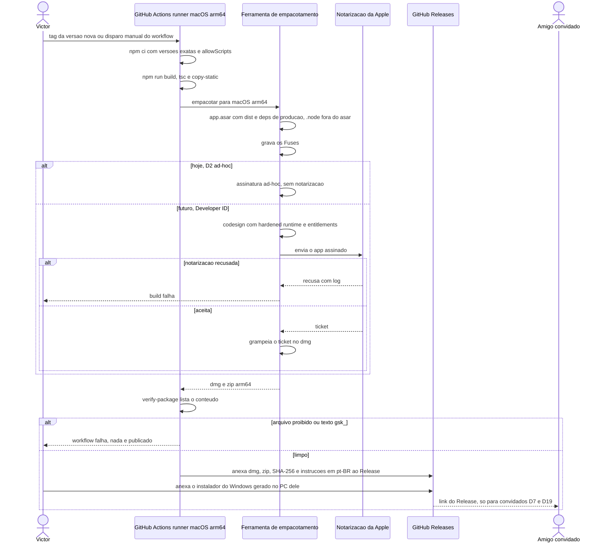
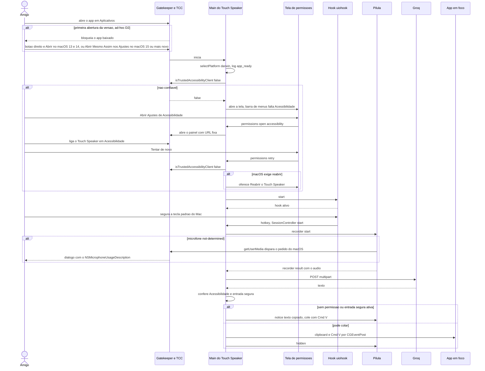
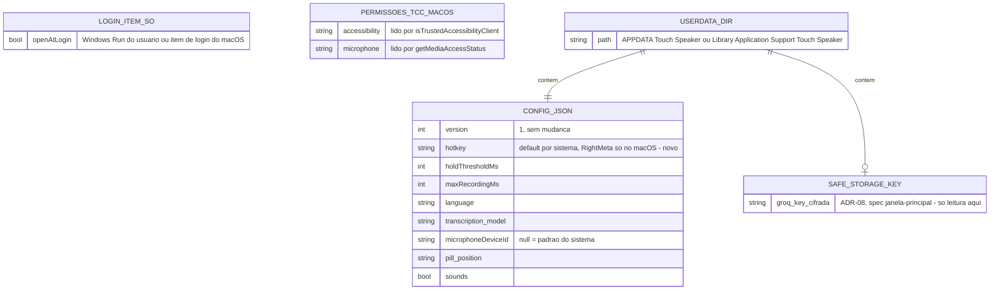
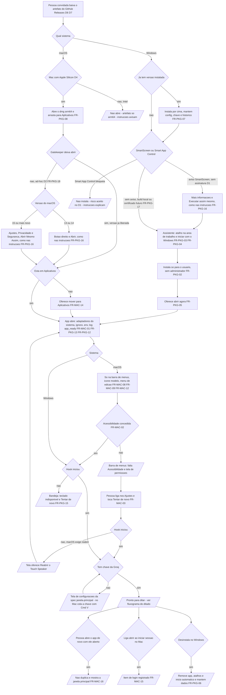
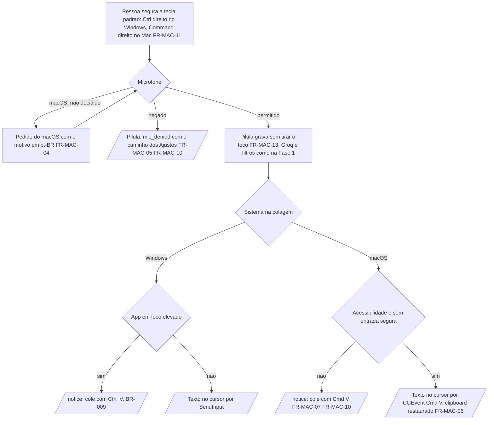
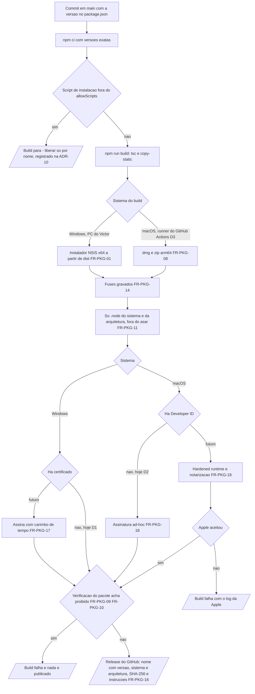

# Distribuição para Windows e macOS — spec

> Criado: 18/out/2026 · Autor: agente de IA (Claude), para revisão do Victor Alves · Status: **aprovada** (18/out/2026 · Victor) · **em implementação** — no código em 18/out/2026 (commits `6b73acb`, `acff340`, `80d642e` e o de docs); roteiros VDW e VDM pendentes (§18, SDD PEND-011)
> Origem: decisão do Victor em 18/out/2026, ao abrir a M2: o Touch Speaker vira um app que se baixa e
> instala sem terminal — instalador `.exe` no Windows e app para macOS. Nas palavras dele: "um amigo meu usa
> Mac, a gente tem que enfatizar isso".
> Fase: M2 (milestone definida pelo Victor em 18/out/2026; ver §3 — instalador e macOS estavam na Fase 4 do
> PRD) · Requisitos: FR-PKG-01…18, FR-MAC-01…16
> Contrato: SDD (`docs/spec/spec-driven-development.md`) · Decisões relacionadas: ADR-01, ADR-02, ADR-03,
> ADR-06, ADR-07 · **Propõe:** ADR-10 e ADR-11 (§17.1 e §17.2) — as duas **aceitas** em 18/out/2026 ·
> **Depende de:** ADR-08 (aceita, spec `janela-principal` — chave da Groq no `safeStorage`) e da ADR-09
> (aceita, spec `historico`). *Nota de 18/out/2026:* a ADR-09 escolheu o `node:sqlite` embutido no
> Electron, não o `better-sqlite3` que esta spec previa; os módulos nativos a empacotar são só dois —
> `koffi` e `uiohook-napi` — e o histórico não exige nada além de levar `dist/database/` no pacote
> Milestone: M2 (a registrar no SDD §29 — §3)
> Decisões do Victor de 18/out/2026: D1–D7 fechadas (§17) — Windows sem assinatura; macOS com assinatura
> ad-hoc; build do Mac no GitHub Actions; artefato do Mac só arm64 (Apple Silicon); Command direito como
> tecla padrão no Mac; entrega por GitHub Releases só para convidados; LICENSE.md, sem termo extra. Um
> conflito encontrado ao registrar essas decisões (repositório público × "só convidados") está no D19 —
> decidido pelo Victor em 18/out/2026: repositório e Releases públicos, com o link passado por ele

Hoje o Touch Speaker só roda para quem clona o repositório, instala o Node, cria um `.env` e abre o app por
`npm run dev` no Windows. Esta spec transforma o app em algo que **qualquer pessoa conhecida do Victor baixa e
instala sem abrir terminal**: um instalador `.exe` para Windows 10/11 x64 (com atalho e a opção de iniciar
com o Windows) e um `.dmg` para macOS 13 ou mais novo, com o mesmo gesto de ditado — segura a tecla, fala,
solta, o texto aparece no cursor. O macOS é objetivo de primeira classe: o código de hoje é preso ao Win32,
e cada peça exclusiva do Windows ganha aqui o equivalente no Mac, atrás de interface. A chave da Groq de cada
pessoa é digitada no próprio app (spec `janela-principal`, ADR-08); nenhum artefato leva chave, `.env`, log
ou dado de usuário.

---

## 0. Constituição (gate — preencher ANTES de desenhar, reconferir DEPOIS)

| Decisão fixa | Esta feature respeita? | Nota |
| --- | --- | --- |
| ADR-01 — Electron + TypeScript estrito (CommonJS, `tsc`, sem bundler na Fase 1); outro runtime ou framework de interface exige ADR | sim | Empacotar não é empacotar com bundler: a ferramenta (ADR-10) recebe o `dist/` que o `tsc` já gera e o coloca num `app.asar`, sem webpack, vite ou esbuild. Ferramenta nova = ADR-10 |
| ADR-02 — hook global com `uiohook-napi`, não `globalShortcut`; só a tecla configurada e o `Esc` são identificados, qualquer outra vira `other` antes de sair do hook | sim | O mesmo `uiohook-napi` é usado no macOS: o pacote traz binário para `darwin-arm64` e `darwin-x64`; o funcionamento no Electron 44 em macOS 13+ é o spike do T4 (RISK-novo-3). A classificação de `main/keyboard.ts:8-9` não muda. No macOS o hook depende da permissão de Acessibilidade (§1.4) |
| ADR-03 — inserção por clipboard + Ctrl+V via `SendInput` (`koffi`), com o clipboard restaurado e fallback quando o app em foco é elevado; o app nunca pede elevação para contornar UIPI | sim no Windows; **estendida** no macOS | No Windows nada muda. No macOS o análogo é clipboard + Cmd+V sintético por `CGEventPost`, com o mesmo backup e a mesma restauração — decisão nova, registrada na ADR-11. O instalador do Windows instala por usuário, sem pedir administrador (FR-PKG-02) |
| ADR-04 — Groq Whisper `large-v3-turbo`, áudio inteiro ao soltar; sem streaming antes da Fase 4 | sim | Não muda |
| ADR-05 — sem limpeza por IA na Fase 1; `Refiner` identidade como encaixe | sim | Não muda |
| ADR-06 — sem backend na Fase 1; o app não é distribuído com chave | sim, com a consequência **revista** | Nenhum artefato leva chave (FR-PKG-09, FR-PKG-10). Mas a frase de consequência "Distribuição exige o backend da Fase 4" deixa de valer para distribuição restrita com a chave de cada pessoa (BYOK) — revisão feita pela ADR-11 |
| ADR-07 — sala limpa em relação ao Typeless | sim | O estudo de referência cobre o Typeless para Windows; nada do comportamento dele no Mac é usado como fonte. O desenho do macOS sai da documentação pública da Apple, do Electron e do código-fonte aberto do `libuiohook` (MIT) |
| C1 Privacidade por padrão | sim | O instalador não coleta nada; a tela de permissões lê só o estado das permissões; os campos novos do log são primitivos (FR-PKG-12) |
| C2 Nunca roubar o foco | sim | A pílula continua sem foco nos dois sistemas; no macOS isso é verificado de novo (FR-MAC-13). A tela de permissões abre fora do ditado |
| C3 Nunca digitar lixo | sim | No macOS, sem permissão para colar, o texto fica no clipboard e a pílula avisa (FR-MAC-07), como o BR-009 |
| C4 Falha visível | sim — **corrige uma lacuna** | Hoje a falha do hook só vai para o log (`main/index.ts:166-170`): a tecla não faz nada e ninguém vê. FR-PKG-15 e FR-MAC-02 tornam isso visível |
| C5 Provedores trocáveis | sim | Colagem e permissões ficam atrás de interface por sistema (§8); `Transcriber` e `Refiner` não mudam |
| C6 Sem segredo em app distribuído | sim | Chave só no `safeStorage` (ADR-08); o app empacotado ignora `.env` (FR-PKG-13); segredos de assinatura só em segredos do CI ou no chaveiro da máquina de build, nunca no repositório |
| C7 Sala limpa | sim | Ver ADR-07 |
| C8 Escopo da fase | **não** | Instalador e macOS estão na Fase 4 do PRD ("Fora de escopo") e do SDD (§2.2, §29). Justificativa abaixo |
| Windows primeiro — nada de macOS/Linux/mobile antes da Fase 4 | **não** | O macOS entra na M2. Linux e mobile continuam fora. Justificativa abaixo e ADR-11 |
| Produto em pt-BR; todo texto de interface em `frontend/src/main/strings.ts` | sim | Textos novos e variantes por sistema entram em `strings.ts` (FR-MAC-10). As instruções de instalação são documentação em pt-BR |
| `SessionController` é o único dono do estado da sessão | sim | A sessão não muda: a diferença de sistema fica dentro do `TextInserter` (porta `InserterPort`, `main/session.ts:27`) e na inicialização |
| Código em `frontend/` é a fonte de fato; a feature rastreia ao PRD, ao SDD ou ao código | sim | Origem: decisão do Victor de 18/out/2026, Security Guide §10 e §15.1 (empacotamento, Fuses), FR-SET-01 (iniciar com o Windows). Os pontos sem origem viraram perguntas, decididas pelo Victor em 18/out/2026 (D1–D7, §17); resta o conflito D19 |
| Nenhum segredo (`GROQ_API_KEY`, conteúdo de `.env`) em doc, código novo ou diff | sim | Só nomes de variáveis de assinatura aparecem (§15) |
| Sem dependência, provedor ou serviço novo sem ADR | sim | `electron-builder` (devDependency) e o eventual CI do GitHub Actions entram pela ADR-10 |

**Violação exige justificativa:**

| O que fura | Por que é necessário | Alternativa rejeitada e por quê | Aval |
| --- | --- | --- | --- |
| Decisão fixa "Windows primeiro; nada de macOS antes da Fase 4" e NFR-06 | O amigo do Victor usa Mac; sem a versão de macOS ele não usa o app. O Victor pediu ênfase nisso | Esperar a Fase 4: a Fase 4 depende de backend e contas, que não têm data (PRD, roadmap, pergunta já aberta lá); o amigo ficaria sem o app indefinidamente | Victor — decisão de 18/out/2026, a confirmar no aceite da ADR-11 |
| C8 — instalador (Fase 4) puxado para a M2 | Uma pessoa sem terminal não consegue rodar `npm run dev`; sem instalador não há distribuição para ninguém, nem para o próprio Victor fora do modo de desenvolvimento | Distribuir um `.zip` do modo de desenvolvimento: exige Node, `npm install` e `.env`, exatamente o que o Victor quer evitar | Victor — mesma decisão |
| Consequência da ADR-06 ("Distribuição exige o backend da Fase 4") | Cada pessoa usa a própria chave da Groq, guardada no próprio computador (ADR-08); não há chave de ninguém no artefato, que é o perigo que a ADR-06 previne | Backend próprio agora: puxa contas, cotas e hospedagem da Fase 4, muito maior que o problema | Victor — ADR-11 |

> O que **não** entra apesar de ser Fase 4: auto-update, contas, backend, cotas, streaming (§2). ADR-08,
> ADR-10 e ADR-11 são propostas, não decisões fixas: a spec depende delas e diz como no §17.

### 0.1 Diagramas obrigatórios

Os quatro estão presentes. A feature tem tela (instalador, tela de permissões do macOS, menu da bandeja e
da barra de menus) e fluxo com vários atores (mantenedor, ferramenta de build, Apple, sistema operacional,
app, pessoa que instala).

| # | Diagrama | Seção |
| --- | --- | --- |
| 1 | Wireframes: assistente do Windows, janela do `.dmg`, tela de permissões do macOS, menus | §7.1 |
| 2 | Sequência: gerar e publicar um artefato; primeira execução no macOS até o primeiro ditado | §8.1 |
| 3 | ER: `config.json` como é lido hoje, com a tecla nova do macOS, e o estado do sistema que o app lê | §9.1 |
| 4 | Fluxogramas: instalação e primeiro uso; ditado nos dois sistemas; geração do artefato | §11.1 |

---

## 1. O problema, na tela

Quem não é o Victor não tem como usar o Touch Speaker: não há o que baixar. E quem usa Mac, mesmo que
compilasse, abriria um app que não cola nada, não ouve a tecla e não diz por quê.

### 1.1 Só existe o modo de desenvolvimento

O único jeito de abrir o app é `npm run dev` ou `npm start` (`frontend/package.json:12-16`), com Node 24,
`npm install` e um `.env` feito à mão (SDD §31). Não há script de empacotamento, instalador, ícone de app
(DESIGN §14: "Não há arquivo de ícone do app (`.ico`)") nem pipeline (`.github/` não existe — SDD §21).

### 1.2 O app instalado não teria de onde tirar a chave

A chave vem de `process.loadEnvFile(path.join(app.getAppPath(), '.env'))` (`frontend/src/main/index.ts:34-38`).
No app empacotado, `app.getAppPath()` aponta para dentro do `app.asar`, onde não pode haver `.env` (seria a
chave de alguém dentro do artefato — ADR-06). Sem a tela de configurações da spec `janela-principal`
(ADR-08), o app instalado mostraria `no_api_key` para sempre, com a mensagem "Falta a chave da Groq — veja o
README" (`frontend/src/main/strings.ts:19`), que não faz sentido para quem não tem o repositório.

### 1.3 No macOS, a colagem falha em silêncio e avisa com o atalho errado

`main/index.ts:14` importa `initWin32` e `isSelfElevated` sem condição, e `main/insert/inserter.ts:4` importa
`isForegroundWindowElevated` e `sendPasteShortcut`. No Mac, `koffi.load('user32.dll')`
(`frontend/src/main/insert/win32.ts:33-35`) falha: a inicialização registra `win32_unavailable`
(`main/index.ts:117-123`), e cada inserção cai no `catch` de `tryPaste` (`main/insert/inserter.ts:62-68`),
que devolve `false`. Todo ditado termina como `copied`, e a pílula avisa "Texto copiado — cole com Ctrl+V"
(`main/strings.ts:29`) — atalho que no Mac não cola.

### 1.4 No macOS, a tecla não faz nada, e só o log sabe

O `libuiohook` dentro do `uiohook-napi` confere, ao iniciar, se o processo é cliente confiável de
Acessibilidade, chamando `AXIsProcessTrustedWithOptions` com o pedido ao usuário ligado
(`frontend/node_modules/uiohook-napi/libuiohook/src/darwin/input_helper.c:43-72`); sem a permissão, devolve
`UIOHOOK_ERROR_AXAPI_DISABLED` (`libuiohook/src/darwin/input_hook.c:1407`), e o `uIOhook.start()` lança esse
erro (`uiohook-napi/src/lib/addon.c:228-229`). O hook usa um *event tap* ativo
(`kCGEventTapOptionDefault`, `input_hook.c:1176-1179`). O app pega a exceção e só registra
`keyboard_hook_unavailable` (`main/index.ts:166-170`): a bandeja continua "pronto", a tecla não faz nada, e
nada aparece na tela (C4). A mesma lacuna existe no Windows quando o hook não carrega — problema
**independente** desta spec, mas pré-requisito para distribuir (quem instala não lê log); entra como
FR-PKG-15. (Os caminhos de `node_modules/` são do pacote instalado em `frontend/`, fora do git, conferidos em
18/out/2026.)

Efeito colateral do pedido embutido: como o `libuiohook` liga o aviso do sistema em toda tentativa, tentar
de novo em laço abriria o diálogo do macOS várias vezes. A checagem tem de vir antes (FR-MAC-02).

### 1.5 A tecla padrão não existe no teclado do MacBook

O padrão é `RightCtrl` (`frontend/src/main/config.ts:23`). O teclado embutido dos MacBooks não tem Control
direito. A lista de teclas aceitas (`frontend/src/main/keys.ts:6-23`) não tem o Command direito, embora o
`uiohook-napi` o conheça (`MetaRight: 3676`, `node_modules/uiohook-napi/dist/index.d.ts:171`).

### 1.6 Textos que só valem no Windows

"Microfone: padrão do Windows" (`main/strings.ts:12`), "cole com Ctrl+V" (`:29`) e "veja o README" (`:19`).

### 1.7 O menu de aplicativo some, e com ele o Cmd+V nos campos de texto do app

`Menu.setApplicationMenu(null)` (`main/index.ts:85`). No macOS, os atalhos de edição (Cmd+C, Cmd+V, Cmd+X,
Cmd+A, Cmd+Z) dos campos de texto das janelas do Electron dependem dos papéis de edição do menu de
aplicativo. Sem menu, a pessoa não consegue colar a chave da Groq no campo da tela de configurações da spec
`janela-principal`. Problema **compartilhado** com aquela spec.

### 1.8 Ícone da bandeja colorido

O glifo é desenhado em `#13A89E` e o ponto de gravação em `#F87171` (`main/icon.ts:4-5`). A barra de menus do
macOS espera imagem modelo (*template*): preta com transparência, que o sistema pinta conforme o modo claro
ou escuro.

### 1.9 O pacote levaria coisas que não devem ir

- `tsconfig.main.json:18` compila `src/test/**` para `dist/test/`, e `:16` gera *source maps* — os dois
  iriam para o artefato se o empacotamento pegasse `dist/` inteiro.
- `frontend/.env` mora na mesma pasta do app empacotado.
- O `uiohook-napi` traz binários de sete plataformas (`node_modules/uiohook-napi/prebuilds/`: `darwin-arm64`,
  `darwin-x64`, `linux-arm64`, `linux-loong64`, `linux-x64`, `win32-arm64`, `win32-x64`).
- O `electron-builder` escreve por padrão em `dist/` — a mesma pasta da saída do `tsc` (§17.1).

### 1.10 O que já funciona no macOS sem mudança

- Pasta de dados: `app.setPath('userData', path.join(app.getPath('appData'), 'Touch Speaker'))`
  (`main/index.ts:28`) dá `~/Library/Application Support/Touch Speaker/` no Mac; config e log seguem
  dentro dela.
- DevTools só fora do app empacotado (`main/index.ts:97`), instância única (`:40`), app sem janela continua
  rodando (`:190-192`).
- Binários prontos: `uiohook-napi` 1.5.5 traz `darwin-arm64` e `darwin-x64` no próprio pacote; `koffi` 3.3.3
  declara `@koromix/koffi-darwin-x64` e `@koromix/koffi-darwin-arm64` como dependências opcionais
  (`node_modules/koffi/package.json`), que o npm só instala no próprio macOS — no PC do Victor só existe
  `@koromix/koffi-win32-x64`.

> Pendências e riscos já registrados que esta spec toca: RISK-004 (piora — §13), RISK-009 (melhora, via
> ADR-08), RISK-013 (vale também no Mac), RISK-003 (ganha um análogo no Mac), e a pergunta aberta do SDD §29
> e do PRD sobre "qual decisão de produto abre a Fase 4" (§3).

---

## 2. Objetivo e não-objetivos

**Objetivo:** uma pessoa sem Node nem terminal baixa um arquivo, instala o Touch Speaker no Windows 10/11 x64
ou no macOS 13+, digita a própria chave da Groq, concede as permissões pedidas e dita no app em foco com o
mesmo gesto e as mesmas regras (BR-001…015) do Windows — verificado pelo roteiro VDW no PC do Victor e pelo
roteiro VDM no Mac do amigo (§14).

**Não-objetivos** (o que esta feature explicitamente NÃO faz):

- **Atualização automática** — não é "de graça": no macOS, a atualização automática do Electron (Squirrel.Mac,
  usada pelo `electron-updater`) exige app assinado com Developer ID, e o D2 (18/out/2026) escolheu ad-hoc; no Windows exigiria
  canal de publicação e manifesto assinado. A versão nova se instala por cima da antiga (FR-PKG-07). Fica
  para a Fase 4, como no PRD.
- **Linux, mobile e Windows arm64** — fora até a Fase 4 (ADR-11).
- **Lojas** (Mac App Store, Microsoft Store) — exigem sandbox, empacotamento próprio e revisão; ninguém pediu.
- **Backend, contas, cotas, chave embutida** — Fase 4 e ADR-06.
- **Tela de configurações e entrada da chave** — spec `janela-principal` (ADR-08). Esta spec só exige que
  exista antes do primeiro artefato (§15).
- **Arte final do ícone do app, do instalador e da janela do `.dmg`** — spec `design-system`. Esta spec fixa
  formato e tamanho (§7, §15).
- **Telemetria e envio automático de erro** — sem telemetria (SDD §23). O amigo manda o `main.log` à mão, se
  quiser (só metadados).
- **Distribuição pública** (site, página de download aberta) — só pessoas convidadas pelo Victor recebem o
  app (D7, decidido em 18/out/2026); ver o conflito do D19.
- **Mac Intel** — o artefato do Mac é só arm64 (D4); não abre em Mac Intel.
- **Assinatura paga** (certificado do Windows, Developer ID e notarização da Apple) — fora por ora (D1, D2);
  ficam como opção futura, com os FR-PKG-17 e FR-PKG-18 já escritos para quando entrarem.
- **Fn/Globe como tecla de ditado no Mac** — não há suporte verificado no `libuiohook` para ela; não entra.
- **Streaming, limpeza por IA, contexto do app** — fases próprias (C8).

### 2.1 Produto — a quem serve e como se mede

| | |
| --- | --- |
| **Para quem** | (a) o **amigo do Victor que usa Mac** — persona nova, sem registro no PRD; a origem é a frase do Victor de 18/out/2026. Mac com Apple Silicon (M1/M2/M3…, D4); a versão do macOS ainda não é conhecida — o amigo confirma no VDM-02 (mínimo: macOS 13). Não se sabe se ele usa terminal: o caminho todo é sem terminal. (b) o **dev multitarefa (Victor)**, que passa a usar o app instalado, iniciado com o Windows, em vez do `npm run dev` |
| **Dor** | Amigo: "não tenho Windows e não vou abrir terminal para rodar npm". Victor: "toda vez que reinicio o PC, preciso abrir o VS Code e rodar o app na mão" |
| **Elo do fluxo que fortalece** | Nenhum elo isolado: é a pré-condição de todos para quem não compila. No macOS fortalece a **tecla** (hook com Acessibilidade) e a **inserção** (Cmd+V sintético), que hoje não funcionam lá (§1.3, §1.4) |
| **Hipótese** | Acreditamos que um instalador sem terminal, com instruções em pt-BR e uma tela que guia as permissões do Mac, faz o amigo ditar no primeiro dia, e saberemos que deu certo quando o log dele tiver um `dictation_done` com `outcome: inserted` até 10 min depois de baixar o arquivo e ele continuar usando por uma semana. Estende a **H4** (colagem nos apps) ao macOS e testa a **H3** (cota gratuita da Groq) com uma segunda pessoa, cada uma com a sua chave |
| **Como se mede** | Log local, só metadados: `app_ready` com `platform`, `arch`, `packaged`, `keyboard_hook` e, no Mac, `accessibility` (FR-PKG-12); `dictation_done` com `outcome` e `total_ms`. Sem telemetria: o número chega quando o amigo manda o `main.log`. Tempo de instalação cronometrado no roteiro VDM |
| **Custo de não fazer** | O amigo não usa o app; o Victor continua no modo de desenvolvimento; a tela de configurações da M2 (spec `janela-principal`) só serve a quem já roda o app pelo código |
| **Alcance × esforço** | Alcance: todo uso fora do PC do Victor (hoje, uma pessoa) e todo uso do próprio Victor sem VS Code. Esforço (estimativa do autor da spec, sem medição): Windows 2–3 dias; macOS 5–8 dias, mais o workflow do GitHub Actions (D3) e o teste remoto com o amigo (D6) |

> Muda texto da pílula e da bandeja no macOS (FR-MAC-10) e o gesto padrão no Mac (FR-MAC-11): o `README.md`
> e o `strings.ts` entram no §16.

---

## 3. Rastreabilidade

| Origem | Referência |
| --- | --- |
| Decisão do Victor | 18/out/2026: app baixável sem terminal; instalador `.exe` (instalar, atalho, iniciar com o Windows opcional); macOS com ênfase ("um amigo meu usa Mac"); M2 com quatro specs (`design-system`, `janela-principal`, `historico`, esta) |
| PRD | "Fora de escopo" e "Roadmap" (Fase 4: "instalador assinado, auto-update", "macOS/Linux/mobile"); NFR-06; FR-SET-01 ("opção iniciar com o Windows") |
| SDD | §2.2 e §2.4 (macOS fora; Windows 10/11 x64), §17 ("Distribuição — PLANEJADO Fase 4"), §21 (empacotamento e Fuses planejados), §26 (RISK-003, RISK-004, RISK-005, RISK-009, RISK-013), §29 (Fase 4 e a pergunta aberta "qual decisão de produto abre a Fase 4") |
| Security Guide | §10 ("O `.env` deixa de ser lido no app empacotado"; "Não distribuir o app com a chave de alguém embutida"), §15.1 (assinatura, Electron Fuses: `RunAsNode`, `EnableNodeCliInspectArguments`, integridade do ASAR), §15.2 (sem CI) |
| Código atual | §1, com âncoras |
| Specs da M2 | `janela-principal` (ADR-08, tela de configurações, chave no `safeStorage`, FR-SET-01), `historico` (`better-sqlite3`), `design-system` (ícones e visual) — escritas em paralelo; os pontos de contato estão no §17 |
| Estudo de referência | Não usado. O estudo cobre o Typeless para Windows; o desenho do macOS não sai dele (ADR-07) |
| Milestone anterior | Nenhuma: `docs/milestones/` não existe |

**Número da milestone.** O SDD §29 define `M<N>` = Fase N, e a Fase 2 do PRD é limpeza por IA, dicionário,
histórico e configurações; instalador e macOS são Fase 4. A M2 do Victor (18/out/2026) não coincide com
nenhuma das duas: tem design system, janela principal, histórico e distribuição. Esta spec **não reatribui**
fases por conta própria: registra que a M2 foi redefinida pela decisão do Victor e lista no §16 a mudança no
SDD §29 e no PRD (roadmap). Se o Victor preferir manter `M<N>` = Fase N, a M2 precisa de outro número antes
do gate.

**Fase 4.** A ADR-11 responde em parte à pergunta aberta do SDD §29 ("qual decisão de produto abre a Fase 4
— distribuição para outras pessoas?"): distribuir para pessoas conhecidas, cada uma com a própria chave,
**não** abre a Fase 4; ela continua sendo backend, contas e produto.

**Fontes externas consultadas em 18/out/2026** (fatos de ferramenta e de sistema operacional citados nesta
spec; o que não foi confirmado está marcado "a confirmar"):

- Electron 44 exige macOS 13 (Ventura) ou mais novo — [notas da versão 44.0.0](https://releases.electronjs.org/release/v44.0.0).
- Opções do `electron-builder` 26.15.3 (`latest` no npm em 18/out/2026): `files`, `asar`, `asarUnpack`,
  `npmRebuild`, `buildDependenciesFromSource`, `nodeGypRebuild`, `electronFuses`, `appId`, `mac.identity`
  (`"-"` = assinatura ad-hoc), `mac.hardenedRuntime`, `mac.entitlements`, `mac.extendInfo`, `mac.notarize`
  (credenciais por `APPLE_API_KEY`, `APPLE_API_KEY_ID`, `APPLE_API_ISSUER`), `mac.target`, `nsis.oneClick`,
  `nsis.perMachine`, `nsis.include`, `nsis.createDesktopShortcut`, `nsis.runAfterFinish` — conferidas no
  [`scheme.json` do `app-builder-lib` 26.15.3](https://unpkg.com/app-builder-lib@26.15.3/scheme.json).
- `systemPreferences.isTrustedAccessibilityClient`, `getMediaAccessStatus`, `askForMediaAccess` e a exigência
  de `NSMicrophoneUsageDescription` — [Electron, `systemPreferences`](https://www.electronjs.org/docs/latest/api/system-preferences);
  `type: 'panel'` no macOS — [Electron, `BaseWindowOptions`](https://www.electronjs.org/docs/latest/api/structures/base-window-options);
  `setLoginItemSettings` (no Windows, o nome padrão do valor de registro é o `AppUserModelId()`; no macOS, o
  tipo padrão é `mainAppService`) e `moveToApplicationsFolder` (sem diálogo de confirmação por padrão — o
  app pergunta antes, FR-MAC-14) — [Electron, `app`](https://www.electronjs.org/docs/latest/api/app).
- `better-sqlite3` 13 roda em Node-API e traz os binários no pacote — [notas da 13.0.0](https://newreleases.io/project/npm/better-sqlite3/release/13.0.0);
  a 13.0.3 traz `prebuilds/win32-x64.node`, `darwin-x64.node` e `darwin-arm64.node` e não tem script de
  instalação (listagem do pacote no unpkg e `npm view`, 18/out/2026).
- Gatekeeper no macOS 15: sem o atalho "Control-clique → Abrir"; a liberação passa por Ajustes → Privacidade
  e Segurança → "Abrir Mesmo Assim" — [Macworld](https://www.macworld.com/article/2457844/what-to-do-when-you-cant-open-an-app-you-just-installed-in-macos-sequoia.html)
  (fonte de terceiros; a confirmar no Mac do amigo).
- SmartScreen: certificado EV não dá mais reputação imediata — [Microsoft Learn, reputação do SmartScreen](https://learn.microsoft.com/et-ee/windows/apps/package-and-deploy/smartscreen-reputation);
  Smart App Control pode bloquear instalador sem assinatura sem opção de "Executar assim mesmo" —
  [relato de desenvolvedor](https://textslashplain.com/2026/04/28/smart-app-control/) (a confirmar).
- Azure Artifact Signing (antigo Trusted Signing): US$ 9,99/mês no plano Basic; pessoa física só nos EUA e no
  Canadá — [Microsoft, opções de assinatura](https://learn.microsoft.com/en-us/windows/apps/package-and-deploy/code-signing-options),
  [preços](https://azure.microsoft.com/nb-no/pricing/details/artifact-signing/) (a confirmar na data da decisão).
- GitHub Actions: `macos-15` e `macos-latest` (arm64), `macos-15-intel` (x64, até o outono de 2027); `macos-14`
  retirado em 02/nov/2026 — [changelog do GitHub, out/2026](https://github.blog/changelog/2026-10-01-github-actions-macos-14-runner-image-retirement),
  [macOS 13](https://github.blog/changelog/2025-09-19-github-actions-macos-13-runner-image-is-closing-down/).
- TCC: *event tap* ativo pede Acessibilidade; postar eventos sintéticos é um privilégio próprio, listado em
  Acessibilidade — fóruns de desenvolvedores da Apple ([1](https://developer.apple.com/forums/thread/122492),
  [2](https://developer.apple.com/forums/thread/828052)); não é documentação formal (a confirmar no spike).

Esta feature não consta como entregue no PRD nem no SDD na forma pedida: o §16 prevê linha no `CHANGELOG` e
as notas no SDD e no PRD.

---

## 4. Atores e permissões

| Ator | O que pode | Como o código (ou o sistema) confere |
| --- | --- | --- |
| Mantenedor (Victor) | gera e publica os artefatos | comando de empacotamento a partir de `npm ci` com versões exatas; verificação do pacote antes de publicar (FR-PKG-10) |
| Máquina de build | roda o `tsc` e a ferramenta de empacotamento | Windows: o PC do Victor. macOS: runner macOS arm64 do GitHub Actions (D3), num workflow novo em `.github/workflows/` (T6). Com assinatura ad-hoc (D2) não há certificado nem segredo de assinatura; o workflow só usa o `GITHUB_TOKEN` do próprio Actions para anexar o artefato ao Release |
| GitHub Releases | guarda e entrega os artefatos (D6) | Release com o `.exe`, o `.dmg`, o `.zip` e os SHA-256; quem pode baixar depende da visibilidade do repositório (D19) |
| Serviço de notarização da Apple | — | não usado por ora (D2 = ad-hoc); entra se o Developer ID for adotado no futuro |
| Pessoa que instala (Victor no Windows, amigo no Mac) | baixa, instala, concede permissões, digita a chave, dita | o sistema operacional pede as permissões; o app só lê o estado delas |
| SmartScreen / Smart App Control (Windows) | avisa ou bloqueia executável baixado da internet sem reputação | instalador sem assinatura (D1): o aviso do SmartScreen é aceito e explicado nas instruções; o bloqueio do Smart App Control é risco aceito (RISK-novo-1) |
| Gatekeeper (macOS) | bloqueia app não notarizado baixado da internet até a pessoa liberar | assinatura ad-hoc (D2): bloqueia na primeira abertura de cada versão; a liberação depende da versão do macOS (§7, instruções do FR-PKG-16); a assinatura ad-hoc é o mínimo para rodar em Apple Silicon |
| TCC — Acessibilidade (macOS) | libera o hook global e o Cmd+V sintético | `systemPreferences.isTrustedAccessibilityClient(false)` antes de iniciar o hook (FR-MAC-02) |
| TCC — Microfone (macOS) | libera o `getUserMedia` | `NSMicrophoneUsageDescription` no `Info.plist`; `systemPreferences.getMediaAccessStatus('microphone')` e `askForMediaAccess` (FR-MAC-04) |
| Chaves do macOS (Keychain) | guarda a chave mestra do `safeStorage` (ADR-08) | o acesso é ligado à assinatura do app — ver RISK-novo-2 |
| Processo main | rede (Groq), clipboard, teclado global, colagem por sistema, arquivos em `userData` | dono único do estado (`SessionController`); escolhe o adaptador de plataforma na inicialização (FR-MAC-01) |
| Renderer (pílula) e preload | iguais à Fase 1 | `contextIsolation`, `sandbox`, `nodeIntegration: false`; CSP de `pill.html` intacta |
| Janela de permissões (macOS) | mostra o estado das permissões e pede ao main para abrir o painel certo dos Ajustes | canais da §10, validados no main; o main só abre URLs fixas, nunca vindas do renderer |
| App em foco | recebe Ctrl+V (Windows) ou Cmd+V (macOS) | Windows: elevação (BR-009). macOS: Acessibilidade e entrada segura (FR-MAC-07) |

---

## 5. Requisitos funcionais

`FR-PKG-NN` = empacotamento e distribuição (os dois sistemas); `FR-MAC-NN` = port para o macOS. Formato EARS.

### 5.1 Empacotamento e distribuição — FR-PKG

| # | Requisito | Origem | Prioridade |
| --- | --- | --- | --- |
| FR-PKG-01 | QUANDO o mantenedor roda o comando de empacotamento do Windows O SISTEMA DEVE gerar um instalador `.exe` para Windows 10/11 x64 a partir do `dist/` produzido pelo `tsc`, sem bundler | Victor 18/out; ADR-01; ADR-10 | P1 |
| FR-PKG-02 | QUANDO a pessoa executa o instalador do Windows O SISTEMA DEVE instalar o app só para o usuário atual, sem pedir privilégios de administrador | Victor ("instalar"); guardrail "nunca pedir elevação" | P1 |
| FR-PKG-03 | QUANDO a instalação no Windows termina O SISTEMA DEVE ter criado o atalho no Menu Iniciar e, se a pessoa deixou marcada a opção, o atalho na área de trabalho | Victor ("atalho"); D8 | P1 |
| FR-PKG-04 | QUANDO a pessoa marca "Iniciar com o Windows" no instalador O SISTEMA DEVE abrir o Touch Speaker sozinho no próximo login daquele usuário, e a tela de configurações (FR-SET-01) DEVE mostrar a opção ligada — o estado que o instalador grava é o mesmo que o app lê (`app.getLoginItemSettings`) | Victor ("iniciar com o Windows opcional"); PRD FR-SET-01 | P1 |
| FR-PKG-05 | QUANDO o instalador do Windows termina O SISTEMA DEVE oferecer abrir o Touch Speaker na hora, com a opção marcada | instalação sem terminal (Victor) | P2 |
| FR-PKG-06 | QUANDO a pessoa desinstala pelo "Aplicativos instalados" do Windows O SISTEMA DEVE remover o app, os atalhos e o início automático, e manter `%APPDATA%\Touch Speaker` | D9 | P2 |
| FR-PKG-07 | QUANDO uma versão nova é instalada por cima de outra (Windows: instalador; macOS: substituir o app em Aplicativos) O SISTEMA DEVE manter o `config.json`, a chave guardada (ADR-08) e o histórico (spec `historico`) | sem auto-update (§2); dados em `userData` (`main/index.ts:28`) | P1 |
| FR-PKG-08 | QUANDO o workflow de release do GitHub Actions roda num runner macOS O SISTEMA DEVE gerar um `.dmg` (arrastar para Aplicativos) e um `.zip` do app para macOS 13+, só para arm64 (Apple Silicon) | Victor ("macOS"); D3, D4 (18/out/2026); Electron 44 exige macOS 13 | P1 |
| FR-PKG-09 | QUANDO um artefato é gerado O SISTEMA DEVE conter só `dist/main`, `dist/preload`, `dist/shared`, `dist/renderer`, o `package.json` e as dependências de produção — nunca `.env`, `.env.*`, logs, `config.json`, banco do histórico, `dist/test`, `*.map`, `src/`, `scripts/`, `docs/` nem devDependencies | ADR-06; C6; §1.9 | P1 |
| FR-PKG-10 | QUANDO um artefato é gerado O SISTEMA DEVE rodar uma verificação que lista o conteúdo do pacote e falha o build ao encontrar arquivo proibido (FR-PKG-09) ou texto com o prefixo das chaves da Groq (`gsk_`) | ADR-06; RISK-novo-5 | P1 |
| FR-PKG-11 | QUANDO o app é empacotado O SISTEMA DEVE levar só os binários nativos (`.node`) do sistema e da arquitetura do artefato, fora do `app.asar`, sem compilar módulo nativo e sem rodar script de instalação que não esteja liberado por nome no `allowScripts` | ADR-10; `package.json:27-30`; Security Guide §15.1 | P1 |
| FR-PKG-12 | QUANDO o app abre O SISTEMA DEVE registrar no `app_ready` os campos `platform`, `arch` e `packaged` e, no macOS, `accessibility` (booleano), além dos que já existem (`keyboard_hook`, `has_api_key`…) | observabilidade sem telemetria (§2.1) | P1 |
| FR-PKG-13 | ENQUANTO o app roda empacotado (`app.isPackaged`) O SISTEMA DEVE ignorar qualquer `.env` e ler a chave só do `safeStorage` (ADR-08) | Security Guide §10 | P1 |
| FR-PKG-14 | QUANDO o app é empacotado O SISTEMA DEVE gravar os Electron Fuses: `RunAsNode`, `EnableNodeOptionsEnvironmentVariable` e `EnableNodeCliInspectArguments` desligados; `EnableEmbeddedAsarIntegrityValidation` e `OnlyLoadAppFromAsar` ligados | Security Guide §15.1 | P2 |
| FR-PKG-15 | SE o hook de teclado não inicia (em qualquer sistema) ENTÃO O SISTEMA DEVE mostrar isso na bandeja ou barra de menus — status e item de menu com o que fazer — em vez de continuar "pronto" | C4; §1.4 | P1 |
| FR-PKG-16 | QUANDO um artefato é publicado O SISTEMA DEVE ter no nome o produto, a versão do `package.json`, o sistema e a arquitetura, e vir com o SHA-256 e as instruções de instalação em pt-BR daquele sistema — no Windows, o aviso do SmartScreen ("Mais informações → Executar assim mesmo", D1); no macOS, a liberação do Gatekeeper na primeira abertura de cada versão (botão direito → Abrir no macOS 13 e 14; Ajustes → Privacidade e Segurança → "Abrir Mesmo Assim" no macOS 15 ou mais novo, D2) e o aviso de que as permissões podem ser pedidas de novo a cada versão; e o que o app envia para fora (só o áudio, para a Groq, com a chave da própria pessoa) | instalação sem terminal; D1, D2; C1 | P1 |
| FR-PKG-17 | ONDE houver certificado de assinatura do Windows O SISTEMA DEVE assinar o instalador e os executáveis com carimbo de tempo, com a mesma identidade em todas as versões. **Hoje não se aplica:** D1 (18/out/2026) = sem assinatura | Security Guide §15.1; D1 | P3 (futuro) |
| FR-PKG-18 | QUANDO o app do macOS é empacotado O SISTEMA DEVE assiná-lo com assinatura ad-hoc (D2) e, ONDE um dia houver Developer ID, assinar com *hardened runtime*, notarizar e grampear o tíquete no `.dmg` (opção futura) | Apple Silicon só executa código assinado; D2 | P1 (ad-hoc) |

### 5.2 macOS — FR-MAC

| # | Requisito | Origem | Prioridade |
| --- | --- | --- | --- |
| FR-MAC-01 | QUANDO o app abre no macOS O SISTEMA DEVE usar os adaptadores de plataforma do macOS (colagem e permissões) e nunca carregar `user32`, `kernel32` nem `advapi32` | §1.3; C5 | P1 |
| FR-MAC-02 | QUANDO o app abre no macOS sem ser cliente confiável de Acessibilidade O SISTEMA DEVE não iniciar o hook, mostrar "falta permissão de Acessibilidade" na barra de menus e abrir a tela de permissões | §1.4; C4 | P1 |
| FR-MAC-03 | QUANDO a pessoa concede a Acessibilidade e escolhe "Tentar de novo" (ou o app volta a ficar ativo) O SISTEMA DEVE iniciar o hook; SE o macOS só reconhecer a permissão depois de reabrir o app ENTÃO O SISTEMA DEVE oferecer "Reabrir o Touch Speaker" | §1.4 | P1 |
| FR-MAC-04 | QUANDO a tela de permissões é mostrada, ou um ditado vai começar, com o microfone em `not-determined` O SISTEMA DEVE pedir o acesso pelo diálogo do macOS (`askForMediaAccess('microphone')`), com o motivo em pt-BR no `NSMicrophoneUsageDescription` | Electron `systemPreferences`; NFR-04 | P1 |
| FR-MAC-05 | SE o microfone está `denied` ou `restricted` no macOS ENTÃO O SISTEMA DEVE mostrar `mic_denied` com o caminho dos Ajustes do macOS e oferecer, na tela de permissões, abrir o painel de Microfone | FR-DICT-09; C4 | P1 |
| FR-MAC-06 | QUANDO há texto para inserir no macOS O SISTEMA DEVE colar com clipboard + Cmd+V sintético, com o backup e a restauração do clipboard (BR-010) e a espera da tecla física solta (BR-008) | ADR-03 estendida (ADR-11) | P1 |
| FR-MAC-07 | SE, na hora de colar no macOS, o app não é mais confiável de Acessibilidade ou a entrada segura do sistema (*Secure Event Input*) está ativa ENTÃO O SISTEMA DEVE deixar o texto no clipboard e mostrar o aviso `paste_blocked` com "⌘V" | análogo do BR-009; C3 | P1 |
| FR-MAC-08 | ENQUANTO nenhuma janela do Touch Speaker está aberta no macOS O SISTEMA DEVE ficar só na barra de menus, sem ícone no Dock | app de bandeja (SDD §1.1); D10 | P1 |
| FR-MAC-09 | QUANDO o app roda no macOS O SISTEMA DEVE usar ícone de barra de menus em imagem modelo (*template*), legível nos modos claro e escuro, com a variante "gravando" distinta pela forma | DESIGN ("cor nunca é o único sinal"); D11 | P2 |
| FR-MAC-10 | QUANDO o app roda no macOS O SISTEMA DEVE mostrar textos sem "Windows" e sem "Ctrl+V": colar como "⌘V", microfone "padrão do sistema", e a tecla pelo nome do Mac ("Option direita", "Command direito") | §1.6 | P1 |
| FR-MAC-11 | QUANDO o `config.json` é criado no macOS O SISTEMA DEVE usar `RightMeta` (Command direito) como tecla padrão (D5, 18/out/2026) e aceitar `RightMeta` (Command direito, código 3676) no campo `hotkey`; no Windows, `RightMeta` é inválido e cai no default com `config_invalid_field` | §1.5; BR-012 | P1 |
| FR-MAC-12 | QUANDO o app roda no macOS O SISTEMA DEVE ter um menu de aplicativo mínimo com os papéis de edição, para Cmd+C, Cmd+V, Cmd+X, Cmd+A e Cmd+Z funcionarem nos campos de texto do próprio app | §1.7; spec `janela-principal` | P1 |
| FR-MAC-13 | QUANDO a pílula aparece no macOS O SISTEMA DEVE mostrá-la sem tirar o foco do app em foco, inclusive sobre app em tela cheia | C2; FR-DICT-07 | P1 |
| FR-MAC-14 | QUANDO o app abre no macOS fora da pasta Aplicativos (de dentro do `.dmg` ou de Downloads) O SISTEMA DEVE oferecer movê-lo para Aplicativos (`app.moveToApplicationsFolder`) | permissões do TCC presas ao local e à assinatura do app; D12 | P2 |
| FR-MAC-15 | QUANDO a pessoa liga "Abrir ao iniciar sessão" na tela de configurações no macOS O SISTEMA DEVE registrar o item de login (`setLoginItemSettings`) | FR-SET-01 estendido pela ADR-11; D13 | P3 |
| FR-MAC-16 | QUANDO a pessoa abre o Touch Speaker de novo (Finder, Launchpad) com ele já aberto no macOS O SISTEMA DEVE não abrir segunda instância e mostrar a janela principal (spec `janela-principal`) | instância única (`main/index.ts:40`) | P3 |

**Casos de borda:**

- **Tecla acidental, atalho, `Esc`:** BR-001…004 valem nos dois sistemas. No Mac, Option direita mais uma
  letra (acentos no teclado americano) seria tratada como atalho (BR-003) — um dos motivos do Command direito
  como padrão (D5). O `Esc` também chega ao app em foco no Mac (RISK-013).
- **Foco muda durante a transcrição:** igual à Fase 1 (RISK-006).
- **Microfone ocupado ou sem permissão:** `mic_unavailable` e `mic_denied`; no Mac, também o estado do TCC
  (FR-MAC-04, FR-MAC-05).
- **Sem rede, chave inválida, limite da Groq:** igual à Fase 1.
- **Clipboard com imagem; pessoa copia algo logo depois:** BR-010 nos dois sistemas (a API de clipboard do
  Electron é a mesma).
- **App de destino elevado (Windows):** BR-009. **Entrada segura ativa (macOS)** — campo de senha, Terminal
  com "Entrada Segura de Teclado", gerenciadores de senha: o hook não recebe as teclas (a tecla de ditado não
  responde) e a colagem cai no FR-MAC-07. Aceito e documentado nas instruções.
- **Duas telas:** a pílula aparece na tela do mouse (`main/pill-window.ts:84-90`), nos dois sistemas.
- **Sem chave:** `no_api_key` leva à tela de configurações (spec `janela-principal`).
- **Gravação no limite de 5 min:** BR-011, igual.
- **Permissão de Acessibilidade revogada com o app aberto:** a colagem cai no FR-MAC-07; o hook pode parar
  de receber eventos — o app confere a permissão ao colar e ao reabrir o menu (FR-MAC-03).
- **Atualização no Mac com assinatura ad-hoc:** a permissão de Acessibilidade e o acesso ao Keychain podem
  se perder a cada versão (RISK-novo-2, risco aceito no D2); as instruções dizem o que fazer.
- **Mac Intel:** fora — o artefato é só arm64 (D4); as instruções dizem que é para Mac com Apple Silicon.
- **Windows com Smart App Control ligado e instalador sem assinatura:** pode não instalar (RISK-novo-1,
  aceito no D1).
- **Teclado sem a tecla padrão:** a pessoa troca a tecla no `config.json` (FR-DICT-13) ou na tela de
  configurações (spec `janela-principal`).
- **Instalar por cima com o app aberto:** o instalador do Windows pede para fechar o app; no Mac, a pessoa
  sai pelo menu antes de substituir — está nas instruções.

---

## 6. Requisitos não-funcionais

Os NFR novos levam `NFR-novo-N`; o número definitivo é dado quando a spec for aprovada. Os limiares sem
origem anterior são propostas desta spec, para o aval do Victor (§17).

| Categoria | Requisito (com limiar) | Como se verifica |
| --- | --- | --- |
| Plataforma (NFR-06, revisto) | Windows 10/11 x64 e macOS 13 (Ventura) ou mais novo em Mac com Apple Silicon (arm64, D4) | roteiros VDW e VDM; o Electron 44 não abre em macOS 12; a versão do macOS do amigo é anotada no VDM-02 |
| Tamanho (NFR-novo-1) | instalador do Windows x64 ≤ 150 MB; `.dmg` arm64 ≤ 150 MB (o ADR-01 estima o app em ~150 MB); crescimento > 10% entre versões exige linha no `CHANGELOG` com o motivo | tamanho do arquivo ao fim do build, anotado nas notas da versão |
| Instalação (NFR-novo-2) | do download ao primeiro ditado inserido ≤ 10 min para quem segue as instruções, sem terminal | cronometrado nos roteiros VDW-01 e VDM-01 |
| Build reproduzível (NFR-novo-3) | dois builds do mesmo commit, com `npm ci`, geram a mesma lista de arquivos no pacote | saída da verificação do FR-PKG-10, comparada entre dois builds |
| Latência (NFR-01, NFR-02) | as metas da Fase 1 valem no app empacotado e no Mac: p50 ≤ 1,5 s e p95 ≤ 3 s; captura ≤ 300 ms (com a permissão já concedida) | `dictation_done.total_ms` e `recorder_started.latency_ms` de 10 ditados no VDW e 10 no VDM |
| Consumo em repouso (NFR-03) | ≤ 220 MB de memória somando os processos, ~0% de CPU, no app empacotado do Windows e do Mac | Gerenciador de Tarefas (Windows) e Monitor de Atividade (macOS), após 10 min parado |
| Privacidade (C1, NFR-04) | 0 arquivos de usuário ou segredo no artefato; a tela de permissões lê só estados; log novo só com primitivos; o microfone fecha em todo caminho também no Mac (o indicador laranja do macOS apaga) | FR-PKG-10; revisão do `main.log` após os roteiros; VDM-06 |
| Segurança Electron (NFR-05) | `contextIsolation`, `sandbox`, sem `nodeIntegration`, CSP intacta, DevTools desligado no empacotado (`main/index.ts:97`), Fuses do FR-PKG-14; a janela de permissões segue as mesmas regras | revisão + teste do validador dos canais novos + leitura dos Fuses do binário (`npx @electron/fuses read`, a confirmar) |
| Foco (C2) | a pílula não toma foco nem clique nos dois sistemas | VDW-08 e VDM-08: o cursor continua piscando no app em foco |
| Acessibilidade | a tela de permissões tem rótulos legíveis por leitor de tela (VoiceOver), foco visível e contraste ≥ 4,5:1 (regras da spec `design-system`); a pílula mantém `role="status"` e `aria-live="polite"` | revisão manual com VoiceOver no VDM |
| Observabilidade | `app_ready` com `platform`, `arch`, `packaged`, `accessibility`; eventos novos `accessibility_missing`, `secure_input_active`, `hook_retry` só com primitivos | revisão de um `main.log` real de cada sistema |
| Degradação (C4) | toda permissão faltando e toda falha do hook aparece na bandeja/barra de menus ou na pílula; o app nunca fecha nem fica "pronto" sem estar | VDM-03, VDM-05, VDW-10 |
| i18n | N/A — produto em pt-BR; textos em `strings.ts`, agora com variantes por sistema | — |
| Fuso horário | N/A — a interface não mostra data nem hora | — |

---

## 7. Telas e estados

**Onde monta:**

- Assistente do instalador do Windows — NSIS gerado pela ferramenta (ADR-10), com a página de opções em
  script `include` do NSIS (`frontend/build/installer.nsh`).
- Janela do `.dmg` — fundo e posição dos ícones na configuração `dmg` da ferramenta; arte pela spec
  `design-system`.
- Tela de permissões do macOS — dentro da janela principal da spec `janela-principal`, ou numa janela própria
  pequena (D14).
- Bandeja / barra de menus — `frontend/src/main/tray.ts`, ícone em `frontend/src/main/icon.ts`.
- Pílula — sem estado novo; só os textos por sistema (`strings.ts`).

**Onde NÃO aparece:** nada desta spec aparece durante o ditado. A tela de permissões nunca abre enquanto a
sessão grava, transcreve ou insere (C2).

| Estado da pílula | O que muda |
| --- | --- |
| `hidden` | nada |
| `listening` | nada; no Mac, a dica de mãos livres é a mesma |
| `transcribing` | nada |
| `notice` | "Texto copiado — cole com Ctrl+V" no Windows; "Texto copiado — cole com ⌘V" no Mac (texto proposto) |
| `error` | `mic_denied` no Mac: "Sem permissão para usar o microfone — veja Ajustes do Sistema" (texto proposto); `no_api_key` sem "veja o README" no app empacotado (spec `janela-principal`) |

| Estado da bandeja / barra de menus | Texto de status (proposto) | Itens novos |
| --- | --- | --- |
| pronto | "Touch Speaker — pronto" | — |
| ouvindo | "Touch Speaker — ouvindo" | — |
| falta a chave | "Touch Speaker — falta a chave da Groq" | (spec `janela-principal`) |
| **falta Acessibilidade (macOS)** | "Touch Speaker — falta permissão de Acessibilidade" | "Abrir Ajustes de Acessibilidade…", "Tentar de novo" |
| **teclado indisponível (os dois)** | "Touch Speaker — teclado indisponível" | "Tentar de novo"; no Windows, "Abrir pasta de configuração" (onde está o log) |

**Interação:** a tela de permissões é a única superfície nova que recebe foco e clique; ela abre na
inicialização quando falta permissão (FR-MAC-02) e pelo menu. A pílula continua sem foco nem clique.

### 7.1 Wireframes — diagrama 1 de 4

Baixa fidelidade. Cores, ícones e textos finais saem da spec `design-system` e do `strings.ts`.

**Assistente do Windows** (página de opções antes de instalar; página final):

```text
┌─ Instalar o Touch Speaker ────────────────────────────────────┐
│  [ícone]  Touch Speaker 0.2.0                                  │
│                                                                │
│  Opções                                                        │
│  [x] Criar atalho na área de trabalho                          │
│  [ ] Iniciar o Touch Speaker com o Windows                     │
│                                                                │
│  Instala só para você, em %LOCALAPPDATA%; não pede            │
│  administrador.                                                │
│                                      [ Cancelar ] [ Instalar ] │
└────────────────────────────────────────────────────────────────┘

┌─ Instalação concluída ────────────────────────────────────────┐
│  O Touch Speaker fica na bandeja, perto do relógio            │
│  (às vezes escondido na setinha ^).                            │
│  [x] Abrir o Touch Speaker agora                               │
│                                                  [ Concluir ]  │
└────────────────────────────────────────────────────────────────┘
```

Se a ferramenta mostrar a página "para todos os usuários / só para mim" (`nsis.perMachine: false` com
`oneClick: false` mostra essa escolha, segundo o esquema da ferramenta), a spec pede que ela seja suprimida
ou fixada em "só para mim" — conferido no T1.

**Janela do `.dmg`:**

```text
┌─ Touch Speaker ───────────────────────────────────────────────┐
│                                                                │
│      [ícone Touch Speaker]   ──────►   [pasta Aplicativos]     │
│                                                                │
│   Arraste o Touch Speaker para Aplicativos                     │
└────────────────────────────────────────────────────────────────┘
```

**Tela de permissões do macOS** (estado principal: Acessibilidade faltando):

```text
┌─ Touch Speaker — permissões ──────────────────────────────────┐
│  Para ditar, o Touch Speaker precisa de duas permissões        │
│  do macOS. Nada sai do seu Mac além do áudio, para a Groq.     │
│                                                                │
│  ✗ Acessibilidade        ouvir a tecla de ditado e colar       │
│    [ Abrir Ajustes de Acessibilidade ]   [ Tentar de novo ]    │
│                                                                │
│  ? Microfone             gravar enquanto você segura a tecla   │
│    [ Permitir microfone ]                                      │
│                                                                │
│  Tecla de ditado: Command direito  (troque em Configurações)   │
└────────────────────────────────────────────────────────────────┘

estado esquecível — microfone negado:
│  ✗ Microfone   negado. Ajustes do Sistema → Privacidade e       │
│                Segurança → Microfone → ligar o Touch Speaker   │
│    [ Abrir Ajustes de Microfone ]                              │

depois de concedida e o macOS exigir reabrir:
│  ✓ Acessibilidade   concedida — falta reabrir o app            │
│    [ Reabrir o Touch Speaker ]                                 │
```

Cada linha tem glifo **e** texto (cor nunca é o único sinal — DESIGN §13).

**Menu da barra de menus (macOS)** e **menu da bandeja (Windows)** com a falha:

```text
macOS                                         Windows
┌──────────────────────────────────────────┐  ┌──────────────────────────────────────┐
│ Touch Speaker — falta permissão de       │  │ Touch Speaker — teclado indisponível │
│   Acessibilidade              (inativo)  │  │ Microfone: padrão do Windows (inat.) │
│ Microfone: padrão do sistema  (inativo)  │  │ ──────────────────────────────────── │
│ ──────────────────────────────────────── │  │ Tentar de novo                       │
│ Abrir Ajustes de Acessibilidade…         │  │ Abrir pasta de configuração          │
│ Tentar de novo                           │  │ Sair                                 │
│ Abrir pasta de configuração              │  └──────────────────────────────────────┘
│ Sair                                     │
└──────────────────────────────────────────┘
ícone: imagem modelo; "gravando" = mesmo glifo com ponto cheio (forma, não cor)
```

Duas telas e `pill.position: top-center`: o mesmo layout da Fase 1. A tela de permissões abre centralizada
na tela do mouse.

---

## 8. Arquitetura — onde isso encaixa

**Lados envolvidos:** processo main (inicialização, inserção, bandeja, config, textos), a janela de
permissões (renderer novo ou parte da janela principal) e a cadeia de build (`package.json`, configuração da
ferramenta, `frontend/build/`, `frontend/scripts/`). A pílula, o preload dela e `shared/ipc.ts` não mudam.

**Componentes novos ou existentes:**

| Peça | Hoje | Proposta |
| --- | --- | --- |
| Colagem | `TextInserter` importa `win32.ts` direto (`main/insert/inserter.ts:4`) | interface `PasteDriver` injetada no `TextInserter`: `targetBlocksPaste(): boolean` e `sendPasteShortcut(): boolean`. Implementações: `Win32PasteDriver` (o `win32.ts` de hoje, sem mudança de lógica) e `MacPasteDriver` (novo `main/insert/darwin.ts`). O `TextInserter` e o `SessionController` não mudam de regra |
| Colagem no Mac | — | `koffi` chamando CoreGraphics: `CGEventCreateKeyboardEvent` com a tecla V (`kVK_ANSI_V`), `CGEventSetFlags` com a máscara de Command, `CGEventPost` no *tap* de HID e `CFRelease`; checagem da entrada segura por `IsSecureEventInputEnabled` (Carbon) e da Acessibilidade por `systemPreferences.isTrustedAccessibilityClient(false)`. Escrito a partir da documentação da Apple, como o `win32.ts` foi da Microsoft. Plano B (D15): `uIOhook.keyTap(V, [Meta])`, que o pacote já tem (`node_modules/uiohook-napi/dist/index.js:187-200`) |
| Permissões | — | interface `PermissionsPort` (`accessibility()`, `microphone()`, `openSettings(target)`, `requestMicrophone()`); no Windows devolve "não se aplica" para Acessibilidade e lê o microfone por `getMediaAccessStatus` |
| Escolha do sistema | — | `main/platform.ts`, **lógica pura**: `selectPlatform(process.platform)` devolve qual driver e quais textos usar; testável com `node:test` |
| Hook | `startKeyboardHook` em `main/keyboard.ts:7-13` | igual; no Mac, só é chamado depois de `accessibility() === true` (FR-MAC-02), com "Tentar de novo" (FR-MAC-03) |
| Textos | `strings` fixo (`main/strings.ts`) | `stringsFor(platform)`: base comum + variantes (colar, microfone, nome da tecla, status de permissão) |
| Config | `DEFAULT_CONFIG` com `RightCtrl` (`main/config.ts:21-31`) | `defaultConfig(platform)` e `normalizeConfig(raw, warn, platform)`; `HOTKEY_CODES` ganha `RightMeta: 3676` (`main/keys.ts`), válido só no macOS |
| Menu de aplicativo | `Menu.setApplicationMenu(null)` (`main/index.ts:85`) | no Mac, menu mínimo com `appMenu` e `editMenu`; no Windows, igual a hoje |
| Dock e ícone | ícone colorido | no Mac, `LSUIElement` no `Info.plist` (ou `app.dock.hide()`) e ícone modelo (`setTemplateImage(true)`); no Windows, igual |
| Pílula no Mac | `focusable: false`, `showInactive`, `alwaysOnTop` `screen-saver` (`main/pill-window.ts:35`, `:49`, `:80`) | conferir no Mac; se tomar foco ou não aparecer sobre tela cheia, usar `type: 'panel'` (documentado no Electron para macOS) e/ou `setVisibleOnAllWorkspaces` — decidido no T4 |
| `.env` | lido sempre (`main/index.ts:34-38`) | só com `!app.isPackaged` (FR-PKG-13) |
| Build | `tsc` + `copy-static.mjs` | o mesmo `npm run build`, seguido da ferramenta (ADR-10) e de `scripts/verify-package.mjs` |

**Lógica pura ou presa ao Electron?** `platform.ts`, `config.ts` (com o parâmetro de plataforma), a escolha
de textos e as regras do verificador de pacote ficam sem `electron` e com teste `node:test`. `darwin.ts`,
`win32.ts` e o `PermissionsPort` ficam presos ao sistema e vão para o roteiro manual.

**Provedor externo?** Nenhum provedor novo no app. A notarização da Apple é chamada pela ferramenta de build,
não pelo app.

**Estado:** o `SessionController` continua o único dono da sessão. O estado das permissões é do main
(inicialização), lido sob demanda; não entra na sessão.

**Configuração:** um valor novo aceito em `hotkey` (`RightMeta`, só no Mac) e o default por sistema (§9).

```text
build:   npm ci → npm run build (tsc) → ferramenta (asar, .node fora, Fuses)
         → Windows sem assinatura (D1) · macOS ad-hoc no runner do GitHub Actions (D2, D3)
         → verify-package → artefato + SHA-256 + instruções → GitHub Releases (D6)
macOS:   abrir → selectPlatform(darwin) → isTrustedAccessibilityClient(false)?
         ├─ não → barra de menus "falta Acessibilidade" + tela de permissões → Tentar de novo / Reabrir
         └─ sim → uiohook start → tecla → SessionController → pílula grava (TCC microfone)
                → Groq → filtros → Refiner → TextInserter(MacPasteDriver: CGEvent Cmd+V) → app em foco
```

### 8.1 UML de sequência — diagrama 2 de 4

**Gerar e publicar o artefato do macOS** (D2 e D3: assinatura ad-hoc no runner do GitHub Actions; o ramo
Developer ID é a opção futura. O Windows é gerado no PC do Victor, sem assinatura, e anexado ao mesmo
Release):



**Primeira execução no macOS até o primeiro ditado:**



---

## 9. Modelo de dados

**Onde vive:** `config.json` (`frontend/src/main/config.ts`). Nenhum dado novo persistido pelo app. O estado
do início automático e das permissões é do sistema operacional; o app só o lê ou o pede.

**Muda o formato de dado persistido?** **não** — `RightMeta` é um valor novo aceito num campo que já existe
(`hotkey`), e o default passa a depender do sistema na criação do arquivo. Um `config.json` antigo continua
válido; não há `version` nova nem spec de migração. Por que não basta o que existe: nenhum valor atual de
`hotkey` é uma modificadora sozinha que exista em todo teclado de Mac e não sirva para digitar — por isso o
Command direito (D5).

| Onde | Campo | Tipo | Default | Faixa válida e o que acontece se for inválido |
| --- | --- | --- | --- | --- |
| `config.json` | `hotkey` | string | Windows: `RightCtrl` (igual a hoje). macOS: `RightMeta`, Command direito (D5, 18/out/2026) | Windows: `RightCtrl`, `RightAlt`, `RightShift`, `CapsLock`, `F13`–`F24`. macOS: os mesmos e `RightMeta`. Fora da lista do sistema → default do sistema com `config_invalid_field` (`field: "hotkey"`) — BR-012 |
| `config.json` | `microphoneDeviceId` | string \| null | `null` | igual; o texto do menu diz "padrão do sistema" no Mac (FR-MAC-10) |
| `config.json` | demais campos | — | — | sem mudança |
| sistema (Windows) | início automático | valor em `HKCU\Software\Microsoft\Windows\CurrentVersion\Run` | ausente | escrito pelo instalador (FR-PKG-04) ou pelo app. Pela documentação do `app.setLoginItemSettings`, o nome padrão do valor é o `AppUserModelId()` do app — aqui `com.victoralves.touchspeaker` (`main/index.ts:29`) — e o caminho padrão é o executável; que o valor gravado pelo instalador com esse nome seja lido pelo `getLoginItemSettings` é conferido no T1 |
| sistema (macOS) | item de login | serviço de login do macOS | desligado | só pela tela de configurações (FR-MAC-15) |
| sistema (macOS) | Acessibilidade, Microfone | TCC | não concedidos | o app lê; nunca grava |

- **Índices:** N/A — sem SQLite nesta spec.
- **Unicidade / idempotência:** instalar por cima não duplica atalho nem valor de início automático (mesmo
  nome de valor); o `config.json` existente nunca é sobrescrito pelo instalador.
- **Retenção:** desinstalar mantém `userData` (D9). O artefato não carrega dado nenhum de usuário.
- **Privacidade:** o app nunca grava estado de permissão, nome de dispositivo nem caminho de instalação no
  log além dos booleanos e códigos do §6.

### 9.1 ER — diagrama 3 de 4



O `config.json` é o único dado do app que esta spec toca; `SAFE_STORAGE_KEY` é da spec `janela-principal` e
aparece porque o FR-PKG-07 exige que sobreviva à atualização. `LOGIN_ITEM_SO` e `PERMISSOES_TCC_MACOS` são
estado do sistema, não persistido pelo app. Sem índice (não há SQLite aqui); a unicidade do início automático
vem do nome de valor fixo.

---

## 10. Contrato

**Canais IPC.** Nenhum canal novo na pílula: `shared/ipc.ts`, `preload/pill.ts` e `renderer/global.d.ts` não
mudam. A tela de permissões precisa de três canais. Ficam no preload da janela que a hospedar (D14 — se for a
janela principal, no preload da spec `janela-principal`), com os nomes propostos abaixo. Não levam
`sessionId`: não são eventos de sessão de ditado (como o `pill:state`).

| Canal | Direção | Payload | Validação no main |
| --- | --- | --- | --- |
| `permissions:state` | main → janela | `{ platform: 'win32' \| 'darwin', accessibility: 'granted' \| 'denied' \| 'not-applicable', microphone: 'not-determined' \| 'granted' \| 'denied' \| 'restricted' \| 'unknown', keyboardHook: boolean, needsRelaunch: boolean }` | só o main envia |
| `permissions:open` | janela → main | `{ target: 'accessibility' \| 'microphone' }` | remetente = a janela de permissões; `target` de lista fechada; o main mapeia para a URL fixa do painel dos Ajustes (`x-apple.systempreferences:com.apple.preference.security?Privacy_Accessibility` e `…?Privacy_Microphone` — a confirmar no T4). Nunca abre URL vinda do renderer (Security Guide §9) |
| `permissions:retry` | janela → main | `{ action: 'retry' \| 'relaunch' \| 'request-microphone' }` | remetente e `action` de lista fechada; `relaunch` = `app.relaunch()` + `app.exit(0)`; `request-microphone` = `askForMediaAccess('microphone')` |

**HTTP (provedor externo):** nenhum novo. A chamada à Groq não muda.

**Formato:** os três canais entram em `docs/API.md` antes do código que os consome (§16).

**Códigos de erro:** nenhum código novo na união `ErrorCode` (`frontend/src/main/errors.ts`). O FR-MAC-07 usa
`paste_blocked`; o FR-MAC-05 usa `mic_denied`. Mudam só as **mensagens** por sistema em `strings.ts` e na
tabela "Códigos de erro" do `docs/API.md`.

**Efeitos colaterais:**

- Log: campos novos no `app_ready` (`platform`, `arch`, `packaged`, `accessibility`) e eventos novos
  `accessibility_missing` (warn), `hook_retry` (info, `ok: boolean`) e `secure_input_active` (info, na
  colagem) — só primitivos.
- Clipboard: igual à Fase 1, nos dois sistemas.
- Bandeja: estados novos (§7).
- Sistema: o instalador escreve o início automático no registro do usuário; o app no Mac pode pedir para
  mover-se para Aplicativos.

**Compatibilidade:** nenhum canal ou payload existente muda. `config.json` antigo continua abrindo. O modo
de desenvolvimento (`npm run dev`) continua funcionando nos dois sistemas: no Mac, um desenvolvedor concede
Acessibilidade ao `Electron.app` de `node_modules` (registrar no `ENVIRONMENT.md`).

---

## 11. Fluxo ponta a ponta

```text
1. Victor gera o artefato (Windows no PC dele; macOS arm64 no runner do GitHub Actions) e publica num
   Release do GitHub, com o link só para convidados (D3, D4, D6, D7)
2. a pessoa baixa e instala
   Windows: aviso do SmartScreen (sem assinatura, D1) → assistente: atalho, iniciar com o Windows
            → instala por usuário → abre
   macOS:   .dmg → arrasta para Aplicativos → Gatekeeper bloqueia (ad-hoc, D2) → botão direito → Abrir
            (macOS 13–14) ou "Abrir Mesmo Assim" nos Ajustes (macOS 15+) → abre
3. o app abre: selectPlatform → app_ready (platform, arch, packaged…) → .env ignorado (empacotado)
   macOS: Acessibilidade? não → tela de permissões e barra de menus; sim → hook
   os dois: hook falhou? → bandeja "teclado indisponível"
4. sem chave → tela de configurações (spec janela-principal); a pessoa cola a chave (Cmd+V no Mac)
5. a pessoa segura a tecla padrão do sistema → SessionController (sem mudança) → pílula grava
   macOS: primeiro uso do microfone → pedido do macOS
6. Groq → filtros → Refiner → TextInserter com o PasteDriver do sistema
   Windows: elevado? → notice Ctrl+V; senão SendInput
   macOS: sem Acessibilidade ou entrada segura? → notice ⌘V; senão CGEvent Cmd+V
7. pílula some; clipboard restaurado (BR-010)
```

### 11.1 Fluxogramas — diagrama 4 de 4

**Instalação e primeiro uso:**



**Ditado nos dois sistemas** (o que muda em relação ao fluxograma da Fase 1):



**Geração do artefato** (mantenedor):



Conferência FR × ramo: FR-PKG-01…18 e FR-MAC-01…16 aparecem nos três fluxogramas; não há ramo sem FR (os
ramos herdados da Fase 1 — elevação, BR-009 — têm os FR-DICT dela).

---

## 12. Alternativas consideradas

| Alternativa | Por que foi rejeitada |
| --- | --- |
| **Electron Forge** (`@electron-forge/cli` 8.0.1 no npm, 18/out/2026) | ferramenta oficial e boa, mas o instalador padrão do Windows é o Squirrel.Windows, que instala em silêncio, sem assistente — sem a escolha de atalho e de início automático que o Victor pediu; o MSI (WiX) exige o WiX Toolset instalado; vários pacotes (`cli` + um *maker* por formato) e reconstrução de módulo nativo ligada por padrão, que aqui não é necessária |
| **`@electron/packager` + Inno Setup (Windows) + `create-dmg` (macOS)** | controle total, mas três ferramentas e mais scripts próprios para manter; assinatura e notarização à mão |
| **Instalador MSIX / lojas** | MSIX e Microsoft Store exigem assinatura e empacotamento próprios; Mac App Store exige sandbox — nenhum foi pedido |
| **`.zip` "portátil" sem instalador** | sem atalho, sem início automático, e no Mac o app rodaria de Downloads (permissões do TCC instáveis) |
| **Tauri** | reescrever o main em Rust; o ADR-01 só prevê Tauri se o tamanho virar problema |
| **Gerar o artefato do macOS no Windows** | inviável: o binário do `koffi` para macOS vem de pacote opcional que o npm só instala no macOS (no PC do Victor só existe `@koromix/koffi-win32-x64`), e `codesign`, `notarytool` e o `.dmg` são ferramentas do macOS |
| **Binário universal (x64 + arm64)** | dobra o tamanho e exige os binários do `koffi` das duas arquiteturas na mesma árvore; rejeitado no D4 (18/out/2026): o Mac do amigo é Apple Silicon, artefato só arm64 |
| **Developer ID + notarização agora** | abre sem bloqueio e mantém as permissões entre versões, mas custa US$ 99/ano e uma conta Apple; adiado no D2 (18/out/2026) — opção futura |
| **Certificado de assinatura do Windows agora** | custo anual (OV com chave em token ou HSM) ou elegibilidade restrita (Azure Artifact Signing: pessoa física só nos EUA e no Canadá); adiado no D1 (18/out/2026) |
| **Build do Mac no Mac do amigo ou em outro Mac** | exigiria Node, acesso ao repositório e terminal do amigo; rejeitado no D3 (18/out/2026) em favor do GitHub Actions |
| **Colar no Mac por `osascript` (System Events)** | abre um processo por colagem (latência), pede uma terceira permissão (Automação) e depende de AppleScript |
| **Colar no Mac por helper nativo em Swift** | exige Xcode e um binário próprio para assinar; o `koffi` já faz a chamada |
| **`uIOhook.keyTap` para o Cmd+V** | viável e sem FFI nova (o `libuiohook` liga a máscara de Command no V — `post_event.c:33-99`); fica como plano B (D15) porque não dá retorno de sucesso e põe colagem e hook na mesma biblioteca |
| **`globalShortcut` no Mac** | os mesmos motivos da ADR-02: não avisa quando a tecla é solta nem aceita modificadora sozinha |
| **Hook próprio no Mac (`CGEventTapCreate` via `koffi`)** | exige *callback* nativo e laço de eventos próprio; só se o `uiohook-napi` falhar no spike (RISK-novo-3) |
| **Pular a checagem e deixar o `libuiohook` pedir a permissão** | o pedido dele aparece a cada tentativa (§1.4) e a falha continua invisível na tela |
| **Atualização automática (`electron-updater`)** | no Mac exige assinatura Developer ID; no Windows, canal e manifesto; não é "de graça" (§2) |

---

## 13. Riscos

| Risco | Impacto | Mitigação |
| --- | --- | --- |
| **RISK-004** — módulos nativos quebram com o Electron | **piora**: dois módulos (`koffi`, `uiohook-napi` — o histórico usa o `node:sqlite` embutido, ADR-09) × dois sistemas × uma arquitetura por sistema | todos Node-API com binário pronto, sem compilar (ADR-10); FR-PKG-12 mostra no log o que carregou; roteiro nos dois sistemas a cada atualização do Electron |
| **RISK-005** — copiar do Typeless | igual | o desenho do Mac sai da documentação da Apple, do Electron e do `libuiohook` aberto; nada do Typeless para Mac |
| **RISK-009** — chave em texto puro | **melhora** | o app empacotado ignora `.env` (FR-PKG-13); chave no `safeStorage` (ADR-08) |
| **RISK-013** — `Esc` chega ao app em foco | igual, agora também no Mac | aceito, como na Fase 1 |
| **RISK-003** — UIPI | igual no Windows; ganha o análogo no Mac (entrada segura) | FR-MAC-07 |
| **RISK-novo-1** — sem assinatura no Windows: aviso do SmartScreen; com Smart App Control ligado, o instalador pode nem rodar | a pessoa não instala ou desconfia | **aceito no D1 (18/out/2026)**; instruções com o passo a passo (FR-PKG-16); para o próprio Victor, o build local não tem a marca de internet; certificado fica como opção futura (FR-PKG-17) |
| **RISK-novo-2** — no Mac com assinatura ad-hoc, cada versão nova tem outra identidade: a permissão de Acessibilidade pode parecer ligada e não valer, e o acesso ao Keychain do `safeStorage` pode pedir senha ou falhar (chave da Groq perdida) | cada atualização obriga a refazer as permissões e talvez redigitar a chave | **aceito no D2 (18/out/2026)**; instruções de atualização (remover e readicionar o Touch Speaker em Acessibilidade; liberar o Gatekeeper de novo); a confirmar no VDM-10; o Developer ID, que mantém a identidade entre versões, fica como opção futura |
| **RISK-novo-3** — o `uiohook-napi` 1.5.5 nunca rodou neste projeto no macOS 13+ com o Electron 44 | sem hook no Mac | spike no T4 antes do resto; plano B: hook próprio com `CGEventTapCreate` via `koffi` |
| **RISK-novo-4** — entrada segura do macOS cega o hook e bloqueia a colagem | a tecla não responde em campo de senha, no Terminal com "Entrada Segura de Teclado" e em alguns apps | aceito (é proteção do sistema); FR-MAC-07; instruções |
| **RISK-novo-5** — artefato com `.env`, log ou chave | chave de alguém circulando | lista de permissão (FR-PKG-09) e verificação que falha o build (FR-PKG-10) |
| **RISK-novo-6** — Cmd+V sintético usa o código físico da tecla V (`kVK_ANSI_V`); em layout não QWERTY (Dvorak) pode virar outro atalho | colagem errada | o layout ABNT2 e o americano têm o V no mesmo lugar; Dvorak fica fora; a confirmar no VDM com o layout do amigo |
| **RISK-novo-7** — o Victor não tem Mac: todo teste do macOS depende do amigo ou do CI | regressão no Mac só aparece no Mac do amigo | roteiro VDM curto e cronometrado; log com `platform`/`arch`; o runner do GitHub Actions (D3) garante ao menos que o app do Mac compila, empacota e passa na verificação — o comportamento interativo (permissões, colagem) só o Mac do amigo prova |
| **RISK-novo-8** — segredos no CI | vazamento de credencial | com ad-hoc (D2) não há certificado nem chave da Apple no CI; o workflow usa só o `GITHUB_TOKEN` com permissão mínima para criar o Release; se o Developer ID entrar no futuro, certificado e chave de API vão para os segredos do GitHub, nunca para o repositório |
| **RISK-novo-9** — Mac Intel | quem tiver Mac Intel não roda o artefato | fora de escopo: só arm64 (D4); as instruções dizem "Mac com Apple Silicon (M1 ou mais novo)" |
| **RISK-novo-10** — distribuir app proprietário a terceiros sem termo (LICENSE.md, SDD §18 "termos antes de distribuir") | ambiguidade jurídica e de privacidade | **decidido no D7 (18/out/2026)**: só convidados do Victor; vale o LICENSE.md, sem termo extra por ora; a frase do FR-PKG-16 diz o que sai do computador. Mas o repositório é público — ver D19 |
| **RISK-novo-11** — o repositório `Victorkaue333/touch-speaker` é público (API do GitHub, 18/out/2026): um Release nele pode ser baixado por qualquer pessoa, e o código-fonte também está aberto | o "só convidados" do D7 não se sustenta com Release público | **aceito no D19** (Victor, 18/out/2026): Release público, link passado pelo Victor; o README e as notas do Release dizem o que sai do computador |

---

## 14. Critérios de aceite

| # | Critério | Verifica |
| --- | --- | --- |
| 1 | DADO um clone limpo no Windows QUANDO o Victor roda `npm ci` e o comando de empacotamento do Windows ENTÃO sai `Touch-Speaker-Setup-<versão>-x64.exe` (ou nome equivalente com versão, sistema e arquitetura) em `frontend/release/`, sem bundler | FR-PKG-01, FR-PKG-16 |
| 2 | DADO um usuário Windows sem privilégio de administrador QUANDO executa o instalador ENTÃO instala sem pedido de UAC | FR-PKG-02 |
| 3 | DADO o assistente com "atalho na área de trabalho" marcado QUANDO a instalação termina ENTÃO há atalho no Menu Iniciar e na área de trabalho; com a opção desmarcada, só no Menu Iniciar | FR-PKG-03 |
| 4 | DADO "Iniciar com o Windows" marcado QUANDO o usuário sai e entra de novo no Windows ENTÃO o Touch Speaker abre na bandeja, e `app.getLoginItemSettings().openAtLogin` é `true`; desmarcado, não abre | FR-PKG-04 |
| 5 | DADO o fim da instalação QUANDO a pessoa clica "Concluir" com "Abrir agora" marcado ENTÃO o ícone aparece na bandeja | FR-PKG-05 |
| 6 | DADO o app instalado com início automático QUANDO a pessoa desinstala pelo "Aplicativos instalados" ENTÃO somem app, atalhos e início automático, e `%APPDATA%\Touch Speaker` continua lá | FR-PKG-06 |
| 7 | DADO a versão N instalada, com chave e `config.json` alterado QUANDO a versão N+1 é instalada por cima (Windows) ou substitui o app em Aplicativos (macOS) ENTÃO a chave, o `config.json` e o histórico continuam; no Mac com ad-hoc, o resultado (inclusive o pedido do Keychain) é anotado no VDM-10 | FR-PKG-07 |
| 8 | DADO o workflow de release no runner macOS do GitHub Actions QUANDO ele roda ENTÃO saem `.dmg` e `.zip` arm64 anexados ao Release, e o app abre num Mac com Apple Silicon em macOS 13+ | FR-PKG-08 |
| 9 | DADO um artefato gerado QUANDO a verificação lista o pacote ENTÃO não há `.env*`, `*.log`, `config.json`, `dist/test`, `*.map`, `src/`, `scripts/`, `docs/` nem devDependencies | FR-PKG-09 |
| 10 | DADO um arquivo **permitido** de teste (ex.: um `.js` de `dist/main/` gerado só para o teste) contendo um texto que começa por `gsk_` QUANDO o build roda ENTÃO a verificação falha o build e nada é publicado; DADO um `.env` posto em `frontend/` ENTÃO ele não aparece no pacote (a lista de permissão o barra antes) | FR-PKG-10 |
| 11 | DADO o pacote do Windows (ou do Mac) QUANDO se listam os `.node` ENTÃO só há os do sistema e da arquitetura do artefato, fora do `app.asar`, e o `npm ci` não rodou script fora do `allowScripts` | FR-PKG-11 |
| 12 | DADO o app empacotado QUANDO abre ENTÃO o `app_ready` traz `platform`, `arch`, `packaged: true`, `keyboard_hook` e, no Mac, `accessibility` | FR-PKG-12 |
| 13 | DADO um `.env` com chave posto ao lado do executável instalado QUANDO o app empacotado abre ENTÃO a chave não é usada (`has_api_key` reflete só o `safeStorage`) | FR-PKG-13 |
| 14 | DADO o executável empacotado QUANDO se leem os Fuses ENTÃO `RunAsNode`, `EnableNodeOptionsEnvironmentVariable` e `EnableNodeCliInspectArguments` estão desligados e a integridade do ASAR e `OnlyLoadAppFromAsar` ligados; e `ELECTRON_RUN_AS_NODE=1` não transforma o app em Node | FR-PKG-14 |
| 15 | DADO o hook impedido de iniciar (no Mac, sem Acessibilidade; no Windows, simulando a falha) QUANDO o app abre ENTÃO a bandeja/barra de menus mostra o estado de falha com "Tentar de novo", e não "pronto" | FR-PKG-15, FR-MAC-02 |
| 16 | DADO um artefato publicado QUANDO a pessoa o recebe ENTÃO vêm junto o SHA-256 e as instruções em pt-BR do sistema dela: no Windows, o aviso do SmartScreen; no Mac, botão direito → Abrir (macOS 13–14) ou "Abrir Mesmo Assim" (macOS 15+), o aviso de que as permissões podem voltar a ser pedidas a cada versão e que o app é para Apple Silicon; e a frase sobre o que sai do computador | FR-PKG-16 |
| 17 | **Não se aplica enquanto D1 = sem assinatura.** Quando houver certificado: DADO o instalador QUANDO se abrem as propriedades ENTÃO a assinatura é válida e tem carimbo de tempo | FR-PKG-17 |
| 18 | DADO o `.app` gerado QUANDO se confere a assinatura (`codesign --verify`) ENTÃO há assinatura ad-hoc válida (D2) e o app abre em Apple Silicon depois da liberação do Gatekeeper; com Developer ID (futuro), o `.dmg` teria o tíquete grampeado e abriria sem bloqueio | FR-PKG-18 |
| 19 | DADO o app no Mac QUANDO abre ENTÃO o log não tem `win32_unavailable`, e nenhuma biblioteca do Windows é carregada | FR-MAC-01 |
| 20 | DADO o app no Mac sem Acessibilidade QUANDO abre ENTÃO a tela de permissões aparece uma vez, o diálogo do sistema não se repete e o log tem `accessibility_missing` | FR-MAC-02 |
| 21 | DADO a Acessibilidade recém-concedida QUANDO a pessoa toca "Tentar de novo" ENTÃO o hook inicia (`hook_retry` com `ok: true`), ou a tela oferece "Reabrir o Touch Speaker", que reabre o app já com o hook | FR-MAC-03 |
| 22 | DADO o microfone em `not-determined` QUANDO a pessoa toca "Permitir microfone" ou começa o primeiro ditado ENTÃO aparece o diálogo do macOS com o motivo em pt-BR | FR-MAC-04 |
| 23 | DADO o microfone negado nos Ajustes QUANDO a pessoa tenta ditar ENTÃO a pílula mostra a mensagem com o caminho dos Ajustes e a tela de permissões oferece abrir o painel de Microfone | FR-MAC-05 |
| 24 | DADO "ABC" no clipboard e o TextEdit em foco QUANDO a pessoa dita "teste" ENTÃO "teste" aparece no cursor e um Cmd+V manual depois cola "ABC" | FR-MAC-06 |
| 25 | DADO a Acessibilidade revogada com o app aberto, ou um campo de senha em foco QUANDO um ditado termina ENTÃO o texto fica no clipboard e a pílula mostra "Texto copiado — cole com ⌘V" | FR-MAC-07 |
| 26 | DADO o app aberto no Mac sem janela QUANDO a pessoa olha o Dock e o Cmd+Tab ENTÃO o Touch Speaker não aparece; aparece só na barra de menus | FR-MAC-08 |
| 27 | DADO o modo claro e o escuro do macOS QUANDO o app grava e para ENTÃO o ícone da barra de menus é legível nos dois, e a variante "gravando" se distingue pela forma | FR-MAC-09 |
| 28 | DADO o app no Mac QUANDO se percorrem pílula, menu e tela de permissões ENTÃO nenhum texto diz "Windows" nem "Ctrl+V" | FR-MAC-10 |
| 29 | DADO um Mac sem `config.json` QUANDO o app abre pela primeira vez ENTÃO o arquivo é criado com `hotkey: "RightMeta"` (D5) e o Command direito dita; DADO `hotkey: "RightMeta"` no Windows ENTÃO cai em `RightCtrl` com `config_invalid_field` | FR-MAC-11 |
| 30 | DADO a chave da Groq copiada QUANDO a pessoa aperta Cmd+V no campo da tela de configurações no Mac ENTÃO a chave é colada | FR-MAC-12 |
| 31 | DADO o TextEdit em foco (e, em outra rodada, um app em tela cheia) QUANDO a pessoa segura a tecla ENTÃO a pílula aparece por cima e o cursor continua piscando no app | FR-MAC-13 |
| 32 | DADO o app aberto direto do `.dmg` montado QUANDO abre ENTÃO oferece mover para Aplicativos; aceitando, reabre de lá | FR-MAC-14 |
| 33 | DADO "Abrir ao iniciar sessão" ligado no Mac QUANDO a pessoa sai e entra na sessão ENTÃO o app abre na barra de menus | FR-MAC-15 |
| 34 | DADO o app aberto no Mac QUANDO a pessoa o abre de novo pelo Finder ENTÃO não surge segunda instância e a janela principal aparece | FR-MAC-16 |
| 35 | DADO um toque acidental sem fala, no Mac QUANDO a tecla é solta ENTÃO nada é inserido | C3, FR-DICT-08 |
| 36 | DADO qualquer permissão faltando no Mac QUANDO a pessoa tenta ditar ENTÃO a falha aparece na tela e o app continua aberto | C4 |

**Testes previstos**

| Arquivo | O que cobre |
| --- | --- |
| `frontend/src/test/platform.test.ts` (TEST-novo-1) | `selectPlatform`: `win32` → driver do Windows e textos do Windows; `darwin` → driver do Mac; outro sistema → erro claro |
| `frontend/src/test/config.test.ts` (ampliado, TEST-004) | default de `hotkey` por sistema; `RightMeta` válido só em `darwin`; config antigo continua válido |
| `frontend/src/test/strings.test.ts` (TEST-novo-2) | os textos de `darwin` não contêm "Windows" nem "Ctrl+V"; todo código de erro tem mensagem nos dois sistemas |
| teste da função pura do verificador de pacote (TEST-novo-3) | lista com `.env`, `dist/test/x.js`, `a.map` ou conteúdo com `gsk_` é recusada; lista limpa passa. Onde ele mora (em `src/` ou em `scripts/` com o próprio `node --test`) é decidido no T2 |
| Roteiro VDW (Windows, Victor) | critérios 1–7, 9–16 (o 17 não se aplica: D1 = sem assinatura), 35–36 e latência/memória do §6 |
| Roteiro VDM (macOS, amigo; Victor acompanha por chamada) | critérios 7, 8, 12, 15, 18–36 e latência/memória do §6 |

**Roteiro VDW — Windows** (app instalado, não `npm run dev`; o Victor anota tempo e resultado):

| ID | Passo | Critérios |
| --- | --- | --- |
| VDW-01 | baixar o instalador como um usuário faria (navegador), cronometrar até o primeiro ditado no Bloco de Notas | 2, 3, 5, NFR-novo-2 |
| VDW-02 | reiniciar a sessão com "Iniciar com o Windows" marcado; depois desmarcado | 4 |
| VDW-03 | instalar a versão N+1 por cima | 7 |
| VDW-04 | desinstalar | 6 |
| VDW-05 | rodar a verificação de pacote e a leitura dos Fuses; listar os `.node` | 9–11, 14 |
| VDW-06 | `.env` com chave ao lado do executável | 13 |
| VDW-07 | ler o `app_ready` | 12 |
| VDW-08 | pílula sem foco no Bloco de Notas e no VS Code | C2 |
| VDW-09 | 10 ditados de 3–30 s; memória após 10 min parado | NFR-01, NFR-03 |
| VDW-10 | simular o hook indisponível (ex.: outro app de ditado segurando o hook, ou a variável de teste do T3) | 15 |

**Roteiro VDM — macOS** (amigo, com o Victor por chamada; resultado anotado nesta spec):

| ID | Passo | Critérios |
| --- | --- | --- |
| VDM-01 | baixar, abrir o `.dmg`, arrastar, abrir; cronometrar até o primeiro ditado no TextEdit | 8, 18, 32, NFR-novo-2 |
| VDM-02 | anotar modelo do Mac, chip, versão do macOS e layout do teclado | D4, D5, RISK-novo-6 |
| VDM-03 | primeira abertura sem Acessibilidade → tela de permissões → conceder → "Tentar de novo" (ou "Reabrir") | 15, 20, 21 |
| VDM-04 | microfone: permitir; depois negar nos Ajustes e tentar ditar | 22, 23 |
| VDM-05 | colar a chave no campo de configurações com Cmd+V | 30 |
| VDM-06 | ditar em TextEdit, Notas, Safari ou Chrome, Slack ou WhatsApp, VS Code; conferir clipboard ("ABC") e indicador de microfone | 24, 28, 31, NFR-04 |
| VDM-07 | campo de senha em foco; depois revogar a Acessibilidade com o app aberto | 25 |
| VDM-08 | pílula sobre app em tela cheia; Dock e Cmd+Tab; modo claro e escuro | 26, 27, 31 |
| VDM-09 | toque acidental, `Esc`, mãos livres; abrir o app de novo pelo Finder; "Abrir ao iniciar sessão" | 33–36 |
| VDM-10 | instalar a versão N+1 (substituir em Aplicativos): permissões e chave continuam? | 7, RISK-novo-2 |
| VDM-11 | 10 ditados; memória após 10 min parado; mandar o `main.log` ao Victor | 12, NFR-01, NFR-03 |

> Não há teste de interface nem CI de testes: o que depende de instalador, permissões, microfone ou app em
> foco fica no roteiro manual, com o resultado anotado na spec.

---

## 15. Rollout

1. **Ordem:**
   1. **Pré-requisito:** a tela de configurações com a chave no `safeStorage` (spec `janela-principal`,
      ADR-08) entra antes do primeiro artefato ou junto com ele. Sem ela, o app instalado não tem chave.
   2. Fronteira de plataforma no código (T3) — não muda comportamento no Windows; `npm test` e o roteiro da
      Fase 1 continuam valendo.
   3. Empacotamento do Windows (T1, T2) e roteiro VDW.
   4. Workflow do GitHub Actions que gera o app do Mac (T6) — primeiro como build de teste, sem publicar.
   5. Spike do macOS (T4): o runner gera, o Mac do amigo executa; só depois o resto do Mac (T5).
   6. Instruções e primeiro Release para o amigo (T7), roteiro VDM (T9).
2. **Configuração nova:** nenhum campo novo; `RightMeta` aceito em `hotkey` no Mac e default por sistema
   (`defaultConfig(platform)`, `normalizeConfig` com plataforma, linha no `docs/DATABASE.md`). Com D1 (sem
   assinatura) e D2 (ad-hoc), o build não precisa de certificado nem de credencial da Apple: o workflow do
   Mac usa só o `GITHUB_TOKEN` do próprio Actions para anexar o artefato ao Release. Se um dia entrarem
   certificado ou Developer ID, as variáveis da ferramenta (`CSC_LINK`, `CSC_KEY_PASSWORD`, `APPLE_API_KEY`,
   `APPLE_API_KEY_ID`, `APPLE_API_ISSUER`) vão para os segredos do GitHub — só os nomes no `ENVIRONMENT.md`.
   O `.env.example` do app não muda.
3. **Dados:** não muda formato persistido; sem spec de migração.
4. **Distribuição:** este é o item que muda. Antes, a mudança chegava só a quem compilava; agora chega por
   artefato versionado (`version` do `package.json`, hoje `0.1.0`), publicado num Release do GitHub (D6),
   com o link passado só aos convidados do Victor (D7; ver D19), sem atualização automática: a pessoa baixa
   e instala por cima. Primeiro o Victor no Windows (VDW); depois o artefato do Mac para o amigo (VDM). O
   amigo devolve o `main.log` à mão (só metadados). Cada versão publicada tem uma linha no `CHANGELOG` com
   o que mudou e os resultados dos roteiros.
5. **Rollback:** reverter o commit volta o modo de desenvolvimento; para quem instalou, "voltar" é instalar o
   artefato anterior por cima — por isso todo Release publicado fica no GitHub, com os SHA-256. O
   `config.json` continua abrindo na versão anterior (nenhum campo novo; `RightMeta` numa versão antiga cai
   no default com aviso, BR-012).

---

## 16. Impacto na documentação (mesmo PR)

Docs a atualizar **na implementação** (esta spec não edita nenhum deles):

- [ ] `docs/CHANGELOG.md` — o quê e o porquê (amigo no Mac; app sem terminal)
- [ ] SDD — §0.3 (versão), §1.1 (estado), §2.2 e §2.4 (macOS e instalador saem do "fora do escopo"; macOS
      13+), §3 (atores: instalador, TCC), §5 (NFR-06 revisto, NFR-novo-1…3 numerados), §17 (distribuição),
      §20 (TEST-novo-1…3 numerados; roteiros VDW/VDM), §21 (empacotamento; CI no GitHub Actions para o Mac),
      §22 (variáveis de build), §23 (campos e eventos novos do log), §26 (RISK-novo-1…11 numerados; RISK-004
      piora, RISK-009
      melhora), §27 (ADR-10 e ADR-11), §29 (M2 redefinida; Fase 4 sem instalador), §30 (estrutura), §31
      (instalar sem terminal; desenvolver no Mac), Apêndice B (D19, se ainda aberto, e o que
      sobrar dos defaults D8–D18); §1.1 e §0 com o nome atual do repositório (`Victorkaue333/touch-speaker`,
      público)
- [ ] `docs/DECISIONS.md` — ADR-10 e ADR-11; nota na ADR-06 (consequência revista pela ADR-11) e na ADR-03
      (análogo do macOS)
- [ ] `docs/PRD.md` — NFR-06, "Fora de escopo", Roadmap (Fase 4 sem "instalador"; M2), Personas (amigo no Mac)
- [ ] `PROJECT_CONTEXT.md` — escopo (macOS), personas, fases
- [ ] `docs/ARCHITECTURE.md` — adaptadores de plataforma, cadeia de build, evolução por fase
- [ ] `docs/ENVIRONMENT.md` — seção "Linux e macOS" (macOS suportado; desenvolver no Mac com Acessibilidade
      para o `Electron.app`), caminhos no Mac (`~/Library/Application Support/Touch Speaker/`), comandos de
      empacotamento, variáveis de build (só nomes), problemas comuns (SmartScreen, Gatekeeper, Acessibilidade,
      entrada segura)
- [ ] `docs/API.md` — canais `permissions:*`; mensagens por sistema na tabela de códigos de erro
- [ ] `docs/DATABASE.md` — `hotkey` com `RightMeta` (macOS) e default por sistema; caminhos no Mac; campos
      novos do `app_ready` e eventos novos do log
- [ ] `docs/DESIGN.md` — ícone modelo da barra de menus, estados novos do menu, tela de permissões, ícone do
      app e do instalador (com a spec `design-system`), §14 (já não é "Fase 4")
- [ ] `docs/Security-Guide.md` — §5 (permissões TCC), §9 (Fuses agora), §10 (distribuição BYOK; `.env`
      ignorado no empacotado), §15.1 (`electron-builder`, `allowScripts`), §15.2 (CI agora existe: workflow do Mac), §16 (checklist:
      verificação do pacote), §18 (riscos novos)
- [ ] `SECURITY.md` — versões suportadas (artefatos publicados), se o arquivo tratar disso
- [ ] `README.md` — "Instalar" para quem não programa (Windows e macOS) separado de "Desenvolver"; roadmap
- [ ] `CLAUDE.md` e `AGENTS.md` — decisão fixa "Windows primeiro" revista pela ADR-11; stack (`electron-builder`);
      comandos de empacotamento; estrutura (`frontend/build/`, `frontend/release/`)
- [ ] `docs/templates/README.md` — linha no índice de specs; a frase "app de bandeja em Electron, só Windows"
      da tabela "Contexto deste projeto"
- [ ] `docs/templates/TEMPLATE-spec-feature.md` — linha "Windows primeiro" do §0 e item 4 do §15 ("não há
      instalador nem auto-update antes da Fase 4")
- [ ] `.gitignore` — `frontend/release/` (saída da ferramenta)
- [ ] `frontend/package.json` — devDependency da ferramenta (versão exata), scripts de empacotamento,
      eventual `build`; `frontend/build/` (ícones, `entitlements.mac.plist`, `installer.nsh`)

---

## 17. Decisões

D1–D7 foram decididas pelo Victor em 18/out/2026 (registradas abaixo). D8–D18 são defaults propostos por
esta spec, aceitos ou trocados no gate. D19 é um conflito encontrado ao registrar o D6 e o D7.

### 17.0 Decididas pelo Victor — 18/out/2026

| # | Questão | Decisão | Consequências registradas |
| --- | --- | --- | --- |
| D1 | Assinatura do Windows | **Sem assinatura por enquanto.** O aviso do SmartScreen ("O Windows protegeu o computador" → "Mais informações" → "Executar assim mesmo") é aceito e explicado nas instruções de instalação | FR-PKG-17 fica para o futuro (certificado OV ou Azure Artifact Signing — este exige, para pessoa física, residência nos EUA ou no Canadá); o bloqueio pelo Smart App Control é risco aceito (RISK-novo-1); critério 17 não se aplica |
| D2 | Assinatura do macOS | **Assinatura ad-hoc gratuita por enquanto**, sem Developer ID nem notarização. As instruções explicam a liberação na primeira abertura de cada versão e que as permissões (e o acesso ao Keychain) podem ser pedidas de novo a cada versão — **risco aceito**. Developer ID + notarização (Apple Developer Program, US$ 99/ano) ficam como opção futura | Fato registrado ao escrever as instruções: o atalho **botão direito → Abrir** vale no macOS 13 e 14; a partir do macOS 15 ele não libera mais app sem notarização, e o caminho é Ajustes → Privacidade e Segurança → **"Abrir Mesmo Assim"** (§3, fontes). As instruções trazem os dois, pela versão do macOS. Com ad-hoc, a ADR-10 desliga o *hardened runtime* (ou usa `disable-library-validation`). RISK-novo-2 aceito |
| D3 | Onde o artefato do macOS é gerado | **GitHub Actions, num runner macOS** (arm64: `macos-15` ou `macos-latest`). Não existe `.github/` hoje: o workflow é tarefa desta spec (T6) | Sem segredo de assinatura no CI (D2 = ad-hoc); só o `GITHUB_TOKEN` para criar o Release. O repositório é público (D19), e para repositório público os runners padrão do GitHub não consomem cota paga. O runner só compila e empacota: o comportamento interativo (permissões, colagem) é provado no Mac do amigo |
| D4 | Arquitetura e versão do Mac | **Mac do amigo com Apple Silicon (M1/M2/M3…): artefato só arm64**, sem universal. A versão do macOS ainda não é conhecida: o mínimo é o macOS 13 (Electron 44), e o amigo confirma no VDM-02 | Mac Intel fora (RISK-novo-9); NFR-novo-1 só com o limite de uma arquitetura; binário universal rejeitado (§12) |
| D5 | Tecla padrão no macOS | **Command direito (`RightMeta`, código 3676 do `libuiohook`).** Existe em todo teclado de Mac, sozinha não faz nada e é pouco usada em atalhos; Option direita (acentos no teclado americano, BR-003), Control direito (não existe no MacBook), F13–F19 (só com teclado numérico) e Caps Lock (alterna estado; não testada) ficaram de fora como padrão | FR-MAC-11; `HOTKEY_CODES` ganha `RightMeta`, válido só no macOS; a pessoa pode trocar a tecla no `config.json` ou na tela de configurações |
| D6 | Canal de entrega e retorno | **Link de download num Release do GitHub, passado só aos convidados do Victor.** O log volta com o amigo mandando o `main.log` à mão (só metadados — SDD §23) | O Release leva `.exe`, `.dmg`, `.zip`, os SHA-256 e as instruções; o `.exe` é gerado no PC do Victor e anexado ao mesmo Release. Ver D19 |
| D7 | Quem pode receber o app | **Só pessoas convidadas pelo Victor.** Vale o `LICENSE.md` (software proprietário); sem termo extra por enquanto | A frase das instruções (FR-PKG-16) diz o que sai do computador; termo de uso e política de privacidade continuam para a Fase 4 (SDD §18). RISK-novo-10 tratado; ver D19 |

**Conflito encontrado ao registrar D6 e D7**

| # | Questão | Situação | Decide |
| --- | --- | --- | --- |
| D19 | Release "só para convidados" num repositório público | O repositório `Victorkaue333/touch-speaker` é **público** (API do GitHub, 18/out/2026; o nome antigo `-touch-speaker` redireciona para ele). Num repositório público, todo Release — e o link dele — pode ser baixado por qualquer pessoa, e o código-fonte já está aberto. "Só convidados" (D7) passaria a valer só pela discrição do link. `[PRECISA ESCLARECER: para manter o D7 com o GitHub Releases (D6), o repositório passa a privado (cada convidado precisa de conta no GitHub com acesso de leitura; os minutos de macOS do Actions passam a contar na cota do plano), os Releases vão para um repositório privado separado só de distribuição, ou o Victor aceita Release público com o link passado só aos convidados?]` Rascunho de Release não serve: só quem tem acesso de escrita o vê. **Decidido pelo Victor em 18/out/2026** (ao pedir a implementação): o repositório continua **público**, os Releases são **públicos** e o Victor passa o link; o README ganha a seção "Download". O "só convidados" do D7 vale pela discrição do link (RISK-novo-11 aceito) | Victor — **fechado** |

**Defaults propostos por esta spec**

| # | Questão | Default proposto | Decide |
| --- | --- | --- | --- |
| D8 | Atalhos no Windows | Menu Iniciar sempre; área de trabalho opcional, marcada por padrão | Victor |
| D9 | Desinstalar apaga dados? | Não: mantém `%APPDATA%\Touch Speaker` (config, chave cifrada, histórico, log); as instruções dizem onde apagar à mão. (A opção `deleteAppDataOnUninstall` da ferramenta só vale no instalador de um clique) | Victor |
| D10 | Dock no Mac com a janela principal aberta | Sem Dock enquanto não houver janela; com a janela principal aberta, a spec `janela-principal` decide se mostra o ícone no Dock (`app.dock.show()`) | Victor, com a spec `janela-principal` |
| D11 | Ícone da barra de menus | Imagem modelo nos dois estados; "gravando" = mesmo glifo com ponto cheio. Arte pela spec `design-system` | Victor, com a spec `design-system` |
| D12 | Mover para Aplicativos | Perguntar uma vez (FR-MAC-14) | Victor |
| D13 | Abrir ao iniciar sessão no Mac | Opção na tela de configurações, desligada por padrão (o `.dmg` não tem etapa para perguntar) | Victor, com a spec `janela-principal` |
| D14 | Onde mora a tela de permissões | Uma seção da janela principal (spec `janela-principal`), aberta sozinha quando falta permissão; janela própria só se a janela principal não existir ainda | Victor, com a spec `janela-principal` |
| D15 | Mecanismo do Cmd+V no Mac | `koffi` → CoreGraphics (`CGEventPost`), no mesmo padrão do `win32.ts`; plano B `uIOhook.keyTap` se o spike mostrar problema | spike T4, aval do Victor |
| D16 | *Source maps* no artefato | Fora (`*.map` excluídos); o log só guarda o `name` do erro, então não perdem informação de diagnóstico registrada hoje | Victor |
| D17 | Nome da pasta de saída | `frontend/release/` — o padrão da ferramenta é `dist/`, que é a saída do `tsc` | Victor |
| D18 | Limiares novos (NFR-novo-1…3) | os do §6 | Victor |

**Conflito engenharia × produto, resolvido no D2:** o certo para o Mac (Developer ID + notarização,
US$ 99/ano) custa dinheiro e uma conta Apple; o barato (ad-hoc) custa atrito a cada versão e pode fazer o
amigo refazer as permissões e redigitar a chave a cada atualização. O Victor escolheu ad-hoc por ora
(18/out/2026), aceitando o risco; o Developer ID fica como opção futura.

### 17.1 ADR-10 — Empacotamento com `electron-builder`, sem bundler, módulos nativos sem recompilar (aceita)

*Texto da proposta, mantido como foi aprovado. A versão aceita, com a implementação, está no
[`docs/DECISIONS.md`](../../DECISIONS.md#adr-10--empacotamento-com-electron-builder-sem-bundler-módulos-nativos-sem-recompilar).
Diferenças da implementação (18/out/2026): não há `better-sqlite3` — a ADR-09 escolheu o `node:sqlite`, e
os módulos nativos são dois; `files` inclui `dist/database/` (migrations do histórico); o workflow gera também
o `.exe` do Windows, além do Mac, e roda no `macos-14` (arm64), como o Victor pediu.*

**Contexto**

- Não há empacotamento: o app só roda por `npm run dev` (§1.1). A M2 pede instalador do Windows com
  assistente (atalho, iniciar com o Windows) e app do macOS.
- A ADR-01 fixa `tsc` para CommonJS, sem bundler.
- Os módulos nativos são Node-API e trazem binário pronto, o que dispensa recompilar contra o Electron: o
  `uiohook-napi` 1.5.5 traz `prebuilds/<sistema>-<arquitetura>` no pacote; o `koffi` 3.3.3 traz o binário por
  pacote opcional `@koromix/koffi-<sistema>-<arquitetura>`; o `better-sqlite3` 13 (se a spec `historico`
  fixar ≥ 13) roda em Node-API, traz `prebuilds/` no pacote e não tem script de instalação. Os dois primeiros
  já carregam no Electron 44 sem recompilar (`keyboard_hook: true` no `app_ready`, SDD §1.1).
- Scripts de instalação ficam negados no `allowScripts` (`package.json:27-30`).

**Decisão**

- `electron-builder` como devDependency, em versão exata (no npm em 18/out/2026: `latest` 26.15.3), com a
  configuração num arquivo próprio em `frontend/` (ou na chave `build` do `package.json`) e recursos em
  `frontend/build/`.
- **Empacotar não é empacotar com bundler:** a ferramenta recebe o `dist/` do `npm run build` e o coloca num
  `app.asar` (`asar: true`). A ADR-01 continua valendo.
- `files` em lista de permissão: `dist/main/**`, `dist/preload/**`, `dist/shared/**`, `dist/renderer/**`,
  `package.json`; negados explicitamente `dist/test/**`, `**/*.map`, `.env*`. Saída em `frontend/release/`
  (`directories.output`), porque o padrão da ferramenta é `dist/`.
- Módulos nativos: `npmRebuild: false` (e `buildDependenciesFromSource`/`nodeGypRebuild` no padrão `false`),
  porque os três são Node-API com binário pronto; `asarUnpack` explícito para `**/*.node` (a ferramenta
  detecta sozinha, segundo o próprio esquema, mas a lista explícita é verificável); filtros que excluem os
  `prebuilds` de outros sistemas e arquiteturas. Se a ferramenta ou um módulo exigir script de instalação,
  ele só é liberado por nome no `allowScripts`, com linha nesta ADR. Se a spec `historico` fixar um
  `better-sqlite3` anterior ao 13, esta ADR ganha a etapa de recompilação contra o Electron 44 por
  arquitetura, e o build passa a exigir compilador C++ nas duas máquinas. Nome das opções: na 26.15.3,
  `npmRebuild`, `buildDependenciesFromSource` e `nodeGypRebuild` ficam no nível de cima da configuração; no
  código atual do repositório da ferramenta (linha 27, em alpha em 18/out/2026) elas passam para
  `nativeModules.*`, com uma checagem nova de binários por plataforma (`verifyNativeBinaries`) — a versão
  fixada decide o nome.
- Windows: NSIS assistido (`oneClick: false`), por usuário, sem elevação; atalho no Menu Iniciar e na área de
  trabalho (opcional); página de opções e "Iniciar com o Windows" em script `include` do NSIS
  (`build/installer.nsh`), escrevendo o valor de registro com o nome padrão do `setLoginItemSettings` do
  Electron (o `AppUserModelId()`, segundo a documentação), para o app ler o mesmo estado;
  `appId` = `com.victoralves.touchspeaker` (o `AppUserModelId` de `main/index.ts:29`).
- macOS: `dmg` e `zip`; `mac.extendInfo` com `LSUIElement` e `NSMicrophoneUsageDescription` (pt-BR);
  `entitlements.mac.plist` com `com.apple.security.cs.allow-jit` e `com.apple.security.device.audio-input`
  (lista final no spike); **assinatura ad-hoc** (`mac.identity: "-"`, D2 de 18/out/2026), com
  `hardenedRuntime` desligado ou com `com.apple.security.cs.disable-library-validation`, como o esquema da
  ferramenta avisa (a validação de biblioteca recusa o framework do Electron com outro Team ID); sem
  notarização. Opção futura: Developer ID com `hardenedRuntime: true` e notarização pela integração
  `mac.notarize`, com chave de API do App Store Connect nos segredos do GitHub.
- Só arm64 no macOS (D4); só x64 no Windows.
- Windows sem assinatura (D1); o instalador é gerado no PC do Victor.
- Electron Fuses pela opção `electronFuses` da ferramenta (FR-PKG-14).
- `scripts/verify-package.mjs` roda depois de cada build e falha ao achar arquivo proibido ou texto `gsk_`.
- O artefato do macOS só é gerado em macOS (o `koffi` darwin só se instala lá; `codesign` e o `.dmg` são do
  macOS): num **workflow do GitHub Actions com runner macOS arm64** (D3), em `.github/workflows/`, disparado
  por tag de versão ou à mão, que roda `npm ci`, `npm run build`, a ferramenta, a verificação do pacote e
  anexa `.dmg`, `.zip` e SHA-256 a um Release do GitHub (D6), com o `GITHUB_TOKEN` e permissão mínima
  (`contents: write`). O GitHub Actions é serviço novo e entra por esta ADR.
- Sem `electron-updater` (sem atualização automática).

**Consequências**

- Positivas: uma ferramenta para os dois sistemas; instalador com assistente; assinatura e notarização
  integradas, prontas para quando o Developer ID entrar; nada compila na instalação; build declarativo e
  verificável; o Mac é gerado sem o Victor ter um Mac.
- Negativas aceitas pelo Victor (18/out/2026): aviso do SmartScreen no Windows (D1); bloqueio do Gatekeeper
  na primeira abertura de cada versão e permissões possivelmente pedidas de novo a cada versão no Mac (D2).
- Negativas: a ferramenta traz muitas dependências transitivas de desenvolvimento (não vão no app) e baixa
  binários próprios no build (NSIS, utilitários) — cadeia de fornecimento a acompanhar com versão exata e
  `package-lock.json`; a página de opções do NSIS é script NSIS, outra linguagem para manter; cada
  atualização do Electron exige conferir os três módulos nos dois sistemas (RISK-004).

**Implementação** (a preencher quando aceita): `frontend/package.json` (devDependency e scripts), arquivo de
configuração da ferramenta, `frontend/build/` (`entitlements.mac.plist`, `installer.nsh`, ícones),
`frontend/scripts/verify-package.mjs`, `.gitignore` (`frontend/release/`) e o workflow do Mac em
`.github/workflows/` (D3).

### 17.2 ADR-11 — macOS como plataforma suportada e distribuição restrita antes da Fase 4 (proposta)

*Texto para `docs/DECISIONS.md` quando aceita. Substitui em parte a decisão fixa "Windows primeiro; nada de
macOS/Linux/mobile antes da Fase 4" do `CLAUDE.md` e a frase de consequência da ADR-06 "Distribuição exige o
backend da Fase 4"; o resto da ADR-06 continua aceito.*

**Contexto**

- Decisão fixa do `CLAUDE.md`, NFR-06 e SDD §2.2/§2.4: só Windows até a Fase 4.
- ADR-06: o app não é distribuído com chave; "Distribuição exige o backend da Fase 4".
- Victor, 18/out/2026: app baixável sem terminal, Windows e macOS; "um amigo meu usa Mac, a gente tem que
  enfatizar isso".
- A ADR-08 (proposta, spec `janela-principal`) guarda a chave de cada pessoa no `safeStorage` do próprio
  computador — o "uso pessoal" do C6.

**Decisão**

1. A partir da M2, o macOS 13 (Ventura) ou mais novo — o mínimo do Electron 44 — é plataforma suportada, ao
   lado do Windows 10/11 x64, em Mac com Apple Silicon (arm64 — D4, 18/out/2026). Mac Intel, Linux, mobile e
   Windows arm64 continuam fora até a Fase 4.
2. Antes da Fase 4, a distribuição é **restrita a pessoas convidadas pelo Victor**, sob o `LICENSE.md`, sem
   termo extra (D7, 18/out/2026), entregue por Release do GitHub (D6; ver D19), e **sem chave**: cada pessoa usa a própria chave da
   Groq, digitada no app e guardada no `safeStorage` (BYOK). Chave embutida continua proibida (ADR-06).
   Distribuição como produto (pública, com contas) continua exigindo o backend da Fase 4.
3. As diferenças de sistema ficam atrás de interface (`PasteDriver`, `PermissionsPort`), escolhidas na
   inicialização:
   - hook: `uiohook-napi` nos dois sistemas (a ADR-02 vale); no macOS, só inicia com a permissão de
     Acessibilidade, conferida antes;
   - colagem: no Windows, a ADR-03; no macOS, clipboard + Cmd+V por `CGEventPost` (CoreGraphics via
     `koffi`), com o mesmo backup e a mesma restauração;
   - elevação/UIPI: só no Windows; no macOS, o análogo é a falta de Acessibilidade e a entrada segura, que
     caem no mesmo fallback "texto copiado".
4. As regras de negócio BR-001…015 valem nos dois sistemas; muda só o texto que cita atalho ou sistema.

**Consequências**

- Positivas: o amigo usa o app; o código ganha uma fronteira de plataforma testável; o próprio Victor deixa
  o modo de desenvolvimento.
- Negativas: roteiro manual em dois sistemas a cada versão; o Victor não tem Mac (teste depende do amigo ou
  do CI — RISK-novo-7); sem assinatura paga por ora (D1, D2), o que deixa avisos do SmartScreen e do Gatekeeper
  e permissões do macOS possivelmente pedidas de novo a cada versão; NFR-06, o SDD (§2.2, §2.4,
  §29), o PRD e o `CLAUDE.md` mudam.

**Implementação** (a preencher quando aceita): `frontend/src/main/platform.ts`, `insert/darwin.ts`, o
`PasteDriver` no `TextInserter`, `PermissionsPort`, `stringsFor`, `defaultConfig`, `keys.ts` (`RightMeta`),
menu e Dock no `index.ts`, ícone modelo no `icon.ts`.

---

## 18. Anexo — tarefas

**M2 — Distribuição para Windows e macOS**

*Objetivo:* qualquer pessoa convidada instala e usa o Touch Speaker no Windows ou no macOS sem terminal.

*Requisitos:* FR-PKG-01 · FR-PKG-02 · FR-PKG-03 · FR-PKG-04 · FR-PKG-05 · FR-PKG-06 · FR-PKG-07 · FR-PKG-08 ·
FR-PKG-09 · FR-PKG-10 · FR-PKG-11 · FR-PKG-12 · FR-PKG-13 · FR-PKG-14 · FR-PKG-15 · FR-PKG-16 · FR-PKG-17 ·
FR-PKG-18 · FR-MAC-01 · FR-MAC-02 · FR-MAC-03 · FR-MAC-04 · FR-MAC-05 · FR-MAC-06 · FR-MAC-07 · FR-MAC-08 ·
FR-MAC-09 · FR-MAC-10 · FR-MAC-11 · FR-MAC-12 · FR-MAC-13 · FR-MAC-14 · FR-MAC-15 · FR-MAC-16

*Resultados:* instalador do Windows e `.dmg` arm64 do macOS versionados, verificados e publicados num
Release do GitHub para os convidados (D6, D7, D19); workflow do Mac em `.github/workflows/`; roteiros VDW e
VDM anotados nesta spec; ADR-10 e ADR-11 aceitas.

Subtarefas (cada uma pequena e verificável; a ordem segue o §15 — o T6 roda antes do T4, porque é ele que
gera o app que o spike do Mac executa):

1. **T1 — Instalador do Windows (spike + definitivo).** `electron-builder` em versão exata; `files`,
   `asarUnpack`, `npmRebuild: false`, saída em `release/`; NSIS por usuário sem elevação, atalhos, página de
   opções com "Iniciar com o Windows" no mesmo valor de registro do Electron, "Abrir agora"; desinstalação.
   Confirmar que o app empacotado carrega `koffi`, `uiohook-napi` (e `better-sqlite3`, se a spec `historico`
   já tiver entrado — *não entrou: a ADR-09 usa o `node:sqlite`, nada a carregar além das migrations*).
   (FR-PKG-01, 02, 03, 04, 05, 06, 11)
2. **T2 — Higiene do pacote.** Verificador (`scripts/verify-package.mjs`) com a função pura testada;
   `.env` ignorado no empacotado; Fuses; campos novos do `app_ready`; nomes de artefato com versão, sistema e
   arquitetura; SHA-256. (FR-PKG-09, 10, 12, 13, 14, 16)
3. **T3 — Fronteira de plataforma.** `platform.ts`, `PasteDriver` no `TextInserter` (o `win32.ts` vira
   `Win32PasteDriver` sem mudar lógica), `PermissionsPort`, `stringsFor(platform)`, `defaultConfig(platform)`
   e `RightMeta` só no Mac, estado "teclado indisponível" com "Tentar de novo" nos dois sistemas; testes
   TEST-novo-1, TEST-novo-2 e o TEST-004 ampliado; roteiro da Fase 1 no Windows sem regressão. (FR-MAC-01, 10,
   11; FR-PKG-15)
4. **T4 — Spike do macOS** (app gerado pelo workflow do T6, executado no Mac do amigo — o runner não concede
   permissões interativas). `uiohook-napi` no macOS 13+ com Electron 44: checagem de
   Acessibilidade antes do `start`, "Tentar de novo" × "Reabrir"; Cmd+V por `CGEventPost` via `koffi` (D15)
   e checagem de entrada segura; pílula sem foco e sobre tela cheia (`type: 'panel'` se preciso); menu de
   edição; `LSUIElement`; ícone modelo; URLs dos painéis dos Ajustes; necessidade ou não de "Monitoramento de
   Entrada" além de Acessibilidade. Resultado anotado nesta spec antes do T5. (FR-MAC-02, 03, 06, 07, 08, 09,
   12, 13)
5. **T5 — Permissões e integração no macOS** (com a spec `janela-principal`). Tela de permissões (D14) e
   canais `permissions:*` validados no main; microfone (`askForMediaAccess`, `NSMicrophoneUsageDescription`);
   mover para Aplicativos; item de login; segunda abertura. (FR-MAC-04, 05, 14, 15, 16)
6. **T6 — Workflow do Mac no GitHub Actions e Release.** Criar `.github/workflows/` (não existe hoje — D3):
   runner macOS arm64 (`macos-15` ou `macos-latest`, conferindo os rótulos vigentes), disparo por tag de versão
   ou manual, `npm ci`, `npm run build`, empacotamento `.dmg` + `.zip` só arm64 (D4), assinatura ad-hoc (D2),
   verificação do pacote, SHA-256 e anexo ao Release do GitHub (D6) com `GITHUB_TOKEN` e `permissions:
   contents: write`; sem segredo de assinatura. Primeira rodada sem publicar (artefato do workflow) para o T4.
   O instalador do Windows é gerado no PC do Victor e anexado ao mesmo Release. Antes do primeiro Release
   para o amigo, resolver o D19. FR-PKG-17 e o ramo Developer ID do FR-PKG-18 ficam para o futuro.
   (FR-PKG-07, 08, 18)
7. **T7 — Instruções de instalação em pt-BR.** Windows: download, aviso do SmartScreen ("Mais informações →
   Executar assim mesmo", D1), Smart App Control. macOS: só para Mac com Apple Silicon e macOS 13+ (D4);
   arrastar para Aplicativos; primeira abertura de cada versão com botão direito → Abrir (macOS 13–14) ou
   Ajustes → Privacidade e Segurança → "Abrir Mesmo Assim" (macOS 15+) (D2); Acessibilidade e Microfone, e
   que podem ser pedidos de novo a cada versão (remover e readicionar em Acessibilidade); tecla padrão
   Command direito (D5). Os dois: SHA-256 (opcional), chave da Groq, onde fica o log e como mandá-lo ao
   Victor (D6), como atualizar, como desinstalar, entrada segura, o que sai do computador, uso só por
   convidados sob o `LICENSE.md` (D7). (FR-PKG-16; FR-PKG-06, 07)
8. **T8 — Roteiro VDW** no PC do Victor, com o app instalado; resultado anotado no §14.
9. **T9 — Roteiro VDM** com o amigo (chamada com o Victor); o amigo anota a versão do macOS (VDM-02) e manda
   o `main.log` à mão (D6); resultado anotado no §14.
10. **T10 — Documentação afetada** (§16), inclusive a numeração definitiva dos `RISK-novo`, `NFR-novo` e
    `TEST-novo` no SDD.
11. **T11 — Testes + self-review.** `npm run typecheck`, `npm test`, checklist de segurança do PR (Security
    Guide §16, com a verificação do pacote), revisão de que nada veio do Typeless (ADR-07) e de que nenhum
    segredo de assinatura está no diff.

### 18.1 Execução — estado em 18/out/2026

Quatro commits no `main`, sem push: `6b73acb` (T1, T2), `acff340` (T6), `80d642e` (T3, parte do T4 e do T5)
e o de documentação (T7, parte do T10). `npm run typecheck` sem erros; `npm test` 390/390 no Windows, e
390/390 com `process.platform` simulado como `darwin`.

- [x] **T1** — `Touch-Speaker-Setup-0.1.0-win-x64.exe`, 107,2 MB, gerado no PC do Victor. Conferido **sem
  abrir o app nem o instalador**: manifesto `asInvoker` (sem UAC); `customInstallMode` inserido (macro do NSIS
  sem diferença de maiúsculas, conferido com o próprio `makensis`); `koffi` e `uiohook-napi` só win32-x64 e
  fora do `app.asar`. *Só compilado:* a página de opções, o atalho opcional, o valor do "Iniciar com o Windows"
  lido pelo `getLoginItemSettings`, o "abrir agora" e a desinstalação — ficam para a VDW.
- [x] **T2** — verificador com regras puras (TEST-novo-3, `scripts/package-rules.test.mjs`), rodando no
  `afterPack`: com um arquivo permitido contendo o prefixo das chaves, o build parou e nenhum `.exe` saiu
  (critério 10). Fuses lidos no executável (critério 14, parte estática); integridade do `app.asar` embutida e
  conferida contra o hash do cabeçalho. `.env` ignorado no empacotado já vinha da ADR-08. `app_ready` com
  `platform`, `arch`, `packaged` (e `accessibility` no Mac). SHA-256 no Release (`SHA256SUMS.txt`).
- [x] **T3** — `platform.ts`, `PasteDriver` (`win32-driver.ts` sobre o `win32.ts` sem mudança de lógica),
  `PermissionsPort` (`permissions.ts`), `stringsFor`/`hotkeyNamesFor`/`errorMessagesFor`, `defaultConfig`,
  `RightMeta` só no Mac, "teclado indisponível" com "Tentar de novo" nos dois sistemas; TEST-novo-1
  (`platform.test.ts`), TEST-novo-2 (`strings.test.ts`), TEST-004 ampliado. *Falta:* o roteiro da Fase 1 no
  Windows sem regressão (VDW).
- [ ] **T4** — o código do spike está pronto (Acessibilidade antes do `start`, "Tentar de novo" × "Reabrir",
  ⌘V por `CGEventPost` no tap de HID com `IsSecureEventInputEnabled`, pílula `type: 'panel'` visível sobre tela
  cheia, menu de edição, `LSUIElement`, ícone modelo, URLs dos painéis), **só compilado**: falta rodar no Mac
  do amigo, com o app do workflow. A pergunta "Monitoramento de Entrada além de Acessibilidade?" continua aberta.
- [ ] **T5** — parcial: microfone (`askForMediaAccess` só em `not-determined`, depois do hook,
  `NSMicrophoneUsageDescription`), "Abrir Ajustes de Microfone…" com o microfone negado, segunda abertura
  (`second-instance`, que já existia) e item de login (`LoginItem`, que já existia). **Adiados** (opção segura,
  sem canal IPC novo): a tela de permissões na janela principal com `permissions:*` (D14) — hoje o caminho é o
  diálogo do próprio macOS, uma vez por abertura, e o menu da barra de menus — e "mover para Aplicativos"
  (FR-MAC-14), coberto pelas instruções ("abra sempre de Aplicativos").
- [x] **T6** — `.github/workflows/release.yml`: tag `v*` (publica) ou "Run workflow" (ensaio), `windows-latest`
  e `macos-14`, typecheck + testes antes do build, tag = versão do `package.json`, só `GITHUB_TOKEN`. Diferença
  do texto do T6: o `.exe` também sai do workflow (pedido do Victor), não só do PC dele. *Ainda não rodou:* o
  primeiro ensaio é a primeira vez que os testes e o empacotamento rodam num macOS. D19 fechado.
- [x] **T7** — seção "⬇️ Download" no `README.md` (SmartScreen, Smart App Control, Gatekeeper no 13–14 e no
  15+, Acessibilidade e Microfone e o que fazer a cada versão, tecla Command direito, chave da Groq, log, como
  atualizar e desinstalar, entrada segura, o que sai do computador) e "Como publicar uma versão"; as notas do
  Release resumem o mesmo.
- [ ] **T8** — roteiro VDW: pendente (Victor, com o app instalado).
- [ ] **T9** — roteiro VDM: pendente (amigo do Victor).
- [ ] **T10** — parcial: `CHANGELOG`, `DECISIONS` (ADR-10 aceita, ADR-11 com a implementação), `ENVIRONMENT`,
  `README`, `CLAUDE.md`, SDD (§1.1, versão 1.5, PEND-008 resolvida no código, PEND-011). Faltam a numeração
  definitiva no SDD e PRD, `PROJECT_CONTEXT.md`, `ARCHITECTURE.md`, `API.md`, `DATABASE.md`, `DESIGN.md`,
  `Security-Guide.md`, `AGENTS.md` e os templates (PEND-011).
- [x] **T11** — typecheck e testes antes de cada commit; nenhuma chave da Groq nem `.env` nos diffs; nada do Typeless.

**Escolhas feitas na execução** (pontos que a spec deixava para a implementação, na opção mais segura):

- `files` ganhou `dist/database/**` — sem ele o histórico ficaria indisponível no app instalado.
- Exclusão dos binários de outro sistema com `${platform}-${arch}` na lista de cima: uma lista `files` em
  `win:`/`mac:` substitui a de cima no `electron-builder` 26.15.3 e empacotava o projeto inteiro (a verificação
  pegou).
- O verificador procura o prefixo das chaves em todo arquivo do app (`app.asar` e `app.asar.unpacked`), não
  nos binários do Electron, que vêm do pacote `electron` em versão exata.
- `PasteDriver.targetBlocksPaste()` devolve o motivo (`elevated_target`, `no_accessibility`, `secure_input`)
  em vez de um booleano, para o log ter `secure_input_active` sem o `TextInserter` conhecer o sistema.
- Ícone do app e do instalador desenhados em código a partir da geometria do `docs/assets/logo.svg` (provisórios
  até a spec `design-system`); ícone da barra de menus em imagem modelo, com o mesmo glifo da bandeja.
- `electron-builder` 26.15.3, a `latest` do npm (a `26.17.0` só está na tag `v26`); actions fixadas por commit
  em versões com pelo menos duas semanas.
