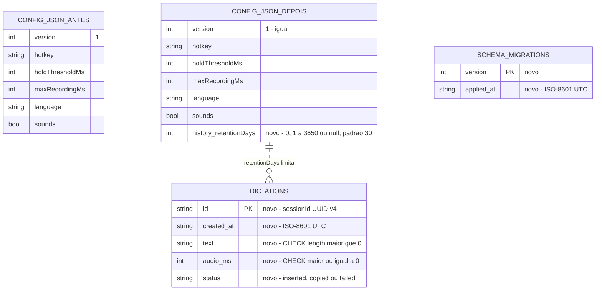
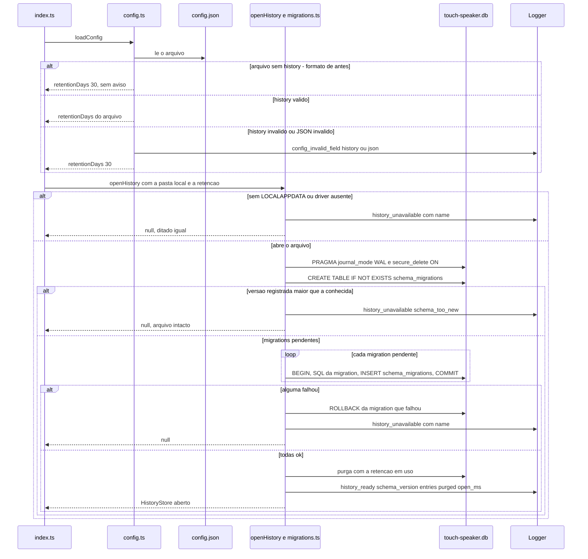
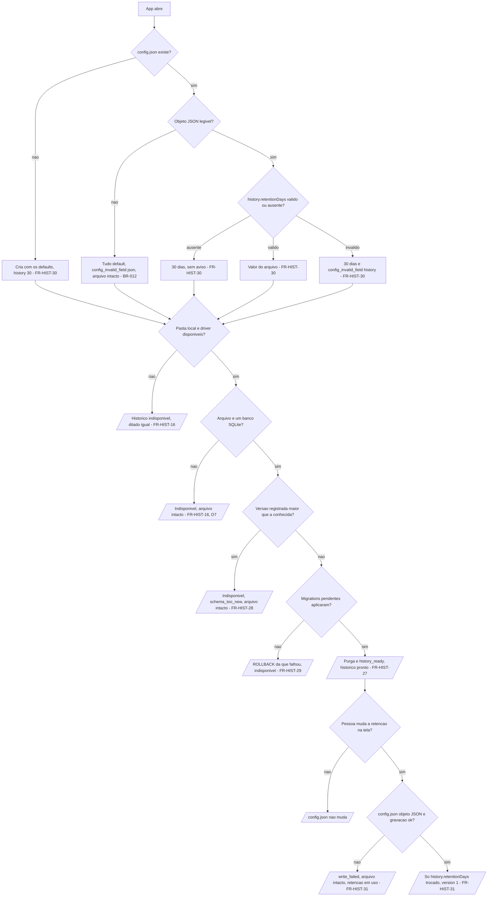

# Histórico local (SQLite `0001`) e `history.retentionDays` — spec da migração

> **ID / slug:** `historico-dados-v1` · **Template:** `TEMPLATE-spec-migracao.md` v1
> **O que muda:** migration `database/local/0001_init.sql` (Fase 2 — primeiro banco do app) e campo novo `history.retentionDays` no `config.json`, **sem** mudar o `version` (continua `1`, §6.6)
> **Fase:** 2 · **Módulo dono do dado:** `database/local/` + `frontend/src/main/history/` (banco) e `frontend/src/main/config.ts` (campo) · **Milestone:** `M2` (aberta por decisão do Victor de 18/out/2026 — [`docs/milestones/M2-app-com-interface.md`](../../milestones/M2-app-com-interface.md))
> **Status:** **proposta** — **implementação autorizada pelo Victor antes da aprovação formal** (decisão de 18/out/2026: "escrever a spec de migração companheira e implementar direto; ele aprova tudo junto quando testar"). A aprovação vem com a validação dele no roteiro VH da spec [`historico`](historico.md); até lá, todo o destino descrito aqui é PROPOSTA, já em código · **Modo:** completo (cria tabela)
> **Criado:** 18/out/2026 · **Autor:** agente de IA (para revisão do Victor Alves) · **Última revisão:** 18/out/2026 · **Código conferido em:** `0c0aa5b` + árvore não commitada da M2 (`design-system`, `janela-principal`, `historico`) · 18/out/2026
> **Origem:** spec de feature [`historico`](historico.md) §9 e §17.2 ("a `0001` e o campo novo do `config.json` pedem a spec de migração companheira — slug `historico-dados-v1`, modo completo"); decisões do Victor de 18/out/2026 (M1: retenção 30 dias, "para sempre", 1–3650; M6: banco em `%LOCALAPPDATA%`) · **ADRs de que depende:** ADR-01, ADR-06, **ADR-09** (§0, bloco D)

O app passa a ter o primeiro banco: um arquivo SQLite na pasta **local** do Windows (`%LOCALAPPDATA%\Touch Speaker\touch-speaker.db`), criado na primeira abertura pela migration `0001`, com a tabela `dictations` (só texto de ditados que terminaram com texto — nunca áudio, nunca o app em foco) e o registro `schema_migrations`. O `config.json` ganha `history.retentionDays` (`0` = nunca guardar, 1–3650 dias, `null` = para sempre; padrão 30). Ninguém perde nada: não existe dado antigo de histórico, e um `config.json` de antes, sem o campo, vale como 30 dias até a pessoa mudar a retenção na tela — só então o campo é escrito, trocando só ele.

## 0. Constituição (gate — preencher ANTES de desenhar, reconferir DEPOIS)

> Como preencher: TEMPLATE-spec-migracao.md §0

#### A. Decisões fixas (ADR-01…07) e Constituição (C1–C8)

| Itens | O que exigem desta spec | Respeita? | Nota |
| --- | --- | --- | --- |
| ADR-01 · ADR-06 | o dado é lido, validado e gravado no processo main, em TypeScript estrito, e fica só na máquina do usuário até a Fase 4 | sim | banco aberto só pelo main (`main/history/store.ts`), numa pasta local que não acompanha perfil móvel; o `config.json` continua do main (`main/config.ts`) |
| C1 · ADR-03 · ADR-04 | áudio só em memória; conteúdo do clipboard nunca persistido; texto ditado, clipboard e teclas nunca no log | sim | o banco guarda texto ditado (exceção aceita pelo Victor na spec `historico` §0, Security Guide §1) e nada mais; nenhuma coluna de áudio; os eventos de log da migração levam só versão, contagem e nome de erro |
| C6 | nenhuma chave no `config.json`, no banco ou em arquivo distribuído | sim | — |
| ADR-02 | `hotkey` só entre os nomes de `main/keys.ts` | sim | não toca `hotkey` |
| C2 · C3 · C4 | sem janela focável; falha não muda o que o ditado insere; o que afetar o uso aparece | sim | migração sem tela; falha → histórico indisponível na tela Histórico (`historico` FR-HIST-16), ditado igual |
| C5 · ADR-05 · C8 | provedor atrás de interface; nada de fase seguinte | sim | `HistoryStore` é a interface; nenhuma coluna de limpeza por IA (`text_final`) nem de sincronização |
| C7 · ADR-07 | nada do Typeless | sim | schema, nomes e regras saem do `docs/DATABASE.md` e da spec `historico` |

#### B. Princípios de dados

| # | Princípio | Respeita? | Nota |
| --- | --- | --- | --- |
| 1–2 | Áudio nunca é persistido; texto ditado só na máquina do usuário | sim | pasta local (`%LOCALAPPDATA%`), sem rede, sem sincronização |
| 3 | Migrations só para frente, numeradas, aplicadas ao iniciar, em transação; aplicada nunca é editada | sim | `main/history/migrations.ts` — uma transação por migration (FR-HIST-27, 29) |
| 4 | Config inválida cai no default, com aviso, sem derrubar o app (BR-012) | sim | FR-HIST-30 |
| 5 | Nenhuma chave em arquivo distribuído | sim | — |

#### C. Regras mantidas

| Regra | Onde vive | Respeita? | Nota |
| --- | --- | --- | --- |
| BR-012 — campo inválido → default + `config_invalid_field`; JSON inválido → tudo default; o app sempre abre | `main/config.ts` (`normalizeConfig`, `loadConfig`) | sim | `history` inválido → 30 dias + `config_invalid_field` com `field: "history"` |
| Faixas do `config.json` e log só com metadados primitivos | `main/config.ts`, `main/logger.ts` | sim | as faixas existentes não mudam; nova: `history.retentionDays` |
| Fase 2 (PLANEJADO): `database/local/NNNN_descricao.sql`, pendentes aplicadas ao iniciar, em transação, em `schema_migrations`; retenção 30 dias, "nunca guardar", "Apagar histórico" com `VACUUM` | `DATABASE.md#migrations` | sim, com diferenças | diferenças do plano (pasta Local, colunas) registradas na spec `historico` §9 e §17.3 |

#### D. ADRs que esta spec assume

| ADR | O que a spec assume | Seções que dependem | Se for substituída |
| --- | --- | --- | --- |
| ADR-01, ADR-06 | dado no main, só local | todas | a spec volta a `proposta` |
| **ADR-09** (Aceita — 18/out/2026, com o spike T1) | SQLite pelo módulo embutido `node:sqlite` do Node 24 do Electron 44.9.0, sem dependência de terceiros | §6.5, §6.6, §6.7, §10, §12 | trocar o driver muda `store.ts` e `migrations.ts`; o formato do arquivo (SQLite 3) não muda |

#### E. Guardrails do `CLAUDE.md`

| Guardrail | Respeita? | Nota |
| --- | --- | --- |
| Nunca commitar `.env`, chaves ou dados de usuário — nem o `config.json` ou o banco do ensaio | sim | os testes usam pasta temporária (`fs.mkdtempSync`) ou `:memory:`; o ensaio usa a máquina do Victor e nada vai para o repositório |
| Nunca logar texto ditado, áudio, clipboard, teclas ou a chave | sim | `history_ready` (`schema_version`, `entries`, `purged`, `open_ms`), `history_unavailable` (`name`) |
| Nada de fase seguinte; nenhuma dependência sem ADR; doc no mesmo trabalho | sim | ADR-09; `DATABASE.md` atualizado no mesmo trabalho |

#### F. Violação exige justificativa

Nenhuma violação nova. A exceção "texto ditado em disco" é da spec `historico` (§0, aval do Victor de 18/out/2026) e não é repetida aqui.

### 0.1 Diagramas obrigatórios

| # | Diagrama | Seção | Estado |
| --- | --- | --- | --- |
| 1 | ER antes e depois | §6.6 | presente |
| 2 | Sequência | §6.8 | presente |
| 3 | Fluxograma | §6.8 | presente |
| 4 | Máquina de estados | §6.2 | `N/A — dictations.status é o resultado da inserção, gravado uma vez e nunca alterado: não há transição de estado` |

## 1. AS-IS — o formato de hoje

> Como preencher: TEMPLATE-spec-migracao.md §1

**Código conferido:** `0c0aa5b` + árvore não commitada da M2 · 18/out/2026 · **Arquivos lidos:** `main/config.ts`, `main/settings.ts`, `main/atomic-file.ts`, `main/index.ts`, `main/logger.ts`, `docs/DATABASE.md`.

| Dado | Onde | Formato | Dono no código |
| --- | --- | --- | --- |
| `config.json` | `%APPDATA%\Touch Speaker\config.json` | JSON com `version: 1`, `hotkey`, `holdThresholdMs`, `maxRecordingMs`, `language`, `transcription`, `microphoneDeviceId`, `pill.position`, `sounds`. Criado com os defaults no primeiro uso; desde a `janela-principal`, regravado pela fila única `ConfigWriter` (relê, troca só os próprios campos, temporário + renomeação; arquivo que não é objeto JSON não é sobrescrito; ausente é recriado). O `version` não é conferido (`normalizeConfig` sempre devolve `1`); campo desconhecido é ignorado — inclusive `history`, que o `mergeSettings` da tela já preservava (`main/settings.ts`, FR-UI-29) | `main/config.ts` (`DEFAULT_CONFIG`, `normalizeConfig`, `loadConfig`, `ConfigWriter`) |
| Log | `%APPDATA%\Touch Speaker\logs\main.log` | uma linha JSON por evento, campos primitivos, rotação 5 MB × 3 | `main/logger.ts` |
| Banco | — | **não existe**: `database/` só tinha o `README.md`; o histórico era PLANEJADO (`DATABASE.md`, "dictations (Fase 2 — planejado)") com o arquivo em `%APPDATA%` | — |

**O problema, por evidência:** o ditado não deixa rastro recuperável — o texto existe só na memória e no clipboard durante a colagem (spec `historico` §1, `main/session.ts`, `main/insert/inserter.ts`). **Fora desta spec:** o comportamento do histórico (gravar, listar, buscar, copiar, apagar, telas) é da spec de feature [`historico`](historico.md); o campo `theme` do `config.json` (janela-principal FR-UI-39) segue a mesma regra aditiva do §6.6, descrita na spec `janela-principal`.

## 2. Objetivo, não-objetivos e produto

> Como preencher: TEMPLATE-spec-migracao.md §2

**Objetivo:** o app cria e migra o banco local na abertura sem nunca impedir o ditado, e lê o `config.json` de antes (sem `history`) como 30 dias, sem perder nenhum valor que a pessoa definiu.

**Não-objetivos herdados:**

- Persistir áudio, levar texto ditado para fora da máquina do usuário ou guardar chave (C1, C6).
- Mudar o comportamento do ditado sob o pretexto da migração (isso é a spec `historico`) ou puxar dado de fase seguinte (C8).
- Editar migration já aplicada ou escrever migração "para trás".
- **Da mudança:** subir o `version` do `config.json` — o campo é aditivo, com default, e lido nos dois sentidos (§6.6); reparar banco corrompido (spec `historico` D7); escrever o campo no `config.json` de quem já usa sem a pessoa mudar a retenção (spec `historico` §15.2).

### 2.1 Produto — a quem serve e como se mede

| | |
| --- | --- |
| **Para quem** | Dev multitarefa (Victor) — único usuário até a Fase 4 |
| **Dor** | "Atualizei o app e quero que ele continue abrindo e ditando; o histórico tem de nascer sozinho." |
| **Elo do fluxo que protege** | todos: a migração roda na abertura, antes da sessão; se falhar, só o histórico fica indisponível |
| **Como se mede** | `history_ready` com `schema_version: 1` no `main.log` na primeira abertura; nenhum `config_invalid_field` novo num `config.json` válido de antes; `history_unavailable` só com nome de erro |
| **Custo de não fazer** | a spec `historico` não tem onde guardar o texto |

## 3. Rastreabilidade

| Origem | Referência | Nota |
| --- | --- | --- |
| PRD e spec de feature | PRD FR-HIST-01 · [`historico`](historico.md) FR-HIST-01…26 · NFR-01, NFR-03 | a feature que pede o dado |
| SDD e código | §9, BR-012 · `frontend/src/main/config.ts` (`normalizeConfig`, `withRetention`, `ConfigWriter`) · `frontend/src/main/history/migrations.ts`, `store.ts`, `paths.ts`, `service.ts` (`openHistory`) · `database/local/0001_init.sql` | código conferido no cabeçalho |
| Dados e ADRs | [`docs/DATABASE.md`](../../DATABASE.md) (`#configjson`, `#migrations`, `#dictations`) · ADR-01, ADR-06, ADR-09 | §0, bloco D |

## 4. Invariantes preservadas

| Invariante | Como o novo formato garante | Teste |
| --- | --- | --- |
| O app abre com o `config.json` ausente, vazio, com JSON inválido ou com campo inválido (BR-012) | `history` passa pelo `normalizeConfig` como os outros campos; inválido → 30 + aviso | `src/test/config.test.ts` — "an invalid value falls back to 30…" |
| Valor válido definido no formato antigo sobrevive | nenhum campo existente muda; a regravação troca só `history.retentionDays` | `config.test.ts` — "withRetention changes only…"; `settings.test.ts` (TEST-008) |
| Nenhum texto ditado, áudio, clipboard, tecla ou chave vai para o arquivo de config ou para o log; o banco só tem as cinco colunas | `dictations` com cinco colunas; eventos só com metadados | `history-store.test.ts` (colunas exatas); `session-history.test.ts` (o `Logger` falso nunca recebe o texto) |
| As faixas de `DATABASE.md#configjson` continuam | nenhuma faixa existente muda | `config.test.ts` (casos de antes) |
| O app abre e dita com o banco indisponível | `openHistory` captura toda falha e devolve `null` | `history-service.test.ts` — "no LOCALAPPDATA, a corrupt file or missing migrations…" |

## 5. Limitações corrigidas e mantidas

| Limitação no formato de hoje | Evidência | Corrigida / mantida | O que muda, ou por que fica | Verificação ou aval |
| --- | --- | --- | --- | --- |
| `version` não é conferido | `normalizeConfig` devolve sempre `1` | mantida | o campo novo é aditivo e não exige reconhecer o formato antigo: a ausência dele já é o formato antigo (§6.6) | §14 #1 — confirmar com o Victor |
| O plano punha o banco em `%APPDATA%` (Roaming) | `DATABASE.md` (antes desta spec) | corrigida | `%LOCALAPPDATA%`; sem a variável, indisponível (spec `historico` M6, D14) | `history-paths.test.ts`; VH12 |
| Banco corrompido não tem reparo | — | mantida | sem reparo automático (spec `historico` D7); a pessoa apaga os arquivos (`ENVIRONMENT.md`) | `history-store.test.ts` — arquivo corrompido intacto |

## 6. TO-BE (PROPOSTA)

### 6.1 Quem lê e escreve o dado

| Ator | Lê | Escreve | Quando | Nota |
| --- | --- | --- | --- | --- |
| Processo main | sim | sim | banco: abre, migra e purga na abertura (`openHistory`, `main/index.ts`, depois do `loadConfig` e antes da sessão); grava depois de cada ditado com texto. `config.json`: lê na abertura; regrava `history.retentionDays` só pelo `history:set-retention` | único dono do arquivo e do banco |
| Renderer (pílula) | não | não | — | nada do histórico |
| Renderer (janela principal) | não diretamente | não diretamente | pede por `history:*` (contrato na spec `historico` §10) | o main valida remetente e payload |
| Pessoa editando o `config.json` | sim | sim | a qualquer hora | vale no próximo início; se depois mudar a retenção pela tela, o main relê o arquivo e só troca `history.retentionDays` |

### 6.2 Requisitos funcionais (EARS)

Numerados na área do requisito que pediu a mudança (HIST), continuando a spec `historico` (FR-HIST-01…26).

| # | Requisito | Origem | Prioridade |
| --- | --- | --- | --- |
| FR-HIST-27 | QUANDO o app abre O SISTEMA DEVE abrir (criando se não existir) `touch-speaker.db` na pasta local, ligar `journal_mode=WAL` e `secure_delete=ON`, criar `schema_migrations` se faltar e aplicar em ordem as migrations de `database/local/` ainda não registradas, cada uma numa transação, registrando `version` e `applied_at` (ISO-8601 UTC) | `DATABASE.md#migrations`; ADR-09 | P1 |
| FR-HIST-28 | SE `schema_migrations` registrar uma versão maior que a da última migration que o app conhece ENTÃO O SISTEMA DEVE deixar o arquivo intacto, tratar o histórico como indisponível (`history_unavailable` com `name: schema_too_new`) e manter o ditado | caso de borda "versão desconhecida" do template; spec `historico` FR-HIST-16, D7 | P1 |
| FR-HIST-29 | SE uma migration falhar no meio ENTÃO O SISTEMA DEVE desfazer a migration inteira (`ROLLBACK`), não registrar a versão dela e tratar o histórico como indisponível; a próxima abertura tenta de novo | princípio 3; spec `historico` FR-HIST-16 | P1 |
| FR-HIST-30 | QUANDO o app lê o `config.json` O SISTEMA DEVE ler `history.retentionDays`: ausente (formato de antes, ou `history` sem a chave) → 30, sem aviso; `0`, inteiro de 1 a 3650 ou `null` → o valor; qualquer outro valor (ou `history` que não é objeto) → 30 com `config_invalid_field` `field: "history"`; o `version` continua `1` | spec `historico` §9 e M1; BR-012 | P1 |
| FR-HIST-31 | QUANDO a pessoa muda a retenção pela tela O SISTEMA DEVE regravar o `config.json` pela fila única (`ConfigWriter`), relendo o arquivo e trocando só `history.retentionDays` — outras chaves dentro de `history`, todos os outros campos, campos desconhecidos e o `version` ficam como estavam —, em arquivo temporário + renomeação; arquivo que não é objeto JSON não é sobrescrito (`write_failed`); arquivo ausente é recriado com os defaults e a retenção nova | spec `historico` FR-HIST-20, FR-HIST-21, D13; janela-principal FR-UI-29 | P1 |

**Casos de borda:**

- **Primeiro uso** — sem `config.json`: criado com os defaults, que já trazem `history.retentionDays: 30` (e `theme: "system"`, da `janela-principal`). Sem banco: criado pela `0001` (FR-HIST-27).
- **Versão desconhecida** — `config.json` com `version` maior: o app não confere `version` e lê os campos que conhece (comportamento de antes, mantido). Banco com versão maior: FR-HIST-28.
- **Arquivo editado à mão** — `history` com tipo errado ou fora da faixa: FR-HIST-30; JSON inválido: tudo default na abertura (BR-012) e a tela não sobrescreve (FR-HIST-31).
- **Falha no meio** — disco cheio ou arquivo bloqueado durante a `0001`: FR-HIST-29; durante a regravação do `config.json`: o temporário é apagado e o arquivo anterior fica (`writeFileAtomic`); app encerrado durante a migração: a transação não confirmada é desfeita pelo SQLite na próxima abertura.
- **Duas instâncias** — a segunda sai no `requestSingleInstanceLock` antes de ler a config ou abrir o banco (`main/index.ts`).
- **Dado real** — não há histórico antigo a converter; um `config.json` real de antes não tem `history` e vale 30 dias.
- **Sem `LOCALAPPDATA`** — histórico indisponível, nunca a pasta Roaming (spec `historico` D14).

### 6.3 Requisitos não-funcionais

| Categoria | Requisito (com limiar) | Origem | Como se verifica |
| --- | --- | --- | --- |
| Integridade | zero valor válido perdido; cada migration numa transação; `config.json` em temporário + renomeação | princípio 3; BR-012 | `history-store.test.ts` (migration que falha não deixa tabela pela metade); `config.test.ts`; `settings.test.ts` |
| Boot | abrir, migrar e purgar ≤ 150 ms com o volume de referência (10 000 entradas) | spec `historico` §6 | `open_ms` do `history_ready` no ensaio; `history-store.test.ts` (volume de referência, limite folgado) |
| Privacidade e segurança | nenhum conteúdo de ditado, clipboard, tecla ou chave no `config.json` nem no log; o banco só com as cinco colunas | C1, C6 | revisão + `history-store.test.ts` (colunas) + `session-history.test.ts` (log) |
| Degradação e observabilidade | falha de abertura/migração → histórico indisponível, ditado igual; `history_unavailable` só com `name` (código SQLite `SQLITE_<n>`, errno, `schema_too_new`, `migrations_missing` ou `migration_duplicated` — de `migrations.ts` — ou, antes de abrir, `no_localappdata` ou `unsupported_platform` — de `paths.ts`) | BR-012; C4; SDD §23 | `history-service.test.ts` |
| i18n e fuso | i18n: N/A — sem texto de interface nesta spec. Fuso: `created_at` e `applied_at` em ISO-8601 UTC com milissegundos | `DATABASE.md` | `history-store.test.ts` (`applied_at`) |

### 6.4 Telas e estados

`N/A — sem superfície de tela`: o efeito visível (histórico indisponível) é da spec `historico` §7.

### 6.5 Arquitetura

| Camada | Onde | Dono | Nota |
| --- | --- | --- | --- |
| Leitura e validação do `config.json` | `frontend/src/main/config.ts` (`normalizeConfig`, `withRetention`, `ConfigWriter`) | processo main | o campo é validado junto com os outros, na mesma passada |
| Banco | `database/local/0001_init.sql` (copiado para `dist/database/local/` pelo `scripts/copy-static.mjs`) + `frontend/src/main/history/migrations.ts` (`readMigrations`, `applyMigrations`) + `store.ts` (`openSqliteHistory`) + `service.ts` (`openHistory`) | processo main | driver `node:sqlite` (ADR-09), carregado só dentro de `openSqliteHistory`: um runtime sem ele deixa o histórico indisponível em vez de impedir a abertura |

**Ordem no boot:** `requestSingleInstanceLock` → `whenReady` → `loadConfig` (lê `history.retentionDays`) → pílula → chave → `openHistory` (local do banco por `historyLocation`, migrations, purga com a retenção em uso, `history_ready` ou `history_unavailable`) → `SessionController` com a `HistoryPort`. A sessão não espera nada além disso; com o banco indisponível ela abre igual.

### 6.6 Modelo de dados

**Precisa de migration?** **sim** — `database/local/0001_init.sql`. **`config.json`:** campo novo, **`version` continua `1`**.

Por que o `version` não sobe (PROPOSTA, §14 #1): o campo é **aditivo e opcional**, com default; o formato de antes (sem `history`) é lido como 30 dias sem transformar nada; o app de antes ignora `history` (campo desconhecido) e a tela de antes já o preservava (`mergeSettings`, FR-UI-29). O app não confere `version`, então subir o número não mudaria nenhuma leitura — só obrigaria o `settings:save` aprovado (FR-UI-29, que mantém `version: 1`) a mudar de comportamento. A frase do `DATABASE.md` "mudança no formato = subir `version`" passa a valer para mudança que **não** é aditiva (renomear, mudar tipo, remover), que é quando o app precisa reconhecer o formato antigo.

| Campo ou coluna | Antes (tipo, default, regra) | Depois (tipo, default, regra) | Mudança |
| --- | --- | --- | --- |
| `config.json` `version` | `1`, não conferido | `1`, não conferido | igual |
| `config.json` `history.retentionDays` | — (ignorado se existisse) | inteiro ou `null`; default `30`; `0` = nunca guardar, 1–3650 dias, `null` = para sempre; inválido → 30 + `config_invalid_field` `field: "history"` | novo |
| `dictations` | — | tabela nova (abaixo) | novo |
| `schema_migrations` | — | `version INTEGER PRIMARY KEY`, `applied_at TEXT NOT NULL` (ISO-8601 UTC); criada pelo aplicador antes da `0001` | novo |

```sql
-- database/local/0001_init.sql
CREATE TABLE dictations (
  id          TEXT PRIMARY KEY,                                    -- sessionId (UUID v4)
  created_at  TEXT NOT NULL,                                       -- ISO-8601 UTC, com ms
  text        TEXT NOT NULL CHECK (length(text) > 0),
  audio_ms    INTEGER NOT NULL CHECK (audio_ms >= 0),
  status      TEXT NOT NULL CHECK (status IN ('inserted', 'copied', 'failed'))
);
CREATE INDEX idx_dictations_created_at ON dictations (created_at DESC, id DESC);
```

**ER — diagrama 1 de 4:**



- `idx_dictations_created_at (created_at DESC, id DESC)` — lista paginada da mais nova para a mais antiga, com `id` como desempate do cursor; purga `created_at < corte`.
- `PRIMARY KEY (id)` — uma entrada por sessão; a gravação usa `ON CONFLICT (id) DO NOTHING` (idempotente só no `id`: `CHECK` e `NOT NULL` violados continuam falhando e contam como gravação falha).
- `CHECK (length(text) > 0)`, `CHECK (audio_ms >= 0)`, `CHECK (status IN …)` — só ditado com texto vira entrada (spec `historico` D2).
- PRAGMAs da conexão: `journal_mode=WAL` (persistente no arquivo), `secure_delete=ON` (por conexão, ligado a cada abertura).

### 6.7 Contrato

**Formato novo (`config.json` de um primeiro uso):**

```json
{
  "version": 1,
  "hotkey": "RightCtrl",
  "holdThresholdMs": 500,
  "maxRecordingMs": 300000,
  "language": "pt",
  "transcription": { "provider": "groq", "model": "whisper-large-v3-turbo" },
  "microphoneDeviceId": null,
  "pill": { "position": "bottom-center" },
  "sounds": true,
  "history": { "retentionDays": 30 },
  "theme": "system"
}
```

(`theme` é da spec `janela-principal`, FR-UI-39, com a mesma regra aditiva.) O formato fecha no `docs/DATABASE.md` no mesmo trabalho. O dado não cruza a IPC da pílula; a retenção cruza a da janela principal por `history:get-retention`/`history:set-retention` (spec `historico` §10, `docs/API.md`).

**Compatibilidade:** o app novo lê o `config.json` de antes (sem `history` → 30). O app de antes abre com o formato novo: ignora `history` e `theme` (campo desconhecido) e preserva os dois ao salvar preferências (`mergeSettings`). O app de antes nunca abre o banco.

### 6.8 Fluxo ponta a ponta

**Sequência — diagrama 2 de 4:**



**Fluxograma — diagrama 3 de 4:**



Checklist: FR-HIST-27…31 aparecem em algum ramo; todo ramo termina num estado do app e tem critério no §7.

## 7. Critérios de equivalência e de aceite

| # | Critério | Verifica |
| --- | --- | --- |
| 1 | DADO um `config.json` válido de antes, sem `history`, QUANDO o app abre ENTÃO todos os valores dele valem como antes, a retenção é 30 dias e não há `config_invalid_field` | FR-HIST-30; §4 |
| 2 | DADO `history.retentionDays` igual a `0`, `7`, `3650` ou `null` QUANDO o app abre ENTÃO esse é o valor em uso; DADO `5000`, `-1`, `7.5`, `"30"` ou `history: 30` ENTÃO 30 dias e `config_invalid_field` `field: "history"` | FR-HIST-30; BR-012 |
| 3 | DADO um `config.json` com JSON inválido QUANDO o app abre ENTÃO abre com os defaults e o log registra o aviso; QUANDO a pessoa muda a retenção ENTÃO o arquivo não é sobrescrito | BR-012; FR-HIST-31 |
| 4 | DADO um `config.json` com campo desconhecido e outra chave dentro de `history` QUANDO a pessoa muda a retenção ENTÃO só `history.retentionDays` muda, e `version` continua `1` | FR-HIST-31; §4 |
| 5 | DADO nenhum banco QUANDO o app abre ENTÃO `touch-speaker.db` existe em `%LOCALAPPDATA%\Touch Speaker\`, com `dictations` de cinco colunas, o índice, `schema_migrations` com a versão 1 e `journal_mode` `wal`; o log tem `history_ready` com `schema_version: 1` | FR-HIST-27 |
| 6 | DADO o banco já migrado QUANDO o app abre de novo ENTÃO nenhuma migration é reaplicada e as entradas continuam | FR-HIST-27 |
| 7 | DADO um banco com `schema_migrations` na versão 2 QUANDO o app (que conhece só a 1) abre ENTÃO o arquivo fica byte a byte igual, o histórico fica indisponível e o ditado funciona | FR-HIST-28 |
| 8 | DADO uma migration que falha no meio QUANDO o app abre ENTÃO nenhuma tabela dela fica, a versão dela não é registrada e o histórico fica indisponível | FR-HIST-29 |
| 9 | DADO o app de antes (sem esta mudança) e um `config.json` com `history` QUANDO ele abre e a pessoa salva preferências ENTÃO ele abre normalmente e `history` continua no arquivo | §6.7 (compatibilidade) |

## 8. Dados a importar

| Origem (campo antigo) | Destino | Transformação | Default se ausente ou inválido |
| --- | --- | --- | --- |
| (nenhum) | `history.retentionDays` | nenhuma: o campo é lido se existir | `30` |
| (nenhum histórico antigo) | `dictations` | nenhuma: a tabela nasce vazia | — |

**O que se descarta:** nada. **Regras:** nenhuma regravação do `config.json` na abertura; abrir duas vezes dá o mesmo resultado (migration registrada não roda de novo); valor inválido cai no default e nunca derruba o app.

## 9. Riscos de migração

| # | Risco | Tipo | Prob. | Impacto | Mitigação | Ligação |
| --- | --- | --- | --- | --- | --- | --- |
| 1 | Perder valor que o usuário definiu | dados | baixa | alto | nada é transformado na abertura; regravação só do campo, pela fila única, relendo o arquivo | §4; FR-HIST-31 |
| 2 | O app não abre depois da migração | operação | baixa | alto | `openHistory` captura tudo; histórico indisponível, ditado igual | C4; FR-HIST-16 |
| 3 | `node:sqlite` muda de API (o módulo é "release candidate", estabilidade 1.2, no Node 24) | compatibilidade | média | médio | Electron em versão exata; só `store.ts` e `migrations.ts` usam o driver; testes reais do SQLite no `npm test` | ADR-09; RISK-032 |
| 4 | App fechado no meio da `0001` | dados | baixa | baixo | transação: o SQLite desfaz na próxima abertura e a migration roda de novo | FR-HIST-29 |
| 5 | Banco aberto por versão mais nova do app e depois pela antiga | compatibilidade | baixa | médio | FR-HIST-28: a antiga não toca o arquivo | — |
| 6 | Texto ditado fica no disco depois de um rollback do código | privacidade | média | médio | o rollback inclui apagar `touch-speaker.db`, `-wal` e `-shm` (§12) | RISK-030 |

## 10. Validação

| Camada | Onde | Runner | O que cobre |
| --- | --- | --- | --- |
| Unidade | `src/test/config.test.ts` (TEST-004 ampliado) · `history-store.test.ts` (TEST-015) · `history-service.test.ts` (TEST-017) · `history-paths.test.ts` (TEST-016) | `node:test` + `node:assert/strict`, por `npm test` | critérios 1–8: campo novo, regravação, `0001` num arquivo temporário, idempotência, `schema_too_new`, migration que falha, arquivo corrompido, `:memory:` |
| Tipos | `npm run typecheck` | `tsc` | `AppConfig.history`, `HistoryStore` |
| Ensaio com dado real | máquina do Victor | manual | copiar o `config.json` real (cópia fora do repositório), abrir por `npm run dev`, conferir `history_ready` no log, o arquivo em `%LOCALAPPDATA%\Touch Speaker\`, a retenção na tela e, depois de mudá-la, o `config.json` (critérios 1, 4, 5); a cópia serve de rollback |

Cada teste cria os próprios dados em pasta temporária e nunca lê nem grava a pasta real do usuário; o relógio é injetado.

## 11. Alternativas consideradas

| Alternativa | Por que foi rejeitada |
| --- | --- |
| Subir o `config.json` para `version: 2` | Não muda nenhuma leitura (o app não confere `version`), exige mudar o `settings:save` aprovado (FR-UI-29 mantém `version: 1`) e cria um formato "2 sem `history`" quando a tela de preferências salva primeiro. Fica como §14 #1 para o Victor confirmar |
| Escrever `history.retentionDays: 30` no `config.json` de quem já usa, na abertura | Regravação na abertura arrisca a edição à mão e contraria a spec `historico` §15.2 (o campo aparece na primeira mudança pela tela) |
| Não migrar (só criar a tabela no código, sem `schema_migrations`) | Sem registro de versão, a próxima mudança de schema não sabe o que já foi aplicado |
| Migrations embutidas no TypeScript | Rejeitada na spec `historico` D11: mantém o plano `database/local/NNNN_*.sql` |
| Recriar o banco quando a versão é desconhecida ou o arquivo está corrompido | Apagaria texto da pessoa sem ela pedir (spec `historico` D7) |

## 12. Rollout e rollback

1. **Ordem:** formato em `DATABASE.md` → testes do §10 → código (`0001_init.sql`, `migrations.ts`, `store.ts`, `config.ts`) → ensaio com dado real → commit (feito pelo Victor).
2. **Backup:** `config.json` — sem cópia automática: nada é transformado na abertura, e a regravação troca um campo, por temporário + renomeação; o ensaio usa uma cópia manual fora do repositório. Banco — nada a preservar antes da `0001` (arquivo novo).
3. **Ponto de não retorno e app antigo:** não há. O app antigo abre com o formato novo (ignora `history` e `theme`) e nunca abre o banco.
4. **Rollback:** voltar ao commit anterior basta para abrir e ditar. **O texto ditado continua no disco:** com o app fechado, apagar `touch-speaker.db`, `touch-speaker.db-wal` e `touch-speaker.db-shm` de `%LOCALAPPDATA%\Touch Speaker\`. O campo `history` pode ficar no `config.json` (ignorado). Sem instalador antes da `distribuicao-windows-macos`: a migração roda na máquina de quem abre o app por `npm run dev` / `npm start`.

## 13. Impacto na documentação (mesmo trabalho)

- [x] `docs/DATABASE.md` — `dictations` implementada, `0001_init.sql`, `schema_migrations`, PRAGMAs, banco em `%LOCALAPPDATA%`, `history.retentionDays`, a regra do `version` (§6.6), como apagar o histórico à mão; `docs/CHANGELOG.md` com o porquê.
- [x] SDD §9 (modelo de dados), FR-HIST-27…31 (§4.4), riscos novos (§26).
- [x] `docs/ENVIRONMENT.md` (variável `LOCALAPPDATA`, pasta e arquivos do banco); `docs/DECISIONS.md` (ADR-09); `docs/API.md` (`history:get-retention`/`history:set-retention`).

## 14. Decisões em aberto

| # | Pergunta | Bloqueia nesta spec | Default proposto (já implementado) | Decide |
| --- | --- | --- | --- | --- |
| 1 | O `config.json` continua em `version: 1` com o campo novo aditivo (§6.6), ou sobe para `2`? | não bloqueia (Victor autorizou implementar antes; confirma na validação) | continua `1`; "subir `version`" vale para mudança não aditiva | Victor |
| 2 | Banco com versão maior que a conhecida: indisponível sem tocar no arquivo (FR-HIST-28)? | não bloqueia | indisponível, arquivo intacto | Victor |

## 15. Anexo — task

**Histórico local — `0001` e `history.retentionDays`** · milestone `M2` · *Objetivo:* o banco nasce e migra sozinho na abertura sem nunca impedir o ditado, e o `config.json` de antes vale como 30 dias · *Requisitos:* FR-HIST-27 · FR-HIST-28 · FR-HIST-29 · FR-HIST-30 · FR-HIST-31 · *Resultados:* `0001_init.sql`, aplicador de migrations, campo validado e regravado só pela tela

Subtarefas:

- [x] T1 — formato novo em `docs/DATABASE.md` (§6.7) — 18/out/2026
- [x] T2 — testes do §10 (TEST-004 ampliado, TEST-015, TEST-016, TEST-017) — 18/out/2026
- [x] T3 — migração em `database/local/0001_init.sql`, `main/history/migrations.ts`, `store.ts`, `config.ts` (FR-HIST-27…31) — 18/out/2026
- [ ] T4 — ensaio com dado real e rollback conferido (§10, §12) — **com o Victor**, no roteiro VH da spec `historico`
- [x] T5 — documentação afetada (§13) — 18/out/2026
- [x] T6 — `npm run typecheck` e `npm test` verdes (291/291 em 18/out/2026) + self-review

## Gate — estado real

Herdado do template, não repetir.

| Item | Passa / não passa | Motivo |
| --- | --- | --- |
| 1-R. Marcadores | passa | nenhum `[PRECISA ESCLARECER]`; as duas linhas do §14 têm default implementado e esperam a confirmação do Victor |
| 2. Diagramas | passa | §6.6 (ER), §6.8 (sequência e fluxograma); máquina de estados N/A com motivo |
| 3. §2.1 e critérios | passa | FR-HIST-27…31 e as invariantes do §4 com critério no §7 |
| 4. Formato fechado | passa | antes e depois no §6.6, §8 completo, default do campo novo |
| 5. Constituição | passa | §0 sem violação nova; ADR-09 aceita |
| 6. Rollback | passa | §12, com o apagamento dos arquivos do banco |
| 1-E. Nenhum marcador que bloqueie | passa | — |
| 7. `DATABASE.md` com o formato novo | passa | atualizado no mesmo trabalho |
| 8. ADRs aceitas | passa | ADR-09 aceita em 18/out/2026 |
| Aval do Victor (status `revisada` → `aprovada`) | **não passa** | implementação autorizada antes; o aval vem com a validação dele |

## Definition of Done da migração

Herdada do template, não repetir. Próprio deste dado: ensaio com o `config.json` real do Victor e conferência de que `touch-speaker.db` está em `%LOCALAPPDATA%` e não em `%APPDATA%` (VH12 da spec `historico`) — **pendente, com o Victor**.
