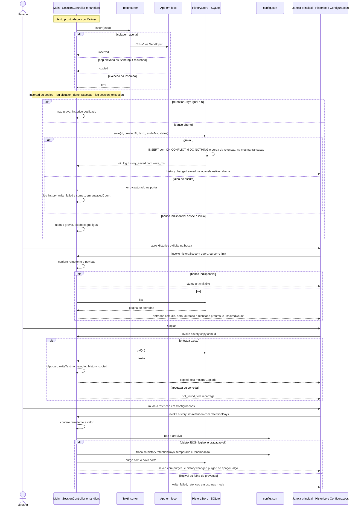
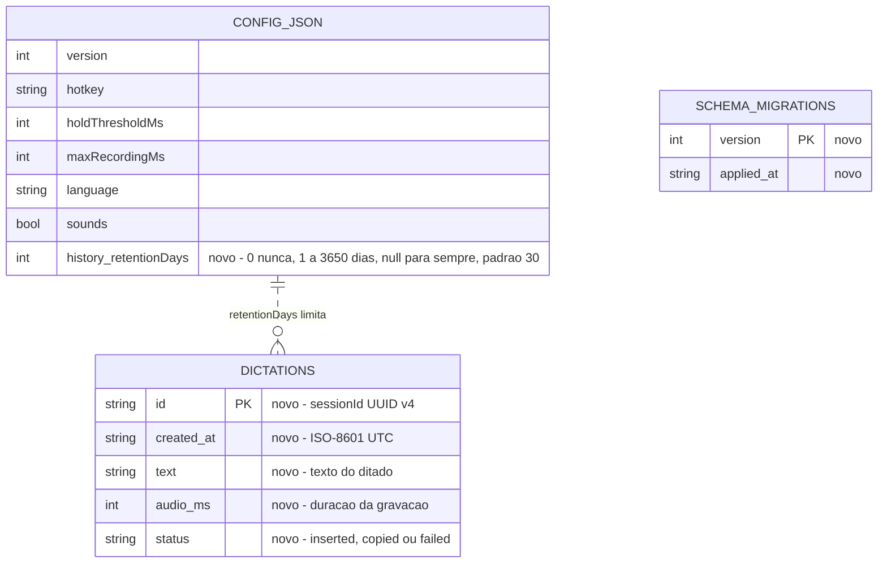

# Histórico de ditados — spec

> Criado: 18/out/2026 · Autor: agente de IA (rascunho para revisão do Victor Alves) · Status: **aprovada** (18/out/2026 · Victor) — as decisões do Victor de 18/out/2026 estão registradas (§17.1) · **Implementada no código em 18/out/2026** (não commitado; roteiro VH1–VH13 pendente, com o Victor). Na implementação: spike T1 trocou o driver para o `node:sqlite` embutido (ADR-09 aceita, §19); o Início ganhou os cards do histórico pedidos pelo Victor (FR-HIST-22…26); as correções de redação estão em §17.4
> Origem: decisão do Victor em 18/out/2026 de abrir a M2 agora, com a Fase 1 (T9/T10) ainda aberta em paralelo. Para o histórico: **só texto**, salvo localmente em SQLite, **nenhum áudio**; caso de uso principal "quando eu perder" — a colagem falhou ou foi para a janela errada, e a pessoa acha o texto no histórico e copia de novo
> Fase: 2 (FR-HIST-01 no roadmap do PRD) · Requisitos: FR-HIST-01 … FR-HIST-26 (FR-HIST-27…31 na spec de migração [`historico-dados-v1`](historico-dados-v1.md))
> Contrato: SDD (`docs/spec/spec-driven-development.md`) · Decisões relacionadas: ADR-01, ADR-03, ADR-05, ADR-06, ADR-07 · **ADR-09 (aceita em 18/out/2026 com o spike T1, §19)**
> Milestone: M2 — aberta por decisão do Victor em 18/out/2026. `docs/milestones/` ainda não existe e o SDD §29 ainda diz "não há milestones abertas" (a conferir no gate). Specs irmãs, escritas em paralelo: `design-system`, `janela-principal` (desenha as telas Histórico e Configurações que esta spec usa), `distribuicao-windows-macos` (empacota o módulo nativo do banco)
> Código conferido em: `0c0aa5b` · 18/out/2026 · `better-sqlite3` 13.0.3 conferido no registro do npm em 18/out/2026 (§19) · Caminhos de código relativos à raiz do repositório

Cada ditado que termina com texto passa a ficar guardado, só como texto, num banco SQLite na pasta local do
Windows (`%LOCALAPPDATA%`), que não acompanha perfil móvel nem sai da máquina. Quando a colagem falha, vai para
a janela errada ou o texto some do clipboard, a pessoa abre a tela Histórico da janela principal, acha o
ditado (por dia ou pela busca) e copia de novo — sem precisar falar tudo outra vez. A retenção (padrão 30
dias) é ajustada na tela Configurações; há apagar um e apagar tudo. O áudio continua sem nunca tocar o disco,
o log continua sem nenhum texto ditado, e nada do app em foco é guardado.

---

## 0. Constituição (gate — preencher ANTES de desenhar, reconferir DEPOIS)

| Decisão fixa | Esta feature respeita? | Nota |
| --- | --- | --- |
| ADR-01 — Electron + TypeScript estrito (CommonJS, `tsc`, sem bundler na Fase 1); outro runtime ou framework de interface exige ADR | sim | Banco aberto só no processo main, em TypeScript estrito. O driver SQLite é dependência nova → ADR-09 (§19) |
| ADR-02 — hook global com `uiohook-napi`; só a tecla configurada e o `Esc` são identificados | sim | O histórico não lê teclado. A busca da tela recebe digitação pela própria janela, não pelo hook |
| ADR-03 — inserção por clipboard + Ctrl+V via `SendInput`, clipboard restaurado, fallback para app elevado; nunca pedir elevação | sim | A inserção não muda. "Copiar" do histórico escreve no clipboard pelo main, por ação explícita da pessoa, sem Ctrl+V sintético. Nada do app em foco é lido para o histórico (FR-HIST-05) |
| ADR-04 — Groq Whisper, áudio inteiro ao soltar; sem streaming antes da Fase 4 | sim | Não toca a transcrição |
| ADR-05 — sem limpeza por IA; `Refiner` identidade como encaixe | sim | Guarda o texto que sai do `Refiner` e vai para o `TextInserter` (`frontend/src/main/session.ts:195-202`); hoje é igual à saída do Whisper |
| ADR-06 — sem backend; o app não é distribuído com chave | sim | Banco só local, em `%LOCALAPPDATA%` (decisão de 18/out/2026): não acompanha perfil móvel, nada sincronizado, nada enviado |
| ADR-07 — sala limpa em relação ao Typeless | sim | O estudo (§8) só confirma a ideia "histórico local sem áudio", já registrada no SDD §1.6. Schema, nomes de canal e textos saem do plano do `docs/DATABASE.md` e desta spec |
| C1 Privacidade por padrão — áudio nunca vai para disco; texto ditado, clipboard e teclas nunca vão para log | sim | Áudio nunca é gravado (nem no banco). Texto ditado vai para o **banco**, não para o **log**: os eventos novos só levam contagens, tempos e nomes de erro (§6, §10). O C1 não proíbe texto em disco — a regra que proíbe é a do Security Guide §1, tratada na tabela de violação abaixo |
| C2 Nunca roubar o foco — nada do Touch Speaker recebe foco durante o ditado | sim | A pílula não muda. As telas Histórico e Configurações vivem na janela principal, que é focável por natureza; como o ditado se comporta com ela em foco é decisão da spec `janela-principal`. Um ditado colado na própria tela (na busca, por exemplo) é guardado como qualquer outro |
| C3 Nunca digitar lixo | sim | O histórico nunca insere nada sozinho; só guarda o texto que já passou pelos filtros (`frontend/src/main/transcribe/filters.ts` `isNoSpeech`) |
| C4 Falha visível — todo erro chega à pessoa | sim, com exceção aceita | Banco indisponível aparece na tela Histórico (FR-HIST-16). A falha ao **gravar uma entrada** aparece **só** na tela Histórico, não na pílula nem na bandeja (FR-HIST-17) — decisão do Victor de 18/out/2026, na tabela de violação abaixo |
| C5 Provedores trocáveis atrás de interface | sim | Não há provedor novo. O banco fica atrás da interface `HistoryStore`, no mesmo espírito (§8) |
| C6 Sem segredo em app distribuído | sim | Nenhuma chave no banco nem no `config.json` |
| C7 Sala limpa — ver ADR-07 | sim | — |
| C8 Escopo da fase | sim | Histórico é Fase 2 no PRD (FR-HIST-01). A M2 abre antes de a Fase 1 fechar por decisão do Victor de 18/out/2026. Nada de fase seguinte: sem sincronização (Fase 4), sem nome nem contexto do app (decisão de 18/out/2026; contexto é FR-CTX-01, Fase 3), sem limpeza por IA |
| Windows primeiro | sim | Esta spec descreve Windows. O único ponto que muda por plataforma é o caminho do banco (§9): se a `distribuicao-windows-macos` for aprovada, o macOS usa `app.getPath('appData')` e o driver precisa do binário de cada plataforma (§19) |
| Produto em pt-BR; textos só em `frontend/src/main/strings.ts` | sim | Rótulos de dia, estados vazios, avisos e opções de retenção entram em `strings.ts` e chegam prontos à tela, como já acontece com a pílula |
| `SessionController` é o único dono do estado da sessão | sim | A sessão chama uma porta `HistoryPort` depois da inserção; o banco não conhece nem muda o estado da sessão |
| Código em `frontend/` é a fonte de fato; a feature rastreia ao PRD, ao SDD ou ao código | sim | PRD FR-HIST-01; SDD §4.4, §6.2, §18; `docs/DATABASE.md` (plano da tabela `dictations`); Security Guide §11 e §13; decisões do Victor de 18/out/2026 (§17.1) |
| Nenhum segredo em doc, código novo ou diff | sim | — |
| Sem dependência, provedor ou serviço novo sem ADR | sim | ADR-09 aceita (18/out/2026): o driver é o `node:sqlite` embutido no Node 24 do Electron 44.9.0 — **nenhuma dependência nova** no `package.json` (spike T1, §19). A versão anterior desta spec propunha o `better-sqlite3` 13.0.3 |

**Violação exige justificativa:**

| O que fura | Por que é necessário | Alternativa rejeitada e por quê | Aval |
| --- | --- | --- | --- |
| Regra prática do Security Guide §1: o texto ditado sai "só para o app em foco" e "nunca para log, **disco** ou outro endereço" | O histórico **é** texto ditado em disco: sem isso não há "quando eu perder" depois de reiniciar o app. A exceção já está planejada no próprio guia (§11, linha "Histórico e dicionário"), no `docs/DATABASE.md` ("texto ditado só fica na máquina do usuário") e no SDD §18. Na v1, sem criptografia além da proteção da conta do sistema (RISK-novo-1) | Histórico só em memória (some ao fechar o app) — ver §12 | Victor — 18/out/2026 ("só texto, salvo localmente"; sem criptografia extra na v1). O Security Guide §1 ganha a exceção no mesmo PR da implementação (§16) |
| C4 — a falha ao gravar uma entrada aparece só na tela Histórico | Um aviso na pílula depois de um ditado que deu certo confunde o resultado do ditado; o histórico é secundário ao ditado | Aviso na pílula; status da bandeja | Victor — 18/out/2026 |

> ADR proposta ainda não é decisão fixa: esta spec depende da **ADR-09** (§19) e tem como pré-requisito
> planejado a spec de migração companheira `historico-dados-v1` (§9, §17.2).

### 0.1 Diagramas obrigatórios

| # | Diagrama | Seção | Estado |
| --- | --- | --- | --- |
| 1 | Wireframe da tela Histórico, com os estados | §7.1 | presente (a tela é desenhada pela `janela-principal`; aqui, conteúdo e estados) |
| 2 | UML de sequência | §8.1 | presente |
| 3 | ER (tabelas SQLite + campo novo do `config.json`) | §9.1 | presente |
| 4 | Fluxograma (gravação da entrada, jornada "perdi o texto", mudança da retenção) | §11.1 | presente |

---

## 1. O problema, na tela

Hoje o texto ditado existe só por alguns instantes: na memória do main e no clipboard durante a colagem. Se
ele não chega aonde a pessoa queria, a única saída é ditar de novo.

### 1.1 A colagem foi para a janela errada

O Ctrl+V vai para a janela que está em foco **no momento da inserção**; se a pessoa trocou de janela durante
a transcrição, o texto vai para a outra (RISK-006, aceito na Fase 1). Depois da colagem, o clipboard é
restaurado (`frontend/src/main/insert/inserter.ts:96-105`), então o texto também não fica lá para um Ctrl+V
manual. O resultado da sessão é `inserted` e nada avisa que deu errado (`frontend/src/main/session.ts:204-215`).

### 1.2 A colagem foi bloqueada e o texto ficou só no clipboard

Com o app em foco elevado, ou com o `SendInput` recusado, o texto fica no clipboard e a pílula avisa "Texto
copiado — cole com Ctrl+V" (`frontend/src/main/insert/inserter.ts:77-80`, `:93`; BR-009). Se a pessoa copiar
outra coisa antes de colar, o texto ditado se perde.

### 1.3 A inserção falhou com exceção

Uma exceção depois que o texto existe (`frontend/src/main/session.ts:195-202`) cai no `catch` da sessão, que
mostra `provider_error` na pílula (`:216-219`); o texto é descartado com a sessão.

### 1.4 O que já está planejado e o que muda

O `docs/DATABASE.md` planeja a tabela `dictations` (Fase 2) e a retenção (padrão 30 dias, "nunca guardar",
"Apagar histórico" com `VACUUM`); o SDD §6.2 registra a mesma regra como PROPOSTA. **Não há ADR** para o
SQLite nem para o `better-sqlite3` (só o plano no `DATABASE.md` e no `ARCHITECTURE.md`, "Evolução por fase") —
por isso a ADR-09 (§19). O plano põe o banco em `%APPDATA%\Touch Speaker\`, a pasta de dados de hoje
(`frontend/src/main/index.ts:28`), que é a pasta **Roaming** do Windows; por decisão do Victor de 18/out/2026 o
banco vai para `%LOCALAPPDATA%` (§9). E o app hoje só escreve o `config.json` quando ele não existe
(`frontend/src/main/config.ts:93-99`); com a retenção ajustada na tela Configurações, o main passa a regravar
um campo dele (FR-HIST-20).

> Problema independente desta feature, achado na leitura: a exceção na inserção aparece como "A Groq falhou"
> (`session.ts:216-219` mapeia toda exceção para `provider_error`) — comportamento de hoje, fora desta spec,
> sem `PEND-` registrado.

---

## 2. Objetivo e não-objetivos

**Objetivo:** todo ditado que termina com texto fica guardado localmente, só como texto, e pode ser achado e
copiado de novo pela tela Histórico até a retenção vencer — sem mudar a latência nem o resultado do ditado.

**Não-objetivos** (o que esta feature explicitamente NÃO faz):

- Guardar áudio, em qualquer forma — guardrail "Nunca gravar áudio em disco" fica como está.
- Sincronizar, exportar ou enviar o histórico para qualquer lugar — sincronização opcional é da Fase 4
  (`docs/DATABASE.md`, "até existir sync opcional e explícito na Fase 4"); C8.
- Guardar o nome do app em foco, o executável, o título da janela, o texto ao redor do cursor ou qualquer
  identificação do destino — decisão do Victor de 18/out/2026. O PRD citava "app" no FR-HIST-01; o texto do
  PRD é corrigido no PR da implementação (§16). Contexto do app é FR-CTX-01, Fase 3.
- Criptografia em repouso além da proteção da conta do sistema — decisão do Victor de 18/out/2026 para a v1;
  fica registrada como melhoria possível depois (RISK-novo-1, §12).
- Reinserir o texto no app em foco a partir do histórico — "copiar de novo" é o que o PRD pede (FR-HIST-01);
  a pessoa cola com Ctrl+V.
- Editar o texto de uma entrada, favoritar ou etiquetar — sem origem no PRD.
- Guardar sessões sem texto (canceladas, descartadas, com erro) — o histórico não é métrica; as métricas
  continuam no log (`dictation_done`, `session_*`). Desvio do plano em §17.3 D2.
- Desenhar as telas — layout, componentes e estilo das telas Histórico e Configurações são das specs
  `janela-principal` e `design-system`; esta spec define conteúdo, estados e contrato.
- Empacotar o módulo nativo para distribuição — spec `distribuicao-windows-macos`.
- Dicionário pessoal (`dictionary_terms`, FR-VOCAB-01) — fora da M2; a migration dele vem depois.

### 2.1 Produto — a quem serve e como se mede

| | |
| --- | --- |
| **Para quem** | Dev multitarefa (Victor) — único usuário até a Fase 4 |
| **Dor** | "O texto foi parar na janela errada (ou a colagem não rolou) e eu perdi o que falei — vou ter que falar tudo de novo." |
| **Elo do fluxo que fortalece** | **Inserção**: dá saída para quando ela falha ou erra o alvo. Protege também o custo da **transcrição** já feita |
| **Hipótese** | Acreditamos que guardar o texto de cada ditado faz o Victor recuperar o texto perdido em vez de ditar de novo, e saberemos que deu certo quando "Copiar" do histórico for usado nas situações de perda e o "falar de novo" sumir. Mexe na H4 (colagem nos apps do Victor): não a valida, mas reduz o custo de quando ela falha |
| **Como se mede** | Contagem de `history_copied` por semana no log (o evento não leva texto nem id) ao lado da contagem de `dictation_done` com `outcome: copied`. Quantas perdas acontecem de verdade **não dá para medir ainda**: "foi para a janela errada" não aparece em log nenhum |
| **Custo de não fazer** | Cada perda = falar de novo (o tempo da fala + ~1 s de transcrição) e torcer para lembrar o que foi dito. RISK-006 continua sem recuperação; o histórico do clipboard do Windows (`Win + V`) só ajuda se estiver ligado |
| **Alcance × esforço** | Alcance: todo ditado com texto é gravado; o valor aparece só nos ditados perdidos (frequência não medida). Esforço estimado nesta spec: ~3–4 dias (banco, migrations, sessão, retenção e regravação do `config.json`, IPC, testes), sem as telas (`janela-principal`) e sem o empacotamento (`distribuicao-windows-macos`) |

> Não muda o gesto (tecla, segurar × tocar, `Esc`), nem a pílula, nem a bandeja: a falha de gravação no
> histórico aparece só na tela Histórico (decisão de 18/out/2026).

---

## 3. Rastreabilidade

| Origem | Referência |
| --- | --- |
| PRD | `docs/PRD.md` → FR-HIST-01 ("Histórico local dos ditados (texto, app, duração), com 'copiar de novo'", Fase 2). Esta spec decompõe o FR-HIST-01 em FR-HIST-01…26, e a spec de migração [`historico-dados-v1`](historico-dados-v1.md) em FR-HIST-27…31 (banco `0001` e `history.retentionDays`); o "app" sai por decisão do Victor de 18/out/2026 (FR-HIST-05) |
| SDD | §2.3 (backlog: histórico depende do SQLite local) · §4.4 (FR-HIST-01) · §6.2 (regra planejada: retenção 30 dias, "nunca guardar", "Apagar histórico" com `VACUUM`, sem áudio, só na máquina) · §9 e §9.3 (texto ditado "não vai para log nem disco" — muda) · §18 (privacidade: histórico só na máquina) · §22 (variáveis lidas — entra `LOCALAPPDATA`) · §23 (eventos de log) · RISK-003, RISK-004, RISK-006, RISK-007, RISK-008 (§26) |
| Dados | `docs/DATABASE.md` — tabela `dictations` (PLANEJADO), `schema_migrations`, "Migrations", "Campos de auditoria e retenção"; "o app só escreve o `config.json` quando ele não existe" (muda com FR-HIST-20) |
| Segurança | `docs/Security-Guide.md` §1 (regra prática), §11 (dados em disco), §12 (log), §13 (LGPD) |
| Código atual | `frontend/src/main/session.ts:195-219` (fim de um ditado com texto) · `frontend/src/main/insert/inserter.ts:6`, `:73-110` (resultado da inserção) · `frontend/src/main/config.ts:46-99` (validação e criação do `config.json`) · `frontend/src/main/logger.ts:6-7` (só campos primitivos) · `frontend/src/main/index.ts:28` (pasta de dados), `:150-163` (validação de IPC) · `frontend/package.json:16` (testes com `node --test`), `:27-30` (`allowScripts`) |
| Registro do npm | `better-sqlite3` 13.0.3 — `npm view` e `npm pack --dry-run` em 18/out/2026 (§19) |
| Estudo de referência (não normativo) | `docs/referencia/estudo-typeless.md` §8 e §9 — "histórico local em SQLite, sem guardar áudio" (já no SDD §1.6) e a ideia de criptografar o que fica no histórico, que fica só como melhoria possível depois (§17.1). Nada de código, nome ou formato (ADR-07) |
| Decisões do Victor | 18/out/2026 — só texto, SQLite local, sem áudio, "quando eu perder", M2 aberta agora; e os seis pontos do §17.1 (retenção, sem nome do app, sem criptografia extra na v1, retenção na tela Configurações, falha só na tela Histórico, banco em `%LOCALAPPDATA%`) |
| Milestone anterior | nenhuma — `docs/milestones/` não existe |

---

## 4. Atores e permissões

| Ator | O que pode | Como o código confere |
| --- | --- | --- |
| usuário | dita (cria entradas), abre a tela Histórico, busca, copia, apaga uma, apaga tudo, ajusta a retenção na tela Configurações | — |
| processo main | único dono do arquivo do banco: abre, migra, grava, lista, apaga, purga; único que escreve no clipboard ("Copiar"); único que regrava o `config.json`, e só o campo `history.retentionDays` | `HistoryStore` só existe no main; o driver só é importado por dois arquivos (§8) |
| `SessionController` | entrega a entrada pronta à `HistoryPort` depois da inserção | a porta nunca lança exceção para a sessão (FR-HIST-17) |
| renderer da janela principal (telas Histórico e Configurações) | pede lista, cópia, exclusão, limpeza e troca da retenção por `invoke`; recebe o texto das entradas para mostrar | o main confere o remetente (`webContents` da janela principal, da spec `janela-principal`) e valida tipo e tamanho de todo payload (FR-HIST-19, §10) |
| renderer da pílula | **nada** do histórico: o preload dela não expõe nenhum canal `history:*` | o main recusa `history:*` vindo da pílula (FR-HIST-19) |
| app em foco | nada novo: o histórico não lê nada dele (FR-HIST-05) | — |

---

## 5. Requisitos funcionais

"Entrada" = uma linha da tabela `dictations`. "Texto do ditado" = o texto que sai do `Refiner` e é entregue ao
`TextInserter` (`frontend/src/main/session.ts:195`, `:202`).

| # | Requisito | Origem | Prioridade |
| --- | --- | --- | --- |
| FR-HIST-01 | QUANDO a inserção de um ditado termina com resultado `inserted` ou `copied` O SISTEMA DEVE gravar uma entrada com o texto do ditado, o horário, a duração da gravação e o resultado da inserção | PRD FR-HIST-01; decisão do Victor 18/out/2026 | P1 |
| FR-HIST-02 | SE a inserção lança exceção **depois** que o texto do ditado existe ENTÃO O SISTEMA DEVE gravar a entrada com resultado `failed`; exceção antes de haver texto (na transcrição ou no `Refiner`, mesmo `catch` em `session.ts:216-219`) não grava nada | decisão do Victor ("quando eu perder") | P1 |
| FR-HIST-03 | QUANDO a sessão termina sem texto do ditado — cancelada (`Esc` ou atalho), gravação curta, sem fala, texto vazio depois do `Refiner`, erro de microfone, erro da Groq ou sem chave — O SISTEMA DEVE deixar o histórico como está | decisão do Victor ("só texto"); §17.3 D2 | P1 |
| FR-HIST-04 | QUANDO a inserção termina O SISTEMA DEVE gravar a entrada só depois do registro `dictation_done` (ou `session_exception`, no caso do FR-HIST-02), de modo que a colagem e o `total_ms` do log não esperem pelo banco | NFR-01; §17.3 D3 | P1 |
| FR-HIST-05 | QUANDO grava uma entrada O SISTEMA DEVE guardar só os campos do §9 — nunca o nome do app em foco, o executável, o título da janela nem outra identificação do destino | decisão do Victor 18/out/2026 (M2); Security Guide §12 e §13 | P1 |
| FR-HIST-06 | ENQUANTO `history.retentionDays` for `0` ("nunca guardar") O SISTEMA DEVE não gravar nenhuma entrada nova | `docs/DATABASE.md` ("'nunca guardar' é uma opção") | P1 |
| FR-HIST-07 | QUANDO o app abre, e depois de cada entrada gravada, O SISTEMA DEVE apagar as entradas mais antigas que `history.retentionDays` dias — todas, quando o valor é `0`; nenhuma, quando é `null` ("para sempre") | `docs/DATABASE.md` ("limpeza ao iniciar o app"); decisão do Victor 18/out/2026 (M1); §17.3 D4 | P1 |
| FR-HIST-08 | QUANDO a tela Histórico pede a lista O SISTEMA DEVE devolver as entradas da mais nova para a mais antiga, em páginas de até 50, cada uma com o texto completo, a hora local, a duração e o resultado da inserção | PRD FR-HIST-01; decisão do Victor | P1 |
| FR-HIST-09 | QUANDO devolve a lista O SISTEMA DEVE agrupar as entradas pelo dia local do sistema, com o rótulo pronto: "Hoje", "Ontem" ou a data por extenso em pt-BR (com o ano só quando não é o ano corrente) | decisão do Victor ("agrupar por dia") | P2 |
| FR-HIST-10 | QUANDO a pessoa busca um termo O SISTEMA DEVE devolver só as entradas cujo texto contém o termo, sem diferenciar maiúsculas, acentos e pontuação ("nao" acha "Não,"). Letras e dígitos de qualquer escrita contam (`\p{L}\p{N}`: "ß", "привет", "日本" são buscáveis); só os acentos (marcas combinantes) caem. Um termo que normaliza para vazio (só pontuação ou emoji, como "?!") não devolve nenhuma entrada — nunca a lista inteira | decisão do Victor ("busca"); revisão de código de 18/out/2026 (§17.4 R10) | P2 |
| FR-HIST-11 | QUANDO não há entradas, a busca não acha nada ou o histórico está desligado (`retentionDays: 0`) O SISTEMA DEVE devolver o estado correspondente para a tela mostrar o texto de `strings.ts` daquele estado, nunca uma lista vazia sem explicação | C4 | P2 |
| FR-HIST-12 | QUANDO a pessoa escolhe "Copiar" numa entrada O SISTEMA DEVE escrever o texto dela no clipboard do Windows, pelo processo main, e a tela confirma "Copiado" | PRD FR-HIST-01 ("copiar de novo") | P1 |
| FR-HIST-13 | SE "Copiar" ou "Apagar" chega para uma entrada que não existe mais (apagada ou vencida) ENTÃO O SISTEMA DEVE responder `not_found`, sem mexer no clipboard, e a tela recarrega a lista | C4 | P2 |
| FR-HIST-14 | QUANDO a pessoa apaga uma entrada O SISTEMA DEVE removê-la de modo que o texto não fique legível no arquivo do banco nem no arquivo WAL (`secure_delete` + checkpoint) | Security Guide §13 ("apagar tudo"); §17.3 D6 | P1 |
| FR-HIST-15 | QUANDO a pessoa confirma "Apagar tudo" O SISTEMA DEVE apagar todas as entradas, esvaziar o WAL e compactar o arquivo (`VACUUM`) | `docs/DATABASE.md` ("'Apagar histórico' … roda `VACUUM`"); §17.3 D6 | P1 |
| FR-HIST-16 | SE o banco não abre (driver não carrega, arquivo corrompido, migration falha, disco, permissão ou pasta local indisponível) ENTÃO O SISTEMA DEVE manter o ditado funcionando exatamente como antes, registrar `history_unavailable` só com o nome do erro, e a tela Histórico mostra "Histórico indisponível" | C4; decisão do Victor ("o ditado tem de continuar funcionando"); §17.3 D7, D14 | P1 |
| FR-HIST-17 | SE gravar uma entrada falha ENTÃO O SISTEMA DEVE manter o resultado do ditado (texto colado ou copiado; pílula e bandeja como hoje), registrar `history_write_failed` só com o nome do erro e somar a falha a uma contagem que a tela Histórico mostra — e só ela — como "ditados não guardados desde que o app abriu" | C4; decisão do Victor 18/out/2026 (M5); §17.3 D15 | P1 |
| FR-HIST-18 | QUANDO uma entrada é gravada, apagada ou vence, ou o histórico é limpo, O SISTEMA DEVE avisar a janela principal aberta (`history:changed`, sem conteúdo) para a tela Histórico recarregar. A recarga (`keep`) pede `history:list` página por página, desde o topo, até a quantidade que estava na tela (cada resposta com no máximo 100), de modo que a lista nunca encolhe para a primeira página | — (consequência de FR-HIST-08); revisão de código de 18/out/2026 (§17.4 R11) | P2 |
| FR-HIST-19 | SE uma mensagem `history:*` chega de outro remetente que não a janela principal (a pílula, por exemplo) ou com payload inválido ENTÃO O SISTEMA DEVE recusá-la sem tocar no banco, no clipboard nem no `config.json`, e registrar `ipc_rejected` com o canal | Security Guide §7; NFR-05 | P1 |
| FR-HIST-20 | QUANDO a pessoa muda a retenção na tela Configurações da janela principal O SISTEMA DEVE gravar o novo `history.retentionDays` no `config.json`, trocando só esse campo, e aplicá-lo na hora — com a purga do FR-HIST-07 e o aviso do FR-HIST-18 | decisão do Victor 18/out/2026 (M4); §17.3 D12, D13 | P1 |
| FR-HIST-21 | SE o `config.json` não pode ser lido como objeto JSON, ou a gravação falha, quando a pessoa muda a retenção ENTÃO O SISTEMA DEVE manter a retenção em uso, não sobrescrever o arquivo e responder `write_failed` para a tela Configurações mostrar o aviso | C4; BR-012 ("o app nunca deixa de abrir por causa de config"); §17.3 D13 | P1 |
| FR-HIST-22 | QUANDO o Início pede o uso (`history:stats`) O SISTEMA DEVE calcular no processo main um agregado do histórico — só números e rótulos prontos, nunca um texto ditado — e responder com o mesmo `status` do `history:list` (`ok`, `disabled`, `unavailable`) | pedido do Victor de 18/out/2026 (Início com os dados do histórico); janela-principal FR-UI-15 e D11 ("agregado sem conteúdo, calculado no main") | P2 |
| FR-HIST-23 | QUANDO calcula o agregado O SISTEMA DEVE somar, para **hoje** (dia local do sistema) e para **todo o histórico** guardado, as palavras ditadas (tokens separados por espaço em branco), o número de ditados e o tempo falado (soma de `audio_ms`) | pedido do Victor de 18/out/2026 | P2 |
| FR-HIST-24 | QUANDO calcula o agregado O SISTEMA DEVE devolver a média de palavras por minuto = total de palavras ÷ total de minutos, só sobre as entradas com duração maior que zero, arredondada; sem nenhuma, "—" | pedido do Victor de 18/out/2026 | P2 |
| FR-HIST-25 | QUANDO o Início é mostrado com o histórico ligado O SISTEMA DEVE exibir os **3 ditados mais recentes** (por `history:list` com `limit: 3`), cada um com o dia, a hora, o começo do texto e "Copiar" (o mesmo `history:copy` da tela Histórico), e um "Ver todos" que abre a tela Histórico | pedido do Victor de 18/out/2026 — exceção registrada à regra "texto ditado só na tela Histórico" (`docs/DESIGN.md` §18; janela-principal §2) | P2 |
| FR-HIST-26 | ENQUANTO o histórico estiver desligado (`retentionDays: 0`) ou indisponível O SISTEMA DEVE mostrar nos cards do Início o estado claro ("histórico desligado", com o caminho para Configurações, ou "indisponível"), nunca números zerados sem explicação; e QUANDO chega `history:changed` com o Início aberto, recarregar os cards | C4; FR-HIST-11, FR-HIST-18 | P2 |

**Casos de borda:**

- **Tecla acidental, toque curto sem fala, `Esc`, atalho** — sem texto → nada gravado (FR-HIST-03).
- **Foco muda durante a transcrição** (RISK-006) — a entrada é gravada como `inserted`, sem saber para onde o
  texto foi (FR-HIST-05). É exatamente o caso "quando eu perder" (VH3): a pessoa acha pelo horário e pela busca.
- **Microfone ocupado ou sem permissão; sem rede, chave inválida, limite da Groq; `.env` sem chave** — sem
  texto → nada gravado (FR-HIST-03).
- **Clipboard com imagem e BR-010** — a inserção não muda. "Copiar" do histórico troca o clipboard por texto
  puro; se isso acontece nos 250 ms de uma restauração pendente, a restauração não roda, porque o clipboard
  não contém mais o texto ditado (`inserter.ts:99-102`) — o BR-010 continua valendo.
- **App de destino elevado** (`paste_blocked`, BR-009) — entrada com resultado `copied`; a tela mostra "Não
  colado — o texto ficou no clipboard".
- **Duas telas** — N/A; o histórico não tem nada na pílula.
- **Gravação no limite de 5 min** (BR-011) — transcreve e grava normalmente; o texto não tem limite de tamanho
  próprio (5 min de fala ficam na casa de alguns milhares de caracteres).
- **Mesmo `sessionId` gravado duas vezes** — a chave primária é o `sessionId`; a segunda gravação é ignorada
  (`INSERT … ON CONFLICT (id) DO NOTHING`; uma violação de `CHECK` ou `NOT NULL` continua sendo erro de gravação,
  FR-HIST-17).
- **Campo de senha** (RISK-007) — o texto ditado num campo de senha também vai para o histórico. Piora o
  RISK-007 (§13); a pessoa apaga a entrada. Pular campo de senha é Fase 3.
- **Fuso horário ou horário de verão mudam** — o horário é gravado em UTC; o dia e a hora mostrados usam o fuso
  do sistema no momento de listar.
- **`config.json` editado à mão com o app aberto** — a edição só vale no próximo início
  (`frontend/src/main/index.ts:88`). Se depois disso a pessoa muda a retenção pela tela, o main relê o arquivo
  antes de gravar e só troca `history.retentionDays`; o resto da edição à mão fica no arquivo (D13).
- **`config.json` com JSON inválido quando a pessoa muda a retenção** — FR-HIST-21: o arquivo não é tocado.
- **Variável `LOCALAPPDATA` ausente no Windows** — o histórico fica indisponível (FR-HIST-16), em vez de cair na
  pasta Roaming (D14).
- **App fechado no meio de uma gravação** — a gravação é uma transação; ou a entrada existe inteira, ou não
  existe.
- **Segunda instância** — sai antes de abrir o banco (`requestSingleInstanceLock`, `index.ts:40-47`).
- **Disco cheio** — FR-HIST-17 (entrada) ou FR-HIST-21 (retenção).

---

## 6. Requisitos não-funcionais

Volume de referência para os limiares: **10 000 entradas de até 500 caracteres** (≈ 330 ditados por dia
durante 30 dias) — **HIPÓTESE** desta spec, sem medição de uso real; os limiares são propostos (§17.3 D9).

| Categoria | Requisito (com limiar) | Como se verifica |
| --- | --- | --- |
| Performance — ditado | NFR-01 não muda **por construção**: a entrada é gravada depois do `dictation_done`, que já fecha o `total_ms` (`session.ts:204-213`) | teste de ordem com portas falsas (TEST-novo-5) + critério 4 do §14; não precisa remedir a latência |
| Performance — gravação | gravar uma entrada (com a purga da retenção) leva ≤ 10 ms no p95 | campo `write_ms` do evento `history_saved`, nos ditados do roteiro VH |
| Performance — abertura | abrir o banco, aplicar migrations pendentes e purgar no início leva ≤ 150 ms com o volume de referência | campo `open_ms` do evento `history_ready`; banco sintético no TEST-novo-6 |
| Performance — tela | uma página de 50 entradas sai em ≤ 30 ms; uma busca, em ≤ 150 ms no p95, com o volume de referência | TEST-novo-6 com banco sintético (relógio injetado) |
| Consumo em repouso | NFR-03 continua: ≤ 220 MB de memória privada e ~0% de CPU com o app parado na bandeja, banco aberto e janela principal fechada | Gerenciador de Tarefas depois de 10 min parado (VH10) |
| Privacidade (C1) | Banco: só o texto do ditado, horário UTC, duração e resultado da inserção. **Nunca:** áudio, conteúdo do clipboard da pessoa (o backup do `TextInserter`), nome do app ou executável, título de janela, resposta bruta do Whisper, termo de busca, a chave. Log: nenhum texto ditado nem termo de busca — só contagens, tempos e nomes de erro. Banco em `%LOCALAPPDATA%`: não acompanha perfil móvel e nunca sai da máquina (sem rede, sem sincronização). **Sem criptografia além da proteção da conta do sistema na v1** (decisão de 18/out/2026; RISK-novo-1) | TEST-novo-5 (o `Logger` falso nunca recebe o texto), TEST-novo-6 (colunas do banco), revisão do `main.log` depois do roteiro (VH9), VH12 (local do arquivo) |
| Privacidade — exclusão | Entrada apagada ou vencida não fica legível no `touch-speaker.db` nem no `-wal` | VH6: procurar o texto apagado nos arquivos com `Select-String` → nenhum resultado |
| Segurança Electron | Canais `history:*` só aceitos da janela principal, com payload validado no main; a pílula não ganha nada. A tela que mostra o texto ditado precisa de renderer sem rede (CSP com `connect-src 'none'`) e de texto inserido por `textContent`, nunca `innerHTML` — o texto ditado pode conter qualquer coisa | TEST-novo-4 (validadores) + revisão; o CSP e o preload da janela são da `janela-principal` |
| Integridade do `config.json` | Mudar a retenção troca só `history.retentionDays`; os outros valores do arquivo (inclusive campo desconhecido) ficam iguais; escrita em arquivo temporário + renomeação, para nunca deixar o arquivo pela metade | TEST-004 ampliado (pasta temporária) |
| Foco (C2) | A pílula não muda: `focusable: false`, `showInactive`, `setIgnoreMouseEvents` | roteiro VH1 (o cursor continua no Bloco de Notas) |
| Acessibilidade das telas | Botões "Copiar" e "Apagar" com nome acessível que inclua a hora da entrada; o "Copiado" anunciado numa região `aria-live="polite"`; contraste e movimento pelo `design-system` | revisão manual; a implementação é da `janela-principal` |
| Integridade do banco | gravação em transação; `journal_mode=WAL` (plano do `DATABASE.md`); `secure_delete=ON`; gravar duas vezes o mesmo `sessionId` não duplica | TEST-novo-6 |
| Observabilidade | Eventos novos, só com campos primitivos: `history_ready` (`schema_version`, `entries`, `purged`, `open_ms`), `history_unavailable` (`name`), `history_saved` (`session`, `write_ms`), `history_write_failed` (`session`, `name`), `history_purged` (`count`), `history_copied`, `history_deleted`, `history_cleared` (`count`), `history_retention_changed` (`retention_days`, `purged`), `config_write_failed` (`name`); `ipc_rejected` existente, com o canal | revisão do `logger` e de um `main.log` real (VH9) |
| Degradação | Banco indisponível, falha de gravação ou falha ao regravar o `config.json` nunca mudam o ditado nem fecham o app; a tela mostra o estado | TEST-novo-5 (porta que lança erro), TEST-004 ampliado, VH8 |
| i18n | N/A — produto em pt-BR; textos em `strings.ts`; datas por `Intl` em `pt-BR` | — |
| Fuso horário | **Aplica-se agora** (a tela mostra data e hora): `created_at` em ISO-8601 UTC com milissegundos; dia e hora calculados no main com o fuso do sistema na hora de listar; a virada de dia e o horário de verão seguem o fuso local | TEST-novo-2 com relógio e fuso injetados |

---

## 7. Telas e estados

**Onde monta:** tela **Histórico** e seletor de retenção na tela **Configurações**, ambas na janela
principal — janela, navegação, preload e visual são das specs `janela-principal` e `design-system`. Esta spec
define o conteúdo, os estados e o contrato (§10). Textos novos em `frontend/src/main/strings.ts`; chegam
prontos à tela, como os da pílula.

**Onde NÃO aparece:** na pílula e na bandeja — nem a falha de gravação (decisão de 18/out/2026). Um atalho
"Abrir histórico" no menu da bandeja, se houver, é da `janela-principal`.

| Estado da tela Histórico | O que aparece | Texto proposto (`strings.ts`) |
| --- | --- | --- |
| `list` | Campo de busca, botão "Apagar tudo", grupos por dia com as entradas (hora · duração · aviso de resultado), texto completo, "Copiar" e "Apagar" em cada uma; rodapé com a retenção e "Carregar mais" quando há próxima página | "Buscar no histórico" · "Copiar" · "Apagar" · "Apagar tudo" · "Guardando os ditados dos últimos {N} dias" / "Guardando todos os ditados" |
| `list`, aviso de resultado | Entrada `copied`: aviso de que não foi colada; `failed`: aviso de que a colagem falhou; `inserted`: nada | "Não colado — o texto ficou no clipboard" · "A colagem falhou" |
| `list`, falhas de gravação | Faixa no topo quando `unsavedCount > 0` (FR-HIST-17) | "{N} ditados não foram guardados no histórico desde que o app abriu" |
| `empty` | Nenhuma entrada guardada ainda | "Nenhum ditado guardado ainda" |
| `no_results` | A busca não achou nada | "Nenhum ditado com esse termo" |
| `disabled` | `retentionDays: 0` | "O histórico está desligado — nada é guardado. Ligue em Configurações" |
| `unavailable` | O banco não abriu (FR-HIST-16) | "Histórico indisponível — o ditado continua funcionando" |
| `confirm_clear` | Confirmação antes de "Apagar tudo" | "Apagar todo o histórico? Isso não pode ser desfeito." · "Apagar tudo" · "Cancelar" |
| `copied` (momentâneo) | Confirmação junto da entrada copiada | "Copiado" |

| Seletor na tela Configurações | O que aparece | Texto proposto (`strings.ts`) |
| --- | --- | --- |
| opções | "Nunca guardar" (`0`), um número de dias de 1 a 3650 (padrão 30) e "Para sempre" (`null`) | "Guardar histórico" · "Nunca guardar" · "Por {N} dias" · "Para sempre" |
| depois de salvar | confirmação; se a nova retenção apagou entradas, quantas | "Salvo" · "{N} ditados mais antigos foram apagados" |
| falha (FR-HIST-21) | aviso; o valor anterior continua | "Não foi possível salvar — o config.json não pôde ser lido ou gravado" |

**Interação:** busca pela digitação na própria janela; "Copiar", "Apagar", "Apagar tudo" e o seletor por
clique ou teclado. O ditado continua pela tecla configurada; a pílula nunca recebe foco nem clique.

**Foco depois de "Apagar"** (WCAG 2.4.3; revisão de código de 18/out/2026, §17.4 R12): quando a lista recarregada
depois da resposta é desenhada, o foco vai para o botão "Apagar" da entrada seguinte — a que ficou no lugar da
apagada —; sem ela, para o "Apagar" da anterior; sem nenhuma, para o título da seção (`#history-title`). Se a
pessoa já moveu o foco para outro lugar nesse meio-tempo, ele fica onde está.

### 7.1 Wireframe — diagrama 1 de 4

Baixa fidelidade: hierarquia e estados. Cor, tipografia e espaçamento são do `design-system`; moldura e
navegação, da `janela-principal`.

```text
┌─ Touch Speaker ─ Histórico ───────────────────────────────────────────┐
│  ⚠ 1 ditado não foi guardado no histórico desde que o app abriu        │
│  [ Buscar no histórico…                              ]   [Apagar tudo] │
│                                                                        │
│  Hoje                                                                  │
│  ┌──────────────────────────────────────────────────────────────────┐  │
│  │ 14:32 · 0:12                                   [Copiar] [Apagar] │  │
│  │ Vou fazer o deploy no Docker e abrir um pull request amanhã.     │  │
│  └──────────────────────────────────────────────────────────────────┘  │
│  ┌──────────────────────────────────────────────────────────────────┐  │
│  │ 14:05 · 0:31 · ⚠ Não colado — o texto ficou no clipboard          │  │
│  │                                                [Copiar] [Apagar] │  │
│  │ Oi, pessoal, segue o resumo da reunião de hoje…                   │  │
│  └──────────────────────────────────────────────────────────────────┘  │
│  Ontem                                                                 │
│  ┌──────────────────────────────────────────────────────────────────┐  │
│  │ 18:47 · 0:05                                   [Copiar] [Apagar] │  │
│  │ Manda o link do PR no Slack.                                      │  │
│  └──────────────────────────────────────────────────────────────────┘  │
│                         [Carregar mais]                                │
│  Guardando os ditados dos últimos 30 dias                              │
└────────────────────────────────────────────────────────────────────────┘

faixa de falha: só quando houve falha de gravação desde que o app abriu (FR-HIST-17)
copiado:      a entrada mostra "Copiado" no lugar do botão por alguns segundos
vazio:        "Nenhum ditado guardado ainda"            (sem lista, sem "Apagar tudo")
sem busca:    "Nenhum ditado com esse termo"            (busca continua preenchida)
desligado:    "O histórico está desligado — nada é guardado. Ligue em Configurações"
indisponível: "Histórico indisponível — o ditado continua funcionando"
confirmar:    caixa "Apagar todo o histórico? Isso não pode ser desfeito."  [Cancelar] [Apagar tudo]

┌─ Touch Speaker ─ Configurações (trecho) ─────────────────────────────┐
│  Guardar histórico   ( ) Nunca guardar                                │
│                      (•) Por [ 30 ] dias                              │
│                      ( ) Para sempre                       [Salvar]   │
│  Salvo · 12 ditados mais antigos foram apagados                       │
└───────────────────────────────────────────────────────────────────────┘
```

As telas não dependem de duas telas nem de `pill.position`: é o mesmo layout em qualquer monitor.

---

## 8. Arquitetura — onde isso encaixa

**Lados envolvidos:** processo main (sessão, banco, config, log, IPC) · preload e renderer da janela
principal (spec `janela-principal`) · tipos compartilhados (`frontend/src/shared/ipc.ts`). A pílula, o preload
dela, o `renderer/global.d.ts` da pílula e o `TextInserter` **não mudam**.

**Componente novo ou existente?** Novo módulo `frontend/src/main/history/`, ligado por porta à sessão
existente; o `config.ts` ganha a regravação de um campo. Nenhum outro componente muda de responsabilidade.

| Arquivo | O que faz | Puro ou preso ao driver |
| --- | --- | --- |
| `main/history/store.ts` | interface `HistoryStore` (`save`, `list`, `get`, `remove`, `clear`, `purge`, `status`) e a implementação SQLite | preso ao driver |
| `main/history/migrations.ts` | aplica as migrations pendentes de `database/local/` ao abrir, em transação, e registra em `schema_migrations` (plano do `DATABASE.md`) | preso ao driver |
| `main/history/paths.ts` | caminho do banco por plataforma: Windows, variável `LOCALAPPDATA` + `Touch Speaker\touch-speaker.db`; macOS, `app.getPath('appData')` + `Touch Speaker/touch-speaker.db` (§9). Plataforma, ambiente e `appData` injetados | puro |
| `main/history/retention.ts` | calcula o corte da retenção (`0`, `N`, `null`) a partir do relógio | puro |
| `main/history/format.ts` | dia local, rótulo do dia, hora, duração, rótulo do resultado e da retenção — `Intl` em `pt-BR`, textos de `strings.ts`, relógio e fuso injetados | puro |
| `main/history/search.ts` | normalização do termo e do texto (caixa, acento e pontuação; pode reaproveitar `normalizeForMatch`, `frontend/src/main/transcribe/filters.ts:25-33`) | puro |
| `main/history/ipc.ts` | validadores dos payloads `history:*` e montagem das respostas | puro (o registro dos `handle` fica no `index.ts`) |
| `main/session.ts` | dependência nova opcional `history?: HistoryPort`, chamada depois do `dictation_done`; com `history` ausente, nada muda | puro (já testável: só importa tipos de `insert/`) |
| `main/config.ts` | campo `history.retentionDays` em `AppConfig`, `DEFAULT_CONFIG` e `normalizeConfig`; função nova que relê o arquivo, troca só esse campo e grava em arquivo temporário + renomeação (FR-HIST-20, 21) | puro (`node:fs` com pasta injetada) |
| `main/index.ts` | abre o banco depois do `loadConfig` e antes de montar a sessão; registra os `ipcMain.handle` de `history:*` com o remetente da janela principal | Electron |
| `scripts/copy-static.mjs` | passa a copiar `database/local/*.sql` para `dist/database/local/`: hoje só copia HTML e CSS do renderer, e as migrations vivem fora de `frontend/` | build |
| `database/local/0001_init.sql` | cria `dictations` e o índice (§9) | SQL |

Só `store.ts` e `migrations.ts` importam o driver (como `insert/win32.ts` é o único com FFI).

**Lógica pura ou presa ao Electron?** Caminho, retenção, formatação, busca, validadores, regravação do
`config.json` e a integração com a sessão ficam sem `electron` nem driver e rodam em `node:test`. `store.ts` e
`migrations.ts` dependem do driver, o `node:sqlite` embutido (ADR-09): o spike T1 confirmou o mesmo SQLite
3.53.4 no Node 24.20 dos testes e no Node 24.22 do Electron 44.9.0, então os testes do banco rodam no `npm test`
com SQLite real (RISK-novo-4 resolvido).

**Na implementação (18/out/2026):** o módulo ganhou `main/history/service.ts` (`HistoryService`, a
`HistoryPort` da sessão e o que os handlers `history:*` respondem, com a retenção em uso e o `unsavedCount`;
e `openHistory`, que abre, migra e purga no início) — sem `electron` (clipboard, aviso à janela e fila do
`config.json` entram por injeção). O agregado do Início (FR-HIST-22…24) é calculado ali, percorrendo as
entradas (`HistoryStore.scan`).

**Provedor externo?** Nenhum. O banco fica atrás de `HistoryStore`; trocar o driver é reescrever `store.ts` e
`migrations.ts`.

**Estado:** o `SessionController` continua o único dono do estado da sessão. A `HistoryPort.save` recebe uma
entrada pronta e **nunca lança** para a sessão: erro vira `history_write_failed` e soma na contagem de falhas
dentro da porta (FR-HIST-17). O `sessionId` vira o `id` da entrada. A retenção em uso fica em memória no main
(lida no início, trocada pelo FR-HIST-20).

**Configuração:** campo novo `history.retentionDays` (§9), default em `DEFAULT_CONFIG`, validação em
`normalizeConfig` (inválido → default + `config_invalid_field` com `field: "history"`, BR-012). A pessoa ajusta
na tela Configurações da janela principal; o main grava o campo (FR-HIST-20).

```text
tecla → … → Refiner → TextInserter → app em foco
      → log dictation_done (total_ms fechado)
      → HistoryPort.save(entrada) → SQLite (transação: INSERT … ON CONFLICT (id) DO NOTHING + purga) → history_saved
      → history:changed → tela Histórico recarrega (se aberta)

tela Histórico → history:list / history:copy / history:delete / history:clear (invoke)
      → main valida remetente e payload → HistoryStore → resposta com rótulos prontos
      → "Copiar": clipboard.writeText no main → "Copiado"

tela Configurações → history:set-retention (invoke)
      → main relê o config.json, troca history.retentionDays, grava (temporário + renomeação)
      → purga com o novo corte → history:changed
```

### 8.1 UML de sequência — diagrama 2 de 4



---

## 9. Modelo de dados

**Onde vive** — decisão do Victor de 18/out/2026: o banco fica numa pasta **local**, que não acompanha perfil
móvel, para nunca sair da máquina.

| Plataforma | Caminho | Como o código chega nele |
| --- | --- | --- |
| Windows | `%LOCALAPPDATA%\Touch Speaker\touch-speaker.db` (+ `-wal` e `-shm` do modo WAL) | variável de ambiente `LOCALAPPDATA` do Windows + `Touch Speaker`. O `app.getPath` do Electron só oferece a pasta Roaming (`appData`) e o `userData` derivado dela; não há nome para a pasta Local entre os que a documentação lista (a reconferir na documentação do Electron 44 na T1). É uma leitura de variável nova (SDD §22, `docs/ENVIRONMENT.md`). Sem a variável, o histórico fica indisponível (FR-HIST-16) — nunca cai na pasta Roaming (D14) |
| macOS (só se a `distribuicao-windows-macos` for aprovada) | `~/Library/Application Support/Touch Speaker/touch-speaker.db` | `app.getPath('appData')` + `Touch Speaker`. É pasta local, fora das que o iCloud Drive sincroniza (Mesa e Documentos); o Time Machine faz backup dela (RISK-novo-1) |

O resto da pasta de dados não muda: `config.json` e `logs\` continuam em `%APPDATA%\Touch Speaker\`
(`frontend/src/main/index.ts:28`), sem texto ditado. O plano do `docs/DATABASE.md` (`%APPDATA%\Touch
Speaker\touch-speaker.db`) é corrigido no PR da implementação (§16).

**Muda o formato de dado persistido?** **Sim** — cria o primeiro banco (migration `0001`) e um campo no
`config.json`, que o main passa a regravar. Pelo [`TEMPLATE-spec-migracao.md`](../../templates/TEMPLATE-spec-migracao.md)
("Qual template"), as duas mudanças pedem a **spec de migração companheira** — pré-requisito planejado
(§17.2), não questão em aberto: slug `historico-dados-v1`, modo **completo** (cria tabela). Ela fechou que o
`config.json` **continua em `version: 1`** — o campo é aditivo e ausente vale 30 (`historico-dados-v1` §6.6, com o
§14 #1 lá para o Victor confirmar) —, como o app trata o arquivo de quem já usa (`loadConfig` só escreve o
arquivo quando ele não existe, então o campo só aparece no arquivo depois da primeira mudança pela tela) e as
regras da regravação do FR-HIST-20 (FR-HIST-30, 31).

| Onde | Campo / coluna | Tipo | Default | Faixa válida e o que acontece se for inválido |
| --- | --- | --- | --- | --- |
| `config.json` | `history.retentionDays` | inteiro ou `null` | `30` (decisão de 18/out/2026) | `0` = nunca guardar (plano do `DATABASE.md`); `1`–`3650` = dias; `null` = para sempre (decisão de 18/out/2026). Fora disso → default, com `config_invalid_field` `field: "history"` (BR-012); pela tela, valor fora da faixa é recusado (FR-HIST-19) |
| `dictations` | `id` | `TEXT PRIMARY KEY` | — | `sessionId` do ditado (UUID v4, `session.ts:93`). Repetido → ignorado (`INSERT … ON CONFLICT (id) DO NOTHING`) |
| `dictations` | `created_at` | `TEXT NOT NULL` | — | ISO-8601 em UTC com milissegundos (`Date.toISOString()` do relógio injetado na sessão), instante em que a inserção terminou. A ordem do texto é a ordem do tempo |
| `dictations` | `text` | `TEXT NOT NULL CHECK (length(text) > 0)` | — | o texto do ditado, exatamente o entregue ao `TextInserter` |
| `dictations` | `audio_ms` | `INTEGER NOT NULL CHECK (audio_ms >= 0)` | — | duração da gravação arredondada, o mesmo valor do `audio_ms` do `dictation_done` (`session.ts:207`) |
| `dictations` | `status` | `TEXT NOT NULL CHECK (status IN ('inserted', 'copied', 'failed'))` | — | resultado da inserção (`InsertOutcome`, `inserter.ts:6`) ou `failed` (FR-HIST-02) |
| `schema_migrations` | `version`, `applied_at` | `INTEGER PRIMARY KEY`, `TEXT NOT NULL` | — | como no plano; criada pelo próprio aplicador de migrations antes da `0001` |

```sql
-- database/local/0001_init.sql (PROPOSTA)
CREATE TABLE dictations (
  id          TEXT PRIMARY KEY,                                    -- sessionId (UUID v4)
  created_at  TEXT NOT NULL,                                       -- ISO-8601 UTC, com ms
  text        TEXT NOT NULL CHECK (length(text) > 0),
  audio_ms    INTEGER NOT NULL CHECK (audio_ms >= 0),
  status      TEXT NOT NULL CHECK (status IN ('inserted', 'copied', 'failed'))
);
CREATE INDEX idx_dictations_created_at ON dictations (created_at DESC, id DESC);
```

Ao abrir a conexão: `PRAGMA journal_mode = WAL` (plano) e `PRAGMA secure_delete = ON` (texto apagado é
sobrescrito no arquivo). Depois de apagar uma, de purgar ou de apagar tudo: `PRAGMA wal_checkpoint(TRUNCATE)`;
depois de apagar tudo, também `VACUUM`.

**Diferenças em relação ao plano do `docs/DATABASE.md`** (cada uma é uma linha do §17, com o plano como
alternativa): o arquivo sai da pasta Roaming para a Local (decisão M6); `text_raw` + `text_final` viram uma
coluna só, `text` (D1); `status` perde `empty` e `cancelled`, e o texto passa a `NOT NULL`, porque só ditado
com texto vira entrada (D2); saem `mode`, `latency_ms`, `provider`, `model` e `error_code`, que são métrica e já
estão no log (D2); o índice ganha `id` como desempate da paginação e o `idx_dictations_status` sai, porque
nenhuma consulta filtra por status (D5). Nenhuma coluna identifica o app em foco (decisão M2).

- **Índices:** `idx_dictations_created_at` serve a lista paginada da mais nova para a mais antiga (FR-HIST-08,
  paginação por `created_at` + `id`), o agrupamento por dia (mesma ordem) e a purga `created_at < corte`
  (FR-HIST-07). A busca varre as entradas dentro da retenção, sem índice de texto (D5).
- **Unicidade / idempotência:** `id` = `sessionId`; uma sessão gera no máximo uma entrada.
- **Retenção:** `history.retentionDays`; purga ao abrir o app, depois de cada gravação (na mesma transação) e
  quando a pessoa muda a retenção (FR-HIST-07, 20); `0` apaga tudo e para de gravar; `null` não purga; "Apagar
  tudo" a qualquer momento. Áudio nunca é persistido; o texto só fica na máquina da pessoa.
- **Privacidade:** nunca gravados: áudio, o conteúdo do clipboard da pessoa, nome do app ou executável, título
  de janela, texto ao redor do cursor, segmentos e probabilidades do Whisper, termo de busca, a chave.
  **Criptografia em repouso:** nenhuma além da proteção da conta do sistema na v1 (decisão de 18/out/2026); a
  proteção é a da pasta do perfil, que o sistema já restringe ao usuário. Fica registrada como melhoria
  possível depois (cifrar cada texto com `safeStorage`/DPAPI ou o banco inteiro com outro driver), com o risco
  nomeado no RISK-novo-1.

### 9.1 ER — diagrama 3 de 4



- `idx_dictations_created_at (created_at DESC, id DESC)` serve FR-HIST-07, 08 e 09.
- A chave primária `id` (= `sessionId`) garante uma entrada por sessão; `INSERT … ON CONFLICT (id) DO NOTHING`
  torna a gravação idempotente sem engolir violação de `CHECK` ou `NOT NULL`.
- Nenhum campo existente do `config.json` serve: nada nele fala de persistência de texto.

---

## 10. Contrato

**Canais IPC** — todos novos, nomes em `frontend/src/shared/ipc.ts` (`Channel`), espelhados no preload da janela
principal (spec `janela-principal`). **Requisição e resposta usam `ipcRenderer.invoke` / `ipcMain.handle`, que é
novo nesta base** (hoje tudo é `send` / `on`). Os canais `history:*` não são eventos de sessão: não levam
`sessionId` no sentido do BR-014; a entrada carrega o `id`, que é o `sessionId` do ditado que a criou. Todos
aceitam só o `webContents` da janela principal (telas Histórico e Configurações).

| Canal | Direção | Payload | Resposta | Validação no main |
| --- | --- | --- | --- | --- |
| `history:list` | janela principal → main (`invoke`) | `{ query?: string; cursor?: string \| null; limit?: number }` | `{ status: 'ok' \| 'disabled' \| 'unavailable'; entries: HistoryEntry[]; nextCursor: string \| null; retentionLabel: string; unsavedCount: number }` | remetente = `webContents` da janela principal; `query` texto com até 200 caracteres depois do `trim`; `cursor` opaco, até 128 caracteres, no formato que o próprio main gerou; `limit` inteiro de 1 a 100 (padrão 50) |
| `history:copy` | janela principal → main (`invoke`) | `{ id: string }` | `{ result: 'copied' \| 'not_found' \| 'unavailable' }` | remetente; `id` no formato UUID v4 |
| `history:delete` | janela principal → main (`invoke`) | `{ id: string }` | `{ result: 'deleted' \| 'not_found' \| 'unavailable' }` | remetente; `id` UUID v4 |
| `history:clear` | janela principal → main (`invoke`) | `{ confirmed: true }` | `{ result: 'cleared' \| 'unavailable'; count: number }` | remetente; `confirmed` exatamente `true` (segunda trava, além da confirmação na tela) |
| `history:get-retention` | janela principal → main (`invoke`) | nenhum | `{ retentionDays: number \| null; retentionLabel: string }` | remetente; nenhum argumento |
| `history:set-retention` | janela principal → main (`invoke`) | `{ retentionDays: number \| null }` | `{ result: 'saved' \| 'write_failed'; retentionDays: number \| null; purged: number }` | remetente; `retentionDays` inteiro de 0 a 3650 ou `null` |
| `history:changed` | main → janela principal (`send`) | `{ reason: 'saved' \| 'deleted' \| 'cleared' \| 'purged' }` | — | só o main envia, e só se a janela existir; sem conteúdo |
| `history:stats` (FR-HIST-22…26, 18/out/2026) | janela principal → main (`invoke`) | nenhum | `{ status: 'ok' \| 'disabled' \| 'unavailable'; today: HistoryTotals; allTime: HistoryTotals; wordsPerMinute: number \| null; wordsPerMinuteLabel: string; retentionLabel: string }` com `HistoryTotals = { words, dictations, spokenMs, wordsLabel, dictationsLabel, spokenLabel }` | remetente; nenhum argumento |

**Como ficou no código (18/out/2026; tipos em `frontend/src/shared/ipc.ts`):** `history:get-retention` e
`history:stats` não levam argumento nenhum (o padrão dos canais sem payload da janela, `isEmptyPayload`), no lugar
do `{}`; as respostas ganharam rótulos prontos, aditivos — `unsavedLabel` no `history:list` (o texto da faixa com
o número), `savedLabel` no `history:set-retention` ("Salvo" ou "Salvo · N ditados mais antigos foram apagados"),
e `copyLabel`/`deleteLabel` em cada `HistoryEntry` (o nome acessível dos botões, com o dia e a hora).

```ts
// Forma proposta para frontend/src/shared/ipc.ts
interface HistoryEntry {
  id: string;                 // sessionId do ditado
  text: string;               // texto completo
  createdAt: string;          // ISO-8601 UTC
  dayKey: string;             // AAAA-MM-DD no fuso local, para agrupar
  dayLabel: string;           // "Hoje", "Ontem", "17 de outubro" — de strings.ts
  timeLabel: string;          // "14:32"
  durationLabel: string;      // "0:12"
  status: 'inserted' | 'copied' | 'failed';
  statusLabel: string | null; // aviso de strings.ts; null para 'inserted'
}
```

`unsavedCount` conta as falhas de gravação desde que o app abriu; fica só em memória e zera ao reiniciar
(D15). Payload recusado (remetente errado, tipo, tamanho, formato) → a promessa do `invoke` é rejeitada, nada
toca o banco, o clipboard nem o `config.json`, e o log registra `ipc_rejected` com o canal (FR-HIST-19). O
preload da pílula não expõe nenhum canal `history:*`.

**HTTP:** nenhum — o histórico não usa rede.

**Formato:** canais, payloads e a API do preload da janela principal entram em `docs/API.md` antes do código
(§16). O nome global da API no preload (`window.<nome>`) é da `janela-principal`; esta spec fixa as funções
(`history.list`, `history.copy`, `history.delete`, `history.clear`, `history.getRetention`,
`history.setRetention`, `history.onChanged`, e `history.stats` para o Início). Se a `janela-principal` definir um canal genérico para a tela
Configurações, ele chama o mesmo tratamento do `history:set-retention`, com as mesmas validações.

**Códigos de erro:** nenhum código novo em `ErrorCode` (`frontend/src/main/errors.ts`), que é o mapa de
mensagens da pílula: a falha de gravação não aparece na pílula (decisão de 18/out/2026), e os estados do
histórico (`unavailable`, `not_found`, `disabled`, `write_failed`) são respostas do contrato acima, com texto em
`strings.ts`.

**Efeitos colaterais:** "Copiar" escreve texto puro no clipboard (e, por isso, também no histórico do
clipboard do Windows, se ligado — RISK-008). O main passa a regravar o `config.json` (só
`history.retentionDays`). Eventos novos no log (§6). Arquivos novos: `touch-speaker.db`, `-wal`, `-shm` em
`%LOCALAPPDATA%\Touch Speaker\`. A bandeja e a pílula não mudam.

**Compatibilidade:** nenhum canal ou payload existente muda. O app antigo ignora o campo `history` do
`config.json` (campo desconhecido é ignorado sem aviso, BR-012) e nunca abre o banco.

---

## 11. Fluxo ponta a ponta

```text
1. usuário dita normalmente (segurar ou mãos livres) e a fala vira texto
2. SessionController: texto vazio, cancelado, sem fala ou erro → fim, nada gravado (FR-HIST-03)
3. TextInserter cola → inserted / copied; ou lança depois do texto → failed (FR-HIST-01, 02)
4. sessão registra dictation_done (ou session_exception) — a latência do ditado está fechada (FR-HIST-04)
5. retentionDays = 0 → não grava (FR-HIST-06); banco indisponível → não grava, ditado igual (FR-HIST-16)
6. HistoryPort.save → transação: INSERT … ON CONFLICT (id) DO NOTHING + purga (FR-HIST-07), só os campos do §9 (FR-HIST-05)
   falha → history_write_failed + unsavedCount, ditado igual, aviso só na tela Histórico (FR-HIST-17)
7. tela aberta → history:changed → recarrega (FR-HIST-18)
8. pessoa abre o Histórico → history:list → grupos por dia (FR-HIST-08, 09) → busca (FR-HIST-10)
9. Copiar → clipboard pelo main → "Copiado" (FR-HIST-12); entrada sumiu → not_found (FR-HIST-13)
10. Apagar / Apagar tudo → secure_delete + checkpoint (+ VACUUM) (FR-HIST-14, 15)
11. Configurações → history:set-retention → config.json com só o campo trocado → purga na hora (FR-HIST-20)
    arquivo ilegível ou falha → nada muda, aviso na tela (FR-HIST-21)
```

### 11.1 Fluxograma — diagrama 4 de 4

```mermaid
flowchart TD
    subgraph GRAVAR["Gravar a entrada"]
        A["Ditado termina"] --> B{"Saiu texto depois do Refiner?"}
        B -- "nao: cancelado, sem fala, erro, sem chave" --> B1[/"Nada gravado - FR-HIST-03"/]
        B -- sim --> C{"Resultado da insercao"}
        C -- inserted --> D["Log dictation_done, depois grava - FR-HIST-01 e 04"]
        C -- copied --> D
        C -- "excecao depois do texto" --> D2["Log session_exception, depois grava como failed - FR-HIST-02 e 04"]
        D --> E{"retentionDays maior que 0?"}
        D2 --> E
        E -- nao --> E1[/"Nao grava, historico desligado - FR-HIST-06"/]
        E -- sim --> F{"Banco aberto?"}
        F -- nao --> F1[/"Ditado igual, historico indisponivel - FR-HIST-16"/]
        F -- sim --> G{"Gravou?"}
        G -- nao --> G1[/"Ditado igual, log history_write_failed, contagem so na tela Historico - FR-HIST-17"/]
        G -- sim --> H["Entrada salva sem nada do app em foco, com purga da retencao - FR-HIST-05 e 07"]
        H --> I{"Janela principal aberta?"}
        I -- sim --> I1[/"history:changed, tela recarrega - FR-HIST-18"/]
        I -- nao --> I2[/"Fica para a proxima abertura"/]
    end

    subgraph RECUPERAR["Perdi o texto"]
        R["Pessoa percebe que o texto se perdeu"] --> R0{"Pedido vem da janela principal com payload valido?"}
        R0 -- nao --> R01[/"Recusado, ipc_rejected - FR-HIST-19"/]
        R0 -- sim --> K{"Banco aberto?"}
        K -- nao --> K1[/"Tela: historico indisponivel - FR-HIST-16"/]
        K -- sim --> L{"retentionDays maior que 0?"}
        L -- nao --> L1[/"Tela: historico desligado - FR-HIST-11"/]
        L -- sim --> M{"Tem entradas?"}
        M -- nao --> M1[/"Tela: nenhum ditado guardado - FR-HIST-11"/]
        M -- sim --> N["Lista por dia, mais nova primeiro, com a faixa de falhas se houver - FR-HIST-08, 09 e 17"]
        N --> O{"Buscou um termo?"}
        O -- nao --> Q["Escolhe a entrada"]
        O -- sim --> P{"Achou alguma?"}
        P -- nao --> P1[/"Tela: nenhum ditado com esse termo - FR-HIST-11"/]
        P -- sim --> P2["So as entradas com o termo - FR-HIST-10"] --> Q
        Q --> S{"Acao"}
        S -- Copiar --> S1{"Entrada ainda existe?"}
        S1 -- sim --> S2[/"Texto no clipboard, tela mostra Copiado - FR-HIST-12"/]
        S1 -- nao --> S3[/"not_found, lista recarrega - FR-HIST-13"/]
        S -- Apagar --> S4{"Entrada ainda existe?"}
        S4 -- sim --> S5[/"Removida sem resto legivel no arquivo - FR-HIST-14"/]
        S4 -- nao --> S3
        S -- "Apagar tudo" --> T{"Confirmou?"}
        T -- sim --> T1[/"Tudo apagado, WAL vazio, VACUUM - FR-HIST-15"/]
        T -- nao --> N
    end

    subgraph RETENCAO["Mudar a retencao"]
        X["Pessoa escolhe a retencao em Configuracoes"] --> X0{"Remetente certo e valor de 0 a 3650 ou para sempre?"}
        X0 -- nao --> X01[/"Recusado, ipc_rejected - FR-HIST-19"/]
        X0 -- sim --> X1{"config.json legivel e gravado?"}
        X1 -- nao --> X2[/"Retencao em uso nao muda, tela avisa a falha - FR-HIST-21"/]
        X1 -- sim --> X3[/"So o campo trocado, purga na hora, history:changed - FR-HIST-20, 07 e 18"/]
    end

    subgraph INICIO["Inicio com o historico - 18/out/2026"]
        Y["Pessoa abre o Inicio"] --> Y0{"Banco aberto?"}
        Y0 -- nao --> Y01[/"Cards: historico indisponivel - FR-HIST-26"/]
        Y0 -- sim --> Y1{"retentionDays maior que 0?"}
        Y1 -- nao --> Y11[/"Cards: historico desligado, caminho para Configuracoes - FR-HIST-26"/]
        Y1 -- sim --> Y2["history:stats - so numeros, calculados no main - FR-HIST-22"]
        Y2 --> Y3[/"Hoje e todo o historico: palavras, ditados, tempo falado - FR-HIST-23"/]
        Y2 --> Y4[/"Media de palavras por minuto, so com duracao - FR-HIST-24"/]
        Y1 -- sim --> Y5["history:list com limit 3"]
        Y5 --> Y6{"Tem entradas?"}
        Y6 -- nao --> Y61[/"Nenhum ditado guardado ainda - FR-HIST-11"/]
        Y6 -- sim --> Y7[/"3 mais recentes com Copiar e Ver todos - FR-HIST-25"/]
        Y7 --> Y8{"history:changed com o Inicio aberto?"}
        Y8 -- sim --> Y2
        Y8 -- nao --> Y9[/"Recarrega ao mostrar o Inicio - FR-HIST-26"/]
    end
```



Conferência com o §5: FR-HIST-01 a 26 aparecem em algum ramo; todo ramo tem FR (FR-HIST-27…31, da migração,
estão no fluxograma da [`historico-dados-v1`](historico-dados-v1.md) §6.8).

---

## 12. Alternativas consideradas

| Alternativa | Por que foi rejeitada |
| --- | --- |
| Histórico só em memória (últimos N ditados, some ao fechar o app) | Resolve o caso imediato sem texto em disco, mas some a cada reinício e contraria a decisão do Victor (SQLite local) e o FR-HIST-01 ("histórico local") |
| Confiar no histórico do clipboard do Windows (`Win + V`) | Desligado por padrão, guarda poucos itens, perde os não fixados ao reiniciar e pode sincronizar com a nuvem se a pessoa ligar a sincronização — e a restauração do clipboard (BR-010) mistura o texto ditado com o que a pessoa copiou |
| Banco na pasta Roaming (`%APPDATA%`, como no plano) | Com perfil móvel, o arquivo com texto ditado sai da máquina; rejeitado pela decisão do Victor de 18/out/2026 (M6) |
| Guardar o nome do app (executável) ou o título da janela | Dado pessoal novo (quais apps a pessoa usa; o título carrega nome de documento, assunto de e-mail, nome de conversa); o título é proibido no log (Security Guide §12). Rejeitado pela decisão do Victor de 18/out/2026 (M2), embora o PRD citasse "app" |
| Criptografar o texto já na v1 — cada texto com `safeStorage`/DPAPI, ou o banco inteiro com um driver que cifra | Adiado pela decisão do Victor de 18/out/2026 (M3): com DPAPI por texto, a busca decifra tudo em memória e a coluna vira BLOB; o banco cifrado troca o driver por outro módulo nativo (ADR-09 mudaria). Fica como melhoria possível depois (RISK-novo-1) |
| Retenção só pelo `config.json` editado à mão | O app nunca regrava o arquivo hoje, então seria a única preferência sem tela; rejeitado pela decisão do Victor de 18/out/2026 (M4) |
| Avisar a falha de gravação na pílula ou na bandeja | Confunde com o resultado de um ditado que deu certo; rejeitado pela decisão do Victor de 18/out/2026 (M5) |
| Arquivo JSON ou JSONL na pasta de dados | Sem índice para paginar e purgar; apagar uma entrada é regravar o arquivo inteiro; escrita pela metade num fechamento abrupto; sem como garantir que o texto apagado sumiu do disco |
| `sql.js` (SQLite em WebAssembly) | O banco inteiro fica em memória e o arquivo é regravado inteiro a cada mudança — todo o texto do histórico residente em memória e escrita não atômica |
| `node:sqlite` (módulo embutido do Node) | Sem dependência de terceiros. Com o `better-sqlite3` 13.0.3 sendo Node-API, com binários prontos e sem script de instalação (§19), a vantagem do `node:sqlite` se resume a isso. Disponibilidade e estabilidade no Electron 44.9.0 não verificadas. Não rejeitado: o spike T1 compara (§19) |
| IndexedDB ou `localStorage` no renderer | Põe o texto ditado no processo não confiável; o banco tem de ser do main, como todo dado (SDD §3.2) |
| FTS5 para a busca | Duplica o texto nas tabelas do índice (mais texto em disco para apagar com segurança) e não faz busca por trecho sem diferenciar acento sem tokenizador próprio; no volume de referência, a varredura normalizada basta (D5) |
| Gravar a entrada **antes** de colar | Protege contra o app fechar no meio da colagem, mas põe o banco no caminho da latência (NFR-01) e exige uma segunda escrita para o resultado (D3) |
| Guardar todas as sessões, inclusive sem texto, como no plano | Sessão sem texto não tem o que recuperar; as métricas já estão no log (D2) |

---

## 13. Riscos

| Risco | Impacto | Mitigação |
| --- | --- | --- |
| **RISK-novo-1** — texto ditado em disco **sem criptografia** (decisão da v1), legível por quem tem a conta do sistema aberta, por programa rodando como a pessoa, por backup do perfil (inclusive o Time Machine, no macOS) ou por quem lê o disco sem criptografia de disco (BitLocker, FileVault) | mensagens, e-mails, código e senhas ditadas (RISK-007) fora do lugar a que se destinavam | aceito na v1 pelo Victor em 18/out/2026: retenção padrão de 30 dias, apagar um, apagar tudo, `secure_delete`, nada sai pela rede. Melhoria possível depois: cifrar cada texto com `safeStorage`/DPAPI ou o banco inteiro |
| **RISK-novo-2** — `%APPDATA%` é a pasta Roaming: com perfil móvel (domínio) ou ferramenta que sincroniza o perfil, o banco sairia da máquina | quebraria a promessa "só na máquina" | **mitigado** pela decisão de 18/out/2026: banco em `%LOCALAPPDATA%` (macOS: Application Support local); sem `LOCALAPPDATA`, histórico indisponível, nunca a pasta Roaming (D14) |
| **RISK-novo-3** — o driver não carrega no app | histórico indisponível | FR-HIST-16 (o ditado não depende do banco). **Mudou com o spike T1:** sem módulo nativo de terceiro — o `node:sqlite` vem dentro do Electron 44.9.0, carregado só ao abrir o banco (`store.ts`); o risco que fica é de API: o módulo é "release candidate" (estabilidade 1.2) no Node 24, então uma atualização do Electron pode mudá-lo — Electron em versão exata e testes do banco no `npm test` (ADR-09) |
| **RISK-novo-4** — os testes rodam em `node --test` no Node do sistema (`frontend/package.json:16`) e o app no Node do Electron | `store.ts` sem teste automatizado, ou com teste que não roda | **Resolvido** pelo spike T1: o mesmo SQLite 3.53.4 no Node 24.20 do sistema e no Node 24.22 do Electron; o TEST-015 roda o SQLite real no `npm test` |
| **RISK-novo-5** — texto apagado continua no arquivo (páginas livres, WAL) | "apagar" que não apaga | `secure_delete=ON`, `wal_checkpoint(TRUNCATE)` depois de apagar, `VACUUM` no "Apagar tudo"; conferido no VH6 |
| **RISK-novo-6** — banco corrompido | histórico inacessível; o arquivo com texto continua no disco, fora do alcance da retenção | sem reparo automático (D7); log `history_unavailable`; a pessoa pode apagar os arquivos da pasta local (instrução no `ENVIRONMENT.md`, §16) |
| **RISK-novo-7** — as telas mostram texto ditado num renderer: um texto com cara de HTML vira injeção se for inserido como HTML | execução de conteúdo na janela principal | `textContent`, CSP sem rede (dependência da `janela-principal`, §6) |
| **RISK-novo-8** — o main passa a regravar o `config.json`: escrita pela metade ou que derruba o que a pessoa editou à mão | perder a configuração da pessoa | troca só `history.retentionDays`, relendo o arquivo antes; temporário + renomeação; arquivo ilegível não é sobrescrito (FR-HIST-21, D13); regras finais na `historico-dados-v1` |
| **RISK-novo-9** — a falha de gravação só aparece na tela Histórico (decisão M5): a pessoa só descobre quando precisa do texto | ditado perdido de vez, sem aviso na hora | aceito pelo Victor em 18/out/2026; contagem na faixa da tela; `history_write_failed` no log |
| RISK-006 — texto vai para a janela errada | — | **melhora**: o texto passa a ser recuperável |
| RISK-007 — ditado em campo de senha | — | **piora**: a senha ditada vai para o histórico, sem criptografia na v1. Mitigação: apagar a entrada; pular campo de senha é Fase 3 |
| RISK-008 — histórico do clipboard do Windows | — | **igual**; "Copiar" do histórico também passa pelo clipboard |
| RISK-003 — colagem bloqueada por UIPI | — | **melhora**: a entrada `copied` continua disponível depois que a pessoa copiar outra coisa |
| RISK-004 — módulos nativos quebram com versão nova do Electron | — | **igual**: com o `node:sqlite` (ADR-09) não entra módulo nativo novo (a versão anterior desta linha dizia "piora pouco", com o `better-sqlite3`) |

---

## 14. Critérios de aceite

| # | Critério | Verifica |
| --- | --- | --- |
| 1 | DADO o histórico ligado QUANDO a pessoa dita "teste de histórico" no Bloco de Notas e o texto é colado ENTÃO aparece no topo da tela Histórico, em "Hoje", uma entrada com esse texto, a hora e a duração, sem aviso de resultado | FR-HIST-01, FR-HIST-08, FR-HIST-09 |
| 2 | DADO o Prompt de Comando como administrador em foco QUANDO a pessoa dita ENTÃO a entrada aparece com "Não colado — o texto ficou no clipboard" | FR-HIST-01 |
| 3 | DADO um `TextInserter` falso que lança exceção depois de receber o texto QUANDO a sessão termina ENTÃO a porta do histórico recebe uma entrada `failed` com o texto; DADO um `Transcriber` falso que lança exceção ENTÃO a porta não recebe nada | FR-HIST-02 |
| 4 | DADO portas falsas QUANDO um ditado com texto termina ENTÃO a ordem das chamadas é `insert` → log `dictation_done` → `HistoryPort.save` | FR-HIST-04, NFR-01 |
| 5 | DADO cada saída sem texto (cancelado por `Esc`, atalho, gravação < 500 ms, `no_speech`, texto vazio depois do `Refiner`, `recorder:error`, erro da Groq, sem chave) QUANDO a sessão termina ENTÃO a porta do histórico não é chamada | FR-HIST-03, C3 |
| 6 | DADO o VS Code em foco QUANDO a pessoa dita ENTÃO a entrada gravada tem só `id`, `created_at`, `text`, `audio_ms` e `status`, e nem o banco nem a resposta do `history:list` têm nome de app, executável ou título de janela | FR-HIST-05 |
| 7 | DADO "Nunca guardar" escolhido em Configurações QUANDO a pessoa dita ENTÃO nenhuma entrada nova existe e a tela Histórico mostra "O histórico está desligado" | FR-HIST-06, FR-HIST-11 |
| 8 | DADO entradas de 40 e de 10 dias atrás e `retentionDays: 30` QUANDO o app abre ENTÃO só a de 10 dias continua; DADO `0` ENTÃO nenhuma continua; DADO `null` ("para sempre") ENTÃO as duas continuam | FR-HIST-07 |
| 9 | DADO 120 entradas QUANDO a tela pede a lista ENTÃO recebe 50, da mais nova para a mais antiga, com `nextCursor`; a terceira página traz as 20 restantes e `nextCursor: null` | FR-HIST-08 |
| 10 | DADO o relógio em 18/out/2026 e entradas de 18, 17 e 01/out/2026 e de 30/dez/2025 QUANDO a lista é montada ENTÃO os rótulos são "Hoje", "Ontem", "1 de outubro" e "30 de dezembro de 2025"; uma entrada às 23:30 locais de 17/out cai em "Ontem" mesmo sendo 18/out em UTC | FR-HIST-09 |
| 11 | DADO uma entrada "Não, quer dizer, faz o deploy" QUANDO a pessoa busca "nao quer" ou "DEPLOY" ENTÃO ela aparece; QUANDO busca "kubernetes" ENTÃO a tela mostra "Nenhum ditado com esse termo" | FR-HIST-10, FR-HIST-11 |
| 12 | DADO a tela aberta QUANDO a pessoa clica "Copiar" numa entrada e depois dá Ctrl+V no Bloco de Notas ENTÃO cola exatamente o texto da entrada, e a tela mostrou "Copiado" | FR-HIST-12 |
| 13 | DADO uma entrada apagada depois da última listagem QUANDO chega `history:copy` com o `id` dela ENTÃO a resposta é `not_found` e o clipboard não muda | FR-HIST-13 |
| 14 | DADO uma entrada com uma palavra única ("zebracapivara") QUANDO a pessoa a apaga ENTÃO `Select-String` não acha a palavra em `touch-speaker.db` nem em `touch-speaker.db-wal` | FR-HIST-14 |
| 15 | DADO várias entradas QUANDO a pessoa escolhe "Apagar tudo" e cancela ENTÃO nada muda; QUANDO confirma ENTÃO a lista fica vazia, o arquivo diminui e nenhuma das palavras é achada nos arquivos | FR-HIST-15 |
| 16 | DADO um `touch-speaker.db` corrompido (bytes aleatórios) QUANDO o app abre e a pessoa dita ENTÃO o texto é colado como sempre, o log tem `history_unavailable` sem conteúdo e a tela mostra "Histórico indisponível" | FR-HIST-16, C4 |
| 17 | DADO uma `HistoryStore` falsa que lança ao gravar QUANDO o ditado termina ENTÃO o resultado do ditado, a pílula e a bandeja são os de hoje, o log tem `history_write_failed`, e a próxima `history:list` traz `unsavedCount: 1`, que a tela mostra na faixa | FR-HIST-17 |
| 18 | DADO a tela aberta QUANDO a pessoa dita ENTÃO a entrada nova aparece sem recarregar à mão | FR-HIST-18 |
| 19 | DADO um `history:list` vindo da pílula, ou com `limit: 1000`, ou um `history:copy` com `id` que não é UUID, ou um `history:set-retention` com `retentionDays: 5000` ENTÃO o main recusa, não toca o banco, o clipboard nem o `config.json`, e registra `ipc_rejected` | FR-HIST-19, NFR-05 |
| 20 | DADO um `config.json` com um campo desconhecido e `retentionDays: 30` QUANDO a pessoa muda a retenção para 7 dias em Configurações ENTÃO o arquivo passa a ter `history.retentionDays: 7`, os outros valores (inclusive o campo desconhecido) continuam iguais, entradas com mais de 7 dias somem na hora e a tela Histórico recarrega | FR-HIST-20 |
| 21 | DADO um `config.json` com JSON inválido QUANDO a pessoa muda a retenção ENTÃO o arquivo não é sobrescrito, a retenção em uso não muda e a tela Configurações mostra o aviso de falha | FR-HIST-21 |
| 22 | DADO o app aberto pela primeira vez na versão nova ENTÃO `touch-speaker.db` existe em `%LOCALAPPDATA%\Touch Speaker\` e não em `%APPDATA%\Touch Speaker\` | §9 (local do banco), RISK-novo-2 |
| 23 | DADO o roteiro VH completo QUANDO se lê o `main.log` ENTÃO não há texto ditado nem termo de busca em nenhuma linha | NFR privacidade, C1 |
| 24 | DADO entradas de hoje (10:00 e 00:30 locais), uma de ontem às 23:30 locais e uma sem duração QUANDO o Início pede `history:stats` ENTÃO "hoje" soma só as duas de hoje e "todo o histórico" soma as quatro, e a resposta não tem nenhum texto ditado | FR-HIST-22, FR-HIST-23 |
| 25 | DADO 10 palavras em 6 s de gravação e uma entrada sem duração QUANDO o agregado é montado ENTÃO a média é 100 palavras por minuto; DADO o histórico vazio ENTÃO "—" | FR-HIST-24 |
| 26 | DADO o histórico ligado com entradas QUANDO a pessoa abre o Início ENTÃO vê os 3 ditados mais recentes, "Copiar" em cada um copia o texto (Ctrl+V no Bloco de Notas) e "Ver todos" abre a tela Histórico | FR-HIST-25 |
| 27 | DADO "Nunca guardar" QUANDO a pessoa abre o Início ENTÃO os dois cards dizem que o histórico está desligado, com o caminho para Configurações; DADO o banco indisponível ENTÃO dizem "Histórico indisponível"; DADO o Início aberto QUANDO a pessoa dita ENTÃO os números e os recentes se atualizam sozinhos | FR-HIST-26 |

**Testes previstos** (`TEST-novo-N` até o registro no SDD §20.1):

| Arquivo | O que cobre |
| --- | --- |
| `frontend/src/test/history-retention.test.ts` (TEST-novo-1) | corte para `0`, `N` e `null`; relógio injetado (critério 8, parte pura) |
| `frontend/src/test/history-format.test.ts` (TEST-novo-2) | dia local, rótulos "Hoje"/"Ontem"/data com e sem ano, hora, duração, rótulo da retenção, virada de dia e horário de verão com fuso injetado (critério 10) |
| `frontend/src/test/history-search.test.ts` (TEST-novo-3) | normalização de termo e texto: caixa, acento, pontuação (critério 11, parte pura) |
| `frontend/src/test/history-ipc.test.ts` (TEST-novo-4) | validadores: remetente, tipos, limites, formato do `id` e do `cursor`, `confirmed: true`, faixa de `retentionDays` (critério 19) |
| `frontend/src/test/session-history.test.ts` (TEST-novo-5) | `SessionController` com portas falsas: ordem `insert` → `dictation_done` → `save` (4); mapeamento `inserted`/`copied`/`failed` (1–3); nada gravado nas saídas sem texto (5); `retentionDays: 0` (7); porta que lança não muda o resultado e soma em `unsavedCount` (17); o `Logger` falso nunca recebe o texto (23) |
| `frontend/src/test/history-paths.test.ts` (TEST-novo-7) | caminho do banco: Windows com `LOCALAPPDATA`; Windows sem a variável → indisponível, nunca a pasta Roaming; macOS com `appData` (critério 22, parte pura) |
| `frontend/src/test/config.test.ts` (TEST-004, ampliado) | `history.retentionDays` válido, ausente e inválido; regravação: só o campo muda, campo desconhecido preservado, JSON inválido não é sobrescrito, temporário + renomeação (critérios 20 e 21), numa pasta temporária |
| `frontend/src/test/history-store.test.ts` (TEST-novo-6) | SQL: migration `0001` num banco vazio, colunas exatas (6), gravação idempotente, paginação, purga, `secure_delete` e checkpoint, "Apagar tudo" com `VACUUM`, arquivo corrompido, limiares de desempenho com o volume de referência. Com o driver Node-API, deve rodar no `npm test` (Node 24); a T1 confirma, e se não rodar define o runtime — o critério continua obrigatório |
| `frontend/src/test/history-service.test.ts` (TEST-017, novo na implementação) | o serviço por trás de `history:*`: estados `ok`/`disabled`/`unavailable`, `not_found`, cópia pelo main, "Apagar tudo", regravação só de `history.retentionDays` com purga na hora e `write_failed` (critérios 13, 17, 20, 21), o agregado do Início (critérios 24, 25) e o `openHistory` (critério 16) |
| `frontend/src/test/history-screen.test.ts` (TEST-020, novo na revisão de código de 18/out/2026), com o auxiliar `renderer-source.ts` | o script da tela Histórico: a recarga `keep` vai página por página até a quantidade na tela (FR-HIST-18, critério 18) e o foco depois de "Apagar" (§7) |
| Roteiro manual `VH1`–`VH13` (esta spec; prefixo `VH` para não colidir com o V1–V13 da Fase 1) | o que só se vê na tela, no app em foco, no disco e no log, com o app aberto por `npm run dev` |

**Registro dos testes (18/out/2026):** TEST-novo-1 → **TEST-010** (`history-retention`), TEST-novo-2 → **TEST-011**
(`history-format`), TEST-novo-3 → **TEST-012** (`history-search`), TEST-novo-4 → **TEST-013** (`history-ipc`),
TEST-novo-5 → **TEST-014** (`session-history`), TEST-novo-6 → **TEST-015** (`history-store`, SQLite real em pasta
temporária), TEST-novo-7 → **TEST-016** (`history-paths`), **TEST-017** (`history-service`); TEST-004 ampliado
(`config.test.ts`). Todos verdes no `npm test` (291 testes, depois os do tema da `janela-principal`: 301). Com as
correções da revisão de código de 18/out/2026 entraram o **TEST-020** (`history-screen`) e casos novos no TEST-011,
TEST-012 e TEST-017 (busca em qualquer escrita, termo que normaliza para vazio, troca de fuso com o app aberto):
**326** no `npm test`.

**Roteiro manual:**

| Passo | Como | Verifica |
| --- | --- | --- |
| VH1 | ditar no Bloco de Notas; abrir a tela Histórico | critério 1; foco da pílula |
| VH2 | ditar no Prompt de Comando como administrador; copiar outra coisa; voltar ao histórico e copiar a entrada | critérios 2, 12 |
| VH3 | começar a ditar no Bloco de Notas, trocar para outra janela durante "Transcrevendo…"; achar o texto no histórico e colar onde queria | caso "quando eu perder"; RISK-006 |
| VH4 | `Esc` durante a gravação; toque acidental; ditar sem rede | critério 5 |
| VH5 | buscar "nao" numa entrada com "Não"; buscar termo inexistente | critério 11 |
| VH6 | apagar uma entrada com palavra única; "Apagar tudo" (cancelar e depois confirmar); procurar as palavras em `%LOCALAPPDATA%\Touch Speaker\touch-speaker.db*` com `Select-String` | critérios 14, 15 |
| VH7 | escolher "Nunca guardar" em Configurações; ditar; reiniciar o app | critério 7 |
| VH8 | com o app fechado, sobrescrever `touch-speaker.db` com bytes aleatórios; abrir, ditar, abrir a tela | critério 16 |
| VH9 | ler o `main.log` depois do roteiro | critério 23 |
| VH10 | 10 min parado na bandeja, banco aberto, janela fechada: memória privada somada dos `electron.exe` | NFR-03 |
| VH11 | mudar a retenção de 30 para 7 dias em Configurações, com entradas antigas; abrir o `config.json` | critério 20 |
| VH12 | `Test-Path` no banco em `%LOCALAPPDATA%\Touch Speaker\` e em `%APPDATA%\Touch Speaker\` | critério 22 |
| VH13 | com 2–3 ditados feitos, abrir o Início: conferir os 3 recentes, "Copiar" de um, "Ver todos", e os números de hoje e de todo o histórico; ditar com o Início aberto e ver os números mudarem; escolher "Nunca guardar" e ver o estado desligado | critérios 26, 27 |

---

## 15. Rollout

1. **Ordem:** spike T1 e ADR-09 aceita → spec de migração `historico-dados-v1` aprovada → formato em
   `docs/DATABASE.md` e canais em `docs/API.md` → `shared/ipc.ts` → migration `0001` + `store.ts` +
   `migrations.ts` + `paths.ts` + testes → `retention.ts`, `format.ts`, `search.ts` + testes → integração na
   sessão → `config.ts` (campo e regravação) → handlers no `index.ts` → telas (spec `janela-principal`) →
   roteiro VH.
2. **Configuração nova:** `history.retentionDays`, default `30` em `DEFAULT_CONFIG`, validação em
   `normalizeConfig`, linha em `docs/DATABASE.md`. Quem já tem `config.json` usa o default até mudar a
   retenção pela tela, quando o campo é escrito no arquivo. A variável `LOCALAPPDATA` (do próprio Windows, não
   do `.env`) entra no `docs/ENVIRONMENT.md` como leitura nova; nada vai para o `.env.example`.
3. **Dados:** o banco nasce no primeiro início da versão nova (`0001`); não há dado antigo a converter. Mudança
   de schema depois desta vira migration `0002`+ com spec de migração própria.
4. **Distribuição:** não há instalador antes da spec `distribuicao-windows-macos`. Com o `node:sqlite` (ADR-09)
   não há módulo nativo de terceiro: nada a instalar, compilar, tirar do `asar` ou levar por plataforma; só as
   migrations vão no pacote, em `dist/database/local/` — item da `distribuicao-windows-macos`. (A versão
   anterior deste item descrevia o empacotamento do `better-sqlite3`, que saiu com o spike T1.)
5. **Rollback:** reverter o commit basta para o app abrir e ditar: o app antigo ignora o campo `history` e
   nunca abre o banco. **O texto continua no disco**: o rollback inclui apagar `touch-speaker.db`,
   `touch-speaker.db-wal` e `touch-speaker.db-shm` de `%LOCALAPPDATA%\Touch Speaker\`, com o app fechado.
   Desligar sem reverter: "Nunca guardar" em Configurações (nada novo é gravado e a purga apaga tudo na hora).

---

## 16. Impacto na documentação (mesmo PR da implementação)

Esta spec não edita nenhum outro documento. Na implementação:

- [x] `docs/CHANGELOG.md` — o histórico, o banco, o campo do `config.json`, a ADR-09, as decisões de 18/out/2026, com o porquê ("quando eu perder")
- [ ] SDD — §2.3 (backlog) e §2.2; §4.4 (FR-HIST-01…21 no lugar do FR-HIST-01 único, sem o "app"); §6.1 (regras novas viram `BR-` com número do registro) e §6.2 (sai a linha planejada); §8 (módulo `history/`); §9 e §9.3 (texto ditado passa a ir para o banco, nunca para o log; sem criptografia na v1; o main regrava o `config.json`); §10 (canais `history:*`); §13 (telas Histórico e Configurações, com a `janela-principal`); §17 e §18 (privacidade); §20.1 (TEST-novo-1…7 viram `TEST-NNN`); §22 (`LOCALAPPDATA`); §23 (eventos novos); §26 (RISK-novo-1…9 viram `RISK-NNN`; RISK-004 e RISK-007 pioram, RISK-003 e RISK-006 melhoram); §27 (ADR-09); §29 (M2); apêndices A, B (pendências que sobrarem) e C (critérios viram `AC-NNN`)
- [x] `docs/DECISIONS.md` — ADR-09 (§19), com o resultado do spike
- [ ] `docs/DATABASE.md` — `dictations` como implementada (e as diferenças do plano), `0001_init.sql`, PRAGMAs, local do banco em `%LOCALAPPDATA%`, campo `history.retentionDays`, retenção, a regravação do `config.json` pelo main (a frase "o app só escreve o `config.json` quando ele não existe" muda), "apagar os arquivos do banco" na seção de comandos; status do topo deixa de dizer "a Fase 1 não tem banco"
- [ ] `docs/API.md` — canais `history:*`, `invoke`/`handle`, API do preload da janela principal
- [ ] `docs/ARCHITECTURE.md` — componente `history/`, fluxo de gravação depois da inserção, estrutura de `frontend/` e `database/local/`; "Evolução por fase" com o driver da ADR-09
- [ ] `docs/Security-Guide.md` — §1 (exceção do histórico na regra prática), §2 (superfícies novas: arquivo do banco, IPC da janela principal, regravação do `config.json`), §7 (canais novos), §10 (o `config.json` passa a ser regravado), §11 (o histórico deixa de ser PLANEJADO; pasta local; sem criptografia na v1), §12 (eventos novos; termo de busca proibido no log), §13 (dado pessoal novo: texto ditado; nome do app explicitamente não guardado), §15.1 (driver nativo com binário pronto), §16 (checklist: "nada do histórico no log"), §18 (riscos novos)
- [ ] `docs/ENVIRONMENT.md` — banco em `%LOCALAPPDATA%\Touch Speaker\`, leitura da variável `LOCALAPPDATA`, eventos novos do log, como apagar o histórico à mão
- [x] `docs/DESIGN.md` — telas Histórico e Configurações (retenção) e seus estados (com a `design-system` e a `janela-principal`); §7.1 deixa de dizer que não há histórico
- [ ] `docs/PRD.md` — FR-HIST-01 sem o "app" (decisão de 18/out/2026), status e a decomposição; "Fora de escopo" da Fase 1 continua valendo
- [ ] `docs/templates/README.md` — índice de specs (esta e a de migração)
- [ ] `database/README.md` — `local/` deixa de ser só planejado
- [ ] `README.md` — histórico no roadmap e no "como usar"
- [x] `CLAUDE.md` — "Estado atual" e a linha de `database/`; os guardrails "Nunca gravar áudio em disco" e "Nunca logar texto ditado" ficam como estão
- [x] **Pré-requisito:** `docs/spec/features/historico-dados-v1.md` (spec de migração companheira, §17.2)

---

## 17. Decisões

### 17.1 Decisões do Victor (18/out/2026)

Os seis pontos que a versão anterior desta spec deixava em aberto, decididos pelo Victor em 18/out/2026:

| Ponto | Questão | Decisão | Onde entra |
| --- | --- | --- | --- |
| M1 | Retenção padrão e opções | Padrão **30 dias**; opção **"para sempre"** (`null`); faixa de **1 a 3650** dias. O `0` = "nunca guardar" continua, vindo do plano do `docs/DATABASE.md` | FR-HIST-06, 07; §9; §7 |
| M2 | Guardar o nome do app em foco | **Não.** Nenhum nome de app, executável ou título de janela vai para o banco | FR-HIST-05; §9; §12 |
| M3 | Criptografia em repouso | **Nenhuma criptografia extra na v1**; a proteção é a da conta do sistema. Criptografia fica registrada como **melhoria possível depois** (`safeStorage`/DPAPI por texto ou banco cifrado), com o risco nomeado | RISK-novo-1; §6; §9; §12 |
| M4 | Onde a retenção é ajustada | Na **tela Configurações da `janela-principal`**; o **main grava** `history.retentionDays` no `config.json` | FR-HIST-20, 21; §10 (`history:get-retention`, `history:set-retention`) |
| M5 | Como a falha ao gravar chega à pessoa | **Só na tela Histórico** (faixa com a contagem); o ditado continua funcionando; pílula e bandeja não mudam | FR-HIST-17; §0 (C4); RISK-novo-9 |
| M6 | Pasta do banco | **`%LOCALAPPDATA%`**, que não acompanha perfil móvel e nunca sai da máquina; no macOS, a pasta local equivalente pelo `app.getPath('appData')` = `~/Library/Application Support` | §9; RISK-novo-2; D14 |

### 17.2 Pré-requisitos planejados

Trabalho planejado, não questão em aberto:

| Pré-requisito | O que entrega | Bloqueia |
| --- | --- | --- |
| Spec de migração `historico-dados-v1` (modo completo) — obrigatória pelo `TEMPLATE-spec-migracao.md` para a `0001` e para o campo novo do `config.json` | `version` do `config.json`, tratamento do arquivo de quem já usa, regras da regravação (FR-HIST-20, 21), ensaio e rollback dos arquivos | aprovação desta spec |
| Spike T1 (§18) | carregamento do `better-sqlite3` 13.0.3 no Electron 44.9.0 e no Node dos testes; comparação com `node:sqlite`; nome da pasta Local no `app.getPath` do Electron 44 | ADR-09 aceita, código |
| Spec `janela-principal` | telas Histórico e Configurações, preload, `webContents` que os handlers aceitam, CSP sem rede | telas e roteiro VH |
| Spec `distribuicao-windows-macos` | binário fora do `asar`, só o prebuild da plataforma, migrations no pacote | distribuição (não o uso em `npm run dev`) |

### 17.3 Decisões de desenho desta spec

Default proposto; a aprovação final do Victor confirma ou troca:

| # | Questão | Default proposto | Decide |
| --- | --- | --- | --- |
| D1 | Uma coluna `text` ou `text_raw` + `text_final` como no plano | uma coluna: com o `Refiner` identidade as duas são iguais, e guardar o mesmo texto duas vezes dobra o que fica no disco (sem criptografia, na v1). A limpeza por IA (FR-CLEAN-01) traz a outra coluna por migration, se precisar | Victor |
| D2 | Guardar só ditados com texto (`inserted`, `copied`, `failed`) ou todas as sessões, com `mode`, `latency_ms`, `provider`, `model`, `error_code` e os status `empty`/`cancelled` do plano | só com texto e só as colunas que algum FR usa: o histórico serve para recuperar texto; métricas ficam no log | Victor |
| D3 | Gravar depois da inserção ou antes | depois do `dictation_done` (NFR-01 intacto por construção); o custo é perder a entrada se o app fechar entre a colagem e a gravação | Victor |
| D4 | Purga só ao iniciar (plano) ou também depois de cada gravação | as duas (e na mudança da retenção): o app de bandeja fica aberto por dias, e a purga indexada custa pouco | Victor |
| D5 | Busca por varredura normalizada no main, sem índice de texto (FTS5) | varredura; FTS5 se o volume real passar muito do de referência. A normalização (`normalizeForSearch`, `main/history/search.ts`) tira caixa e acentos e troca o que não é letra nem dígito (`\p{L}\p{N}`, qualquer escrita) por espaço; termo que fica vazio não devolve nenhuma entrada (R10) | Victor |
| D6 | Confirmação para "Apagar tudo"; "Apagar" uma sem confirmação; `secure_delete` + checkpoint + `VACUUM` | como descrito no §5 e no §9 | Victor |
| D7 | Banco corrompido: reparo automático, renomear e começar outro, ou só ficar indisponível | só indisponível (FR-HIST-16), sem apagar nem renomear nada sozinho; a pessoa apaga os arquivos pela pasta local | Victor |
| D8 | Formato do `cursor` de paginação | `created_at` + `id` da última entrada, opaco para a tela | Victor |
| D9 | Volume de referência (10 000 entradas) e os limiares do §6 | como no §6, até haver uso real | Victor |
| D10 | Driver: `better-sqlite3` 13.0.3 ou `node:sqlite` | **resolvido pelo spike T1 (18/out/2026): `node:sqlite`** — funciona no Electron 44.9.0 e no Node dos testes, sem dependência nova; o Victor autorizou a troca antes (decisão de 18/out/2026: "se funcionar, preferir") — ADR-09 | Victor |
| D11 | Migrations em `database/local/` copiadas para `dist/` pelo `copy-static.mjs`, ou embutidas no TypeScript | copiadas: mantém o plano (`database/local/NNNN_*.sql`) | Victor |
| D12 | Retenção nova vale na hora ou no próximo início | na hora: o main já tem o valor em memória e purga com o novo corte; a tela mostra quantas entradas saíram | Victor |
| D13 | Como o main regrava o `config.json` | relê o arquivo, troca só `history.retentionDays` e mantém o resto (inclusive campo desconhecido); grava em temporário + renomeação; arquivo que não é objeto JSON não é sobrescrito (FR-HIST-21). Regras finais na `historico-dados-v1` | Victor |
| D14 | `LOCALAPPDATA` ausente no Windows | histórico indisponível (FR-HIST-16); nunca cair na pasta Roaming | Victor |
| D15 | Contagem de falhas de gravação (`unsavedCount`) | só em memória, desde que o app abriu; zera ao reiniciar | Victor |

### 17.4 Correções de redação da implementação (18/out/2026)

O comportamento aprovado não mudou; mudou como o texto descreve o que entrou. Uma linha por correção:

| # | Onde | Antes | Como ficou | Por quê |
| --- | --- | --- | --- | --- |
| R1 | §0, §8, §13, §15, §17.3 D10, §19 | driver `better-sqlite3` 13.0.3 | `node:sqlite` embutido (ADR-09 aceita) | spike T1; o Victor autorizou a troca se o `node:sqlite` funcionasse |
| R2 | §5 casos de borda, §9.1 | gravação com `INSERT OR IGNORE` | `INSERT … ON CONFLICT (id) DO NOTHING` | o spike mostrou que `OR IGNORE` também engole violação de `CHECK`/`NOT NULL` em silêncio — uma gravação inválida sumiria sem contar no `unsavedCount` (FR-HIST-17); a idempotência no `id` é a mesma |
| R3 | §10 | `history:get-retention` com payload `{}` | sem argumento (como `settings:get`) | padrão dos canais sem payload da janela (`isEmptyPayload`) |
| R4 | §10 | respostas sem os textos com número | `unsavedLabel`, `savedLabel`, `copyLabel`, `deleteLabel` (aditivos) | os textos com valor chegam prontos do `strings.ts` (FR-UI-10): função não atravessa o IPC |
| R5 | §6 "Observabilidade" | — | eventos a mais, só com `name`: `history_read_failed` (leitura do banco falhou numa lista, cópia ou agregado → resposta `unavailable`), `history_purge_failed` (purga no início ou na mudança da retenção falhou); `config_write_failed` em nível `error` | C4: falha de leitura vira estado na tela, nunca exceção no renderer |
| R6 | §8 tabela | sete arquivos em `main/history/` | mais `service.ts` (`HistoryService`, `openHistory`) | separa a lógica dos handlers do `index.ts`, testável sem Electron |
| R7 | §9 | — | o `config.json` continua em `version: 1` | decidido na spec de migração [`historico-dados-v1`](historico-dados-v1.md) §6.6 (campo aditivo), com §14 #1 lá para o Victor confirmar |
| R8 | §14 | TEST-novo-1…7 | TEST-010…016, mais TEST-017 (`history-service`) | registro no SDD §20.1 |
| R9 | §7 seletor | "( ) Nunca guardar / (•) Por [30] dias / ( ) Para sempre" com "Salvar" | igual, com o intervalo "1 a 3650 dias" ao lado do número e a frase "Vale na hora, sem reiniciar. Os ditados ficam só neste computador, sem o áudio." | texto de apoio na tela; nenhum comportamento novo |
| R10 | §5 FR-HIST-10, §17.3 D5 | "sem diferenciar maiúsculas, acentos e pontuação" | letras e dígitos de qualquer escrita (`\p{L}\p{N}`) ficam; termo que normaliza para vazio não devolve nada | revisão de código de 18/out/2026: a normalização apagava letras fora do alfabeto latino, e um termo só de pontuação ou emoji listava o histórico inteiro (TEST-012, TEST-017) |
| R11 | §5 FR-HIST-18 | "para a tela Histórico recarregar" | a recarga `keep` vai página por página até a quantidade que estava na tela | revisão de código: com mais de 100 entradas na tela, a recarga encolhia a lista para o máximo de uma resposta (TEST-020) |
| R12 | §7 | — | foco depois de "Apagar": o "Apagar" da entrada seguinte, senão o da anterior, senão `#history-title` | revisão de código: o foco caía no `<body>` com o botão removido (WCAG 2.4.3; TEST-020) |

---

## 18. Anexo — tarefas

**M2 — Histórico de ditados**

*Objetivo:* todo ditado com texto fica guardado localmente e pode ser achado e copiado de novo, sem mudar o
ditado.

*Requisitos:* FR-HIST-01 · FR-HIST-02 · FR-HIST-03 · FR-HIST-04 · FR-HIST-05 · FR-HIST-06 · FR-HIST-07 ·
FR-HIST-08 · FR-HIST-09 · FR-HIST-10 · FR-HIST-11 · FR-HIST-12 · FR-HIST-13 · FR-HIST-14 · FR-HIST-15 ·
FR-HIST-16 · FR-HIST-17 · FR-HIST-18 · FR-HIST-19 · FR-HIST-20 · FR-HIST-21 · FR-HIST-22 · FR-HIST-23 ·
FR-HIST-24 · FR-HIST-25 · FR-HIST-26 — e, na spec de migração [`historico-dados-v1`](historico-dados-v1.md),
FR-HIST-27 · FR-HIST-28 · FR-HIST-29 · FR-HIST-30 · FR-HIST-31

*Resultados:* banco `dictations` criado pela `0001` em `%LOCALAPPDATA%`; entradas gravadas depois de cada
ditado com texto; retenção ajustável pela tela Configurações; busca, cópia e exclusão pelo contrato
`history:*`; ditado igual com o banco indisponível; testes e roteiro VH verdes; docs do §16 atualizados.

Subtarefas:

Estado em 18/out/2026: T1–T6 **feitas no código** (não commitado); T7 feita na parte automática (typecheck,
testes), roteiro VH1–VH13 **pendente, com o Victor**. Também entrou o Início com o histórico (FR-HIST-22…26),
pedido do Victor no mesmo dia.

1. [x] T1 — **Spike do driver** — feito em 18/out/2026: `node:sqlite` funciona no Electron 44.9.0 (rodado como Node,
   `ELECTRON_RUN_AS_NODE=1`, sem janela nem hook: Node 24.22.0, SQLite 3.53.4) e no Node 24.20.0 dos testes, com
   WAL, `secure_delete`, `wal_checkpoint(TRUNCATE)`, `VACUUM`, função registrada (`db.function`) e erro limpo para
   arquivo corrompido (`ERR_SQLITE_ERROR`, código 26); o `app.getPath` do Electron 44 não tem nome para a pasta
   Local (só `appData`, a Roaming) — vale a variável `LOCALAPPDATA`. ADR-09 aceita com o `node:sqlite`. Texto
   original da tarefa: confirmar que o prebuild win32-x64 do
   `better-sqlite3` 13.0.3 carrega no main do Electron 44.9.0 e no `node --test` (Node 24) sem rebuild e sem
   mudar o `allowScripts`; conferir se o Node do Electron 44 atende o `engines.node >= 22` do pacote; conferir na
   documentação do Electron 44 se o `app.getPath` tem nome para a pasta Local do Windows; comparar com
   `node:sqlite` (disponível e estável no Electron 44? aceita função registrada para a busca?). Resultado
   registrado na ADR-09; se o spike trocar o driver, a ADR-09 volta ao Victor antes da T2. (ADR-09; RISK-novo-3,
   RISK-novo-4)
2. [x] T2 — Banco: `0001_init.sql`, `migrations.ts`, `store.ts` (WAL, `secure_delete`, checkpoint, `VACUUM`),
   `paths.ts` (`%LOCALAPPDATA%`), `copy-static.mjs` copiando as migrations, abertura no `index.ts` com
   `history_ready`/`history_unavailable`; TEST-novo-6 e TEST-novo-7. (FR-HIST-05, 07, 14, 15, 16)
3. [x] T3 — Sessão: `HistoryPort` opcional, gravação depois do `dictation_done`, `failed` só com texto, nada nas
   saídas sem texto, porta que nunca lança e conta as falhas; TEST-novo-5. (FR-HIST-01, 02, 03, 04, 17)
4. [x] T4 — Retenção e config: `history.retentionDays` em `config.ts`, regravação só do campo (temporário +
   renomeação), `retention.ts`, purga no início, depois de gravar e na mudança, `0` sem gravar; TEST-004
   ampliado e TEST-novo-1. (FR-HIST-06, 07, 20, 21)
5. [x] T5 — Contrato e IPC: `shared/ipc.ts`, `history/ipc.ts`, `format.ts`, `search.ts`, `handle` no `index.ts`
   com o remetente da janela principal (inclusive `history:get-retention` e `history:set-retention`),
   `history:changed`, `unsavedCount`; TEST-novo-2, 3 e 4. (FR-HIST-08 a 13, 17, 18, 19, 20)
6. [x] T6 — Documentação afetada (§16); a spec de migração `historico-dados-v1` escrita (status `proposta`, implementação
   autorizada pelo Victor antes da aprovação, que vem com a validação dele).
7. [ ] T7 — Testes + self-review (automático feito: `npm run typecheck` e `npm test` verdes; falta o roteiro VH1–VH13, com o Victor): `npm run typecheck`, `npm test` (326/326), roteiro VH1–VH13 com as telas da
   `janela-principal`, leitura do `main.log`, checklist de segurança do PR (Security Guide §16); app aberto por
   agente encerrado com `Stop-Process` nos `electron.exe` do `touch-speaker`.

---

## 19. Anexo — ADR-09 (proposta original; a versão aceita está em `docs/DECISIONS.md`)

> **18/out/2026 — aceita com outro driver.** O spike T1 mostrou que o `node:sqlite` embutido funciona no Electron
> 44.9.0 e no Node dos testes; o Victor tinha autorizado a troca nesse caso. A ADR-09 entrou em
> [`docs/DECISIONS.md`](../../DECISIONS.md#adr-09--sqlite-local-pelo-nodesqlite-embutido-para-o-histórico-de-ditados)
> como **Aceita**, com o `node:sqlite`, o resultado do spike e a mesma decisão de arquivo, pasta, conexão única,
> WAL, `secure_delete` e migrations. O texto abaixo é a proposta como foi aprovada com a spec, mantido para o
> histórico da decisão.

### ADR-09 — SQLite local (`better-sqlite3` 13.0.3) para o histórico de ditados (proposta original)

18/out/2026 · Proposta — substituída pela versão aceita com o `node:sqlite` (spike T1)

**Contexto**

O histórico (FR-HIST-01…21) precisa guardar texto na máquina da pessoa com paginação, purga por data, busca,
exclusão que não deixa resto legível e transação contra fechamento abrupto. O `docs/DATABASE.md` e o
`docs/ARCHITECTURE.md` ("Evolução por fase") planejam SQLite via `better-sqlite3` em `database/local/`, mas
nenhuma ADR registra a escolha — e dependência nova exige ADR (`CLAUDE.md`, Security Guide §15.1).

**Fatos conferidos no registro do npm** (18/out/2026, `npm view better-sqlite3@13.0.3` e
`npm pack better-sqlite3@13.0.3 --dry-run`; a informação veio da spec `distribuicao-windows-macos` e bateu):

- Nenhum script de instalação: os scripts do pacote são `test`, `clean`, `download`, `benchmark`,
  `build-debug` e `build-release`, e nenhum roda no `npm install`; `gypfile: false`.
- Única dependência: `node-addon-api` `^8.0.0` — o módulo é **Node-API**.
- Binários prontos dentro do pacote (`prebuilds/*.node`): `win32-x64`, `win32-arm64`, `darwin-x64`,
  `darwin-arm64`, `linux-x64`, `linux-arm64`, `linuxmusl-x64`, `linuxmusl-arm64`.
- `engines.node`: `>=22`. Pacote com 68 arquivos e ~27,3 MB descompactado.
- **Não verificado:** o carregamento real do binário no Electron 44.9.0 e no Node 24, e a versão do SQLite
  embutida — spike T1.

**Decisão**

- Um arquivo SQLite na pasta local da pessoa (Windows: `%LOCALAPPDATA%\Touch Speaker\`; macOS, se a
  distribuição for aprovada: `app.getPath('appData')`), aberto **só pelo processo main**, por uma conexão
  única, com `journal_mode=WAL` e `secure_delete=ON`.
- Driver: `better-sqlite3` **13.0.3**, versão exata, API síncrona — as operações são curtas e o histórico não
  disputa o caminho do ditado (a gravação vem depois da inserção).
- Migrations numeradas em `database/local/NNNN_descricao.sql`, só para frente, aplicadas ao abrir, em
  transação, registradas em `schema_migrations`, copiadas para `dist/` no build.
- Só `main/history/store.ts` e `main/history/migrations.ts` importam o driver.

**Consequências**

- Positivas:
  - consultas indexadas, transação, exclusão segura e compactação pelo próprio SQLite; formato aberto e
    conhecido; trocar de driver mexe em dois arquivos;
  - **sem rebuild por ABI**: Node-API é estável entre versões do Node e do Electron, então o mesmo binário
    serve ao app e atualizar o Electron não exige recompilar (o RISK-004 piora pouco);
  - **nada muda no `allowScripts`** do `frontend/package.json`: o pacote não tem script de instalação, e o
    `npm install` não compila nada nem precisa de ferramenta de rebuild;
  - o mesmo binário deve carregar no `node --test` dos testes (Node 24, atende `>=22`), o que reduz o
    RISK-novo-4 — a confirmar na T1.
- Negativas:
  - continua sendo módulo nativo: no pacote, o `.node` tem de ficar fora do `asar` — spec
    `distribuicao-windows-macos`;
  - o pacote traz binários de oito plataformas (~27 MB descompactado); o empacotamento leva só o da
    plataforma de destino;
  - binário compilado por terceiros: a confiança fica na publicação do pacote — versão exata e integridade do
    `package-lock.json`, como já se faz com `koffi` e `uiohook-napi`;
  - `engines.node >= 22`: o Node do Electron 44 precisa atender — a confirmar na T1;
  - se a melhoria futura de criptografia escolher banco cifrado inteiro, o driver muda (outro módulo nativo) e
    esta ADR é substituída.

**Alternativas**

- `node:sqlite` — sem dependência de terceiros. Com o 13.0.3 sendo Node-API e sem script, sobra essa vantagem.
  **Não verificado** se está disponível e estável no Electron 44.9.0. O spike T1 compara; **se mostrar que o
  `node:sqlite` atende, esta ADR volta ao Victor propondo a troca antes de qualquer código.**
- `sql.js`, arquivo JSON/JSONL, IndexedDB no renderer — rejeitados no §12 da spec `historico`.

**Implementação** (prevista)

- `frontend/package.json` — `better-sqlite3` `13.0.3` em `dependencies`, versão exata; sem entrada nova no
  `allowScripts`.
- `database/local/0001_init.sql`; `frontend/src/main/history/store.ts`, `migrations.ts`, `paths.ts`;
  `frontend/scripts/copy-static.mjs`.
- `docs/DATABASE.md`, `docs/ENVIRONMENT.md`, Security Guide §15.1.

---

## Gate — estado real (Definition of Ready)

| Item | Passa? | Motivo |
| --- | --- | --- |
| Nenhum marcador de esclarecimento aberto | sim | M1–M6 decididos pelo Victor em 18/out/2026 (§17.1) |
| Quatro diagramas | sim | §7.1, §8.1, §9.1, §11.1 |
| Fluxograma ⇄ FR nos dois sentidos | sim | FR-HIST-01…26 em ramos do §11.1; FR-HIST-27…31 no fluxograma da [`historico-dados-v1`](historico-dados-v1.md) §6.8 |
| §2.1 preenchido | sim | medida de perda real: "não dá para medir ainda" |
| Todo FR com critério DADO/QUANDO/ENTÃO | sim | §14, critérios 1–27 (FR-HIST-01…26); FR-HIST-27…31 nos critérios 1–9 da [`historico-dados-v1`](historico-dados-v1.md) §7 |
| NFR com limiar e verificação | sim | limiares propostos (D9) |
| Dados fechados em `docs/DATABASE.md` | sim (18/out/2026) | `DATABASE.md` atualizado com a implementação e a spec de migração [`historico-dados-v1`](historico-dados-v1.md) |
| Contrato fechado em `docs/API.md` | sim (18/out/2026) | canais `history:*` (e `history:stats`) no `API.md`; preload `window.touchSpeakerApp.history` |
| Constituição conferida | sim | violações (Security Guide §1; exceção do C4) com aval do Victor de 18/out/2026; exceção nova do Início (FR-HIST-25), pedida pelo Victor |
| Dependência nova → ADR | sim | ADR-09 aceita — e sem dependência nova (`node:sqlite`) |
| Milestone conferida | sim | `docs/milestones/M2-app-com-interface.md` existe; o SDD §29 lista a M2 |
