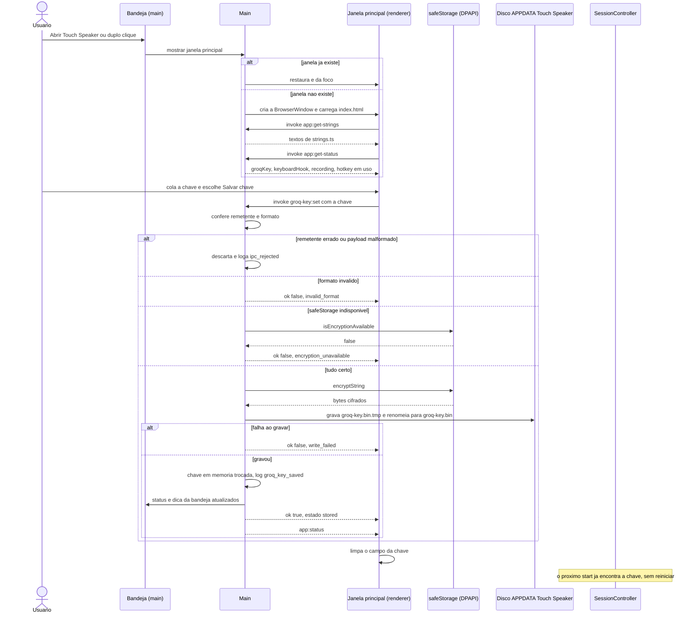
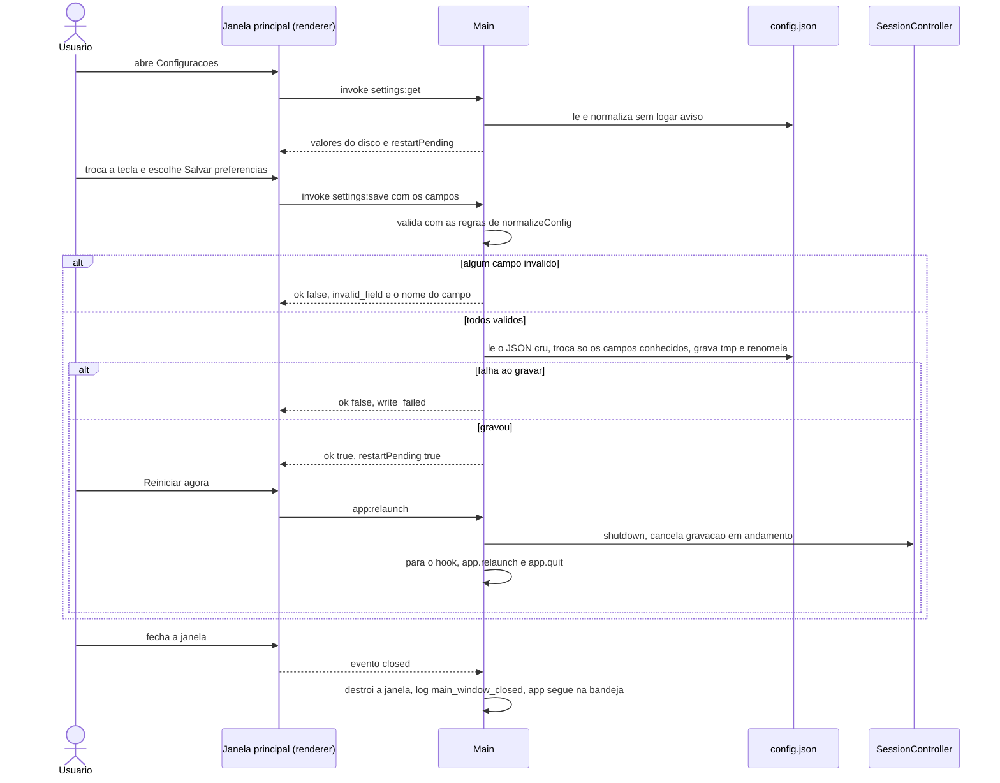
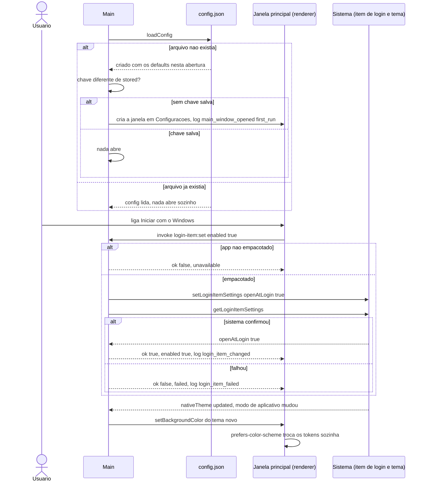
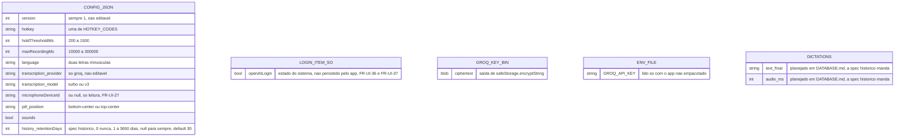
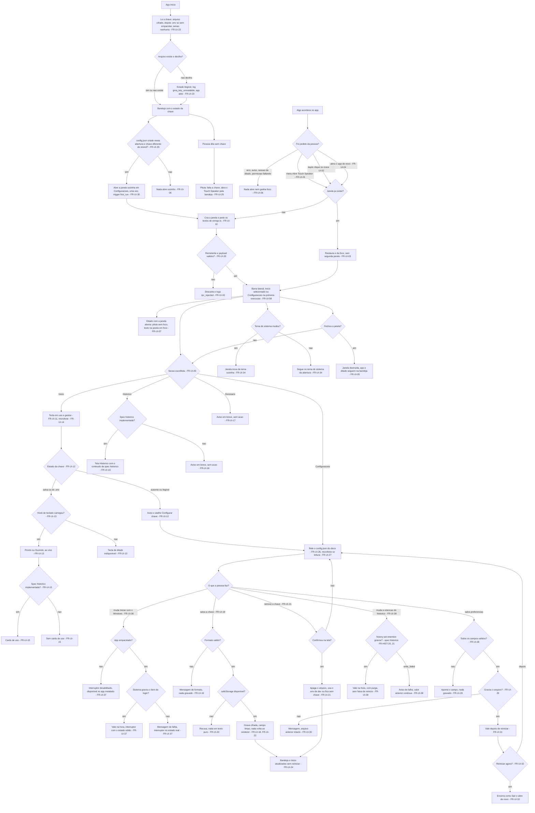

# Janela principal — spec

> Criado: 18/out/2026 · Autor: Victor Alves (redação com agente de IA) · Status: proposta | **aprovada** (18/out/2026 · Victor) | implementada
> Origem: decisão do Victor de 18/out/2026 de abrir a milestone M2 já, com a T9 e a T10 da Fase 1 correndo em
> paralelo, em quatro specs escritas juntas: `design-system`, `janela-principal` (esta), `historico` e
> `distribuicao-windows-macos`. O pedido desta, transmitido pela orquestração da M2 (a frase original do Victor
> não foi registrada): uma janela principal aberta pela bandeja, com barra lateral — Início, Histórico, Dicionário
> e Configurações —, no espírito de um app de ditado moderno que ele usa (escuro, barra lateral, cards), e a chave
> da Groq digitada na própria interface, porque o app instalado não tem `frontend/.env`.
> Fase: itens da Fase 2 do PRD (FR-SET-01; chave no `safeStorage` — SDD §29). A M2 não é igual à Fase 2: junta
> itens das Fases 2 e 4 por decisão do Victor (doc-pai, "Decisões que não são detalhe", item 2; PEND-novo-1 do
> doc-pai) · Requisitos: FR-UI-01 … FR-UI-42 (FR-UI-39…42 entraram em 18/out/2026, pedido do Victor)
> Decisões do Victor de 18/out/2026: os cinco pontos em aberto (Q1–Q5), as escolhas D1–D11 e a retenção do
> histórico nas Configurações (M4 da spec `historico`) estão decididos e registrados no [§17](#17-decisões-tomadas).
> A spec foi aprovada pelo Victor em 18/out/2026
> Contrato: SDD (`docs/spec/spec-driven-development.md`) · Decisões relacionadas: ADR-01, ADR-02, ADR-06, ADR-07 e
> **ADR-08** (texto no [Anexo B](#anexo-b--adr-08-proposta); aceita em 18/out/2026 com esta spec —
> [`docs/DECISIONS.md`](../../DECISIONS.md#adr-08--chave-da-groq-no-safestorage-do-electron-com-o-env-só-como-reserva-de-desenvolvimento))
> Milestone: M2 — doc-pai [`docs/milestones/M2-app-com-interface.md`](../../milestones/M2-app-com-interface.md)
> (em execução); nesta spec, ordem 2, depois da `design-system` e antes da `historico` e da distribuição
> Implementação: T1–T6 feitas em 18/out/2026 (ainda não commitadas); T7 parcial — falta o roteiro manual
> VJ1–VJ24 (PEND-007 no SDD), que o Victor roda (§18). **Com a `historico` implementada no código (18/out/2026):**
> a seção Histórico tem o conteúdo real (FR-UI-16), Configurações tem "Guardar histórico" (FR-UI-38) e o Início tem
> os cards do histórico (FR-UI-15, cumprida pelos FR-HIST-22…26 da `historico`). **Pedidos do Victor do mesmo dia,
> já no código:** Início com "Como ditar" compacto e a tecla em destaque (FR-UI-11, §7 nota) e os 3 ditados recentes
> (exceção ao §2, abaixo); tema claro/escuro escolhido na janela, com animação de revelação (FR-UI-39…42; Q2 e a D4
> da `design-system` revistas, §17); listas suspensas, caixas de seleção e campos numéricos no estilo da janela
> (`docs/DESIGN.md` §6.5). `npm test` 326/326 (com as correções da revisão de código de 18/out/2026)
> Registros: os itens `-novo-` desta spec ganharam número no SDD (versão 1.3) — RISK-novo-1…9 → RISK-021…029,
> TEST-novo-1…3 → TEST-007…009, SCREEN-novo-1 → SCREEN-003, critérios 1–41 do §14 → AC-035…075; a regra da chave
> virou BR-016 e o roteiro pendente, PEND-007; a área `UI` entrou no SDD §0.2
> Depende de: [`design-system`](design-system.md) (paleta "Sálvia", fonte Inter, tokens claro/escuro) ·
> [`historico`](historico.md) (conteúdo da seção Histórico e números de uso do Início) ·
> [`distribuicao-windows-macos`](distribuicao-windows-macos.md) (instalador, ícone do app, plataformas)

Hoje o Touch Speaker não tem tela: a pessoa vê só a pílula durante o ditado e um menu na bandeja, e tudo o que
se configura — inclusive a chave da Groq — está em arquivos (`config.json` e `frontend/.env`). Esta spec cria a
**janela principal**: uma janela comum do Windows, aberta quando a pessoa pede pela bandeja — e sozinha só uma
vez, na primeira execução sem chave salva —, com uma barra lateral de quatro seções e o tema do sistema. No
**Início**, a pessoa vê qual é a tecla de ditado, como ditar e se o app está pronto (chave presente, tecla
funcionando, gravando agora). Em **Configurações**, digita, troca ou remove a chave da Groq — guardada cifrada pelo
`safeStorage` do Electron, e não mais só no `.env` —, muda os campos que já existem no `config.json`, liga ou
desliga "Iniciar com o Windows" e escolhe por quanto tempo o histórico é guardado. **Histórico** mostra a tela cujo
conteúdo, estados e contrato são da spec `historico` — aqui ela é desenhada e ganha a ponte do preload;
**Dicionário** aparece como "em breve". A pílula continua igual: nunca recebe foco nem clique.

---

## 0. Constituição (gate — preencher ANTES de desenhar, reconferir DEPOIS)

| Decisão fixa | Esta feature respeita? | Nota |
| --- | --- | --- |
| ADR-01 — Electron + TypeScript estrito (CommonJS, `tsc`, sem bundler na Fase 1); outro runtime ou framework de interface exige ADR | sim | Renderer da janela em HTML, CSS e TypeScript sem framework nem bundler, como a pílula. A janela pede um segundo programa do `tsc` para o renderer (§8) — ajuste de build, não dependência |
| ADR-02 — hook global com `uiohook-napi`, não `globalShortcut`; só a tecla configurada e o `Esc` são identificados, qualquer outra vira `other` antes de sair do hook | sim | Nenhum atalho global novo para abrir a janela: ele obrigaria a identificar outra tecla (BR-007). A janela abre pela bandeja ou por uma segunda instância (FR-UI-01, 02, 04) |
| ADR-03 — inserção por clipboard + Ctrl+V via `SendInput` (`koffi`), com o clipboard restaurado e fallback quando o app em foco é elevado; o app nunca pede elevação para contornar UIPI | sim | Inserção inalterada. Ditado com a própria janela principal em foco cola no campo dela, como em qualquer app (FR-UI-07) |
| ADR-04 — Groq Whisper `large-v3-turbo`, áudio inteiro ao soltar; sem streaming antes da Fase 4 | sim | A chamada à Groq não muda; só a origem da chave (Anexo B) |
| ADR-05 — sem limpeza por IA na Fase 1; `Refiner` identidade como encaixe | sim | Não toca o `Refiner` |
| ADR-06 — sem backend na Fase 1; o app não é distribuído com chave | sim | Esta spec não distribui nada, e o app continua sem chave embutida: a chave é do usuário, digitada por ele. A parte "não distribuir sem backend" da ADR-06 é da spec `distribuicao-windows-macos` (PEND-novo-2 do doc-pai); a parte da chave no app é respondida aqui pela ADR-08, que complementa a ADR-06 e não a substitui |
| ADR-07 — sala limpa em relação ao Typeless: nada de código, pseudocódigo, strings, constantes, nomes de canal, ícones, sons ou cores dele; o estudo de referência é só referência | sim | O estudo registra que o Typeless tem uma janela principal com seções parecidas (`docs/referencia/estudo-typeless.md`, §1 "Visão geral", linhas 22–24). Aqui os nomes das seções vêm do pedido do Victor e do PRD (FR-HIST-01, FR-VOCAB-01, FR-SET-01); o layout está descrito com palavras próprias; cores e fonte vêm da spec `design-system`; canais IPC, textos e ícones são escritos do zero; sem React |
| C1 Privacidade por padrão — áudio nunca vai para disco; texto ditado, clipboard e teclas nunca vão para log | sim | A janela não guarda texto ditado e só o mostra no Histórico e, desde 18/out/2026 (pedido do Victor), no card "Ditados recentes" do Início (spec `historico` FR-HIST-25); a chave nunca vai para log; o console da janela vai para o log sem a mensagem (§6) |
| C2 Nunca roubar o foco — nada do Touch Speaker recebe foco durante o ditado | sim | A janela abre por ação explícita da pessoa ou, uma única vez, na primeira execução sem chave salva — na abertura do app, antes de existir qualquer sessão de ditado (FR-UI-35, decisão do Victor de 18/out/2026). Nenhum erro, aviso ou sessão a abre (FR-UI-06). A pílula continua `focusable: false` (FR-UI-07). A janela recebe foco quando abre, como qualquer janela |
| C3 Nunca digitar lixo — na dúvida entre inserir algo errado e não inserir nada, não insere e avisa | sim | Nada novo é inserido |
| C4 Falha visível — todo erro chega à pessoa com mensagem clara; nada falha em silêncio | sim | Erros ao salvar chave e preferências aparecem na tela (FR-UI-19, 20, 28, 30); a tecla de ditado indisponível, que hoje só vai para o log, passa a aparecer no Início (FR-UI-13) |
| C5 Provedores trocáveis — transcrição e limpeza atrás de interface (`Transcriber`, `Refiner`); trocar provedor = adapter novo | sim | `Transcriber` inalterado; a chave chega ao `GroqTranscriber` por uma função do main (§8) |
| C6 Sem segredo em app distribuído — chave só no `.env` (dev), `safeStorage` (uso pessoal) ou `backend/` (produto) | sim | É exatamente o caminho que o C6 prevê para uso pessoal: `safeStorage`, com o `.env` só em desenvolvimento (Anexo B) |
| C7 Sala limpa — ver ADR-07 | sim | Ver a linha da ADR-07 |
| C8 Escopo da fase — a spec não puxa funcionalidade de fase seguinte "porque era fácil" | sim | O que esta spec traz — tela de configurações (FR-SET-01) e chave no `safeStorage` — está na linha da Fase 2 do roadmap (SDD §29). A M2 junta itens das Fases 2 e 4 por decisão do Victor de 18/out/2026 (doc-pai, item 2), e a reprioridade fica registrada lá (PEND-novo-1). O conteúdo do Histórico e o dicionário ficam nas specs deles. A Fase 1 segue aberta (T9/T10) |
| Windows primeiro — nada de macOS/Linux/mobile antes da Fase 4 | sim | Esta spec é só Windows. O `safeStorage` também existe no macOS (Keychain), e as decisões de 18/out/2026 já dizem como a janela se comporta lá (tema do sistema, "Abrir ao iniciar sessão", tela de permissões na primeira execução), mas o macOS só entra se a spec `distribuicao-windows-macos` tiver o aval do Victor para mexer nessa decisão fixa (Anexo B, "Consequências") |
| Produto em pt-BR; todo texto de interface em `frontend/src/main/strings.ts` | sim | O renderer da janela não tem strings próprias: recebe os textos de `strings.ts` pelo canal `app:get-strings` (FR-UI-10) |
| `SessionController` é o único dono do estado da sessão | sim | A janela só observa (`onRecordingChange`, já existente — `frontend/src/main/session.ts:39`); "Reiniciar agora" usa o mesmo caminho do "Sair", que chama `session.shutdown()` (`frontend/src/main/index.ts:172-180`) |
| Código em `frontend/` é a fonte de fato; a feature rastreia ao PRD, ao SDD ou ao código — o estudo de referência não é normativo | sim | Rastreabilidade no §3 |
| Nenhum segredo (`GROQ_API_KEY`, conteúdo de `.env`) em doc, código novo ou diff | sim | Nenhum valor de chave nesta spec |
| Sem dependência, provedor ou serviço novo sem ADR | sim | Nenhum pacote novo: `safeStorage`, `nativeTheme` e `app.getLoginItemSettings`/`setLoginItemSettings` são APIs do Electron. A decisão de onde guardar a chave abre a ADR-08 (proposta). A fonte Inter é asset da spec `design-system` |

**Violação exige justificativa:**

| O que fura | Por que é necessário | Alternativa rejeitada e por quê | Aval |
| --- | --- | --- | --- |
| Nenhuma | — | — | — |

> A spec depende da ADR-08 (§17, Anexo B): sem o aceite dela, as FR-UI-18…24 não entram. A ADR-08 foi aceita em
> 18/out/2026, junto com a aprovação desta spec (`docs/DECISIONS.md`).

### 0.1 Diagramas obrigatórios

| # | Diagrama | Seção |
| --- | --- | --- |
| 1 | Wireframe da janela (Início com e sem chave, Configurações, Dicionário) | [§7.1](#71-wireframe--diagrama-1-de-4) |
| 2 | UML de sequência (abrir e salvar a chave; salvar preferências, reiniciar e fechar; primeira execução, tema e início automático) | [§8.1](#81-uml-de-sequência--diagrama-2-de-4) |
| 3 | ER dos dados que a janela lê e escreve | [§9.1](#91-er--diagrama-3-de-4) |
| 4 | Fluxograma da jornada, com o FR de cada ramo | [§11.1](#111-fluxograma--diagrama-4-de-4) |

---

## 1. O problema, na tela

Quem instala o Touch Speaker (spec `distribuicao-windows-macos`) não tem `frontend/.env`: a pasta do código não
existe na máquina dela. Ao segurar a tecla, a pílula diz "Falta a chave da Groq — veja o README", e não há na
interface nenhum lugar para colocar a chave. Quem quer trocar a tecla precisa achar o `config.json` pelo menu da
bandeja, editar um JSON à mão e reiniciar o app. E quando o hook de teclado não carrega, a bandeja continua dizendo
"pronto": a tecla não faz nada e a pessoa não sabe por quê.

### 1.1 A chave só entra pelo `.env`

O main lê a chave de `<appPath>/.env` com `process.loadEnvFile`, e sem o arquivo o app abre sem chave
(`frontend/src/main/index.ts:33-38`). A pílula manda a pessoa para o README (`frontend/src/main/strings.ts:19`,
`no_api_key`). A ADR-06 proíbe embutir chave no app distribuído, e o SDD já planeja a chave no `safeStorage`
"digitada na tela de configurações" (SDD §6.2, §22, §29 Fase 2; `docs/API.md`, tabela de Autenticação, linha
"2"; `docs/ENVIRONMENT.md`, "Fase 2 — PLANEJADO"). Sem esta feature, o app instalado nunca dita. Risco
relacionado: RISK-009 (chave em texto puro no `.env`).

### 1.2 A chave é congelada na abertura

O `GroqTranscriber` recebe a chave uma vez, no construtor (`GroqOptions.apiKey`,
`frontend/src/main/transcribe/groq.ts:9-15`, `:35-43`; montado em `frontend/src/main/index.ts:125`). A bandeja
recebe um booleano `hasApiKey` também uma vez (`frontend/src/main/tray.ts:5-10`, `:24`;
`frontend/src/main/index.ts:182-187`). Salvar uma chave pela interface não teria efeito até reiniciar, e a bandeja
continuaria dizendo "falta a chave da Groq".

### 1.3 Configurar é editar arquivo e reiniciar

A bandeja só oferece "Abrir pasta de configuração" (`frontend/src/main/tray.ts:31`). O app só escreve o
`config.json` quando ele não existe (`frontend/src/main/config.ts:93-99`); campo desconhecido é ignorado na
leitura (`config.ts:53-57`) e campo inválido cai no default só em memória (BR-012). A tecla é ligada ao hook na
abertura (`frontend/src/main/index.ts:167`) e o `holdThresholdMs`, ao `HotkeyController` (`index.ts:144-148`):
trocar qualquer um exige reiniciar (SDD §9.1; FR-DICT-13; AC-013). O modelo e a posição da pílula também são lidos
só na abertura (`index.ts:125`, `:97`).

### 1.4 Tecla indisponível falha em silêncio

Se o `uiohook-napi` não carrega, o app registra `keyboard_hook_unavailable` e segue (`frontend/src/main/index.ts:165-170`;
SDD §19), mas a bandeja diz "Touch Speaker — pronto" (`tray.ts:24` só olha a chave e a gravação). É uma lacuna de
C4 que **existe independente desta feature**. Aqui ela é tratada no Início (FR-UI-13); corrigir também o texto da
bandeja é trabalho separado (§2, não-objetivos) — não há `PEND-` para isso no SDD (Apêndice B), e a sugestão é
registrar uma na aprovação.

### 1.5 O código assume uma janela só

- A pílula é "the only renderer" (`frontend/src/main/pill-window.ts:1-2`); o SDD e o Security Guide repetem isso
  (SDD §3.2, §12; Security Guide §9, §14).
- A permissão de mídia já é só da pílula: o handler compara `contents === pill.webContents`
  (`frontend/src/main/index.ts:107-113`). Uma janela nova **não** herda o microfone — o que é bom, e esta spec
  mantém (Security Guide §5).
- O preload expõe `window.touchSpeaker` com as sete funções da pílula (`frontend/src/preload/pill.ts:22-30`), e o
  tipo que o renderer enxerga declara `Window.touchSpeaker` (`frontend/src/renderer/global.d.ts:23-35`). Um segundo
  formato com o mesmo nome se mesclaria com o primeiro no mesmo programa do `tsc`.
- O `tsconfig.renderer.json` compila todo `src/renderer/**` num programa só, como scripts clássicos
  (`frontend/tsconfig.renderer.json:5-8`, `:14`): dois scripts clássicos no mesmo programa dividem o escopo global
  do compilador. O `scripts/copy-static.mjs` só copia `.html` e `.css` do primeiro nível de `src/renderer`
  (`frontend/scripts/copy-static.mjs:11-13`).
- A segunda instância do app é só registrada no log (`frontend/src/main/index.ts:189`, `second_instance_ignored`).
- `window-all-closed` não encerra o app (`frontend/src/main/index.ts:190-192`): fechar uma janela já não derruba a
  bandeja.

---

## 2. Objetivo e não-objetivos

**Objetivo:** existir uma janela principal, aberta por ação da pessoa (e sozinha só na primeira execução sem chave
salva), com barra lateral Início · Histórico · Dicionário · Configurações e o tema do sistema, em que a pessoa vê
como ditar e o estado do app e configura a chave da Groq (guardada com `safeStorage`), os campos existentes do
`config.json`, o início automático com o Windows e a retenção do histórico, sem mudar o ditado, sem dar foco à
pílula e sem subir o consumo em repouso com a janela fechada (NFR-03).

**Não-objetivos** (o que esta feature explicitamente NÃO faz):

- Conteúdo, dados, estados, textos e ações do Histórico (lista, busca, "copiar de novo", purga) e a regra da
  retenção — são da spec [`historico`](historico.md) (FR-HIST-01). Aqui entram a seção na barra lateral, o desenho
  da tela com os componentes comuns da janela, a ponte do preload que leva os canais `history:*` dela e o controle
  de retenção em Configurações (FR-UI-38).
- Atalho na bandeja direto para uma seção (ex.: "Abrir histórico") — a spec `historico` deixa para esta, e
  esta não prevê; o Victor pode pedir.
- Dicionário pessoal (FR-VOCAB-01) — não há spec; a aba aparece como "em breve", sem ação (FR-UI-17; decisão Q1).
- Escolha de microfone (`microphoneDeviceId`) — fica para depois (decisão Q3); Configurações só mostra o
  microfone em uso, como a bandeja (FR-UI-27).
- Escolha manual de tema — não existe (decisão Q2): a janela segue o tema do sistema (FR-UI-34).
- Paleta, fonte, tokens e ícones da interface — são da spec [`design-system`](design-system.md). Esta spec
  diz onde cada coisa fica, não a cor.
- Instalador, atalho no menu Iniciar, ícone do app (`.ico`), desinstalação e macOS — spec
  [`distribuicao-windows-macos`](distribuicao-windows-macos.md).
- Instalar ou desinstalar o item de login — o instalador da spec `distribuicao-windows-macos` grava o estado
  inicial (FR-PKG-04 de lá); aqui só se mostra e se alterna o mesmo item de login (FR-UI-36, FR-UI-37).
- Comportamento no macOS (ícone no Dock com a janela aberta, menu de edição para Cmd+C/Cmd+V, conteúdo da tela de
  permissões) — é da spec `distribuicao-windows-macos` (D10, D14, FR-MAC-12, FR-MAC-16 de lá); esta spec é só
  Windows. O que já está decidido para a janela no macOS (tema, texto do início automático, abertura na primeira
  execução) vale quando a distribuição para o macOS for aprovada.
- Validar a chave na Groq no momento de salvar — exigiria uma chamada HTTP nova (contrato novo no `docs/API.md` e
  no `docs/INTEGRATION.md`). A chave errada aparece no primeiro ditado como `invalid_api_key`, como hoje (D5).
- Aplicar preferências sem reiniciar — o app segue a regra atual de "vale depois de reiniciar" (FR-DICT-13,
  AC-013), com um botão para reiniciar (FR-UI-32) (D4). Exceções que valem na hora: "Iniciar com o Windows", porque
  é estado do sistema, não do `config.json` (FR-UI-37), e a retenção do histórico, que a spec `historico` aplica na
  hora (FR-HIST-20).
- Lembrar tamanho e posição da janela entre aberturas — seria dado persistido novo.
- Atalho de teclado global para abrir a janela — identificaria outra tecla além da configurada e do `Esc`
  (BR-007, guardrail do `CLAUDE.md`).
- Mostrar texto ditado no Início ou em qualquer seção fora do Histórico (`docs/DESIGN.md` §18). **Exceção (pedido
  do Victor de 18/out/2026):** o card "Ditados recentes" do Início mostra o começo dos 3 ditados mais recentes, com
  "Copiar" e "Ver todos" — conteúdo e contrato na spec `historico` (FR-HIST-25), pelo mesmo `history:list`.
- Aviso de "o app continua na bandeja" ao fechar a janela — o ícone da bandeja já indica; o Victor pode pedir.
- Corrigir o status da bandeja quando o hook não carrega (§1.4) — trabalho separado.
- Limpeza por IA, contexto do app, comandos por voz, tradução — specs próprias das Fases 2 e 3 (C8).
- Mudar a pílula — salvo o texto de `no_api_key` (FR-UI-25).

### 2.1 Produto — a quem serve e como se mede

| | |
| --- | --- |
| **Para quem** | Dev multitarefa (Victor), hoje; e quem instalar o app pelo instalador da spec `distribuicao-windows-macos`. Para quem o app será distribuído é decisão daquela spec e do SDD §29 (a pergunta sobre a Fase 4 já está aberta lá) — esta spec não decide |
| **Dor** | "Instalei e não tenho onde pôr a chave." · "Para trocar a tecla eu tenho que achar e editar um JSON." · "Apertei a tecla e nada aconteceu, e eu não sei por quê." |
| **Elo do fluxo que fortalece** | **tecla** (mostra qual é e como usar; avisa quando o hook não carregou) e **transcrição** (chave configurada sem `.env`). Gravação, inserção e pílula não mudam, salvo o texto de `no_api_key` |
| **Hipótese** | Acreditamos que configurar chave e tecla numa janela faz quem instala o app ditar pela primeira vez sem editar arquivo, e saberemos que deu certo quando, no log de uma instalação nova, `groq_key_saved` vier seguido de `dictation_done` sem nenhum `session_rejected` (`no_api_key`) depois dele. Não mexe nas hipóteses H1–H4 do `PROJECT_CONTEXT.md` |
| **Como se mede** | Eventos do log, só metadados (C1): `main_window_opened` (com `trigger`), `main_window_ready` (`ready_ms`), `groq_key_saved`, `groq_key_rejected` (`reason`), `settings_saved` (`fields`), `settings_rejected` (`field`) e a sequência `session_rejected` → `groq_key_saved` → `dictation_done`. Nunca o valor da chave nem de campo |
| **Custo de não fazer** | O app instalado não dita: sem `.env`, toda sessão termina em `no_api_key`, e a ADR-06 e o C6 proíbem embutir a chave. A spec de distribuição perde o sentido, e o RISK-009 segue aberto |
| **Alcance × esforço** | Alcance: 100% do primeiro uso de quem instala e toda troca de configuração; o ditado do dia a dia não passa pela janela. Esforço: estimativa do redator de 5 a 7 sessões de trabalho (T1–T7 do §18), a conferir pelo Victor |

> A feature muda um texto da pílula (`no_api_key`, FR-UI-25): o `README.md` e o `frontend/src/main/strings.ts`
> precisam continuar verdadeiros (§16).

---

## 3. Rastreabilidade

| Origem | Referência |
| --- | --- |
| Decisão do Victor | 18/out/2026 — abrir a M2 com quatro specs; janela principal pela bandeja, barra lateral com Início, Histórico, Dicionário e Configurações; chave da Groq na interface. E, no mesmo dia, as respostas Q1–Q5, o aceite de D1–D11 e a retenção do histórico nas Configurações (§17) |
| PRD | `docs/PRD.md` → **FR-SET-01** (tela de configurações: tecla, microfone, idioma, iniciar com o Windows — aqui entram tecla, idioma e "iniciar com o Windows" (FR-UI-36, 37); o microfone fica para depois (Q3)) · **FR-HIST-01** (seção Histórico — desenho da tela e ponte; conteúdo, estados e contrato na spec `historico`) · **FR-VOCAB-01** (seção Dicionário — FR-UI-17) · roadmap da Fase 2 |
| SDD | C2, C4, C6 (§1.5) · §2.2 e §2.3 (tela de configurações: Fase 2) · §3.2 e §3.3 (capacidades e camadas de isolamento — ganham uma coluna e uma camada) · §6.2 ("Chave guardada no `safeStorage`… no lugar do `.env`", Fase 2) · §9.1 e §9.2 (o `config.json` só vale ao reiniciar) · §12 e §13 (navegação e catálogo de telas — ganham a janela) · §19 (hook indisponível) · §22 (variáveis — `safeStorage` planejado) · §29 (linha da Fase 2: "chave no `safeStorage` (DPAPI); janela de configurações") · BR-007, BR-012, BR-013, BR-015 · NFR-03, NFR-05 · RISK-005, RISK-006, RISK-009, RISK-013 · FR-DICT-13 e AC-013 |
| Docs | `docs/Security-Guide.md` §3, §5 ("Janela nova não herda a permissão de mídia"), §7, §9, §10, §12, §14 · `docs/ENVIRONMENT.md`, "O arquivo .env" · `docs/API.md`, "Autenticação" · `docs/DATABASE.md`, "`config.json`" · `docs/DESIGN.md` §7.1, §9, §17, §18 |
| Código atual | `frontend/src/main/index.ts:33-38`, `:40-47`, `:97`, `:107-113`, `:125`, `:141`, `:144-148`, `:165-170`, `:172-180`, `:182-187`, `:189`, `:190-192`, `:198-205` · `frontend/src/main/tray.ts:5-10`, `:24`, `:31` · `frontend/src/main/config.ts:7-17`, `:21-31`, `:46-90`, `:93-106` · `frontend/src/main/transcribe/groq.ts:9-15`, `:35-46` · `frontend/src/main/pill-window.ts:1-2`, `:35`, `:37-47`, `:50` · `frontend/src/preload/pill.ts:22-30` · `frontend/src/renderer/global.d.ts:23-35` · `frontend/src/renderer/pill.html:7` · `frontend/src/main/strings.ts:9-15`, `:19` · `frontend/src/main/keys.ts:6-23` · `frontend/tsconfig.renderer.json` · `frontend/scripts/copy-static.mjs:11-13` |
| Estudo de referência (não normativo) | `docs/referencia/estudo-typeless.md` (§1 "Visão geral", linhas 22–24): o produto estudado tem janela principal separada da pílula. Serviu só para confirmar que a separação "janela principal + pílula" é comum; nada de layout, texto, cor, ícone ou canal sai dele (ADR-07) |
| Specs irmãs da M2 | `design-system` (tokens e fonte; a D4 de lá e a Q2 daqui têm a mesma resposta: seguir o tema do sistema) · `historico` (conteúdo, estados e canais `history:*` da tela Histórico; campo `history.retentionDays`, cuja M4 foi decidida: editado aqui, em Configurações) · `distribuicao-windows-macos` (app empacotado, `.env` ignorado — FR-PKG-13, igual à FR-UI-23 —, `.ico`, macOS; a FR-PKG-04 de lá é atendida pelas FR-UI-36 e 37, e a D14 de lá fica restrita à primeira execução pela FR-UI-35) |
| Milestone | doc-pai da M2: `docs/milestones/M2-app-com-interface.md` (em especificação, aberto antes do gate por decisão do Victor). Milestone anterior: nenhuma — a M1 só ganha doc quando a T9/T10 fecharem |

**Área de FR nova.** `UI` não está na lista de áreas em uso (SDD §0.2; `docs/templates/README.md`, "IDs
estáveis"). Os FR da janela ficam em `FR-UI-NN` por pedido da orquestração da M2; na aprovação, a área entra no
SDD §0.2 e no README dos templates (§16). Os FR de Configurações cobrem parte do **FR-SET-01** do PRD — o Victor
pode preferir renumerá-los como `FR-SET-NN` na aprovação; os IDs não mudam de substância.

**Registros novos sem número.** Esta spec não aloca números nos registros globais. Itens novos aparecem como
`RISK-novo-N`, `TEST-novo-N` e `SCREEN-novo-1` e ganham número no SDD quando a spec for aprovada. A verificação
manual usa `VJ1`–`VJ24`, locais a esta spec, para não colidir com o `V1`–`V13` da spec `ditado-por-voz`.

---

## 4. Atores e permissões

| Ator | O que pode | Como o código confere |
| --- | --- | --- |
| usuário | aciona a tecla de ditado; usa o menu da bandeja; **abre a janela principal** (menu, duplo clique no ícone, abrir o app de novo); digita a chave da Groq, muda preferências, liga ou desliga "Iniciar com o Windows" e escolhe a retenção do histórico na janela; ainda pode editar o `config.json` à mão | o hook só distingue tecla configurada, `Esc` e `other` (`frontend/src/main/keyboard.ts:8-9`), inclusive enquanto a pessoa digita na janela |
| processo main | tudo o que já podia, mais: criar e destruir a janela principal (e abri-la sozinha na primeira execução sem chave salva); **escrever** o `config.json`; cifrar, gravar, ler e apagar o arquivo da chave via `safeStorage`; ler e gravar o item de login do sistema; acompanhar o tema do sistema (`nativeTheme`); reiniciar o app | dono único do estado da sessão (`SessionController`) e da chave em memória; valida remetente, tipos e tamanho de todo IPC da janela (FR-UI-33) |
| renderer (pílula) | inalterado: só o microfone, entre `recorder:start` e `recorder:stop`/`recorder:cancel`, e a interface da pílula | inalterado (`frontend/src/main/index.ts:107-113`, `:150`) |
| renderer (janela principal) — **novo** | mostrar as seções; mandar ao main a chave digitada (uma vez, ao salvar) e as preferências editadas; pedir textos e estado | `contextIsolation`, `sandbox`, `nodeIntegration: false`, `webSecurity`; **sem** permissão de mídia (o handler atual já nega — `index.ts:111`); CSP própria sem rede; não persiste nada no navegador (sem `localStorage`/IndexedDB) |
| preload (pílula) | inalterado: `window.touchSpeaker` com as sete funções | `frontend/src/preload/pill.ts:22-30` |
| preload (janela principal) — **novo** | expõe só `window.touchSpeakerApp`, com as funções do §10 | `contextBridge`; nome de ponte diferente do da pílula; nenhum `ipcRenderer` genérico |
| `safeStorage` (Electron, DPAPI no Windows) — **novo** | cifrar e decifrar a chave para o usuário do Windows logado | chamado só pelo main, depois do `ready` do app (Anexo B) |
| item de login do sistema (chave `Run` do usuário no Windows; item de login no macOS) — **novo para o app** | abrir o Touch Speaker no login, se ligado; o estado inicial vem do instalador (spec `distribuicao-windows-macos`, FR-PKG-04) | lido e gravado só pelo main, por `app.getLoginItemSettings`/`setLoginItemSettings`, e só com o app empacotado (FR-UI-37) |
| Groq | inalterado: recebe o áudio e devolve o texto | `Authorization: Bearer` só no main (`frontend/src/main/transcribe/groq.ts:61`) |
| app em foco | recebe o Ctrl+V sintético — **inclusive a própria janela principal**, quando é ela que está em foco | detecção de elevação inalterada (`frontend/src/main/insert/inserter.ts`) |

---

## 5. Requisitos funcionais

Formato EARS. Um comportamento por linha. Prioridade: P1 = sem isso a feature não fecha; P2 = entra na M2 se
couber, sem bloquear.

### 5.1 Abrir e fechar

| # | Requisito | Origem | Prioridade |
| --- | --- | --- | --- |
| FR-UI-01 | QUANDO a pessoa escolhe "Abrir Touch Speaker" no menu da bandeja O SISTEMA DEVE mostrar a janela principal com foco, criando-a se não existir | Victor (18/out/2026: "aberta pela bandeja") | P1 |
| FR-UI-02 | QUANDO a pessoa dá duplo clique no ícone da bandeja O SISTEMA DEVE fazer o mesmo que a FR-UI-01 | Victor (abrir pela bandeja); gesto decidido em 18/out/2026 (D2) | P2 |
| FR-UI-03 | QUANDO a janela já existe (aberta atrás de outras ou minimizada) e é pedida de novo O SISTEMA DEVE restaurá-la e dar foco a ela, sem criar uma segunda janela | instância única de janela — pedido da M2 ("single instance") | P1 |
| FR-UI-04 | QUANDO o app é aberto de novo com uma instância já rodando O SISTEMA DEVE encerrar a segunda instância e mostrar a janela principal da primeira como na FR-UI-01, registrando `second_instance_focus` no log | `frontend/src/main/index.ts:40-47`, `:189`; pedido da M2 ("single instance"); decidido em 18/out/2026 (D3) | P2 |
| FR-UI-05 | QUANDO a pessoa fecha a janela principal O SISTEMA DEVE destruí-la e continuar na bandeja, com o hook de teclado e uma sessão de ditado em andamento intactos | Victor (fechar volta para a bandeja); NFR-03; `frontend/src/main/index.ts:190-192` | P1 |
| FR-UI-06 | ENQUANTO a pessoa não pediu a janela (FR-UI-01, 02 ou 04) O SISTEMA DEVE mantê-la fechada — nenhum erro, aviso, sessão de ditado, permissão faltando ou mudança de estado abre, mostra ou dá foco à janela —, com uma única exceção: a primeira execução sem chave salva (FR-UI-35) | C2; `docs/DESIGN.md` §18 ("abrir janela durante o ditado"); decisão Q4 de 18/out/2026 ("nunca em outro momento") | P1 |
| FR-UI-07 | ENQUANTO a janela principal está aberta O SISTEMA DEVE manter a pílula e o ditado como hoje — pílula sem foco nem clique, texto colado na janela que estiver em foco no momento da inserção, inclusive a própria janela principal | C2; ADR-03; RISK-006 | P1 |
| FR-UI-35 | QUANDO o app abre pela primeira vez — o `config.json` não existia e foi criado nesta abertura (`frontend/src/main/config.ts:95-98`) — e não há chave salva no app (estado da chave diferente de `stored`) O SISTEMA DEVE abrir a janela principal sozinha, uma vez, na seção Configurações, depois de montar a bandeja e antes de qualquer sessão de ditado, registrando `main_window_opened` com `trigger: first_run`; no macOS, a mesma abertura mostra também a tela de permissões da D14 da spec `distribuicao-windows-macos`, se faltar permissão | decisão Q4 de 18/out/2026; spec `distribuicao-windows-macos` D14 | P1 |

### 5.2 Navegação e textos

| # | Requisito | Origem | Prioridade |
| --- | --- | --- | --- |
| FR-UI-08 | QUANDO a janela principal é criada O SISTEMA DEVE mostrar a barra lateral com Início, Histórico, Dicionário ("em breve", FR-UI-17) e, separado dos três, Configurações, com Início selecionado (Configurações, na abertura da FR-UI-35) | Victor (seções); PRD FR-HIST-01, FR-VOCAB-01, FR-SET-01 | P1 |
| FR-UI-09 | QUANDO a pessoa escolhe um item da barra lateral, com mouse ou teclado, O SISTEMA DEVE trocar a seção na mesma página, sem navegar para outro endereço, e marcar o item atual | Security Guide §9 (navegação bloqueada em todo `webContents` — `frontend/src/main/index.ts:92-95`) | P1 |
| FR-UI-10 | QUANDO a janela principal carrega O SISTEMA DEVE entregar a ela, por IPC, os textos de interface de `frontend/src/main/strings.ts`; o renderer não tem texto próprio | `CLAUDE.md` "Convenções"; SDD §3.2 (linha "Textos da interface") | P1 |
| FR-UI-34 | QUANDO a janela abre, e sempre que o modo de aplicativo do sistema muda com ela aberta, O SISTEMA DEVE desenhar a janela — conteúdo e moldura — no tema do sistema (claro ou escuro), trocando sozinho, sem reabrir. **Revisto em 18/out/2026:** vale enquanto a escolha for "Seguir o sistema" (o padrão); com um tema escolhido, vale a FR-UI-39 | decisão Q2 de 18/out/2026 (a mesma da D4 da spec `design-system`), revista no mesmo dia (§17); FR-DS-03 e FR-DS-04 de lá | P1 |
| FR-UI-39 | QUANDO o app abre O SISTEMA DEVE aplicar o tema guardado no `config.json` (`theme`: `"system"` por padrão, `"light"` ou `"dark"`) com `nativeTheme.themeSource`, antes de criar qualquer janela — conteúdo, moldura nativa e pílula seguem a escolha, sem pintar no outro tema —; o ícone da bandeja continua seguindo o tema da barra de tarefas | pedido do Victor de 18/out/2026 (padrão: seguir o sistema); `tray.ts`/`icon.ts` (`shouldUseDarkColorsForSystemIntegratedUI`) | P2 |
| FR-UI-40 | QUANDO a pessoa clica no botão de tema da barra lateral O SISTEMA DEVE trocar o tema da tela entre claro e escuro na hora (atributo `data-theme`, síncrono) e gravar a escolha pelo canal `theme:set` (remetente conferido; `{ theme }` só com `system`, `light` ou `dark`), que troca só o campo `theme` do `config.json` pela fila única e aplica o `themeSource`; SE a gravação falhar ENTÃO o tema em uso continua, a tela volta a ele e mostra "Não foi possível salvar o tema" | pedido do Victor de 18/out/2026 | P2 |
| FR-UI-41 | QUANDO o tema troca pelo botão O SISTEMA DEVE revelar o novo tema num círculo que cresce a partir do botão (View Transitions, 500 ms), sem outra animação por cima e ignorando cliques até a revelação acabar; com "reduzir movimento" ligado, ou sem a API, a troca é direta, sem animação. O botão mostra o sol no tema claro e a lua no escuro (Lucide 1.52.0) — os dois `<svg>` ficam no botão e a troca liga e desliga o **atributo** `hidden` (`toggleAttribute`; a propriedade `.hidden` não existe em `<svg>` e não esconde nada) —, com o nome acessível do que o clique faz ("Mudar para tema escuro" / "Mudar para tema claro") e anel de foco visível | pedido do Victor de 18/out/2026 (trecho de código dele, adaptado) | P2 |
| FR-UI-42 | QUANDO Configurações é mostrada O SISTEMA DEVE exibir o card "Aparência" com o tema em uso ("Seguindo o sistema", "Claro" ou "Escuro") e o botão "Seguir o sistema", que volta a escolha para `"system"` — e a janela volta a acompanhar o sistema sozinha (FR-UI-34). Na volta para `"system"` as cores só trocam quando o `themeSource` do main chega ao `prefers-color-scheme` da janela, depois do `theme:set`: as transições CSS ficam desligadas (`holdTransitions`) até esse `change` ou, quando o sistema já mostra o mesmo tema e nenhum `change` vem, até 300 ms; voltam dois quadros depois | pedido do Victor de 18/out/2026; revisão de código de 18/out/2026 (as transições voltavam antes de o sistema responder, e as cores trocavam animadas, controle por controle) | P2 |

### 5.3 Início

| # | Requisito | Origem | Prioridade |
| --- | --- | --- | --- |
| FR-UI-11 | QUANDO o Início é mostrado O SISTEMA DEVE exibir o nome em pt-BR da tecla de ditado em uso e como ditar: segurar por `holdThresholdMs` ou mais, falar e soltar; toque curto para mãos livres, até o próximo toque; `Esc` cancela. (18/out/2026, pedido do Victor: num card compacto, com a tecla em destaque — mesmo conteúdo) | Victor ("tecla configurada e como ditar"); BR-001, BR-003, BR-004; `README.md` | P1 |
| FR-UI-12 | QUANDO o Início é mostrado O SISTEMA DEVE exibir o estado da chave da Groq — salva no app, vinda do `.env` de desenvolvimento, ausente ou ilegível — e, quando ausente ou ilegível, um atalho que abre Configurações | Victor ("status da chave"); BR-013 | P1 |
| FR-UI-13 | ENQUANTO o Início está aberto O SISTEMA DEVE exibir o estado do app e atualizá-lo sem reabrir a janela: "pronto", "ouvindo" (durante uma gravação), "falta a chave" ou "tecla de ditado indisponível" (hook não carregou) | Victor ("estado do app"); C4; SDD §19; `frontend/src/main/index.ts:141`, `:165-170` | P1 |
| FR-UI-14 | QUANDO o Início é mostrado O SISTEMA DEVE exibir o microfone em uso como hoje na bandeja: "padrão do Windows" ou "definido no config.json" | `frontend/src/main/tray.ts:29`; `strings.ts:12-13` | P2 |
| FR-UI-15 | QUANDO a spec `historico` expuser um agregado de uso O SISTEMA DEVE mostrar no Início cards de uso (palavras e minutos ditados) com os dados e o contrato definidos por ela; antes disso, o Início não mostra card de uso | Victor (estatísticas dependem do histórico) — **dependência da spec `historico`**, que em 18/out/2026 ainda não define esse agregado; decidido (D11) que ele é pedido à `historico`, sem conteúdo, e que até lá não há card. **Cumprida em 18/out/2026:** a `historico` expõe `history:stats` (FR-HIST-22…24) e o Início mostra o card "Seu uso" — palavras, ditados e tempo falando, de hoje e de todo o histórico, e a média de palavras por minuto —, com o estado desligado/indisponível (FR-HIST-26) | P2 |

### 5.4 Histórico e Dicionário

| # | Requisito | Origem | Prioridade |
| --- | --- | --- | --- |
| FR-UI-16 | QUANDO a pessoa abre Histórico O SISTEMA DEVE mostrar a tela Histórico com o conteúdo, os estados, os textos e as ações definidos pela spec `historico` (§7, §7.1 e §10 dela), desenhada por esta spec com os componentes e tokens comuns da janela e falando com o main só pelas funções `history.*` da ponte (§10). A `historico` entra na mesma milestone; se a janela for implementada antes dela, a seção mostra o mesmo aviso "em breve" da FR-UI-17 até a `historico` entrar | Victor; PRD FR-HIST-01; spec `historico` ("a tela é desenhada pela `janela-principal`; aqui, conteúdo e estados"); decisão Q1 de 18/out/2026 — **dependência da spec `historico`** | P1 |
| FR-UI-17 | ENQUANTO não existe a feature de dicionário O SISTEMA DEVE mostrar o item Dicionário na barra lateral marcado como "em breve" e, ao ser escolhido, uma seção só com o título e o aviso "em breve", sem nenhuma ação | decisão Q1 de 18/out/2026; Victor (aba pedida); FR-VOCAB-01 sem spec | P2 |

### 5.5 Configurações — chave da Groq

| # | Requisito | Origem | Prioridade |
| --- | --- | --- | --- |
| FR-UI-18 | QUANDO a pessoa digita a chave e escolhe "Salvar chave" (primeira vez ou trocando a atual) O SISTEMA DEVE conferir o formato no main, cifrá-la com `safeStorage`, gravar o arquivo da chave de forma atômica, passar a usá-la a partir do próximo ditado sem reiniciar e limpar o campo da tela | Victor (chave na interface); ADR-08 (proposta); SDD §6.2 | P1 |
| FR-UI-19 | SE a chave digitada estiver vazia depois de aparar os espaços das pontas, tiver espaço ou caractere de controle no meio, ou passar de 512 caracteres, ENTÃO O SISTEMA DEVE mostrar a mensagem de formato inválido, sem gravar nada e mantendo a chave anterior | Security Guide §7 (tamanho e tipo validados no main); limite defensivo do IPC, não regra de formato da Groq | P1 |
| FR-UI-20 | SE o `safeStorage` não estiver disponível ENTÃO O SISTEMA DEVE recusar o salvamento com mensagem clara e nunca gravar a chave em texto puro, em lugar nenhum | C4; C6; ADR-08 | P1 |
| FR-UI-21 | QUANDO a pessoa escolhe "Remover chave" e confirma na própria tela O SISTEMA DEVE apagar o arquivo da chave e passar a usar a chave do `.env` de desenvolvimento, se houver, ou ficar sem chave | Victor (remover a chave); ADR-08 | P1 |
| FR-UI-22 | O SISTEMA DEVE manter a chave só no processo main: ela vai do renderer ao main uma vez, ao salvar, e nunca volta — nem inteira, nem em parte —; nunca vai para o log nem para o `config.json`; o renderer recebe só o estado (`stored`, `env`, `none`, `unreadable`) | C6; Security Guide §3, §10, §12; `docs/API.md` "Autenticação" | P1 |
| FR-UI-23 | QUANDO o app inicia O SISTEMA DEVE carregar a chave nesta ordem: arquivo cifrado; senão, só com o app não empacotado, o `.env`; senão, nenhuma. SE o arquivo existir e não puder ser decifrado ENTÃO O SISTEMA DEVE abrir normalmente, tratar a chave como ilegível, registrar `groq_key_unreadable` e mostrar o estado no Início e em Configurações | ADR-08 (D1); `docs/ENVIRONMENT.md` ("o `.env` deixa de ser lido no app empacotado"); BR-012 (o app nunca deixa de abrir por causa de arquivo) | P1 |
| FR-UI-24 | QUANDO a chave é salva ou removida O SISTEMA DEVE atualizar o status e a dica do ícone da bandeja e o Início, sem reiniciar | §1.2; `frontend/src/main/tray.ts:24` | P1 |
| FR-UI-25 | QUANDO a sessão é recusada por falta de chave (`no_api_key`) O SISTEMA DEVE mostrar na pílula um texto que leve à janela, e não ao README: "Falta a chave da Groq — abra o Touch Speaker pela bandeja" | §1.1; `frontend/src/main/strings.ts:19`; BR-013 — texto decidido em 18/out/2026 (D9) | P1 |

### 5.6 Configurações — preferências do `config.json`

| # | Requisito | Origem | Prioridade |
| --- | --- | --- | --- |
| FR-UI-26 | QUANDO Configurações é mostrada O SISTEMA DEVE exibir os campos editáveis que já existem no `config.json` — `hotkey`, `holdThresholdMs`, `maxRecordingMs`, `language`, `transcription.model`, `pill.position`, `sounds` — com os valores lidos do arquivo no disco naquele momento, já normalizados, sem registrar `config_invalid_field` nessa leitura. Do `history.retentionDays` (spec `historico`) trata a FR-UI-38; nenhum outro campo de spec irmã entra nesta tela sem que a spec dona peça | Victor ("só campos que existem"); PRD FR-SET-01; `docs/DATABASE.md` "`config.json`"; BR-012 (o aviso é da abertura do app) | P1 |
| FR-UI-27 | QUANDO Configurações é mostrada O SISTEMA DEVE exibir o microfone em uso só para leitura, como a bandeja — "padrão do Windows" ou "definido no config.json" —, sem lista de dispositivos e sem gravar `microphoneDeviceId` | decisão Q3 de 18/out/2026 (escolha de microfone fica para depois); `frontend/src/main/tray.ts:29` | P2 |
| FR-UI-28 | QUANDO a pessoa escolhe "Salvar preferências" O SISTEMA DEVE validar todos os campos no main com as mesmas regras do `normalizeConfig` e, SE algum for inválido, recusar o salvamento inteiro, apontar o campo na tela e não gravar nada | BR-012; `frontend/src/main/config.ts:46-90` | P1 |
| FR-UI-29 | QUANDO todos os campos são válidos O SISTEMA DEVE gravar o `config.json` de forma atômica, trocando só os sete campos da FR-UI-26 pelos valores da tela e mantendo todo o resto como estava — `version: 1`, `transcription.provider`, `microphoneDeviceId`, `history.retentionDays` (que só o `history:set-retention` da spec `historico` grava, FR-HIST-20), outros campos de specs irmãs e campos desconhecidos; as duas gravações do `config.json` passam pela mesma fila do main, uma de cada vez, cada uma relendo o arquivo antes de trocar o seu campo | §1.3; `docs/DATABASE.md` (campo desconhecido é ignorado); rollback do §15; spec `historico` (campo `history.retentionDays`) | P1 |
| FR-UI-30 | SE a gravação do `config.json` falhar (disco cheio, arquivo somente leitura, pasta sem permissão) ENTÃO O SISTEMA DEVE mostrar a mensagem de falha ao salvar, manter o arquivo anterior intacto e registrar `settings_write_failed` | C4 | P1 |
| FR-UI-31 | ENQUANTO os valores gravados no `config.json` forem diferentes dos que o app está usando O SISTEMA DEVE mostrar em Configurações que as mudanças valem depois de reiniciar, com o botão "Reiniciar agora" | FR-DICT-13; AC-013; SDD §9.1 ("trocar a tecla exige reiniciar o app") | P1 |
| FR-UI-32 | QUANDO a pessoa escolhe "Reiniciar agora" O SISTEMA DEVE encerrar como no "Sair" da bandeja (cancela a sessão em andamento, para o hook) e abrir o app de novo | `frontend/src/main/index.ts:172-180`; consequência da FR-UI-31; decidido em 18/out/2026 (D4) | P2 |
| FR-UI-38 | QUANDO Configurações é mostrada com a spec `historico` implementada O SISTEMA DEVE exibir o controle "Guardar histórico por", lido por `history:get-retention` e gravado por `history:set-retention` (contrato, validação, gravação só de `history.retentionDays` e efeito imediato com purga: spec `historico` §10, FR-HIST-20 e FR-HIST-21), com os valores definidos lá — `0` = nunca guardar, 1 a 3650 dias, `null` = guardar para sempre, 30 por padrão —; esse controle tem o próprio botão de salvar, fora do "Salvar preferências" e sem a faixa de reinício, e mostra a resposta `write_failed` como mensagem na tela | decisão do Victor de 18/out/2026 (M4 da `historico`: retenção editada em Configurações; 30 dias por padrão; opção "para sempre"); spec `historico` FR-HIST-06, FR-HIST-07, FR-HIST-20, FR-HIST-21 | P1 |

### 5.6.1 Configurações — iniciar com o sistema

| # | Requisito | Origem | Prioridade |
| --- | --- | --- | --- |
| FR-UI-36 | QUANDO Configurações é mostrada O SISTEMA DEVE exibir o interruptor "Iniciar com o Windows" (no macOS, "Abrir ao iniciar sessão") com o estado atual do item de login do sistema, lido por `app.getLoginItemSettings()` — ligado se o instalador o ligou (FR-PKG-04 da spec `distribuicao-windows-macos`) | decisão Q5 de 18/out/2026; PRD FR-SET-01 ("iniciar com o Windows"); spec `distribuicao-windows-macos` FR-PKG-04 | P1 |
| FR-UI-37 | QUANDO a pessoa muda o interruptor O SISTEMA DEVE gravar o item de login na hora (`app.setLoginItemSettings`), sem reiniciar e sem tocar no `config.json`, reler o estado e mostrar o valor real; SE a gravação falhar ENTÃO O SISTEMA DEVE mostrar a mensagem de falha, voltar o interruptor ao estado real e registrar `login_item_failed`; ENQUANTO o app roda sem empacotar (`npm run dev`) O SISTEMA DEVE mostrar o interruptor desabilitado com o aviso "disponível no app instalado", porque o item de login apontaria para o `electron.exe` sem o app | decisão Q5 de 18/out/2026; C4 | P1 |

### 5.7 Contrato e segurança

| # | Requisito | Origem | Prioridade |
| --- | --- | --- | --- |
| FR-UI-33 | QUANDO chega uma mensagem num canal da janela principal O SISTEMA DEVE aceitá-la só se o remetente for a janela principal aberta, carregada do arquivo local do app, e se tipos, tamanhos e listas fechadas do §10 baterem; SE não baterem ENTÃO O SISTEMA DEVE descartá-la e registrar `ipc_rejected` com o canal. Os canais da pílula continuam aceitando só a pílula | Security Guide §7; `frontend/src/main/index.ts:49-80`, `:150` | P1 |

### 5.8 Casos de borda

- **Tecla acidental:** inalterado. Tocar a tecla de ditado enquanto digita na janela abre uma sessão como em
  qualquer app; outra tecla em até 1 s cancela como atalho (BR-003) — inclusive Ctrl direito + V para colar a
  chave no campo: o microfone abre por instantes e nada é inserido.
- **Foco muda durante a transcrição:** o texto vai para a janela em foco no momento da inserção, inclusive a
  janela principal — até o campo da chave, se for ele que estiver em foco (FR-UI-07, RISK-006, RISK-novo-4).
- **Abrir a janela durante uma gravação:** permitido, porque é ação explícita da pessoa; a gravação continua; o
  texto vai para a janela em foco na hora da inserção (FR-UI-07).
- **Microfone ocupado ou sem permissão:** inalterado. A janela principal não recebe permissão de mídia
  (`frontend/src/main/index.ts:111`); um `getUserMedia` dela é negado (§6, VJ16).
- **Sem rede, chave inválida, limite da Groq:** salvar a chave não chama a Groq (não-objetivo). Uma chave errada
  aparece no primeiro ditado como `invalid_api_key`, com o texto de hoje.
- **Clipboard:** inalterado; a janela não lê nem escreve o clipboard.
- **App de destino elevado:** inalterado. A janela principal roda no processo do Touch Speaker, que não é elevado
  (salvo se o próprio app foi aberto como administrador — `self_elevated` no `app_ready`).
- **Duas telas:** a janela abre centralizada na tela onde está o mouse, a mesma regra da pílula
  (`frontend/src/main/pill-window.ts:84-90`).
- **`.env` ausente ou sem `GROQ_API_KEY`:** coberto pela FR-UI-23; com o app empacotado, o `.env` nem é lido.
- **Limite de 5 min e `Esc`:** inalterados. `Esc` apertado na janela durante uma gravação cancela o ditado e também
  chega à janela (RISK-013): na janela, `Esc` não pode disparar ação destrutiva (no máximo, desfaz a confirmação de
  "Remover chave").
- **`config.json` editado à mão com a janela aberta:** Configurações relê o disco toda vez que é mostrada
  (FR-UI-26); um "Salvar preferências" grava os valores da tela por cima dos campos conhecidos (RISK-novo-5).
- **`config.json` apagado com o app aberto:** "Salvar preferências" recria o arquivo com os campos da tela.
- **`config.json` com JSON inválido no "Salvar preferências"** (nota de implementação, 18/out/2026 — caso que a
  spec não cobria): a gravação responde `write_failed`, o arquivo **não** é sobrescrito e o log registra
  `settings_write_failed` com `name: invalid_json` — a mesma regra que a FR-HIST-21 da spec `historico` dá à
  retenção, pela mesma fila (`ConfigWriter`). A tela mostra "Não foi possível salvar as configurações". A conferir
  pelo Victor.
- **Arquivo da chave apagado à mão com o app aberto:** a chave em memória vale até reiniciar; na próxima abertura,
  vale o `.env` (dev) ou nenhuma.
- **Dois salvamentos seguidos:** o main grava um de cada vez, na ordem de chegada; vale o último.
- **Janela fechada com um salvamento em andamento:** o main termina a gravação; a resposta é descartada.
- **Renderer da janela cai:** log `main_window_renderer_gone` com o motivo; a janela é destruída; abrir de novo
  recria. O ditado não é afetado.
- **"Reiniciar agora" em desenvolvimento:** o app reaberto por `app.relaunch()` não fica preso ao terminal do
  `npm run dev` (o `scripts/start.mjs` termina com o processo antigo) — documentar no `docs/ENVIRONMENT.md` (§16).
- **"Sair" da bandeja com a janela aberta:** a janela é destruída junto com o app.
- **Primeira execução (FR-UI-35):** o sinal é o `config.json` ausente na abertura, que o app já detecta para
  criá-lo (`frontend/src/main/config.ts:95-98`); nenhum dado novo é gravado para lembrar que a janela já abriu. Quem
  apaga o `config.json` para voltar aos padrões (`docs/DATABASE.md`) e não tem chave salva vê a janela abrir sozinha
  de novo na abertura seguinte (RISK-novo-8). Em desenvolvimento, com só o `.env`, a regra vale igual: o estado é
  `env`, não `stored`. Com chave salva (`stored`), a janela não abre, mesmo na primeira execução.
- **Tema do sistema muda com a janela aberta (FR-UI-34):** conteúdo e moldura trocam sozinhos; nada do que a
  pessoa digitou se perde.
- **"Iniciar com o Windows" mudado fora do app** (Gerenciador de Tarefas → Aplicativos de inicialização): o
  interruptor relê o estado do sistema toda vez que Configurações é mostrada (FR-UI-36). Se o Windows marcou o item
  como desabilitado pela pessoa, vale o que `app.getLoginItemSettings()` devolver; a T1 confere como o Electron 44
  reporta esse caso.
- **Retenção mudada com a janela aberta:** vale na hora, com a purga e o aviso `history:changed` da spec `historico`
  (FR-HIST-20, FR-HIST-07, FR-HIST-18); não entra na faixa de "reinício pendente". `config.json` ilegível ou falha
  ao gravar → a retenção em uso não muda e a tela mostra o aviso (FR-HIST-21).
- **"Salvar preferências" e "Guardar histórico por" quase ao mesmo tempo:** as duas gravações do `config.json` vão
  para a mesma fila do main; cada uma relê o arquivo e troca só os seus campos, então nenhuma apaga a outra
  (FR-UI-29).

---

## 6. Requisitos não-funcionais

| Categoria | Requisito (com limiar) | Como se verifica |
| --- | --- | --- |
| Performance / latência do ditado | Sem regressão: com a janela principal aberta, a captura começa em ≤ 300 ms (NFR-02) em 10 ditados seguidos; o caminho do ditado (hook → sessão → pílula → Groq → inserção) não passa pela janela | `latency_ms` de `recorder_started` no log, 10 ditados com a janela aberta (VJ6) |
| Abertura da janela | Sem meta numérica: não há fonte para um limiar (SDD §5 — "limiar numérico só aparece quando há fonte"). O tempo é medido e registrado | `ready_ms` de `main_window_ready` no log, 5 aberturas (VJ1) |
| Consumo em repouso | Com a janela **fechada** (depois de aberta e fechada), continua ≤ 220 MB de memória privada somando os `electron.exe` e ~0% de CPU (NFR-03). Com a janela aberta: medido e registrado, sem meta (não há fonte) | Gerenciador de Tarefas 10 min depois de fechar a janela (VJ5) |
| Privacidade (C1) e segredo (C6) | A chave fica em memória só no main; no renderer, só entre a digitação e o "Salvar" (o campo é limpo depois); em disco, só cifrada; 0 ocorrências da chave em log, `config.json`, resposta de IPC ou arquivo em texto puro. A janela não mostra texto ditado fora do Histórico e do card "Ditados recentes" do Início (exceção de 18/out/2026, §2) | TEST-novo-1 (nenhuma resposta de estado contém a chave); busca pela chave em `main.log`, `config.json` e no arquivo da chave depois do roteiro (VJ12) |
| Segurança Electron (NFR-05) | Janela com `contextIsolation: true`, `sandbox: true`, `nodeIntegration: false`, `webSecurity: true`; preload próprio e mínimo; DevTools só com o app não empacotado; sem permissão de mídia; navegação e `window.open` negados (já valem para todo `webContents`); CSP: `default-src 'none'; script-src 'self'; style-src 'self'; font-src 'self'; img-src 'self' data:; connect-src 'none'; media-src 'none'; object-src 'none'; base-uri 'none'; form-action 'none'` (sem `'unsafe-inline'`); CSP da pílula intacta; IPC novo validado no main (FR-UI-33) | review + TEST-novo-3 + DevTools da janela: nenhuma violação de CSP ao carregar, `fetch` bloqueado, `getUserMedia` negado (VJ16) |
| Foco (C2) | A pílula continua `focusable: false`, `showInactive`, `setIgnoreMouseEvents(true)`; a janela nunca abre nem recebe foco sem ação da pessoa (FR-UI-06), salvo a única abertura da primeira execução sem chave salva, que acontece antes de qualquer sessão de ditado (FR-UI-35) | roteiro: com a janela aberta atrás do Bloco de Notas, o cursor continua piscando no Bloco de Notas durante e depois do ditado (VJ6); erro `no_api_key` não abre a janela (VJ7); primeira execução abre uma vez e a segunda abertura não (VJ20) |
| Tema | A janela segue o modo de aplicativo do sistema ao abrir e troca sozinha quando ele muda, conteúdo e moldura (FR-UI-34); sem cor literal no CSS da janela (FR-DS-01 da `design-system`); contraste ≥ 4,5:1 nos dois temas | roteiro: trocar o modo de aplicativo do Windows com a janela aberta (VJ21); o teste de contraste dos tokens é da `design-system` |
| Acessibilidade da janela | Tudo operável só pelo teclado (Tab, Shift+Tab, Enter, Espaço) com foco visível; barra lateral como `nav` com `aria-current="page"` no item atual; todo campo com rótulo associado; mensagens de salvar em região `role="status"` com `aria-live="polite"`; contraste ≥ 4,5:1 com os tokens da spec `design-system`; `prefers-reduced-motion` respeitado; `lang="pt-BR"` | roteiro com teclado e Narrador (VJ17); medição de contraste dos pares de tokens usados |
| Acessibilidade da pílula | inalterada: `role="status"` e `aria-live="polite"` mantidos (`frontend/src/renderer/pill.html:14`) | review |
| Escala de tela | De 100% a 200%, no tamanho mínimo da janela (D6), sem rolagem horizontal e sem texto cortado na barra lateral | roteiro (VJ18) |
| Observabilidade | Eventos novos com campos primitivos e sem conteúdo: `main_window_opened` (`trigger`: `tray_menu`, `tray_double_click`, `second_instance`, `first_run`), `login_item_changed` (`enabled`), `login_item_failed` (`name`), `main_window_ready` (`ready_ms`), `main_window_closed`, `main_window_renderer_gone` (`reason`), `main_window_console` (`level`, `line` — **sem** a mensagem, porque a janela manipula a chave), `second_instance_focus`, `groq_key_saved`, `groq_key_removed`, `groq_key_rejected` (`reason`: `invalid_format`, `encryption_unavailable`, `write_failed`), `groq_key_unreadable`, `settings_saved` (`fields`: nomes dos campos alterados, separados por vírgula), `settings_rejected` (`field`), `settings_write_failed` (`name`), `app_relaunch`; `app_ready` ganha `groq_key` (`stored`, `env`, `none`, `unreadable`); `ipc_rejected` reaproveitado com o `channel`. `second_instance_ignored` deixa de existir. Nota de implementação (18/out/2026): entrou também `main_window_load_failed` (`name`), se o `loadFile` da janela falhar; `groq_key_rejected` leva também `name` (código do erro ou `null`), `groq_key_removed` leva `state` e `groq_key_unreadable` leva `reason` | review do `logger` e de um `main.log` real depois do roteiro (VJ12) |
| Degradação | Falha da janela nunca derruba o ditado nem o app (C4): renderer caído → janela destruída e log; erro de salvar → mensagem na tela; arquivo da chave ilegível → app abre, estado `unreadable` visível; falha no item de login → mensagem e interruptor no estado real | roteiro de erro (VJ9, VJ11, VJ15, VJ22) |
| i18n | N/A — produto em pt-BR; todos os textos em `strings.ts`, entregues pelo `app:get-strings` | — |
| Fuso horário | N/A nesta spec — o Início não mostra data nem hora; datas do Histórico são da spec `historico` | — |

---

## 7. Telas e estados

**Onde monta:**

- janela — `frontend/src/main/main-window.ts` (novo, classe `MainWindow`);
- renderer — `frontend/src/renderer/main-window/` (novo: `index.html`, `main-window.css`, `main-window.ts`,
  `global.d.ts`), com programa do `tsc` próprio (§8). O arquivo de tipos se chama `global.d.ts`, como o da pílula,
  e não `main-window.d.ts`: com esse nome o `tsc` o trataria como a saída de `main-window.ts` e o ignoraria
  (correção de redação, 18/out/2026);
- preload — `frontend/src/preload/main-window.ts` (novo, ponte `window.touchSpeakerApp`);
- bandeja — item novo e duplo clique em `frontend/src/main/tray.ts`;
- textos — `frontend/src/main/strings.ts`;
- cores, fonte, espaçamento e tema — tokens da spec `design-system`.

**Onde NÃO aparece:** na pílula (que só muda o texto de `no_api_key`); durante o ditado por iniciativa do app
(FR-UI-06); no menu da bandeja, além do item novo.

**Pílula** — estados inalterados, salvo um texto:

| Estado da pílula | O que aparece |
| --- | --- |
| `hidden` | inalterado |
| `listening` | inalterado (segurando · mãos livres · últimos 30 s) |
| `transcribing` | inalterado |
| `notice` | inalterado ("Texto copiado — cole com Ctrl+V") |
| `error` | inalterado, exceto `no_api_key`: "Falta a chave da Groq — abra o Touch Speaker pela bandeja" (FR-UI-25; texto decidido, D9). A pílula continua sem clique: o texto aponta o caminho, não é um link |

**Janela principal** — `SCREEN-novo-1` (entra no catálogo do SDD §13 na aprovação):

| Seção | Estado | O que aparece |
| --- | --- | --- |
| Início | pronto | card "Como ditar" (tecla em uso + os três gestos); card "Estado" ("Pronto", microfone); card "Chave da Groq" ("Salva no app" ou "Vinda do .env de desenvolvimento") |
| Início | ouvindo | igual, com o card "Estado" em "Ouvindo…" enquanto a sessão grava (FR-UI-13) |
| Início | sem chave | card "Chave da Groq" em destaque de aviso: "Falta a chave da Groq" + botão "Configurar chave" → Configurações (FR-UI-12) |
| Início | chave ilegível | como "sem chave", com o texto "A chave salva não pôde ser lida — salve de novo" |
| Início | tecla indisponível | card "Estado" em destaque de erro: "A tecla de ditado não está funcionando — reinicie o app"; o resto igual (FR-UI-13) |
| Início | com histórico | cards de uso abaixo, conforme a spec `historico` (FR-UI-15) |
| Histórico | os da spec `historico` (com entradas, vazio, sem resultado na busca, desligado, indisponível) | a tela do wireframe da spec `historico` (§7.1 dela), desenhada aqui com os componentes comuns (FR-UI-16) |
| Histórico | antes da `historico` entrar | título + aviso "em breve", sem ação (FR-UI-16, mesma regra do Dicionário) |
| Dicionário | em breve | item da barra lateral com a marca "em breve"; seção só com o título e o aviso "O dicionário pessoal chega numa próxima versão.", sem ação (FR-UI-17, decisão Q1) |
| qualquer | tema claro / escuro | o tema do sistema, trocando sozinho com a janela aberta (FR-UI-34) |
| Configurações | aberta sozinha (primeira execução) | Configurações selecionada, com o foco no campo da chave; no macOS, também a tela de permissões da `distribuicao-windows-macos`, se faltar permissão (FR-UI-35) |
| Configurações · chave | `none` / `env` / `stored` / `unreadable` | texto do estado; campo de senha; "Salvar chave"; "Remover chave" só quando `stored` |
| Configurações · chave | salvando / salvo / erro | botão desabilitado durante o salvamento; depois, mensagem em `role="status"`: "Chave salva", ou a mensagem do código de erro (§10) |
| Configurações · chave | confirmar remoção | o botão "Remover chave" vira "Confirmar remoção" + "Cancelar", na própria tela (sem diálogo nativo) |
| Configurações · preferências | sem mudanças | campos com os valores do disco |
| Configurações · preferências | campo inválido | campo marcado + mensagem; nada gravado (FR-UI-28) |
| Configurações · preferências | reinício pendente | faixa "As mudanças valem depois de reiniciar o app" + "Reiniciar agora" (FR-UI-31, 32) |
| Configurações · preferências | falha ao gravar | mensagem "Não foi possível salvar as configurações"; arquivo anterior intacto (FR-UI-30) |
| Configurações · preferências | microfone | só leitura: "padrão do Windows" ou "definido no config.json" (FR-UI-27, decisão Q3) |
| Configurações · histórico | retenção salva / salvando / falha | controle "Guardar histórico por" — "Nunca guardar" (`0`), 1 a 3650 dias (30 por padrão) ou "Para sempre" (`null`) —, lido por `history:get-retention` e salvo pelo botão próprio com `history:set-retention`; vale na hora, sem a faixa de reinício; `write_failed` → aviso de falha e o valor anterior continua (FR-UI-38; spec `historico` FR-HIST-20, 21); só aparece com a `historico` implementada |
| Configurações · iniciar com o sistema | ligado / desligado / mudando / falha | interruptor "Iniciar com o Windows" com o estado real do sistema; vale na hora, sem a faixa de reinício; falha → mensagem e o interruptor volta ao estado real (FR-UI-36, 37) |
| Configurações · iniciar com o sistema | em desenvolvimento | interruptor desabilitado com "Disponível no app instalado" (FR-UI-37) |

Nota de implementação (18/out/2026): o card "Estado" mostra um estado por vez, nesta ordem — tecla indisponível
(erro) → "Ouvindo…" → "Falta a chave da Groq" (aviso) → "Pronto" —; o card "Chave da Groq" mostra o estado da chave
independentemente, como no wireframe dos dois estados juntos (§7.1).

**Interação:** a janela principal é uma janela comum — recebe foco, mouse e teclado quando a pessoa a abre. A
pílula continua sem foco nem clique; a tecla de ditado, o `Esc` e o menu da bandeja seguem como hoje. Fechar (X) ou
Alt+F4 destrói a janela e o app fica na bandeja; minimizar vai para a barra de tarefas; "Sair" continua só na
bandeja.

**Textos novos para `strings.ts`** (o item da bandeja e o `no_api_key` foram decididos em 18/out/2026 — D8, D9; os
demais são propostos e entram com a aprovação final da spec; nenhum vem de outro produto):

| Chave proposta | Texto |
| --- | --- |
| `trayOpenWindow` | "Abrir Touch Speaker" |
| `navHome` · `navHistory` · `navDictionary` · `navSettings` | "Início" · "Histórico" · "Dicionário" · "Configurações" |
| `homeHowTo` | "Como ditar" |
| `homeHold(key, ms)` | "Segure {tecla} por {ms} ms ou mais, fale e solte: o texto aparece no cursor." — função em `strings.ts`, montada no main e enviada pronta em `AppStatus.howTo` (§10) |
| `homeTap(key)` | "Toque rápido em {tecla}: grava com as mãos livres até o próximo toque." — idem |
| `homeEsc` | "Esc cancela a gravação." |
| `stateReady` · `stateListening` · `stateNoKey` · `stateHookDown` | "Pronto" · "Ouvindo…" · "Falta a chave da Groq" · "A tecla de ditado não está funcionando — reinicie o app" |
| `keyStored` · `keyEnv` · `keyNone` · `keyUnreadable` | "Salva no app" · "Vinda do .env de desenvolvimento" · "Falta a chave da Groq" · "A chave salva não pôde ser lida — salve de novo" |
| `keyConfigure` · `keySave` · `keyRemove` · `keyConfirmRemove` · `keyCancel` · `keySaved` · `keyRemoved` | "Configurar chave" · "Salvar chave" · "Remover chave" · "Confirmar remoção" · "Cancelar" · "Chave salva" · "Chave removida" |
| `keyHelp` | "A chave fica cifrada neste computador e só é usada para falar com a Groq." |
| `settingsSave` · `settingsSaved` · `settingsRestartPending` · `settingsRestartNow` | "Salvar preferências" · "Preferências salvas" · "As mudanças valem depois de reiniciar o app" · "Reiniciar agora" |
| rótulos dos campos | "Tecla de ditado" · "Tempo para segurar (ms)" · "Duração máxima da gravação (s)" · "Idioma (código de duas letras)" · "Modelo de transcrição" · "Posição da pílula" · "Sons" |
| nomes das teclas (`HOTKEY_CODES`) | `RightCtrl` "Ctrl direito" · `RightAlt` "Alt direito" · `RightShift` "Shift direito" · `CapsLock` "Caps Lock" · `F13`…`F24` "F13"…"F24" |
| posições da pílula | `bottom-center` "Embaixo, no centro" · `top-center` "Em cima, no centro" |
| erros da janela (§10) | `invalid_format` "Chave em formato inválido — confira se colou a chave inteira" · `encryption_unavailable` "Este computador não permite guardar a chave com segurança" · `write_failed` (chave) "Não foi possível salvar a chave" · `invalid_field` "Valor fora do permitido" · `write_failed` (preferências) "Não foi possível salvar as configurações" |
| `noApiKey` (pílula, substitui o atual) | "Falta a chave da Groq — abra o Touch Speaker pela bandeja" |
| `navSoon` · `dictionarySoon` | "em breve" · "O dicionário pessoal chega numa próxima versão." |
| `historySoon` (só se a janela entrar antes da `historico`) | "O histórico chega em breve." |
| `micReadOnly` | reaproveita `trayMicDefault` / `trayMicCustom` (`strings.ts:12-13`) |
| retenção do histórico | rótulo "Guardar histórico por" e os textos de "Nunca guardar", "{n} dias", "Para sempre" e da falha: os que a spec `historico` define em `strings.ts` (o `history:get-retention` já devolve o `retentionLabel` pronto); esta spec não cria outros |
| `loginItemWindows` · `loginItemMac` · `loginItemDevOnly` · `loginItemFailed` | "Iniciar com o Windows" · "Abrir ao iniciar sessão" · "Disponível no app instalado" · "Não foi possível mudar o início automático" |

### 7.1 Wireframe — diagrama 1 de 4

Baixa fidelidade: caixa, rótulo e hierarquia. Cor, raio, sombra, fonte e espaçamento vêm da spec `design-system`
(e depois do `docs/DESIGN.md`), não daqui. Nenhum ícone é desenhado aqui: onde houver ícone, ele é do design system.

**Início — pronto (estado principal):**

```text
┌─ Touch Speaker ──────────────────────────────────────────────── _  □  × ┐
│┌────────────────┐┌─────────────────────────────────────────────────────┐│
││ Touch Speaker  ││ Início                                              ││
││                ││                                                     ││
││ ▌Início        ││ ┌─ Como ditar ────────────────────────────────────┐ ││
││  Histórico     ││ │ Tecla de ditado: Ctrl direito                   │ ││
││  Dicionário    ││ │ • Segure por 500 ms ou mais, fale e solte       │ ││
││    em breve    ││ │ • Toque rápido: mãos livres até o próximo toque │ ││
││                ││ │ • Esc cancela a gravação                        │ ││
││                ││ └─────────────────────────────────────────────────┘ ││
││                ││ ┌─ Estado ──────────────┐ ┌─ Chave da Groq ───────┐ ││
││                ││ │ Pronto                │ │ Salva no app          │ ││
││                ││ │ Microfone: padrão do  │ │                       │ ││
││                ││ │ Windows               │ │                       │ ││
││                ││ └───────────────────────┘ └───────────────────────┘ ││
││                ││ ┌─ Uso (spec historico) ──────────────────────────┐ ││
││ ────────────── ││ │ palavras · minutos — só quando houver histórico │ ││
││  Configurações ││ └─────────────────────────────────────────────────┘ ││
│└────────────────┘└─────────────────────────────────────────────────────┘│
└─────────────────────────────────────────────────────────────────────────┘
```

**Início — sem chave e tecla indisponível (os estados mais fáceis de esquecer):**

```text
│ Início                                                     │
│ ┌─ Como ditar ───────────────────────────────────────────┐ │
│ │ (igual)                                                │ │
│ └────────────────────────────────────────────────────────┘ │
│ ┌─ Estado ─────────────────────┐ ┌─ Chave da Groq ───────┐ │
│ │ [!] A tecla de ditado não    │ │ [!] Falta a chave da  │ │
│ │ está funcionando — reinicie  │ │ Groq                  │ │
│ │ o app                        │ │ [ Configurar chave ]  │ │
│ └──────────────────────────────┘ └───────────────────────┘ │
```

`[!]` = destaque de erro ou aviso com forma e texto, nunca só cor (`docs/DESIGN.md` §13).

**Configurações:**

```text
│ Configurações                                              │
│ ┌─ Chave da Groq ────────────────────────────────────────┐ │
│ │ Estado: Vinda do .env de desenvolvimento               │ │
│ │ [ •••••••••••••••••••••••• ]  [ Salvar chave ]         │ │
│ │ A chave fica cifrada neste computador e só é usada     │ │
│ │ para falar com a Groq.                                 │ │
│ │ (Remover chave aparece só quando o estado é "Salva")   │ │
│ │ <região de status: "Chave salva" / mensagem de erro>   │ │
│ └────────────────────────────────────────────────────────┘ │
│ ┌─ Preferências ─────────────────────────────────────────┐ │
│ │ Tecla de ditado           [ Ctrl direito        v ]    │ │
│ │ Tempo para segurar (ms)   [ 500 ]   (200 a 1500)       │ │
│ │ Duração máxima (s)        [ 300 ]   (10 a 300)         │ │
│ │ Idioma                    [ pt ]                       │ │
│ │ Modelo de transcrição     [ whisper-large-v3-turbo v ] │ │
│ │ Posição da pílula         [ Embaixo, no centro  v ]    │ │
│ │ Sons                      [x]                          │ │
│ │ Microfone                 padrão do Windows (leitura)  │ │
│ │ ┌──────────────────────────────────────────────────┐   │ │
│ │ │ As mudanças valem depois de reiniciar o app      │   │ │
│ │ │                              [ Reiniciar agora ] │   │ │
│ │ └──────────────────────────────────────────────────┘   │ │
│ │                                [ Salvar preferências ] │ │
│ └────────────────────────────────────────────────────────┘ │
│ ┌─ Histórico ────────────────────────────────────────────┐ │
│ │ Guardar histórico por  [ 30 dias     v ] [ Salvar ]    │ │
│ │ (nunca guardar · 1 a 3650 dias · para sempre)          │ │
│ │ vale na hora, sem reiniciar                            │ │
│ └────────────────────────────────────────────────────────┘ │
│ ┌─ Início com o sistema ─────────────────────────────────┐ │
│ │ Iniciar com o Windows     [x]   vale na hora           │ │
│ │ (no npm run dev: desabilitado, disponível no app       │ │
│ │ instalado)                                             │ │
│ └────────────────────────────────────────────────────────┘ │
```

O bloco "Histórico" só aparece com a spec `historico` implementada (FR-UI-38). Ele e "Iniciar com o Windows" ficam
fora do bloco de preferências porque valem na hora, sem reinício, e não passam pelo "Salvar preferências" —
a retenção pelo `history:set-retention` da `historico` (FR-HIST-20) e o início automático pelo `login-item:set`
(FR-UI-37).

**Dicionário:** o item da barra lateral leva a marca "em breve" (no wireframe de cima, a linha embaixo de
"Dicionário"); a seção mostra só o título e o aviso, sem ação (FR-UI-17).

**Duas telas:** a janela abre centralizada na tela onde está o mouse; o layout é o mesmo. `pill.position` não afeta
a janela. Tamanho inicial 960 × 640 e mínimo 760 × 520 px lógicos (D6). **Tema:** o mesmo layout nos dois temas do
sistema (FR-UI-34).

---

## 8. Arquitetura — onde isso encaixa

**Lados envolvidos:** processo main (janela nova, armazenamento da chave, gravação do `config.json`, IPC novo,
bandeja) · preload novo da janela · renderer novo da janela · tipos compartilhados novos. A pílula, o hook, a
sessão, a inserção e a transcrição só mudam onde está dito abaixo.

**Componentes**

| Componente | Novo ou existente | Arquivo proposto | Responsabilidade |
| --- | --- | --- | --- |
| `MainWindow` | novo | `main/main-window.ts` | cria a `BrowserWindow` sob demanda, mostra/restaura/foca, destrói ao fechar, encaminha o console sem a mensagem, registra os eventos de janela |
| `CredentialStore` | novo, lógica pura | `main/credentials.ts` | carrega, salva, remove e devolve a chave em memória e o estado (`stored`/`env`/`none`/`unreadable`); recebe uma porta de cifra (`encrypt`, `decrypt`, `isAvailable`) e a pasta, para testar sem Electron |
| `SettingsStore` | novo, lógica pura | `main/settings.ts` | lê o `config.json` do disco para a tela, valida a entrada da tela com as regras do `normalizeConfig`, mescla só os sete campos da FR-UI-26 no JSON cru, grava de forma atômica (arquivo temporário + renomear), calcula "reinício pendente"; usa a mesma fila de gravação do `config.json` que a regravação de `history.retentionDays` da spec `historico` (`main/config.ts`, FR-HIST-20), para uma não apagar a outra |
| `LoginItem` | novo, porta fina | `main/login-item.ts` | lê e grava o item de login por `app.getLoginItemSettings`/`setLoginItemSettings`; devolve `available: false` com o app não empacotado; recebe o `app` por parâmetro para o teste |
| validadores do IPC da janela | novo, lógica pura | `main/main-window-ipc.ts` | `asGroqKeyInput`, `asSettingsInput`, checagem de remetente — no estilo de `asStarted`/`asResult` (`main/index.ts:51-80`) |
| tipos e canais | existente, cresce | `shared/ipc.ts` | nomes de canal (no `Channel`) e payloads do §10 — o mesmo arquivo onde a spec `historico` põe os `history:*` |
| preload da janela | novo | `preload/main-window.ts` | `window.touchSpeakerApp`; cópia própria dos nomes de canal (preload em sandbox não importa arquivo local — mesma regra de `preload/pill.ts:1-3`) |
| renderer da janela | novo | `renderer/main-window/` | barra lateral, seções, formulários; aplica textos por `textContent`, nunca `innerHTML`; não guarda nada no navegador |
| `GroqTranscriber` | existente, muda | `main/transcribe/groq.ts` | passa a ler a chave a cada chamada por uma função (`getApiKey: () => string \| undefined`) em vez de um valor congelado; `hasCredentials()` também |
| `AppTray` | existente, muda | `main/tray.ts` | item "Abrir Touch Speaker", duplo clique, `setGroqKeyState(...)` para o status dinâmico |
| `index.ts` | existente, muda | `main/index.ts` | `.env` só com `!app.isPackaged`; monta `CredentialStore`, `SettingsStore`, `LoginItem`, `MainWindow`; `onRecordingChange` passa a avisar a bandeja **e** a janela; `second-instance` mostra a janela; abre a janela na primeira execução sem chave salva (FR-UI-35); repassa o `updated` do `nativeTheme` à janela aberta (FR-UI-34); registra os handlers do IPC novo uma vez só |
| `config.ts` | existente, reaproveitado | `main/config.ts` | `normalizeConfig` e as faixas viram a regra de validação da tela (sem duplicar); `loadConfig` passa a dizer se criou o arquivo nesta abertura — é o sinal de primeira execução da FR-UI-35 (`config.ts:95-98`) |
| `SessionController`, `HotkeyController`, `TextInserter`, pílula | existentes, inalterados | — | a janela não comanda a sessão; só observa a gravação |

**Lógica pura ou presa ao Electron?** `CredentialStore`, `SettingsStore`, a decisão de abrir na primeira execução
(`shouldOpenOnFirstRun(configCreated, keyState)`) e os validadores ficam sem importar `electron` — cifra, sistema
de arquivos e `app` entram por parâmetro —, para serem testados com `node:test`, como `config.ts` e `groq.ts` hoje.
Só `main-window.ts`, `login-item.ts`, `tray.ts` e `index.ts` tocam o Electron.

**Provedor externo?** Nenhum novo. A Groq continua atrás de `Transcriber` (C5); muda só de onde vem a chave.

**Estado:** o `SessionController` segue dono único da sessão. O estado da janela (`AppStatus`) é montado no main a
partir de três fontes que já existem ou são novas e não são da sessão: o `CredentialStore` (chave), o resultado de
`startKeyboardHook` (`keyboard_hook`, `index.ts:165-170`) e o `onRecordingChange` (`index.ts:141`). Os canais da
janela não carregam `sessionId`: não pertencem a uma sessão de ditado, e o remetente é conferido pela identidade do
`webContents` — o mesmo precedente do `pill:state` (SDD §3.3, camada 7).

**Configuração:** nenhum campo novo no `config.json` criado por esta spec. O `history.retentionDays` nasce na spec
`historico` (default, faixa, validação, gravação e canais `history:get-retention`/`history:set-retention` lá — §10,
FR-HIST-20, FR-HIST-21); aqui ele só ganha o controle na tela (FR-UI-38). "Iniciar com o
Windows" não é campo do `config.json`: é o item de login do sistema (FR-UI-36). Muda quem escreve: o app passa a
gravar o arquivo pela tela (FR-UI-29). O `config.json` em memória **não** muda depois de salvar: o app continua usando os valores da abertura
até reiniciar (FR-UI-31), e por isso o Início mostra a tecla **em uso** e Configurações mostra a tecla **gravada**.

**Janela (`BrowserWindow`)** — opções propostas: `show: false` até `ready-to-show`; moldura nativa do Windows (sem
barra de título própria — §12), que segue o tema do sistema; `backgroundColor` igual ao fundo do tema em vigor
(`nativeTheme.shouldUseDarkColors` na criação, trocado com `setBackgroundColor` no evento `updated` do
`nativeTheme`), para não piscar branco; o conteúdo troca de tema pela `prefers-color-scheme` dos tokens da spec
`design-system` (FR-UI-34, decisão Q2); 960 × 640 de tamanho inicial e `minWidth`/`minHeight` 760 × 520 (D6); `skipTaskbar: false` (aparece na barra de tarefas
enquanto aberta); `setMenu(null)` (o menu de aplicação já é nulo — `index.ts:85`); `webPreferences` com
`preload: dist/preload/main-window.js`, `contextIsolation: true`, `sandbox: true`, `nodeIntegration: false`,
`webSecurity: true`, `spellcheck: false`, `devTools: !app.isPackaged`; ícone da janela pela spec
`distribuicao-windows-macos` ou, até lá, o glifo de `main/icon.ts` em tamanho maior. Criada só quando pedida — ou
na abertura da primeira execução sem chave salva (FR-UI-35) — e destruída ao fechar — é o que segura o NFR-03.

**Build do renderer** — o renderer da janela é um script clássico, como a pílula, com programa do `tsc` próprio
(`tsconfig.main-window.json`, `rootDir: src/renderer/main-window`) para não dividir o escopo global com
`pill.ts` (§1.5); o `tsconfig.renderer.json` passa a excluir essa pasta; o `scripts/copy-static.mjs` passa a copiar
também `src/renderer/main-window/*.html` e `*.css`. O `index.html` da janela carrega `../tokens.css` (spec
`design-system`, FR-DS-01 e FR-DS-18) antes do CSS próprio, que não tem nenhuma cor literal; a fonte Inter vem
pelo `@font-face` do próprio `tokens.css` (`src/renderer/fonts/`, que a `design-system` já manda copiar), com
`font-src 'self'` na CSP da janela. Carregar ES modules por `file://` não é premissa: a T1
confere o que funciona no Electron 44 e fica com script clássico se houver dúvida.

**Chave e `.env`:** detalhado na ADR-08 (Anexo B). Resumo do encaixe: `index.ts` cria o `CredentialStore` depois do
`ready`, carrega a chave (FR-UI-23) e passa `() => credentials.current()` ao `GroqTranscriber`; `groq-key:set` e
`groq-key:remove` chamam o `CredentialStore`, que atualiza a chave em memória; em seguida o main avisa a bandeja e
empurra `app:status` para a janela (FR-UI-24).

```text
1a vez:  loadConfig criou o config.json + chave diferente de stored → MainWindow.show('settings')
         (trigger first_run; em qualquer outra abertura, nada abre sozinho)
abrir:   bandeja (menu ou duplo clique) / segunda instância → MainWindow.show()
         → existe? restaura e foca : cria, carrega index.html → ready-to-show → mostra e foca
         → renderer: app:get-strings → app:get-status → (Configurações) settings:get
chave:   renderer groq-key:set {key} → main valida remetente e formato → CredentialStore.save
         → safeStorage.encryptString → groq-key.bin.tmp → renomeia → chave em memória
         → AppTray.setGroqKeyState → app:status → renderer limpa o campo
ditado:  inalterado: tecla → HotkeyController → SessionController.start
         → transcriber.hasCredentials() lê o CredentialStore → … → TextInserter → app em foco
         → onRecordingChange → bandeja + app:status (se a janela existir)
login:   interruptor → login-item:set {enabled} → LoginItem.set → relê → resposta com o estado real
tema:    nativeTheme 'updated' → janela.setBackgroundColor · conteúdo troca pela prefers-color-scheme
fechar:  X → MainWindow destrói a janela → app segue na bandeja
```

### 8.1 UML de sequência — diagrama 2 de 4

**Abrir a janela e salvar a chave:**



**Salvar preferências, reiniciar e fechar:**



**Primeira execução, tema e início automático:**



---

## 9. Modelo de dados

**Onde vive:**

- `config.json` (`%APPDATA%\Touch Speaker\config.json`) — existente; passa a ser escrito pela tela;
- **arquivo da chave** (`%APPDATA%\Touch Speaker\groq-key.bin`) — **novo**, cifrado pelo `safeStorage`;
- `frontend/.env` — existente; só lido com o app não empacotado;
- SQLite do histórico — da spec `historico`; o Início só lê o que ela expuser (FR-UI-15);
- item de login do sistema (chave `Run` do usuário no Windows) — estado do sistema, **não** persistido pelo app;
  lido e gravado pela FR-UI-36/37, com o estado inicial vindo do instalador (spec `distribuicao-windows-macos`).

**Muda o formato de dado persistido?** **Não** para o `config.json`: os mesmos campos, `version: 1`, a mesma
validação; muda só quem escreve (FR-UI-29), e campos desconhecidos são preservados. O arquivo da chave é dado
**novo**, não mudança de formato de um dado existente — não pede spec de migração, mas entra no
`docs/DATABASE.md` (§16). Por que não reusar o `config.json` para a chave: o Security Guide §10 diz que o
`config.json` "guarda só preferências — … — e nenhum segredo"; ele é editável à mão e reescrito pela tela; e um
campo novo nele obrigaria a subir a `version` pelo template de migração.

| Onde | Campo / coluna | Tipo | Default | Faixa válida e o que acontece se for inválido |
| --- | --- | --- | --- | --- |
| `groq-key.bin` (novo) | conteúdo inteiro | bytes devolvidos por `safeStorage.encryptString` | arquivo ausente | decifra → estado `stored`; não decifra (perfil ou máquina trocados, dado do Chromium apagado, arquivo corrompido) → estado `unreadable`, log `groq_key_unreadable`, app abre normalmente (FR-UI-23) |
| `config.json` | `hotkey` | string | `"RightCtrl"` | uma das 16 de `HOTKEY_CODES` (`main/keys.ts:6-23`); na tela, lista fechada; inválido no `settings:save` → `invalid_field` |
| `config.json` | `holdThresholdMs` | int | `500` | 200 a 1500 (`main/config.ts:60`) |
| `config.json` | `maxRecordingMs` | int | `300000` | 10 000 a 300 000 (`config.ts:61`); a tela mostra em segundos (10 a 300) e o renderer converte: o contrato (`EditableSettings.maxRecordingMs`, §10) e o arquivo ficam em ms (correção de redação, 18/out/2026 — o texto anterior dizia que o main convertia, o que contradizia o §10) |
| `config.json` | `language` | string | `"pt"` | `^[a-z]{2}$` (`config.ts:64`); o formato é conferido, não a lista de idiomas do Whisper (SDD §9.1) |
| `config.json` | `transcription.model` | string | `"whisper-large-v3-turbo"` | `whisper-large-v3-turbo` ou `whisper-large-v3` (`config.ts:33`) |
| `config.json` | `pill.position` | enum | `"bottom-center"` | `bottom-center` ou `top-center` |
| `config.json` | `sounds` | bool | `true` | booleano |
| `config.json` | `microphoneDeviceId` | string \| null | `null` | lido e mostrado só para leitura, como na bandeja (FR-UI-27); a tela nunca escreve esse campo (escolha de microfone fica para depois — Q3) |
| `config.json` | `version`, `transcription.provider` | int, enum | `1`, `"groq"` | não editáveis; gravados como estão |
| `config.json` | `history.retentionDays` (campo da spec `historico`) | inteiro ou `null` | `30` (decisão do Victor de 18/out/2026) | `0` = nunca guardar, 1 a 3650 dias, `null` = guardar para sempre; validado e gravado só pela spec `historico` (`history:set-retention`, FR-HIST-20, FR-HIST-21), que regrava só esse campo, de forma atômica; o `settings:save` desta spec nunca o escreve |
| `config.json` | outros campos de specs irmãs | os da spec dona | os da spec dona | preservados como estão na gravação desta tela; editados aqui só se a spec dona pedir |
| `config.json` | campos desconhecidos | qualquer | — | preservados na gravação, ignorados na leitura (como hoje) |

- **Índices:** N/A — não há tabela nesta spec; os índices do histórico são da spec `historico`.
- **Unicidade / idempotência:** há um arquivo de chave e um `config.json`; salvar a mesma chave ou as mesmas
  preferências duas vezes deixa o mesmo estado. A gravação atômica (temporário + renomear, na mesma pasta) impede
  arquivo pela metade; o main serializa as gravações.
- **Retenção:** o arquivo da chave vive até "Remover chave" ou até a pasta de dados ser apagada; o que a
  desinstalação faz com ele é da spec `distribuicao-windows-macos`. O `config.json` segue como hoje.
- **Privacidade:** a chave nunca vai para disco em texto puro, nunca para o `config.json`, nunca para o log; a
  janela não grava nada no navegador; nenhum texto ditado é gravado por esta spec (C1).

### 9.1 ER — diagrama 3 de 4



- `CONFIG_JSON` é lido para o Início (valores **em uso**, da abertura) e para Configurações (valores **do disco**,
  relidos a cada vez) e escrito por `settings:save`. Os campos aninhados aparecem com `_` só por limite do
  diagrama (`transcription.model`, `pill.position`).
- `GROQ_KEY_BIN` (novo) precede `ENV_FILE`: com o arquivo legível, o `.env` não é usado (D1). Não há relação de
  chave entre eles; é ordem de leitura (FR-UI-23).
- `DICTATIONS` é da spec `historico`: o Início só consome o agregado que ela expuser (FR-UI-15, D11); esta spec não
  lê a tabela direto nem define colunas.
- `history_retentionDays` é da spec `historico` (dona do campo e da gravação, FR-HIST-20); esta spec só mostra o
  controle e chama `history:get-retention`/`history:set-retention` (FR-UI-38).
- `LOGIN_ITEM_SO` não é dado do app: é estado do sistema, o mesmo que a spec `distribuicao-windows-macos` desenha no
  ER dela; o instalador grava o estado inicial e Configurações o lê e alterna.
- Sem índice nem unicidade a desenhar: são dois arquivos de um documento cada, mais um estado do sistema.

---

## 10. Contrato

**Ponte do preload** (`frontend/src/preload/main-window.ts`, exposta como `window.touchSpeakerApp`):

```ts
interface TouchSpeakerAppApi {
  getStrings(): Promise<MainWindowStrings>;                      // invoke app:get-strings
  getStatus(): Promise<AppStatus>;                               // invoke app:get-status
  onStatus(callback: (status: AppStatus) => void): void;         // on app:status
  getSettings(): Promise<SettingsView>;                          // invoke settings:get
  saveSettings(input: EditableSettings): Promise<SettingsResult>; // invoke settings:save
  setGroqKey(key: string): Promise<GroqKeyResult>;               // invoke groq-key:set
  removeGroqKey(): Promise<GroqKeyResult>;                       // invoke groq-key:remove
  setLoginItem(enabled: boolean): Promise<LoginItemResult>;      // invoke login-item:set
  relaunch(): void;                                              // send app:relaunch
  setTheme(theme: ThemePreference): Promise<ThemeResult>;        // invoke theme:set (FR-UI-40)
  history: HistoryApi;  // list, copy, delete, clear, onChanged, getRetention, setRetention e stats (Início, FR-HIST-22) — funções, canais history:* e validação: spec historico §10
}

type GroqKeyState = 'stored' | 'env' | 'none' | 'unreadable';

interface AppStatus {
  groqKey: GroqKeyState;
  encryptionAvailable: boolean;
  keyboardHook: boolean;          // startKeyboardHook carregou
  recording: boolean;             // de onRecordingChange
  hotkey: HotkeyName;             // em uso (da abertura)
  holdThresholdMs: number;        // em uso (da abertura)
  howTo: string[];                // linhas de "Como ditar" já montadas no main com a tecla e os ms em uso
  microphone: 'default' | 'custom';
}

interface EditableSettings {
  hotkey: HotkeyName;
  holdThresholdMs: number;        // inteiro, 200 a 1500
  maxRecordingMs: number;         // inteiro, 10000 a 300000
  language: string;               // ^[a-z]{2}$
  model: 'whisper-large-v3-turbo' | 'whisper-large-v3';
  pillPosition: 'bottom-center' | 'top-center';
  sounds: boolean;
}

interface SettingsView {
  values: EditableSettings;       // do config.json no disco, normalizados
  restartPending: boolean;        // disco diferente do que está em uso
  hotkeys: HotkeyName[];          // as 16 de HOTKEY_CODES, para a lista da tela
  microphone: 'default' | 'custom';                    // só leitura (FR-UI-27)
  loginItem: { available: boolean; enabled: boolean }; // available = app empacotado (FR-UI-37)
  // a retenção do histórico não entra aqui: vem de history:get-retention (spec historico §10)
}

type SettingsResult =
  | { ok: true; restartPending: boolean }
  | { ok: false; code: 'invalid_field'; field: keyof EditableSettings }
  | { ok: false; code: 'write_failed' };

type LoginItemResult =
  | { ok: true; enabled: boolean }               // estado relido do sistema depois de gravar
  | { ok: false; code: 'unavailable' | 'login_item_failed'; enabled: boolean };

type GroqKeyResult =
  | { ok: true; state: GroqKeyState }
  | { ok: false; code: 'invalid_format' | 'encryption_unavailable' | 'write_failed' };
```

`MainWindowStrings` é o subconjunto de `strings.ts` da janela (§7), já com os nomes das teclas e das posições, e
só tem texto fixo: função não atravessa o IPC (o Electron serializa por clone estruturado). Os textos com valor —
`homeHold(key, ms)` e `homeTap(key)` — são montados no main com a tecla e o `holdThresholdMs` em uso e chegam
prontos em `AppStatus.howTo`; como esses valores só mudam ao reiniciar (FR-UI-31), não há o que recalcular no
renderer. Nenhum tipo de resposta tem campo para a chave.

**Canais IPC**

| Canal | Direção | Payload | Validação no main |
| --- | --- | --- | --- |
| `app:get-strings` | janela → main (`invoke`) | nenhum → `MainWindowStrings` | remetente = janela principal (FR-UI-33) |
| `app:get-status` | janela → main (`invoke`) | nenhum → `AppStatus` | remetente |
| `app:status` | main → janela (`send`) | `AppStatus` | só o main envia; enviado quando a chave, a gravação ou o hook mudam, e só se a janela existir |
| `settings:get` | janela → main (`invoke`) | nenhum → `SettingsView` | remetente |
| `settings:save` | janela → main (`invoke`) | `EditableSettings` → `SettingsResult` | remetente; objeto com **exatamente** as 7 chaves da FR-UI-26 (chave a mais ou a menos — inclusive qualquer tentativa de mandar a retenção por aqui —, ou tipo errado → descartado com `ipc_rejected`); valores fora da faixa → `invalid_field` |
| `login-item:set` | janela → main (`invoke`) | `{ enabled: boolean }` → `LoginItemResult` | remetente; objeto com só `enabled`, booleano (senão `ipc_rejected`); app não empacotado → `unavailable` sem tocar no sistema |
| `groq-key:set` | janela → main (`invoke`) | `{ key: string }` → `GroqKeyResult` | remetente; objeto com só `key`, string (senão `ipc_rejected`); depois de aparar as pontas, 1 a 512 caracteres, sem espaço nem caractere de controle (senão `invalid_format`) |
| `groq-key:remove` | janela → main (`invoke`) | nenhum → `GroqKeyResult` | remetente |
| `app:relaunch` | janela → main (`send`) | nenhum | remetente |
| `theme:set` (18/out/2026, FR-UI-40) | janela → main (`invoke`) | `{ theme: 'system' \| 'light' \| 'dark' }` → `{ ok: true; theme } \| { ok: false; code: 'write_failed'; theme }` (o `theme` da falha é o que continua em uso) | remetente; objeto com só `theme`, um dos três valores (senão `ipc_rejected`); grava só `theme` no `config.json` pela fila única e, depois, `nativeTheme.themeSource` |

`AppStatus` ganhou `theme: 'system' | 'light' | 'dark'` (a escolha em uso, lida no `app:get-status` ao abrir a
janela, antes de mostrar o conteúdo); o `config.json` ganhou `theme` (padrão `"system"`; inválido → `"system"` com
`config_invalid_field` `field: "theme"`), aditivo como o `history.retentionDays` — o `version` continua `1`
(mesma regra da [`historico-dados-v1`](historico-dados-v1.md) §6.6).

- **Remetente:** `event.sender` tem de ser o `webContents` da janela principal aberta, e `event.senderFrame` tem de
  ser o quadro principal com a URL do `index.html` local do app. Janela fechada → todo pedido é recusado.
- **Sem `sessionId`:** os canais não pertencem a uma sessão de ditado (SDD §3.3, camada 7, precedente do
  `pill:state`).
- **Os handlers são registrados uma vez**, na abertura do app, e não a cada janela criada.
- **Canais da pílula:** inalterados; continuam aceitando só a pílula (`fromPill`, `main/index.ts:150`). O preload da
  janela não expõe `recorder:*` nem `pill:state`, e o da pílula não expõe nada da janela.
- **Canais `history:*`:** definidos pela spec `historico` (`history:list`, `history:copy`, `history:delete`,
  `history:clear`, `history:changed`, e `history:get-retention`/`history:set-retention` para a retenção —
  FR-HIST-20, FR-HIST-21). Esta spec só os leva pela ponte, como `window.touchSpeakerApp.history`, e fornece a
  checagem de remetente da janela principal que os handlers de lá usam (FR-HIST-19 ⇄ FR-UI-33). Payloads, respostas
  e validação estão no §10 da `historico` e não são repetidos aqui. Nota de implementação (18/out/2026): enquanto a
  `historico` não está implementada, a ponte **não** tem `history` (não há handler do outro lado); a função entra
  com ela, junto com a seção real e o controle de retenção (FR-UI-16, FR-UI-38). A checagem de remetente que os
  handlers de lá vão usar já existe (`MainWindow.isSender`, `main/main-window-ipc.ts` `isMainWindowSender`).
- **Canais `permissions:*`:** se a D14 da spec `distribuicao-windows-macos` puser a tela de permissões na janela
  principal, os três canais dela entram nesta ponte do mesmo jeito (contrato e validação lá; remetente conferido
  por esta spec). Pela decisão Q4, essa tela só abre sozinha na primeira execução (FR-UI-35); depois, só quando a
  pessoa abre a janela.
- **Nomes de canal:** escritos do zero, no padrão `domínio:ação` que o projeto já usa (`recorder:start`,
  `pill:state`); nenhum vem do produto estudado (ADR-07).

**HTTP (provedor externo):** nenhuma chamada nova. A transcrição continua `POST
https://api.groq.com/openai/v1/audio/transcriptions` com `Authorization: Bearer <chave>` montado só no main; muda só
de onde o main tira a chave.

**Formato:** canais, payloads e a ponte entram no `docs/API.md` (seção nova "IPC main ⇄ janela principal" e
"API do preload (`window.touchSpeakerApp`)") **antes** do código que os consome (T1).

**Códigos de erro:** os códigos da janela (`invalid_format`, `encryption_unavailable`, `write_failed`,
`unavailable` e `login_item_failed` do item de login,
`invalid_field`) nunca vão para a pílula, e por isso **não** entram na união `ErrorCode` de
`frontend/src/main/errors.ts`: ficam num tipo próprio em `shared/ipc.ts`, com mensagem pt-BR em
`strings.ts` (§7) e uma tabela "Códigos da janela principal" no `docs/API.md`. A união `ErrorCode` não muda; só o
texto de `no_api_key` muda (FR-UI-25). O log grava só o código.

**Efeitos colaterais:** grava o `config.json` (os sete campos da FR-UI-26; o `history.retentionDays` é gravado pela
spec `historico`, pela mesma fila); grava e apaga `groq-key.bin`;
liga e desliga o item de login do sistema (chave `Run` do usuário no Windows); muda o status e a dica da bandeja;
eventos novos no log (§6); `app.relaunch()`; a janela aparece na barra de tarefas enquanto aberta, e uma vez sozinha
na primeira execução sem chave salva. Não mexe no clipboard.

**Compatibilidade:** nenhum canal ou payload existente muda. Um `config.json` gravado pela tela continua `version:
1` e abre na versão anterior do app. O `groq-key.bin` é ignorado por uma versão anterior (que só lê o `.env`). O
renderer da pílula e o main novo convivem sem mudança.

---

## 11. Fluxo ponta a ponta

```text
0. só na primeira execução (config.json criado nesta abertura) e sem chave salva: a janela abre sozinha em
   Configurações (log main_window_opened, trigger first_run); em qualquer outra abertura, nada abre sozinho
1. pessoa escolhe "Abrir Touch Speaker" na bandeja, dá duplo clique no ícone ou abre o app de novo
2. main: janela existe? restaura e foca : cria (show: false) → index.html → ready-to-show → mostra e foca
   (log main_window_opened com trigger; main_window_ready com ready_ms)
3. janela pede app:get-strings e app:get-status → mostra a barra lateral e o Início
4. Início: tecla em uso e gestos; estado (pronto / ouvindo / falta a chave / tecla indisponível); chave; microfone;
   cards de uso só com a spec historico
5. Configurações: settings:get relê o config.json; a pessoa salva a chave (groq-key:set → cifra → arquivo →
   memória → bandeja → app:status) ou remove (groq-key:remove); ou salva preferências (settings:save → valida →
   grava → reinício pendente → "Reiniciar agora" opcional); ou muda a retenção do histórico (history:set-retention
   da spec historico → só esse campo → vale na hora, com purga); ou liga e desliga
   "Iniciar com o Windows" (login-item:set → vale na hora; desabilitado em npm run dev)
5a. o tema do sistema muda → a janela troca de tema sozinha
6. ditado em qualquer momento: inalterado; a pílula aparece sem foco; o texto vai para a janela em foco;
   onRecordingChange atualiza a bandeja e o Início
7. pessoa fecha a janela → janela destruída → app segue na bandeja (log main_window_closed)
```

### 11.1 Fluxograma — diagrama 4 de 4

Cada nó cita o FR que o cobre, para o gate conferir os dois sentidos.



**Conferência FR ⇄ ramo:** FR-UI-01 a FR-UI-38 aparecem todos em algum nó; todo losango tem os ramos desenhados e
todo ramo termina num estado de tela, num estado da bandeja ou na pílula.

---

## 12. Alternativas consideradas

| Alternativa | Por que foi rejeitada |
| --- | --- |
| Esconder a janela ao fechar, em vez de destruir (reabre mais rápido) | Um renderer escondido continua ocupando memória; com 205 MB medidos em repouso e teto de 220 MB (NFR-03), não cabe. Reabrir custa uma carga de página local |
| Framework de interface (React, Vue, Svelte) | Exige ADR e, na prática, bundler (ADR-01); quatro seções com formulários simples cabem em HTML, CSS e TypeScript, como a pílula. Que o produto estudado use React não é argumento (ADR-07) |
| Chave cifrada dentro do `config.json` | O `config.json` é só de preferências, editável à mão e reescrito pela tela (Security Guide §10); campo novo obrigaria migração de `version` |
| Manter a chave só no `.env`, também no app instalado | O app instalado não tem a pasta do código; e chave em texto puro é exatamente o RISK-009, aceito só em desenvolvimento |
| Gerenciador de credenciais do Windows por pacote nativo (ex.: `keytar`) | Dependência nativa nova (ADR, RISK-004 de quebra com versão nova do Electron); o `safeStorage` já vem no Electron e usa a DPAPI |
| Testar a chave na Groq ao salvar (ex.: listar modelos) | Contrato HTTP novo no `API.md` e no `INTEGRATION.md` e uma requisição a mais na cota; o primeiro ditado já diz `invalid_api_key`. Rejeitada pelo Victor em 18/out/2026 (D5) |
| Aplicar preferências ao vivo | Trocar a tecla exige parar e religar o hook; modelo e posição da pílula são lidos na construção do `GroqTranscriber` e da `PillWindow`; o app já tem a regra "vale depois de reiniciar" (FR-DICT-13). Rejeitada pelo Victor em 18/out/2026 (D4) |
| Tema sempre escuro, como no pedido original | Victor decidiu em 18/out/2026 que a janela segue o tema do sistema (Q2, igual à D4 da `design-system`); os tokens claro e escuro já existem na `design-system` |
| Escolha manual de tema em Configurações | Seria campo novo no `config.json`; rejeitada na mesma decisão Q2 |
| Esconder o Dicionário até a feature existir | Victor decidiu mostrar "em breve" (Q1): a aba sinaliza o que vem, sem ação |
| Escolha de microfone nesta spec (a pílula listaria os dispositivos) | Adiada pelo Victor (Q3); exigiria um par de canais novo na pílula e cuidado com a permissão de mídia (BR-015) |
| Abrir a janela sozinha sempre que falta a chave ou uma permissão | Fura o "nunca em outro momento" da decisão Q4 e o espírito do C2; a pílula já avisa `no_api_key` |
| Marca persistida de "primeira execução já aconteceu" | Dado novo em disco; o `config.json` ausente na abertura já é o sinal, sem gravar nada (FR-UI-35, RISK-novo-8) |
| "Iniciar com o Windows" como campo do `config.json` | Duplicaria um estado que é do sistema e que o instalador já grava (FR-PKG-04); a fonte de verdade é o item de login (FR-UI-36) |
| Configurações dentro da pílula ou em submenus da bandeja | A pílula nunca recebe foco nem clique (C2); menu da bandeja não tem campo de texto para a chave |
| Barra de título própria (janela sem moldura) | Mais código, botões de janela a reimplementar com acessibilidade; a moldura nativa do Windows já faz isso |
| Uma janela por seção (configurações, histórico) | Um renderer por janela aberta pesa no NFR-03; o pedido é uma janela com barra lateral |
| Reaproveitar o preload da pílula com mais funções | Menor privilégio: a pílula não deve ganhar acesso à chave nem às preferências, e a janela não deve ganhar `recorder:*` |
| Expor `ipcRenderer` genérico na janela | Proibido (Security Guide §7, §9) |
| Atalho global para abrir a janela | Identificaria outra tecla (BR-007) |
| Segunda instância continuar só registrada no log, como hoje | Com o instalador, abrir o app de novo pelo menu Iniciar é o gesto natural para "quero a janela"; sem resposta, parece que nada aconteceu. Rejeitada pelo Victor em 18/out/2026 (D3) |

---

## 13. Riscos

| Risco | Impacto | Mitigação |
| --- | --- | --- |
| RISK-novo-1 — a DPAPI protege por **usuário do Windows**, não por app: outro processo rodando como a mesma pessoa consegue decifrar o arquivo da chave | chave roubada por software malicioso na própria conta | aceito: melhor que o texto puro do `.env` (RISK-009) e o mesmo modelo de qualquer app do usuário; a chave da Groq é revogável no console; documentar no Security Guide §10 |
| RISK-novo-2 — o arquivo cifrado não sobrevive a troca de máquina, de perfil do Windows ou à perda do dado de cifra do Chromium na pasta de dados (`Local State`) | a chave "some" e o ditado volta a `no_api_key` | estado `unreadable` visível no Início e em Configurações, com "salve de novo" (FR-UI-23); a T1 confere onde o Electron 44 guarda a chave de cifra |
| RISK-novo-3 — a janela fechada continuar ocupando memória (renderer não destruído, vazamento) | NFR-03 estoura | destruir ao fechar (FR-UI-05); medir no VJ5 |
| RISK-novo-4 — o ditado com a janela principal em foco cola o texto num campo dela (até no da chave) | texto inesperado na janela | aceito, como o RISK-006: é "digitar onde está o cursor"; a pessoa vê o campo; salvar exige clique |
| RISK-novo-5 — "Salvar preferências" sobrescreve uma edição manual do `config.json` feita com a janela aberta | edição manual perdida nos campos conhecidos | Configurações relê o disco toda vez que é mostrada; só campos conhecidos são reescritos; desconhecidos preservados |
| RISK-novo-6 — um segundo renderer, que manipula a chave, aumenta a superfície de ataque | chave ou config adulterados por um renderer comprometido | sandbox, CSP sem rede, preload mínimo, remetente e payload validados no main, a chave nunca volta ao renderer, console sem a mensagem no log |
| RISK-novo-7 — o contrato duplicado em três lugares passa a existir duas vezes (pílula e janela: `shared/`, preload e `.d.ts`) | canal com nome ou tipo divergente | review; testes dos validadores (TEST-novo-3); a regra de "os três arquivos mudam juntos" vale para os dois conjuntos (`docs/Code-Style.md`) |
| RISK-novo-8 — a primeira execução é reconhecida pelo `config.json` ausente: quem apaga o arquivo para voltar aos padrões, sem chave salva, vê a janela abrir sozinha de novo | uma abertura inesperada da janela, fora de sessão de ditado | aceito: é o mesmo estado de quem acabou de instalar; documentar no `docs/DATABASE.md` junto da instrução de apagar o `config.json` |
| RISK-novo-9 — gravar o item de login com o app rodando por `npm run dev` registraria o `electron.exe` sem o app | o Windows abriria um Electron vazio no login | o interruptor fica desabilitado sem `app.isPackaged`, e o `login-item:set` responde `unavailable` sem tocar no sistema (FR-UI-37) |
| RISK-009 — chave da Groq em `frontend/.env` em texto puro | — | **melhora**: no app empacotado o `.env` nem é lido; em desenvolvimento continua aceito |
| RISK-005 — copiar algo do Typeless por engano | — | **igual (permanente)**: o pedido é "no espírito" de um app que o Victor usa; layout descrito com palavras próprias, tokens da spec `design-system`, nenhum texto, ícone, cor ou canal de lá; checklist do PR |
| RISK-006 — texto vai para a janela errada se o foco mudar | — | **igual**; a janela principal passa a ser uma das janelas possíveis (RISK-novo-4) |
| RISK-013 — `Esc` também chega ao app em foco | — | **igual**; na janela, `Esc` não dispara ação destrutiva (§5.8) |
| RISK-011 — primeiras sílabas cortadas | — | **igual**; o caminho do ditado não passa pela janela (NFR de latência no §6) |

---

## 14. Critérios de aceite

| # | Critério | Verifica |
| --- | --- | --- |
| 1 | DADO o app na bandeja sem a janela QUANDO a pessoa escolhe "Abrir Touch Speaker" ENTÃO a janela aparece em primeiro plano, com foco, na tela onde está o mouse | FR-UI-01 |
| 2 | DADO o app na bandeja QUANDO a pessoa dá duplo clique no ícone ENTÃO a janela aparece como no critério 1 | FR-UI-02 |
| 3 | DADO a janela minimizada QUANDO a pessoa pede a janela de novo (menu ou duplo clique) ENTÃO ela é restaurada e focada, e o Gerenciador de Tarefas não mostra uma segunda janela | FR-UI-03 |
| 4 | DADO o app aberto QUANDO a pessoa roda `npm start` de novo (ou abre o app pelo menu Iniciar, com o instalador) ENTÃO a segunda instância sai, a janela da primeira aparece, e o log tem `second_instance_focus` | FR-UI-04 |
| 5 | DADO a janela aberta e uma gravação em mãos livres QUANDO a pessoa fecha a janela ENTÃO a gravação continua, o texto é inserido ao terminar, o app segue na bandeja e o log tem `main_window_closed` | FR-UI-05 |
| 6 | DADO a janela fechada, o app sem chave e um `config.json` que já existia na abertura QUANDO a pessoa aperta a tecla de ditado ENTÃO a pílula mostra o erro e a janela não abre nem ganha foco | FR-UI-06, C2 |
| 7 | DADO a janela aberta atrás do Bloco de Notas QUANDO a pessoa dita ENTÃO a pílula aparece sem foco, o cursor continua no Bloco de Notas e o texto entra nele; DADO a janela em foco num campo de texto QUANDO a pessoa dita ENTÃO o texto entra nesse campo | FR-UI-07 |
| 8 | DADO a janela aberta pela bandeja QUANDO ela aparece ENTÃO a barra lateral mostra Início, Histórico, Dicionário com a marca "em breve" e Configurações separado, com Início selecionado | FR-UI-08 |
| 9 | DADO a janela aberta QUANDO a pessoa escolhe Configurações com o mouse e depois volta ao Início só com o teclado ENTÃO a seção troca, o item atual fica marcado (`aria-current`) e a URL da página não muda | FR-UI-09 |
| 10 | DADO a janela aberta QUANDO se lê o código do renderer ENTÃO não há texto de interface nele: todos os textos chegam por `app:get-strings`, vindos de `strings.ts` | FR-UI-10 |
| 11 | DADO `hotkey: "RightAlt"` e `holdThresholdMs: 700` em uso QUANDO o Início é mostrado ENTÃO aparecem "Alt direito", os 700 ms, o toque para mãos livres e o `Esc` | FR-UI-11 |
| 12 | DADO o app sem chave QUANDO o Início é mostrado ENTÃO aparece "Falta a chave da Groq" com "Configurar chave", que abre Configurações | FR-UI-12 |
| 13 | DADO o Início aberto QUANDO a pessoa começa e termina uma gravação ENTÃO o estado passa a "Ouvindo…" e volta a "Pronto" sem reabrir a janela; DADO o hook que não carregou (`keyboard_hook: false` no `app_ready`) QUANDO o Início é mostrado ENTÃO aparece "A tecla de ditado não está funcionando" | FR-UI-13, C4 |
| 14 | DADO `microphoneDeviceId` diferente de `null` QUANDO o Início é mostrado ENTÃO aparece "definido no config.json" | FR-UI-14 |
| 15 | DADO a spec `historico` não implementada QUANDO o Início é mostrado ENTÃO não há card de uso; DADO a spec implementada ENTÃO os cards mostram os números que ela expõe | FR-UI-15 |
| 16 | DADO a spec `historico` implementada QUANDO a pessoa escolhe Histórico ENTÃO aparece a tela com o conteúdo e os estados da `historico`; DADO a `historico` ainda não implementada ENTÃO aparece só o título e o aviso "em breve" | FR-UI-16 |
| 17 | DADO a janela aberta QUANDO a pessoa escolhe Dicionário ENTÃO aparece só o título e "O dicionário pessoal chega numa próxima versão.", sem botão nem campo | FR-UI-17 |
| 18 | DADO o app sem `.env` e sem chave QUANDO a pessoa salva uma chave válida e dita, sem reiniciar ENTÃO o texto é inserido, o campo da chave fica vazio e o log tem `groq_key_saved` | FR-UI-18 |
| 19 | DADO uma chave salva QUANDO a pessoa tenta salvar " abc def " ENTÃO aparece a mensagem de formato inválido, `groq-key.bin` não muda e o ditado segue com a chave anterior | FR-UI-19 |
| 20 | DADO o `safeStorage` simulado como indisponível (teste) QUANDO a pessoa salva ENTÃO o resultado é `encryption_unavailable`, nenhum arquivo é gravado e nada da chave aparece em disco | FR-UI-20 |
| 21 | DADO uma chave salva e um `.env` de desenvolvimento QUANDO a pessoa remove a chave e confirma ENTÃO `groq-key.bin` some e o estado passa a "Vinda do .env de desenvolvimento"; sem `.env`, a "Falta a chave da Groq" | FR-UI-21 |
| 22 | DADO o roteiro inteiro feito QUANDO se procura a chave em `main.log`, `config.json`, `groq-key.bin` (como texto) e nas respostas de `app:get-status` e `settings:get` ENTÃO ela não aparece em nenhum, nem em parte | FR-UI-22, C1, C6 |
| 23 | DADO `groq-key.bin` corrompido QUANDO o app abre ENTÃO ele abre normalmente, o log tem `groq_key_unreadable` e o Início mostra "A chave salva não pôde ser lida"; DADO o app empacotado com um `.env` ao lado ENTÃO o `.env` é ignorado | FR-UI-23 |
| 24 | DADO a bandeja dizendo "falta a chave da Groq" QUANDO a pessoa salva uma chave ENTÃO o status e a dica da bandeja passam a "pronto" sem reiniciar, e o Início também | FR-UI-24 |
| 25 | DADO o app sem chave QUANDO a pessoa aperta a tecla de ditado ENTÃO a pílula mostra o texto novo de `no_api_key`, sem citar o README | FR-UI-25 |
| 26 | DADO `holdThresholdMs: 9999` escrito à mão no `config.json` QUANDO a pessoa abre Configurações ENTÃO o campo mostra 500 (o default) e o log não ganha um `config_invalid_field` novo | FR-UI-26 |
| 27 | DADO `microphoneDeviceId` diferente de `null` QUANDO Configurações é mostrada ENTÃO aparece "definido no config.json", só para leitura, sem lista de dispositivos; e salvar preferências não muda o `microphoneDeviceId` do arquivo | FR-UI-27 |
| 28 | DADO um `settings:save` com `holdThresholdMs: 100` (enviado pelo DevTools) QUANDO o main recebe ENTÃO o resultado é `invalid_field` com `holdThresholdMs`, o `config.json` não muda e o log tem `settings_rejected` | FR-UI-28 |
| 29 | DADO um campo desconhecido `"x": 1` e um `microphoneDeviceId` no `config.json` QUANDO a pessoa salva preferências válidas ENTÃO o arquivo tem os valores novos, `version: 1`, o mesmo `microphoneDeviceId` e ainda `"x": 1` | FR-UI-29 |
| 30 | DADO o `config.json` marcado como somente leitura QUANDO a pessoa salva preferências ENTÃO aparece "Não foi possível salvar as configurações", o arquivo continua igual e o log tem `settings_write_failed` | FR-UI-30, C4 |
| 31 | DADO a tecla trocada para `RightAlt` e salva QUANDO Configurações é mostrada de novo ENTÃO aparece "As mudanças valem depois de reiniciar o app"; o Início ainda mostra a tecla em uso (Ctrl direito) | FR-UI-31 |
| 32 | DADO o aviso de reinício QUANDO a pessoa escolhe "Reiniciar agora" ENTÃO o app fecha (log `app_relaunch`), abre de novo e a nova tecla vale | FR-UI-32 |
| 33 | DADO um `groq-key:set` enviado pela pílula, ou com `{ key: 42 }`, ou com uma chave extra no objeto QUANDO o main recebe ENTÃO a mensagem é descartada e o log tem `ipc_rejected` com o canal | FR-UI-33 |
| 34 | DADO a janela aberta e fechada QUANDO se mede a memória 10 min depois ENTÃO a soma dos `electron.exe` fica ≤ 220 MB | NFR-03 |
| 35 | DADO a janela aberta com DevTools (dev) QUANDO a página carrega e se tenta `fetch` e `getUserMedia` no console ENTÃO não há violação de CSP no carregamento, o `fetch` é bloqueado e o microfone é negado | NFR-05, Security Guide §5 |
| 36 | DADO só o teclado e o Narrador QUANDO a pessoa percorre a janela ENTÃO alcança e aciona todos os itens e botões com foco visível, e o Narrador lê os rótulos e as mensagens de salvar | NFR acessibilidade |
| 37 | DADO a janela aberta no modo escuro do Windows QUANDO a pessoa troca o modo de aplicativo para claro ENTÃO conteúdo e moldura passam ao tema claro sem reabrir a janela, e voltam ao escuro na troca inversa | FR-UI-34 |
| 38 | DADO a pasta de dados sem `config.json` e sem `groq-key.bin` QUANDO o app abre ENTÃO a janela abre sozinha em Configurações e o log tem `main_window_opened` com `trigger: first_run`; DADO a abertura seguinte, ainda sem chave salva, ENTÃO nada abre sozinho; DADO uma primeira execução com `groq-key.bin` legível ENTÃO a janela não abre | FR-UI-35, FR-UI-06 |
| 39 | DADO o app instalado com "Iniciar com o Windows" marcado no instalador QUANDO a pessoa abre Configurações ENTÃO o interruptor aparece ligado | FR-UI-36 |
| 40 | DADO o app instalado QUANDO a pessoa desliga o interruptor ENTÃO `app.getLoginItemSettings().openAtLogin` passa a `false` na hora, sem reiniciar, e o `config.json` não muda; DADO o app em `npm run dev` ENTÃO o interruptor está desabilitado com "Disponível no app instalado" e um `login-item:set` responde `unavailable` | FR-UI-37 |
| 41 | DADO a spec `historico` implementada e um `config.json` novo QUANDO Configurações é mostrada ENTÃO "Guardar histórico por" mostra 30 dias; QUANDO a pessoa escolhe "Para sempre" e salva esse controle ENTÃO o `history:set-retention` responde `saved`, o `config.json` passa a ter `history.retentionDays: null` com todo o resto igual, e não aparece a faixa de reinício; DADO um `config.json` com JSON inválido ENTÃO a resposta é `write_failed` e a tela mostra o aviso (FR-HIST-21) | FR-UI-38 |
| 42 | DADO `theme: "dark"` no `config.json` QUANDO o app abre e a pessoa abre a janela ENTÃO janela, moldura e pílula já aparecem escuras, sem passar pelo claro, e o botão mostra a lua; DADO o ícone da bandeja ENTÃO ele continua no tema da barra de tarefas | FR-UI-39 |
| 43 | DADO o tema claro QUANDO a pessoa clica no botão de tema ENTÃO tudo na janela (barra lateral, cards, campos, listas e o popup delas, botões, selos, barras de rolagem, anel de foco) passa ao escuro numa revelação circular a partir do botão, cliques durante a revelação são ignorados, o `config.json` passa a ter `theme: "dark"` (só esse campo muda) e, reabrindo a janela ou o app, continua escuro; DADO um `config.json` com JSON inválido ENTÃO a tela volta ao tema em uso e mostra "Não foi possível salvar o tema" | FR-UI-40, FR-UI-41 |
| 44 | DADO "reduzir movimento" ligado no Windows QUANDO a pessoa clica no botão de tema ENTÃO o tema troca na hora, sem animação; DADO um `theme:set` com `{ theme: "auto" }` ou com chave a mais ENTÃO o main recusa (`ipc_rejected`) sem tocar no `config.json` | FR-UI-41, FR-UI-40 |
| 45 | DADO um tema escolhido QUANDO a pessoa escolhe "Seguir o sistema" em Configurações ENTÃO o card "Aparência" mostra "Seguindo o sistema", o `config.json` passa a `theme: "system"`, e trocar o modo de aplicativo do Windows troca a janela e a pílula sozinhas, com o botão acompanhando (sol no claro, lua no escuro) | FR-UI-42, FR-UI-34 |

**Testes previstos**

| Arquivo | O que cobre |
| --- | --- |
| `frontend/src/test/credentials.test.ts` (**TEST-novo-1**) | `CredentialStore` com porta de cifra simulada e pasta temporária: salvar, trocar, remover; ordem arquivo → `.env` → nenhuma; `.env` ignorado quando "empacotado"; arquivo que não decifra → `unreadable` sem exceção; cifra indisponível → recusa sem gravar; gravação atômica (falha no meio deixa o arquivo anterior); nenhuma função de estado devolve a chave |
| `frontend/src/test/settings.test.ts` (**TEST-novo-2**) | `SettingsStore`: entrada válida aceita; cada campo fora da faixa vira `invalid_field` com o nome certo (reusando as regras do `normalizeConfig`); mescla preserva campos desconhecidos, `microphoneDeviceId`, `history.retentionDays` e `version: 1`; gravar preferências e a retenção em seguida, pela mesma fila, mantém as duas mudanças (a gravação da retenção em si é testada na spec `historico`); `maxRecordingMs` em segundos ↔ ms; `restartPending` verdadeiro só quando disco ≠ em uso; falha de escrita deixa o arquivo anterior; leitura para a tela não chama o aviso; `shouldOpenOnFirstRun` verdadeiro só com `config.json` criado e chave ≠ `stored` |
| `frontend/src/test/main-window-ipc.test.ts` (**TEST-novo-3**) | validadores: `asGroqKeyInput` (não objeto, `key` não string, chave extra → recusa; vazia, espaço no meio, controle, > 512 → `invalid_format`; pontas aparadas); `asSettingsInput` (chaves a mais ou a menos, tipos errados → recusa); `asLoginItemInput` (só `enabled` booleano); `LoginItem` com `app` simulado (não empacotado → `unavailable` sem chamar `setLoginItemSettings`); checagem de remetente com identidades simuladas |
| `frontend/src/test/groq.test.ts` (**TEST-003**, ajustado) | a chave é lida a cada chamada: trocar a chave entre duas chamadas muda o `Authorization`; sem chave → `no_api_key` sem rede |
| `frontend/src/test/config.test.ts` (**TEST-004**) | inalterado; `normalizeConfig` continua a fonte das regras |
| Roteiro manual `VJ1`–`VJ24` (abaixo) | o que só se vê na janela, na bandeja, na pílula e no app em foco, com o app aberto por `npm run dev` |

**Roteiro manual** (app aberto por `npm run dev`; ao fim, `Stop-Process` nos `electron.exe` cujo caminho contém
`touch-speaker`):

| # | Passo | Critério |
| --- | --- | --- |
| VJ1 | Abrir pelo menu da bandeja 5 vezes (fechando entre elas); anotar `ready_ms` | 1, 10 |
| VJ2 | Duplo clique no ícone | 2 |
| VJ3 | Minimizar e pedir de novo; conferir uma janela só | 3 |
| VJ4 | Com o app aberto, rodar `npm start` de novo | 4 |
| VJ5 | Abrir, fechar e medir a memória 10 min depois; fechar durante uma gravação em mãos livres | 5, 34 |
| VJ6 | 10 ditados com a janela aberta atrás do Bloco de Notas (anotar `latency_ms`); 1 ditado com a janela em foco num campo | 7, NFR latência |
| VJ7 | Sem chave, apertar a tecla de ditado com a janela fechada | 6, 25 |
| VJ8 | Renomear o `.env`, salvar uma chave válida, ditar sem reiniciar; conferir a bandeja | 18, 24 |
| VJ9 | Salvar chave com espaço no meio | 19 |
| VJ10 | Remover a chave com e sem `.env` | 21 |
| VJ11 | Corromper o `groq-key.bin` (editar um byte) e reabrir | 23 |
| VJ12 | Procurar a chave em `main.log`, `config.json`, `groq-key.bin` e nas respostas de IPC (DevTools) | 22, NFR observabilidade |
| VJ13 | Trocar a tecla para `RightAlt`, ver o aviso, "Reiniciar agora", ditar com `RightAlt` | 31, 32 |
| VJ14 | Pelo DevTools, `settings:save` com `holdThresholdMs: 100` e `groq-key:set` com `{ key: 42 }` | 28, 33 |
| VJ15 | `config.json` somente leitura e salvar; campo desconhecido no arquivo e salvar | 29, 30 |
| VJ16 | DevTools da janela: CSP, `fetch`, `getUserMedia` | 35 |
| VJ17 | Percorrer a janela só com teclado e com o Narrador | 9, 36 |
| VJ18 | Escala de tela em 200% no tamanho mínimo; `prefers-reduced-motion` ligado no Windows | NFR escala e acessibilidade |
| VJ19 | Com o hook simulado indisponível (T1 define como), abrir o Início | 13 |
| VJ20 | Com o app fechado, renomear `config.json` e `groq-key.bin` e abrir: a janela abre em Configurações; fechar, sair e abrir de novo sem salvar chave: nada abre sozinho; repetir a primeira abertura com uma chave salva: nada abre | 38 |
| VJ21 | Com a janela aberta, trocar o modo de aplicativo do Windows (Configurações → Personalização → Cores) de escuro para claro e de volta | 37 |
| VJ22 | No app empacotado (artefato da spec `distribuicao-windows-macos`): ligar e desligar "Iniciar com o Windows", conferir em Gerenciador de Tarefas → Aplicativos de inicialização; sair e entrar no Windows | 39, 40 |
| VJ23 | Em `npm run dev`: conferir o interruptor desabilitado; pelo DevTools, `login-item:set` com `{ enabled: true }` responde `unavailable` | 40 |
| VJ24 | Com a `historico` implementada: abrir Configurações num `config.json` novo (30 dias), escolher "Para sempre", salvar o controle e conferir o arquivo e a ausência da faixa de reinício; depois mudar uma preferência e a retenção em seguida e conferir as duas no arquivo | 41 |
| VJ25 | Tema (18/out/2026): com o Windows claro, clicar no botão de tema da barra lateral — tudo vira escuro numa revelação circular (barra lateral, cards, campos, listas abertas, botões, barras de rolagem, anel de foco, moldura); clicar várias vezes depressa (só uma revelação por vez); fechar e reabrir a janela e o app (continua escuro, sem piscar o claro); a pílula num ditado sai escura; a bandeja continua no tema da barra de tarefas | 42, 43 |
| VJ26 | Ligar "Mostrar animações" desligado (reduzir movimento) no Windows e trocar o tema (sem animação); "Seguir o sistema" em Configurações e trocar o modo de aplicativo do Windows (janela, pílula e ícone do botão acompanham) | 44, 45 |
| VJ27 | Listas suspensas de Configurações nos dois temas: altura de 36 px, seta da Lucide, popup com borda e cantos arredondados, opção sob o mouse ou o teclado com fundo suave, a escolhida com o visto; teclado (setas, Home/End, letra, Enter, Esc) e leitor de tela; caixa "Sons", interruptor "Iniciar com o Windows" e opções de "Guardar histórico" no mesmo estilo | `docs/DESIGN.md` §6.5 |

> Não há teste de interface nem CI: o que depende da janela, da bandeja, do `safeStorage` real ou do app em foco
> entra no roteiro, com o resultado anotado nesta spec.

**Resultado do roteiro:** VJ1–VJ24 **pendentes** em 18/out/2026 (PEND-007) — o agente não abre o app. Apoio para
quem roda: o DevTools da janela abre com **F12** em `npm run dev` (VJ12, VJ14, VJ16, VJ23), e no console dele a ponte
é `window.touchSpeakerApp` (ex.: `window.touchSpeakerApp.setGroqKey(42)` para o VJ14); o hook indisponível do VJ19 se
simula renomeando `frontend/node_modules/uiohook-napi/prebuilds/win32-x64/uiohook-napi.node` com o app fechado (e
desfazendo depois); o VJ8 pede o `frontend/.env` renomeado antes de abrir. Os testes automáticos que já cobrem parte
dos critérios: TEST-007 (18–23), TEST-008 (26–31; a regra de decisão do 38), TEST-009 (25, 33; o 40 em dev),
TEST-005 e TEST-009 juntos (10: o `index.html` não tem texto e cada `data-text` tem o seu em `strings.ts`) e TEST-003
(18).

---

## 15. Rollout

1. **Ordem:** ADR-08 aceita em `docs/DECISIONS.md` → contrato no `docs/API.md` e em `shared/ipc.ts` →
   `CredentialStore`, `SettingsStore` e validadores, com testes → `GroqTranscriber` com a chave por função e
   `AppTray` dinâmica → `MainWindow`, handlers do IPC e preload → renderer (com os tokens da spec `design-system`)
   → textos em `strings.ts` → roteiro VJ → docs (§16).
2. **Configuração nova:** nenhum campo novo no `config.json` criado por esta spec e nenhuma variável de ambiente
   nova. O `history.retentionDays` e os canais `history:get-retention`/`history:set-retention` nascem na spec
   `historico`, que entra depois desta na M2; o controle em Configurações (FR-UI-38) liga quando ela entrar. Muda a regra do `.env`: lido só com `!app.isPackaged`
   (`docs/ENVIRONMENT.md`). O interruptor de início automático só funciona no app empacotado (FR-UI-37), então a
   VJ22 depende do artefato da spec `distribuicao-windows-macos`.
3. **Dados:** o `config.json` não muda de formato. O `groq-key.bin` é novo; nada a migrar. Quem hoje usa o `.env`
   continua usando, até salvar uma chave pela tela (D1).
4. **Distribuição:** em desenvolvimento, chega a quem compila e abre por `npm run dev`. No app instalado, depende da
   spec `distribuicao-windows-macos`; esta spec é pré-requisito dela (sem a chave na tela, o app instalado não dita).
5. **Rollback:** reverter o commit basta. O `config.json` gravado pela tela continua `version: 1` e abre na versão
   anterior, com os campos desconhecidos preservados. O `groq-key.bin` fica órfão na pasta de dados — a versão
   anterior o ignora e volta a ler o `.env`; a orientação de apagá-lo à mão entra no `docs/ENVIRONMENT.md`.

---

## 16. Impacto na documentação (mesmo PR)

Docs a atualizar na implementação — esta spec não edita nenhum deles:

- [ ] `docs/CHANGELOG.md` — a janela principal, a chave no `safeStorage` e o `.env` só em dev, com o porquê (app
      instalado sem `.env`; RISK-009)
- [ ] SDD `docs/spec/spec-driven-development.md` — §0.2 (área `UI`); §2.1/§2.2/§2.3 (o que da Fase 2 entrou); §3.1,
      §3.2 e §3.3 (renderer e preload da janela, `safeStorage`, camada nova); §4 (FR-UI no registro, ligados ao
      FR-SET-01); §6.2 (linha do `safeStorage` vira BR); §9.1/§9.2/§9.3 (quem escreve o `config.json`, arquivo da
      chave); §12 (deixa de "não se aplica"); §13 (`SCREEN-novo-1`); §17/§18; §20.1 (`TEST-novo-1…3`); §22; §23
      (eventos novos); §25 (acessibilidade da janela, tema do sistema); §26 (`RISK-novo-1…9`; RISK-009 melhora); §27
      (ADR-08); Apêndice C (critérios); registro das decisões de 18/out/2026 (Q1–Q5, D1–D11, M4 da `historico`)
- [ ] `docs/DECISIONS.md` — ADR-08 (Anexo B), no índice e no corpo
- [ ] `docs/ENVIRONMENT.md` — `.env` só com o app não empacotado; precedência da chave salva; "Reiniciar agora" em
      dev; "Iniciar com o Windows" desabilitado em `npm run dev`; apagar o `groq-key.bin` órfão no rollback; problema
      comum "a chave salva não pôde ser lida"; apagar o `config.json` sem chave salva reabre a janela sozinha
- [ ] `docs/API.md` — "Estado atual", "Autenticação" (Fase 2 vira fato), "IPC main ⇄ janela principal", "API do
      preload (`window.touchSpeakerApp`)", canal `login-item:set`, "Códigos da janela principal", texto novo de
      `no_api_key`; a frase "a pílula é a única janela com renderer" deixa de valer
- [ ] `docs/DATABASE.md` — o app passa a escrever o `config.json` (os sete campos da FR-UI-26 por esta spec; o
      `history.retentionDays` pela spec `historico`, na mesma fila);
      campos desconhecidos preservados; arquivo `groq-key.bin` na tabela de modelos e na de segurança; o `config.json`
      ausente é o sinal de primeira execução (RISK-novo-8); o item de login é estado do sistema, não dado do app
- [ ] `docs/INTEGRATION.md` — a chave da Groq vem do `CredentialStore` (ciclo da chave)
- [ ] `docs/ARCHITECTURE.md` — diagrama e tabela de componentes com a janela, o `CredentialStore` e o
      `SettingsStore`; "o único renderer é a pílula" deixa de valer
- [ ] `docs/Security-Guide.md` — §1 (ativo: arquivo da chave), §2 (superfícies: renderer da janela, `groq-key.bin`),
      §3 e §10 (Fase 2 vira fato; RISK-novo-1), §5 (a janela sem mídia), §7 (validação dos canais novos), §9
      (checklist da segunda janela e a CSP dela), §12 (eventos novos; console da janela sem mensagem), §14 (renderer
      da janela), §16 (checklist do PR), §18 (riscos novos)
- [ ] `docs/DESIGN.md` — §2, §6 (componente janela principal), §6.3 (item novo da bandeja), §7.1 (deixa de "não há
      janela principal"), §7.2 (texto de `no_api_key`), §8, §9 (navegação; Dicionário "em breve"), §12 (a janela segue
      o tema do sistema, sem escolha manual — decisão Q2, igual à D4 da `design-system`), §13
- [ ] `docs/Code-Style.md` — o par de "três arquivos que mudam juntos" da janela; segundo programa do `tsc`
- [ ] `docs/templates/README.md` — área `UI` em "IDs estáveis" e a linha desta spec no "Índice de specs"
- [ ] `README.md` — "colocar a chave": pela janela (Configurações) além do `.env` de desenvolvimento; o texto da
      pílula sem chave
- [ ] `PROJECT_CONTEXT.md` — se o estado da Fase 2 mudar
- [ ] `CLAUDE.md` — "Estado atual" e a tabela de componentes (janela principal; chave no `safeStorage`); nenhuma
      decisão fixa muda

---

## 17. Decisões tomadas

Todas decididas pelo Victor em **18/out/2026**. Nenhum ponto desta spec segue em aberto. A aprovação final veio no
mesmo dia e levou a ADR-08 a "Aceita" no `docs/DECISIONS.md` (correção de redação, 18/out/2026: o texto anterior
ainda dizia que a spec seguia `proposta`).

**Perguntas que estavam abertas (Q1–Q5)**

| # | Pergunta | Decisão (18/out/2026) | Onde entrou |
| --- | --- | --- | --- |
| Q1 | Dicionário "em breve" ou escondido até a feature existir? E o Histórico antes da spec `historico`? | O Dicionário aparece como "em breve": item visível, seção só com título e aviso, sem ação. O Histórico mostra o conteúdo real quando a `historico` entrar, na mesma milestone; se a janela vier antes, a seção mostra o mesmo "em breve" até lá | FR-UI-08, FR-UI-16, FR-UI-17 |
| Q2 | Tema da janela: sempre escuro, seguir o sistema ou escolha manual? | Segue o tema do sistema (Windows e macOS) e troca sozinho quando ele muda; não há escolha manual. É a mesma decisão da D4 da spec `design-system`. **Revista pelo Victor em 18/out/2026:** o padrão continua "seguir o sistema", e há escolha manual — botão claro/escuro na barra lateral, com revelação circular, gravado no `config.json` (`theme`) e aplicado com `nativeTheme.themeSource` (a pílula segue; a bandeja continua com a barra de tarefas); "Seguir o sistema" em Configurações volta ao padrão | FR-UI-34, FR-UI-39…42; §8 (`backgroundColor` e `nativeTheme`) |
| Q3 | Escolha de microfone nesta spec? | Não; fica para depois. Configurações mostra o microfone em uso só para leitura, como a bandeja | FR-UI-27 |
| Q4 | A janela pode abrir sozinha em algum caso? | Só na primeira execução, quando não há chave salva. No macOS, isso cobre também a tela de permissões da primeira execução (D14 da `distribuicao-windows-macos`). Em nenhum outro momento | FR-UI-06, FR-UI-35 |
| Q5 | "Iniciar com o Windows" em Configurações? | Sim: interruptor em Configurações sobre o item de login do sistema ("Abrir ao iniciar sessão" no macOS), como pede a FR-PKG-04 da `distribuicao-windows-macos` | FR-UI-36, FR-UI-37 |

**Escolhas com default proposto (D1–D11) — todas aceitas como propostas**

| # | Questão | Decisão (18/out/2026) |
| --- | --- | --- |
| D1 | Chave salva no app × `.env` de desenvolvimento | Vale a salva no app; o `.env` é só reserva de desenvolvimento, e "Remover chave" volta a ele (FR-UI-21, FR-UI-23) |
| D2 | Gesto no ícone da bandeja | Duplo clique abre a janela; o clique simples fica livre (FR-UI-02) |
| D3 | Abrir o app de novo com ele rodando | Mostra a janela principal (FR-UI-04) |
| D4 | Quando as preferências valem | Depois de reiniciar, com o botão "Reiniciar agora" (FR-UI-31, FR-UI-32); "Iniciar com o Windows" é exceção e vale na hora, por ser estado do sistema (FR-UI-37) |
| D5 | Testar a chave na Groq ao salvar | Não; a chave errada aparece no primeiro ditado como `invalid_api_key` (§2) |
| D6 | Tamanho da janela | 960 × 640 px lógicos ao abrir e mínimo de 760 × 520, sujeitos à spec `design-system` (§8) |
| D7 | Confirmação de "Remover chave" | Na própria tela, em dois passos, sem diálogo nativo (FR-UI-21, §7) |
| D8 | Texto do item novo da bandeja | "Abrir Touch Speaker", acima de "Abrir pasta de configuração" (FR-UI-01) |
| D9 | Texto novo de `no_api_key` na pílula | "Falta a chave da Groq — abra o Touch Speaker pela bandeja" (FR-UI-25) |
| D10 | ADR-08 | Texto aceito como está no Anexo B; o número ADR-08 fica; passa a "Aceita" no `docs/DECISIONS.md` com a aprovação final da spec |
| D11 | Cards de uso do Início | Pedir à spec `historico` um agregado sem conteúdo (contagem de palavras e soma das durações, calculadas no main); até lá, o Início não mostra card de uso (FR-UI-15) |

**Decisão vinda da spec `historico` (M4 de lá)**

| Questão | Decisão (18/out/2026) | Onde entrou |
| --- | --- | --- |
| Onde a pessoa ajusta a retenção do histórico | Em Configurações: o main regrava só `history.retentionDays` no `config.json`, de forma atômica, pelos canais `history:get-retention`/`history:set-retention` da spec `historico` (§10, FR-HIST-20, FR-HIST-21); valores `0` = nunca guardar, 1 a 3650 dias, `null` = para sempre; 30 por padrão. Esta spec só desenha o controle e não redefine o contrato | FR-UI-29, FR-UI-38; §9; §10 (canais `history:*`) |

---

## 18. Anexo — tarefas (não há ferramenta de tarefas: elas vivem aqui e no doc-pai da milestone)

**M2 — Janela principal**

*Objetivo:* uma janela principal aberta pela bandeja (e sozinha só na primeira execução sem chave salva), no tema
do sistema, com Início, Histórico (tela da spec `historico`), Dicionário ("em breve") e Configurações, em que a
pessoa vê como ditar e o estado do app e configura a chave da Groq, as preferências existentes, o início
automático e a retenção do histórico.

*Requisitos:* FR-UI-01 · FR-UI-02 · FR-UI-03 · FR-UI-04 · FR-UI-05 · FR-UI-06 · FR-UI-07 · FR-UI-08 · FR-UI-09 ·
FR-UI-10 · FR-UI-11 · FR-UI-12 · FR-UI-13 · FR-UI-14 · FR-UI-15 · FR-UI-16 · FR-UI-17 · FR-UI-18 · FR-UI-19 ·
FR-UI-20 · FR-UI-21 · FR-UI-22 · FR-UI-23 · FR-UI-24 · FR-UI-25 · FR-UI-26 · FR-UI-27 · FR-UI-28 · FR-UI-29 ·
FR-UI-30 · FR-UI-31 · FR-UI-32 · FR-UI-33 · FR-UI-34 · FR-UI-35 · FR-UI-36 · FR-UI-37 · FR-UI-38

*Resultados:* o app instalado dita sem `.env` e leva a pessoa à chave na primeira execução; trocar a tecla não
exige editar JSON; o hook indisponível aparece na tela; o início automático e a retenção do histórico se ajustam
na janela; NFR-03 mantido com a janela fechada.

Subtarefas:

1. [x] T1 — Fundação: ADR-08 aceita; contrato no `docs/API.md`; canais e tipos em `shared/ipc.ts`; programa do `tsc` e
   `copy-static.mjs` para o segundo renderer; conferir no Electron 44 a API do `safeStorage` (síncrona ou
   assíncrona, disponibilidade depois do `ready`, onde fica a chave de cifra) e o carregamento de script clássico
   na pasta nova; conferir `app.getLoginItemSettings`/`setLoginItemSettings` (inclusive o caso "desabilitado pela
   pessoa no Gerenciador de Tarefas") e o evento `updated` do `nativeTheme` no Electron 44; definir como simular o
   hook indisponível para o VJ19 (FR-UI-10, FR-UI-33). **Feita em 18/out/2026**, conferida nos tipos do Electron
   44.9.0 (`node_modules/electron/electron.d.ts`), sem abrir o app: o `safeStorage` tem API síncrona
   (`isEncryptionAvailable`, `encryptString`, `decryptString`) e assíncrona; usada a síncrona, que no Windows vale
   depois do `ready` (a chave de cifra fica no `Local State` da pasta de dados do Chromium — RISK-novo-2). Item de
   login: no Windows o estado real é `executableWillLaunchAtLogin` ("set to open at login and its run key is not
   deactivated"), que cobre a desativação no Gerenciador de Tarefas; `setLoginItemSettings` com o `enabled` padrão
   (`true`) reativa. `nativeTheme` `updated` existe (já usado pela bandeja). Renderer como **script clássico**
   (`tsconfig.main-window.json`), sem ES modules por `file://`. Hook indisponível no VJ19: com o app fechado,
   renomear `frontend/node_modules/uiohook-napi/prebuilds/win32-x64/uiohook-napi.node` — para isso o
   `uiohook-napi` passou a ser carregado dentro de `startKeyboardHook` (`main/keyboard.ts`); antes, o import no topo
   derrubaria a abertura do app. DevTools da janela em `npm run dev`: F12 (não há menu).
2. [x] T2 — Chave: `CredentialStore` (porta de cifra, gravação atômica, ordem de carga, `unreadable`), `.env` só sem
   empacotar, `GroqTranscriber` com a chave por função, `AppTray` com status dinâmico, texto de `no_api_key`, eventos
   de log; TEST-novo-1 e TEST-003 ajustado (FR-UI-18, 19, 20, 21, 22, 23, 24, 25). **Feita em 18/out/2026:**
   `main/credentials.ts`, `main/atomic-file.ts`, `main/index.ts`, `main/transcribe/groq.ts`, `main/tray.ts`,
   `main/strings.ts`; `test/credentials.test.ts` (TEST-007, 14 casos) e `test/groq.test.ts` (+1). Arquivo ilegível
   ⇒ nenhuma chave em uso (o `.env` não substitui); `encryptString` que lança ⇒ `write_failed`.
3. [x] T3 — Preferências: `SettingsStore` (leitura sem aviso, validação pelo `normalizeConfig`, mescla só dos sete
   campos preservando o resto, gravação atômica na mesma fila da regravação de `history.retentionDays` da spec
   `historico`, `restartPending`), "Reiniciar agora"; `LoginItem` e o canal `login-item:set` (desabilitado sem
   empacotar); TEST-novo-2 (FR-UI-26, 28, 29, 30, 31, 32, 36, 37). **Feita em 18/out/2026:** `main/settings.ts`,
   `main/login-item.ts`, `main/config.ts` (`loadConfig` com `created`, `readConfigQuietly`, a fila `ConfigWriter`
   que a `historico` vai usar); `test/settings.test.ts` (TEST-008, 27 casos). JSON inválido no "Salvar preferências"
   ⇒ `write_failed`, arquivo intacto (§5.8).
4. [x] T4 — Janela e ciclo de vida: `MainWindow` (criação sob demanda, foco, restaurar, destruir ao fechar, console sem
   mensagem, `render-process-gone`), abertura única da primeira execução (`loadConfig` dizendo se criou o arquivo +
   `shouldOpenOnFirstRun`), tema do sistema (`backgroundColor` e `nativeTheme` `updated`), item e duplo clique na
   bandeja, `second-instance`, handlers e validadores do IPC com checagem de remetente, CSP; TEST-novo-3
   (FR-UI-01, 02, 03, 04, 05, 06, 07, 33, 34, 35). **Feita em 18/out/2026:** `main/main-window.ts`,
   `main/main-window-ipc.ts`, `preload/main-window.ts`, `main/index.ts`, `main/tray.ts`, `main/icon.ts`
   (`windowIcon`); `test/main-window-ipc.test.ts` (TEST-009, 22 casos). A seção da primeira execução vai pelo hash
   `#settings` do `loadFile`.
5. [x] T5 — Renderer: barra lateral e navegação na página, Início (tecla, gestos, estado ao vivo, chave, microfone),
   tela Histórico conforme o conteúdo, os estados e o contrato da spec `historico` (com `window.touchSpeakerApp.history`),
   Dicionário "em breve", Configurações (chave; preferências; microfone só leitura; "Guardar histórico por" com os
   canais `history:get-retention`/`history:set-retention` da `historico`; interruptor "Iniciar com o Windows"),
   tema do sistema pelos tokens, textos por `app:get-strings` (inclusive os da tela Histórico), acessibilidade,
   tokens da spec `design-system`; ponto de encaixe dos cards de uso (D11) (FR-UI-08, 09, 10, 11, 12, 13, 14, 15,
   16, 17, 26, 27, 34, 36, 38). **Feita em 18/out/2026** para tudo o que não depende da `historico`:
   `renderer/main-window/` (`index.html` sem nenhum texto, `main-window.css` só com tokens, `main-window.ts`,
   `global.d.ts`); `test/tokens.test.ts` (+5 casos: CSS sem cor literal, CSP exata, HTML sem texto, ids). Como a
   `historico` ainda não entrou, a seção Histórico mostra "O histórico chega em breve." (FR-UI-16), sem `history` na
   ponte, sem "Guardar histórico por" (FR-UI-38) e sem cards de uso (FR-UI-15) — essa parte entra com a `historico`
   (os comentários de encaixe estão em `index.html` e em `preload/main-window.ts`). **Completada em 18/out/2026 com
   a `historico`:** seção Histórico real (FR-UI-16), `window.touchSpeakerApp.history`, card "Guardar histórico" em
   Configurações (FR-UI-38), cards "Seu uso" e "Ditados recentes" no Início (FR-UI-15). **E, no mesmo dia, pedidos
   do Victor:** "Como ditar" compacto com a tecla num `<kbd>` (FR-UI-11, mesmo conteúdo); botão de tema claro/escuro
   na barra lateral com revelação circular, card "Aparência" e `theme:set` (FR-UI-39…42; `main/theme-setting.ts`,
   `shared/theme.ts`, blocos `:root[data-theme]` em `tokens.css`; TEST-018); listas suspensas como `select`
   personalizável do Chromium 152 (`appearance: base-select`) com `chevron-down` e `check` da Lucide, caixa de
   seleção, interruptor e opções de rádio desenhados nos tokens, campos numéricos sem as setas nativas (TEST-019).
6. [x] T6 — Documentação afetada (§16). **Feita em 18/out/2026** — ver os itens marcados no §16.
7. [ ] T7 — Testes + self-review: `npm run typecheck`, `npm test`, roteiro VJ1–VJ24 com resultado anotado nesta spec,
   checklist de segurança do PR (Security Guide §16), conferência de sala limpa. **Parcial em 18/out/2026:**
   `npm run typecheck` limpo (três programas); `npm test` 182/182 (eram 113); conferido no diff: nenhum valor de
   chave, a chave não vai para log nem resposta de IPC (TEST-007/009), console da janela sem mensagem, pílula e
   permissão de mídia intocadas, hook sem tecla nova, nenhuma dependência nova, nada do Typeless (nomes de canal,
   textos e layout escritos do zero). **Falta:** o roteiro VJ1–VJ24 com o app aberto (PEND-007) — o app não foi aberto
   pelo agente; a VJ22 depende do app empacotado da `distribuicao-windows-macos` e a VJ24, da `historico`.

---

## Anexo B — ADR-08 (proposta)

Texto pronto para entrar em `docs/DECISIONS.md`. Em 18/out/2026 o Victor aceitou o texto como está (D10); ele
passa a "Aceita" junto com a aprovação final desta spec. Até lá, **não é decisão fixa**.

> Atualização de 18/out/2026: a spec foi aprovada e a ADR-08 entrou em `docs/DECISIONS.md` como **Aceita**, com a
> seção "Implementação" apontando para o código real e os riscos com o número do SDD (RISK-021, RISK-022,
> RISK-026). O texto abaixo fica como foi aprovado.

### ADR-08 — Chave da Groq no `safeStorage` do Electron, com o `.env` só como reserva de desenvolvimento

18/out/2026 · **Proposta** — texto aceito pelo Victor em 18/out/2026 (D10); vira "Aceita" com a aprovação final da
spec `janela-principal`

**Contexto**

- A chave da Groq do usuário vive hoje em `frontend/.env`, em texto puro, lida na abertura
  (`src/main/index.ts:33-38`) — aceito só em desenvolvimento (RISK-009, ADR-06).
- A M2 traz um app instalado (spec `distribuicao-windows-macos`), que não tem a pasta do código nem `.env`; sem outro
  lugar para a chave, o ditado sempre termina em `no_api_key`.
- O SDD já planeja a chave no `safeStorage` do Electron (DPAPI no Windows), digitada na tela de configurações (SDD
  §6.2, §22, §29 Fase 2; `docs/API.md` "Autenticação"; `docs/ENVIRONMENT.md`), e o C6 aceita o `safeStorage` para uso
  pessoal.
- A ADR-06 proíbe distribuir o app com chave embutida; essa regra não muda.

**Decisão**

- A pessoa digita a chave na seção Configurações da janela principal. O renderer a manda ao main **uma vez**, pelo
  canal `groq-key:set`; ela nunca volta ao renderer, nem em parte.
- O main confere o formato (1 a 512 caracteres depois de aparar as pontas, sem espaço nem caractere de controle),
  cifra com `safeStorage.encryptString` e grava os bytes em `%APPDATA%\Touch Speaker\groq-key.bin`, de forma atômica
  (arquivo temporário na mesma pasta + renomear). "Remover chave" apaga o arquivo.
- Na abertura, depois do `ready`, o main carrega a chave nesta ordem: `groq-key.bin` decifrado; senão, **só com o app
  não empacotado** (`!app.isPackaged`), o `GROQ_API_KEY` do `.env`; senão, nenhuma. Arquivo que não decifra vira o
  estado `unreadable`, com o app abrindo normalmente.
- A chave fica em memória só no processo main, num `CredentialStore`; o `GroqTranscriber` a lê a cada chamada.
- Se `safeStorage.isEncryptionAvailable()` for falso, o app recusa salvar e mostra a mensagem; **nunca** grava a chave
  em texto puro como alternativa.
- A chave nunca vai para o log, para o `config.json` nem para resposta de IPC; o log registra só eventos e o estado
  (`stored`, `env`, `none`, `unreadable`).
- Nenhuma dependência nova: `safeStorage` é API do próprio Electron.

**Consequências**

- Positivas: o app instalado dita com a chave do próprio usuário; o RISK-009 deixa de valer para o app empacotado
  (o `.env` nem é lido); trocar ou remover a chave não exige reiniciar; o desenvolvimento com `.env` continua
  funcionando.
- Negativas:
  - a DPAPI protege por usuário do Windows, não por app: outro processo da mesma conta consegue decifrar
    (RISK-novo-1). Aceito — é o mesmo modelo de qualquer app pessoal, e a chave é revogável no console da Groq;
  - o arquivo cifrado não sobrevive a troca de máquina, de perfil ou à perda do dado de cifra do Chromium na pasta de
    dados: a pessoa salva a chave de novo (RISK-novo-2);
  - um segundo renderer passa a tocar um segredo (RISK-novo-6), mitigado pelas regras do Security Guide §7 e §9;
  - no macOS o `safeStorage` usa o Keychain; isso só importa se a spec `distribuicao-windows-macos` tiver o aval do
    Victor para levar o app ao macOS, porque "Windows primeiro" é decisão fixa;
  - não substitui a ADR-06: distribuir para outras pessoas com chave do produto continua exigindo o backend da Fase 4.

**Implementação** (prevista; caminhos relativos a `frontend/`)

- `src/main/credentials.ts` — `CredentialStore` com porta de cifra e pasta injetadas (TEST-novo-1).
- `src/main/index.ts` — `.env` só com `!app.isPackaged`; cria o `CredentialStore` depois do `ready`; passa
  `() => credentials.current()` ao `GroqTranscriber`; `app_ready` com `groq_key`.
- `src/main/transcribe/groq.ts` — `GroqOptions` com `getApiKey` no lugar de `apiKey` (TEST-003 ajustado).
- `src/main/tray.ts` — status da chave dinâmico.
- `src/shared/ipc.ts`, `src/preload/main-window.ts`, `src/main/main-window-ipc.ts` — canais
  `groq-key:set` e `groq-key:remove` e a validação deles (TEST-novo-3).
- `docs/Security-Guide.md` §10, `docs/ENVIRONMENT.md`, `docs/API.md` "Autenticação" — passam de PLANEJADO a FATO.
