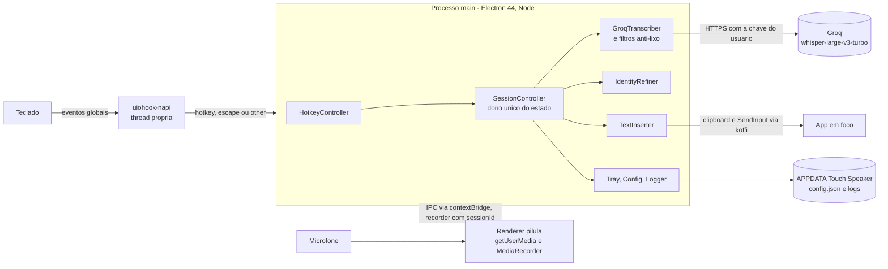
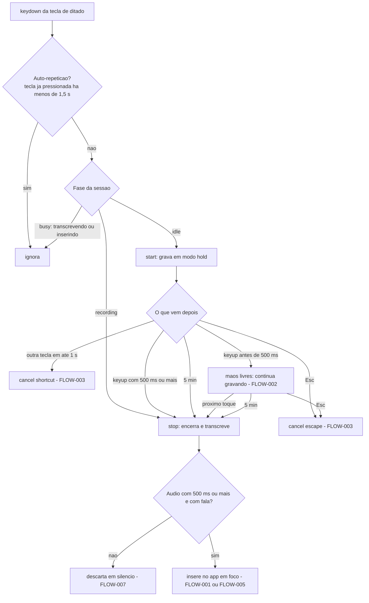
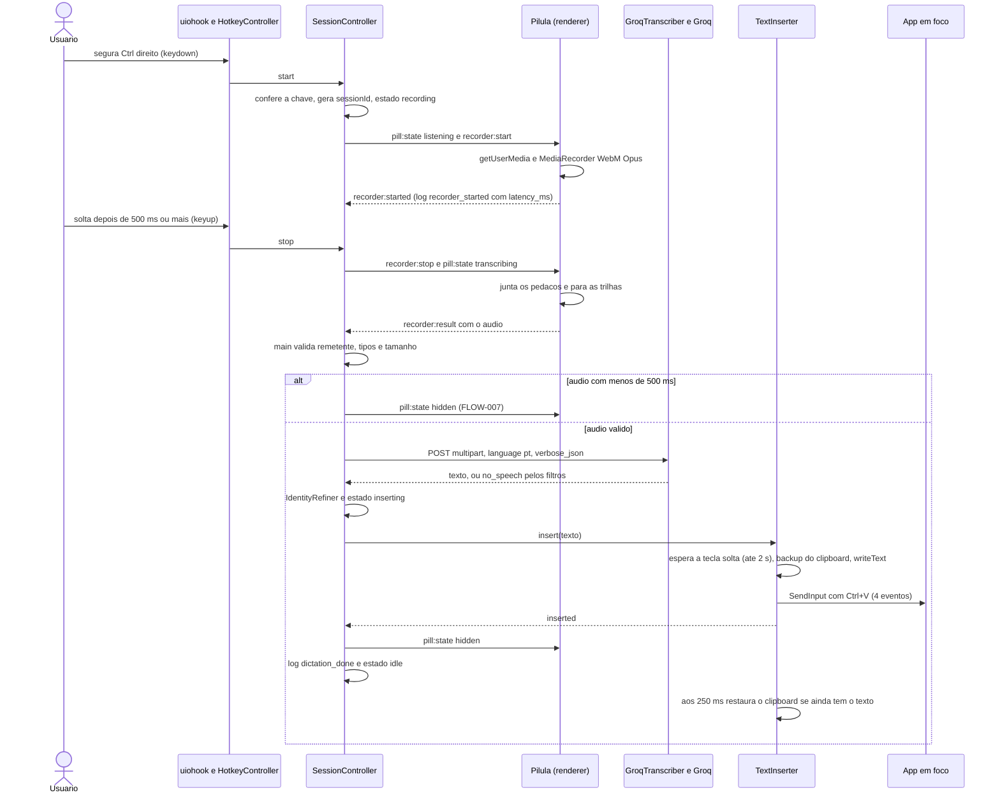
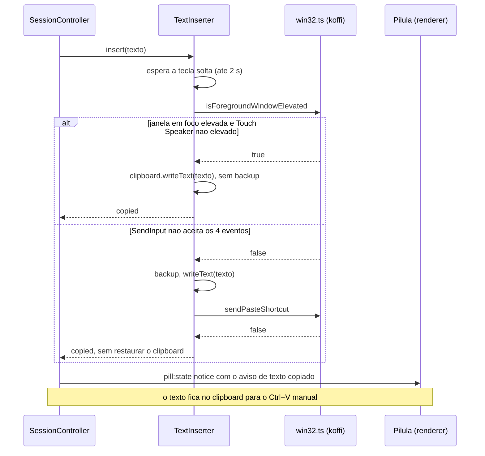
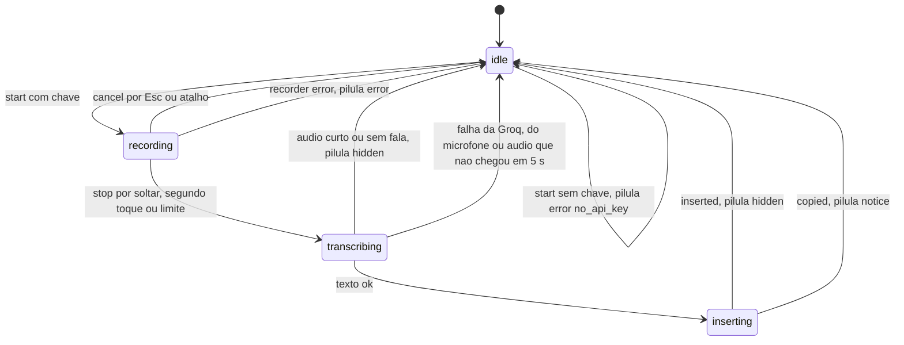
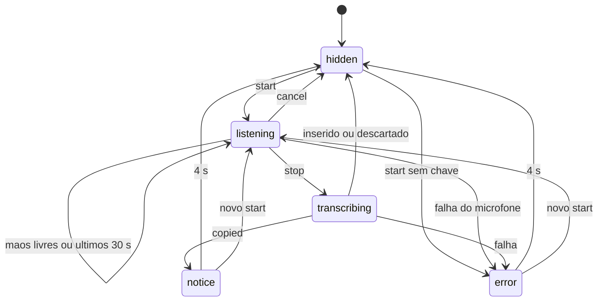

# SDD — Spec-Driven Development · Touch Speaker

> Documento mestre de engenharia do **Touch Speaker**. É o contrato central do app: requisitos, regras, dados, contratos, segurança, qualidade e roadmap vivem aqui. Spec de feature e milestone aprofundam um ponto; nenhuma delas substitui este arquivo.
>
> Última atualização: 17/out/2026 · Mantenedor: Victor Alves

---

## 0. Controle da especificação

| Campo | Valor |
|---|---|
| Projeto | Touch Speaker — app de bandeja para Windows que transforma fala em texto digitado no app em foco |
| Repositório | `Victorkaue333/-touch-speaker` (`git remote -v`; o nome do repositório começa com hífen) — **FATO** |
| Versão da SDD | 1.1 |
| Status | **vigente** |
| Criada em | 17/out/2026 |
| Última revisão | 17/out/2026 |
| Referência analisada | `frontend/` em `ed0a1f5` ("Update CLAUDE.md", 17/out/2026, 14:53). Esse commit só mexeu no `CLAUDE.md`: o código é o de `bae6eba` ("feat: project touch-speaker", 14:48). O primeiro commit, `331de81` (14:43), tinha só o `README.md` — **FATO** (`git log`, `git show --stat`) |
| Base factual | leitura de `frontend/src/**`, `package.json`, `tsconfig.main.json`, `tsconfig.renderer.json`, `.env.example` e `scripts/*.mjs` em 17/out/2026, mais o resultado do `npm test` no mesmo dia (30/30) |
| Idioma | produto e documentação em pt-BR; código e identificadores em inglês |
| Responsável técnico | Victor Alves |
| Decisões de produto | Victor Alves |

### 0.1 Política de prevalência documental

Em conflito entre documentos, vale nesta ordem:

1. **[`docs/DECISIONS.md`](../DECISIONS.md)** — ADRs aceitas (ADR-01…07).
2. **Esta SDD** — contrato de engenharia: requisitos, regras, registros de pendências e riscos, roadmap.
3. **[`CLAUDE.md`](../../CLAUDE.md)** (e [`AGENTS.md`](../../AGENTS.md)) — guardrails operacionais.
4. **Docs específicos** — [`PRD.md`](../PRD.md), [`ARCHITECTURE.md`](../ARCHITECTURE.md), [`API.md`](../API.md), [`INTEGRATION.md`](../INTEGRATION.md), [`DATABASE.md`](../DATABASE.md), [`DESIGN.md`](../DESIGN.md), [`ENVIRONMENT.md`](../ENVIRONMENT.md), [`Security-Guide.md`](../Security-Guide.md), [`Code-Style.md`](../Code-Style.md), [`docs/templates/`](../templates/README.md).
5. **Spec aprovada da feature** (`docs/spec/features/*.md`) — aprofunda um ponto; não substitui o SDD.
6. **READMEs**.

O código em `frontend/` é a fonte de fato sobre **o que existe**; a spec aprovada e o SDD são o contrato sobre **o que deve existir**. Divergência é defeito: código errado → corrige-se o código; spec errada → **corrige-se a spec primeiro** e só depois o código, com aval do Victor sempre que o comportamento muda.

Toda feature do Touch Speaker nasce como **spec escrita** antes de qualquer código: a spec diz o problema, o que entra e o que fica de fora, e como se verifica que ficou pronto. O fluxo (spec → gate → execução), o template, a Definition of Done e o índice de specs ficam em [`docs/templates/README.md`](../templates/README.md#os-três-estágios). Os documentos-base são referenciados, não duplicados: contexto em [`PROJECT_CONTEXT.md`](../../PROJECT_CONTEXT.md), requisitos no PRD, componentes no ARCHITECTURE, decisões no DECISIONS, contratos no API e no INTEGRATION, dados no DATABASE, interface no DESIGN, segurança e sala limpa no Security-Guide.

O estudo [`docs/referencia/estudo-typeless.md`](../referencia/estudo-typeless.md) é referência, **não normativo** e **fonte proibida de código** (ADR-07): dele saem ideias e comportamentos descritos com palavras próprias; nunca código, strings, constantes, nomes de canal, ícones, sons ou cores.

### 0.2 Classificação usada no documento

| Marca | Significado |
|---|---|
| **FATO** | verificado no código em 17/out/2026, com âncora `frontend/src/<caminho>.ts:<linha>` quando a linha foi conferida, ou arquivo + símbolo |
| **PLANEJADO (Fase N)** | previsto no roadmap do PRD para a fase indicada; não há código. Nada neste documento está desligado: o que existe funciona |
| **DECISÃO** | ADR aceita em `docs/DECISIONS.md` ou decisão do Victor registrada com data |
| **PROPOSTA** | desenho deste SDD, ainda não implementado nem aprovado |
| **HIPÓTESE** | leitura plausível que ninguém confirmou; H1–H4 do `PROJECT_CONTEXT.md` são hipóteses de produto |
| **PENDÊNCIA** | falta decisão, verificação ou informação; registrada como `PEND-NNN` no Apêndice B |
| **FORA DO ESCOPO** | declarado fora da Fase 1 (§2.2), com a fase em que volta |

Nas tabelas, as âncoras de código omitem o prefixo `frontend/src/`: `main/hotkey.ts:100` quer dizer `frontend/src/main/hotkey.ts:100`. Caminhos que começam por `frontend/` ou por uma pasta da raiz (`docs/`, `database/`) são relativos à raiz do repositório.

**Famílias de ID.** Toda linha de requisito precisa responder: **FR ⇄ componente ⇄ contrato (IPC/HTTP) ⇄ dado ⇄ verificação** (Apêndice A).

| ID | Formato | Onde nasce |
|---|---|---|
| Requisito funcional | `FR-<ÁREA>-NN` (ex.: `FR-DICT-01`) | PRD; registro no §4 |
| Requisito não funcional | `NFR-NN` | PRD; registro no §5 |
| Decisão de arquitetura | `ADR-NN` | `docs/DECISIONS.md`; índice no §27 |
| Princípio | `C1`–`C8` | §1.5 |
| Hipótese | `H1`–`H4` | `PROJECT_CONTEXT.md`; §1.4 |
| Regra implementada | `BR-NNN` | §6.1 |
| Fluxo | `FLOW-NNN` | §11 |
| Tela | `SCREEN-NNN` | §13 |
| User story | `US-NNN` | §14 |
| Teste automatizado | `TEST-NNN` | §20.1 |
| Verificação manual | `V1`–`V13` | spec `ditado-por-voz` §12.2 |
| Tarefa | `T1`–`T10` | spec `ditado-por-voz` §13 |
| Risco | `RISK-NNN` | §26.1 |
| Pendência | `PEND-NNN` | Apêndice B.1 |
| Critério de aceite | `AC-NNN` | Apêndice C |

Áreas de `FR` em uso: `DICT` (ditado), `CLEAN` (limpeza por IA), `VOCAB` (dicionário), `HIST` (histórico), `SET` (configurações), `CTX` (contexto do app), `ASK` (comandos por voz), `TRANS` (tradução), `ACC` (contas).

### 0.3 Histórico

| Versão | Data | O que mudou |
|---|---|---|
| 1.0 | 17/out/2026 | Primeiro SDD do projeto (commit `bae6eba`): constituição C1–C8, fluxo de trabalho, rastreabilidade e famílias de ID, template de spec dentro do próprio SDD, definição de pronto e índice de specs |
| 1.1 | 17/out/2026 | Documento mestre no molde novo (§0–§31 e apêndices A–C), ainda não commitado, com os registros BR, RISK, PEND, TEST, FLOW, SCREEN, US e AC. Fluxo de trabalho, template, definição de pronto e índice de specs saem daqui e vão para [`docs/templates/`](../templates/README.md); as ADRs passam a viver em `docs/DECISIONS.md`. Nenhum ID mudou: os `FR-DICT` foram reescritos em EARS sem mudar a substância, e a spec `ditado-por-voz` continua no formato original |

---

## 1. Visão e contexto do produto

### 1.1 O que é

App de bandeja para **Windows**, em Electron, que transforma fala em texto digitado no app em foco. A pessoa segura uma tecla (padrão: **Ctrl direito**), fala e solta; o texto aparece onde está o cursor — VS Code, navegador, WhatsApp, Slack, Word, Claude Code — como se tivesse sido digitado. A transcrição em pt-BR é feita pelo Whisper `whisper-large-v3-turbo` na Groq, com a chave do próprio usuário, e o que a pessoa tinha no clipboard volta ao lugar depois da colagem. Não existe servidor próprio na Fase 1 (ADR-06). **FATO** — `main/index.ts` (montagem dos componentes), `main/session.ts` `SessionController`, `main/transcribe/groq.ts` `GroqTranscriber`, `main/insert/inserter.ts` `TextInserter`.

**Estado atual — FATO (17/out/2026).** A Fase 1 (MVP — ditado básico) está implementada: tarefas T1–T8 da spec [`ditado-por-voz`](features/ditado-por-voz.md) (§13).

- `npm test`: 30/30; `npm run typecheck` sem erros; o app sobe no Electron 44 com o hook de teclado e o `koffi` carregados (`keyboard_hook: true` no evento `app_ready` do log).
- Funcionando de ponta a ponta no PC do Victor: verificação V2 (mãos livres) com dois ditados de 4,6 s e 10,5 s no Bloco de Notas, inseridos 0,88 s e 0,66 s depois do fim da fala; microfone aberto em 270 ms e 75 ms.
- Memória em repouso medida: 205 MB (NFR-03).
- Falta a T9 — roteiro V1 e V3–V13 e medição de latência (PEND-001) — e a T10 — spec passa a `implementada` (PEND-002).
- Não há instalador nem distribuição: o app roda em modo de desenvolvimento (`npm run dev`), com a chave do usuário em `frontend/.env`.

### 1.2 Problema

Escrever no computador é lento: uma pessoa digita em média ~40 palavras por minuto e fala ~150. Quem escreve muito ao longo do dia — mensagens, e-mails, documentos, prompts para IA — perde horas digitando o que já tem pronto na cabeça.

O ditado que vem no Windows (`Win + H`) não resolve: funciona mal em português com termos técnicos e nomes próprios, não pontua bem e deixa o texto com cara de transcrição, e não é rápido de acionar nem de encerrar. Ferramentas como o Typeless provam que "falo → aparece escrito em qualquer app" muda o jeito de trabalhar, mas são produtos fechados, pagos por assinatura e com os dados passando pelo servidor deles. O Victor dita o dia inteiro em VS Code, terminal, navegador e mensageiros, depende hoje do Typeless e precisa do mesmo gesto — "segura, fala, solta, aparece escrito" — num app próprio.

**Proposta de valor:** segure uma tecla, fale e o texto aparece onde o cursor está, em qualquer app do Windows. Sem trocar de janela, sem copiar e colar, sem configurar nada por app.

### 1.3 Público

| Persona | Necessidade | Evidência |
|---|---|---|
| Dev multitarefa (Victor) — Fase 1 | escreve o dia todo em pt-BR misturado com termos técnicos em inglês; alterna entre VS Code, Claude Code, terminal, navegador, WhatsApp e Slack | PRD "Personas"; `PROJECT_CONTEXT.md` "Para quem" — primeiro e único usuário da Fase 1; **FATO**: o V2 foi feito na máquina dele |
| Profissional que escreve muito — Fase 4 | advogado, médico, gestor, criador de conteúdo; quer ditado de qualidade em português e texto limpo, sem revisar | PRD "Personas" — **PLANEJADO (Fase 4)** |

### 1.4 Objetivos de negócio

| Fase | Objetivo | Estado |
|---|---|---|
| 1 — MVP | substituir o Typeless no uso diário do Victor, no fluxo básico de ditado | implementada, em verificação (PEND-001) |
| 2 — Qualidade | texto sai "pronto": sem vícios de fala, com o vocabulário da pessoa | PLANEJADO (Fase 2) |
| 3 — Contexto | o texto se adapta ao app em que está sendo escrito; comandos por voz sobre texto selecionado | PLANEJADO (Fase 3) |
| 4 — Produto | distribuir para outras pessoas, com conta, backend próprio e instalador assinado | PLANEJADO (Fase 4) |

Métricas de sucesso, de [`PROJECT_CONTEXT.md`](../../PROJECT_CONTEXT.md):

- **Fase 1 concluída quando** o Victor passar 5 dias úteis seguidos usando só o Touch Speaker, sem abrir o Typeless.
- **Latência:** p50 ≤ 1,5 s e p95 ≤ 3 s do soltar da tecla até o texto inserido, para falas de até 30 s (NFR-01).
- **Confiabilidade:** ≥ 95% das gravações terminam com texto inserido; o resto, com erro claro, nunca em silêncio.
- **Zero lixo:** toque acidental na tecla não pode digitar nada (FR-DICT-08).

Hipóteses a validar — **HIPÓTESE**, todas abertas em PEND-003:

| # | Hipótese | Como validar |
|---|---|---|
| H1 | Whisper `large-v3-turbo` via Groq é bom o bastante em pt-BR para uso diário sem pós-edição pesada | uso real por 1 semana; anotar quantas transcrições precisam de correção |
| H2 | latência de ~1–1,5 s entre soltar a tecla e o texto aparecer é aceitável, mesmo sem streaming | medir p50/p95 nos logs locais; percepção do usuário |
| H3 | o plano gratuito da Groq cobre o uso de uma pessoa | contar requisições e segundos de áudio por dia contra o limite do console |
| H4 | colar via clipboard + Ctrl+V funciona nos apps que o Victor usa | lista de apps de aceite do PRD (FR-DICT-05) |

### 1.5 Princípios do produto — Constituição (C1–C8)

Princípios que **toda** spec precisa respeitar. A seção 0 de cada spec diz quais toca e, se violar algum, por quê.

| # | Princípio | O que significa na prática |
| --- | --- | --- |
| C1 | **Privacidade por padrão** | Áudio nunca vai para disco; texto ditado, clipboard e teclas nunca vão para log |
| C2 | **Nunca roubar o foco** | Nada do Touch Speaker recebe foco durante o ditado |
| C3 | **Nunca digitar lixo** | Na dúvida entre inserir algo errado e não inserir nada, não insere e avisa |
| C4 | **Falha visível** | Todo erro chega à pessoa com mensagem clara; nada falha em silêncio |
| C5 | **Provedores trocáveis** | Transcrição e limpeza ficam atrás de interfaces; trocar provedor = adapter novo |
| C6 | **Sem segredo em app distribuído** | Chaves de provedor só no `.env` (dev), `safeStorage` (uso pessoal) ou `backend/` (produto) |
| C7 | **Sala limpa** | Nada copiado do Typeless ou de outro produto ([Security Guide §15.3](../Security-Guide.md#153-sala-limpa-engenharia-reversa)) |
| C8 | **Escopo da fase** | Uma spec não puxa funcionalidade de fase seguinte "porque era fácil" |

Os princípios valem também para o código que já existe: `logger.ts` só aceita campos primitivos (C1), a pílula é `focusable: false` (C2), os filtros de `transcribe/filters.ts` descartam silêncio (C3), todo código de erro tem mensagem em `strings.ts` (C4), `Transcriber` e `Refiner` são interfaces (C5).

### 1.6 Estudo de referência (Typeless 2.8.2)

A arquitetura do Touch Speaker foi informada por engenharia reversa do Typeless 2.8.2 para Windows, feita para entender o comportamento e a arquitetura de um produto de mercado. A parte publicável, escrita com palavras próprias, é [`docs/referencia/estudo-typeless.md`](../referencia/estudo-typeless.md). O material bruto do estudo (binários de terceiros, código decompilado, anotações) fica **fora da pasta do repositório**, e o `.gitignore` mantém `targets/`, `analysis/` e `rea/` bloqueados como segunda trava — **FATO**. O estudo é **referência não normativa** e **fonte proibida de código** (ADR-07, [Security Guide §15.3](../Security-Guide.md#153-sala-limpa-engenharia-reversa), RISK-005): por ser não normativo, nada dele vale como requisito sem passar pelo PRD e por uma spec aprovada.

O que o estudo informou e como o Touch Speaker tratou (resumo da §9 do estudo):

| Aprendizado | Tratamento no Touch Speaker | Fase |
|---|---|---|
| Gesto segurar / tocar | adotado e simplificado: um limite de 500 ms separa segurar de tocar, sem toque duplo (BR-001) | 1 — **FATO** |
| O hook só informa teclas; a decisão fica em código | `uiohook-napi` + `HotkeyController` testável (ADR-02) | 1 — **FATO** |
| Inserção por clipboard + Ctrl+V, com backup e restauração | escrito do zero (ADR-03, BR-010) | 1 — **FATO** |
| Colagem bloqueada em janela de administrador | detecção de elevação + aviso "Texto copiado" (BR-009) | 1 — **FATO** |
| Filtrar silêncio e lixo da transcrição | regras próprias para alucinações do Whisper em pt-BR (BR-006) | 1 — **FATO** |
| Áudio Opus mono em ~32 kbps | WebM/Opus 32 kbps no renderer do Electron | 1 — **FATO** |
| Streaming do áudio durante a fala | adiado: precisa de servidor próprio (ADR-04, RISK-014) | 4 |
| Limpeza do texto por LLM | atrás da interface `Refiner` (ADR-05) | 2 |
| Dicionário pessoal; histórico local sem áudio | FR-VOCAB-01, FR-HIST-01 | 2 |
| Contexto do app em foco por UI Automation; comandos por voz; tradução | FR-CTX-01, FR-ASK-01, FR-TRANS-01 | 3 |
| Telemetria de erros | não na Fase 1; se vier, opt-in e sem conteúdo | — |

### 1.7 O que veio do molde, o que fica e o que sai

A estrutura desta documentação veio do molde de outro projeto do Victor (mesmo padrão para todos os projetos dele) e foi reescrita com o conteúdo do Touch Speaker em 17/out/2026.

| Item | Origem | Destino | Observação |
|---|---|---|---|
| Docs canônicos (`DECISIONS.md`, `CHANGELOG.md`, `Code-Style.md`, `ENVIRONMENT.md`, `INTEGRATION.md`, `AGENTS.md`) | molde | **ficam, adaptados** | registrados no [`CHANGELOG.md`](../CHANGELOG.md) |
| SDD como documento mestre, com registros de ID (BR, RISK, PEND, TEST, FLOW, SCREEN, US, AC) | molde | **fica** | este arquivo |
| Constituição C1–C8 e famílias de ID | SDD 1.0 deste projeto | **ficam** | §1.5 e §0.2 |
| Fluxo de trabalho, template de spec, definição de pronto e índice de specs | SDD 1.0 deste projeto (§2, §4, §5 e §6) | **movidos** | [`docs/templates/README.md`](../templates/README.md#índice-de-specs) |
| Templates de spec de feature, de milestone e de migração | molde | **ficam, adaptados** | milestone = fase do PRD; migração = mudança de formato de dado do app |
| ADRs dentro do `ARCHITECTURE.md` | este projeto | **movidas** | `docs/DECISIONS.md`; o ARCHITECTURE lista as sete com link |
| Spec da Fase 1 (`ditado-por-voz.md`) | SDD 1.0 deste projeto | **fica no formato original** | anterior ao template atual (§0–§15) |
| Seções do molde específicas de aplicação web com banco relacional (rotas, painel administrativo, migração de stack) | molde | **saem** | não têm equivalente num app de bandeja |
| Pasta de documentos legados do molde | molde | **não existe aqui** | o análogo não normativo é o estudo de referência (§1.6) |

---

## 2. Escopo

### 2.1 Dentro do escopo da V1

A V1 é a **Fase 1 — ditado básico** do [PRD](../PRD.md#requisitos-funcionais), especificada em [`ditado-por-voz.md`](features/ditado-por-voz.md).

**Implementado — FATO** (T1–T8, 17/out/2026):

1. Segurar para falar com a tecla de ditado, padrão Ctrl direito (FR-DICT-01).
2. Mãos livres: toque curto começa, próximo toque termina (FR-DICT-02).
3. Cancelar com `Esc` durante a gravação (FR-DICT-03).
4. Transcrição em pt-BR pela Groq, `whisper-large-v3-turbo` (FR-DICT-04).
5. Inserção no app em foco por clipboard + Ctrl+V (FR-DICT-05).
6. Clipboard preservado depois da inserção (FR-DICT-06).
7. Pílula de status flutuante que não rouba foco (FR-DICT-07).
8. Filtros anti-lixo (FR-DICT-08).
9. Erros visíveis em pt-BR na pílula (FR-DICT-09).
10. Fallback de colagem para janela de administrador (FR-DICT-10).
11. Limite de 5 min por gravação, com aviso 30 s antes (FR-DICT-11).
12. Ícone e menu na bandeja, com "Sair" (FR-DICT-12).
13. Configuração em `config.json` (FR-DICT-13).

**Verificado manualmente:** só FR-DICT-02 (V2, 17/out/2026). A colagem via `SendInput` foi comprovada isoladamente e em ditado real no Bloco de Notas. Os demais requisitos aguardam o roteiro V1–V13 da spec — PEND-001.

**Para fechar a Fase 1 — PENDÊNCIA:** T9 (PEND-001) e T10 (PEND-002). O critério de negócio é o do §1.4: 5 dias úteis seguidos só com o Touch Speaker.

### 2.2 Fora do escopo da V1

| Item | Por quê | Base |
|---|---|---|
| Limpeza do texto por IA | Fase 2; na Fase 1 o `Refiner` devolve o texto como veio | ADR-05, FR-CLEAN-01 — **FORA DO ESCOPO** |
| Dicionário pessoal | Fase 2 | FR-VOCAB-01 |
| Histórico de ditados | Fase 2; depende do SQLite local | FR-HIST-01 |
| Tela de configurações | Fase 2; na Fase 1 a configuração é o `config.json` | FR-SET-01 |
| Contexto do app em foco | Fase 3 | FR-CTX-01 |
| Comandos por voz e tradução | Fase 3 | FR-ASK-01, FR-TRANS-01 |
| Contas e backend | Fase 4; sem backend na Fase 1 | ADR-06, FR-ACC-01 |
| Instalador assinado e auto-update | Fase 4 | PRD "Fora de escopo" |
| Streaming de áudio durante a fala | Fase 4, junto com o backend | ADR-04, RISK-014 |
| macOS, Linux e mobile | só Windows até a Fase 4 | NFR-06; decisão fixa do `CLAUDE.md` |

### 2.3 Backlog (volta quando)

| Item | Gatilho | ID reservado |
|---|---|---|
| Limpeza por IA (Claude Haiku) | Fase 1 fechada e spec da Fase 2 aprovada; depende de chave da Anthropic (PRD, roadmap) | FR-CLEAN-01 |
| Dicionário pessoal | spec da Fase 2; depende do SQLite local (`database/local/`) | FR-VOCAB-01 |
| Histórico local | spec da Fase 2; depende do SQLite local | FR-HIST-01 |
| Tela de configurações | spec da Fase 2 | FR-SET-01 |
| Contexto do app em foco (UI Automation) | Fase 2 entregue | FR-CTX-01 |
| "Ask Anything": comando por voz sobre texto selecionado | Fase 2 entregue | FR-ASK-01 |
| Ditado com tradução | Fase 2 entregue | FR-TRANS-01 |
| Contas, backend próprio e cotas | decisão de produto (§29) | FR-ACC-01 |

### 2.4 Constraints

| Constraint | Origem |
|---|---|
| Windows 10/11 x64; nada de macOS, Linux ou mobile antes da Fase 4 | NFR-06; decisão fixa do `CLAUDE.md` — **DECISÃO** |
| Electron 44.9.0 | `frontend/package.json` (`devDependencies`) — **FATO**; ADR-01 |
| TypeScript 7.0.2 estrito, build com `tsc` para CommonJS (`"type": "commonjs"`, `module nodenext`), renderer como script clássico, sem bundler | `package.json`, `tsconfig.main.json`, `tsconfig.renderer.json` — **FATO**; ADR-01 |
| Node.js 24 LTS no desenvolvimento (conferido com 24.20.0 e npm 11.21) | README de `bae6eba` — **FATO** na máquina do Victor |
| `koffi` 3.3.3 e `uiohook-napi` 1.5.5 em versão exata, com binários prontos para win32-x64 e scripts de instalação negados (`allowScripts: false`); `@types/node` 24.19.2 | `package.json` — **FATO**; ADR-02, ADR-03, RISK-004 |
| Transcrição pelo plano gratuito da Groq, com a chave do próprio usuário | ADR-04, ADR-06; limites em PEND-004 |
| Produto e interface em pt-BR; todo texto de interface em `main/strings.ts` | `CLAUDE.md` "Convenções"; `main/strings.ts` — **FATO** |
| Sem backend; o app não é distribuído com chave | ADR-06 |
| Sala limpa em relação ao Typeless | ADR-07 |
| Uma sessão de ditado por vez; gravação de até 5 min; áudio de até 25 MB | BR-011, BR-014; `main/index.ts:24`, `main/transcribe/groq.ts:7` — **FATO** |

---

## 3. Atores, personas e permissões

### 3.1 Atores

| Ator | Como é reconhecido | Autenticação e confiança |
|---|---|---|
| Usuário | quem segura a tecla de ditado; único titular dos dados na Fase 1 | nenhuma: app local de uma pessoa; contas só na Fase 4 (FR-ACC-01) |
| Processo main | `dist/main/index.js` (campo `main` do `package.json`), Node + Electron | confiável; é o único com rede, clipboard, Win32, hook de teclado, arquivos e a chave |
| Renderer (pílula) | a única janela com página: `renderer/pill.html` | **não confiável** por defesa em profundidade: sandbox, sem Node, CSP sem rede; o main valida tudo o que ele envia |
| Preload | `preload/pill.ts`, em sandbox | expõe só `window.touchSpeaker`, com 7 funções |
| Hook de teclado | `uiohook-napi` (libuiohook, thread própria), ligado em `main/keyboard.ts` | entrega keydown e keyup globais; o código reduz cada evento a `hotkey`, `escape` ou `other` na hora (BR-007) |
| Groq | `https://api.groq.com/openai/v1/audio/transcriptions` | `Authorization: Bearer <GROQ_API_KEY>` sobre TLS |
| Windows e app em foco | recebe o Ctrl+V sintético por `SendInput`; pode estar rodando elevado (UIPI) | nenhuma; o Touch Speaker não pede elevação (BR-009) |

### 3.2 Matriz de capacidades por processo

Base: §3.3 e `main/index.ts`. ✅ pode; ❌ não pode.

| Capacidade | Main | Preload | Renderer (pílula) |
|---|---|---|---|
| Rede (HTTPS para a Groq) | ✅ `transcribe/groq.ts` | ❌ | ❌ CSP com `connect-src 'none'` (`renderer/pill.html:7`) |
| Chave da Groq | ✅ lê `process.env.GROQ_API_KEY` (`main/index.ts:125`) | ❌ | ❌ |
| Clipboard (ler, escrever, restaurar) | ✅ `insert/inserter.ts` | ❌ | ❌ |
| Win32 (`SendInput`, checagem de elevação) | ✅ `insert/win32.ts`, por `koffi` | ❌ | ❌ |
| Hook global de teclado | ✅ `main/keyboard.ts` | ❌ | ❌ |
| Arquivos (`config.json`, log, `.env`) | ✅ `main/config.ts`, `main/logger.ts`, `main/index.ts:35` | ❌ | ❌ |
| Microfone | ❌ — só concede a permissão | ❌ | ✅ só áudio, só esta janela, só entre `recorder:start` e `recorder:stop`/`recorder:cancel` (BR-015) |
| Textos da interface | ✅ `main/strings.ts`; envia prontos em `pill:state` | ❌ | ❌ não tem strings próprias |
| Canais IPC | envia `recorder:start`, `recorder:stop`, `recorder:cancel`, `pill:state`; recebe e valida `recorder:started`, `recorder:result`, `recorder:error` | expõe os 7 canais como funções de `window.touchSpeaker` | usa só `window.touchSpeaker` |
| Abrir janela nova ou navegar | — | — | ❌ negado (`setWindowOpenHandler`, `will-navigate` — `main/index.ts:92-95`) |

### 3.3 Camadas de isolamento — **FATO**

1. **Janela da pílula** — `contextIsolation: true`, `sandbox: true`, `nodeIntegration: false`, `webSecurity: true` (`main/pill-window.ts:37-47`); DevTools só com o app não empacotado (`devTools: allowDevTools`, `!app.isPackaged` em `main/index.ts:97`).
2. **Preload mínimo** — só `window.touchSpeaker` com `onStart`, `onStop`, `onCancel`, `onState`, `started`, `result` e `error` (`preload/pill.ts:22-30`); nenhum `ipcRenderer` genérico exposto.
3. **CSP** — `default-src 'self'; script-src 'self'; style-src 'self'; connect-src 'none'; img-src 'self' data:; media-src 'self' blob: mediastream:` (`renderer/pill.html:7`): o renderer não tem rede e só carrega arquivos locais do app.
4. **Navegação** — toda janela nova é negada e toda navegação é bloqueada, para qualquer web contents (`main/index.ts:92-95`).
5. **Permissões** — mídia só para a pílula e só áudio, no pedido e na checagem (`setPermissionRequestHandler` e `setPermissionCheckHandler`, `main/index.ts:107-113`).
6. **IPC validado no main** — remetente (`event.sender === pill.webContents`), tipos, `durationMs` finito ≥ 0, `mimeType` começando por `audio/`, áudio ≤ 25 MB e código de erro da lista fechada (`main/index.ts:49-80`, `:150-163`). `recorder:result` recusado vai ao log como `ipc_rejected`.
7. **Sessão** — toda mensagem de gravação (`recorder:*`) carrega `sessionId`; o main descarta o que não é da sessão atual (BR-014). `pill:state` não leva `sessionId`: só o main o envia.
8. **UIPI** — o app não pede elevação; janela elevada em foco cai no fallback de colagem (BR-009). Se o próprio Touch Speaker roda elevado, isso vai para o `app_ready` (`self_elevated`).
9. **Instância única** — `app.requestSingleInstanceLock()` (`main/index.ts:40`); a segunda instância sai, e a primeira registra `second_instance_ignored`.

Não há papéis nem autorização por usuário: o app é local e de uma pessoa até a Fase 4.

---

## 4. Requisitos funcionais

Formato EARS: `QUANDO <evento> O SISTEMA DEVE <comportamento observável>`. Os IDs `FR-*` são os do [`PRD.md`](../PRD.md#requisitos-funcionais), sem renumeração; o texto foi reescrito em EARS sem mudar a substância. Status: **FATO** (implementado e conferido no código; a coluna diz também se a verificação manual já foi feita) e **PLANEJADO (Fase N)** (no roadmap, sem código).

### 4.1 Ditado — módulo DICT

| ID | Requisito (EARS) | Ator | AC | Tela | Contrato | Status |
|---|---|---|---|---|---|---|
| FR-DICT-01 | QUANDO a pessoa segura a tecla de ditado (padrão: Ctrl direito) O SISTEMA DEVE começar a gravar e, QUANDO ela soltar depois de pelo menos `holdThresholdMs` (500 ms), encerrar e disparar a transcrição; a auto-repetição da tecla não abre gravações extras | Usuário | AC-001 | SCREEN-001 | `recorder:start`, `recorder:stop` | FATO — `main/hotkey.ts:50-69`, `:91-103` (BR-001, BR-002); TEST-001; V1 pendente (PEND-001) |
| FR-DICT-02 | QUANDO a pessoa dá um toque curto (< 500 ms) na tecla O SISTEMA DEVE continuar gravando em mãos livres até o próximo toque, que encerra a gravação | Usuário | AC-002 | SCREEN-001 | `pill:state` (`mode: 'handsfree'`), `recorder:stop` | FATO — `main/hotkey.ts:102`, `main/session.ts` `switchToHandsFree`; TEST-001; **V2 verificado em 17/out/2026** |
| FR-DICT-03 | QUANDO a pessoa aperta `Esc` durante a gravação O SISTEMA DEVE descartar o áudio sem enviar nada à Groq e sem inserir nada | Usuário | AC-003 | SCREEN-001 | `recorder:cancel` | FATO — `main/hotkey.ts:72-77`, `main/session.ts` `cancel` (BR-004); TEST-001; V3 pendente. O `Esc` também chega ao app em foco (RISK-013) |
| FR-DICT-04 | QUANDO uma gravação válida termina O SISTEMA DEVE transcrevê-la pela Groq com `whisper-large-v3-turbo` e `language=pt` | — | AC-004 | — | `POST /openai/v1/audio/transcriptions` | FATO — `main/transcribe/groq.ts` `GroqTranscriber.transcribe`; TEST-003; V4 pendente; a qualidade em pt-BR é a H1 (PEND-003) |
| FR-DICT-05 | QUANDO há texto transcrito O SISTEMA DEVE colá-lo no cursor do app em foco, sem nunca dar foco à janela do Touch Speaker | Usuário | AC-005 | — | clipboard + `SendInput` | FATO — `main/insert/inserter.ts` `TextInserter.insert`, `main/insert/win32.ts` `sendPasteShortcut`; colagem comprovada em ditado real no Bloco de Notas; lista de apps (V5) pendente |
| FR-DICT-06 | QUANDO o texto é colado O SISTEMA DEVE devolver ao clipboard o conteúdo que a pessoa tinha antes | Usuário | AC-006 | — | clipboard | FATO — `main/insert/inserter.ts:84-105` (BR-010); V6 pendente |
| FR-DICT-07 | QUANDO o estado da sessão muda O SISTEMA DEVE mostrar a pílula flutuante — gravando, com o nível do microfone; transcrevendo; erro — em até 150 ms depois da tecla, sem roubar foco nem clique | Usuário | AC-007 | SCREEN-001 | `pill:state` | FATO — `main/pill-window.ts` (`focusable: false`, `showInactive`, `setIgnoreMouseEvents`), `renderer/pill.ts`; V7 pendente; os 150 ms não foram medidos |
| FR-DICT-08 | QUANDO a gravação dura menos de 0,5 s ou o Whisper marca a transcrição como sem fala O SISTEMA DEVE descartá-la sem inserir nada | Usuário | AC-008 | SCREEN-001 (`hidden`) | — | FATO — `main/session.ts:173-176`, `main/transcribe/filters.ts` `isNoSpeech` (BR-005, BR-006); TEST-002; V8 pendente |
| FR-DICT-09 | QUANDO falta a chave, não há internet, a Groq limita, o microfone está ocupado ou a colagem é bloqueada O SISTEMA DEVE mostrar mensagem clara em pt-BR na pílula, sem fechar o app nem falhar em silêncio | Usuário | AC-009 | SCREEN-001 (`error`, `notice`) | [códigos de erro](../API.md#códigos-de-erro) | FATO — `main/strings.ts` `errorMessage`, `main/session.ts` `fail` e `showMessage`; TEST-003 cobre o mapeamento HTTP → código; V9 pendente |
| FR-DICT-10 | QUANDO o Ctrl+V simulado falha ou o app em foco roda como administrador O SISTEMA DEVE deixar o texto no clipboard e avisar "Texto copiado — cole com Ctrl+V" | Usuário | AC-010 | SCREEN-001 (`notice`) | `paste_blocked` | FATO — `main/insert/inserter.ts:77-80`, `:93`; `main/insert/win32.ts` `isForegroundWindowElevated` (BR-009); V10 pendente (RISK-003) |
| FR-DICT-11 | QUANDO a gravação chega a 5 min O SISTEMA DEVE encerrá-la e transcrevê-la sozinha, com aviso aos 4:30 | Usuário | AC-011 | SCREEN-001 (`warn`) | `recorder:stop` | FATO — `main/session.ts:107-117`, `main/config.ts:19` `MAX_RECORDING_MS` (BR-011); V11 pendente |
| FR-DICT-12 | QUANDO o app está aberto O SISTEMA DEVE manter na bandeja um ícone com status, microfone em uso e "Sair"; QUANDO a pessoa escolhe "Sair" O SISTEMA DEVE encerrar o hook de teclado e o processo | Usuário | AC-012 | SCREEN-002 | — | FATO — `main/tray.ts` `AppTray`, `main/index.ts:172-180` (`quit`); V12 pendente. O menu diz "padrão do Windows" ou "definido no config.json", não o nome do dispositivo |
| FR-DICT-13 | QUANDO o app inicia O SISTEMA DEVE ler a configuração de `config.json` (tecla, idioma, microfone e demais campos) e aplicar o que for válido; trocar a tecla no arquivo e reiniciar faz a nova tecla valer | Usuário | AC-013 | — | `config.json` | FATO — `main/config.ts` `loadConfig`, `normalizeConfig` (BR-012); TEST-004; V13 pendente |

### 4.2 Limpeza — módulo CLEAN

| ID | Requisito (EARS) | Origem | Status |
|---|---|---|---|
| FR-CLEAN-01 | QUANDO o texto transcrito passar pelo `Refiner` O SISTEMA DEVE remover hesitações e repetições ("é…", "tipo") e aplicar a autocorreção falada ("não, quer dizer…"), com Claude Haiku | PRD, fases seguintes; encaixe pronto em `main/refine.ts` (ADR-05) | PLANEJADO (Fase 2) |

### 4.3 Dicionário — módulo VOCAB

| ID | Requisito (EARS) | Origem | Status |
|---|---|---|---|
| FR-VOCAB-01 | QUANDO a pessoa tem termos no dicionário pessoal O SISTEMA DEVE enviá-los no `prompt` do Whisper e na limpeza | PRD, fases seguintes | PLANEJADO (Fase 2) |

### 4.4 Histórico — módulo HIST

| ID | Requisito (EARS) | Origem | Status |
|---|---|---|---|
| FR-HIST-01 | QUANDO um ditado termina O SISTEMA DEVE guardá-lo no histórico local (texto, app, duração), com "copiar de novo" | PRD, fases seguintes; esquema em [`DATABASE.md`](../DATABASE.md) | PLANEJADO (Fase 2) |

### 4.5 Configurações — módulo SET

| ID | Requisito (EARS) | Origem | Status |
|---|---|---|---|
| FR-SET-01 | QUANDO a pessoa abre as configurações O SISTEMA DEVE oferecer numa tela a troca de tecla, microfone e idioma e a opção "iniciar com o Windows" | PRD, fases seguintes | PLANEJADO (Fase 2) |

### 4.6 Contexto — módulo CTX

| ID | Requisito (EARS) | Origem | Status |
|---|---|---|---|
| FR-CTX-01 | QUANDO um ditado vai ser inserido O SISTEMA DEVE usar o contexto do app em foco (nome, título, texto ao redor do cursor) para ajustar o tom | PRD, fases seguintes | PLANEJADO (Fase 3) |

### 4.7 Comandos por voz — módulo ASK

| ID | Requisito (EARS) | Origem | Status |
|---|---|---|---|
| FR-ASK-01 | QUANDO a pessoa dá um comando por voz com texto selecionado ("Ask Anything") O SISTEMA DEVE reescrever, resumir ou responder sobre esse texto | PRD, fases seguintes | PLANEJADO (Fase 3) |

### 4.8 Tradução — módulo TRANS

| ID | Requisito (EARS) | Origem | Status |
|---|---|---|---|
| FR-TRANS-01 | QUANDO a pessoa dita com tradução ligada O SISTEMA DEVE inserir o texto traduzido para outro idioma | PRD, fases seguintes | PLANEJADO (Fase 3) |

### 4.9 Contas — módulo ACC

| ID | Requisito (EARS) | Origem | Status |
|---|---|---|---|
| FR-ACC-01 | QUANDO o app for distribuído para outras pessoas O SISTEMA DEVE ter contas, backend próprio guardando as chaves dos provedores e cota por usuário | PRD, fases seguintes; rascunho em [`API.md`](../API.md#api-própria-fase-4--rascunho) | PLANEJADO (Fase 4) |

---

## 5. Requisitos não funcionais

Os IDs e as metas são os do [PRD](../PRD.md#requisitos-não-funcionais). Limiar numérico só aparece quando há fonte.

| ID | Categoria | Requisito | Meta | Fonte da meta | Verificação | Status |
|---|---|---|---|---|---|---|
| NFR-01 | Latência | do soltar da tecla ao texto inserido | p50 ≤ 1,5 s e p95 ≤ 3 s para falas ≤ 30 s | PRD; métricas do `PROJECT_CONTEXT.md` | log `dictation_done` (`total_ms`); 30 ditados de 3–30 s (spec §12.2) | sem medição p50/p95 — PEND-001. V2: 0,66 s e 0,88 s em dois ditados |
| NFR-02 | Início da gravação | a captura começa depois da tecla | ≤ 300 ms | PRD | log `recorder_started` (`latency_ms`) | medido 75–270 ms (V2). As primeiras sílabas podem ser cortadas no MVP — conhecido, RISK-011 |
| NFR-03 | Consumo em repouso | memória privada somando os processos do Electron, e CPU com o app parado na bandeja | ≤ 220 MB; ~0% de CPU | PRD. A meta original de 150 MB fica abaixo do piso do Electron com uma janela; se virar problema, o caminho é Tauri (ADR-01) | soma dos `electron.exe` após 10 min parado | 205 MB medido em 17/out/2026, com aceleração de hardware desligada (`main/index.ts:31`); CPU sem medição registrada |
| NFR-04 | Privacidade | microfone só aberto durante a gravação; áudio não é salvo em disco; texto ditado nunca vai para log | 0 exceções | PRD; C1 | V3, V8 e V9 (o indicador de microfone do Windows apaga); revisão do log | FATO no código (BR-015; `main/logger.ts` só aceita campos primitivos); verificação manual pendente |
| NFR-05 | Segurança Electron | `contextIsolation`, `sandbox`, sem `nodeIntegration`, preload com API mínima, CSP restrita | toda janela | PRD; [Security Guide §9](../Security-Guide.md#9-cabeçalhos-transporte-e-endurecimento-do-electron) | revisão de `main/pill-window.ts:37-47` e `renderer/pill.html:7` | FATO (§3.3) |
| NFR-06 | Plataforma | Windows 10/11 x64; outras plataformas fora do escopo | único SO | PRD | — | FATO — `koffi` e `uiohook-napi` com binários win32-x64 |
| NFR-07 | Qualidade de código | TypeScript estrito, sem `any` sem justificativa | 0 `any` sem comentário | PRD; `CLAUDE.md` | `npm run typecheck` | FATO — `strict` e `noUncheckedIndexedAccess` nos dois `tsconfig`; nenhum `any` em `frontend/src` |

---

## 6. Regras de negócio

### 6.1 Regras implementadas

Todas **FATO** em 17/out/2026. "Comportamento observado" descreve o que o código faz; "Observações", os limites e as consequências conhecidas.

| ID | Regra | Âncora | Comportamento observado | Observações | FR | Status |
|---|---|---|---|---|---|---|
| BR-001 | Segurar a tecla ≥ `holdThresholdMs` (500 ms) e soltar encerra o ditado; soltar antes vira mãos livres, até o próximo toque | `main/hotkey.ts:91-103` `HotkeyController.onKeyUp` | no keyup, `heldMs ≥ holdThresholdMs` chama `stop`; abaixo disso, `switchToHandsFree`. O keydown seguinte, com a sessão gravando, chama `stop` (`:66-67`) | o limite é configurável de 200 a 1500 ms (BR-012); só vale para o keyup do mesmo toque que começou a gravação (`startedByThisPress`) | FR-DICT-01, 02 | FATO |
| BR-002 | Auto-repetição ignorada: keydown com a tecla já pressionada e a menos de `repeatGapMs` (1,5 s) do anterior não conta como toque novo | `main/hotkey.ts:55-57` `onKeyDown`; `DEFAULT_HOTKEY_TIMING` (`:33`) | o keydown repetido só atualiza o horário do último evento | um keydown mais de 1,5 s depois do anterior, sem keyup no meio, conta como toque novo: cobre o keyup perdido quando uma janela elevada tem o foco (`:24-29`) | FR-DICT-01 | FATO |
| BR-003 | Outra tecla pressionada até `shortcutWindowMs` (1 s) depois da tecla de ditado = atalho (ex.: Ctrl direito + C): cancela em silêncio | `main/hotkey.ts:80-88` | `cancel('shortcut')`: nada é transcrito nem inserido | só vale quando aquele toque começou a gravação; outra tecla mais tarde, num segurar longo, é ignorada. Qual tecla foi apertada nunca é conhecida (BR-007) | FR-DICT-01; C3 | FATO |
| BR-004 | `Esc` durante a gravação cancela sem transcrever e sem inserir | `main/hotkey.ts:72-77`; `main/session.ts:143-151` `cancel` | `cancel('escape')`: o main manda `recorder:cancel`, a sessão volta a `idle` e a pílula some | `Esc` fora da gravação não faz nada; o `Esc` também chega ao app em foco (RISK-013) | FR-DICT-03 | FATO |
| BR-005 | Gravação < 500 ms (`MIN_AUDIO_MS`) é descartada antes do upload | `main/session.ts:173-176` `onRecorderResult`; `main/transcribe/filters.ts:5` | `finishEmpty`: pílula `hidden`, log `session_empty`; nada vai à Groq | não gasta cota | FR-DICT-08 | FATO |
| BR-006 | Transcrição descartada quando o texto vem vazio, quando todos os segmentos têm `no_speech_prob ≥ 0,6`, ou quando é uma alucinação conhecida com duração < 3 s ou média de `no_speech_prob ≥ 0,3` | `main/transcribe/filters.ts:41-54` `isNoSpeech` | o `GroqTranscriber` devolve `no_speech` e a sessão termina em silêncio | as alucinações conhecidas (créditos de legenda e despedidas em pt-BR) são comparadas depois de tirar caixa, acento e pontuação (`normalizeForMatch`); lista e regras na spec, §4.4 | FR-DICT-08; C3 | FATO |
| BR-007 | Só a tecla configurada e `Esc` são identificadas; qualquer outra vira `other` antes de sair do hook | `main/keyboard.ts:8-9` `classify` | o `HotkeyController` recebe só `hotkey`, `escape` ou `other` | o código de tecla não segue adiante; mudança que identifique outra tecla é rejeitada em review ([Security Guide §7](../Security-Guide.md#7-entrada-teclado-global-e-ipc)) | NFR-04; C1 | FATO |
| BR-008 | A inserção espera a tecla física estar solta (até 2 s); durante o Ctrl+V sintético (`inserting`) o hook ignora eventos | `main/insert/inserter.ts:75`, `:82`, `:108`; `main/hotkey.ts:51`, `:97` | `waitUntil` até a tecla soltar ou 2 s (`RELEASE_WAIT_MS`); `setInserting(true)` do backup até 100 ms depois do `SendInput` | passados os 2 s, a inserção segue mesmo assim; o Ctrl sintético é o esquerdo (`VK_CONTROL`), diferente do Ctrl direito físico (ADR-03) | FR-DICT-05 | FATO |
| BR-009 | App em foco elevado (e o Touch Speaker não) → o texto fica no clipboard e a pílula avisa `paste_blocked` | `main/insert/inserter.ts:77-80`; `main/insert/win32.ts` `isForegroundWindowElevated`; `main/index.ts:120` `isSelfElevated` | `writeText` e resultado `copied`, sem backup nem restauração; pílula `notice` "Texto copiado — cole com Ctrl+V" | `SendInput` que não aceita os 4 eventos também cai em `copied` (`inserter.ts:93`). Falha na checagem de elevação conta como "não elevado" (`:54-60`) | FR-DICT-10 | FATO |
| BR-010 | Clipboard restaurado 250 ms após a colagem **só se** ainda contiver o texto ditado | `main/insert/inserter.ts:96-105` | backup de todos os tipos de cada item (`ClipboardItem`), restauração atômica com `clipboard.write` | se a pessoa copiou outra coisa nesse meio-tempo, nada é mexido; se o backup falhou (clipboard ocupado), insere sem restaurar (`:85-89`); falha na restauração é silenciosa (`:103`) | FR-DICT-06 | FATO |
| BR-011 | Gravação encerra sozinha em `maxRecordingMs` (5 min), com aviso 30 s antes, e transcreve normalmente | `main/session.ts:107-117`; `main/config.ts:19` | aos `maxRecordingMs − 30 s`, a pílula mostra "Termina em 0:30" com `warn`; no limite, log `session_timeout` e `stop` | `maxRecordingMs` aceita de 10 000 a 300 000 (BR-012) | FR-DICT-11 | FATO |
| BR-012 | `config.json` inválido: cada campo inválido cai no default com aviso no log; o app nunca deixa de abrir por causa de config | `main/config.ts:46-90` `normalizeConfig`; `:93-105` `loadConfig` | campo inválido → `config_invalid_field` com o nome do campo e o default; JSON ilegível → aviso `json` e todos os defaults; arquivo ausente → criado com os defaults | campo desconhecido é ignorado sem aviso; `version` não é lido do arquivo (§9.1) | FR-DICT-13 | FATO |
| BR-013 | Sem `GROQ_API_KEY` a sessão nem começa: pílula `no_api_key`; o app abre normalmente | `main/session.ts:86-90` `start` | log `session_rejected`; o microfone não abre | a bandeja mostra "Touch Speaker — falta a chave da Groq" (`main/tray.ts:24`) | FR-DICT-09 | FATO |
| BR-014 | Uma sessão por vez; todo evento carrega `sessionId` e o main descarta o que não é da sessão atual | `main/session.ts:84`, `:93`, `:156`, `:161`, `:169`; `main/index.ts:150-163` | `start` só age em `idle`; `onRecorderStarted`, `onRecorderError` e `onRecorderResult` ignoram outro `sessionId` | o renderer também confere o `sessionId` em `stop` e `cancel`; `pill:state` é o único canal sem `sessionId`; se o áudio não chega 5 s depois do `stop`, a sessão falha com `recorder_failed` (`session.ts:135`) | C4 | FATO |
| BR-015 | Permissão de mídia só para a janela da pílula e só áudio; microfone aberto só entre `recorder:start` e `stop`/`cancel` | `main/index.ts:107-113` (`setPermissionRequestHandler`); `renderer/pill.ts` `beginRecording`, `releaseRecording` | todas as trilhas do `MediaStream` param no fim de toda gravação, com ou sem sucesso | o indicador de microfone do Windows tem de apagar (NFR-04; V3, V8, V9) | NFR-04; C1 | FATO |

### 6.2 Regras planejadas (Fases 2–4) — PROPOSTA

| Regra | Origem | Estado | Encaminhamento |
|---|---|---|---|
| Limpeza por IA remove hesitações e aplica autocorreção falada, trocando o `IdentityRefiner` sem mexer no fluxo | FR-CLEAN-01; ADR-05 | encaixe pronto (`main/refine.ts`) | spec da Fase 2; provedor em §19 |
| Termos do dicionário pessoal vão no `prompt` do Whisper | FR-VOCAB-01; [`API.md`](../API.md#transcrição-groq) | o `prompt` não é enviado hoje (`main/transcribe/groq.ts:50-55`) | Fase 2; RISK-012 |
| Histórico com retenção configurável (padrão 30 dias; "nunca guardar" como opção; "Apagar histórico" com `VACUUM`), sem áudio e só na máquina | FR-HIST-01; [`DATABASE.md`](../DATABASE.md) | inexistente | Fase 2 |
| Chave guardada no `safeStorage` do Electron (DPAPI) no lugar do `.env` | [Security Guide §10](../Security-Guide.md#10-segredos-e-configuração) | `.env` em texto puro | Fase 2; RISK-009 |
| Contexto do campo em foco ajusta tom e espaçamento (texto colado na palavra anterior é aceito na Fase 1) | FR-CTX-01; spec `ditado-por-voz` §11 | inexistente | Fase 3 |
| Campos de senha detectados e pulados (UI Automation, `IsPassword`) | Security-Guide; RISK-007 | inexistente | Fase 3 |
| Nenhuma chave de provedor dentro de app distribuído; o backend chama os provedores | ADR-06; FR-ACC-01 | inexistente | Fase 4 |

---

## 7. Arquitetura de alto nível

**FATO** — topologia verificada no código em 17/out/2026. Detalhe, diagrama de componentes e fluxo de um ditado em [`ARCHITECTURE.md`](../ARCHITECTURE.md#visão-geral).



| Camada | Tecnologia | Observação |
|---|---|---|
| Processo main | Electron 44.9.0, Node; TypeScript compilado para CommonJS | dono de rede, clipboard, Win32, teclado e arquivos; `app.disableHardwareAcceleration()` para economizar memória (NFR-03) |
| Renderer | uma janela, a pílula: HTML, CSS e TypeScript como script clássico | grava o áudio (só o renderer tem `getUserMedia`), mede o nível, toca os sons e desenha o estado |
| Preload | `contextBridge` em sandbox | API mínima `window.touchSpeaker`; duplica os nomes de canal de `shared/ipc.ts` porque não pode importar arquivos locais |
| Hook de teclado | `uiohook-napi` 1.5.5 | keydown e keyup globais, que o `globalShortcut` do Electron não oferece (ADR-02) |
| Win32 | `koffi` 3.3.3 chamando `user32`, `kernel32` e `advapi32` | `SendInput` com 4 eventos de 40 bytes (layout x64) e checagem de `TokenElevation` (ADR-03) |
| Gravação | `getUserMedia` + `MediaRecorder`, `audio/webm;codecs=opus`, 32 kbps, mono, pedaços de 1 s | cancelamento de eco, supressão de ruído e ganho automático ligados (`renderer/pill.ts`) |
| Transcrição | Groq, `whisper-large-v3-turbo`, áudio inteiro num `POST` multipart ao soltar | ADR-04; contrato em [`API.md`](../API.md#transcrição-groq) |
| Persistência | `config.json` e log em `%APPDATA%\Touch Speaker\`; chave em `frontend/.env` | sem banco na Fase 1 (§9) |
| Build | `tsc` com dois `tsconfig` e `scripts/copy-static.mjs` | sem bundler (ADR-01); `scripts/start.mjs` abre o Electron sem `ELECTRON_RUN_AS_NODE` |

Sem servidor próprio, banco, fila ou porta aberta: a única saída de rede é `https://api.groq.com` (ADR-06).

---

## 8. Módulos e domínios

| Módulo (`frontend/src/`) | Responsabilidade | Fronteira | Depende de | Tipos principais |
|---|---|---|---|---|
| `main/index.ts` | inicialização, ciclo de vida, permissões de mídia, validação de IPC, montagem dos componentes | único que conhece todos os outros | todos os módulos de `main/`, `shared/ipc.ts` | — |
| `main/session.ts` | `SessionController`: máquina de estados da sessão, timers, mensagens da pílula, log de cada ditado | não fala com Win32, rede nem janela diretamente: usa portas (`PillPort`, `InserterPort`, `Transcriber`, `Refiner`) | `shared/ipc.ts`, `config.ts`, `strings.ts`, `transcribe/filters.ts` (`MIN_AUDIO_MS`), `logger.ts` (tipo) | `State`, `SessionMode`, `SessionDeps` |
| `main/hotkey.ts` | `HotkeyController`: segurar × tocar, auto-repetição, atalho × ditado, `Esc` | lógica pura, sem `electron` e sem códigos de tecla; fala com a sessão pela interface `HotkeyHost` | nada | `KeyKind`, `SessionPhase`, `HotkeyOptions` |
| `main/keyboard.ts` | ponte `uiohook-napi` → `HotkeyController`; classifica cada evento | único lugar que vê o código da tecla, e só para comparar (BR-007) | `uiohook-napi`, `keys.ts` | — |
| `main/keys.ts` | códigos de tecla do libuiohook e o conjunto de teclas aceitas | dados puros, testáveis sem o módulo nativo | nada | `HotkeyName` |
| `main/transcribe/` | `Transcriber` (interface), `GroqTranscriber`, filtros anti-lixo | `groq.ts` e `filters.ts` sem `electron`; `fetch` injetável nos testes | `errors.ts` | `TranscriptionResult`, `VerboseTranscription` |
| `main/refine.ts` | `Refiner` (interface) e `IdentityRefiner` | identidade na Fase 1 | nada | `Refiner` |
| `main/insert/inserter.ts` | `TextInserter`: espera a tecla, backup do clipboard, colagem, restauração, fallback | só o main toca o clipboard | `electron` (`clipboard`), `win32.ts` | `InsertOutcome` (`inserted`, `copied`) |
| `main/insert/win32.ts` | declarações Win32 por `koffi`: `SendInput`, janela em foco, elevação de processo | único arquivo com FFI | `koffi` | — |
| `main/pill-window.ts` | janela da pílula: criação, posição perto do cursor, mostrar sem foco, esconder | não decide estado; só desenha o que a sessão manda | `electron` (`BrowserWindow`, `screen`), `shared/ipc.ts` | `PillWindow` |
| `main/tray.ts`, `main/icon.ts` | ícone e menu da bandeja; glifo de microfone desenhado em código | sem arquivos de imagem de terceiros | `electron`, `strings.ts` | `AppTray` |
| `main/config.ts` | `config.json` com defaults e validação | nunca impede o app de abrir | `node:fs`, `keys.ts` | `AppConfig`, `DEFAULT_CONFIG` |
| `main/logger.ts` | log JSON por linha, com rotação | só aceita campos primitivos | `node:fs` | `LogFields` |
| `main/strings.ts`, `main/errors.ts` | todos os textos da interface (pt-BR) e os códigos de erro | o renderer não tem texto próprio | `errors.ts` | `ErrorCode` |
| `preload/pill.ts` | `contextBridge` com `window.touchSpeaker` | sandbox; cópia dos nomes de canal | `electron` (`contextBridge`, `ipcRenderer`) | — |
| `renderer/` | `pill.html`, `pill.css`, `pill.ts`, `global.d.ts`: gravação, medidor, sons, estado visual | sem rede, sem strings próprias, sem Node | `window.touchSpeaker` | `PillStateName` (espelhado em `global.d.ts`) |
| `shared/ipc.ts` | nomes de canal e payloads do IPC | contrato; importado pelo main | nada | `Channel`, `PillState`, payloads |
| `test/` | `node:test` + `node:assert/strict` | compilado para `dist/test` | módulos puros de `main/` | — |

A dependência corre num sentido só: `index.ts` monta tudo; `session.ts` depende de interfaces, não de implementações; a lógica pura (`hotkey.ts`, `filters.ts`, `config.ts`, `groq.ts`) não importa `electron` e por isso é testada com `node:test` sem abrir o app. Os provedores ficam atrás de `Transcriber` e `Refiner` (C5). O `SessionController` é o único dono do estado da sessão; os outros componentes recebem comandos e devolvem eventos. Três arquivos precisam ficar em sincronia sem que o compilador garanta: `shared/ipc.ts`, `preload/pill.ts` e `renderer/global.d.ts` — ver [`Code-Style.md`](../Code-Style.md).

---

## 9. Modelo de dados

**Banco:** nenhum na Fase 1 — **FATO**. O app guarda só `config.json` e o log em `%APPDATA%\Touch Speaker\` (`app.setPath('userData', …)`, `main/index.ts:28`) e lê a chave de `frontend/.env` (`main/index.ts:35`). O SQLite local entra na Fase 2, com migrations em `database/local/`, e o Postgres do servidor na Fase 4, em `database/server/` — **PLANEJADO**; esquema e regras em [`DATABASE.md`](../DATABASE.md#migrations). Princípio que atravessa as fases: **áudio não é persistido** e **texto ditado só fica na máquina do usuário**.

`config.json`, criado com estes valores na primeira execução (`DEFAULT_CONFIG`, `main/config.ts:21-31`; escrita em `:93-99`):

```json
{
  "version": 1,
  "hotkey": "RightCtrl",
  "holdThresholdMs": 500,
  "maxRecordingMs": 300000,
  "language": "pt",
  "transcription": {
    "provider": "groq",
    "model": "whisper-large-v3-turbo"
  },
  "microphoneDeviceId": null,
  "pill": { "position": "bottom-center" },
  "sounds": true
}
```

Tipos, defaults e regras campo a campo em [`DATABASE.md`](../DATABASE.md#configjson); o formato do log em [`DATABASE.md`](../DATABASE.md#log).

### 9.1 Invariantes no `config.json` — **FATO**

| Invariante | Como é garantida | Lacuna |
|---|---|---|
| `hotkey` ∈ `RightCtrl`, `RightAlt`, `RightShift`, `CapsLock`, `F13`–`F24` | `isHotkeyName` (`main/keys.ts:27-29`), aplicado em `main/config.ts:59` | trocar a tecla exige reiniciar o app |
| `holdThresholdMs` inteiro de 200 a 1500 | `intInRange` (`main/config.ts:60`) | — |
| `maxRecordingMs` inteiro de 10 000 a 300 000 (5 min) | `main/config.ts:61`, com `MAX_RECORDING_MS` (`:19`) | — |
| `language` com duas letras minúsculas (`^[a-z]{2}$`) | `main/config.ts:64` | o formato é conferido, não a lista de idiomas que o Whisper aceita |
| `transcription.provider` só `groq`; `transcription.model` ∈ `whisper-large-v3-turbo`, `whisper-large-v3` | `main/config.ts:74-81` | um valor inválido descarta o objeto `transcription` inteiro (aviso `transcription`) |
| `microphoneDeviceId` texto ou `null` (`null` = microfone padrão do Windows) | `main/config.ts:67-71` | um id que não existe só falha na gravação, como `mic_unavailable` (`renderer/pill.ts` `errorCodeFor`) |
| `pill.position` ∈ `bottom-center`, `top-center` | `main/config.ts:83-87` | — |
| `sounds` booleano | `main/config.ts:72` | — |
| `version` = 1 | tipo `AppConfig.version: 1` (`main/config.ts:8`) | não é lido do arquivo: `normalizeConfig` sempre devolve 1. Mudança de formato = migração (`docs/templates/TEMPLATE-spec-migracao.md`) |
| Config inválida nunca derruba o app | `normalizeConfig` e o `try` de `loadConfig` (`main/config.ts:100-105`) — BR-012 | campo desconhecido é ignorado sem aviso |

### 9.2 Lifecycle

- **`config.json`:** criado com os defaults quando não existe; lido uma vez, ao abrir o app. Editar exige reiniciar. "Abrir pasta de configuração", na bandeja, abre `%APPDATA%\Touch Speaker\`.
- **`.env`:** lido uma vez, ao abrir, por `process.loadEnvFile` (`main/index.ts:35`); sem ele, o app abre e o ditado mostra `no_api_key`.
- **Log:** `logs\main.log`, uma linha JSON por evento; ao passar de 5 MB, gira para `main.1.log` e `main.2.log` (3 arquivos no total — `main/logger.ts:9-10`, `:42-55`).
- **Áudio:** existe só em memória — no renderer durante a gravação e no main até a resposta da Groq — e é descartado ao fim da sessão.
- **Clipboard do usuário:** cópia em memória do backup até a restauração, ~250 ms (BR-010).

### 9.3 Segurança de dados

| Item | Estado |
|---|---|
| Áudio | nunca gravado em disco — **FATO** (nenhuma escrita de áudio no código; `Blob` e `ArrayBuffer` só em memória) |
| Texto ditado | não vai para log nem disco; o log guarda só o tamanho (`chars` em `dictation_done`) |
| Chave da Groq | `frontend/.env` em texto puro, fora do git (`.gitignore`: `.env`, `.env.*`, `!.env.example`) — aceito só em desenvolvimento (RISK-009) |
| Log | só metadados: tempos, tamanhos, latências, códigos de erro, versão; nunca texto, áudio, clipboard, teclas, título de janela ou a chave ([Security Guide §12](../Security-Guide.md#12-logs-e-observabilidade)) |
| Backup | nenhum mecanismo; `config.json` é recriado com defaults se for apagado |
| Criptografia em repouso | inexistente na Fase 1; chave no `safeStorage` (DPAPI) na Fase 2 |

---

## 10. Contratos (HTTP e IPC)

O app não expõe API: não há servidor local nem porta aberta. Há dois contratos — a chamada HTTP à Groq e o IPC entre o main e a pílula — e os códigos de erro. O contrato campo a campo está em [`API.md`](../API.md#contratos) e a integração com a Groq, em [`INTEGRATION.md`](../INTEGRATION.md). Resumo — **FATO**:

| Contrato | Direção | Payload ou resposta | Validação e política | Estado |
|---|---|---|---|---|
| `POST https://api.groq.com/openai/v1/audio/transcriptions` | main → Groq | multipart com `file` (`audio.webm`, ou `.ogg`/`.wav` conforme o mime), `model`, `language`, `temperature=0` e `response_format=verbose_json`; da resposta, o app usa `text` (com `trim()`), `duration` e `segments[].no_speech_prob` | `Authorization: Bearer <GROQ_API_KEY>`; política de falha abaixo | funciona (V2) |
| `recorder:start` | main → pílula | `{ sessionId, deviceId, maxMs, sounds }` | — | funciona |
| `recorder:stop` · `recorder:cancel` | main → pílula | `{ sessionId }` | o renderer ignora outro `sessionId` | funciona |
| `pill:state` | main → pílula | `{ state, mode, message?, hint?, warn?, sounds }` — sem `sessionId` | os textos já chegam prontos, de `main/strings.ts` | funciona |
| `recorder:started` | pílula → main | `{ sessionId, startedAt }` | remetente e tipos (`asStarted`, `main/index.ts:55-59`) | funciona |
| `recorder:result` | pílula → main | `{ sessionId, audio, mimeType, durationMs }` | remetente, tipos, `durationMs` finito ≥ 0, `mimeType` `audio/*`, áudio ≤ 25 MB (`asResult`, `:67-74`); recusa → log `ipc_rejected` | funciona |
| `recorder:error` | pílula → main | `{ sessionId, code, detail? }`, com `code` ∈ `mic_denied`, `mic_unavailable`, `recorder_failed` | remetente e código da lista (`asError`, `:76-80`); o main descarta `detail` | funciona |

**Política de falha da Groq — FATO** (`main/transcribe/groq.ts`): sem chave → `no_api_key`, sem chamar a rede; timeout de 20 s; **uma** nova tentativa só em 5xx, depois de 500 ms, e o segundo 5xx vira `provider_error`; 429 não tenta de novo e o cabeçalho `retry-after` não é lido (`rate_limited`, `:80-84`); 401 e 403 → `invalid_api_key`; 413, ou áudio acima de 25 MB conferido antes do envio → `audio_too_large`; falha de rede ou timeout → `network_error`; corpo JSON inválido → `provider_error`. O `language` vem do `config.json`.

**Convenções observadas:** um código interno por falha (`ErrorCode`, `main/errors.ts`), com mensagem em pt-BR em `main/strings.ts` ([tabela em `API.md`](../API.md#códigos-de-erro)); o log guarda só o código. `no_speech` e `session_timeout` não têm mensagem: silêncio é descartado sem aviso e o limite de tempo transcreve normalmente. `paste_blocked` é aviso (`notice`), não erro. Os nomes de canal vivem em `shared/ipc.ts` e são copiados em `preload/pill.ts`, que em sandbox não pode importar arquivos locais. Não há versão de contrato: é a primeira. A API própria só existe na Fase 4 — **PLANEJADO**, [rascunho em `API.md`](../API.md#api-própria-fase-4--rascunho).

---

## 11. Fluxos do sistema

| ID | Fluxo | Ator | Erros tratados |
|---|---|---|---|
| FLOW-001 | Segurar para falar (caminho feliz) | Usuário | sem chave (FLOW-004), áudio curto ou sem fala (FLOW-007), falha de transcrição (FLOW-004), colagem bloqueada (FLOW-005) |
| FLOW-002 | Mãos livres | Usuário | os mesmos do FLOW-001; limite de 5 min (FLOW-006) |
| FLOW-003 | Cancelar (`Esc` ou atalho) | Usuário | — |
| FLOW-004 | Erro (sem chave, sem rede, limite, microfone) | Usuário | todos os códigos de [`API.md`](../API.md#códigos-de-erro) |
| FLOW-005 | Fallback de colagem (app elevado) | Usuário | `SendInput` recusado |
| FLOW-006 | Limite de 5 min | Usuário | — |
| FLOW-007 | Descarte silencioso (sem fala) | — | — |

**FLOW-001 — Segurar para falar.** Todos os passos são **FATO**.

1. keydown da tecla com a sessão em `idle` → `SessionController.start`: confere a chave (BR-013), gera o `sessionId`, passa a `recording`, mostra "Ouvindo…", manda `recorder:start` e agenda o aviso e o limite de tempo (`main/session.ts:83-119`).
2. A pílula abre o microfone (`getUserMedia`, mono, com cancelamento de eco, supressão de ruído e ganho automático), grava com `MediaRecorder` em WebM/Opus 32 kbps, em pedaços de 1 s, e responde `recorder:started`; o main registra `recorder_started` com `latency_ms` (`renderer/pill.ts` `beginRecording`).
3. keyup depois de ≥ 500 ms → `stop`: estado `transcribing`, `recorder:stop`, "Transcrevendo…", e 5 s de prazo para o áudio chegar (`main/session.ts:127-141`).
4. A pílula junta os pedaços num `Blob`, para todas as trilhas e envia `recorder:result`.
5. O main valida o payload (§3.3) e chama `onRecorderResult`: áudio < 500 ms vai para o FLOW-007; o resto vai para o `GroqTranscriber`.
6. Resposta com fala → `IdentityRefiner` (devolve o texto como veio) → estado `inserting` → `TextInserter.insert`: espera a tecla estar solta (até 2 s), confere a elevação (FLOW-005), faz o backup do clipboard, escreve o texto, espera 20 ms, envia Ctrl↓ V↓ V↑ Ctrl↑ num único `SendInput` e espera 100 ms.
7. Estado `idle`, pílula `hidden`, log `dictation_done` com tempos e tamanhos, sem o texto. Aos 250 ms da colagem, o clipboard é restaurado se ainda contiver o texto ditado (BR-010).

**FLOW-002 — Mãos livres.** keydown → `start` (modo provisório `hold`); keyup antes de 500 ms → `switchToHandsFree`: a pílula ganha a dica "toque de novo para terminar" e a gravação continua; o próximo keydown, com a sessão em `recording`, chama `stop`, e o fluxo segue do passo 3 do FLOW-001. O keyup desse segundo toque é ignorado.

**FLOW-003 — Cancelar.** `Esc` com a sessão em `recording` → `cancel('escape')`; outra tecla até 1 s depois do keydown que começou a gravação → `cancel('shortcut')`. O main manda `recorder:cancel`, a pílula descarta os pedaços e para as trilhas, a sessão volta a `idle`, a pílula some e o log registra `session_cancel` com o motivo. Nada vai à Groq.

**FLOW-004 — Erro.** Sem chave, `start` recusa antes de gravar (log `session_rejected`). Falha do microfone chega por `recorder:error` (`mic_denied`, `mic_unavailable`, `recorder_failed`). Falha da Groq volta como código (`invalid_api_key`, `rate_limited`, `network_error`, `provider_error`, `audio_too_large`; log `transcribe_failed`). Áudio que não chega 5 s depois do `stop` vira `recorder_failed`; exceção inesperada vira `provider_error` (log `session_exception`). Em todos os casos a sessão volta a `idle`, nada é inserido, a pílula mostra a mensagem em pt-BR por 4 s com o som de erro, e o log registra `session_error` com o código.

**FLOW-005 — Fallback de colagem.** Com o app em foco elevado e o Touch Speaker não, o texto vai direto para o clipboard, sem backup nem restauração; se o `SendInput` não aceitar os 4 eventos, o texto também fica no clipboard. Nos dois casos o resultado é `copied` e a pílula mostra `notice` "Texto copiado — cole com Ctrl+V" por 4 s (BR-009).

**FLOW-006 — Limite de 5 min.** Aos `maxRecordingMs − 30 s`, a pílula troca a dica para "Termina em 0:30" e marca `warn`; aos `maxRecordingMs`, o log registra `session_timeout` e a sessão chama `stop`, seguindo do passo 3 do FLOW-001 (BR-011).

**FLOW-007 — Descarte silencioso.** Áudio < 500 ms (antes do upload), resposta que os filtros julgam sem fala, ou texto vazio depois do `Refiner` → a sessão volta a `idle`, a pílula some sem mensagem e o log registra `session_empty` com `code: no_speech` (BR-005, BR-006).

Decisão do gesto, do ponto de vista do `HotkeyController` (§16.3). Enquanto `inserting` estiver ligado, todo evento é ignorado.



---

## 12. Fluxos de navegação e rotas

Não se aplica: não há navegação. O app tem uma janela só, a pílula, que nunca recebe foco nem clique (`focusable: false`, `setIgnoreMouseEvents(true)` — `main/pill-window.ts:35`, `:50`), e o menu da bandeja. Não há rota nem página além de `renderer/pill.html`; janelas novas e navegação são bloqueadas (§3.3).

**Menu da bandeja — FATO** (`main/tray.ts:26-34`; textos de `main/strings.ts`):

| Item | Texto | Ação |
|---|---|---|
| Status (desabilitado) | "Touch Speaker — pronto", "Touch Speaker — ouvindo" ou "Touch Speaker — falta a chave da Groq" | nenhuma; o mesmo texto é o tooltip do ícone |
| Microfone (desabilitado) | "Microfone: padrão do Windows" ou "Microfone: definido no config.json" | nenhuma |
| Separador | — | — |
| Pasta de configuração | "Abrir pasta de configuração" | abre `%APPDATA%\Touch Speaker\` (`shell.openPath`) |
| Sair | "Sair" | cancela a sessão ativa, para o hook de teclado (`uIOhook.stop()`), remove a bandeja e encerra o app (`main/index.ts:172-180`) |

---

## 13. Catálogo de telas e interfaces

| ID | Tela | Arquivo | Gatilho | Ator | Estados | FR |
|---|---|---|---|---|---|---|
| SCREEN-001 | Pílula | `renderer/pill.html`, `pill.css`, `pill.ts`; janela em `main/pill-window.ts` | `pill:state` vindo do main | Usuário | `listening` (segurando; mãos livres; últimos 30 s), `transcribing`, `notice`, `error`, `hidden` | FR-DICT-07, 08, 09, 10, 11 |
| SCREEN-002 | Bandeja (ícone e menu) | `main/tray.ts`, `main/icon.ts` | sempre, enquanto o app está aberto | Usuário | ícone parado / gravando; status pronto / ouvindo / falta a chave | FR-DICT-12 |

**SCREEN-001 — Pílula — FATO.** Janela de 420 × 72 px sem moldura, transparente, `alwaysOnTop` no nível `screen-saver`, fora da barra de tarefas, `focusable: false` e `setIgnoreMouseEvents(true)`. Aparece com `showInactive()` na tela onde está o mouse, centralizada, 24 px acima da borda inferior da área de trabalho (ou abaixo da borda superior com `pill.position: "top-center"`), e se esconde 200 ms depois do estado `hidden`, para o fade terminar (`main/pill-window.ts:7-10`, `:66-90`). Anatomia (`renderer/pill.html`): ponto, 7 barras do nível do microfone, 3 pontos de "transcrevendo", glifos de erro e de aviso, rótulo, dica e cronômetro; o contêiner tem `role="status"` e `aria-live="polite"`. Tokens e medidas em [`DESIGN.md`](../DESIGN.md#61-pílula); tabela de estados em [`DESIGN.md`](../DESIGN.md#72-estados-das-telas).

| Estado (`PillStateName`) | Quando | Texto | Saída |
|---|---|---|---|
| `listening`, segurando | `start` | "Ouvindo…" + cronômetro | soltar → `transcribing` |
| `listening`, mãos livres | keyup antes de 500 ms | "Ouvindo…" + dica "toque de novo para terminar" | próximo toque → `transcribing` |
| `listening`, últimos 30 s | `maxRecordingMs − 30 s` | "Ouvindo…" + dica "Termina em 0:30" (`warn`) | no limite → `transcribing` |
| `transcribing` | `stop` | "Transcrevendo…" | texto inserido ou descartado → `hidden`; `copied` → `notice`; falha → `error` |
| `notice` | resultado `copied` | "Texto copiado — cole com Ctrl+V" | some depois de 4 s |
| `error` | qualquer falha | mensagem do código, abaixo | some depois de 4 s |
| `hidden` | fim, cancelamento ou descarte | — | — |

Mensagens de erro (`main/strings.ts:18-31`):

| Código | Mensagem na pílula |
|---|---|
| `no_api_key` | "Falta a chave da Groq — veja o README" |
| `invalid_api_key` | "Chave da Groq inválida" |
| `rate_limited` | "Limite gratuito da Groq atingido — tente em instantes" |
| `network_error` | "Sem conexão — tente de novo" |
| `provider_error` | "A Groq falhou — tente de novo" |
| `audio_too_large` | "Gravação longa demais" |
| `mic_denied` | "Sem permissão para usar o microfone" |
| `mic_unavailable` | "Microfone indisponível ou em uso" |
| `recorder_failed` | "Falha ao gravar" |
| `paste_blocked` | "Texto copiado — cole com Ctrl+V" (aviso) |
| `no_speech`, `session_timeout` | sem mensagem |

Sons, gerados com Web Audio, sem arquivos (`renderer/pill.ts:30-53`): início da gravação 880 Hz por 60 ms; fim 660 Hz por 60 ms, só na passagem de `listening` para `transcribing`; erro 440 → 330 Hz, 80 ms cada nota. Desligáveis com `"sounds": false` — [`DESIGN.md`](../DESIGN.md#64-sons).

**SCREEN-002 — Bandeja — FATO.** Ícone de microfone desenhado em código na cor `--ts-listening` (`#13A89E`); a variante "gravando" acrescenta um ponto vermelho `#F87171` (`main/icon.ts:4-5`). O status e o tooltip mudam com a gravação e com a falta da chave; o menu está no §12. Detalhe em [`DESIGN.md`](../DESIGN.md#62-ícone-da-bandeja).

---

## 14. User Stories

Derivadas dos fluxos do PRD ([Jornada do usuário](../PRD.md#jornada-do-usuário)), persona Dev multitarefa.

| ID | Story | Critérios | FR | Tela | Teste |
|---|---|---|---|---|---|
| US-001 | Como dev multitarefa, quero segurar o Ctrl direito, falar e soltar para o texto aparecer no cursor do app em que estou, com o meu clipboard intacto, sem trocar de janela | AC-001, AC-004, AC-005, AC-006, AC-008 | FR-DICT-01, 04, 05, 06, 08 | SCREEN-001 | TEST-001, TEST-002, TEST-003; V1, V4, V5, V6, V8 |
| US-002 | Como dev multitarefa, quero dar um toque na tecla, falar com as mãos livres e tocar de novo para terminar | AC-002 | FR-DICT-02 | SCREEN-001 | TEST-001; V2 |
| US-003 | Como dev multitarefa, quero ver na pílula, em pt-BR, o que deu errado quando algo falha, e ter o texto no clipboard quando só a colagem falhou | AC-009, AC-010 | FR-DICT-09, 10 | SCREEN-001 | TEST-003; V9, V10 |

---

## 15. Diagramas de sequência

### 15.1 Segurar para falar (FLOW-001)



Sem a chave, o `start` nem chega a gravar (BR-013). Falhas de microfone e de transcrição seguem o FLOW-004.

### 15.2 Fallback de colagem (FLOW-005)



---

## 16. Estados e máquinas de estado

### 16.1 Sessão de ditado (`SessionController`)



- **Estados reais — FATO.** `State` tem quatro valores: `idle`, `recording`, `transcribing` e `inserting` (`main/session.ts:42`). `error` e `notice` são estados da **pílula**, não da sessão: a sessão já está em `idle` e a mensagem fica 4 s na tela (`MESSAGE_VISIBLE_MS`, `:46`); um `start` nesse intervalo é aceito e limpa a mensagem (`:85`).
- **Visão do teclado.** `phase()` resume a sessão em `idle`, `recording` ou `busy` (`transcribing` e `inserting`) — `:70-73`; em `busy`, o toque na tecla é ignorado.
- **`inserting` como flag.** Além do estado, `setInserting` liga uma flag que o `TextInserter` mantém enquanto o Ctrl+V sintético passa pelo hook (BR-008).
- **Uma sessão por vez** (BR-014): `start` só age em `idle`.

O mesmo ciclo, como está na spec `ditado-por-voz` (§6):

```text
idle ──start──► recording ──stop──► transcribing ──texto ok──► inserting ──► idle
  ▲                │   │                 │                         │
  │             cancel │ erro            ├─ sem fala ──────────────┼──► idle (silencioso)
  │                │   ▼                 └─ erro ──► error ──4 s──►│
  └────────────────┴── idle                                        └─ bloqueado ─► notice ─4 s─► idle
```

### 16.2 Pílula (`PillStateName`)



`mode` (`hold` ou `handsfree`), `hint` e `warn` acompanham o estado (`shared/ipc.ts:17-27`). O renderer só aplica o que recebe: troca `data-state` e `data-warn` no elemento `#pill`, liga o cronômetro em `listening` e guarda o estado anterior apenas para decidir os sons (`renderer/pill.ts` `onState`).

### 16.3 `HotkeyController`

Estado: `down`, `downAt`, `lastDownEventAt` e `startedByThisPress` (`main/hotkey.ts:36-39`). Nenhum código de tecla é guardado (BR-007).

| Evento | Condição | Ação |
|---|---|---|
| qualquer keydown | `inserting` ligado | ignora (`:51`) |
| keydown da tecla | `down` e menos de `repeatGapMs` (1,5 s) desde o keydown anterior | ignora: auto-repetição (`:55-57`) |
| keydown da tecla | sessão `idle` | `down`, `downAt`, `startedByThisPress` e `start` (`:59-65`) |
| keydown da tecla | sessão `recording` | `stop`: encerra o mãos livres, ou um segurar cujo keyup se perdeu (`:66-67`) |
| keydown da tecla | sessão `busy` | só marca `down` (`:59-62`) |
| keydown `Esc` | sessão `recording` | `cancel('escape')` (`:72-77`) |
| keydown de outra tecla | `down`, `startedByThisPress`, sessão `recording` e menos de `shortcutWindowMs` (1 s) desde o keydown | `cancel('shortcut')` (`:80-88`) |
| keyup da tecla | o toque começou a gravação, sem `inserting`, sessão `recording` | `stop` se segurou ≥ `holdThresholdMs`; senão `switchToHandsFree` (`:91-103`) |
| keyup de outra tecla | — | ignora (`:92`) |

A spec `ditado-por-voz` §4.1 descreve um campo `otherKeyWhileDown` que o código não tem; a divergência está no Apêndice A.

---

## 17. Segurança

Resumo do estado. O guia completo — ativos, superfícies, endurecimento e checklist do PR — está em [`Security-Guide.md`](../Security-Guide.md#16-checklist-de-segurança-do-pr); a política de reporte, em [`SECURITY.md`](../../SECURITY.md).

| Tema | Estado |
|---|---|
| Isolamento do renderer | `contextIsolation`, `sandbox`, sem `nodeIntegration`, `webSecurity`, preload mínimo, CSP sem rede, navegação e janelas novas bloqueadas — **FATO** (§3.3) |
| Chave da Groq | só no processo main; sai dele apenas no cabeçalho `Authorization` para `api.groq.com`; `frontend/.env` fora do git — **FATO**; texto puro em disco aceito só em desenvolvimento (RISK-009) |
| Teclado global | só a tecla configurada e o `Esc` são identificados; o resto vira um booleano (BR-007); o hook para ao sair — **FATO** |
| Microfone | permissão só para a pílula e só de áudio; aberto só durante a gravação (BR-015) — **FATO** |
| Clipboard | backup e restauração em memória; restauração só se o texto ditado ainda estiver lá (BR-010); o histórico do Windows guarda o texto (RISK-008) |
| Inserção | o Ctrl+V vai para a janela em foco no momento da inserção (RISK-006); sem elevação para contornar UIPI (BR-009, RISK-003) |
| IPC | todo payload do renderer é validado no main (§3.3) — **FATO** |
| Log | só metadados, campos primitivos ([Security Guide §12](../Security-Guide.md#12-logs-e-observabilidade)) — **FATO** |
| Rede | única saída `https://api.groq.com`, com TLS; sem telemetria — **FATO** |
| Dependências | versões exatas; scripts de instalação de `koffi` e `uiohook-napi` negados; binário do Electron verificado pelo `checksums.json` do pacote (RISK-004) |
| Sala limpa | material bruto fora do repositório; nada copiado do Typeless (ADR-07, RISK-005) |
| Distribuição | **PLANEJADO (Fase 4)**: instalador e auto-update assinados, Electron Fuses; até lá, não distribuir (ADR-06) |

Riscos de segurança do registro (§26.1): RISK-003, RISK-005, RISK-006, RISK-007, RISK-008, RISK-009, RISK-013.

---

## 18. Privacidade e proteção de dados

| Tema | Estado |
|---|---|
| Dados pessoais tratados — **FATO** | voz (áudio só em memória, enviado à Groq); texto ditado (vai ao app de destino e, por instantes, ao clipboard); clipboard do usuário (cópia em memória por ~250 ms); teclado (só a tecla configurada e o `Esc` são identificados). Nada disso vai para disco ou log |
| Microfone | aberto só entre `recorder:start` e `recorder:stop`/`cancel`; todas as trilhas param no fim; o indicador de microfone do Windows tem de apagar (BR-015, NFR-04) |
| Terceiros | a voz vai para a Groq e a política de dados da Groq se aplica ao áudio. Na Fase 1 o único titular é o próprio usuário, que escolheu o provedor |
| Histórico do clipboard do Windows | o painel Win + V guarda o texto ditado — aceito e documentado para o usuário (RISK-008) |
| Logs | só na máquina (`%APPDATA%\Touch Speaker\logs`), sem conteúdo (§23) |
| Telemetria | nenhuma na Fase 1; se um dia houver, opt-in e sem conteúdo ditado |
| Histórico de ditados | **PLANEJADO (Fase 2)**: só na máquina, com retenção configurável e "apagar tudo" |
| Termos e base legal | **PLANEJADO (Fase 4)**, antes de distribuir: termo de uso e política de privacidade dizendo quais provedores recebem a voz e a retenção de cada um, com opção de provedor local (whisper.cpp) para quem não quer enviar áudio para fora |

Detalhe em [Security Guide §13](../Security-Guide.md#13-privacidade-lgpd).

---

## 19. Integrações externas

Uma só na Fase 1 — **FATO**: a Groq, chamada pelo processo main. As outras dependências externas são do próprio Windows.

| Dependência | Onde | Papel | Se cair |
|---|---|---|---|
| Groq Cloud (`whisper-large-v3-turbo`) | `main/transcribe/groq.ts` | transcrição | `network_error`, `provider_error` ou `rate_limited` na pílula; nada é inserido; o app segue aberto (RISK-001) |
| Windows (`user32`, `kernel32`, `advapi32`) | `main/insert/win32.ts`, por `koffi` | colagem e checagem de elevação | log `win32_unavailable`; a colagem falha e o texto fica no clipboard (`copied`) |
| libuiohook (`uiohook-napi`) | `main/keyboard.ts` | hook global de teclado | log `keyboard_hook_unavailable`; o app abre, mas a tecla não faz nada (`keyboard_hook: false` no `app_ready`) |

| Integração planejada | Fase | Estado |
|---|---|---|
| Anthropic (Claude Haiku) para a limpeza por IA, atrás do `Refiner` | 2 | `[PRECISA ESCLARECER: provedor, modelo e contrato da limpeza por IA — a definir na spec da Fase 2]` |
| Backend próprio (contas, chaves dos provedores, cotas, streaming) | 4 | **PLANEJADO** — [rascunho em `API.md`](../API.md#api-própria-fase-4--rascunho) |

Papéis, fluxos, garantias e limites da integração com a Groq em [`INTEGRATION.md`](../INTEGRATION.md#garantias-e-limites); planejadas em [`INTEGRATION.md`](../INTEGRATION.md#integrações-planejadas).

---

## 20. Testes e plano de verificação

**Estado real — FATO (17/out/2026):**

| Item | Estado |
|---|---|
| `npm test` | 30/30: `test/hotkey.test.ts` (10), `test/filters.test.ts` (8), `test/groq.test.ts` (9, três deles gerados em laço) e `test/config.test.ts` (3); `node:test` com `node:assert/strict`, compilados para `dist/test` (`package.json` `test`) |
| `npm run typecheck` | sem erros, nos dois `tsconfig` |
| App no Electron 44 | sobe com o hook de teclado e o `koffi` carregados (`app_ready`) |
| Colagem por `SendInput` | comprovada isoladamente e em ditado real |
| Testes de interface | inexistentes: gravação, colagem, pílula e bandeja só pelo roteiro manual |
| CI | inexistente (`.github/` não existe); os portões rodam à mão (§21) |
| Roteiro manual V1–V13 e latência (spec §12.2) | só V2 feito (17/out/2026); o resto em PEND-001 |
| Cobertura | não medida |

### 20.1 Testes críticos — FATO

Todos com `node:test`, sem dependência extra, sobre a lógica pura: relógio injetado no `HotkeyController`, `fetch` simulado no `GroqTranscriber`.

| ID | O que prova | Amarra em |
|---|---|---|
| TEST-001 | `test/hotkey.test.ts`, 10 casos: segurar ≥ limite começa no keydown e para no keyup; auto-repetição ignorada; toque curto vira mãos livres e o próximo toque para; `Esc` cancela a gravação e não faz nada em `idle`; outra tecla logo depois da tecla de ditado cancela como atalho, e tarde num segurar longo é ignorada; eventos ignorados durante `inserting` e durante a transcrição; keydown muito depois de um keyup perdido conta como toque novo | FR-DICT-01, 02, 03; BR-001, BR-002, BR-003, BR-004, BR-008 (parte do hook) |
| TEST-002 | `test/filters.test.ts`, 8 casos: normalização sem caixa, acento e pontuação; fala real passa; texto vazio é descartado; todos os segmentos com cara de silêncio são descartados; alucinação conhecida em áudio curto é descartada; "Obrigado." dito com clareza em áudio longo é mantido, e com probabilidade de silêncio suspeita é descartado; resposta sem segmentos não quebra | FR-DICT-08; BR-006 |
| TEST-003 | `test/groq.test.ts`, 9 casos: texto aparado e formulário esperado; silêncio filtrado; sem chave falha na hora sem chamar a rede; 401, 413 e 429 viram o código certo sem nova tentativa; 5xx tenta de novo uma vez; segundo 5xx desiste; falha de rede ou timeout vira `network_error` | FR-DICT-04, 09; política do §10 |
| TEST-004 | `test/config.test.ts`, 3 casos: conteúdo ausente cai nos defaults; sobrescritas válidas são aceitas; campos inválidos voltam ao default e são reportados | FR-DICT-13; BR-012 |

BR-005 (gravação < 500 ms) e as regras que dependem de Electron, Win32 ou do hook nativo não têm teste automatizado (Apêndice A).

**Verificação manual — PENDÊNCIA** (spec `ditado-por-voz` §12.2; T9, PEND-001):

| Verificação | O que prova | FR / NFR | Estado |
|---|---|---|---|
| V1 | segurar 3 s falando "teste de ditado" no Bloco de Notas → texto aparece | FR-DICT-01 | pendente |
| V2 | toque, fala, toque → texto aparece | FR-DICT-02 | **feita** em 17/out/2026 (0,88 s e 0,66 s; microfone em 270 ms e 75 ms) |
| V3 | `Esc` durante a gravação → nada aparece, o indicador de microfone apaga | FR-DICT-03, NFR-04 | pendente |
| V4 | "Vou fazer o deploy no Docker e abrir um pull request" → termos em inglês corretos | FR-DICT-04 (H1) | pendente |
| V5 | lista de apps do PRD | FR-DICT-05 (H4) | pendente |
| V6 | copiar "ABC", ditar, Ctrl+V manual → "ABC" | FR-DICT-06 | pendente |
| V7 | pílula aparece rápido e não rouba o foco | FR-DICT-07 | pendente |
| V8 | toque acidental + 3 s de silêncio + toque → nada inserido | FR-DICT-08, NFR-04 | pendente |
| V9 | sem Wi-Fi → "Sem conexão"; chave errada → "Chave da Groq inválida" | FR-DICT-09, NFR-04 | pendente |
| V10 | Prompt de Comando como administrador → "Texto copiado — cole com Ctrl+V" | FR-DICT-10 | pendente (RISK-003) |
| V11 | `maxRecordingMs` de 40 s → aviso aos 10 s, encerra aos 40 s | FR-DICT-11 | pendente |
| V12 | "Sair" na bandeja → o processo some do Gerenciador de Tarefas | FR-DICT-12 | pendente |
| V13 | `hotkey` trocada para `RightAlt` → a nova tecla vale depois de reiniciar | FR-DICT-13 | pendente |
| Latência | 30 ditados, p50/p95 calculados do log | NFR-01 | pendente |

---

## 21. CI/CD e ambientes

| Ambiente | Estado |
|---|---|
| Local | Windows 10/11 x64, de dentro de `frontend/`: `npm run dev` (compila e abre) ou `npm start` (abre sem compilar), sempre por `scripts/start.mjs` — **FATO** |
| Homologação | não existe |
| Produção | não há distribuição antes da Fase 4: sem instalador, sem assinatura, sem atualização automática; o app não pode ser distribuído com chave (ADR-06) |

**Pipeline.** Nenhum: `.github/` não existe — **FATO**. Os portões são manuais, de dentro de `frontend/`: `npm run typecheck` e `npm test`, mais o roteiro manual da spec quando o comportamento muda ([`Code-Style.md`](../Code-Style.md)).

**Empacotamento.** Nenhum na Fase 1. **PLANEJADO (Fase 4):** instalador assinado, atualização automática assinada e Electron Fuses (desligar `RunAsNode` e `EnableNodeCliInspectArguments`, ligar a integridade do ASAR) — Security-Guide §15.1.

**Fluxo de branches.** Só `main`, local e `origin/main` (`git branch -a`) — **FATO**. Commits em Conventional Commits em pt-BR citando o requisito (`feat(dict): FR-DICT-01 segurar para falar`), sem trailer `Co-Authored-By` (`CLAUDE.md`).

**Rollback.** Não se aplica: não há versão publicada. Um `config.json` inválido cai nos defaults (BR-012), e apagar o arquivo faz o app recriá-lo.

---

## 22. Variáveis de ambiente e configuração

O inventário completo está em [`ENVIRONMENT.md`](../ENVIRONMENT.md#variáveis).

| Variável | Onde | Padrão quando ausente | Observação |
|---|---|---|---|
| `GROQ_API_KEY` | `frontend/.env`, lido por `process.loadEnvFile` (`main/index.ts:35`) e passado ao `GroqTranscriber` (`:125`) | o app abre; o ditado mostra `no_api_key` e a bandeja, "falta a chave da Groq" (BR-013) | só no main; nunca no renderer nem no log; o `.env.example` traz só o nome |
| `ELECTRON_RUN_AS_NODE` | removida por `scripts/start.mjs:11-12` antes de abrir o Electron | — | nunca definir: o host de extensões do VS Code exporta `=1` e o `electron.exe` vira Node puro e sai na hora; por isso o app abre sempre por `npm run dev` ou `npm start` |

Nenhuma outra variável é lida pelo código. A configuração do usuário fica no `config.json` (§9), não em variável de ambiente. O `.env` fica fora do git (`.gitignore`: `.env`, `.env.*`, `!.env.example`); chave vazada se revoga no console da Groq. **PLANEJADO (Fase 2):** a chave passa para o `safeStorage` do Electron e o `.env` deixa de ser lido no app empacotado ([`ENVIRONMENT.md`](../ENVIRONMENT.md#o-arquivo-env)).

---

## 23. Observabilidade

| Sinal | Estado |
|---|---|
| Log da aplicação | `%APPDATA%\Touch Speaker\logs\main.log`: uma linha JSON por evento, com `t` (`Date.toISOString()`), `level` (`info`, `warn`, `error`), `event` e campos primitivos (`main/logger.ts:32-33`); rotação a 5 MB, 3 arquivos — **FATO** |
| O que nunca entra | texto ditado, áudio, clipboard, teclas, título de janela, a chave; o tipo `LogFields` só aceita texto, número, booleano e `null` (`main/logger.ts:6-7`) |
| Console da pílula | avisos e erros do renderer vão para o log como `pill_console`, cortados em 300 caracteres; a pílula não registra conteúdo do usuário (`main/index.ts:98-103`) |
| Identificação da sessão | campo `session` com os 8 primeiros caracteres do `sessionId` (`main/session.ts:49`) |
| Métricas, traces, alertas, telemetria | inexistentes; sem telemetria na Fase 1 |
| Health check | não se aplica: não há serviço |

Eventos registrados — **FATO**:

| Evento | Nível | Campos | Onde |
|---|---|---|---|
| `app_ready` | info | `version`, `electron`, `hotkey`, `has_api_key`, `keyboard_hook`, `self_elevated` | `main/index.ts:198-205` |
| `config_invalid_field` | warn | `field` | `main/index.ts:88` |
| `pill_console` | warn | `level`, `message`, `line` | `main/index.ts:101` |
| `pill_renderer_gone` | error | `reason` | `main/index.ts:104` |
| `win32_unavailable` | error | `name` | `main/index.ts:122` |
| `ipc_rejected` | warn | `channel` | `main/index.ts:158` |
| `keyboard_hook_unavailable` | error | `name` | `main/index.ts:169` |
| `second_instance_ignored` | info | — | `main/index.ts:189` |
| `session_rejected` | warn | `code` (`no_api_key`) | `main/session.ts:87` |
| `session_start` | info | `session` | `main/session.ts:118` |
| `session_timeout` | info | `session` | `main/session.ts:114` |
| `session_stop` | info | `session`, `mode`, `recorded_ms` | `main/session.ts:136-140` |
| `session_cancel` | info | `session`, `reason` | `main/session.ts:150` |
| `recorder_started` | info | `session`, `latency_ms` | `main/session.ts:157` |
| `transcribe_failed` | warn | `session`, `code`, `transcribe_ms` | `main/session.ts:186` |
| `dictation_done` | info | `session`, `mode`, `audio_ms`, `audio_bytes`, `transcribe_ms`, `total_ms`, `chars`, `outcome` | `main/session.ts:204-213` |
| `session_exception` | error | `session`, `name` | `main/session.ts:217` |
| `session_empty` | info | `session`, `code` (`no_speech`) | `main/session.ts:235` |
| `session_error` | warn | `session`, `code` | `main/session.ts:241` |

`total_ms` vai do `stop` (soltar a tecla) até o fim da inserção; `chars` é o tamanho do texto, nunca o texto. Detalhe em [`ENVIRONMENT.md`](../ENVIRONMENT.md#log) e [`DATABASE.md`](../DATABASE.md#log).

---

## 24. Performance e escalabilidade

| Tema | Estado |
|---|---|
| Latência (NFR-01) | 0,66 s e 0,88 s nos dois ditados do V2; p50/p95 em 30 ditados ainda não medidos (PEND-001) |
| Início da gravação (NFR-02) | 75–270 ms medidos; a pílula é criada escondida ao abrir o app, com o renderer já carregado, para o início ser rápido; as primeiras sílabas podem ser cortadas (RISK-011) |
| Memória em repouso (NFR-03) | 205 MB com `app.disableHardwareAcceleration()` (`main/index.ts:31`); CPU em repouso sem medição registrada |
| Upload | o áudio inteiro sobe num único `POST` ao soltar a tecla (ADR-04): a latência cresce com o tamanho da fala; NFR-01 só vale para falas ≤ 30 s (RISK-014). Cinco minutos de Opus a 32 kbps ficam muito abaixo dos 25 MB |
| Streaming | inexistente; **PLANEJADO (Fase 4)**, junto com o backend |
| Escala | uma pessoa, uma sessão por vez (BR-014); o teto é o plano gratuito da Groq, cujos limites estão em PEND-004 e em [`API.md`](../API.md#rate-limit) |

---

## 25. Acessibilidade e responsividade

| Tema | Estado |
|---|---|
| Idioma | `lang="pt-BR"` na pílula (`renderer/pill.html:2`); todos os textos em pt-BR (`main/strings.ts`) |
| Leitor de tela | o contêiner da pílula tem `role="status"` e `aria-live="polite"` (`renderer/pill.html:14`); os glifos são `aria-hidden` |
| Sinal além da cor | todo estado tem ícone + texto; cor nunca é o único sinal ([`DESIGN.md`](../DESIGN.md)) |
| Contraste | regra de ≥ 4,5:1 para o texto sobre o fundo da pílula; medição não registrada |
| Movimento reduzido | `prefers-reduced-motion` respeitado: sem escala nem pulso, troca de estado instantânea (`renderer/pill.css:187`) |
| Confirmação não visual | sons curtos de início, fim e erro, desligáveis com `"sounds": false` |
| Escala de tela e layout | a pílula só cresce na horizontal (120 a 360 px); funciona de 100% a 200% de escala, porque o Electron entrega pixels lógicos; texto longo de erro termina em reticências (`renderer/pill.css:33-35`, `:61`) |
| Foco e teclado | a pílula nunca recebe foco nem clique (C2); a única interação do usuário com a interface é o menu da bandeja |

Detalhe visual em [`DESIGN.md`](../DESIGN.md#61-pílula).

---

## 26. Riscos e mitigações

### 26.1 Riscos registrados

| ID | Risco | Impacto | Mitigação | Estado | Fase |
|---|---|---|---|---|---|
| RISK-001 | Groq muda ou corta o plano gratuito | MVP para de transcrever | `Transcriber` atrás de interface; trocar por OpenAI ou whisper.cpp local é um adapter novo (ADR-04) | aberto | 1 |
| RISK-002 | Whisper "alucina" frases em silêncio ("Legendas pela comunidade Amara.org") | texto falso inserido no documento | filtros anti-lixo FR-DICT-08 (`transcribe/filters.ts`, 8 testes) | mitigado | 1 |
| RISK-003 | App de destino rodando como administrador bloqueia o Ctrl+V sintético (UIPI) | texto não inserido | detecção de elevação + fallback "Texto copiado" FR-DICT-10 | mitigado; V10 pendente (PEND-001) | 1 |
| RISK-004 | `uiohook-napi`/`koffi` quebram numa versão nova do Electron | app não abre | versões exatas no `package.json`; atualizar Electron só com teste manual | aberto (controlado) | todas |
| RISK-005 | Copiar código ou assets do Typeless por engano | risco jurídico | sala limpa (ADR-07, Security-Guide §15.3); material bruto fora do repositório; checklist do PR | aberto (permanente) | todas |
| RISK-006 | Texto vai para a janela errada se o foco mudar durante a transcrição | texto no app errado | aceito na Fase 1 (é "digitar onde está o cursor") | aceito | 1 |
| RISK-007 | Ditado em campo de senha | senha digitada no campo (nada vaza além disso) | Fase 3: UI Automation pula campos `IsPassword` | aceito | 3 |
| RISK-008 | Histórico do clipboard do Windows (Win+V) guarda o texto ditado | texto ditado fica no histórico | aceito; documentado para o usuário | aceito | 1 |
| RISK-009 | Chave da Groq em `frontend/.env` em texto puro | vazamento por commit ou upload | `.gitignore`; Fase 2: `safeStorage` (DPAPI) | aceito só em dev | 2 |
| RISK-010 | `uiohook-napi` não carregar no Electron 44 | sem hook de teclado | verificado no T1 (`keyboard_hook: true` no `app_ready`); alternativa: hook próprio com `koffi` | mitigado | 1 |
| RISK-011 | Primeiras sílabas cortadas (captura começa até 300 ms após a tecla) | início da fala perdido | pílula pré-carregada (medido 75–270 ms); se incomodar, manter o stream aberto 30 s após cada uso | aberto (NFR-02, conhecido) | 1 |
| RISK-012 | Whisper erra termos técnicos | correção manual | Fase 2: `prompt` com dicionário pessoal (FR-VOCAB-01) | aberto | 2 |
| RISK-013 | `Esc` de cancelar também chega ao app em foco | app em foco reage ao `Esc` | aceito na Fase 1 (consequência da ADR-02) | aceito | 1 |
| RISK-014 | Latência cresce com falas longas (upload do áudio inteiro ao soltar) | NFR-01 só garantido para falas ≤ 30 s | ADR-04; streaming fica para a Fase 4 com o backend | aceito | 4 |

Os mesmos riscos, do ponto de vista de segurança, estão em [Security Guide §18](../Security-Guide.md#18-riscos-conhecidos-em-aberto).

### 26.2 Riscos de projeto

| Risco | Fonte | Mitigação |
|---|---|---|
| Dependência da Groq Cloud: sem ela, nada é transcrito | dependências externas do `PROJECT_CONTEXT.md`; RISK-001 | `Transcriber` atrás de interface (C5); adapter novo para outro provedor |
| Dependência do Windows 10+ x64 | NFR-06; binários win32-x64 de `koffi` e `uiohook-napi` | outras plataformas só depois da Fase 4 |
| Dependência de um microfone | dependências externas do `PROJECT_CONTEXT.md` | `mic_denied` e `mic_unavailable` com mensagem na pílula (FR-DICT-09) |
| Módulos nativos presos a uma versão do Electron | riscos do `PROJECT_CONTEXT.md`; RISK-004 | versões exatas; atualizar só com teste manual do fluxo completo |
| Fase 1 dada como pronta sem o roteiro manual | spec `ditado-por-voz` §12.2; PEND-001 | T9 antes da T10; critério de saída do §1.4 |
| Decisão da Fase 2 sem dados de uso real | H1–H4; PEND-003 | uso diário e os tempos de `dictation_done` no log local |
| Documentação e código divergirem | §0.1 | spec corrigida primeiro, com aval do Victor; divergências conhecidas no Apêndice A |

---

## 27. ADRs — decisões arquiteturais

### Existentes ([`docs/DECISIONS.md`](../DECISIONS.md))

| ID | Decisão | Status |
|---|---|---|
| [ADR-01 — Electron + TypeScript](../DECISIONS.md#adr-01--electron--typescript) | Electron 44 + TypeScript estrito, build com `tsc` para CommonJS, sem bundler na Fase 1 | aceita — 17/out/2026 |
| [ADR-02 — Hook global com `uiohook-napi`, não `globalShortcut`](../DECISIONS.md#adr-02--hook-global-com-uiohook-napi-não-globalshortcut) | `uiohook-napi` para keydown e keyup globais: o `globalShortcut` não avisa quando a tecla é solta nem aceita uma modificadora sozinha | aceita — 17/out/2026 |
| [ADR-03 — Inserção por clipboard + Ctrl+V via `SendInput`](../DECISIONS.md#adr-03--inserção-por-clipboard--ctrlv-via-sendinput) | salvar o clipboard, escrever o texto, mandar Ctrl+V com `SendInput` (via `koffi`) e restaurar ~250 ms depois | aceita — 17/out/2026 |
| [ADR-04 — Groq Whisper `large-v3-turbo`, áudio inteiro ao soltar](../DECISIONS.md#adr-04--groq-whisper-large-v3-turbo-áudio-inteiro-ao-soltar) | gravar a fala inteira e mandar um único `POST` multipart ao soltar a tecla | aceita — 17/out/2026 |
| [ADR-05 — Sem limpeza por IA na Fase 1, mas com o encaixe pronto](../DECISIONS.md#adr-05--sem-limpeza-por-ia-na-fase-1-mas-com-o-encaixe-pronto) | `Refiner` desde o início, com implementação identidade; a Fase 2 troca a implementação sem mexer no fluxo | aceita — 17/out/2026 |
| [ADR-06 — Sem backend na Fase 1](../DECISIONS.md#adr-06--sem-backend-na-fase-1) | chave da Groq em `frontend/.env` (dev), nenhum servidor; o app não é distribuído com chave | aceita — 17/out/2026 |
| [ADR-07 — Sala limpa em relação ao Typeless](../DECISIONS.md#adr-07--sala-limpa-em-relação-ao-typeless) | do estudo saem ideias e comportamentos, nunca código, strings, constantes, ícones, sons ou textos; todo o código é escrito do zero | aceita — 17/out/2026 |

### Propostas desta SDD

Nenhuma em aberto. Mudar uma decisão = ADR nova em `docs/DECISIONS.md` que substitui a anterior; dependência ou serviço novo também exige ADR.

---

## 28. Dependências e ordem de implementação

Ordem das tarefas da spec `ditado-por-voz` (§13):

```text
T1  Esqueleto: frontend/, package.json, tsconfig estrito, npm run dev, app de bandeja      feita
        ↓
T2  Win32: win32.ts com SendInput e checagem de elevação                                  feita
        ↓
T3  Tecla: HotkeyController + testes                                                       feita
        ↓
T4  Pílula e gravação: janela, preload mínimo, Recorder, medidor de nível, IPC             feita
        ↓
T5  Transcrição: GroqTranscriber + filtros + testes                                        feita
        ↓
T6  Inserção: TextInserter com backup, restauração e fallback                              feita
        ↓
T7  Sessão: SessionController ligando tudo, erros, limite de 5 min, sons                   feita
        ↓
T8  Config e log: config.json com defaults e validação; log sem conteúdo sensível          feita
        ↓
T9  Verificação: roteiro V1–V13, latência, correções — depende do Victor                    PEND-001
        ↓
T10 Docs: README, docs atualizados, spec → implementada                                    parcial — PEND-002
        ↓
Fase 2 → Fase 3 → Fase 4, cada uma com spec própria aprovada antes do código
```

| Dependência externa ou decisão | Impacto |
|---|---|
| Chave da Groq e tempo do Victor para o roteiro manual (T9) | sem isso a Fase 1 não fecha (PEND-001, PEND-002) |
| Uso real por alguns dias (H1–H4) e limites da Groq conferidos | base da decisão de abrir a Fase 2 (PEND-003, PEND-004) |
| Chave da Anthropic e `database/local/` | pré-requisitos da Fase 2 (PRD, roadmap); provedor a definir na spec da fase (§19) |
| Fase 2 entregue | pré-requisito da Fase 3 |
| Decisão de produto | abre a Fase 4 (§29) |

---

## 29. Roadmap e fases

Não há milestones abertas; a pasta `docs/milestones/` é criada quando a primeira abrir, a partir de [`TEMPLATE-milestone.md`](../templates/TEMPLATE-milestone.md). `M<N>` corresponde à Fase N do PRD; a primeira candidata é `M1-ditado-basico.md`, ao fechar a T9 e a T10. Cada PEND e RISK do registro cai em uma linha desta tabela.

| Fase | Nome | Conteúdo | Fecha |
|---|---|---|---|
| 1 | Ditado básico (MVP) | FR-DICT-01…13, implementados (T1–T8); T9 — roteiro V1–V13 e medição de latência; T10 — spec `implementada` e docs finais | PEND-001, PEND-002, PEND-005; RISK-003 (V10), RISK-011 (medir o NFR-02 e decidir sobre o stream aberto) |
| — | Validação com uso real | 5 dias úteis só com o Touch Speaker; hipóteses H1–H4; limites da Groq conferidos no console | PEND-003, PEND-004; RISK-001 (monitorado) |
| 2 | Qualidade | FR-CLEAN-01 (`Refiner` com LLM), FR-VOCAB-01, FR-HIST-01, FR-SET-01; SQLite local (`database/local/`); chave no `safeStorage` (DPAPI); janela de configurações | RISK-009, RISK-012 |
| 3 | Contexto | FR-CTX-01 (UI Automation: app, campo e texto ao redor do cursor), FR-ASK-01, FR-TRANS-01, aprendizado com as correções | RISK-007 |
| 4 | Produto | FR-ACC-01: `backend/` com contas, chaves dos provedores e cotas; streaming de áudio por WebSocket; instalador assinado e atualização automática. Depende de `[PRECISA ESCLARECER: qual decisão de produto abre a Fase 4 (distribuição para outras pessoas)?]` | RISK-014 |
| — | Permanentes, mitigados ou aceitos | sem fase de fechamento | RISK-004 e RISK-005 (permanentes); RISK-002 e RISK-010 (mitigados); RISK-006, RISK-008 e RISK-013 (aceitos) |

O roadmap de produto, com o que cada fase entrega, está no [PRD](../PRD.md#roadmap); a evolução da arquitetura por fase, no [`ARCHITECTURE.md`](../ARCHITECTURE.md).

---

## 30. Estrutura do projeto

```text
touch-speaker/
├── frontend/                       # app desktop Electron (Fase 1) — rode os comandos daqui
│   ├── package.json · package-lock.json   # versões exatas; allowScripts nega koffi e uiohook-napi
│   ├── tsconfig.main.json          # main + preload + shared + testes → CommonJS, strict
│   ├── tsconfig.renderer.json      # renderer → script clássico, lib DOM
│   ├── .env.example                # GROQ_API_KEY= (o .env fica fora do git)
│   ├── scripts/                    # start.mjs (abre sem ELECTRON_RUN_AS_NODE) · copy-static.mjs
│   └── src/
│       ├── main/                   # index, session, hotkey, keyboard, keys, config, logger, strings, errors,
│       │                           # pill-window, tray, icon, refine, transcribe/, insert/
│       ├── preload/pill.ts         # contextBridge com a API mínima da pílula
│       ├── renderer/               # pill.html · pill.css · pill.ts · global.d.ts
│       ├── shared/ipc.ts           # canais e payloads do IPC
│       └── test/                   # hotkey · filters · groq · config (node:test)
├── backend/                        # API própria — só README até a Fase 4
├── database/                       # migrations: local/ (SQLite, Fase 2) e server/ (Fase 4) — só README hoje
├── docs/
│   ├── spec/                       # este SDD · features/ditado-por-voz.md
│   ├── templates/                  # templates de spec de feature, milestone e migração
│   ├── referencia/                 # estudo-typeless.md — não normativo
│   ├── assets/                     # logo.svg
│   └── *.md                        # PRD, ARCHITECTURE, API, INTEGRATION, DATABASE, DESIGN, DECISIONS, ENVIRONMENT, CHANGELOG, Code-Style, Security-Guide
└── README.md · PROJECT_CONTEXT.md · CLAUDE.md · AGENTS.md · SECURITY.md · LICENSE.md · .gitignore
```

`frontend/dist/` e `frontend/node_modules/` são gerados por `npm run build` e `npm install` e ficam fora do git (`.gitignore`). Detalhe por arquivo em [`ARCHITECTURE.md`](../ARCHITECTURE.md#estrutura).

---

## 31. Onboarding técnico

Windows (PowerShell) — único sistema suportado (NFR-06):

```powershell
git clone https://github.com/Victorkaue333/-touch-speaker.git touch-speaker
cd touch-speaker\frontend
npm install                    # o aviso de scripts de koffi e uiohook-napi não executados é esperado
copy .env.example .env         # e preencher GROQ_API_KEY (chave gratuita: console.groq.com → API Keys)
npm run dev                    # compila e abre o app na bandeja
```

Primeiro ditado: abra o Bloco de Notas, clique dentro, **segure o Ctrl direito**, fale "teste de ditado" e solte. Um toque rápido no Ctrl direito grava em mãos livres até o próximo toque; `Esc` cancela; Ctrl direito + outra tecla é tratado como atalho, não como ditado.

Cuidados de quem chega:

- **Abra sempre por `npm run dev` ou `npm start`.** Eles passam por `scripts/start.mjs`, que remove o `ELECTRON_RUN_AS_NODE` herdado do VS Code; sem isso, o app abre e fecha na hora, sem erro.
- Na primeira vez, o `npm install` baixa o binário do Electron (~100 MB, verificado por checksum). O ícone de microfone verde-azulado aparece na bandeja, às vezes escondido na setinha `^`.
- O `.env` nunca vai para o git. Nunca cole a chave em issue, log ou captura de tela; chave vazada se revoga no console da Groq.
- Se nada acontece ao segurar a tecla, veja `%APPDATA%\Touch Speaker\logs\main.log`: `keyboard_hook` deve estar `true` no `app_ready`.
- Se dois apps reagem ao atalho, feche o Typeless ou outro app de ditado com atalho parecido.
- "Texto copiado — cole com Ctrl+V" numa janela de administrador é o comportamento esperado (FR-DICT-10).
- Para encerrar um app aberto por agente: `Stop-Process` nos `electron.exe` cujo caminho contém `touch-speaker`.

| Comando (de dentro de `frontend/`) | O que faz |
|---|---|
| `npm run dev` | compila e abre o app |
| `npm start` | abre sem recompilar |
| `npm run build` | só compila, para `dist/` |
| `npm test` | compila e roda os testes (30) |
| `npm run typecheck` | checa os tipos dos dois `tsconfig` sem gerar arquivos |

Convenções: código e identificadores em inglês; textos de interface, docs e mensagens de commit em pt-BR; textos de interface só em `main/strings.ts`; TypeScript estrito, `any` só com comentário justificando; Conventional Commits citando o requisito (`feat(dict): FR-DICT-01 segurar para falar`), sem trailer `Co-Authored-By`; um único dono do estado da sessão, o `SessionController`; provedores sempre atrás de interface; feature nova começa pelos templates de [`docs/templates/`](../templates/README.md); documentação no mesmo trabalho que muda comportamento, contrato, dado ou interface. Variáveis e problemas comuns em [`ENVIRONMENT.md`](../ENVIRONMENT.md#problemas-comuns); regras operacionais completas em [`CLAUDE.md`](../../CLAUDE.md) e no [`README.md`](../../README.md).

---

## Apêndice A — verificação de rastreabilidade

Toda linha de requisito precisa responder **FR ⇄ componente ⇄ contrato ⇄ dado ⇄ verificação** (famílias de ID no §0.2).

| Checagem | Resultado |
|---|---|
| FR sem critério de aceite | nenhum — FR-DICT-01…13 têm AC-001…013 no Apêndice C; os FR das Fases 2–4 ganham AC na spec da fase |
| FR sem teste automatizado | FR-DICT-05, 06, 07, 10, 11 e 12 — só o roteiro manual (V5, V6, V7, V10, V11, V12); FR-DICT-09 tem só o mapeamento HTTP → código (TEST-003) |
| FR sem verificação manual feita | todos, exceto FR-DICT-02 (V2) — PEND-001 |
| Regra sem teste automatizado | BR-005, BR-007, BR-009, BR-010, BR-011, BR-013, BR-014 e BR-015 — cobertas só pelo roteiro manual; BR-008, só na parte do hook (TEST-001) |
| NFR sem medição | NFR-01 (p50/p95) e a CPU do NFR-03 — PEND-001 |
| Tela sem requisito | nenhuma |
| Contrato sem consumidor | nenhum — os 7 canais de IPC e a chamada à Groq são usados |
| Fluxo sem tratamento de erro | nenhum — FLOW-004 cobre todos os códigos de erro |
| Divergência spec `ditado-por-voz` × código | (a) §4.1 descreve o campo `otherKeyWhileDown`; o código usa `startedByThisPress` e a janela de 1 s (`main/hotkey.ts:36-39`, `:80-88`). (b) §5 mede latência com `t_release`, `t_upload_done` e `t_inserted`; o log registra `recorded_ms`, `transcribe_ms`, `total_ms` e `latency_ms` (`main/session.ts:136-141`, `:157`, `:204-213`). (c) §4.4 cita o log `no_speech`; o código registra `session_empty` com `code: no_speech` (`:235`). (d) §4.5 liga `inserting` antes de checar a elevação; o código checa a elevação primeiro e, no fallback, nem liga `inserting` (`main/insert/inserter.ts:77-82`). A spec fica no texto de 17/out/2026 até o aval do Victor (§0.1) |

Exemplo de cadeia completa:

```text
FR-DICT-01 Segurar para falar
├── BR-001 → main/hotkey.ts:91-103 (onKeyUp) · BR-002 → main/hotkey.ts:55-57 (auto-repetição)
├── US-001
├── AC-001
├── FLOW-001 · SCREEN-001
├── recorder:start · recorder:stop (shared/ipc.ts)
├── config.json → hotkey, holdThresholdMs
└── TEST-001 (test/hotkey.test.ts) · V1
```

## Apêndice B — pendências

### B.1 Pendências do registro

Estado em 17/out/2026.

| ID | Pendência | Estado | Quem decide | Impacto se ficar aberta |
|---|---|---|---|---|
| PEND-001 | T9 — roteiro manual V1 e V3–V13 (segurar, `Esc`, termos em inglês, lista de apps, clipboard, foco, silêncio, erros, admin, limite, "Sair", trocar tecla) e medição de latência (30 ditados, p50/p95) | aberta — só V2 feito (17/out/2026) | Victor | Fase 1 não fecha; FR-DICT-01/03/05/06/09–13 sem verificação manual; NFR-01 sem medição |
| PEND-002 | T10 — spec `ditado-por-voz` passa a `implementada`; docs finais da Fase 1 | parcial (docs atualizados; status depende de PEND-001) | Victor | spec fica "em implementação" |
| PEND-003 | Hipóteses H1–H4 (qualidade do Whisper em pt-BR, latência aceitável, cota gratuita, Ctrl+V nos apps do Victor) não validadas | aberta | Victor | decisão de Fase 2 sem dados de uso real |
| PEND-004 | Limites do plano gratuito da Groq citados de fonte de terceiros (set/2026); confirmar no console — `[PRECISA ESCLARECER: limites atuais do plano gratuito da Groq, conferidos no console]` | aberta | Victor | limites documentados podem estar desatualizados |
| PEND-005 | `README.md` cita o commit inicial `bb7364a`, que não existe neste repositório | aberta | Victor (writer do README) | referência quebrada no doc de entrada |

### B.2 Perguntas abertas desta SDD

| Seção | Pergunta |
|---|---|
| §29 (Fase 4), §2.3 | `[PRECISA ESCLARECER: qual decisão de produto abre a Fase 4 (distribuição para outras pessoas)?]` |
| PEND-004, §24 | `[PRECISA ESCLARECER: limites atuais do plano gratuito da Groq, conferidos no console]` |
| §19, §6.2 | `[PRECISA ESCLARECER: provedor, modelo e contrato da limpeza por IA — a definir na spec da Fase 2]` |

## Apêndice C — critérios de aceite

Formato `DADO … QUANDO … ENTÃO …`. Um critério por requisito, com a substância da coluna "Critério de aceite" do PRD; comportamento observável, sem detalhe de implementação. Verificação de cada um: TEST-NNN (§20.1) e V1–V13 (§20); só o AC-002 foi verificado à mão (V2).

### Ditado

| ID | DADO | QUANDO | ENTÃO | FR |
|---|---|---|---|---|
| AC-001 | o app aberto com a tecla padrão (Ctrl direito) e um campo de texto em foco | a pessoa segura a tecla por 500 ms ou mais, fala e solta | o texto é inserido; a auto-repetição da tecla não abre gravações extras | FR-DICT-01 |
| AC-002 | o app aberto e um campo de texto em foco | a pessoa dá um toque curto, fala 20 s sem segurar a tecla e toca de novo | o texto é inserido | FR-DICT-02 |
| AC-003 | uma gravação em andamento | a pessoa aperta `Esc` | nada é enviado à Groq e nada é inserido; limitação conhecida: o `Esc` também chega ao app em foco | FR-DICT-03 |
| AC-004 | uma fala com termos em inglês ("fazer o deploy no Docker") | ela é transcrita | os termos saem corretos na maioria dos casos (H1) | FR-DICT-04 |
| AC-005 | um app da lista de aceite do PRD em foco | a pessoa dita | o texto aparece no cursor desse app e o foco nunca vai para a janela do Touch Speaker | FR-DICT-05 |
| AC-006 | "ABC" copiado no clipboard | a pessoa dita "teste" e depois aperta Ctrl+V manualmente | cola "ABC" | FR-DICT-06 |
| AC-007 | o app parado na bandeja | a pessoa aperta a tecla de ditado | a pílula aparece em até 150 ms, mostrando gravação, transcrição ou erro, sem roubar foco nem clique | FR-DICT-07 |
| AC-008 | um toque acidental na tecla, ou uma gravação com 3 s de silêncio | a gravação termina | nada é digitado | FR-DICT-08 |
| AC-009 | cada cenário de falha: sem chave, sem internet, limite da Groq, microfone ocupado, app de destino bloqueando a colagem | a pessoa tenta ditar | a pílula mostra texto claro em pt-BR; o app nunca fecha nem falha em silêncio | FR-DICT-09 |
| AC-010 | o Prompt de Comando aberto como administrador, em foco | a pessoa dita | aparece o aviso "Texto copiado — cole com Ctrl+V" e o texto fica no clipboard | FR-DICT-10 |
| AC-011 | uma gravação em andamento | ela chega a 5:00 | a gravação encerra e é transcrita sozinha | FR-DICT-11 |
| AC-012 | o app aberto na bandeja | a pessoa escolhe "Sair" no menu | o hook de teclado e o processo são encerrados | FR-DICT-12 |
| AC-013 | a tecla de ditado trocada no `config.json` | o app é reiniciado | a nova tecla vale | FR-DICT-13 |
