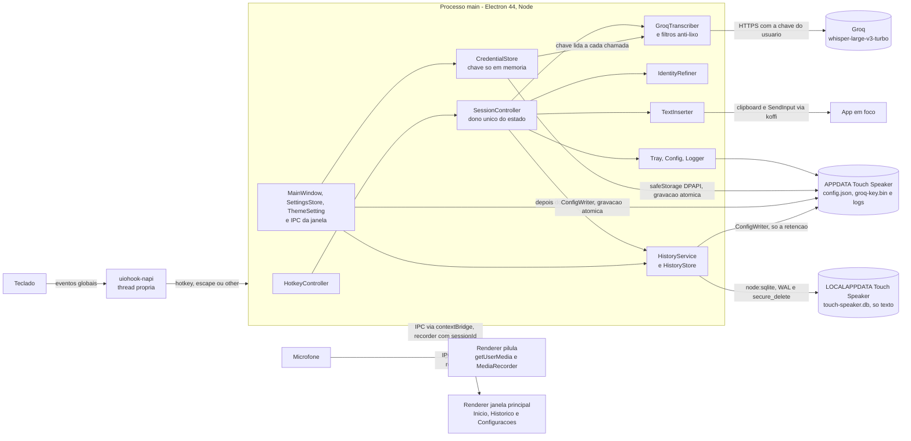
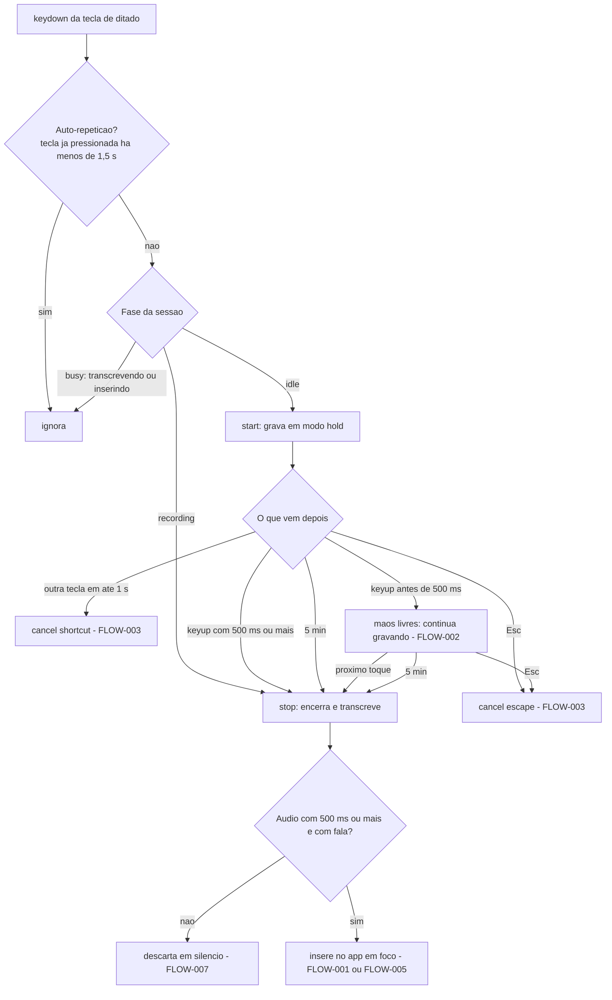
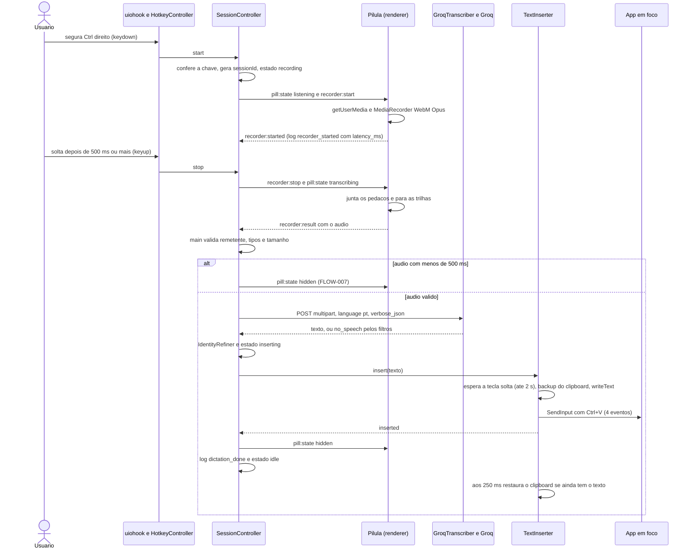
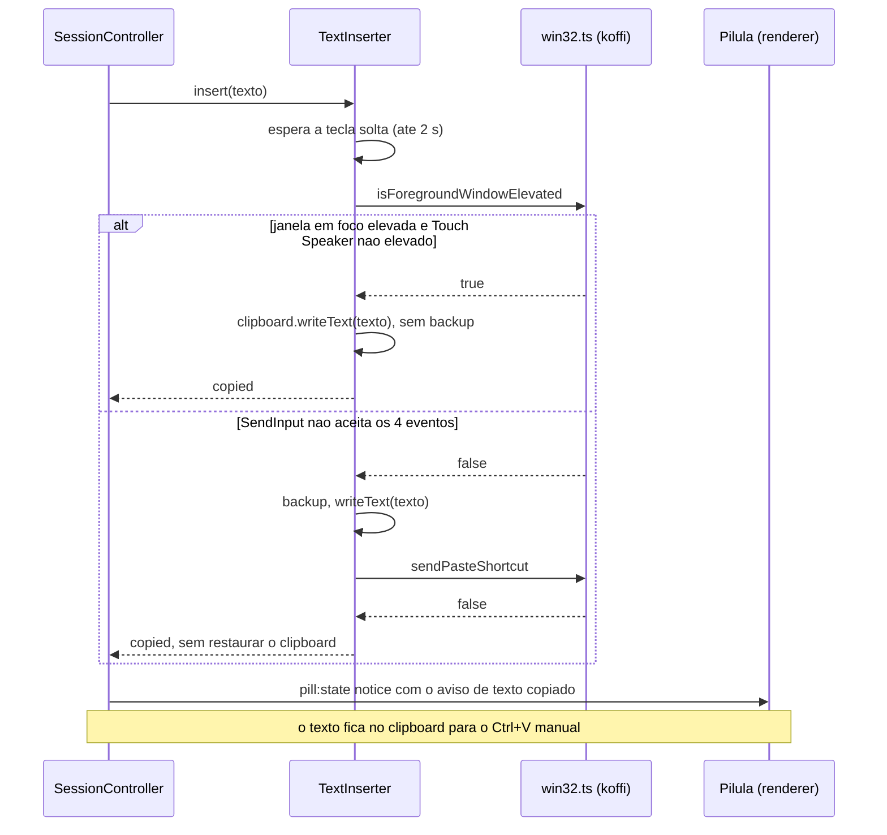
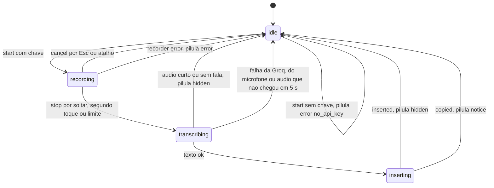
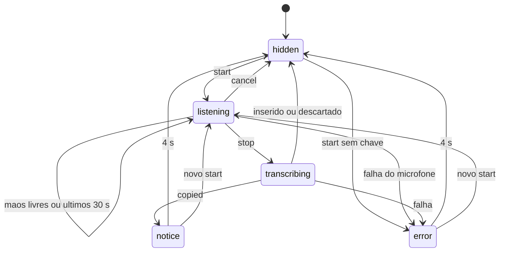

# SDD — Spec-Driven Development · Touch Speaker

> Documento mestre de engenharia do **Touch Speaker**. É o contrato central do app: requisitos, regras, dados, contratos, segurança, qualidade e roadmap vivem aqui. Spec de feature e milestone aprofundam um ponto; nenhuma delas substitui este arquivo.
>
> Última atualização: 18/out/2026 · Mantenedor: Victor Alves

---

## 0. Controle da especificação

| Campo | Valor |
|---|---|
| Projeto | Touch Speaker — app de bandeja para Windows que transforma fala em texto digitado no app em foco |
| Repositório | `Victorkaue333/-touch-speaker` (`git remote -v`; o nome do repositório começa com hífen) — **FATO** |
| Versão da SDD | 1.4 |
| Status | **vigente** |
| Criada em | 17/out/2026 |
| Última revisão | 18/out/2026 (specs `historico` e `historico-dados-v1` e o tema da `janela-principal` — §0.3, versão 1.4) |
| Referência analisada | `frontend/` em `ed0a1f5` ("Update CLAUDE.md", 17/out/2026, 14:53). Esse commit só mexeu no `CLAUDE.md`: o código é o de `bae6eba` ("feat: project touch-speaker", 14:48). O primeiro commit, `331de81` (14:43), tinha só o `README.md` — **FATO** (`git log`, `git show --stat`). As versões 1.2, 1.3 e 1.4 descrevem também o código das specs `design-system`, `janela-principal` e `historico` (com a migração `historico-dados-v1`), implementado em 18/out/2026 e ainda não commitado |
| Base factual | leitura de `frontend/src/**`, `package.json`, `tsconfig.main.json`, `tsconfig.renderer.json`, `.env.example` e `scripts/*.mjs` em 17/out/2026, mais o resultado do `npm test` no mesmo dia (30/30); na versão 1.3, releitura do código de 18/out/2026 (inclusive `tsconfig.main-window.json`) e `npm test` com 182/182; na versão 1.4, leitura de `frontend/src/main/history/`, `main/theme-setting.ts`, `shared/theme.ts`, `database/local/0001_init.sql` e dos trechos novos de `index.ts`, `session.ts`, `config.ts`, `shared/ipc.ts` e `preload/main-window.ts` (18/out/2026), e os testes compilados com 326/326 |
| Idioma | produto e documentação em pt-BR; código e identificadores em inglês |
| Responsável técnico | Victor Alves |
| Decisões de produto | Victor Alves |

### 0.1 Política de prevalência documental

Em conflito entre documentos, vale nesta ordem:

1. **[`docs/DECISIONS.md`](../DECISIONS.md)** — ADRs aceitas (ADR-01…09 e ADR-12) e propostas (ADR-13).
2. **Esta SDD** — contrato de engenharia: requisitos, regras, registros de pendências e riscos, roadmap.
3. **[`CLAUDE.md`](../../CLAUDE.md)** (e [`AGENTS.md`](../../AGENTS.md)) — guardrails operacionais.
4. **Docs específicos** — [`PRD.md`](../PRD.md), [`ARCHITECTURE.md`](../ARCHITECTURE.md), [`API.md`](../API.md), [`INTEGRATION.md`](../INTEGRATION.md), [`DATABASE.md`](../DATABASE.md), [`DESIGN.md`](../DESIGN.md), [`ENVIRONMENT.md`](../ENVIRONMENT.md), [`Security-Guide.md`](../Security-Guide.md), [`Code-Style.md`](../Code-Style.md), [`docs/templates/`](../templates/README.md).
5. **Spec aprovada da feature** (`docs/spec/features/*.md`) — aprofunda um ponto; não substitui o SDD.
6. **READMEs**.

O código em `frontend/` é a fonte de fato sobre **o que existe**; a spec aprovada e o SDD são o contrato sobre **o que deve existir**. Divergência é defeito: código errado → corrige-se o código; spec errada → **corrige-se a spec primeiro** e só depois o código, com aval do Victor sempre que o comportamento muda.

Toda feature do Touch Speaker nasce como **spec escrita** antes de qualquer código: a spec diz o problema, o que entra e o que fica de fora, e como se verifica que ficou pronto. O fluxo (spec → gate → execução), o template, a Definition of Done e o índice de specs ficam em [`docs/templates/README.md`](../templates/README.md#os-três-estágios). Os documentos-base são referenciados, não duplicados: contexto em [`PROJECT_CONTEXT.md`](../../PROJECT_CONTEXT.md), requisitos no PRD, componentes no ARCHITECTURE, decisões no DECISIONS, contratos no API e no INTEGRATION, dados no DATABASE, interface no DESIGN, segurança e sala limpa no Security-Guide.

O estudo [`docs/referencia/estudo-typeless.md`](../referencia/estudo-typeless.md) é referência, **não normativo** e **fonte proibida de código** (ADR-07): dele saem ideias e comportamentos descritos com palavras próprias; nunca código, strings, constantes, nomes de canal, ícones, sons ou cores.

### 0.2 Classificação usada no documento

| Marca | Significado |
|---|---|
| **FATO** | verificado no código em 17/out/2026 (em 18/out/2026 para o que veio das specs da M2), com âncora `frontend/src/<caminho>.ts:<linha>` quando a linha foi conferida, ou arquivo + símbolo |
| **PLANEJADO (Fase N)** | previsto no roadmap do PRD para a fase indicada; não há código. Nada neste documento está desligado: o que existe funciona |
| **DECISÃO** | ADR aceita em `docs/DECISIONS.md` ou decisão do Victor registrada com data |
| **PROPOSTA** | desenho deste SDD, ainda não implementado nem aprovado |
| **HIPÓTESE** | leitura plausível que ninguém confirmou; H1–H4 do `PROJECT_CONTEXT.md` são hipóteses de produto |
| **PENDÊNCIA** | falta decisão, verificação ou informação; registrada como `PEND-NNN` no Apêndice B |
| **FORA DO ESCOPO** | declarado fora da Fase 1 (§2.2), com a fase em que volta |

Nas tabelas, as âncoras de código omitem o prefixo `frontend/src/`: `main/hotkey.ts:100` quer dizer `frontend/src/main/hotkey.ts:100`. Caminhos que começam por `frontend/` ou por uma pasta da raiz (`docs/`, `database/`) são relativos à raiz do repositório.

**Famílias de ID.** Toda linha de requisito precisa responder: **FR ⇄ componente ⇄ contrato (IPC/HTTP) ⇄ dado ⇄ verificação** (Apêndice A).

| ID | Formato | Onde nasce |
|---|---|---|
| Requisito funcional | `FR-<ÁREA>-NN` (ex.: `FR-DICT-01`) | PRD; registro no §4 |
| Requisito não funcional | `NFR-NN` | PRD; registro no §5 |
| Decisão de arquitetura | `ADR-NN` | `docs/DECISIONS.md`; índice no §27 |
| Princípio | `C1`–`C8` | §1.5 |
| Hipótese | `H1`–`H4` | `PROJECT_CONTEXT.md`; §1.4 |
| Regra implementada | `BR-NNN` | §6.1 |
| Fluxo | `FLOW-NNN` | §11 |
| Tela | `SCREEN-NNN` | §13 |
| User story | `US-NNN` | §14 |
| Teste automatizado | `TEST-NNN` | §20.1 |
| Verificação manual | `V1`–`V13`; `V-DS-1`–`V-DS-6`; `VJ1`–`VJ27`; `VH1`–`VH13` | spec `ditado-por-voz` §12.2; spec `design-system` §14; spec `janela-principal` §14; spec `historico` §14 (o ensaio da `historico-dados-v1` é a T4 dela) |
| Tarefa | `T1`–`T10`; `T1`–`T7`; `T1`–`T7`; `T1`–`T6` | spec `ditado-por-voz` §13; spec `janela-principal` §18; spec `historico` §18; spec `historico-dados-v1` §15 — cada spec numera as suas |
| Risco | `RISK-NNN` | §26.1 |
| Pendência | `PEND-NNN` | Apêndice B.1 |
| Critério de aceite | `AC-NNN` | Apêndice C |

Áreas de `FR` em uso: `DICT` (ditado), `CLEAN` (limpeza por IA), `VOCAB` (dicionário), `HIST` (histórico — banco local, gravação, tela Histórico, retenção, cards do Início e a migração do banco; specs [`historico`](features/historico.md) e [`historico-dados-v1`](features/historico-dados-v1.md), M2), `SET` (configurações), `CTX` (contexto do app), `ASK` (comandos por voz), `TRANS` (tradução), `ACC` (contas), `DS` (design system — tokens, tema, fonte e cores da pílula e da bandeja; spec [`design-system`](features/design-system.md), M2), `UI` (janela principal — abrir e fechar, navegação, Início, Histórico, Dicionário e Configurações, inclusive a chave da Groq, e o tema claro/escuro escolhido na janela; spec [`janela-principal`](features/janela-principal.md), M2; os FR de Configurações cobrem parte do `FR-SET-01`).

### 0.3 Histórico

| Versão | Data | O que mudou |
|---|---|---|
| 1.0 | 17/out/2026 | Primeiro SDD do projeto (commit `bae6eba`): constituição C1–C8, fluxo de trabalho, rastreabilidade e famílias de ID, template de spec dentro do próprio SDD, definição de pronto e índice de specs |
| 1.1 | 17/out/2026 | Documento mestre no molde novo (§0–§31 e apêndices A–C), commitado em 17/out/2026 (commits `1ac8ee8`…`0c0aa5b`), com os registros BR, RISK, PEND, TEST, FLOW, SCREEN, US e AC. Fluxo de trabalho, template, definição de pronto e índice de specs saem daqui e vão para [`docs/templates/`](../templates/README.md); as ADRs passam a viver em `docs/DECISIONS.md`. Nenhum ID mudou: os `FR-DICT` foram reescritos em EARS sem mudar a substância, e a spec `ditado-por-voz` continua no formato original |
| 1.2 | 18/out/2026 | Spec `design-system` (M2) implementada, ainda não commitada: área `DS` (§0.2), módulo DS com FR-DS-01…18 (§4.10), TEST-005 e TEST-006 (§20.1), SCREEN-001/002 com as cores da Sálvia (§13), contraste medido (§25), RISK-015…020 (§26.1), ADR-12 (§27), PEND-006 (Apêndice B) e AC-014…034 (Apêndice C) |
| 1.3 | 18/out/2026 | Spec `janela-principal` (M2) implementada, ainda não commitada: área `UI` (§0.2), módulo UI com FR-UI-01…38 (§4.11), parte do FR-SET-01 em FATO (§4.5), BR-016 (§6.1) no lugar da regra planejada do `safeStorage` (§6.2), IPC da janela e códigos da janela (§10.1), navegação (§12), SCREEN-003 (§13), TEST-007, TEST-008 e TEST-009 e o roteiro VJ1–VJ24 (§20), eventos de log novos (§23), RISK-021…029 e RISK-009 mitigado no app empacotado (§26.1), ADR-08 (§27), PEND-007 e PEND-008 (Apêndice B) e AC-035…075 (Apêndice C). Âncoras de `index.ts`, `config.ts`, `groq.ts`, `tray.ts`, `strings.ts`, `keyboard.ts`, `pill-window.ts` e `shared/ipc.ts` reconferidas no código de 18/out/2026 |
| 1.4 | 18/out/2026 | Spec `historico` (M2) e a migração companheira `historico-dados-v1` implementadas, ainda não commitadas, e os pedidos do Victor do mesmo dia na `janela-principal` (tema claro/escuro, cards do histórico no Início, controles de Configurações): área `HIST` (§0.2), FR-HIST-01…31 no lugar do FR-HIST-01 único, sem o "app" (§4.4), FR-UI-15 cumprida, FR-UI-16 e FR-UI-38 implementadas, FR-UI-34 revista e FR-UI-39…42 novas (§4.11), FR-DS-03 com a D4 revista (§4.10), BR-017…019 (§6.1) no lugar da regra planejada do histórico (§6.2), módulo `history/` e `theme-setting.ts` (§8), o banco local e os campos `history.retentionDays` e `theme` do `config.json` (§9), canais `history:*` e `theme:set` (§10.1), FLOW-008 e FLOW-009 (§11), estados reais da SCREEN-003 (§13), TEST-010…019 e os roteiros VH1–VH13 e VJ25–VJ27 (§20), `LOCALAPPDATA` (§22), eventos de log novos (§23), RISK-030…040 e RISK-003, 004, 006, 007 e 008 revistos (§26.1), ADR-09 (§27), PEND-009 e PEND-010 e duas perguntas da `historico-dados-v1` (Apêndice B) e AC-076…115 (Apêndice C); também a ponte e os canais da janela (§3), a topologia (§7), segurança e privacidade (§17, §18), o `node:sqlite` (§19), os limiares propostos do histórico (§24), o tema na acessibilidade (§25), as dependências, a M2 e a estrutura (§28–§31) e as divergências das specs novas (Apêndice A). As âncoras citadas pelas linhas novas foram conferidas no código de 18/out/2026; as das linhas que esta versão não reescreveu (sobretudo de `main/index.ts`, `main/session.ts` e `main/config.ts`) podem ter mudado de lugar com o código novo e não foram reconferidas |
| 1.5 | 18/out/2026 | Spec `distribuicao-windows-macos` (M2) implementada no código (commits `6b73acb`, `acff340`, `80d642e`): instalador do Windows, workflow de release e porte para o macOS; ADR-10 aceita; §1.1 (estado), PEND-008 resolvida no código e PEND-011 nova (Apêndice B), a pergunta da Fase 4 respondida em parte (B.2). A numeração definitiva dos `RISK-novo`, `NFR-novo` e `TEST-novo` da spec e as demais seções listadas no §16 dela ficam para a T10 (PEND-011) |

---

## 1. Visão e contexto do produto

### 1.1 O que é

App de bandeja para **Windows**, em Electron, que transforma fala em texto digitado no app em foco. A pessoa segura uma tecla (padrão: **Ctrl direito**), fala e solta; o texto aparece onde está o cursor — VS Code, navegador, WhatsApp, Slack, Word, Claude Code — como se tivesse sido digitado. A transcrição em pt-BR é feita pelo Whisper `whisper-large-v3-turbo` na Groq, com a chave do próprio usuário, e o que a pessoa tinha no clipboard volta ao lugar depois da colagem. Não existe servidor próprio na Fase 1 (ADR-06). **FATO** — `main/index.ts` (montagem dos componentes), `main/session.ts` `SessionController`, `main/transcribe/groq.ts` `GroqTranscriber`, `main/insert/inserter.ts` `TextInserter`.

**Estado atual — FATO (17/out/2026).** A Fase 1 (MVP — ditado básico) está implementada: tarefas T1–T8 da spec [`ditado-por-voz`](features/ditado-por-voz.md) (§13).

- `npm test`: 30/30; `npm run typecheck` sem erros; o app sobe no Electron 44 com o hook de teclado e o `koffi` carregados (`keyboard_hook: true` no evento `app_ready` do log).
- Funcionando de ponta a ponta no PC do Victor: verificação V2 (mãos livres) com dois ditados de 4,6 s e 10,5 s no Bloco de Notas, inseridos 0,88 s e 0,66 s depois do fim da fala; microfone aberto em 270 ms e 75 ms.
- Memória em repouso medida: 205 MB (NFR-03).
- Falta a T9 — roteiro V1 e V3–V13 e medição de latência (PEND-001) — e a T10 — spec passa a `implementada` (PEND-002).
- Até 18/out/2026 não havia instalador: o app rodava em modo de desenvolvimento (`npm run dev`), com a chave do usuário em `frontend/.env` ou salva pela janela principal (`groq-key.bin`, cifrado — BR-016). Desde 18/out/2026, pela spec [`distribuicao-windows-macos`](features/distribuicao-windows-macos.md) ([ADR-10](../DECISIONS.md#adr-10--empacotamento-com-electron-builder-sem-bundler-módulos-nativos-sem-recompilar), ADR-11): `npm run dist:win` gera o instalador do Windows (`Touch-Speaker-Setup-0.1.0-win-x64.exe`, 107,2 MB), o workflow `.github/workflows/release.yml` gera o `.dmg` arm64 do macOS e publica os dois num Release a cada tag `v*`, e o porte para o macOS está no código — só compilado e testado com fakes; nenhum Release publicado ainda (PEND-011).
- M2 em execução ([doc-pai](../milestones/M2-app-com-interface.md)): as specs `design-system`, `janela-principal` e `historico` (com a migração `historico-dados-v1`) estão implementadas no código em 18/out/2026, ainda não commitadas (`npm test` 326/326), com os roteiros V-DS, VJ e VH pendentes (PEND-006, PEND-007, PEND-009, PEND-010).

### 1.2 Problema

Escrever no computador é lento: uma pessoa digita em média ~40 palavras por minuto e fala ~150. Quem escreve muito ao longo do dia — mensagens, e-mails, documentos, prompts para IA — perde horas digitando o que já tem pronto na cabeça.

O ditado que vem no Windows (`Win + H`) não resolve: funciona mal em português com termos técnicos e nomes próprios, não pontua bem e deixa o texto com cara de transcrição, e não é rápido de acionar nem de encerrar. Ferramentas como o Typeless provam que "falo → aparece escrito em qualquer app" muda o jeito de trabalhar, mas são produtos fechados, pagos por assinatura e com os dados passando pelo servidor deles. O Victor dita o dia inteiro em VS Code, terminal, navegador e mensageiros, depende hoje do Typeless e precisa do mesmo gesto — "segura, fala, solta, aparece escrito" — num app próprio.

**Proposta de valor:** segure uma tecla, fale e o texto aparece onde o cursor está, em qualquer app do Windows. Sem trocar de janela, sem copiar e colar, sem configurar nada por app.

### 1.3 Público

| Persona | Necessidade | Evidência |
|---|---|---|
| Dev multitarefa (Victor) — Fase 1 | escreve o dia todo em pt-BR misturado com termos técnicos em inglês; alterna entre VS Code, Claude Code, terminal, navegador, WhatsApp e Slack | PRD "Personas"; `PROJECT_CONTEXT.md` "Para quem" — primeiro e único usuário da Fase 1; **FATO**: o V2 foi feito na máquina dele |
| Profissional que escreve muito — Fase 4 | advogado, médico, gestor, criador de conteúdo; quer ditado de qualidade em português e texto limpo, sem revisar | PRD "Personas" — **PLANEJADO (Fase 4)** |

### 1.4 Objetivos de negócio

| Fase | Objetivo | Estado |
|---|---|---|
| 1 — MVP | substituir o Typeless no uso diário do Victor, no fluxo básico de ditado | implementada, em verificação (PEND-001) |
| 2 — Qualidade | texto sai "pronto": sem vícios de fala, com o vocabulário da pessoa | PLANEJADO (Fase 2) |
| 3 — Contexto | o texto se adapta ao app em que está sendo escrito; comandos por voz sobre texto selecionado | PLANEJADO (Fase 3) |
| 4 — Produto | distribuir para outras pessoas, com conta, backend próprio e instalador assinado | PLANEJADO (Fase 4) |

Métricas de sucesso, de [`PROJECT_CONTEXT.md`](../../PROJECT_CONTEXT.md):

- **Fase 1 concluída quando** o Victor passar 5 dias úteis seguidos usando só o Touch Speaker, sem abrir o Typeless.
- **Latência:** p50 ≤ 1,5 s e p95 ≤ 3 s do soltar da tecla até o texto inserido, para falas de até 30 s (NFR-01).
- **Confiabilidade:** ≥ 95% das gravações terminam com texto inserido; o resto, com erro claro, nunca em silêncio.
- **Zero lixo:** toque acidental na tecla não pode digitar nada (FR-DICT-08).

Hipóteses a validar — **HIPÓTESE**, todas abertas em PEND-003:

| # | Hipótese | Como validar |
|---|---|---|
| H1 | Whisper `large-v3-turbo` via Groq é bom o bastante em pt-BR para uso diário sem pós-edição pesada | uso real por 1 semana; anotar quantas transcrições precisam de correção |
| H2 | latência de ~1–1,5 s entre soltar a tecla e o texto aparecer é aceitável, mesmo sem streaming | medir p50/p95 nos logs locais; percepção do usuário |
| H3 | o plano gratuito da Groq cobre o uso de uma pessoa | contar requisições e segundos de áudio por dia contra o limite do console |
| H4 | colar via clipboard + Ctrl+V funciona nos apps que o Victor usa | lista de apps de aceite do PRD (FR-DICT-05) |

### 1.5 Princípios do produto — Constituição (C1–C8)

Princípios que **toda** spec precisa respeitar. A seção 0 de cada spec diz quais toca e, se violar algum, por quê.

| # | Princípio | O que significa na prática |
| --- | --- | --- |
| C1 | **Privacidade por padrão** | Áudio nunca vai para disco; texto ditado, clipboard e teclas nunca vão para log |
| C2 | **Nunca roubar o foco** | Nada do Touch Speaker recebe foco durante o ditado |
| C3 | **Nunca digitar lixo** | Na dúvida entre inserir algo errado e não inserir nada, não insere e avisa |
| C4 | **Falha visível** | Todo erro chega à pessoa com mensagem clara; nada falha em silêncio |
| C5 | **Provedores trocáveis** | Transcrição e limpeza ficam atrás de interfaces; trocar provedor = adapter novo |
| C6 | **Sem segredo em app distribuído** | Chaves de provedor só no `.env` (dev), `safeStorage` (uso pessoal) ou `backend/` (produto) |
| C7 | **Sala limpa** | Nada copiado do Typeless ou de outro produto ([Security Guide §15.3](../Security-Guide.md#153-sala-limpa-engenharia-reversa)) |
| C8 | **Escopo da fase** | Uma spec não puxa funcionalidade de fase seguinte "porque era fácil" |

Os princípios valem também para o código que já existe: `logger.ts` só aceita campos primitivos (C1), a pílula é `focusable: false` (C2), os filtros de `transcribe/filters.ts` descartam silêncio (C3), todo código de erro tem mensagem em `strings.ts` (C4), `Transcriber` e `Refiner` são interfaces (C5), a chave da Groq só vai a disco cifrada pelo `safeStorage` (C6, BR-016).

### 1.6 Estudo de referência (Typeless 2.8.2)

A arquitetura do Touch Speaker foi informada por engenharia reversa do Typeless 2.8.2 para Windows, feita para entender o comportamento e a arquitetura de um produto de mercado. A parte publicável, escrita com palavras próprias, é [`docs/referencia/estudo-typeless.md`](../referencia/estudo-typeless.md). O material bruto do estudo (binários de terceiros, código decompilado, anotações) fica **fora da pasta do repositório**, e o `.gitignore` mantém `targets/`, `analysis/` e `rea/` bloqueados como segunda trava — **FATO**. O estudo é **referência não normativa** e **fonte proibida de código** (ADR-07, [Security Guide §15.3](../Security-Guide.md#153-sala-limpa-engenharia-reversa), RISK-005): por ser não normativo, nada dele vale como requisito sem passar pelo PRD e por uma spec aprovada.

O que o estudo informou e como o Touch Speaker tratou (resumo da §9 do estudo):

| Aprendizado | Tratamento no Touch Speaker | Fase |
|---|---|---|
| Gesto segurar / tocar | adotado e simplificado: um limite de 500 ms separa segurar de tocar, sem toque duplo (BR-001) | 1 — **FATO** |
| O hook só informa teclas; a decisão fica em código | `uiohook-napi` + `HotkeyController` testável (ADR-02) | 1 — **FATO** |
| Inserção por clipboard + Ctrl+V, com backup e restauração | escrito do zero (ADR-03, BR-010) | 1 — **FATO** |
| Colagem bloqueada em janela de administrador | detecção de elevação + aviso "Texto copiado" (BR-009) | 1 — **FATO** |
| Filtrar silêncio e lixo da transcrição | regras próprias para alucinações do Whisper em pt-BR (BR-006) | 1 — **FATO** |
| Áudio Opus mono em ~32 kbps | WebM/Opus 32 kbps no renderer do Electron | 1 — **FATO** |
| Streaming do áudio durante a fala | adiado: precisa de servidor próprio (ADR-04, RISK-014) | 4 |
| Limpeza do texto por LLM | atrás da interface `Refiner` (ADR-05) | 2 |
| Dicionário pessoal; histórico local sem áudio | FR-VOCAB-01 (Fase 2); FR-HIST-01…31, no código pela M2 desde 18/out/2026 (§4.4) | 2 / M2 |
| Contexto do app em foco por UI Automation; comandos por voz; tradução | FR-CTX-01, FR-ASK-01, FR-TRANS-01 | 3 |
| Telemetria de erros | não na Fase 1; se vier, opt-in e sem conteúdo | — |

### 1.7 O que veio do molde, o que fica e o que sai

A estrutura desta documentação veio do molde de outro projeto do Victor (mesmo padrão para todos os projetos dele) e foi reescrita com o conteúdo do Touch Speaker em 17/out/2026.

| Item | Origem | Destino | Observação |
|---|---|---|---|
| Docs canônicos (`DECISIONS.md`, `CHANGELOG.md`, `Code-Style.md`, `ENVIRONMENT.md`, `INTEGRATION.md`, `AGENTS.md`) | molde | **ficam, adaptados** | registrados no [`CHANGELOG.md`](../CHANGELOG.md) |
| SDD como documento mestre, com registros de ID (BR, RISK, PEND, TEST, FLOW, SCREEN, US, AC) | molde | **fica** | este arquivo |
| Constituição C1–C8 e famílias de ID | SDD 1.0 deste projeto | **ficam** | §1.5 e §0.2 |
| Fluxo de trabalho, template de spec, definição de pronto e índice de specs | SDD 1.0 deste projeto (§2, §4, §5 e §6) | **movidos** | [`docs/templates/README.md`](../templates/README.md#índice-de-specs) |
| Templates de spec de feature, de milestone e de migração | molde | **ficam, adaptados** | milestone = fase do PRD; migração = mudança de formato de dado do app |
| ADRs dentro do `ARCHITECTURE.md` | este projeto | **movidas** | `docs/DECISIONS.md`; o ARCHITECTURE lista as sete com link |
| Spec da Fase 1 (`ditado-por-voz.md`) | SDD 1.0 deste projeto | **fica no formato original** | anterior ao template atual (§0–§15) |
| Seções do molde específicas de aplicação web com banco relacional (rotas, painel administrativo, migração de stack) | molde | **saem** | não têm equivalente num app de bandeja |
| Pasta de documentos legados do molde | molde | **não existe aqui** | o análogo não normativo é o estudo de referência (§1.6) |

---

## 2. Escopo

### 2.1 Dentro do escopo da V1

A V1 é a **Fase 1 — ditado básico** do [PRD](../PRD.md#requisitos-funcionais), especificada em [`ditado-por-voz.md`](features/ditado-por-voz.md).

**Implementado — FATO** (T1–T8, 17/out/2026):

1. Segurar para falar com a tecla de ditado, padrão Ctrl direito (FR-DICT-01).
2. Mãos livres: toque curto começa, próximo toque termina (FR-DICT-02).
3. Cancelar com `Esc` durante a gravação (FR-DICT-03).
4. Transcrição em pt-BR pela Groq, `whisper-large-v3-turbo` (FR-DICT-04).
5. Inserção no app em foco por clipboard + Ctrl+V (FR-DICT-05).
6. Clipboard preservado depois da inserção (FR-DICT-06).
7. Pílula de status flutuante que não rouba foco (FR-DICT-07).
8. Filtros anti-lixo (FR-DICT-08).
9. Erros visíveis em pt-BR na pílula (FR-DICT-09).
10. Fallback de colagem para janela de administrador (FR-DICT-10).
11. Limite de 5 min por gravação, com aviso 30 s antes (FR-DICT-11).
12. Ícone e menu na bandeja, com "Sair" (FR-DICT-12).
13. Configuração em `config.json` (FR-DICT-13).

**Verificado manualmente:** só FR-DICT-02 (V2, 17/out/2026). A colagem via `SendInput` foi comprovada isoladamente e em ditado real no Bloco de Notas. Os demais requisitos aguardam o roteiro V1–V13 da spec — PEND-001.

**Para fechar a Fase 1 — PENDÊNCIA:** T9 (PEND-001) e T10 (PEND-002). O critério de negócio é o do §1.4: 5 dias úteis seguidos só com o Touch Speaker.

**Além da V1, já no código pela M2 — FATO (18/out/2026, não commitado; roteiros VJ e VH pendentes, PEND-007, PEND-009 e PEND-010):** itens da Fase 2 do PRD entraram pela spec [`janela-principal`](features/janela-principal.md): a janela principal (FR-UI-01…38, §4.11) com a tela Configurações — parte do FR-SET-01: tecla, idioma e os demais campos do `config.json`, e "iniciar com o Windows" — e a chave da Groq digitada na tela e guardada pelo `safeStorage` (ADR-08, BR-016). A spec [`historico`](features/historico.md), com a migração [`historico-dados-v1`](features/historico-dados-v1.md), entrou no mesmo dia (FR-HIST-01…31, §4.4; roteiro VH pendente, PEND-009): o texto de cada ditado que termina com texto fica num SQLite local em `%LOCALAPPDATA%\Touch Speaker\` (ADR-09), com a tela Histórico, a retenção em Configurações e os cards "Seu uso" e "Ditados recentes" no Início. Também em 18/out/2026, a pedido do Victor: tema claro/escuro escolhido na janela, com o sistema como padrão (FR-UI-39…42; roteiro VJ25–VJ27 pendente, PEND-010). Seguem fora: a escolha de microfone (decisão Q3; Configurações só mostra o microfone em uso) e o Dicionário (a seção só diz "em breve"). A spec `design-system`, da mesma M2, está no §4.10.

### 2.2 Fora do escopo da V1

| Item | Por quê | Base |
|---|---|---|
| Limpeza do texto por IA | Fase 2; na Fase 1 o `Refiner` devolve o texto como veio | ADR-05, FR-CLEAN-01 — **FORA DO ESCOPO** |
| Dicionário pessoal | Fase 2; a janela principal mostra a seção como "em breve", sem ação (FR-UI-17) | FR-VOCAB-01 |
| Histórico de ditados | Fase 2. Desde 18/out/2026 está no código pela M2 (spec [`historico`](features/historico.md), §4.4), ainda não commitado; roteiro VH pendente (PEND-009) | FR-HIST-01…31 |
| Tela de configurações | Fase 2; na Fase 1 a configuração é o `config.json`. Desde 18/out/2026 a tela existe (janela principal, §4.11), exceto a escolha de microfone (decisão Q3) | FR-SET-01 |
| Contexto do app em foco | Fase 3 | FR-CTX-01 |
| Comandos por voz e tradução | Fase 3 | FR-ASK-01, FR-TRANS-01 |
| Contas e backend | Fase 4; sem backend na Fase 1 | ADR-06, FR-ACC-01 |
| Instalador assinado e auto-update | Fase 4 | PRD "Fora de escopo" |
| Streaming de áudio durante a fala | Fase 4, junto com o backend | ADR-04, RISK-014 |
| macOS, Linux e mobile | só Windows até a Fase 4 | NFR-06; decisão fixa do `CLAUDE.md` |

### 2.3 Backlog (volta quando)

| Item | Gatilho | ID reservado |
|---|---|---|
| Limpeza por IA (Claude Haiku) | Fase 1 fechada e spec da Fase 2 aprovada; depende de chave da Anthropic (PRD, roadmap) | FR-CLEAN-01 |
| Dicionário pessoal | spec da Fase 2; o SQLite local (`database/local/`, ADR-09) já existe desde a spec `historico`, e a tabela do dicionário vem numa migration própria; a seção da janela já existe, "em breve" | FR-VOCAB-01 |
| Escolha de microfone em Configurações (o resto do FR-SET-01) | decisão do Victor de 18/out/2026 (Q3 da spec `janela-principal`: "fica para depois"); exigiria canais novos na pílula e cuidado com a permissão de mídia (BR-015) | FR-SET-01 |
| Criptografia em repouso do histórico (cada texto com `safeStorage`/DPAPI, ou o banco inteiro com outro driver) | decisão do Victor de 18/out/2026 (M3 da spec `historico`): nenhuma na v1, "melhoria possível depois"; um banco cifrado inteiro substituiria a ADR-09 | — (RISK-030) |
| Status da bandeja quando o hook de teclado não carrega | decisão do Victor (PEND-008) | — |
| Contexto do app em foco (UI Automation) | Fase 2 entregue | FR-CTX-01 |
| "Ask Anything": comando por voz sobre texto selecionado | Fase 2 entregue | FR-ASK-01 |
| Ditado com tradução | Fase 2 entregue | FR-TRANS-01 |
| Contas, backend próprio e cotas | decisão de produto (§29) | FR-ACC-01 |

### 2.4 Constraints

| Constraint | Origem |
|---|---|
| Windows 10/11 x64; nada de macOS, Linux ou mobile antes da Fase 4 | NFR-06; decisão fixa do `CLAUDE.md` — **DECISÃO** |
| Electron 44.9.0 | `frontend/package.json` (`devDependencies`) — **FATO**; ADR-01 |
| TypeScript 7.0.2 estrito, build com `tsc` para CommonJS (`"type": "commonjs"`, `module nodenext`), os dois renderers como script clássico, cada um no seu programa do `tsc` (pílula e janela principal), sem bundler | `package.json`, `tsconfig.main.json`, `tsconfig.renderer.json`, `tsconfig.main-window.json` — **FATO**; ADR-01 |
| Node.js 24 LTS no desenvolvimento (conferido com 24.20.0 e npm 11.21) | README de `bae6eba` — **FATO** na máquina do Victor |
| `koffi` 3.3.3 e `uiohook-napi` 1.5.5 em versão exata, com binários prontos para win32-x64 e scripts de instalação negados (`allowScripts: false`); `@types/node` 24.19.2 | `package.json` — **FATO**; ADR-02, ADR-03, RISK-004 |
| Transcrição pelo plano gratuito da Groq, com a chave do próprio usuário | ADR-04, ADR-06; limites em PEND-004 |
| Produto e interface em pt-BR; todo texto de interface em `main/strings.ts` | `CLAUDE.md` "Convenções"; `main/strings.ts` — **FATO** |
| Sem backend; o app não é distribuído com chave | ADR-06 |
| Sala limpa em relação ao Typeless | ADR-07 |
| Uma sessão de ditado por vez; gravação de até 5 min; áudio de até 25 MB | BR-011, BR-014; `main/index.ts:48`, `main/transcribe/groq.ts:7` — **FATO** |

---

## 3. Atores, personas e permissões

### 3.1 Atores

| Ator | Como é reconhecido | Autenticação e confiança |
|---|---|---|
| Usuário | quem segura a tecla de ditado; único titular dos dados na Fase 1 | nenhuma: app local de uma pessoa; contas só na Fase 4 (FR-ACC-01) |
| Processo main | `dist/main/index.js` (campo `main` do `package.json`), Node + Electron | confiável; é o único com rede, clipboard, Win32, hook de teclado, arquivos, a chave (em memória; em disco só cifrada), o item de login do sistema e, desde 18/out/2026, o banco do histórico (ADR-09) |
| Renderer (pílula) | `renderer/pill.html` — a única página que grava | **não confiável** por defesa em profundidade: sandbox, sem Node, CSP sem rede; o main valida tudo o que ele envia |
| Renderer (janela principal) | `renderer/main-window/index.html`, desde 18/out/2026 (SCREEN-003) | **não confiável**: sandbox, sem Node, CSP própria sem rede, sem permissão de mídia, nada guardado no navegador; recebe o texto ditado do histórico e o mostra só por `textContent` (RISK-036); o main confere o remetente e o payload de toda mensagem (FR-UI-33, FR-HIST-19) |
| Preload (pílula) | `preload/pill.ts`, em sandbox | expõe só `window.touchSpeaker`, com 7 funções |
| Preload (janela principal) | `preload/main-window.ts`, em sandbox | expõe só `window.touchSpeakerApp`, com 10 funções e o objeto `history`, com mais 8 (`preload/main-window.ts:30-60`); nada da pílula |
| Hook de teclado | `uiohook-napi` (libuiohook, thread própria), carregado dentro de `startKeyboardHook` (`main/keyboard.ts:11-13`) | entrega keydown e keyup globais; o código reduz cada evento a `hotkey`, `escape` ou `other` na hora (BR-007), também enquanto a pessoa digita na janela principal |
| `safeStorage` (Electron; DPAPI no Windows) | chamado só pelo main, depois do `ready` (`main/index.ts:166-175`) | cifra e decifra a chave da Groq para o usuário do Windows logado (BR-016); protege por usuário, não por app (RISK-021) |
| Item de login do sistema | chave `Run` do usuário no Windows, por `app.getLoginItemSettings`/`setLoginItemSettings` (`main/login-item.ts`) | lido e gravado só pelo main e só com o app empacotado (FR-UI-37, RISK-029) |
| `node:sqlite` (embutido no Node 24.22.0 do Electron 44.9.0; SQLite 3.53.4) | carregado só pelo main, com `require` dentro de `openSqliteHistory` (`main/history/store.ts:214-225`), desde 18/out/2026 | abre o `touch-speaker.db` em `%LOCALAPPDATA%\Touch Speaker\`; se não carrega, o histórico fica indisponível e o ditado segue igual (FR-HIST-16, ADR-09, RISK-032) |
| Groq | `https://api.groq.com/openai/v1/audio/transcriptions` | `Authorization: Bearer <chave da Groq em uso>` (BR-016) sobre TLS |
| Windows e app em foco | recebe o Ctrl+V sintético por `SendInput` — inclusive a própria janela principal, quando é ela que está em foco (RISK-024); pode estar rodando elevado (UIPI) | nenhuma; o Touch Speaker não pede elevação (BR-009) |

### 3.2 Matriz de capacidades por processo

Base: §3.3 e `main/index.ts`. ✅ pode; ❌ não pode.

| Capacidade | Main | Preloads | Renderer (pílula) | Renderer (janela principal) |
|---|---|---|---|---|
| Rede (HTTPS para a Groq) | ✅ `transcribe/groq.ts` | ❌ | ❌ CSP com `connect-src 'none'` (`renderer/pill.html:7`) | ❌ CSP com `connect-src 'none'` (`renderer/main-window/index.html:7`) |
| Chave da Groq | ✅ em memória no `CredentialStore`: `groq-key.bin` decifrado pelo `safeStorage` ou, sem empacotar, `process.env.GROQ_API_KEY` (`main/index.ts:166-177`, BR-016) | ❌ guarda; o da janela só repassa a chave digitada, uma vez, em `groq-key:set` (`preload/main-window.ts:40`) | ❌ | só entre a digitação e o "Salvar chave" (o campo é limpo depois da resposta); recebe de volta só o estado `GroqKeyState` (FR-UI-22) |
| Clipboard (ler, escrever, restaurar) | ✅ `insert/inserter.ts`; e o "Copiar" do histórico, só `writeText` (`main/index.ts:196`, FR-HIST-12) | ❌ | ❌ | ❌ pede pelo `history:copy` |
| Win32 (`SendInput`, checagem de elevação) | ✅ `insert/win32.ts`, por `koffi` | ❌ | ❌ | ❌ |
| Hook global de teclado | ✅ `main/keyboard.ts` | ❌ | ❌ | ❌ |
| Arquivos (`config.json`, `groq-key.bin`, log, `.env`, banco do histórico) | ✅ `main/config.ts` (`ConfigWriter`), `main/credentials.ts`, `main/atomic-file.ts`, `main/logger.ts`, `main/index.ts:59-65`; o banco só por `main/history/store.ts` e `main/history/migrations.ts` (ADR-09) | ❌ | ❌ | ❌; nada guardado no navegador (sem `localStorage` nem IndexedDB) |
| Item de login do sistema | ✅ `main/login-item.ts`, só com o app empacotado | ❌ | ❌ | ❌ pede pelo `login-item:set` |
| Microfone | ❌ — só concede a permissão | ❌ | ✅ só áudio, só esta janela, só entre `recorder:start` e `recorder:stop`/`recorder:cancel` (BR-015) | ❌ o handler de permissão só concede à pílula (`main/index.ts:147-152`) |
| Textos da interface | ✅ `main/strings.ts`; envia prontos em `pill:state`, `app:get-strings`, `AppStatus.howTo` e nos rótulos das respostas `history:*` (`dayLabel`, `statusLabel`, `retentionLabel`, `unsavedLabel`, `savedLabel`…) | ❌ | ❌ não tem strings próprias | ❌ não tem strings próprias: o HTML só tem ids e `data-text`/`data-label`, preenchidos por `textContent` |
| Canais IPC | pílula: envia `recorder:start`, `recorder:stop`, `recorder:cancel`, `pill:state`; recebe e valida `recorder:started`, `recorder:result`, `recorder:error`. Janela: atende e valida os 16 canais janela → main do §10.1 (8 da `janela-principal`, 7 `history:*` e `theme:set`) e envia `app:status` e `history:changed` | o da pílula expõe os 7 canais como funções de `window.touchSpeaker`; o da janela, os 18 como funções de `window.touchSpeakerApp` (8 delas em `history`) | usa só `window.touchSpeaker` | usa só `window.touchSpeakerApp` |
| Abrir janela nova ou navegar | — | — | ❌ negado (`setWindowOpenHandler`, `will-navigate` — `main/index.ts:131-134`) | ❌ negado pelo mesmo handler; as seções trocam na mesma página |
| DevTools | — | — | só com o app não empacotado | só com o app não empacotado; F12 com a janela em foco (`main/main-window.ts:118-122`) |

### 3.3 Camadas de isolamento — **FATO**

1. **Janela da pílula** — `contextIsolation: true`, `sandbox: true`, `nodeIntegration: false`, `webSecurity: true` (`main/pill-window.ts:38-48`); DevTools só com o app não empacotado (`devTools: allowDevTools`, `!app.isPackaged` em `main/index.ts:136`).
2. **Preload mínimo** — só `window.touchSpeaker` com `onStart`, `onStop`, `onCancel`, `onState`, `started`, `result` e `error` (`preload/pill.ts:22-30`); nenhum `ipcRenderer` genérico exposto. A janela principal tem o preload dela (camada 10).
3. **CSP** — `default-src 'self'; script-src 'self'; style-src 'self'; connect-src 'none'; img-src 'self' data:; media-src 'self' blob: mediastream:` (`renderer/pill.html:7`): o renderer não tem rede e só carrega arquivos locais do app. A janela principal tem CSP própria, mais estrita (camada 10).
4. **Navegação** — toda janela nova é negada e toda navegação é bloqueada, para qualquer web contents (`main/index.ts:131-134`).
5. **Permissões** — mídia só para a pílula e só áudio, no pedido e na checagem (`setPermissionRequestHandler` e `setPermissionCheckHandler`, `main/index.ts:147-152`); a janela principal nunca a recebe.
6. **IPC validado no main** — remetente (`event.sender === pill.webContents`), tipos, `durationMs` finito ≥ 0, `mimeType` começando por `audio/`, áudio ≤ 25 MB e código de erro da lista fechada (`main/index.ts:78-107`, `:249-262`). `recorder:result` recusado vai ao log como `ipc_rejected`.
7. **Sessão** — toda mensagem de gravação (`recorder:*`) carrega `sessionId`; o main descarta o que não é da sessão atual (BR-014). `pill:state` não leva `sessionId`: só o main o envia. Os canais da janela principal também não levam: não pertencem a uma sessão de ditado, e o remetente é conferido pela identidade (camada 11).
8. **UIPI** — o app não pede elevação; janela elevada em foco cai no fallback de colagem (BR-009). Se o próprio Touch Speaker roda elevado, isso vai para o `app_ready` (`self_elevated`).
9. **Instância única** — `app.requestSingleInstanceLock()` (`main/index.ts:67`); a segunda instância sai, e a primeira registra `second_instance_focus` e mostra a janela principal (FR-UI-04; `main/index.ts:424-427`).
10. **Janela principal** (desde 18/out/2026) — `contextIsolation: true`, `sandbox: true`, `nodeIntegration: false`, `webSecurity: true`, `spellcheck: false`, DevTools só com o app não empacotado, preload próprio que expõe só `window.touchSpeakerApp` (`main/main-window.ts:90-98`; `preload/main-window.ts:30-60`); sem permissão de mídia (camada 5); CSP própria, sem `'unsafe-inline'`: `default-src 'none'; script-src 'self'; style-src 'self'; font-src 'self'; img-src 'self' data:; connect-src 'none'; media-src 'none'; object-src 'none'; base-uri 'none'; form-action 'none'` (`renderer/main-window/index.html:7`, conferida pelo TEST-005); textos só por `textContent`, nunca `innerHTML`; nada guardado no navegador; console no log sem a mensagem (§23); renderer caído → log `main_window_renderer_gone` e janela destruída (`main/main-window.ts:123-126`).
11. **IPC da janela validado no main** — handlers registrados uma vez; toda mensagem tem de vir do `webContents` da janela principal aberta agora, do quadro principal, com a URL `file:` do `index.html` do app, e ter exatamente o payload do §10.1 (`main/main-window.ts:53-57`, `main/main-window-ipc.ts:29-121`; `handleWindow` e `rejected` em `main/index.ts:288-296`); senão, log `ipc_rejected` com o canal e o `invoke` rejeita. Desde 18/out/2026, os canais `history:*` e `theme:set` passam pelo mesmo `handleWindow`, com os validadores de `main/history/ipc.ts` e `asThemeInput` (`main/main-window-ipc.ts:64`) — FR-HIST-19, FR-UI-40; TEST-013, TEST-018. Os canais da pílula continuam aceitando só a pílula; nenhum preload expõe os canais do outro (TEST-009).

Não há papéis nem autorização por usuário: o app é local e de uma pessoa até a Fase 4.

---

## 4. Requisitos funcionais

Formato EARS: `QUANDO <evento> O SISTEMA DEVE <comportamento observável>`. Os IDs `FR-*` são os do [`PRD.md`](../PRD.md#requisitos-funcionais), sem renumeração; o texto foi reescrito em EARS sem mudar a substância. Status: **FATO** (implementado e conferido no código; a coluna diz também se a verificação manual já foi feita) e **PLANEJADO (Fase N)** (no roadmap, sem código); nos módulos da M2, também "parcial" e "dependência da spec …", quando parte do requisito espera outra spec.

### 4.1 Ditado — módulo DICT

| ID | Requisito (EARS) | Ator | AC | Tela | Contrato | Status |
|---|---|---|---|---|---|---|
| FR-DICT-01 | QUANDO a pessoa segura a tecla de ditado (padrão: Ctrl direito) O SISTEMA DEVE começar a gravar e, QUANDO ela soltar depois de pelo menos `holdThresholdMs` (500 ms), encerrar e disparar a transcrição; a auto-repetição da tecla não abre gravações extras | Usuário | AC-001 | SCREEN-001 | `recorder:start`, `recorder:stop` | FATO — `main/hotkey.ts:50-69`, `:91-103` (BR-001, BR-002); TEST-001; V1 pendente (PEND-001) |
| FR-DICT-02 | QUANDO a pessoa dá um toque curto (< 500 ms) na tecla O SISTEMA DEVE continuar gravando em mãos livres até o próximo toque, que encerra a gravação | Usuário | AC-002 | SCREEN-001 | `pill:state` (`mode: 'handsfree'`), `recorder:stop` | FATO — `main/hotkey.ts:102`, `main/session.ts` `switchToHandsFree`; TEST-001; **V2 verificado em 17/out/2026** |
| FR-DICT-03 | QUANDO a pessoa aperta `Esc` durante a gravação O SISTEMA DEVE descartar o áudio sem enviar nada à Groq e sem inserir nada | Usuário | AC-003 | SCREEN-001 | `recorder:cancel` | FATO — `main/hotkey.ts:72-77`, `main/session.ts` `cancel` (BR-004); TEST-001; V3 pendente. O `Esc` também chega ao app em foco (RISK-013) |
| FR-DICT-04 | QUANDO uma gravação válida termina O SISTEMA DEVE transcrevê-la pela Groq com `whisper-large-v3-turbo` e `language=pt` | — | AC-004 | — | `POST /openai/v1/audio/transcriptions` | FATO — `main/transcribe/groq.ts` `GroqTranscriber.transcribe`; TEST-003; V4 pendente; a qualidade em pt-BR é a H1 (PEND-003) |
| FR-DICT-05 | QUANDO há texto transcrito O SISTEMA DEVE colá-lo no cursor do app em foco, sem nunca dar foco à janela do Touch Speaker | Usuário | AC-005 | — | clipboard + `SendInput` | FATO — `main/insert/inserter.ts` `TextInserter.insert`, `main/insert/win32.ts` `sendPasteShortcut`; colagem comprovada em ditado real no Bloco de Notas; lista de apps (V5) pendente |
| FR-DICT-06 | QUANDO o texto é colado O SISTEMA DEVE devolver ao clipboard o conteúdo que a pessoa tinha antes | Usuário | AC-006 | — | clipboard | FATO — `main/insert/inserter.ts:84-105` (BR-010); V6 pendente |
| FR-DICT-07 | QUANDO o estado da sessão muda O SISTEMA DEVE mostrar a pílula flutuante — gravando, com o nível do microfone; transcrevendo; erro — em até 150 ms depois da tecla, sem roubar foco nem clique | Usuário | AC-007 | SCREEN-001 | `pill:state` | FATO — `main/pill-window.ts` (`focusable: false`, `showInactive`, `setIgnoreMouseEvents`), `renderer/pill.ts`; V7 pendente; os 150 ms não foram medidos |
| FR-DICT-08 | QUANDO a gravação dura menos de 0,5 s ou o Whisper marca a transcrição como sem fala O SISTEMA DEVE descartá-la sem inserir nada | Usuário | AC-008 | SCREEN-001 (`hidden`) | — | FATO — `main/session.ts:181-184`, `main/transcribe/filters.ts` `isNoSpeech` (BR-005, BR-006); TEST-002; V8 pendente |
| FR-DICT-09 | QUANDO falta a chave, não há internet, a Groq limita, o microfone está ocupado ou a colagem é bloqueada O SISTEMA DEVE mostrar mensagem clara em pt-BR na pílula, sem fechar o app nem falhar em silêncio | Usuário | AC-009 | SCREEN-001 (`error`, `notice`) | [códigos de erro](../API.md#códigos-de-erro) | FATO — `main/strings.ts` `errorMessage`, `main/session.ts` `fail` e `showMessage`; TEST-003 cobre o mapeamento HTTP → código; V9 pendente |
| FR-DICT-10 | QUANDO o Ctrl+V simulado falha ou o app em foco roda como administrador O SISTEMA DEVE deixar o texto no clipboard e avisar "Texto copiado — cole com Ctrl+V" | Usuário | AC-010 | SCREEN-001 (`notice`) | `paste_blocked` | FATO — `main/insert/inserter.ts:77-80`, `:93`; `main/insert/win32.ts` `isForegroundWindowElevated` (BR-009); V10 pendente (RISK-003) |
| FR-DICT-11 | QUANDO a gravação chega a 5 min O SISTEMA DEVE encerrá-la e transcrevê-la sozinha, com aviso aos 4:30 | Usuário | AC-011 | SCREEN-001 (`warn`) | `recorder:stop` | FATO — `main/session.ts:115-125`, `main/config.ts:33` `MAX_RECORDING_MS` (BR-011); V11 pendente |
| FR-DICT-12 | QUANDO o app está aberto O SISTEMA DEVE manter na bandeja um ícone com status, microfone em uso e "Sair"; QUANDO a pessoa escolhe "Sair" O SISTEMA DEVE encerrar o hook de teclado e o processo | Usuário | AC-012 | SCREEN-002 | — | FATO — `main/tray.ts` `AppTray`, `main/index.ts:273-281` (`quit`); V12 pendente. O menu diz "padrão do Windows" ou "definido no config.json", não o nome do dispositivo |
| FR-DICT-13 | QUANDO o app inicia O SISTEMA DEVE ler a configuração de `config.json` (tecla, idioma, microfone e demais campos) e aplicar o que for válido; trocar a tecla no arquivo e reiniciar faz a nova tecla valer | Usuário | AC-013 | — | `config.json` | FATO — `main/config.ts` `loadConfig`, `normalizeConfig` (BR-012); TEST-004; V13 pendente. Desde 18/out/2026 a tecla também se troca em Configurações, com a mesma regra de "vale depois de reiniciar" (FR-UI-26…32) |

### 4.2 Limpeza — módulo CLEAN

| ID | Requisito (EARS) | Origem | Status |
|---|---|---|---|
| FR-CLEAN-01 | QUANDO o texto transcrito passar pelo `Refiner` O SISTEMA DEVE remover hesitações e repetições ("é…", "tipo") e aplicar a autocorreção falada ("não, quer dizer…"), com Claude Haiku | PRD, fases seguintes; encaixe pronto em `main/refine.ts` (ADR-05) | PLANEJADO (Fase 2) |

### 4.3 Dicionário — módulo VOCAB

| ID | Requisito (EARS) | Origem | Status |
|---|---|---|---|
| FR-VOCAB-01 | QUANDO a pessoa tem termos no dicionário pessoal O SISTEMA DEVE enviá-los no `prompt` do Whisper e na limpeza | PRD, fases seguintes | PLANEJADO (Fase 2) |

### 4.4 Histórico — módulo HIST

Origem: PRD FR-HIST-01 (Fase 2) — "Histórico local dos ditados (texto, duração), com 'copiar de novo'": o "app" saiu do requisito por decisão do Victor de 18/out/2026 (M2 da spec), e nada do app em foco é guardado. Decomposto na spec [`historico`](features/historico.md), da M2, em FR-HIST-01…26, e na spec de migração companheira [`historico-dados-v1`](features/historico-dados-v1.md) em FR-HIST-27…31. **DECISÃO** — decisões do Victor de 18/out/2026 (§17.1 da spec `historico`): só texto, sem áudio, SQLite local, caso de uso "quando eu perder" (a colagem falhou ou foi para a janela errada); M1 retenção padrão de 30 dias, `null` = para sempre, 1 a 3650 dias e `0` = nunca guardar; M2 nenhum nome de app, executável ou título de janela; M3 nenhuma criptografia além da conta do sistema na v1 (RISK-030); M4 retenção ajustada em Configurações e gravada pelo main; M5 falha de gravação só na tela Histórico (RISK-038); M6 banco em `%LOCALAPPDATA%` (RISK-031); e, no mesmo dia, o Início com os dados do histórico (FR-HIST-22…26), exceção à regra "texto ditado só na tela Histórico" (RISK-039). Driver: o `node:sqlite` embutido, escolhido pelo spike T1 (ADR-09). A spec `historico` foi aprovada em 18/out/2026; a `historico-dados-v1` está em `proposta`, com a implementação autorizada pelo Victor antes da aprovação, que vem com a validação dele no roteiro VH (PEND-009; perguntas no Apêndice B.2). Implementado no código em 18/out/2026, ainda não commitado (`npm test` 326/326); roteiro VH1–VH13 e ensaio da migração (T4 da `historico-dados-v1`) pendentes (PEND-009).

| ID | Requisito (EARS) | Ator | AC | Tela | Contrato | Status |
|---|---|---|---|---|---|---|
| FR-HIST-01 | QUANDO a inserção de um ditado termina com resultado `inserted` ou `copied` O SISTEMA DEVE gravar uma entrada com o texto do ditado, o horário, a duração da gravação e o resultado da inserção | Usuário | AC-076, AC-077 | SCREEN-003 (Histórico) | `HistoryPort.save` → `dictations` | FATO — `main/session.ts:229`, `:241-249`; `main/history/service.ts:152-175`; `main/history/store.ts:106-120`; TEST-014, TEST-015; VH1 e VH2 pendentes (PEND-009) |
| FR-HIST-02 | SE a inserção lança exceção **depois** que o texto do ditado existe ENTÃO O SISTEMA DEVE gravar a entrada com resultado `failed`; exceção antes de haver texto (na transcrição ou no `Refiner`) não grava nada | — | AC-078 | — | `HistoryPort.save` (`status: failed`) | FATO — `main/session.ts:233-236`; TEST-014 |
| FR-HIST-03 | QUANDO a sessão termina sem texto do ditado — cancelada (`Esc` ou atalho), gravação curta, sem fala, texto vazio depois do `Refiner`, erro de microfone, erro da Groq ou sem chave — O SISTEMA DEVE deixar o histórico como está | — | AC-080 | — | — | FATO — a sessão só chama a porta com texto (`main/session.ts:229`, `:236`); TEST-014; VH4 pendente |
| FR-HIST-04 | QUANDO a inserção termina O SISTEMA DEVE gravar a entrada só depois do registro `dictation_done` (ou `session_exception`, no caso do FR-HIST-02), de modo que a colagem e o `total_ms` do log não esperem pelo banco | — | AC-079 | — | — | FATO — `main/session.ts:218-236`; TEST-014 (ordem `insert` → `dictation_done` → `save`); NFR-01 intacto por construção |
| FR-HIST-05 | QUANDO grava uma entrada O SISTEMA DEVE guardar só `id`, `created_at`, `text`, `audio_ms` e `status` — nunca o nome do app em foco, o executável, o título da janela nem outra identificação do destino | — | AC-081 | — | `dictations` (§9) | FATO — `database/local/0001_init.sql`; TEST-015 (colunas exatas) |
| FR-HIST-06 | ENQUANTO `history.retentionDays` for `0` ("nunca guardar") O SISTEMA DEVE não gravar nenhuma entrada nova | Usuário | AC-082 | SCREEN-003 (Histórico, desligado) | `config.json` (`history.retentionDays`) | FATO — `main/history/service.ts:154`; TEST-014; VH7 pendente |
| FR-HIST-07 | QUANDO o app abre, e depois de cada entrada gravada, O SISTEMA DEVE apagar as entradas mais antigas que `history.retentionDays` dias — todas, quando o valor é `0`; nenhuma, quando é `null` ("para sempre") | — | AC-083 | — | `dictations` | FATO — `main/history/retention.ts:16`; purga na mesma transação da gravação (`main/history/store.ts:106-120`) e na abertura (`main/history/service.ts:77-110`); TEST-010, TEST-015, TEST-017 |
| FR-HIST-08 | QUANDO a tela Histórico pede a lista O SISTEMA DEVE devolver as entradas da mais nova para a mais antiga, em páginas de até 50, cada uma com o texto completo, a hora local, a duração e o resultado da inserção | Usuário | AC-076, AC-084 | SCREEN-003 (Histórico) | `history:list` | FATO — `main/history/store.ts:122`, `main/history/service.ts:176`, cursor em `main/history/ipc.ts:28-40`; tela em `renderer/main-window/main-window.ts:547-593`; TEST-015, TEST-017; VH1 pendente |
| FR-HIST-09 | QUANDO devolve a lista O SISTEMA DEVE agrupar as entradas pelo dia local do sistema, com o rótulo pronto: "Hoje", "Ontem" ou a data por extenso em pt-BR (com o ano só quando não é o ano corrente) | Usuário | AC-076, AC-085 | SCREEN-003 (Histórico) | `history:list` (`dayKey`, `dayLabel`) | FATO — `main/history/format.ts` (`HistoryFormatter`); `renderer/main-window/main-window.ts:593` (`dayGroups`); TEST-011 |
| FR-HIST-10 | QUANDO a pessoa busca um termo O SISTEMA DEVE devolver só as entradas cujo texto contém o termo, sem diferenciar maiúsculas, acentos e pontuação ("nao" acha "Não,") | Usuário | AC-086 | SCREEN-003 (Histórico) | `history:list` (`query`) | FATO — `main/history/search.ts:5`; função SQL `ts_normalize` (`main/history/store.ts:78`, `:225`), varredura sem FTS5; TEST-012, TEST-015; VH5 pendente |
| FR-HIST-11 | QUANDO não há entradas, a busca não acha nada ou o histórico está desligado (`retentionDays: 0`) O SISTEMA DEVE devolver o estado correspondente para a tela mostrar o texto daquele estado, nunca uma lista vazia sem explicação | Usuário | AC-082, AC-086 | SCREEN-003 (Histórico) | `history:list` (`status`) | FATO — `main/history/service.ts:176`; `renderer/main-window/main-window.ts:567` (`renderHistory`); TEST-017 |
| FR-HIST-12 | QUANDO a pessoa escolhe "Copiar" numa entrada O SISTEMA DEVE escrever o texto dela no clipboard do Windows, pelo processo main, e a tela confirma "Copiado" | Usuário | AC-087 | SCREEN-003 (Histórico, Início) | `history:copy` | FATO — `main/history/service.ts:199`, `clipboard.writeText` no main (`main/index.ts:196`); TEST-017, com clipboard simulado; VH2 pendente |
| FR-HIST-13 | SE "Copiar" ou "Apagar" chega para uma entrada que não existe mais (apagada ou vencida) ENTÃO O SISTEMA DEVE responder `not_found`, sem mexer no clipboard, e a tela recarrega a lista | Usuário | AC-088 | SCREEN-003 (Histórico) | `history:copy`, `history:delete` (`not_found`) | FATO — `main/history/service.ts:199-230`; TEST-017 |
| FR-HIST-14 | QUANDO a pessoa apaga uma entrada O SISTEMA DEVE removê-la de modo que o texto não fique legível no arquivo do banco nem no WAL (`secure_delete` + checkpoint) | Usuário | AC-089 | SCREEN-003 (Histórico) | `history:delete` | FATO — `main/history/store.ts:148`, `:197` (`wal_checkpoint(TRUNCATE)`), `:223` (`secure_delete`); TEST-015 confere os bytes do `.db` e do `-wal`; VH6 pendente (RISK-034) |
| FR-HIST-15 | QUANDO a pessoa confirma "Apagar tudo" O SISTEMA DEVE apagar todas as entradas, esvaziar o WAL e compactar o arquivo (`VACUUM`) | Usuário | AC-090 | SCREEN-003 (Histórico, confirmação) | `history:clear` (`confirmed: true`) | FATO — `main/history/store.ts:155-161`, `main/history/service.ts:231`; confirmação em dois passos na própria tela (`renderer/main-window/index.html:189-194`, `main-window.ts:644`); TEST-015, TEST-017; VH6 pendente |
| FR-HIST-16 | SE o banco não abre (driver não carrega, arquivo corrompido, migration falha, disco, permissão ou pasta local indisponível) ENTÃO O SISTEMA DEVE manter o ditado funcionando exatamente como antes, registrar `history_unavailable` só com o nome do erro, e a tela Histórico mostra "Histórico indisponível" | Usuário | AC-091 | SCREEN-003 (Histórico, indisponível) | `history:*` (`unavailable`) | FATO — `openHistory` captura toda falha e devolve `null` (`main/history/service.ts:77-110`); TEST-015, TEST-016, TEST-017; VH8 pendente (RISK-032, RISK-035) |
| FR-HIST-17 | SE gravar uma entrada falha ENTÃO O SISTEMA DEVE manter o resultado do ditado (pílula e bandeja como antes), registrar `history_write_failed` só com o nome do erro e somar a falha a uma contagem que só a tela Histórico mostra, "ditados não guardados desde que o app abriu" | Usuário | AC-092 | SCREEN-003 (Histórico, faixa) | `history:list` (`unsavedCount`, `unsavedLabel`) | FATO — `main/history/service.ts:146-175`; a porta nunca lança para a sessão (`main/session.ts:241-249`); TEST-014 (RISK-038) |
| FR-HIST-18 | QUANDO uma entrada é gravada, apagada ou vence, ou o histórico é limpo, O SISTEMA DEVE avisar a janela principal aberta (`history:changed`, sem conteúdo) para a tela recarregar | — | AC-093 | SCREEN-003 | `history:changed` | FATO — `main/index.ts:197` (`notify`); TEST-017 |
| FR-HIST-19 | SE uma mensagem `history:*` chega de outro remetente que não a janela principal (a pílula, por exemplo) ou com payload inválido ENTÃO O SISTEMA DEVE recusá-la sem tocar no banco, no clipboard nem no `config.json`, e registrar `ipc_rejected` com o canal | — | AC-094 | — | `history:*` (§10.1) | FATO — `main/index.ts:288-296`, `:374-402`; validadores em `main/history/ipc.ts:53-99`; TEST-013 |
| FR-HIST-20 | QUANDO a pessoa muda a retenção na tela Configurações O SISTEMA DEVE gravar o novo `history.retentionDays` no `config.json`, trocando só esse campo, e aplicá-lo na hora — com a purga do FR-HIST-07 e o aviso do FR-HIST-18 | Usuário | AC-095 | SCREEN-003 (Configurações · histórico) | `history:set-retention`, `config.json` | FATO — `main/history/service.ts:255-275`, `withRetention` (`main/config.ts:125-128`); `renderer/main-window/main-window.ts:754` (`saveRetention`); TEST-004, TEST-017; VH11 pendente |
| FR-HIST-21 | SE o `config.json` não pode ser lido como objeto JSON, ou a gravação falha, quando a pessoa muda a retenção ENTÃO O SISTEMA DEVE manter a retenção em uso, não sobrescrever o arquivo e responder `write_failed` para a tela mostrar o aviso | Usuário | AC-096 | SCREEN-003 (Configurações · histórico) | `history:set-retention` (`write_failed`) | FATO — `main/history/service.ts:255-260` (log `config_write_failed`), `ConfigWriter` (`main/config.ts:194`); TEST-017 |
| FR-HIST-22 | QUANDO o Início pede o uso (`history:stats`) O SISTEMA DEVE calcular no processo main um agregado do histórico — só números e rótulos prontos, nunca um texto ditado — e responder com o mesmo `status` do `history:list` (`ok`, `disabled`, `unavailable`) | Usuário | AC-099 | SCREEN-003 (Início, "Seu uso") | `history:stats` | FATO — `main/history/service.ts:279`, que percorre as entradas por `HistoryStore.scan` (`main/history/store.ts:174`); TEST-017. Cumpre a FR-UI-15 |
| FR-HIST-23 | QUANDO calcula o agregado O SISTEMA DEVE somar, para hoje (dia local do sistema) e para todo o histórico guardado, as palavras ditadas (tokens separados por espaço em branco), o número de ditados e o tempo falado (soma de `audio_ms`) | Usuário | AC-099 | SCREEN-003 (Início) | `history:stats` (`today`, `allTime`) | FATO — `main/history/service.ts:279-325`, `main/history/format.ts`; TEST-011, TEST-017 |
| FR-HIST-24 | QUANDO calcula o agregado O SISTEMA DEVE devolver a média de palavras por minuto = total de palavras ÷ total de minutos, só sobre as entradas com duração maior que zero, arredondada; sem nenhuma, "—" | Usuário | AC-100 | SCREEN-003 (Início) | `history:stats` (`wordsPerMinute`) | FATO — `wordsPerMinute` (`main/history/format.ts:96-98`); TEST-011, TEST-017 |
| FR-HIST-25 | QUANDO o Início é mostrado com o histórico ligado O SISTEMA DEVE exibir os 3 ditados mais recentes (`history:list` com `limit: 3`), cada um com o dia, a hora, o começo do texto e "Copiar", e um "Ver todos" que abre a tela Histórico | Usuário | AC-101 | SCREEN-003 (Início, "Ditados recentes") | `history:list`, `history:copy` | FATO — `renderer/main-window/index.html:155-166`, `main-window.ts:696` (`renderRecent`); exceção à regra "texto ditado só na tela Histórico", pedida pelo Victor (RISK-039); VH13 pendente |
| FR-HIST-26 | ENQUANTO o histórico estiver desligado (`retentionDays: 0`) ou indisponível O SISTEMA DEVE mostrar nos cards do Início o estado claro ("histórico desligado", com o caminho para Configurações, ou "indisponível"), nunca números zerados sem explicação; e QUANDO chega `history:changed` com o Início aberto, recarregar os cards | Usuário | AC-102 | SCREEN-003 (Início) | `history:stats`, `history:list`, `history:changed` | FATO — `renderer/main-window/main-window.ts:680-713`; `renderer/main-window/index.html:110`, `:163-164`; VH13 pendente |
| FR-HIST-27 | QUANDO o app abre O SISTEMA DEVE abrir (criando se não existir) `touch-speaker.db` na pasta local, ligar `journal_mode=WAL` e `secure_delete=ON`, criar `schema_migrations` se faltar e aplicar em ordem as migrations de `database/local/` ainda não registradas, cada uma numa transação, registrando `version` e `applied_at` (ISO-8601 UTC) | — | AC-107, AC-108 | — | `touch-speaker.db`, `schema_migrations` | FATO — `main/history/store.ts:217-225`, `main/history/migrations.ts:19-72`, `main/history/paths.ts:23`; aberto depois do `loadConfig` e antes da sessão (`main/index.ts:187-199`); TEST-015, TEST-016; ensaio pendente (PEND-009) |
| FR-HIST-28 | SE `schema_migrations` registrar uma versão maior que a da última migration que o app conhece ENTÃO O SISTEMA DEVE deixar o arquivo intacto, tratar o histórico como indisponível (`history_unavailable` com `name: schema_too_new`) e manter o ditado | — | AC-109 | — | `schema_migrations` | FATO — `main/history/migrations.ts:53`; TEST-015. O comportamento espera a confirmação do Victor (Apêndice B.2) |
| FR-HIST-29 | SE uma migration falhar no meio ENTÃO O SISTEMA DEVE desfazer a migration inteira (`ROLLBACK`), não registrar a versão dela e tratar o histórico como indisponível; a próxima abertura tenta de novo | — | AC-110 | — | `schema_migrations` | FATO — `main/history/migrations.ts:59-66`; TEST-015 |
| FR-HIST-30 | QUANDO o app lê o `config.json` O SISTEMA DEVE ler `history.retentionDays`: ausente (formato de antes, ou `history` sem a chave) → 30, sem aviso; `0`, inteiro de 1 a 3650 ou `null` → o valor; qualquer outro valor (ou `history` que não é objeto) → 30 com `config_invalid_field` `field: "history"`; o `version` continua `1` | — | AC-103, AC-104 | — | `config.json` | FATO — `main/config.ts:108-115`, `isRetentionDays` (`main/history/retention.ts:9-11`); TEST-004. O `version: 1` espera a confirmação do Victor (Apêndice B.2) |
| FR-HIST-31 | QUANDO a pessoa muda a retenção pela tela O SISTEMA DEVE regravar o `config.json` pela fila única (`ConfigWriter`), relendo o arquivo e trocando só `history.retentionDays` — outras chaves dentro de `history`, todos os outros campos, campos desconhecidos e o `version` ficam como estavam —, em arquivo temporário + renomeação; arquivo que não é objeto JSON não é sobrescrito (`write_failed`); arquivo ausente é recriado com os defaults e a retenção nova | Usuário | AC-105, AC-106 | SCREEN-003 (Configurações · histórico) | `history:set-retention`, `config.json` | FATO — `withRetention` (`main/config.ts:125-128`), `ConfigWriter` (`:194`), `main/atomic-file.ts`; TEST-004, TEST-017 |

### 4.5 Configurações — módulo SET

| ID | Requisito (EARS) | Origem | Status |
|---|---|---|---|
| FR-SET-01 | QUANDO a pessoa abre as configurações O SISTEMA DEVE oferecer numa tela a troca de tecla, microfone e idioma e a opção "iniciar com o Windows" | PRD, fases seguintes | parcial — FATO pela M2 (18/out/2026): tecla, idioma e os demais campos do `config.json` (FR-UI-26…32) e "iniciar com o Windows" (FR-UI-36, 37) em Configurações da janela principal (§4.11); a escolha de microfone fica para depois (decisão Q3), hoje só leitura (FR-UI-27) |

### 4.6 Contexto — módulo CTX

| ID | Requisito (EARS) | Origem | Status |
|---|---|---|---|
| FR-CTX-01 | QUANDO um ditado vai ser inserido O SISTEMA DEVE usar o contexto do app em foco (nome, título, texto ao redor do cursor) para ajustar o tom | PRD, fases seguintes | PLANEJADO (Fase 3) |

### 4.7 Comandos por voz — módulo ASK

| ID | Requisito (EARS) | Origem | Status |
|---|---|---|---|
| FR-ASK-01 | QUANDO a pessoa dá um comando por voz com texto selecionado ("Ask Anything") O SISTEMA DEVE reescrever, resumir ou responder sobre esse texto | PRD, fases seguintes | PLANEJADO (Fase 3) |

### 4.8 Tradução — módulo TRANS

| ID | Requisito (EARS) | Origem | Status |
|---|---|---|---|
| FR-TRANS-01 | QUANDO a pessoa dita com tradução ligada O SISTEMA DEVE inserir o texto traduzido para outro idioma | PRD, fases seguintes | PLANEJADO (Fase 3) |

### 4.9 Contas — módulo ACC

| ID | Requisito (EARS) | Origem | Status |
|---|---|---|---|
| FR-ACC-01 | QUANDO o app for distribuído para outras pessoas O SISTEMA DEVE ter contas, backend próprio guardando as chaves dos provedores e cota por usuário | PRD, fases seguintes; rascunho em [`API.md`](../API.md#api-própria-fase-4--rascunho) | PLANEJADO (Fase 4) |

### 4.10 Design system — módulo DS

Origem: decisões do Victor de 18/out/2026 (paleta Sálvia, claro e escuro, Inter embutida, Apricot para "gravando"; D1–D10) na spec [`design-system`](features/design-system.md), da M2. **DECISÃO** — a D4 foi revista pelo Victor no mesmo dia: o padrão continua "seguir o sistema", e passa a haver escolha manual claro/escuro na janela principal, gravada no `config.json` (`theme`) e aplicada com `nativeTheme.themeSource`; a pílula segue a escolha e a bandeja continua seguindo a barra de tarefas (requisitos na `janela-principal`, FR-UI-39…42, §4.11; blocos `:root[data-theme]` no fim de `renderer/tokens.css`, `:116`, `:137`, conferidos pelo TEST-018). O PRD não tem FR desta área (a reprioritização do roadmap é pendência do [doc-pai da M2](../milestones/M2-app-com-interface.md)). Implementado em 18/out/2026, ainda não commitado; o roteiro manual V-DS-1…6 está pendente (PEND-006).

| ID | Requisito (EARS) | Ator | AC | Tela | Contrato | Status |
|---|---|---|---|---|---|---|
| FR-DS-01 | QUANDO uma janela do Touch Speaker é desenhada O SISTEMA DEVE tirar toda cor, família de fonte, raio, sombra e duração de animação de tokens de `renderer/tokens.css`, sem cor literal no CSS da janela | — | AC-014 | SCREEN-001 | — | FATO — `renderer/tokens.css`, `renderer/pill.css` só com `var(--ts-…)`; TEST-005 |
| FR-DS-02 | O SISTEMA DEVE definir em `tokens.css` o mesmo conjunto de tokens semânticos para o tema claro e para o escuro | — | AC-015 | SCREEN-001 | — | FATO — `renderer/tokens.css:63-82` (claro), `:85-106` (escuro); TEST-005 |
| FR-DS-03 | QUANDO uma janela do app (a pílula ou a janela principal) é desenhada O SISTEMA DEVE aplicar o tema escuro se o tema do sistema é escuro (no Windows, o modo de aplicativo) e o claro caso contrário. **Revisto em 18/out/2026 (D4):** é o padrão, "seguir o sistema"; com um tema escolhido na janela principal, vale a escolha (FR-UI-39) | Usuário | AC-016 | SCREEN-001 | — | FATO — `prefers-color-scheme` em `renderer/tokens.css:87`, que segue o `nativeTheme.themeSource` aplicado pelo main (`main/theme-setting.ts`, `main/index.ts:121-128`); V-DS-1 pendente; a escolha manual, no VJ25 (PEND-010) |
| FR-DS-04 | QUANDO o tema do sistema muda com o app aberto O SISTEMA DEVE trocar sozinho o tema das janelas abertas, inclusive da pílula visível, sem reiniciar | Usuário | AC-017 | SCREEN-001 | — | FATO — mesmo mecanismo (media query); vale enquanto a escolha for "Seguir o sistema" (FR-UI-34, FR-UI-42); V-DS-1 pendente |
| FR-DS-05 | ENQUANTO a pílula está visível O SISTEMA DEVE desenhá-la com superfície opaca na cor de fundo do tema (`--ts-pill-surface` = `--ts-bg`) | Usuário | AC-015, AC-018 | SCREEN-001 | — | FATO — `renderer/tokens.css:80`, `:103`; `renderer/pill.css:30`; TEST-005; V-DS-1 pendente |
| FR-DS-06 | ENQUANTO a sessão está em `listening` O SISTEMA DEVE desenhar o ponto e as barras em `--ts-recording` (Apricot no escuro, `#BB7624` no claro) | Usuário | AC-019 | SCREEN-001 | `pill:state` | FATO — `renderer/pill.css:94`, `:107`; V-DS-1 pendente |
| FR-DS-07 | ENQUANTO a sessão está em `transcribing` O SISTEMA DEVE desenhar os três pontos em `--ts-working`, neutro | Usuário | AC-020 | SCREEN-001 | `pill:state` | FATO — `renderer/pill.css:119`; V-DS-1 pendente |
| FR-DS-08 | QUANDO a pílula entra em `error` O SISTEMA DEVE desenhar o glifo e o texto em `--ts-error`, cor diferente de `--ts-recording` | Usuário | AC-021 | SCREEN-001 (`error`) | `pill:state` | FATO — `renderer/pill.css:147`, `:171`; TEST-005; V-DS-1 pendente |
| FR-DS-09 | QUANDO a pílula entra em `notice` O SISTEMA DEVE desenhar o glifo de clipboard em `--ts-notice` | Usuário | AC-022 | SCREEN-001 (`notice`) | `pill:state` | FATO — `renderer/pill.css:152`; V-DS-1 pendente |
| FR-DS-10 | QUANDO a gravação entra nos últimos 30 s (`warn`) O SISTEMA DEVE desenhar o cronômetro em `--ts-notice` | Usuário | AC-023 | SCREEN-001 (`warn`) | `pill:state` | FATO — `renderer/pill.css:71-73`; V-DS-1 pendente |
| FR-DS-11 | QUANDO uma janela do app mostra texto O SISTEMA DEVE usar a fonte Inter carregada de arquivo local, sem requisição de rede | Usuário | AC-024 | SCREEN-001 | — | FATO — `renderer/tokens.css:13-19`, `renderer/fonts/` (ADR-12); TEST-005; V-DS-3 pendente |
| FR-DS-12 | SE o arquivo da fonte não carrega ENTÃO O SISTEMA DEVE mostrar o texto na pilha de reserva, sem texto invisível e sem afetar o ditado | Usuário | AC-025 | SCREEN-001 | — | FATO — `renderer/tokens.css:33`, `font-display: swap`; V-DS-4 pendente |
| FR-DS-13 | QUANDO a pílula aparece pela primeira vez depois de abrir o app O SISTEMA DEVE mostrar o texto já em Inter, sem troca de fonte visível | Usuário | AC-026 | SCREEN-001 | — | FATO — `renderer/pill.ts:228-230` (`document.fonts.load`); V-DS-3 pendente |
| FR-DS-14 | QUANDO a sessão começa a gravar O SISTEMA DEVE desenhar o ponto do ícone "gravando" da bandeja na cor de gravação da variante do tema, no lugar de `#F87171` | Usuário | AC-027 | SCREEN-002 | — | FATO — `main/icon-bitmap.ts:42-48`, `shared/palette.ts:32-36`; TEST-006; V-DS-2 pendente |
| FR-DS-15 | QUANDO o app abre O SISTEMA DEVE desenhar o glifo e o ponto da bandeja na variante que dá ≥ 3:1 contra a barra de tarefas do modo do Windows em uso | Usuário | AC-028 | SCREEN-002 | — | FATO — `main/icon.ts:12-16` (`shouldUseDarkColorsForSystemIntegratedUI`; reserva `#817F7C`); TEST-006; V-DS-2 pendente |
| FR-DS-16 | QUANDO o modo do Windows muda com o app aberto O SISTEMA DEVE redesenhar os ícones da bandeja (parado e gravando) na variante do novo modo | Usuário | AC-029 | SCREEN-002 | — | FATO — `main/tray.ts:19-26`, `:34`, `:71-77` (`nativeTheme` `updated`); V-DS-2 pendente |
| FR-DS-17 | O SISTEMA DEVE manter cada par texto/fundo em ≥ 4,5:1 e cada par gráfico/fundo em ≥ 3:1, nos dois temas e na pílula, e falhar o `npm test` quando um par cair abaixo do limiar | — | AC-030 | SCREEN-001, SCREEN-002 | — | FATO — `shared/contrast.ts`, `test/tokens.test.ts`, `test/icon.test.ts`; TEST-005, TEST-006 |
| FR-DS-18 | O SISTEMA DEVE expor em `tokens.css` a base da janela principal (escala tipográfica, pesos, espaço, raio, elevação, durações e anel de foco), e nenhuma janela nova define paleta própria | — | AC-031 | SCREEN-003 | — | FATO — `renderer/tokens.css:32-60`; TEST-005 |

### 4.11 Janela principal — módulo UI

Origem: pedido do Victor de 18/out/2026 — uma janela aberta pela bandeja, com barra lateral Início · Histórico · Dicionário · Configurações e a chave da Groq digitada na própria interface — na spec [`janela-principal`](features/janela-principal.md), da M2. Os FR de Configurações cobrem parte do FR-SET-01 do PRD: tecla, idioma e "iniciar com o Windows" (§4.5). **DECISÃO** — decisões do Victor de 18/out/2026 ([§17 da spec](features/janela-principal.md#17-decisões-tomadas)): Q1 Dicionário "em breve", e Histórico também "em breve" até a spec `historico` entrar; Q2 a janela segue o tema do sistema, sem escolha manual (a mesma D4 da `design-system`) — **revista no mesmo dia**: o padrão continua "seguir o sistema", e há escolha manual claro/escuro pelo botão da barra lateral, gravada no `config.json` (`theme`) e aplicada com `nativeTheme.themeSource`, com "Seguir o sistema" em Configurações para voltar ao padrão (FR-UI-34 revista, FR-UI-39…42); Q3 a escolha de microfone fica para depois; Q4 a janela abre sozinha só na primeira execução sem chave salva; Q5 interruptor "Iniciar com o Windows" sobre o item de login do sistema; D1 a chave salva no app vale antes do `.env`, que é só reserva de desenvolvimento; D2 duplo clique no ícone abre a janela, o clique simples fica livre; D3 abrir o app de novo mostra a janela; D4 as preferências valem depois de reiniciar, com "Reiniciar agora"; D5 a chave não é testada na Groq ao salvar; D6 janela de 960 × 640, mínimo 760 × 520; D7 "Remover chave" confirmado na própria tela, em dois passos; D8 item "Abrir Touch Speaker" acima de "Abrir pasta de configuração"; D9 texto novo de `no_api_key`; D10 texto da ADR-08 aceito; D11 cards de uso só quando a `historico` expuser um agregado sem conteúdo; e a M4 da spec `historico`: a retenção do histórico é editada em Configurações, 30 dias por padrão. Aprovada em 18/out/2026 e implementada no código no mesmo dia, ainda não commitada; o roteiro manual VJ1…VJ24 está pendente (PEND-007). Com a spec `historico` implementada no mesmo dia, a FR-UI-15 foi cumprida (pelos FR-HIST-22…26), e a FR-UI-16 e a FR-UI-38 passaram a ter o conteúdo real. **Pedidos do Victor do mesmo dia, já no código:** "Como ditar" num card compacto, com a tecla em destaque (FR-UI-11, mesmo conteúdo); os 3 ditados recentes no Início (FR-HIST-25) — **exceção** registrada ao não-objetivo "texto ditado só na seção Histórico" da spec (§2; `docs/DESIGN.md` §18), RISK-039; tema claro/escuro escolhido na janela (FR-UI-39…42); e listas suspensas, caixas de seleção, interruptor, rádio e campos numéricos desenhados nos tokens (`docs/DESIGN.md` §6.5; TEST-019, RISK-040) — roteiro VJ25…VJ27 pendente (PEND-010). A tela de permissões do macOS citada na FR-UI-35 é da spec `distribuicao-windows-macos`.

| ID | Requisito (EARS) | Ator | AC | Tela | Contrato | Status |
|---|---|---|---|---|---|---|
| FR-UI-01 | QUANDO a pessoa escolhe "Abrir Touch Speaker" no menu da bandeja O SISTEMA DEVE mostrar a janela principal com foco, criando-a se não existir | Usuário | AC-035 | SCREEN-002, SCREEN-003 | — | FATO — `main/tray.ts:63`, `main/main-window.ts:60-70` `MainWindow.show`; VJ1 pendente (PEND-007) |
| FR-UI-02 | QUANDO a pessoa dá duplo clique no ícone da bandeja O SISTEMA DEVE fazer o mesmo que a FR-UI-01; o clique simples fica livre | Usuário | AC-036 | SCREEN-002, SCREEN-003 | — | FATO — `main/tray.ts:32`; VJ2 pendente |
| FR-UI-03 | QUANDO a janela já existe (atrás de outras ou minimizada) e é pedida de novo O SISTEMA DEVE restaurá-la e dar foco a ela, sem criar uma segunda janela | Usuário | AC-037 | SCREEN-003 | — | FATO — `main/main-window.ts:62-68`; VJ3 pendente |
| FR-UI-04 | QUANDO o app é aberto de novo com uma instância já rodando O SISTEMA DEVE encerrar a segunda instância e mostrar a janela principal da primeira, registrando `second_instance_focus` | Usuário | AC-038 | SCREEN-003 | — | FATO — `main/index.ts:67-68`, `:424-427`; VJ4 pendente |
| FR-UI-05 | QUANDO a pessoa fecha a janela principal O SISTEMA DEVE destruí-la e continuar na bandeja, com o hook de teclado e uma sessão de ditado em andamento intactos | Usuário | AC-039 | SCREEN-003 | — | FATO — `main/main-window.ts:127-131` (`closed`); `window-all-closed` não encerra o app (`main/index.ts:428-430`); VJ5 pendente (RISK-023) |
| FR-UI-06 | ENQUANTO a pessoa não pediu a janela O SISTEMA DEVE mantê-la fechada — nenhum erro, aviso, sessão de ditado, permissão faltando ou mudança de estado a abre ou lhe dá foco —, com uma única exceção: a primeira execução sem chave salva (FR-UI-35) | — | AC-040, AC-072 | SCREEN-003 | — | FATO — `MainWindow.show` só é chamado pela bandeja (`main/index.ts:419`), pela segunda instância (`:426`) e pela primeira execução (`:449`); VJ7 e VJ20 pendentes |
| FR-UI-07 | ENQUANTO a janela principal está aberta O SISTEMA DEVE manter a pílula e o ditado como hoje — pílula sem foco nem clique, texto colado na janela em foco no momento da inserção, inclusive a própria janela principal | Usuário | AC-041 | SCREEN-001, SCREEN-003 | — | FATO — pílula e inserção inalteradas (`main/pill-window.ts:36`, `:51`); a janela principal não recebe permissão de mídia (`main/index.ts:147-152`); VJ6 pendente (RISK-024) |
| FR-UI-08 | QUANDO a janela principal é criada O SISTEMA DEVE mostrar a barra lateral com Início, Histórico, Dicionário ("em breve") e, separado dos três, Configurações, com Início selecionado (Configurações, na abertura da FR-UI-35) | Usuário | AC-042 | SCREEN-003 | — | FATO — `renderer/main-window/index.html:17-37`; `renderer/main-window/main-window.ts:388-390` |
| FR-UI-09 | QUANDO a pessoa escolhe um item da barra lateral, com mouse ou teclado, O SISTEMA DEVE trocar a seção na mesma página, sem navegar para outro endereço, e marcar o item atual | Usuário | AC-043 | SCREEN-003 | — | FATO — `renderer/main-window/main-window.ts:110-125` (`aria-current="page"`); VJ17 pendente |
| FR-UI-10 | QUANDO a janela principal carrega O SISTEMA DEVE entregar a ela, por IPC, os textos de interface de `main/strings.ts`; o renderer não tem texto próprio | — | AC-044 | SCREEN-003 | `app:get-strings` | FATO — `main/strings.ts:58-123` `mainWindowStrings`, `main/index.ts:302`; `renderer/main-window/main-window.ts:61-71` (só `textContent`); TEST-005, TEST-009 |
| FR-UI-11 | QUANDO o Início é mostrado O SISTEMA DEVE exibir o nome em pt-BR da tecla de ditado em uso e como ditar: segurar por `holdThresholdMs` ou mais, falar e soltar; toque curto para mãos livres, até o próximo toque; `Esc` cancela | Usuário | AC-045 | SCREEN-003 | `app:get-status` (`howTo`) | FATO — `main/index.ts:207-220` `buildStatus`, `main/strings.ts:21-23`, `:27-44`; `renderer/main-window/main-window.ts:133-140` |
| FR-UI-12 | QUANDO o Início é mostrado O SISTEMA DEVE exibir o estado da chave da Groq — salva no app, vinda do `.env` de desenvolvimento, ausente ou ilegível — e, quando ausente ou ilegível, o atalho "Configurar chave", que abre Configurações | Usuário | AC-046 | SCREEN-003 | `app:get-status`, `app:status` | FATO — `renderer/main-window/main-window.ts:142`, `:159-161`, `:170-173` |
| FR-UI-13 | ENQUANTO o Início está aberto O SISTEMA DEVE exibir o estado do app e atualizá-lo sem reabrir a janela: "pronto", "ouvindo" (durante uma gravação), "falta a chave" ou "tecla de ditado indisponível" (hook não carregou) | Usuário | AC-047 | SCREEN-003 | `app:status` | FATO — precedência tecla indisponível → ouvindo → falta a chave → pronto (`renderer/main-window/main-window.ts:144-156`); `app:status` empurrado em `main/index.ts:236-240` e `:297-300`; VJ19 pendente |
| FR-UI-14 | QUANDO o Início é mostrado O SISTEMA DEVE exibir o microfone em uso como a bandeja: "padrão do Windows" ou "definido no config.json" | Usuário | AC-048 | SCREEN-003 | `app:get-status` | FATO — `main/index.ts:217`; `renderer/main-window/main-window.ts:157` |
| FR-UI-15 | QUANDO a spec `historico` expuser um agregado de uso O SISTEMA DEVE mostrar no Início cards de uso (palavras e minutos ditados) com os dados e o contrato definidos por ela; antes disso, o Início não mostra card de uso | Usuário | AC-049 | SCREEN-003 | `history:stats` (D11; FR-HIST-22…26) | **cumprida em 18/out/2026** — FATO: card "Seu uso" (palavras, ditados e tempo falando, de hoje e de todo o histórico, e a média de palavras por minuto; ícones Lucide `whole-word`, `mic`, `clock`, `gauge`) com os estados desligado e indisponível (`renderer/main-window/index.html:108-151`; `main-window.ts:680` `renderUsage`); TEST-017; VH13 pendente (PEND-009) |
| FR-UI-16 | QUANDO a pessoa abre Histórico O SISTEMA DEVE mostrar a tela com o conteúdo, os estados, os textos e as ações da spec `historico`, falando com o main só pelas funções `history.*` da ponte; até a `historico` entrar, a seção mostra o aviso "em breve" | Usuário | AC-050 | SCREEN-003 | `history:*` (§10.1) | FATO (18/out/2026, com a spec `historico`) — busca, "Apagar tudo" com confirmação em dois passos, grupos por dia, "Copiar" e "Apagar" por entrada, "Carregar mais", faixa de não guardados, estados vazio, sem resultado, desligado e indisponível, rodapé com a retenção (`renderer/main-window/index.html:171-201`; `main-window.ts:547-644`); ponte `window.touchSpeakerApp.history` (`preload/main-window.ts:47-59`); VH1…VH8 pendentes (PEND-009) |
| FR-UI-17 | ENQUANTO não existe a feature de dicionário O SISTEMA DEVE mostrar o item Dicionário marcado como "em breve" e, ao ser escolhido, uma seção só com o título e o aviso, sem nenhuma ação | Usuário | AC-051 | SCREEN-003 | — | FATO — `renderer/main-window/index.html:27-30`, `:78-81` |
| FR-UI-18 | QUANDO a pessoa digita a chave e escolhe "Salvar chave" O SISTEMA DEVE conferir o formato no main, cifrá-la com `safeStorage`, gravar o arquivo da chave de forma atômica, passar a usá-la a partir do próximo ditado sem reiniciar e limpar o campo da tela | Usuário | AC-052 | SCREEN-003 | `groq-key:set` | FATO — `main/index.ts:328-343`, `main/credentials.ts:95-114`; chave lida a cada chamada (`main/transcribe/groq.ts:45-51`); campo limpo depois de toda resposta (`renderer/main-window/main-window.ts:200-205`); TEST-007, TEST-003; VJ8 pendente (BR-016) |
| FR-UI-19 | SE a chave digitada estiver vazia depois de aparar os espaços das pontas, tiver espaço ou caractere de controle no meio, ou passar de 512 caracteres, ENTÃO O SISTEMA DEVE mostrar a mensagem de formato inválido, sem gravar nada e mantendo a chave anterior | Usuário | AC-053 | SCREEN-003 | `groq-key:set` (`invalid_format`) | FATO — `main/credentials.ts:43-48` `normalizeGroqKey`, `main/main-window-ipc.ts:39-46`; TEST-007, TEST-009; VJ9 pendente |
| FR-UI-20 | SE o `safeStorage` não estiver disponível ENTÃO O SISTEMA DEVE recusar o salvamento com mensagem clara e nunca gravar a chave em texto puro, em lugar nenhum | Usuário | AC-054 | SCREEN-003 | `groq-key:set` (`encryption_unavailable`) | FATO — `main/credentials.ts:98`; TEST-007 |
| FR-UI-21 | QUANDO a pessoa escolhe "Remover chave" e confirma na própria tela O SISTEMA DEVE apagar o arquivo da chave e passar a usar a chave do `.env` de desenvolvimento, se houver, ou ficar sem chave | Usuário | AC-055 | SCREEN-003 | `groq-key:remove` | FATO — `main/credentials.ts:117-125`, `main/index.ts:345-355`; confirmação em dois passos em `renderer/main-window/main-window.ts:208-243`; TEST-007; VJ10 pendente |
| FR-UI-22 | O SISTEMA DEVE manter a chave só no processo main: ela vai do renderer ao main uma vez, ao salvar, e nunca volta — nem inteira, nem em parte —; nunca vai para o log nem para o `config.json`; o renderer recebe só o estado (`stored`, `env`, `none`, `unreadable`) | — | AC-056 | SCREEN-003 | `groq-key:set`, `app:get-status`, `settings:get` | FATO — só `current()` devolve a chave, e só o `GroqTranscriber` a chama (`main/credentials.ts:85-88`); nenhum tipo de resposta tem campo para ela (`shared/ipc.ts:84-98`, `:152-154`); TEST-007; VJ12 pendente |
| FR-UI-23 | QUANDO o app inicia O SISTEMA DEVE carregar a chave nesta ordem: arquivo cifrado; senão, só com o app não empacotado, o `.env`; senão, nenhuma. SE o arquivo existir e não puder ser decifrado ENTÃO O SISTEMA DEVE abrir normalmente, tratar a chave como ilegível, registrar `groq_key_unreadable` e mostrar o estado no Início e em Configurações | — | AC-057 | SCREEN-003 | `groq-key.bin`, `.env` | FATO — `main/index.ts:59-65`, `:166-177`; `main/credentials.ts:57-83` (BR-016); TEST-007; VJ11 pendente |
| FR-UI-24 | QUANDO a chave é salva ou removida O SISTEMA DEVE atualizar o status e a dica do ícone da bandeja e o Início, sem reiniciar | Usuário | AC-058 | SCREEN-002, SCREEN-003 | `app:status` | FATO — `main/index.ts:297-300`, `main/tray.ts:43-46`; VJ8 pendente |
| FR-UI-25 | QUANDO a sessão é recusada por falta de chave (`no_api_key`) O SISTEMA DEVE mostrar na pílula um texto que leve à janela, e não ao README: "Falta a chave da Groq — abra o Touch Speaker pela bandeja" | Usuário | AC-059 | SCREEN-001 (`error`) | `pill:state` | FATO — `main/strings.ts:126`; TEST-009; VJ7 pendente |
| FR-UI-26 | QUANDO Configurações é mostrada O SISTEMA DEVE exibir os campos editáveis que já existem no `config.json` — `hotkey`, `holdThresholdMs`, `maxRecordingMs`, `language`, `transcription.model`, `pill.position`, `sounds` — com os valores do disco naquele momento, já normalizados, sem registrar `config_invalid_field` | Usuário | AC-060 | SCREEN-003 | `settings:get` | FATO — `main/settings.ts:135-138`, `main/config.ts:180-183` `readConfigQuietly`; relido toda vez que a seção aparece (`renderer/main-window/main-window.ts:298-310`); TEST-008 |
| FR-UI-27 | QUANDO Configurações é mostrada O SISTEMA DEVE exibir o microfone em uso só para leitura — "padrão do Windows" ou "definido no config.json" —, sem lista de dispositivos e sem gravar `microphoneDeviceId` | Usuário | AC-061 | SCREEN-003 | `settings:get` (`microphone`) | FATO — `main/index.ts:313`; `mergeSettings` não escreve o campo (`main/settings.ts:86-99`); TEST-008 |
| FR-UI-28 | QUANDO a pessoa escolhe "Salvar preferências" O SISTEMA DEVE validar todos os campos no main com as mesmas regras do `normalizeConfig` e, SE algum for inválido, recusar o salvamento inteiro, apontar o campo na tela e não gravar nada | Usuário | AC-062 | SCREEN-003 | `settings:save` (`invalid_field`) | FATO — `main/settings.ts:50-67`, `:141-145`; `renderer/main-window/main-window.ts:264-271`; TEST-008; VJ14 pendente |
| FR-UI-29 | QUANDO todos os campos são válidos O SISTEMA DEVE gravar o `config.json` de forma atômica, trocando só os sete campos da FR-UI-26 e mantendo o resto — `version: 1`, `transcription.provider`, `microphoneDeviceId`, `history.retentionDays`, campos de specs irmãs e desconhecidos —, pela fila única de gravação do main, uma de cada vez, cada uma relendo o arquivo | Usuário | AC-063 | SCREEN-003 | `settings:save`, `config.json` | FATO — `main/settings.ts:86-99` `mergeSettings`, `main/config.ts:187-222` `ConfigWriter`, `main/atomic-file.ts:26-39`; TEST-008; VJ15 pendente |
| FR-UI-30 | SE a gravação do `config.json` falhar (disco cheio, somente leitura, pasta sem permissão) ENTÃO O SISTEMA DEVE mostrar a mensagem de falha ao salvar, manter o arquivo anterior intacto e registrar `settings_write_failed` | Usuário | AC-064 | SCREEN-003 | `settings:save` (`write_failed`) | FATO — `main/config.ts:209-221`, `main/index.ts:324`; TEST-008; VJ15 pendente. Um `config.json` que não é objeto JSON também dá `write_failed` e não é sobrescrito (§9.1) |
| FR-UI-31 | ENQUANTO os valores gravados no `config.json` forem diferentes dos que o app está usando O SISTEMA DEVE mostrar em Configurações que as mudanças valem depois de reiniciar, com o botão "Reiniciar agora" | Usuário | AC-065 | SCREEN-003 | `settings:get`, `settings:save` (`restartPending`) | FATO — `main/settings.ts:135-138`, `:154`; `renderer/main-window/main-window.ts:286`, `:336`; VJ13 pendente |
| FR-UI-32 | QUANDO a pessoa escolhe "Reiniciar agora" O SISTEMA DEVE encerrar como no "Sair" da bandeja (cancela a sessão em andamento, para o hook) e abrir o app de novo | Usuário | AC-066 | SCREEN-003 | `app:relaunch` | FATO — `main/index.ts:405-413`; VJ13 pendente |
| FR-UI-33 | QUANDO chega uma mensagem num canal da janela principal O SISTEMA DEVE aceitá-la só se o remetente for a janela principal aberta, carregada do arquivo local do app, e se tipos, tamanhos e listas fechadas do §10 baterem; SE não baterem ENTÃO O SISTEMA DEVE descartá-la e registrar `ipc_rejected` com o canal. Os canais da pílula continuam aceitando só a pílula | — | AC-067 | SCREEN-003 | os canais janela → main (§10.1; os `history:*` também pela FR-HIST-19 e o `theme:set` pela FR-UI-40) | FATO — `main/main-window.ts:53-57`, `main/main-window-ipc.ts:29-67`, `:111-121`; `main/index.ts:288-296`, `:405-409`; TEST-009; VJ14 pendente |
| FR-UI-34 | QUANDO a janela abre, e sempre que o modo de aplicativo do sistema muda com ela aberta, O SISTEMA DEVE desenhá-la — conteúdo e moldura — no tema do sistema (claro ou escuro), trocando sozinho, sem reabrir. **Revisto em 18/out/2026 (Q2):** vale enquanto a escolha for "Seguir o sistema" (o padrão); com um tema escolhido, vale a FR-UI-39 | Usuário | AC-071, AC-115 | SCREEN-003 | — | FATO — `main/main-window.ts:86`, `:102`, `:147-154` (`backgroundColor` e `nativeTheme` `updated`); conteúdo pelos tokens de `renderer/tokens.css` e `color-scheme` em `renderer/main-window/main-window.css`; TEST-005; VJ21 pendente; com a escolha de volta a "Seguir o sistema", VJ26 (PEND-010) |
| FR-UI-35 | QUANDO o app abre pela primeira vez — o `config.json` não existia e foi criado nesta abertura — e não há chave salva (estado diferente de `stored`) O SISTEMA DEVE abrir a janela principal sozinha, uma vez, em Configurações, depois de montar a bandeja e antes de qualquer sessão de ditado, registrando `main_window_opened` com `trigger: first_run` | Usuário | AC-072 | SCREEN-003 | — | FATO — `main/config.ts:144-148` (`created`), `main/settings.ts:102-104` `shouldOpenOnFirstRun`, `main/index.ts:449`; foco no campo da chave (`renderer/main-window/main-window.ts:388-390`); TEST-008; VJ20 pendente |
| FR-UI-36 | QUANDO Configurações é mostrada O SISTEMA DEVE exibir o interruptor "Iniciar com o Windows" (no macOS, "Abrir ao iniciar sessão") com o estado atual do item de login do sistema | Usuário | AC-073 | SCREEN-003 | `settings:get` (`loginItem`) | FATO — `main/login-item.ts:33-40`, `:66-72` (no Windows vale `executableWillLaunchAtLogin`); `main/strings.ts:110`; TEST-009; VJ22 pendente — depende do app empacotado da spec `distribuicao-windows-macos` |
| FR-UI-37 | QUANDO a pessoa muda o interruptor O SISTEMA DEVE gravar o item de login na hora, sem reiniciar e sem tocar no `config.json`, reler o estado e mostrar o valor real; SE a gravação falhar ENTÃO O SISTEMA DEVE mostrar a falha, voltar o interruptor ao estado real e registrar `login_item_failed`; ENQUANTO o app roda sem empacotar O SISTEMA DEVE mostrar o interruptor desabilitado com "Disponível no app instalado" | Usuário | AC-074 | SCREEN-003 | `login-item:set` | FATO — `main/login-item.ts:43-60`, `main/index.ts:357-364`; `renderer/main-window/main-window.ts:290-294`, `:356-373`; TEST-009; VJ23 pendente; VJ22 depende do app empacotado (RISK-029) |
| FR-UI-38 | QUANDO Configurações é mostrada com a spec `historico` implementada O SISTEMA DEVE exibir o controle "Guardar histórico por" — `0` = nunca guardar, 1 a 3650 dias, `null` = para sempre, 30 por padrão —, lido e gravado pelos canais da `historico`, com botão próprio e sem a faixa de reinício | Usuário | AC-075 | SCREEN-003 | `history:get-retention`, `history:set-retention` (§10.1) | FATO (18/out/2026, com a spec `historico`) — card "Histórico" com "Guardar histórico": "Nunca guardar", "Por [N] dias" (1 a 3650) e "Para sempre", com "Salvar" próprio, valendo na hora (`renderer/main-window/index.html:306-342`; `main-window.ts:714-800` `loadRetention`, `saveRetention`); TEST-017; VJ24 e VH11 pendentes (PEND-007, PEND-009) |
| FR-UI-39 | QUANDO o app abre O SISTEMA DEVE aplicar o tema guardado no `config.json` (`theme`: `"system"` por padrão, `"light"` ou `"dark"`) com `nativeTheme.themeSource`, antes de criar qualquer janela — conteúdo, moldura nativa e pílula seguem a escolha, sem pintar no outro tema —; o ícone da bandeja continua seguindo o tema da barra de tarefas | Usuário | AC-112 | SCREEN-001, SCREEN-002, SCREEN-003 | `config.json` (`theme`), `AppStatus.theme` | FATO — `ThemeSetting` (`main/theme-setting.ts:21-44`), aplicado em `main/index.ts:121-128`, antes da pílula e da janela; a bandeja lê `shouldUseDarkColorsForSystemIntegratedUI`, que no Windows ignora o `themeSource` (`main/icon.ts`); TEST-018; VJ25 pendente (PEND-010) |
| FR-UI-40 | QUANDO a pessoa clica no botão de tema da barra lateral O SISTEMA DEVE trocar o tema da tela entre claro e escuro na hora (atributo `data-theme`, síncrono) e gravar a escolha pelo canal `theme:set` (remetente conferido; `{ theme }` só com `system`, `light` ou `dark`), que troca só o campo `theme` do `config.json` pela fila única e aplica o `themeSource`; SE a gravação falhar ENTÃO o tema em uso continua, a tela volta a ele e mostra "Não foi possível salvar o tema" | Usuário | AC-113, AC-114 | SCREEN-003 | `theme:set` | FATO — handler em `main/index.ts:369-372`, `asThemeInput` (`main/main-window-ipc.ts:64`), `withTheme` (`main/config.ts:131-133`) pelo `ConfigWriter`; `renderer/main-window/main-window.ts:842-871` (`applyTheme`, `persistTheme`); TEST-018; VJ25 pendente |
| FR-UI-41 | QUANDO o tema troca pelo botão O SISTEMA DEVE revelar o novo tema num círculo que cresce a partir do botão (View Transitions, 500 ms), sem outra animação por cima e ignorando cliques até a revelação acabar; com "reduzir movimento" ligado, ou sem a API, a troca é direta. O botão mostra o sol no tema claro e a lua no escuro (Lucide 1.52.0), com o nome acessível do que o clique faz ("Mudar para tema escuro" / "Mudar para tema claro") e anel de foco visível | Usuário | AC-113, AC-114 | SCREEN-003 | — | FATO — `renderer/main-window/main-window.ts:873-889` (`document.startViewTransition`; sem a API ou com "reduzir movimento", troca direta), transições CSS desligadas durante a troca (`data-theme-switching`, `renderer/main-window/main-window.css:44-45`), botão em `renderer/main-window/index.html:66-68`; TEST-018 (parte do script); VJ25 e VJ26 pendentes (RISK-040) |
| FR-UI-42 | QUANDO Configurações é mostrada O SISTEMA DEVE exibir o card "Aparência" com o tema em uso ("Seguindo o sistema", "Claro" ou "Escuro") e o botão "Seguir o sistema", que volta a escolha para `"system"` — e a janela volta a acompanhar o sistema sozinha (FR-UI-34) | Usuário | AC-115 | SCREEN-003 | `theme:set` (`{ theme: "system" }`) | FATO — `renderer/main-window/index.html:345-353`; `main-window.ts:812` (`renderThemeControls`); TEST-018; VJ26 pendente |

---

## 5. Requisitos não funcionais

Os IDs e as metas são os do [PRD](../PRD.md#requisitos-não-funcionais). Limiar numérico só aparece quando há fonte.

| ID | Categoria | Requisito | Meta | Fonte da meta | Verificação | Status |
|---|---|---|---|---|---|---|
| NFR-01 | Latência | do soltar da tecla ao texto inserido | p50 ≤ 1,5 s e p95 ≤ 3 s para falas ≤ 30 s | PRD; métricas do `PROJECT_CONTEXT.md` | log `dictation_done` (`total_ms`); 30 ditados de 3–30 s (spec §12.2) | sem medição p50/p95 — PEND-001. V2: 0,66 s e 0,88 s em dois ditados |
| NFR-02 | Início da gravação | a captura começa depois da tecla | ≤ 300 ms | PRD | log `recorder_started` (`latency_ms`) | medido 75–270 ms (V2). As primeiras sílabas podem ser cortadas no MVP — conhecido, RISK-011 |
| NFR-03 | Consumo em repouso | memória privada somando os processos do Electron, e CPU com o app parado na bandeja | ≤ 220 MB; ~0% de CPU | PRD. A meta original de 150 MB fica abaixo do piso do Electron com uma janela; se virar problema, o caminho é Tauri (ADR-01) | soma dos `electron.exe` após 10 min parado | 205 MB medido em 17/out/2026, com aceleração de hardware desligada (`main/index.ts:55`); CPU sem medição registrada. A janela principal é criada só quando pedida e destruída ao fechar (FR-UI-05): a meta vale com ela fechada, a conferir no VJ5 (RISK-023); aberta, é medida sem meta |
| NFR-04 | Privacidade | microfone só aberto durante a gravação; áudio não é salvo em disco; texto ditado nunca vai para log | 0 exceções | PRD; C1 | V3, V8 e V9 (o indicador de microfone do Windows apaga); revisão do log | FATO no código (BR-015; `main/logger.ts` só aceita campos primitivos); desde 18/out/2026 o texto ditado vai ao banco local do histórico, nunca ao log (BR-017; TEST-014; VH9); verificação manual pendente |
| NFR-05 | Segurança Electron | `contextIsolation`, `sandbox`, sem `nodeIntegration`, preload com API mínima, CSP restrita | toda janela | PRD; [Security Guide §9](../Security-Guide.md#9-cabeçalhos-transporte-e-endurecimento-do-electron) | revisão de `main/pill-window.ts:38-48`, `renderer/pill.html:7`, `main/main-window.ts:90-98` e `renderer/main-window/index.html:7`; TEST-005 confere a CSP das duas páginas; VJ16 | FATO (§3.3), nas duas janelas |
| NFR-06 | Plataforma | Windows 10/11 x64; outras plataformas fora do escopo | único SO | PRD | — | FATO — `koffi` e `uiohook-napi` com binários win32-x64 |
| NFR-07 | Qualidade de código | TypeScript estrito, sem `any` sem justificativa | 0 `any` sem comentário | PRD; `CLAUDE.md` | `npm run typecheck` | FATO — `strict` e `noUncheckedIndexedAccess` nos três `tsconfig` (main, pílula e janela principal); nenhum `any` em `frontend/src` (conferido em 18/out/2026) |

---

## 6. Regras de negócio

### 6.1 Regras implementadas

Todas **FATO**: BR-001…015 em 17/out/2026; BR-016 em 18/out/2026, com a spec `janela-principal`; BR-017 e BR-018 em 18/out/2026, com as specs `historico` e `historico-dados-v1`, e BR-019 no mesmo dia, com o tema da `janela-principal`. "Comportamento observado" descreve o que o código faz; "Observações", os limites e as consequências conhecidas.

| ID | Regra | Âncora | Comportamento observado | Observações | FR | Status |
|---|---|---|---|---|---|---|
| BR-001 | Segurar a tecla ≥ `holdThresholdMs` (500 ms) e soltar encerra o ditado; soltar antes vira mãos livres, até o próximo toque | `main/hotkey.ts:91-103` `HotkeyController.onKeyUp` | no keyup, `heldMs ≥ holdThresholdMs` chama `stop`; abaixo disso, `switchToHandsFree`. O keydown seguinte, com a sessão gravando, chama `stop` (`:66-67`) | o limite é configurável de 200 a 1500 ms (BR-012); só vale para o keyup do mesmo toque que começou a gravação (`startedByThisPress`) | FR-DICT-01, 02 | FATO |
| BR-002 | Auto-repetição ignorada: keydown com a tecla já pressionada e a menos de `repeatGapMs` (1,5 s) do anterior não conta como toque novo | `main/hotkey.ts:55-57` `onKeyDown`; `DEFAULT_HOTKEY_TIMING` (`:33`) | o keydown repetido só atualiza o horário do último evento | um keydown mais de 1,5 s depois do anterior, sem keyup no meio, conta como toque novo: cobre o keyup perdido quando uma janela elevada tem o foco (`:24-29`) | FR-DICT-01 | FATO |
| BR-003 | Outra tecla pressionada até `shortcutWindowMs` (1 s) depois da tecla de ditado = atalho (ex.: Ctrl direito + C): cancela em silêncio | `main/hotkey.ts:80-88` | `cancel('shortcut')`: nada é transcrito nem inserido | só vale quando aquele toque começou a gravação; outra tecla mais tarde, num segurar longo, é ignorada. Qual tecla foi apertada nunca é conhecida (BR-007) | FR-DICT-01; C3 | FATO |
| BR-004 | `Esc` durante a gravação cancela sem transcrever e sem inserir | `main/hotkey.ts:72-77`; `main/session.ts:151-159` `cancel` | `cancel('escape')`: o main manda `recorder:cancel`, a sessão volta a `idle` e a pílula some | `Esc` fora da gravação não faz nada; o `Esc` também chega ao app em foco (RISK-013) | FR-DICT-03 | FATO |
| BR-005 | Gravação < 500 ms (`MIN_AUDIO_MS`) é descartada antes do upload | `main/session.ts:181-184` `onRecorderResult`; `main/transcribe/filters.ts:5` | `finishEmpty`: pílula `hidden`, log `session_empty`; nada vai à Groq | não gasta cota | FR-DICT-08 | FATO |
| BR-006 | Transcrição descartada quando o texto vem vazio, quando todos os segmentos têm `no_speech_prob ≥ 0,6`, ou quando é uma alucinação conhecida com duração < 3 s ou média de `no_speech_prob ≥ 0,3` | `main/transcribe/filters.ts:41-54` `isNoSpeech` | o `GroqTranscriber` devolve `no_speech` e a sessão termina em silêncio | as alucinações conhecidas (créditos de legenda e despedidas em pt-BR) são comparadas depois de tirar caixa, acento e pontuação (`normalizeForMatch`); lista e regras na spec, §4.4 | FR-DICT-08; C3 | FATO |
| BR-007 | Só a tecla configurada e `Esc` são identificadas; qualquer outra vira `other` antes de sair do hook | `main/keyboard.ts:14-15` `classify` | o `HotkeyController` recebe só `hotkey`, `escape` ou `other` | o código de tecla não segue adiante; mudança que identifique outra tecla é rejeitada em review ([Security Guide §7](../Security-Guide.md#7-entrada-teclado-global-e-ipc)) | NFR-04; C1 | FATO |
| BR-008 | A inserção espera a tecla física estar solta (até 2 s); durante o Ctrl+V sintético (`inserting`) o hook ignora eventos | `main/insert/inserter.ts:75`, `:82`, `:108`; `main/hotkey.ts:51`, `:97` | `waitUntil` até a tecla soltar ou 2 s (`RELEASE_WAIT_MS`); `setInserting(true)` do backup até 100 ms depois do `SendInput` | passados os 2 s, a inserção segue mesmo assim; o Ctrl sintético é o esquerdo (`VK_CONTROL`), diferente do Ctrl direito físico (ADR-03) | FR-DICT-05 | FATO |
| BR-009 | App em foco elevado (e o Touch Speaker não) → o texto fica no clipboard e a pílula avisa `paste_blocked` | `main/insert/inserter.ts:77-80`; `main/insert/win32.ts` `isForegroundWindowElevated`; `main/index.ts:159` `isSelfElevated` | `writeText` e resultado `copied`, sem backup nem restauração; pílula `notice` "Texto copiado — cole com Ctrl+V" | `SendInput` que não aceita os 4 eventos também cai em `copied` (`inserter.ts:93`). Falha na checagem de elevação conta como "não elevado" (`:54-60`) | FR-DICT-10 | FATO |
| BR-010 | Clipboard restaurado 250 ms após a colagem **só se** ainda contiver o texto ditado | `main/insert/inserter.ts:96-105` | backup de todos os tipos de cada item (`ClipboardItem`), restauração atômica com `clipboard.write` | se a pessoa copiou outra coisa nesse meio-tempo, nada é mexido; se o backup falhou (clipboard ocupado), insere sem restaurar (`:85-89`); falha na restauração é silenciosa (`:103`) | FR-DICT-06 | FATO |
| BR-011 | Gravação encerra sozinha em `maxRecordingMs` (5 min), com aviso 30 s antes, e transcreve normalmente | `main/session.ts:115-125`; `main/config.ts:33` | aos `maxRecordingMs − 30 s`, a pílula mostra "Termina em 0:30" com `warn`; no limite, log `session_timeout` e `stop` | `maxRecordingMs` aceita de 10 000 a 300 000 (BR-012) | FR-DICT-11 | FATO |
| BR-012 | `config.json` inválido: cada campo inválido cai no default com aviso no log; o app nunca deixa de abrir por causa de config | `main/config.ts:62-118` `normalizeConfig`; `:141-155` `loadConfig` | campo inválido → `config_invalid_field` com o nome do campo e o default; JSON ilegível → aviso `json` e todos os defaults; arquivo ausente → criado com os defaults | campo desconhecido é ignorado sem aviso na leitura e preservado quando a tela grava (§9.1); `version` não é lido do arquivo; a mesma `normalizeConfig` valida a tela Configurações (FR-UI-28) | FR-DICT-13 | FATO |
| BR-013 | Sem chave da Groq em uso (BR-016) a sessão nem começa: pílula `no_api_key`; o app abre normalmente | `main/session.ts:94-98` `start` | log `session_rejected`; o microfone não abre; a pílula diz "Falta a chave da Groq — abra o Touch Speaker pela bandeja" (FR-UI-25) | a bandeja mostra "Touch Speaker — falta a chave da Groq" (`main/tray.ts:56`); salvar ou remover a chave na janela atualiza a bandeja e vale no próximo ditado, sem reiniciar (FR-UI-24) | FR-DICT-09 | FATO |
| BR-014 | Uma sessão por vez; todo evento carrega `sessionId` e o main descarta o que não é da sessão atual | `main/session.ts:92`, `:101`, `:164`, `:169`, `:177`; `main/index.ts:249-262` | `start` só age em `idle`; `onRecorderStarted`, `onRecorderError` e `onRecorderResult` ignoram outro `sessionId` | o renderer também confere o `sessionId` em `stop` e `cancel`; `pill:state` é o único canal sem `sessionId`; se o áudio não chega 5 s depois do `stop`, a sessão falha com `recorder_failed` (`session.ts:143`) | C4 | FATO |
| BR-015 | Permissão de mídia só para a janela da pílula e só áudio; microfone aberto só entre `recorder:start` e `stop`/`cancel` | `main/index.ts:147-152` (`setPermissionRequestHandler`); `renderer/pill.ts` `beginRecording`, `releaseRecording` | todas as trilhas do `MediaStream` param no fim de toda gravação, com ou sem sucesso | o indicador de microfone do Windows tem de apagar (NFR-04; V3, V8, V9); a janela principal nunca recebe a permissão (FR-UI-07; VJ16) | NFR-04; C1 | FATO |
| BR-016 | A chave da Groq vem de `groq-key.bin`, cifrado pelo `safeStorage`; senão, só com o app não empacotado, do `GROQ_API_KEY` do `.env`; senão, nenhuma. Nunca fica em texto puro em disco, no log, no `config.json` ou numa resposta de IPC | `main/index.ts:59-65` (`.env` só com `!app.isPackaged`), `:166-177`; `main/credentials.ts:57-83` `CredentialStore.load`, `:95-114` `save`, `:117-125` `remove` | arquivo que decifra → `stored`; sem arquivo → `env` (só sem empacotar) ou `none`; arquivo que não decifra, cifra indisponível na abertura ou conteúdo fora do formato → `unreadable`, log `groq_key_unreadable` com `reason`, nenhuma chave em uso — o `.env` não substitui; salvar grava `groq-key.bin.tmp` e renomeia (`mode 0o600`, `main/atomic-file.ts:26-39`); a chave salva ou removida vale a partir do próximo ditado, sem reiniciar | API síncrona do `safeStorage` (`isEncryptionAvailable`, `encryptString`, `decryptString`), usada só depois do `ready`; cifra indisponível ao salvar → `encryption_unavailable`, nada gravado; a DPAPI protege por usuário do Windows, não por app (RISK-021); o arquivo não sobrevive a troca de máquina ou de perfil (RISK-022); o `.env` segue valendo em desenvolvimento até uma chave ser salva pela tela (D1) | FR-UI-18…23; C6; ADR-08 | FATO (18/out/2026); VJ8–VJ12 pendentes (PEND-007) |
| BR-017 | O histórico guarda só o texto de ditados que terminaram com texto (`inserted`, `copied` ou `failed`), com horário UTC, duração e resultado — nunca áudio nem nada do app em foco —, gravado depois do `dictation_done`; falha do histórico nunca muda o ditado | `main/session.ts:218-249` (`record`); `main/history/service.ts:152-175` (`save`); `main/history/store.ts:94-120`; `database/local/0001_init.sql` | `record` só é chamado com texto, depois do `dictation_done` (ou do `session_exception`, como `failed`); a entrada usa o `sessionId` como `id` e `INSERT … ON CONFLICT (id) DO NOTHING`; com `retentionDays: 0` ou banco indisponível, nada é gravado; falha de escrita → `history_write_failed` e `unsavedCount` + 1, só em memória | `INSERT OR IGNORE` não é usado porque engoliria violação de `CHECK` em silêncio (ADR-09); texto ditado num campo de senha também é guardado (RISK-007); a falha aparece só na tela Histórico (RISK-038); o banco não é cifrado na v1 (RISK-030) | FR-HIST-01…06, 16, 17; C1 | FATO (18/out/2026); VH1–VH4, VH9 pendentes (PEND-009) |
| BR-018 | Retenção `history.retentionDays`: `0` = nunca guardar, 1 a 3650 dias, `null` = para sempre, 30 por padrão; a purga roda ao abrir o app, a cada gravação (na mesma transação) e ao mudar a retenção, que vale na hora | `main/history/retention.ts:5-20`; `main/config.ts:108-115`, `:125-128` (`withRetention`); `main/history/service.ts:77-110`, `:255-275` | ausente → 30 sem aviso; inválido → 30 e `config_invalid_field` `field: "history"`; a tela grava só `history.retentionDays` pela fila `ConfigWriter`, purga com o novo corte e avisa a janela (`history:changed`); `config.json` que não é objeto JSON → `write_failed`, a retenção em uso fica | o `config.json` continua em `version: 1` (campo aditivo; `historico-dados-v1` §6.6, a confirmar pelo Victor, B.2); quem já tem `config.json` só ganha o campo no arquivo na primeira mudança pela tela | FR-HIST-06, 07, 20, 21, 30, 31 | FATO (18/out/2026); VH7, VH11 pendentes (PEND-009) |
| BR-019 | Tema `theme` no `config.json`: `"system"` (padrão), `"light"` ou `"dark"`, aplicado com `nativeTheme.themeSource` antes de qualquer janela e a cada troca gravada; a bandeja segue a barra de tarefas | `main/theme-setting.ts:21-44`; `main/index.ts:121-128`, `:369-372`; `main/config.ts:90`, `:131-133` (`withTheme`) | inválido → `"system"` e `config_invalid_field` `field: "theme"`; `theme:set` grava só `theme` pela fila única e só depois aplica o `themeSource` (log `theme_changed`); falha → `write_failed` com o tema em uso, log `theme_write_failed`; pílula e moldura nativa seguem o `themeSource`; o ícone da bandeja lê `shouldUseDarkColorsForSystemIntegratedUI`, que no Windows ignora o `themeSource` | no macOS essa propriedade é igual ao `shouldUseDarkColors` — nota para a spec `distribuicao-windows-macos`; campo aditivo, `version` continua `1` | FR-UI-39…42 | FATO (18/out/2026); VJ25–VJ26 pendentes (PEND-010) |

### 6.2 Regras planejadas (Fases 2–4) — PROPOSTA

| Regra | Origem | Estado | Encaminhamento |
|---|---|---|---|
| Limpeza por IA remove hesitações e aplica autocorreção falada, trocando o `IdentityRefiner` sem mexer no fluxo | FR-CLEAN-01; ADR-05 | encaixe pronto (`main/refine.ts`) | spec da Fase 2; provedor em §19 |
| Termos do dicionário pessoal vão no `prompt` do Whisper | FR-VOCAB-01; [`API.md`](../API.md#transcrição-groq) | o `prompt` não é enviado hoje (`main/transcribe/groq.ts:55-60`) | Fase 2; RISK-012 |
| Contexto do campo em foco ajusta tom e espaçamento (texto colado na palavra anterior é aceito na Fase 1) | FR-CTX-01; spec `ditado-por-voz` §11 | inexistente | Fase 3 |
| Campos de senha detectados e pulados (UI Automation, `IsPassword`) | Security-Guide; RISK-007 | inexistente | Fase 3 |
| Nenhuma chave de provedor dentro de app distribuído; o backend chama os provedores | ADR-06; FR-ACC-01 | inexistente | Fase 4 |

---

## 7. Arquitetura de alto nível

**FATO** — topologia verificada no código em 17/out/2026; a janela principal e o histórico, em 18/out/2026 (specs `janela-principal` e `historico`, não commitadas). Detalhe, diagrama de componentes e fluxo de um ditado em [`ARCHITECTURE.md`](../ARCHITECTURE.md#visão-geral).



| Camada | Tecnologia | Observação |
|---|---|---|
| Processo main | Electron 44.9.0, Node; TypeScript compilado para CommonJS | dono de rede, clipboard, Win32, teclado, arquivos, da chave da Groq (`CredentialStore`) e do item de login; `app.disableHardwareAcceleration()` para economizar memória (NFR-03) |
| Renderers | duas páginas, HTML, CSS e TypeScript como script clássico, cada uma no seu programa do `tsc`: a pílula e, desde 18/out/2026, a janela principal | a pílula grava o áudio (só um renderer tem `getUserMedia`, e só ela recebe a permissão), mede o nível, toca os sons e desenha o estado; a janela principal mostra Início, Histórico, Dicionário e Configurações — com o texto ditado do histórico só por `textContent` — e é criada só quando pedida |
| Preloads | `contextBridge` em sandbox, um por janela | APIs mínimas `window.touchSpeaker` (pílula) e `window.touchSpeakerApp` (janela principal); cada um duplica os nomes de canal de `shared/ipc.ts` porque não pode importar arquivos locais |
| Hook de teclado | `uiohook-napi` 1.5.5 | keydown e keyup globais, que o `globalShortcut` do Electron não oferece (ADR-02) |
| Win32 | `koffi` 3.3.3 chamando `user32`, `kernel32` e `advapi32` | `SendInput` com 4 eventos de 40 bytes (layout x64) e checagem de `TokenElevation` (ADR-03) |
| Gravação | `getUserMedia` + `MediaRecorder`, `audio/webm;codecs=opus`, 32 kbps, mono, pedaços de 1 s | cancelamento de eco, supressão de ruído e ganho automático ligados (`renderer/pill.ts`) |
| Transcrição | Groq, `whisper-large-v3-turbo`, áudio inteiro num `POST` multipart ao soltar | ADR-04; contrato em [`API.md`](../API.md#transcrição-groq) |
| Persistência | `config.json`, `groq-key.bin` (chave cifrada pelo `safeStorage`) e log em `%APPDATA%\Touch Speaker\`; em desenvolvimento, a chave também pode vir de `frontend/.env`; desde 18/out/2026, o banco do histórico `touch-speaker.db` em `%LOCALAPPDATA%\Touch Speaker\` | sem banco na Fase 1; o SQLite local entrou pela M2, com o `node:sqlite` embutido, sem dependência nova (ADR-09, §9) |
| Build | `tsc` com três programas (`tsconfig.main.json`, `tsconfig.renderer.json`, `tsconfig.main-window.json`) e `scripts/copy-static.mjs` | sem bundler (ADR-01); `scripts/start.mjs` abre o Electron sem `ELECTRON_RUN_AS_NODE` |

Sem servidor próprio, banco de servidor, fila ou porta aberta: a única saída de rede é `https://api.groq.com` (ADR-06); o banco do histórico é um arquivo local, aberto só pelo main, sem rede nem sincronização. A janela principal não tem rede (CSP com `connect-src 'none'`).

---

## 8. Módulos e domínios

| Módulo (`frontend/src/`) | Responsabilidade | Fronteira | Depende de | Tipos principais |
|---|---|---|---|---|
| `main/index.ts` | inicialização, ciclo de vida, permissões de mídia, validação de IPC da pílula, handlers do IPC da janela principal (inclusive `history:*` e `theme:set`), montagem dos componentes, tema aplicado antes de qualquer janela, abertura do banco do histórico depois do `loadConfig` e antes da sessão, abertura da janela na primeira execução | único que conhece todos os outros | todos os módulos de `main/`, `shared/ipc.ts` | — |
| `main/session.ts` | `SessionController`: máquina de estados da sessão, timers, mensagens da pílula, log de cada ditado; entrega o ditado com texto à `HistoryPort` depois do `dictation_done` | não fala com Win32, rede, banco nem janela diretamente: usa portas (`PillPort`, `InserterPort`, `Transcriber`, `Refiner` e, opcional, `HistoryPort`) | `shared/ipc.ts`, `config.ts`, `strings.ts`, `transcribe/filters.ts` (`MIN_AUDIO_MS`), `logger.ts` e `history/service.ts` (tipos) | `State`, `SessionMode`, `SessionDeps` |
| `main/hotkey.ts` | `HotkeyController`: segurar × tocar, auto-repetição, atalho × ditado, `Esc` | lógica pura, sem `electron` e sem códigos de tecla; fala com a sessão pela interface `HotkeyHost` | nada | `KeyKind`, `SessionPhase`, `HotkeyOptions` |
| `main/keyboard.ts` | ponte `uiohook-napi` → `HotkeyController`; classifica cada evento; carrega o módulo nativo dentro de `startKeyboardHook`, para que um binário ausente ou quebrado caia no `try` do `index.ts` e o app abra sem a tecla | único lugar que vê o código da tecla, e só para comparar (BR-007) | `uiohook-napi`, `keys.ts` | — |
| `main/keys.ts` | códigos de tecla do libuiohook e o conjunto de teclas aceitas | dados puros, testáveis sem o módulo nativo | nada | `HotkeyName` |
| `main/transcribe/` | `Transcriber` (interface), `GroqTranscriber`, filtros anti-lixo | `groq.ts` e `filters.ts` sem `electron`; `fetch` injetável nos testes; a chave chega por `getApiKey`, lida a cada chamada | `errors.ts` | `TranscriptionResult`, `VerboseTranscription` |
| `main/refine.ts` | `Refiner` (interface) e `IdentityRefiner` | identidade na Fase 1 | nada | `Refiner` |
| `main/insert/inserter.ts` | `TextInserter`: espera a tecla, backup do clipboard, colagem, restauração, fallback | só o main toca o clipboard | `electron` (`clipboard`), `win32.ts` | `InsertOutcome` (`inserted`, `copied`) |
| `main/insert/win32.ts` | declarações Win32 por `koffi`: `SendInput`, janela em foco, elevação de processo | único arquivo com FFI | `koffi` | — |
| `main/pill-window.ts` | janela da pílula: criação, posição perto do cursor, mostrar sem foco, esconder | não decide estado; só desenha o que a sessão manda; a única janela que grava | `electron` (`BrowserWindow`, `screen`), `shared/ipc.ts` | `PillWindow` |
| `main/main-window.ts` | `MainWindow`: cria a janela principal sob demanda, mostra, restaura e foca, destrói ao fechar, troca o fundo com o tema, encaminha o console sem a mensagem, confere o remetente | não decide nada da sessão; só observa | `electron` (`BrowserWindow`, `nativeTheme`, `screen`), `shared/palette.ts`, `icon.ts`, `main-window-ipc.ts`, `strings.ts` | `MainWindow`, `MainWindowTrigger` |
| `main/main-window-ipc.ts` | validadores do IPC da janela (`asGroqKeyInput`, `asSettingsInput`, `asLoginItemInput`, `asThemeInput`, `isEmptyPayload`) e checagem de remetente (`isMainWindowSender`, `isPageUrl`) | lógica pura, sem `electron` | `shared/ipc.ts`, `shared/theme.ts`, `credentials.ts`, `settings.ts` (tipo) | `GroqKeyInput`, `FrameIdentity` |
| `main/history/` | histórico de ditados (spec `historico`, ADR-09): `paths.ts` (`historyLocation`: `LOCALAPPDATA` no Windows, `appData` no macOS), `retention.ts` (corte da retenção), `format.ts` (`HistoryFormatter`: dia local, rótulos, contas do uso), `search.ts` (`normalizeForSearch`), `ipc.ts` (validadores dos `history:*` e cursor opaco), `migrations.ts` (`readMigrations`, `applyMigrations`), `store.ts` (`HistoryStore` e `openSqliteHistory`), `service.ts` (`HistoryService` — a `HistoryPort` da sessão e as respostas dos handlers — e `openHistory`) | sem `electron`: clipboard, aviso à janela e fila do `config.json` entram por injeção; só `store.ts` e `migrations.ts` tocam o driver, carregado dentro de `openSqliteHistory` | `node:sqlite`, `node:fs`, `config.ts` (`withRetention`), `strings.ts`, `atomic-file.ts` (`errorName`), `main-window-ipc.ts` (`isPlainRecord`), `logger.ts` (tipo), `shared/ipc.ts` | `HistoryStore`, `HistoryPort`, `HistoryService`, `HistoryLocation`, `RetentionCutoff` |
| `main/theme-setting.ts` | `ThemeSetting`: tema em uso, lido do `config.json` na abertura e aplicado na hora; `set` grava só `theme` pela fila única e só depois aplica | sem `electron`: o `themeSource` entra por `apply` | `config.ts` (`withTheme`), `shared/theme.ts`, `logger.ts` (tipo), `shared/ipc.ts` (tipo) | `ThemeSetting`, `ThemeSettingDeps` |
| `main/credentials.ts` | `CredentialStore`: carrega, salva, remove e devolve a chave da Groq e o estado; `normalizeGroqKey` | lógica pura, sem `electron`: cifra (`CipherPort`) e arquivos (`FilePort`) entram por parâmetro; só `current()` devolve a chave | `atomic-file.ts`, `shared/ipc.ts` | `CipherPort`, `GroqKeyState` |
| `main/settings.ts` | `SettingsStore`: lê o `config.json` para a tela, valida com o `normalizeConfig`, mescla só os sete campos, calcula "reinício pendente"; `shouldOpenOnFirstRun` | lógica pura, sem `electron`; grava pelo `ConfigWriter` | `config.ts`, `atomic-file.ts`, `shared/ipc.ts` | `SettingsStore`, `SettingsInput` |
| `main/login-item.ts` | `LoginItem`: lê e grava o item de login do sistema | porta fina; recebe o `app` por parâmetro; responde `unavailable` sem empacotar | `shared/ipc.ts` | `LoginItem`, `LoginItemApp` |
| `main/atomic-file.ts` | `writeFileAtomic` (temporário na mesma pasta + `rename`, com `flush`), porta `FilePort`, `errorName` (só o código errno ou o nome do erro) | lógica pura | `node:fs` | `FilePort` |
| `main/tray.ts`, `main/icon.ts` | ícone e menu da bandeja, com "Abrir Touch Speaker" e duplo clique; status da chave atualizado sem reiniciar; glifo de microfone desenhado em código, também como ícone da janela principal | sem arquivos de imagem de terceiros | `electron`, `strings.ts` | `AppTray` |
| `main/config.ts` | `config.json` com defaults e validação (inclusive `history.retentionDays` e `theme`); `loadConfig` diz se criou o arquivo (sinal de primeira execução); `ConfigWriter`, a fila única de gravação, com as trocas de um campo `withRetention` e `withTheme` | nunca impede o app de abrir; gravação atômica, uma de cada vez | `node:fs`, `keys.ts`, `atomic-file.ts`, `history/retention.ts`, `shared/theme.ts`, `shared/ipc.ts` (tipo) | `AppConfig`, `DEFAULT_CONFIG`, `ConfigWriter` |
| `main/logger.ts` | log JSON por linha, com rotação | só aceita campos primitivos | `node:fs` | `LogFields` |
| `main/strings.ts`, `main/errors.ts` | todos os textos da interface (pt-BR), inclusive os da janela principal (`mainWindowStrings`, `hotkeyNames`), e os códigos de erro da pílula | os renderers não têm texto próprio | `errors.ts` | `ErrorCode` |
| `preload/pill.ts` | `contextBridge` com `window.touchSpeaker` | sandbox; cópia dos nomes de canal | `electron` (`contextBridge`, `ipcRenderer`) | — |
| `preload/main-window.ts` | `contextBridge` com `window.touchSpeakerApp`, inclusive `setTheme` e o objeto `history` | sandbox; cópia dos nomes de canal da janela; nada da pílula | `electron` (`contextBridge`, `ipcRenderer`) | — |
| `renderer/` (pílula) | `pill.html`, `pill.css`, `pill.ts`, `global.d.ts`: gravação, medidor, sons, estado visual | sem rede, sem strings próprias, sem Node | `window.touchSpeaker` | `PillStateName` (espelhado em `global.d.ts`) |
| `renderer/main-window/` | `index.html`, `main-window.css`, `main-window.ts`, `global.d.ts`: barra lateral com o botão de tema, Início (com os cards "Seu uso" e "Ditados recentes"), Histórico, Dicionário "em breve", Configurações (com "Histórico" e "Aparência"); listas suspensas como `select` personalizável do Chromium; ícones Lucide 1.52.0 sem modificação (`LICENSE-lucide.txt`) | sem rede, sem strings próprias, sem Node, sem microfone, nada guardado no navegador; texto ditado só por `textContent`; programa do `tsc` próprio | `window.touchSpeakerApp` | `AppStatus`, `SettingsView`, `HistoryEntry`, `HistoryStatsView` (espelhados em `global.d.ts`) |
| `shared/ipc.ts` | nomes de canal e payloads do IPC da pílula e da janela principal, inclusive `history:*` e `theme:set`; `EDITABLE_SETTINGS_KEYS`; `MainWindowErrorCode` | contrato; importado pelo main | `main/keys.ts` (tipo), `shared/theme.ts` (tipo) | `Channel`, `PillState`, `AppStatus`, `HistoryEntry`, `HistoryListResult`, `HistoryStatsView`, `ThemeResult`, payloads |
| `shared/theme.ts` | preferência de tema (`system`, `light`, `dark`), `isThemePreference` e a resolução contra o tema do sistema | lógica pura; o renderer da janela espelha a resolução, porque script clássico não importa (TEST-018) | nada | `ThemePreference` |
| `test/` | `node:test` + `node:assert/strict` | compilado para `dist/test` | módulos puros de `main/`; o `HistoryStore` com SQLite real em pasta temporária ou `:memory:` | — |

A dependência corre num sentido só: `index.ts` monta tudo; `session.ts` depende de interfaces, não de implementações; a lógica pura (`hotkey.ts`, `filters.ts`, `config.ts`, `groq.ts`, `credentials.ts`, `settings.ts`, `main-window-ipc.ts`, `atomic-file.ts`, `theme-setting.ts`, os arquivos de `history/`, e `login-item.ts` com o `app` por parâmetro) não importa `electron` e por isso é testada com `node:test` sem abrir o app — `history/store.ts` e `history/migrations.ts` com o mesmo SQLite 3.53.4 do Electron (ADR-09). Os provedores ficam atrás de `Transcriber` e `Refiner` (C5). O `SessionController` é o único dono do estado da sessão; os outros componentes — a janela principal inclusive — recebem comandos, observam e devolvem eventos. Dois trios de arquivos precisam ficar em sincronia sem que o compilador garanta: `shared/ipc.ts`, `preload/pill.ts` e `renderer/global.d.ts`, para a pílula; `shared/ipc.ts`, `preload/main-window.ts` e `renderer/main-window/global.d.ts`, para a janela principal (RISK-027; o TEST-009 confere os nomes de canal dos preloads) — ver [`Code-Style.md`](../Code-Style.md).

---

## 9. Modelo de dados

**Banco:** nenhum na Fase 1 — **FATO**. O app guarda em `%APPDATA%\Touch Speaker\` (`app.setPath('userData', …)`, `main/index.ts:52`) o `config.json`, o log e, desde 18/out/2026, a chave da Groq cifrada em `groq-key.bin` (quando a pessoa a salva na janela principal); só com o app não empacotado, lê também a chave de `frontend/.env` (`main/index.ts:59-65`; BR-016). **Desde 18/out/2026 — FATO (M2, spec `historico`, ADR-09; não commitado):** o SQLite local previsto para a Fase 2 existe, com o histórico de ditados, num arquivo à parte, na pasta **Local** do Windows — `%LOCALAPPDATA%\Touch Speaker\touch-speaker.db`, mais `-wal` e `-shm` —, que não acompanha perfil móvel; o caminho sai da variável `LOCALAPPDATA`, porque o `app.getPath` do Electron 44 não tem nome para a pasta Local, e sem ela o histórico fica indisponível, nunca na pasta Roaming (`main/history/paths.ts:23`; no macOS, `app.getPath('appData')` + `Touch Speaker`). O Postgres do servidor continua **PLANEJADO** para a Fase 4, em `database/server/`; esquema e regras em [`DATABASE.md`](../DATABASE.md#migrations). Princípio que atravessa as fases: **áudio não é persistido** e **texto ditado só fica na máquina do usuário** — no banco local, nunca no log.

`config.json`, criado com estes valores na primeira execução (`DEFAULT_CONFIG`, `main/config.ts:35-47`; escrita em `:142-147`). `history` e `theme` entraram em 18/out/2026 como campos aditivos, com o `version` em `1` (`historico-dados-v1` §6.6; confirmação do Victor no Apêndice B.2); um `config.json` de antes, sem eles, vale como 30 dias e "seguir o sistema", sem aviso:

```json
{
  "version": 1,
  "hotkey": "RightCtrl",
  "holdThresholdMs": 500,
  "maxRecordingMs": 300000,
  "language": "pt",
  "transcription": {
    "provider": "groq",
    "model": "whisper-large-v3-turbo"
  },
  "microphoneDeviceId": null,
  "pill": { "position": "bottom-center" },
  "sounds": true,
  "history": { "retentionDays": 30 },
  "theme": "system"
}
```

Tipos, defaults e regras campo a campo em [`DATABASE.md`](../DATABASE.md#configjson); o formato do log em [`DATABASE.md`](../DATABASE.md#log).

**Banco do histórico — FATO** (`database/local/0001_init.sql`, copiada para `dist/database/local/` por `scripts/copy-static.mjs`; aplicador em `main/history/migrations.ts`):

```sql
CREATE TABLE dictations (
  id          TEXT PRIMARY KEY,                                    -- sessionId (UUID v4)
  created_at  TEXT NOT NULL,                                       -- ISO-8601 UTC, com ms
  text        TEXT NOT NULL CHECK (length(text) > 0),
  audio_ms    INTEGER NOT NULL CHECK (audio_ms >= 0),
  status      TEXT NOT NULL CHECK (status IN ('inserted', 'copied', 'failed'))
);
CREATE INDEX idx_dictations_created_at ON dictations (created_at DESC, id DESC);
```

| Invariante do banco | Como é garantida |
|---|---|
| Só cinco colunas; nada de áudio, app em foco, título de janela, clipboard, resposta do Whisper, termo de busca ou chave | `0001_init.sql`; TEST-015 confere as colunas exatas (FR-HIST-05) |
| Uma entrada por sessão, e só de ditado com texto | `id` = `sessionId`; `INSERT … ON CONFLICT (id) DO NOTHING` (`main/history/store.ts:94-97`); `CHECK` violado conta como gravação falha, não é engolido (ADR-09) |
| Migrations só para frente, cada uma numa transação, registradas em `schema_migrations (version INTEGER PRIMARY KEY, applied_at TEXT NOT NULL)` | `applyMigrations` (`main/history/migrations.ts:48-72`): `BEGIN IMMEDIATE`/`COMMIT`, `ROLLBACK` na falha; versão no banco maior que a última conhecida → `schema_too_new`, arquivo intacto (FR-HIST-27…29) |
| Texto apagado não fica legível no arquivo | `journal_mode=WAL` e `secure_delete=ON` em cada abertura (`main/history/store.ts:222-223`); `wal_checkpoint(TRUNCATE)` depois de apagar um ou purgar (`:197`); "Apagar tudo" = `DELETE` + checkpoint + `VACUUM` + checkpoint (`:155-161`) — RISK-034 |
| Busca sem índice de texto | função SQL `ts_normalize` registrada na conexão (`:225`), varredura das entradas, sem FTS5 (FR-HIST-10) |
| Banco corrompido não é reparado nem apagado | `openHistory` devolve `null`, log `history_unavailable` com `name` (`main/history/service.ts:77-110`); a pessoa apaga os arquivos à mão (RISK-035) |

### 9.1 Invariantes no `config.json` — **FATO**

| Invariante | Como é garantida | Lacuna |
|---|---|---|
| `hotkey` ∈ `RightCtrl`, `RightAlt`, `RightShift`, `CapsLock`, `F13`–`F24` | `isHotkeyName` (`main/keys.ts:27-29`), aplicado em `main/config.ts:76` | trocar a tecla exige reiniciar o app; a janela mostra a faixa de reinício pendente e "Reiniciar agora" (FR-UI-31, 32) |
| `holdThresholdMs` inteiro de 200 a 1500 | `intInRange` (`main/config.ts:77`) | — |
| `maxRecordingMs` inteiro de 10 000 a 300 000 (5 min) | `main/config.ts:78`, com `MAX_RECORDING_MS` (`:33`) | a tela mostra segundos (10 a 300); o contrato e o arquivo ficam em ms |
| `language` com duas letras minúsculas (`^[a-z]{2}$`) | `main/config.ts:79-83` | o formato é conferido, não a lista de idiomas que o Whisper aceita |
| `transcription.provider` só `groq`; `transcription.model` ∈ `whisper-large-v3-turbo`, `whisper-large-v3` | `main/config.ts:92-99`, com `TRANSCRIPTION_MODELS` (`:49`) | um valor inválido descarta o objeto `transcription` inteiro (aviso `transcription`) |
| `microphoneDeviceId` texto ou `null` (`null` = microfone padrão do Windows) | `main/config.ts:84-88` | um id que não existe só falha na gravação, como `mic_unavailable` (`renderer/pill.ts` `errorCodeFor`); a tela nunca escreve este campo (FR-UI-27) |
| `pill.position` ∈ `bottom-center`, `top-center` | `main/config.ts:101-105` | — |
| `sounds` booleano | `main/config.ts:89` | — |
| `history.retentionDays` = `0` (nunca guardar), inteiro de 1 a 3650 ou `null` (para sempre); padrão 30 | `isRetentionDays` (`main/history/retention.ts:9-11`), aplicado em `main/config.ts:108-115` — BR-018, FR-HIST-30 | ausente → 30 sem aviso; inválido, ou `history` que não é objeto → 30 com `config_invalid_field` `field: "history"`; outra chave dentro de `history` é ignorada sem aviso e preservada na regravação |
| `theme` ∈ `system`, `light`, `dark`; padrão `system` | `isThemePreference` (`shared/theme.ts`), aplicado em `main/config.ts:90` — BR-019 | inválido → `system` com `config_invalid_field` `field: "theme"` |
| `version` = 1 | tipo `AppConfig.version: 1` (`main/config.ts:12`) | não é lido do arquivo: `normalizeConfig` sempre devolve 1; nenhum escritor mexe na `version`. Mudança de formato = migração (`docs/templates/TEMPLATE-spec-migracao.md`); pela `historico-dados-v1` §6.6, "subir `version`" vale para mudança não aditiva, e `history` e `theme`, aditivos, não sobem — a confirmar pelo Victor (Apêndice B.2) |
| Config inválida nunca derruba o app | `normalizeConfig` e o `try` de `loadConfig` (`main/config.ts:149-154`) — BR-012 | campo desconhecido é ignorado sem aviso na leitura |
| A tela grava só os sete campos editáveis; `version`, `transcription.provider`, `microphoneDeviceId`, `history.retentionDays`, campos de specs irmãs e campos desconhecidos ficam como estavam | `mergeSettings` (`main/settings.ts:86-99`) — FR-UI-29; TEST-008 | a tela relê o disco toda vez que aparece, mas grava os sete campos por cima de uma edição manual feita com a janela aberta (RISK-025) |
| Toda gravação do `config.json` é atômica e uma de cada vez: cada uma relê o arquivo e troca só os seus campos | `ConfigWriter.update` (`main/config.ts:202`), `writeFileAtomic` (`main/atomic-file.ts:26-39`) — FR-UI-29, FR-HIST-31, FR-UI-40 | três escritores, desde 18/out/2026, pela mesma fila: as preferências (`mergeSettings`, os sete campos), a retenção (`withRetention`, só `history.retentionDays`, `main/config.ts:125-128`) e o tema (`withTheme`, só `theme`, `:131-133`); TEST-008, TEST-017 e TEST-018 conferem que um não apaga o outro (RISK-037) |
| Um `config.json` que não é objeto JSON nunca é sobrescrito por nenhum escritor | `ConfigWriter` → `write_failed`; log `settings_write_failed`, `config_write_failed` (retenção) ou `theme_write_failed` (tema), com `name: invalid_json` ou o errno | decisão de implementação de 18/out/2026, que a spec `janela-principal` não cobria; é a mesma regra da FR-HIST-21 e da FR-HIST-31. `config.json` **ausente** é recriado com os defaults e o valor novo |

### 9.2 Lifecycle

- **`config.json`:** criado com os defaults quando não existe — e o `loadConfig` diz que o criou nesta abertura (`created`, `main/config.ts:135-148`), o sinal de primeira execução que abre a janela principal sozinha quando não há chave salva (FR-UI-35; RISK-028); lido uma vez, ao abrir o app, para o que o app usa. Desde 18/out/2026 é **escrito também pelo app**, pela tela Configurações: relido do disco (normalizado, sem aviso) toda vez que a tela aparece, e gravado pela fila `ConfigWriter` só com os sete campos editáveis (§9.1). O que o app usa só muda ao reiniciar (FR-DICT-13, FR-UI-31) — com duas exceções que valem na hora: a retenção do histórico (`history:set-retention`, FR-HIST-20) e o tema (`theme:set`, FR-UI-40), cada uma gravando só o seu campo. Quem já tinha `config.json` só ganha os campos `history` e `theme` no arquivo na primeira mudança pela tela; nada é regravado na abertura (`historico-dados-v1` §8). "Abrir pasta de configuração", na bandeja, abre `%APPDATA%\Touch Speaker\`.
- **`touch-speaker.db` (com `-wal` e `-shm`):** criado na primeira abertura da versão com o histórico, pela migration `0001`, em `%LOCALAPPDATA%\Touch Speaker\` (FR-HIST-27); aberto, migrado e purgado na abertura, depois do `loadConfig` e antes da sessão (`main/index.ts:187-199`); uma entrada por ditado com texto, depois do `dictation_done` (BR-017); purgado ao abrir, a cada gravação e ao mudar a retenção (BR-018); "Apagar" remove uma, "Apagar tudo" remove todas e compacta. Fica até a retenção vencer, a pessoa apagar ou a pasta local ser apagada; o que a desinstalação faz com ele é da spec `distribuicao-windows-macos`. Para apagar à mão: com o app fechado, apagar os três arquivos. Num rollback da spec `historico`, o app antigo ignora o campo `history` e nunca abre o banco, mas **o texto continua no disco** até os arquivos serem apagados (`historico` §15, `historico-dados-v1` §12).
- **`groq-key.bin`:** criado por "Salvar chave" (`groq-key.bin.tmp` + renomear, `mode 0o600`) e apagado por "Remover chave"; lido uma vez, na abertura, depois do `ready` (BR-016). Fica até ser removido ou até a pasta de dados ser apagada; o que a desinstalação faz com ele é da spec `distribuicao-windows-macos`. Num rollback da spec `janela-principal`, fica órfão: a versão anterior o ignora e volta ao `.env`, e ele pode ser apagado à mão.
- **`.env`:** lido uma vez, ao abrir, por `process.loadEnvFile`, **só com o app não empacotado** (`main/index.ts:59-65`); a chave dele só vale sem `groq-key.bin` (BR-016). Sem chave nenhuma, o app abre e o ditado mostra `no_api_key`.
- **Item de login do sistema:** estado do Windows, não do app; lido toda vez que Configurações aparece e gravado na hora pelo interruptor, só com o app empacotado (`main/login-item.ts`; FR-UI-36, 37).
- **Log:** `logs\main.log`, uma linha JSON por evento; ao passar de 5 MB, gira para `main.1.log` e `main.2.log` (3 arquivos no total — `main/logger.ts:9-10`, `:42-55`).
- **Áudio:** existe só em memória — no renderer durante a gravação e no main até a resposta da Groq — e é descartado ao fim da sessão.
- **Clipboard do usuário:** cópia em memória do backup até a restauração, ~250 ms (BR-010).

### 9.3 Segurança de dados

| Item | Estado |
|---|---|
| Áudio | nunca gravado em disco — **FATO** (nenhuma escrita de áudio no código; `Blob` e `ArrayBuffer` só em memória) |
| Texto ditado | nunca vai para o log, que guarda só o tamanho (`chars` em `dictation_done`). Desde 18/out/2026 vai para o disco **só** no banco local do histórico: o texto de ditados que terminaram com texto, na pasta Local, com retenção (BR-017, BR-018) — **FATO**. Exceção à regra prática do Security Guide §1, aceita pelo Victor em 18/out/2026 (spec `historico` §0) |
| Banco do histórico | `%LOCALAPPDATA%\Touch Speaker\touch-speaker.db`, aberto só pelo main; **sem criptografia além da proteção da conta do sistema na v1** (decisão M3 do Victor; RISK-030); texto apagado sobrescrito (`secure_delete`, checkpoint, `VACUUM`; RISK-034); nada sai pela rede nem é sincronizado; nome do app em foco nunca guardado (FR-HIST-05) |
| Chave da Groq | `%APPDATA%\Touch Speaker\groq-key.bin`, cifrado pelo `safeStorage` (DPAPI), gravado de forma atômica — **FATO** desde 18/out/2026 (BR-016, ADR-08); em memória só no main; nunca no log, no `config.json` nem em resposta de IPC (FR-UI-22). Em desenvolvimento, também `frontend/.env` em texto puro, fora do git (`.gitignore`: `.env`, `.env.*`, `!.env.example`), lido só sem empacotar (RISK-009) |
| Log | só metadados: tempos, tamanhos, latências, códigos de erro, versão, estado da chave, nomes de campo, contagens do histórico; nunca texto, áudio, clipboard, teclas, título de janela, a chave, valor de campo ou termo de busca ([Security Guide §12](../Security-Guide.md#12-logs-e-observabilidade)) |
| Janela principal | não guarda nada no navegador (sem `localStorage` nem IndexedDB); mostra texto ditado só na tela Histórico e, por exceção pedida pelo Victor, o começo dos 3 ditados recentes no Início (RISK-039), sempre por `textContent` (RISK-036); a chave só existe nela entre a digitação e o "Salvar chave" |
| Backup | nenhum mecanismo; `config.json` é recriado com defaults se for apagado — e, sem chave salva, a janela principal abre sozinha na abertura seguinte (RISK-028); apagar o `config.json` não afeta o `groq-key.bin` nem o banco do histórico. O banco não tem cópia automática; um backup do perfil do usuário pode levá-lo (RISK-030) |
| Criptografia em repouso | só a chave da Groq, pelo `safeStorage` (DPAPI do usuário do Windows; RISK-021, RISK-022) — **FATO**; preferências e log não têm segredo; o banco do histórico **não** é cifrado na v1 (RISK-030; melhoria possível no backlog, §2.3) |

---

## 10. Contratos (HTTP e IPC)

O app não expõe API: não há servidor local nem porta aberta. Há três contratos — a chamada HTTP à Groq, o IPC entre o main e a pílula e, desde 18/out/2026, o IPC entre o main e a janela principal (§10.1, inclusive os canais do histórico e do tema) — e os códigos de erro. O histórico não usa rede. O contrato campo a campo está em [`API.md`](../API.md#contratos) e a integração com a Groq, em [`INTEGRATION.md`](../INTEGRATION.md). Resumo — **FATO**:

| Contrato | Direção | Payload ou resposta | Validação e política | Estado |
|---|---|---|---|---|
| `POST https://api.groq.com/openai/v1/audio/transcriptions` | main → Groq | multipart com `file` (`audio.webm`, ou `.ogg`/`.wav` conforme o mime), `model`, `language`, `temperature=0` e `response_format=verbose_json`; da resposta, o app usa `text` (com `trim()`), `duration` e `segments[].no_speech_prob` | `Authorization: Bearer <chave da Groq em uso>` (BR-016), lida a cada chamada (`main/transcribe/groq.ts:50`, `:66`); política de falha abaixo | funciona (V2) |
| `recorder:start` | main → pílula | `{ sessionId, deviceId, maxMs, sounds }` | — | funciona |
| `recorder:stop` · `recorder:cancel` | main → pílula | `{ sessionId }` | o renderer ignora outro `sessionId` | funciona |
| `pill:state` | main → pílula | `{ state, mode, message?, hint?, warn?, sounds }` — sem `sessionId` | os textos já chegam prontos, de `main/strings.ts` | funciona |
| `recorder:started` | pílula → main | `{ sessionId, startedAt }` | remetente e tipos (`asStarted`, `main/index.ts:82-86`) | funciona |
| `recorder:result` | pílula → main | `{ sessionId, audio, mimeType, durationMs }` | remetente, tipos, `durationMs` finito ≥ 0, `mimeType` `audio/*`, áudio ≤ 25 MB (`asResult`, `:94-101`); recusa → log `ipc_rejected` | funciona |
| `recorder:error` | pílula → main | `{ sessionId, code, detail? }`, com `code` ∈ `mic_denied`, `mic_unavailable`, `recorder_failed` | remetente e código da lista (`asError`, `:103-107`); o main descarta `detail` | funciona |

**Política de falha da Groq — FATO** (`main/transcribe/groq.ts`): sem chave → `no_api_key`, sem chamar a rede; timeout de 20 s; **uma** nova tentativa só em 5xx, depois de 500 ms, e o segundo 5xx vira `provider_error`; 429 não tenta de novo e o cabeçalho `retry-after` não é lido (`rate_limited`, `:85-89`); 401 e 403 → `invalid_api_key`; 413, ou áudio acima de 25 MB conferido antes do envio → `audio_too_large`; falha de rede ou timeout → `network_error`; corpo JSON inválido → `provider_error`. O `language` vem do `config.json`.

**Convenções observadas:** um código interno por falha (`ErrorCode`, `main/errors.ts`), com mensagem em pt-BR em `main/strings.ts` ([tabela em `API.md`](../API.md#códigos-de-erro)); o log guarda só o código. `no_speech` e `session_timeout` não têm mensagem: silêncio é descartado sem aviso e o limite de tempo transcreve normalmente. `paste_blocked` é aviso (`notice`), não erro. Os nomes de canal vivem em `shared/ipc.ts` e são copiados em `preload/pill.ts` e em `preload/main-window.ts`, que em sandbox não podem importar arquivos locais. Não há versão de contrato: é a primeira. A API própria só existe na Fase 4 — **PLANEJADO**, [rascunho em `API.md`](../API.md#api-própria-fase-4--rascunho).

### 10.1 IPC main ⇄ janela principal — FATO (18/out/2026)

Specs [`janela-principal`](features/janela-principal.md) §10 e [`historico`](features/historico.md) §10; nomes de canal em `shared/ipc.ts:20-39`, tipos em `shared/ipc.ts:90-419`, espelhados em `renderer/main-window/global.d.ts`. Ponte `window.touchSpeakerApp` (`preload/main-window.ts:30-60`): `getStrings()`, `getStatus()`, `onStatus(cb)` (o callback recebe só o payload), `getSettings()`, `saveSettings(input)`, `setGroqKey(key)` (o preload embrulha em `{ key }`), `removeGroqKey()`, `setLoginItem(enabled)` (embrulha em `{ enabled }`), `relaunch()`, `setTheme(theme)` (embrulha em `{ theme }`) e, desde 18/out/2026, o objeto `history` com `list(input)`, `copy(id)` e `delete(id)` (embrulham em `{ id }`), `clear(confirmed)` (em `{ confirmed }`), `getRetention()`, `setRetention(days)` (em `{ retentionDays }`), `stats()` e `onChanged(cb)`. A pílula não expõe nada disso. Os handlers são registrados uma vez, na abertura do app, pelo `handleWindow` (`main/index.ts:288-402`). Implementado e coberto pelo TEST-009, pelo TEST-013 (`history:*`) e pelo TEST-018 (`theme:set`); o roteiro VJ12, VJ14, VJ23 e VJ25 e o VH pendentes (PEND-007, PEND-009, PEND-010). Os `history:*` usam `ipcRenderer.invoke`/`ipcMain.handle` como os outros canais da janela e não levam `sessionId` no sentido do BR-014; a entrada carrega o `id`, que é o `sessionId` do ditado que a criou.

| Canal | Direção | Payload → resposta | Validação no main |
|---|---|---|---|
| `app:get-strings` | janela → main (`invoke`) | nenhum → `MainWindowStrings` | remetente; nenhum argumento |
| `app:get-status` | janela → main (`invoke`) | nenhum → `AppStatus` | remetente; nenhum argumento |
| `app:status` | main → janela (`send`) | `AppStatus` | só o main envia: quando a chave muda (salvar ou remover) ou a gravação começa ou termina, e só se a janela existir (`main/index.ts:221`, `:236-240`, `:297-300`) |
| `settings:get` | janela → main (`invoke`) | nenhum → `SettingsView` | remetente; nenhum argumento |
| `settings:save` | janela → main (`invoke`) | `EditableSettings` → `SettingsResult` | remetente; objeto simples com **exatamente** as 7 chaves, tipos certos e strings ≤ 64 caracteres, senão `ipc_rejected` (`main/main-window-ipc.ts:53-60`); valor fora da faixa → `invalid_field` |
| `groq-key:set` | janela → main (`invoke`) | `{ key: string }` → `GroqKeyResult` | remetente; só `key`, string, senão `ipc_rejected`; pontas aparadas, 1 a 512 caracteres, sem espaço (`\s`) nem caractere de controle (`\p{Cc}`) no meio, senão `invalid_format` (`main/main-window-ipc.ts:39-46`) |
| `groq-key:remove` | janela → main (`invoke`) | nenhum → `GroqKeyResult` | remetente; nenhum argumento |
| `login-item:set` | janela → main (`invoke`) | `{ enabled: boolean }` → `LoginItemResult` | remetente; só `enabled`, booleano, senão `ipc_rejected` (`main/main-window-ipc.ts:63-67`); app não empacotado → `unavailable` sem tocar no sistema |
| `app:relaunch` | janela → main (`send`) | nenhum | remetente; nenhum argumento |
| `theme:set` (FR-UI-40) | janela → main (`invoke`) | `{ theme: 'system' \| 'light' \| 'dark' }` → `ThemeResult` = `{ ok: true, theme }` \| `{ ok: false, code: 'write_failed', theme }` (o `theme` da falha é o que continua em uso) | remetente; objeto com só `theme`, um dos três valores, senão `ipc_rejected` (`asThemeInput`, `main/main-window-ipc.ts:64`); grava só `theme` pela fila única e, depois, aplica o `themeSource` (`main/index.ts:369-372`) |
| `history:list` | janela → main (`invoke`) | `{ query?: string; cursor?: string \| null; limit?: number }` → `{ status: 'ok' \| 'disabled' \| 'unavailable'; entries: HistoryEntry[]; nextCursor: string \| null; retentionLabel; unsavedCount; unsavedLabel: string \| null }` | remetente; objeto simples só com essas chaves; `query` ≤ 200 caracteres depois do `trim`; `cursor` opaco, ≤ 128, no formato `<createdAt ISO>~<uuid>` que o próprio main gerou; `limit` inteiro de 1 a 100 (padrão 50), senão `ipc_rejected` (`asHistoryListInput`, `main/history/ipc.ts:53`) |
| `history:copy` | janela → main (`invoke`) | `{ id }` → `{ result: 'copied' \| 'not_found' \| 'unavailable' }` | remetente; `id` UUID v4 (`asHistoryIdInput`, `main/history/ipc.ts:81`); o main escreve o clipboard com `clipboard.writeText`; `not_found` não toca o clipboard |
| `history:delete` | janela → main (`invoke`) | `{ id }` → `{ result: 'deleted' \| 'not_found' \| 'unavailable' }` | remetente; `id` UUID v4 |
| `history:clear` | janela → main (`invoke`) | `{ confirmed: true }` → `{ result: 'cleared' \| 'unavailable'; count }` | remetente; `confirmed` exatamente `true`, a segunda trava além da confirmação na tela (`asHistoryClearInput`, `main/history/ipc.ts:88`) |
| `history:get-retention` | janela → main (`invoke`) | nenhum → `{ retentionDays: number \| null; retentionLabel }` | remetente; nenhum argumento (`isEmptyPayload`) |
| `history:set-retention` | janela → main (`invoke`) | `{ retentionDays: 0..3650 \| null }` → `{ result: 'saved' \| 'write_failed'; retentionDays (o em uso depois); purged; savedLabel: string \| null }` | remetente; inteiro de 0 a 3650 ou `null` (`asRetentionInput`, `main/history/ipc.ts:94`); grava só `history.retentionDays` pela fila única, purga na hora |
| `history:stats` (FR-HIST-22…26) | janela → main (`invoke`) | nenhum → `{ status; today: HistoryTotals; allTime: HistoryTotals; wordsPerMinute: number \| null; wordsPerMinuteLabel; retentionLabel }` | remetente; nenhum argumento; nunca devolve texto ditado |
| `history:changed` | main → janela (`send`) | `{ reason: 'saved' \| 'deleted' \| 'cleared' \| 'purged' }` | só o main envia, e só se a janela existir (`main/index.ts:197`); sem conteúdo |

Tipos: `GroqKeyState` = `stored` \| `env` \| `none` \| `unreadable`; `AppStatus` = `{ groqKey, encryptionAvailable, keyboardHook, recording, hotkey, holdThresholdMs, howTo, microphone, theme }`, com a tecla, o limite e o tema (a preferência, `ThemePreference`; o renderer resolve `system`) **em uso** e as linhas de "Como ditar" já montadas no main; `HistoryEntry` = `{ id, text, createdAt, dayKey (AAAA-MM-DD local), dayLabel ("Hoje", "Ontem", "1 de outubro", "30 de dezembro de 2025"), timeLabel ("14:32"), durationLabel ("0:12"), status, statusLabel \| null, copyLabel, deleteLabel }`; `HistoryTotals` = `{ words, dictations, spokenMs, wordsLabel, dictationsLabel, spokenLabel ("45 s", "12 min", "1 h 05 min") }` — palavras = tokens separados por espaço, tempo = soma de `audio_ms`, palavras por minuto só das entradas com `audio_ms` > 0, "hoje" = dia local; `EditableSettings` = `{ hotkey, holdThresholdMs, maxRecordingMs, language, model, pillPosition, sounds }`, com `maxRecordingMs` em ms (a tela mostra segundos e o renderer converte); `SettingsView` = `{ values, restartPending, hotkeys, microphone, loginItem: { available, enabled } }`; `SettingsResult`, `LoginItemResult` e `GroqKeyResult` com `ok` e o código de falha. Nenhum tipo de resposta tem campo para a chave (FR-UI-22).

**Remetente (FR-UI-33).** `event.sender` tem de ser o `webContents` da janela principal **aberta agora** — o getter é lido a cada mensagem, porque a janela é recriada —; `event.senderFrame` tem de existir, não ter `parent` (quadro principal) e ter URL `file:` sem query cujo caminho é o `dist/renderer/main-window/index.html` do app, comparado sem diferenciar maiúsculas no Windows; o hash `#settings` é aceito (`main/main-window.ts:53-57`, `main/main-window-ipc.ts:88-121`). Janela fechada → tudo recusado. Recusa → log `ipc_rejected` com o `channel` e o `invoke` rejeita, sem tocar no banco, no clipboard nem no `config.json` (`main/index.ts:288-296`; FR-HIST-19). Os canais não levam `sessionId`: não pertencem a uma sessão de ditado (o mesmo precedente do `pill:state`, §3.3, camada 7). Os canais da pílula continuam aceitando só a pílula (`fromPill`, `main/index.ts:249`); o preload da pílula não expõe nada da janela, e o da janela não expõe `recorder:*` nem `pill:state`.

**Códigos da janela — FATO.** Tipo `MainWindowErrorCode` (`shared/ipc.ts:160-166`), **fora** da união `ErrorCode` de `main/errors.ts`, que não mudou: esses códigos nunca chegam à pílula. Mensagens em `main/strings.ts:113-119` e `:111-112`:

| Código | Onde | Mensagem na janela |
|---|---|---|
| `invalid_format` | `groq-key:set` | "Chave em formato inválido — confira se colou a chave inteira" |
| `encryption_unavailable` | `groq-key:set` | "Este computador não permite guardar a chave com segurança" |
| `write_failed` | `groq-key:set`, `groq-key:remove` | "Não foi possível salvar a chave" |
| `invalid_field` | `settings:save` | "Valor fora do permitido", junto do campo |
| `write_failed` | `settings:save` | "Não foi possível salvar as configurações" |
| `unavailable` | `login-item:set` (app não empacotado) | "Disponível no app instalado" |
| `login_item_failed` | `login-item:set` | "Não foi possível mudar o início automático" |
| `write_failed` | `theme:set` | "Não foi possível salvar o tema"; a tela volta ao tema em uso |

**Respostas do histórico — FATO.** Os estados do histórico não são códigos de erro: são respostas do contrato acima, com texto em `main/strings.ts` (`mainWindowStrings().history`, `.retention`, `.home` e `historyStrings`), e nenhum entra em `ErrorCode` — a falha de gravação nunca aparece na pílula (decisão M5):

| Resposta | Onde | Texto na janela |
|---|---|---|
| `status: 'disabled'` | `history:list`, `history:stats` | "O histórico está desligado — nada é guardado. Ligue em Configurações" (Histórico), com "Abrir Configurações"; no Início, o texto do card desligado |
| `status: 'unavailable'` / `result: 'unavailable'` | todos os `history:*` | "Histórico indisponível — o ditado continua funcionando" |
| `status: 'ok'` sem entradas | `history:list` | "Nenhum ditado guardado ainda", ou "Nenhum ditado com esse termo" com busca |
| `not_found` | `history:copy`, `history:delete` | a lista recarrega |
| `write_failed` | `history:set-retention` | "Não foi possível salvar — o config.json não pôde ser lido ou gravado"; o valor anterior continua |
| `unsavedCount` > 0 | `history:list` | faixa "N ditados não foram guardados no histórico desde que o app abriu" (`unsavedLabel`) |

**HTTP:** nenhuma chamada nova; a chave salva na tela não é testada na Groq (D5). Uma chave errada aparece no primeiro ditado como `invalid_api_key`, como antes.

---

## 11. Fluxos do sistema

| ID | Fluxo | Ator | Erros tratados |
|---|---|---|---|
| FLOW-001 | Segurar para falar (caminho feliz) | Usuário | sem chave (FLOW-004), áudio curto ou sem fala (FLOW-007), falha de transcrição (FLOW-004), colagem bloqueada (FLOW-005) |
| FLOW-002 | Mãos livres | Usuário | os mesmos do FLOW-001; limite de 5 min (FLOW-006) |
| FLOW-003 | Cancelar (`Esc` ou atalho) | Usuário | — |
| FLOW-004 | Erro (sem chave, sem rede, limite, microfone) | Usuário | todos os códigos de [`API.md`](../API.md#códigos-de-erro) |
| FLOW-005 | Fallback de colagem (app elevado) | Usuário | `SendInput` recusado |
| FLOW-006 | Limite de 5 min | Usuário | — |
| FLOW-007 | Descarte silencioso (sem fala) | — | — |
| FLOW-008 | Gravar o ditado no histórico e recuperar o texto perdido (desde 18/out/2026) | Usuário | histórico desligado, banco indisponível, falha de gravação, entrada que sumiu (`not_found`), payload recusado, `config.json` ilegível na troca da retenção |
| FLOW-009 | Abertura com a migração do banco (desde 18/out/2026) | — | sem `LOCALAPPDATA` ou sem driver, arquivo que não é SQLite, `schema_too_new`, migration que falha, `history` inválido no `config.json` |

**FLOW-001 — Segurar para falar.** Todos os passos são **FATO**.

1. keydown da tecla com a sessão em `idle` → `SessionController.start`: confere a chave (BR-013), gera o `sessionId`, passa a `recording`, mostra "Ouvindo…", manda `recorder:start` e agenda o aviso e o limite de tempo (`main/session.ts:91-127`).
2. A pílula abre o microfone (`getUserMedia`, mono, com cancelamento de eco, supressão de ruído e ganho automático), grava com `MediaRecorder` em WebM/Opus 32 kbps, em pedaços de 1 s, e responde `recorder:started`; o main registra `recorder_started` com `latency_ms` (`renderer/pill.ts` `beginRecording`).
3. keyup depois de ≥ 500 ms → `stop`: estado `transcribing`, `recorder:stop`, "Transcrevendo…", e 5 s de prazo para o áudio chegar (`main/session.ts:135-149`).
4. A pílula junta os pedaços num `Blob`, para todas as trilhas e envia `recorder:result`.
5. O main valida o payload (§3.3) e chama `onRecorderResult`: áudio < 500 ms vai para o FLOW-007; o resto vai para o `GroqTranscriber`.
6. Resposta com fala → `IdentityRefiner` (devolve o texto como veio) → estado `inserting` → `TextInserter.insert`: espera a tecla estar solta (até 2 s), confere a elevação (FLOW-005), faz o backup do clipboard, escreve o texto, espera 20 ms, envia Ctrl↓ V↓ V↑ Ctrl↑ num único `SendInput` e espera 100 ms.
7. Estado `idle`, pílula `hidden`, log `dictation_done` com tempos e tamanhos, sem o texto. Aos 250 ms da colagem, o clipboard é restaurado se ainda contiver o texto ditado (BR-010). Desde 18/out/2026, depois do `dictation_done`, o texto vai ao histórico (FLOW-008).

**FLOW-002 — Mãos livres.** keydown → `start` (modo provisório `hold`); keyup antes de 500 ms → `switchToHandsFree`: a pílula ganha a dica "toque de novo para terminar" e a gravação continua; o próximo keydown, com a sessão em `recording`, chama `stop`, e o fluxo segue do passo 3 do FLOW-001. O keyup desse segundo toque é ignorado.

**FLOW-003 — Cancelar.** `Esc` com a sessão em `recording` → `cancel('escape')`; outra tecla até 1 s depois do keydown que começou a gravação → `cancel('shortcut')`. O main manda `recorder:cancel`, a pílula descarta os pedaços e para as trilhas, a sessão volta a `idle`, a pílula some e o log registra `session_cancel` com o motivo. Nada vai à Groq.

**FLOW-004 — Erro.** Sem chave, `start` recusa antes de gravar (log `session_rejected`). Falha do microfone chega por `recorder:error` (`mic_denied`, `mic_unavailable`, `recorder_failed`). Falha da Groq volta como código (`invalid_api_key`, `rate_limited`, `network_error`, `provider_error`, `audio_too_large`; log `transcribe_failed`). Áudio que não chega 5 s depois do `stop` vira `recorder_failed`; exceção inesperada vira `provider_error` (log `session_exception`). Em todos os casos a sessão volta a `idle`, nada é inserido, a pílula mostra a mensagem em pt-BR por 4 s com o som de erro, e o log registra `session_error` com o código.

**FLOW-005 — Fallback de colagem.** Com o app em foco elevado e o Touch Speaker não, o texto vai direto para o clipboard, sem backup nem restauração; se o `SendInput` não aceitar os 4 eventos, o texto também fica no clipboard. Nos dois casos o resultado é `copied` e a pílula mostra `notice` "Texto copiado — cole com Ctrl+V" por 4 s (BR-009).

**FLOW-006 — Limite de 5 min.** Aos `maxRecordingMs − 30 s`, a pílula troca a dica para "Termina em 0:30" e marca `warn`; aos `maxRecordingMs`, o log registra `session_timeout` e a sessão chama `stop`, seguindo do passo 3 do FLOW-001 (BR-011).

**FLOW-007 — Descarte silencioso.** Áudio < 500 ms (antes do upload), resposta que os filtros julgam sem fala, ou texto vazio depois do `Refiner` → a sessão volta a `idle`, a pílula some sem mensagem e o log registra `session_empty` com `code: no_speech` (BR-005, BR-006).

**FLOW-008 — Gravar no histórico e recuperar o texto perdido** (spec `historico` §11; **FATO** no código de 18/out/2026, roteiro VH pendente). (1) Com texto e resultado `inserted` ou `copied`, depois do `dictation_done` — ou `failed`, depois do `session_exception`, se o texto já existia —, a sessão chama `HistoryPort.save`; sessão sem texto não grava nada (FR-HIST-01…04). (2) `retentionDays: 0` ou banco indisponível → nada é gravado, o ditado fica igual (FR-HIST-06, 16). (3) Senão, uma transação grava a entrada, só com as cinco colunas, e purga a retenção (FR-HIST-05, 07); falha → `history_write_failed` e `unsavedCount` + 1, aviso só na tela Histórico (FR-HIST-17); sucesso → `history_saved` e `history:changed` para a janela aberta (FR-HIST-18). (4) A pessoa que perdeu o texto abre o Histórico (ou o Início): `history:list` agrupado por dia, com busca (FR-HIST-08…11); "Copiar" → `clipboard.writeText` no main e "Copiado" (FR-HIST-12); entrada que sumiu → `not_found` e a lista recarrega (FR-HIST-13); a pessoa cola com Ctrl+V onde queria. (5) "Apagar" e "Apagar tudo" removem sem resto legível (FR-HIST-14, 15). (6) Em Configurações, `history:set-retention` grava só o campo e purga na hora; `config.json` ilegível → `write_failed`, nada muda (FR-HIST-20, 21). Mensagem `history:*` de outro remetente ou com payload inválido → `ipc_rejected`, nada tocado (FR-HIST-19).

**FLOW-009 — Abertura com a migração do banco** (spec `historico-dados-v1` §6.8; **FATO** no código de 18/out/2026, ensaio pendente). `loadConfig` lê `history.retentionDays` (ausente → 30 sem aviso; inválido → 30 e `config_invalid_field` `history`; FR-HIST-30) → pílula → chave → `openHistory`: sem `LOCALAPPDATA` (ou relativa) ou sem driver → `history_unavailable` e o app segue sem histórico; senão, abre o arquivo, liga WAL e `secure_delete`, cria `schema_migrations` se faltar; versão registrada maior que a conhecida → `schema_too_new`, arquivo intacto (FR-HIST-28); cada migration pendente numa transação, e a que falha volta por `ROLLBACK` (FR-HIST-29); tudo certo → purga com a retenção em uso e `history_ready` com `schema_version`, `entries`, `purged` e `open_ms` (FR-HIST-27) → `SessionController` com a `HistoryPort`. Nenhuma regravação do `config.json` na abertura; abrir duas vezes dá o mesmo resultado.

Decisão do gesto, do ponto de vista do `HotkeyController` (§16.3). Enquanto `inserting` estiver ligado, todo evento é ignorado.



---

## 12. Fluxos de navegação e rotas

Não há rota nem endereço: o app tem duas páginas locais, `renderer/pill.html` (a pílula, que nunca recebe foco nem clique — `focusable: false`, `setIgnoreMouseEvents(true)`, `main/pill-window.ts:36`, `:51`) e, desde 18/out/2026, `renderer/main-window/index.html` (a janela principal, SCREEN-003). Janelas novas e navegação são bloqueadas para todo `webContents` (`main/index.ts:131-134`, §3.3).

**Navegação da janela principal — FATO** (spec `janela-principal`; FR-UI-01…09, 35):

| De | Gesto | Para |
|---|---|---|
| Bandeja | "Abrir Touch Speaker" no menu, ou duplo clique no ícone (o clique simples fica livre) | janela principal com foco — criada no Início, ou, se já existe, restaurada e focada na seção em que estava (`main/tray.ts:32`, `:63`; `main/main-window.ts:60-70`) |
| Segunda instância do app | abrir o app de novo com ele rodando | a segunda sai e a primeira mostra a janela, como acima (`main/index.ts:424-427`) |
| Abertura do app | primeira execução (`config.json` criado agora) sem chave `stored` | janela em Configurações, com foco no campo da chave, uma única vez (`main/index.ts:449`; hash `#settings`, `main/main-window.ts:134`) |
| Barra lateral | Início · Histórico · Dicionário ("em breve") · Configurações, com mouse ou teclado | troca de seção na mesma página; a URL não muda; `aria-current="page"` no item atual (`renderer/main-window/main-window.ts:110-125`) |
| Início | "Configurar chave" (só com a chave ausente ou ilegível) | Configurações, com foco no campo da chave (`renderer/main-window/main-window.ts:170-173`) |
| Início (desde 18/out/2026) | "Ver todos" no card "Ditados recentes" (só com entradas) | Histórico (`renderer/main-window/index.html:158`; `main-window.ts:709`; FR-HIST-25) |
| Início ou Histórico, com o histórico desligado | "Abrir Configurações" | Configurações, onde fica "Guardar histórico" (`renderer/main-window/index.html:164`, `:197`; `main-window.ts:623`, `:710`; FR-HIST-26) |
| Barra lateral (desde 18/out/2026) | botão de tema, ao lado de Configurações | não navega: troca o tema da página, com a revelação circular (`renderer/main-window/index.html:66-68`; FR-UI-40, 41) |
| Janela principal | fechar (X ou Alt+F4) | janela destruída; o app, o hook e uma gravação em andamento seguem na bandeja; minimizar vai para a barra de tarefas |

Nenhum erro, aviso ou sessão de ditado abre a janela (FR-UI-06). "Sair" continua só na bandeja.

**Menu da bandeja — FATO** (`main/tray.ts:58-67`; textos de `main/strings.ts:12-19`):

| Item | Texto | Ação |
|---|---|---|
| Status (desabilitado) | "Touch Speaker — pronto", "Touch Speaker — ouvindo" ou "Touch Speaker — falta a chave da Groq" | nenhuma; o mesmo texto é o tooltip do ícone; muda sem reiniciar quando a chave é salva ou removida (FR-UI-24) |
| Microfone (desabilitado) | "Microfone: padrão do Windows" ou "Microfone: definido no config.json" | nenhuma |
| Separador | — | — |
| Janela principal | "Abrir Touch Speaker" | mostra a janela principal (FR-UI-01) |
| Pasta de configuração | "Abrir pasta de configuração" | abre `%APPDATA%\Touch Speaker\` (`shell.openPath`) |
| Sair | "Sair" | cancela a sessão ativa, para o hook de teclado, remove a bandeja e encerra o app; a janela principal, se aberta, vai junto (`main/index.ts:273-281`; o hook para pela função devolvida por `startKeyboardHook`, `main/keyboard.ts:22-27`) |

O status da bandeja só olha a chave e a gravação (`main/tray.ts:56`): com o hook de teclado indisponível, ele continua "pronto" — PEND-008.

---

## 13. Catálogo de telas e interfaces

| ID | Tela | Arquivo | Gatilho | Ator | Estados | FR |
|---|---|---|---|---|---|---|
| SCREEN-001 | Pílula | `renderer/pill.html`, `tokens.css`, `pill.css`, `pill.ts`, `fonts/`; janela em `main/pill-window.ts` | `pill:state` vindo do main | Usuário | `listening` (segurando; mãos livres; últimos 30 s), `transcribing`, `notice`, `error`, `hidden` — cada um no tema claro e no escuro | FR-DICT-07, 08, 09, 10, 11; FR-DS-01…13, 17; FR-UI-25, 39 |
| SCREEN-002 | Bandeja (ícone e menu) | `main/tray.ts`, `main/icon.ts`, `main/icon-bitmap.ts`, `shared/palette.ts` | sempre, enquanto o app está aberto | Usuário | ícone parado / gravando, na variante da barra escura, da clara ou da reserva; status pronto / ouvindo / falta a chave | FR-DICT-12; FR-DS-14…17; FR-UI-01, 02, 24 |
| SCREEN-003 | Janela principal (Início, Histórico, Dicionário, Configurações) | `renderer/main-window/index.html`, `main-window.css`, `main-window.ts`, `global.d.ts`, com `renderer/tokens.css`; janela em `main/main-window.ts`; preload `preload/main-window.ts` | bandeja (menu ou duplo clique), segunda instância, primeira execução sem chave salva | Usuário | Início pronto / ouvindo / sem chave / chave ilegível / tecla indisponível, com os cards "Seu uso" e "Ditados recentes" (ligado / desligado / indisponível); Histórico com entradas / vazio / sem resultado / desligado / indisponível / confirmar "Apagar tudo" / faixa de não guardados; Dicionário "em breve"; Configurações (chave, preferências, histórico, aparência, início com o sistema) — cada um no tema claro e no escuro, escolhido pelo botão da barra lateral ou seguindo o sistema | FR-UI-01…42; FR-HIST-08…26; FR-DS-01, 03, 04, 18 |

**SCREEN-001 — Pílula — FATO.** Janela de 420 × 72 px sem moldura, transparente, `alwaysOnTop` no nível `screen-saver`, fora da barra de tarefas, `focusable: false` e `setIgnoreMouseEvents(true)`. Aparece com `showInactive()` na tela onde está o mouse, centralizada, 24 px acima da borda inferior da área de trabalho (ou abaixo da borda superior com `pill.position: "top-center"`), e se esconde 200 ms depois do estado `hidden`, para o fade terminar (`main/pill-window.ts:8-11`, `:67-91`). Anatomia (`renderer/pill.html`): ponto, 7 barras do nível do microfone, 3 pontos de "transcrevendo", glifos de erro e de aviso, rótulo, dica e cronômetro; o contêiner tem `role="status"` e `aria-live="polite"`. Desde a spec `design-system` (18/out/2026), a pílula segue o tema do sistema, claro ou escuro — e, desde a D4 revista no mesmo dia, o tema escolhido na janela principal, pelo `themeSource` (FR-UI-39) —, com superfície opaca na cor de fundo do tema; "gravando" em Apricot (`--ts-recording`), erro em terracota (`--ts-error`), aviso em verde (`--ts-notice`); texto em Inter embutida (ADR-12). Tokens e medidas em [`DESIGN.md`](../DESIGN.md#61-pílula); tabela de estados em [`DESIGN.md`](../DESIGN.md#72-estados-das-telas).

| Estado (`PillStateName`) | Quando | Texto | Saída |
|---|---|---|---|
| `listening`, segurando | `start` | "Ouvindo…" + cronômetro | soltar → `transcribing` |
| `listening`, mãos livres | keyup antes de 500 ms | "Ouvindo…" + dica "toque de novo para terminar" | próximo toque → `transcribing` |
| `listening`, últimos 30 s | `maxRecordingMs − 30 s` | "Ouvindo…" + dica "Termina em 0:30" (`warn`) | no limite → `transcribing` |
| `transcribing` | `stop` | "Transcrevendo…" | texto inserido ou descartado → `hidden`; `copied` → `notice`; falha → `error` |
| `notice` | resultado `copied` | "Texto copiado — cole com Ctrl+V" | some depois de 4 s |
| `error` | qualquer falha | mensagem do código, abaixo | some depois de 4 s |
| `hidden` | fim, cancelamento ou descarte | — | — |

Mensagens de erro (`main/strings.ts:125-138`):

| Código | Mensagem na pílula |
|---|---|
| `no_api_key` | "Falta a chave da Groq — abra o Touch Speaker pela bandeja" (desde 18/out/2026, FR-UI-25; antes, "… — veja o README"). A pílula continua sem clique: o texto aponta o caminho, não é um link |
| `invalid_api_key` | "Chave da Groq inválida" |
| `rate_limited` | "Limite gratuito da Groq atingido — tente em instantes" |
| `network_error` | "Sem conexão — tente de novo" |
| `provider_error` | "A Groq falhou — tente de novo" |
| `audio_too_large` | "Gravação longa demais" |
| `mic_denied` | "Sem permissão para usar o microfone" |
| `mic_unavailable` | "Microfone indisponível ou em uso" |
| `recorder_failed` | "Falha ao gravar" |
| `paste_blocked` | "Texto copiado — cole com Ctrl+V" (aviso) |
| `no_speech`, `session_timeout` | sem mensagem |

Sons, gerados com Web Audio, sem arquivos (`renderer/pill.ts:30-53`): início da gravação 880 Hz por 60 ms; fim 660 Hz por 60 ms, só na passagem de `listening` para `transcribing`; erro 440 → 330 Hz, 80 ms cada nota. Desligáveis com `"sounds": false` — [`DESIGN.md`](../DESIGN.md#64-sons).

**SCREEN-002 — Bandeja — FATO.** Ícone de microfone desenhado em código (`main/icon-bitmap.ts`), na cor da variante do **modo do Windows** (barra de tarefas), lido por `nativeTheme.shouldUseDarkColorsForSystemIntegratedUI` (`main/icon.ts:12-16`): glifo Moss Green `#7AA05A` na barra escura e Slate Green `#2D5A4A` na clara; a variante "gravando" acrescenta um ponto Apricot `#D78B30` na barra escura e `#BB7624` na clara; sem leitura do tema, glifo neutro `#817F7C` e ponto `#BB7624` (`shared/palette.ts:32-36`). Quando o modo do Windows muda, o `AppTray` redesenha os dois ícones, mantendo "gravando" (`main/tray.ts:71-77`). O status e o tooltip mudam com a gravação e com a falta da chave; o menu está no §12. Desde a spec `janela-principal` (18/out/2026), o menu ganha "Abrir Touch Speaker", o duplo clique no ícone abre a janela principal (`main/tray.ts:32`) e o status da chave muda sem reiniciar (`setGroqKeyState`, `:43-46`). Detalhe em [`DESIGN.md`](../DESIGN.md#62-ícone-da-bandeja). Até 17/out/2026 o glifo era `#13A89E` e o ponto, o vermelho do erro `#F87171`.

**SCREEN-003 — Janela principal — FATO** (18/out/2026; roteiros pendentes: VJ1…VJ24, PEND-007; VH1…VH13, com as telas do histórico, PEND-009; VJ25…VJ27, tema e controles, PEND-010). Janela comum do Windows, com moldura nativa, de 960 × 640 px lógicos ao abrir e mínimo de 760 × 520, centralizada na tela onde está o mouse; criada escondida e mostrada com foco no `ready-to-show`, com `backgroundColor` no fundo do tema (Black Hole no escuro, Alabaster no claro) para não piscar branco; aparece na barra de tarefas enquanto aberta, sem menu, com o glifo do microfone a 32 px como ícone até a spec `distribuicao-windows-macos` trazer o `.ico`; destruída ao fechar (`main/main-window.ts:18-21`, `:77-137`, `:140-154`; `main/icon.ts:39-41`). Anatomia (`renderer/main-window/index.html`): barra lateral `nav`, rotulada pelo nome do app, com Início, Histórico, Dicionário (marca "em breve") e, separado, Configurações, com o botão de tema ao lado (desde 18/out/2026: sol no tema claro, lua no escuro, nome acessível "Mudar para tema escuro"/"Mudar para tema claro"); conteúdo em seções com título e cards. Desde 18/out/2026, listas suspensas são o `select` personalizável do Chromium 152 (`appearance: base-select`, com o `chevron-down` e o `check` da Lucide), e caixa de seleção, interruptor e rádio são desenhados nos tokens; campos numéricos sem as setas nativas (`docs/DESIGN.md` §6.5; TEST-019). O HTML não tem texto — só ids e `data-text`/`data-label`, preenchidos por `textContent` com os textos de `app:get-strings` —, e nada fica guardado no navegador. Conteúdo pelos tokens de `renderer/tokens.css`, carregado como `../tokens.css` antes de `main-window.css`, sem cor literal; destaques de aviso (`--ts-notice`) e de erro (`--ts-error`) com borda, glifo (o triângulo da pílula) e texto, nunca só cor. Os estados:

| Seção | Estado | O que aparece |
|---|---|---|
| Início | pronto | card "Como ditar", compacto desde 18/out/2026 (a tecla em uso pelo nome em pt-BR, num `<kbd>`, e as três linhas de `howTo`); card "Estado" ("Pronto" e a linha do microfone); card "Chave da Groq" ("Salva no app" ou "Vinda do .env de desenvolvimento") |
| Início | ouvindo | card "Estado" em "Ouvindo…" enquanto a sessão grava |
| Início | sem chave | cards "Estado" e "Chave da Groq" em destaque de aviso, com "Falta a chave da Groq", e o botão "Configurar chave" |
| Início | chave ilegível | como "sem chave", com "A chave salva não pôde ser lida — salve de novo" no card da chave |
| Início | tecla indisponível | card "Estado" em destaque de erro: "A tecla de ditado não está funcionando — reinicie o app"; vale antes de "ouvindo" e de "sem chave" |
| Início · "Seu uso" | histórico ligado | Palavras, Ditados e Tempo falando, de hoje e de todo o histórico, e a Média de palavras por minuto ("—" sem dado), com os ícones Lucide `whole-word`, `mic`, `clock` e `gauge`, e a linha da retenção; recarrega com `history:changed` (FR-UI-15, FR-HIST-22…24, 26) |
| Início · "Ditados recentes" | histórico ligado | os 3 ditados mais recentes, cada um com dia, hora, o começo do texto e "Copiar", e "Ver todos", que abre o Histórico; sem entradas, "Nenhum ditado guardado ainda" (FR-HIST-25) — a única seção fora do Histórico que mostra texto ditado (exceção pedida pelo Victor, RISK-039) |
| Início · cards do histórico | desligado / indisponível | os dois cards dizem "O histórico está desligado — os ditados recentes e os números aparecem quando ele estiver ligado em Configurações", com "Abrir Configurações", ou "Histórico indisponível — o ditado continua funcionando"; nunca números zerados sem explicação (FR-HIST-26) |
| Histórico | com entradas | busca ("Buscar no histórico", até 200 caracteres), "Apagar tudo", grupos por dia ("Hoje", "Ontem", a data), cada entrada com hora · duração · aviso de resultado ("Não colado — o texto ficou no clipboard" ou "A colagem falhou"), o texto completo, "Copiar" e "Apagar" com nome acessível que inclui o dia e a hora; "Carregar mais" quando há próxima página; rodapé com a retenção ("Guardando os ditados dos últimos N dias" / "Guardando todos os ditados") (FR-UI-16, FR-HIST-08…12) |
| Histórico | vazio / sem resultado | "Nenhum ditado guardado ainda" / "Nenhum ditado com esse termo", com a busca preenchida (FR-HIST-11) |
| Histórico | desligado / indisponível | "O histórico está desligado — nada é guardado. Ligue em Configurações", com "Abrir Configurações" / "Histórico indisponível — o ditado continua funcionando" (FR-HIST-11, 16) |
| Histórico | confirmar "Apagar tudo" | na própria tela: "Apagar todo o histórico? Isso não pode ser desfeito." com "Cancelar" e "Apagar tudo" (FR-HIST-15) |
| Histórico | falhas de gravação | faixa no topo: "N ditados não foram guardados no histórico desde que o app abriu" (FR-HIST-17) |
| Histórico | depois de uma ação | "Copiado", "Ditado apagado" ou "Histórico apagado" numa região `aria-live`; entrada que sumiu → a lista recarrega (FR-HIST-12, 13) |
| Dicionário | em breve | título e "O dicionário pessoal chega numa próxima versão.", sem ação |
| Configurações | aberta sozinha (primeira execução) | Configurações selecionada, com o foco no campo da chave |
| Configurações · chave | `none` / `env` / `stored` / `unreadable` | "Estado" com o texto do estado; campo de senha (`autocomplete="off"`, sem corretor); "Salvar chave"; a ajuda "A chave fica cifrada neste computador e só é usada para falar com a Groq."; "Remover chave" só com `stored` |
| Configurações · chave | salvando / salvo / erro | campo e botão desabilitados durante o salvamento; depois, "Chave salva" ou a mensagem do código (§10.1) em `role="status"`; o campo é limpo depois de toda resposta |
| Configurações · chave | confirmar remoção | "Remover chave" vira "Confirmar remoção" + "Cancelar", na própria tela; o foco vai para "Cancelar"; `Esc` desfaz a confirmação — a única coisa que o `Esc` faz na janela |
| Configurações · preferências | sem mudanças | os sete campos com os valores do disco; a duração máxima em segundos |
| Configurações · preferências | campo inválido | campo marcado (`aria-invalid`) com "Valor fora do permitido"; nada gravado |
| Configurações · preferências | reinício pendente | faixa "As mudanças valem depois de reiniciar o app" com "Reiniciar agora" |
| Configurações · preferências | falha ao gravar | "Não foi possível salvar as configurações"; arquivo anterior intacto |
| Configurações · preferências | microfone | só leitura: "Microfone: padrão do Windows" ou "Microfone: definido no config.json" |
| Configurações · histórico | salvo / salvando / falha | card "Histórico" com "Guardar histórico": "Nunca guardar", "Por [N] dias" (1 a 3650, 30 por padrão) e "Para sempre", "Salvar" próprio e a ajuda "Vale na hora, sem reiniciar. Os ditados ficam só neste computador, sem o áudio."; depois de salvar, "Salvo" ou "Salvo · N ditados mais antigos foram apagados"; número fora da faixa → "Escolha de 1 a 3650 dias"; `write_failed` → "Não foi possível salvar — o config.json não pôde ser lido ou gravado" e o valor anterior continua; sem a faixa de reinício (FR-UI-38, FR-HIST-20, 21) |
| Configurações · aparência | seguindo o sistema / claro / escuro | card "Aparência" com "Tema: Seguindo o sistema", "Claro" ou "Escuro" e o botão "Seguir o sistema" (FR-UI-42) |
| Configurações · início com o sistema | ligado / desligado / falha | interruptor "Iniciar com o Windows" com o estado real do sistema, relido a cada vez; vale na hora, sem a faixa de reinício; falha → "Não foi possível mudar o início automático" e o interruptor no estado real |
| Configurações · início com o sistema | em desenvolvimento | interruptor desabilitado com "Disponível no app instalado" |
| qualquer | tema claro / escuro | "Seguir o sistema" (padrão): o tema do sistema, trocando sozinho com a janela aberta (FR-UI-34); com um tema escolhido pelo botão da barra lateral, a escolha, que vale para janela, moldura e pílula e sobrevive a reabrir (FR-UI-39) |
| qualquer | trocando o tema | revelação circular de 500 ms a partir do botão, cliques ignorados até acabar; com "reduzir movimento" ou sem View Transitions, troca direta; falha ao gravar → a tela volta ao tema em uso com "Não foi possível salvar o tema" (FR-UI-40, 41) |

Detalhe visual em [`DESIGN.md`](../DESIGN.md); wireframe e textos na spec [`janela-principal`](features/janela-principal.md) §7.

---

## 14. User Stories

Derivadas dos fluxos do PRD ([Jornada do usuário](../PRD.md#jornada-do-usuário)), persona Dev multitarefa.

| ID | Story | Critérios | FR | Tela | Teste |
|---|---|---|---|---|---|
| US-001 | Como dev multitarefa, quero segurar o Ctrl direito, falar e soltar para o texto aparecer no cursor do app em que estou, com o meu clipboard intacto, sem trocar de janela | AC-001, AC-004, AC-005, AC-006, AC-008 | FR-DICT-01, 04, 05, 06, 08 | SCREEN-001 | TEST-001, TEST-002, TEST-003; V1, V4, V5, V6, V8 |
| US-002 | Como dev multitarefa, quero dar um toque na tecla, falar com as mãos livres e tocar de novo para terminar | AC-002 | FR-DICT-02 | SCREEN-001 | TEST-001; V2 |
| US-003 | Como dev multitarefa, quero ver na pílula, em pt-BR, o que deu errado quando algo falha, e ter o texto no clipboard quando só a colagem falhou | AC-009, AC-010 | FR-DICT-09, 10 | SCREEN-001 | TEST-003; V9, V10 |

---

## 15. Diagramas de sequência

### 15.1 Segurar para falar (FLOW-001)



Sem a chave, o `start` nem chega a gravar (BR-013). Falhas de microfone e de transcrição seguem o FLOW-004.

### 15.2 Fallback de colagem (FLOW-005)



---

## 16. Estados e máquinas de estado

### 16.1 Sessão de ditado (`SessionController`)



- **Estados reais — FATO.** `State` tem quatro valores: `idle`, `recording`, `transcribing` e `inserting` (`main/session.ts:50`). `error` e `notice` são estados da **pílula**, não da sessão: a sessão já está em `idle` e a mensagem fica 4 s na tela (`MESSAGE_VISIBLE_MS`, `:54`); um `start` nesse intervalo é aceito e limpa a mensagem (`:93`).
- **Visão do teclado.** `phase()` resume a sessão em `idle`, `recording` ou `busy` (`transcribing` e `inserting`) — `:78-81`; em `busy`, o toque na tecla é ignorado.
- **`inserting` como flag.** Além do estado, `setInserting` liga uma flag que o `TextInserter` mantém enquanto o Ctrl+V sintético passa pelo hook (BR-008).
- **Uma sessão por vez** (BR-014): `start` só age em `idle`.

O mesmo ciclo, como está na spec `ditado-por-voz` (§6):

```text
idle ──start──► recording ──stop──► transcribing ──texto ok──► inserting ──► idle
  ▲                │   │                 │                         │
  │             cancel │ erro            ├─ sem fala ──────────────┼──► idle (silencioso)
  │                │   ▼                 └─ erro ──► error ──4 s──►│
  └────────────────┴── idle                                        └─ bloqueado ─► notice ─4 s─► idle
```

### 16.2 Pílula (`PillStateName`)



`mode` (`hold` ou `handsfree`), `hint` e `warn` acompanham o estado (`shared/ipc.ts:30-42`). O renderer só aplica o que recebe: troca `data-state` e `data-warn` no elemento `#pill`, liga o cronômetro em `listening` e guarda o estado anterior apenas para decidir os sons (`renderer/pill.ts` `onState`).

### 16.3 `HotkeyController`

Estado: `down`, `downAt`, `lastDownEventAt` e `startedByThisPress` (`main/hotkey.ts:36-39`). Nenhum código de tecla é guardado (BR-007).

| Evento | Condição | Ação |
|---|---|---|
| qualquer keydown | `inserting` ligado | ignora (`:51`) |
| keydown da tecla | `down` e menos de `repeatGapMs` (1,5 s) desde o keydown anterior | ignora: auto-repetição (`:55-57`) |
| keydown da tecla | sessão `idle` | `down`, `downAt`, `startedByThisPress` e `start` (`:59-65`) |
| keydown da tecla | sessão `recording` | `stop`: encerra o mãos livres, ou um segurar cujo keyup se perdeu (`:66-67`) |
| keydown da tecla | sessão `busy` | só marca `down` (`:59-62`) |
| keydown `Esc` | sessão `recording` | `cancel('escape')` (`:72-77`) |
| keydown de outra tecla | `down`, `startedByThisPress`, sessão `recording` e menos de `shortcutWindowMs` (1 s) desde o keydown | `cancel('shortcut')` (`:80-88`) |
| keyup da tecla | o toque começou a gravação, sem `inserting`, sessão `recording` | `stop` se segurou ≥ `holdThresholdMs`; senão `switchToHandsFree` (`:91-103`) |
| keyup de outra tecla | — | ignora (`:92`) |

A spec `ditado-por-voz` §4.1 descreve um campo `otherKeyWhileDown` que o código não tem; a divergência está no Apêndice A.

---

## 17. Segurança

Resumo do estado. O guia completo — ativos, superfícies, endurecimento e checklist do PR — está em [`Security-Guide.md`](../Security-Guide.md#16-checklist-de-segurança-do-pr); a política de reporte, em [`SECURITY.md`](../../SECURITY.md).

| Tema | Estado |
|---|---|
| Isolamento dos renderers | pílula e, desde 18/out/2026, janela principal: `contextIsolation`, `sandbox`, sem `nodeIntegration`, `webSecurity`, preload mínimo próprio, CSP sem rede (a da janela, mais estrita, sem `'unsafe-inline'`), navegação e janelas novas bloqueadas, DevTools só sem empacotar — **FATO** (§3.3, camadas 1–6, 10 e 11) |
| Chave da Groq | só no processo main, em memória (`CredentialStore`); em disco só cifrada pelo `safeStorage` em `groq-key.bin` (BR-016, ADR-08); sai do main apenas no cabeçalho `Authorization` para `api.groq.com`; o renderer da janela só a tem entre a digitação e o "Salvar chave" e recebe de volta só o estado; nunca em log, `config.json` ou resposta de IPC (FR-UI-22) — **FATO**. `frontend/.env` fora do git e lido só com o app não empacotado; texto puro em disco aceito só em desenvolvimento (RISK-009). A DPAPI protege por usuário do Windows, não por app (RISK-021) |
| Teclado global | só a tecla configurada e o `Esc` são identificados; o resto vira um booleano (BR-007), também enquanto a pessoa digita na janela principal; o hook para ao sair; nenhum atalho global abre a janela — **FATO** |
| Microfone | permissão só para a pílula e só de áudio; aberto só durante a gravação (BR-015); a janela principal nunca a recebe — **FATO** |
| Item de login | lido e gravado só pelo main e só com o app empacotado; em `npm run dev` o canal responde `unavailable` sem tocar no registro (RISK-029) — **FATO** |
| Clipboard | backup e restauração em memória; restauração só se o texto ditado ainda estiver lá (BR-010); o histórico do Windows guarda o texto (RISK-008); "Copiar" do histórico escreve texto puro pelo main, por ação explícita da pessoa, sem Ctrl+V sintético (FR-HIST-12) |
| Histórico de ditados | desde 18/out/2026: texto ditado em disco **só** no banco local `%LOCALAPPDATA%\Touch Speaker\touch-speaker.db`, aberto só pelo main, sem rede nem sincronização, nunca na pasta Roaming (RISK-031); sem criptografia além da conta do sistema na v1 (RISK-030, aceito pelo Victor); `secure_delete`, checkpoint e `VACUUM` para o texto apagado não ficar legível (RISK-034); só cinco colunas, nada do app em foco; renderer sem rede e texto só por `textContent` (RISK-036); a senha ditada num campo de senha também vai para o histórico (RISK-007) — **FATO** |
| Inserção | o Ctrl+V vai para a janela em foco no momento da inserção (RISK-006); sem elevação para contornar UIPI (BR-009, RISK-003) |
| IPC | todo payload dos renderers é validado no main; nos canais da janela, também o remetente — a janela aberta agora, o quadro principal e o `index.html` do app (FR-UI-33; §3.3, camada 11; TEST-009) —, inclusive `history:*` e `theme:set` (FR-HIST-19, FR-UI-40; TEST-013, TEST-018); a pílula não expõe nenhum deles — **FATO** |
| `config.json` | regravado pelo main por três escritores, cada um só com os seus campos, pela fila única, em temporário + renomeação; arquivo que não é objeto JSON nunca é sobrescrito (RISK-037) — **FATO** |
| Log | só metadados, campos primitivos ([Security Guide §12](../Security-Guide.md#12-logs-e-observabilidade)); o console da janela principal vai sem a mensagem; os eventos do histórico levam só contagens, tempos, o `session` curto e nomes de erro — nunca texto ditado nem termo de busca — **FATO** |
| Rede | única saída `https://api.groq.com`, com TLS; sem telemetria — **FATO** |
| Dependências | versões exatas; scripts de instalação de `koffi` e `uiohook-napi` negados; binário do Electron verificado pelo `checksums.json` do pacote (RISK-004) |
| Sala limpa | material bruto fora do repositório; nada copiado do Typeless (ADR-07, RISK-005) |
| Distribuição | **PLANEJADO (Fase 4)**: instalador e auto-update assinados, Electron Fuses; até lá, não distribuir (ADR-06) |

Riscos de segurança do registro (§26.1): RISK-003, RISK-005, RISK-006, RISK-007, RISK-008, RISK-009, RISK-013, RISK-021, RISK-022, RISK-024, RISK-026, RISK-027, RISK-029, RISK-030, RISK-031, RISK-034, RISK-036, RISK-037, RISK-039.

---

## 18. Privacidade e proteção de dados

| Tema | Estado |
|---|---|
| Dados pessoais tratados — **FATO** | voz (áudio só em memória, enviado à Groq); texto ditado (vai ao app de destino e, por instantes, ao clipboard); clipboard do usuário (cópia em memória por ~250 ms); teclado (só a tecla configurada e o `Esc` são identificados). Nada disso vai para o log. Para o disco vai só o texto ditado, e só no banco local do histórico, desde 18/out/2026 (BR-017) — nunca o áudio, o clipboard da pessoa, as teclas ou o app em foco. A chave da Groq do usuário, um segredo, vai a disco só cifrada (BR-016) |
| Janela principal — **FATO** (18/out/2026) | mostra texto ditado só no Histórico e no card "Ditados recentes" do Início (o começo de 3 entradas — exceção pedida pelo Victor, RISK-039), por `textContent`; não guarda nada no navegador; não lê nem escreve o clipboard ("Copiar" é feito pelo main); o termo de busca fica na tela e nunca vai para o log; o console vai para o log sem a mensagem; o log da janela tem só eventos, estado da chave e nomes de campo, nunca valores |
| Microfone | aberto só entre `recorder:start` e `recorder:stop`/`cancel`; todas as trilhas param no fim; o indicador de microfone do Windows tem de apagar (BR-015, NFR-04) |
| Terceiros | a voz vai para a Groq e a política de dados da Groq se aplica ao áudio. Na Fase 1 o único titular é o próprio usuário, que escolheu o provedor |
| Histórico do clipboard do Windows | o painel Win + V guarda o texto ditado — aceito e documentado para o usuário (RISK-008) |
| Logs | só na máquina (`%APPDATA%\Touch Speaker\logs`), sem conteúdo (§23) |
| Telemetria | nenhuma na Fase 1; se um dia houver, opt-in e sem conteúdo ditado |
| Histórico de ditados — **FATO** (18/out/2026, M2) | só na máquina, na pasta Local (`%LOCALAPPDATA%`), que não acompanha perfil móvel; sem áudio e sem nome do app, executável ou título de janela; retenção de 30 dias por padrão, "Nunca guardar" (nada gravado e tudo purgado na hora), 1 a 3650 dias ou "Para sempre"; "Apagar" uma e "Apagar tudo"; sem criptografia além da conta do sistema na v1 (RISK-030). Para apagar à mão: com o app fechado, os três arquivos `touch-speaker.db*`. Dado pessoal novo: o texto ditado em disco ([Security Guide §13](../Security-Guide.md#13-privacidade-lgpd)) |
| Termos e base legal | **PLANEJADO (Fase 4)**, antes de distribuir: termo de uso e política de privacidade dizendo quais provedores recebem a voz e a retenção de cada um, com opção de provedor local (whisper.cpp) para quem não quer enviar áudio para fora |

Detalhe em [Security Guide §13](../Security-Guide.md#13-privacidade-lgpd).

---

## 19. Integrações externas

Uma só na Fase 1 — **FATO**: a Groq, chamada pelo processo main. As outras dependências externas são do próprio Windows.

| Dependência | Onde | Papel | Se cair |
|---|---|---|---|
| Groq Cloud (`whisper-large-v3-turbo`) | `main/transcribe/groq.ts` | transcrição | `network_error`, `provider_error` ou `rate_limited` na pílula; nada é inserido; o app segue aberto (RISK-001) |
| Windows (`user32`, `kernel32`, `advapi32`) | `main/insert/win32.ts`, por `koffi` | colagem e checagem de elevação | log `win32_unavailable`; a colagem falha e o texto fica no clipboard (`copied`) |
| libuiohook (`uiohook-napi`) | `main/keyboard.ts`, carregado dentro de `startKeyboardHook` (`:11-13`) | hook global de teclado | binário ausente ou quebrado lança dentro do `try` de `main/index.ts:265-269`: log `keyboard_hook_unavailable`; o app abre, mas a tecla não faz nada (`keyboard_hook: false` no `app_ready`); desde 18/out/2026, o Início da janela principal mostra "A tecla de ditado não está funcionando — reinicie o app" (FR-UI-13); a bandeja continua "pronto" (PEND-008) |
| DPAPI do Windows, pelo `safeStorage` do Electron | `main/index.ts:166-175`, `main/credentials.ts` | cifrar e decifrar a chave da Groq | cifra indisponível ao salvar → `encryption_unavailable`, nada gravado; arquivo que não decifra na abertura → estado `unreadable`, log `groq_key_unreadable`, o app abre sem chave (BR-016; RISK-022) |
| Item de login do Windows (chave `Run` do usuário) | `main/login-item.ts` | "Iniciar com o Windows" | falha ao gravar → `login_item_failed` na tela e no log, interruptor no estado real; sem empacotar, nem é tocado (RISK-029) |
| `node:sqlite` do Electron (SQLite 3.53.4) e a pasta Local do Windows (`LOCALAPPDATA`) — desde 18/out/2026 | `main/history/store.ts`, `main/history/paths.ts` | banco do histórico | driver que não carrega, variável ausente, arquivo corrompido ou migration que falha → `history_unavailable` com `name`, a tela mostra "Histórico indisponível" e o ditado segue igual (FR-HIST-16; RISK-032, RISK-035); não é integração de rede |

| Integração planejada | Fase | Estado |
|---|---|---|
| Anthropic (Claude Haiku) para a limpeza por IA, atrás do `Refiner` | 2 | `[PRECISA ESCLARECER: provedor, modelo e contrato da limpeza por IA — a definir na spec da Fase 2]` |
| Backend próprio (contas, chaves dos provedores, cotas, streaming) | 4 | **PLANEJADO** — [rascunho em `API.md`](../API.md#api-própria-fase-4--rascunho) |

Papéis, fluxos, garantias e limites da integração com a Groq em [`INTEGRATION.md`](../INTEGRATION.md#garantias-e-limites); planejadas em [`INTEGRATION.md`](../INTEGRATION.md#integrações-planejadas).

---

## 20. Testes e plano de verificação

**Estado real — FATO (17/out/2026; atualizado em 18/out/2026 com as specs da M2):**

| Item | Estado |
|---|---|
| `npm test` | 30/30 em 17/out/2026: `test/hotkey.test.ts` (10), `test/filters.test.ts` (8), `test/groq.test.ts` (9, três deles gerados em laço) e `test/config.test.ts` (3); `node:test` com `node:assert/strict`, compilados para `dist/test` (`package.json` `test`). **113/113 em 18/out/2026**, com a spec `design-system`: mais `test/tokens.test.ts` (69, os pares de contraste gerados em laço) e `test/icon.test.ts` (14). **182/182 em 18/out/2026**, com a spec `janela-principal`: mais `test/credentials.test.ts` (14), `test/settings.test.ts` (27) e `test/main-window-ipc.test.ts` (22); `test/groq.test.ts` passa a 10 (+1) e `test/tokens.test.ts` a 74 (+5) — nove arquivos. **301/301 em 18/out/2026**, com as specs `historico` e `historico-dados-v1` e o tema e os controles da `janela-principal`: mais `test/history-retention.test.ts` (6), `test/history-format.test.ts` (11), `test/history-search.test.ts` (4), `test/history-ipc.test.ts` (12), `test/session-history.test.ts` (9), `test/history-store.test.ts` (19, SQLite real), `test/history-paths.test.ts` (4), `test/history-service.test.ts` (19), `test/theme.test.ts` (23) e `test/controls.test.ts` (4); `test/config.test.ts` passa a 9 (+6) e `test/tokens.test.ts` a 76 (+2: os pares de contraste vão de 52 a 54) — dezenove arquivos, mais o apoio `test/history-fakes.ts`. **326/326 em 18/out/2026**, com as correções da revisão de código: mais `test/history-screen.test.ts` (10, TEST-020); `test/history-format.test.ts` passa a 13 (+2), `test/history-search.test.ts` a 6 (+2), `test/history-service.test.ts` a 22 (+3) e `test/theme.test.ts` a 31 (+8) — vinte arquivos, mais os apoios `test/history-fakes.ts` e `test/renderer-source.ts` |
| `npm run typecheck` | sem erros, nos três programas do `tsc` (`tsconfig.main.json`, `tsconfig.renderer.json`, `tsconfig.main-window.json`) — 18/out/2026, também depois da `historico` e do tema |
| App no Electron 44 | sobe com o hook de teclado e o `koffi` carregados (`app_ready`) |
| Colagem por `SendInput` | comprovada isoladamente e em ditado real |
| Testes de interface | inexistentes: gravação, colagem, pílula, bandeja e janela principal só pelo roteiro manual |
| CI | inexistente (`.github/` não existe); os portões rodam à mão (§21) |
| Roteiro manual V1–V13 e latência (spec §12.2) | só V2 feito (17/out/2026); o resto em PEND-001 |
| Roteiro manual VJ1–VJ24 (spec `janela-principal` §14) | nenhum feito; PEND-007 |
| Roteiro manual VH1–VH13 (spec `historico` §14) e ensaio com dado real (spec `historico-dados-v1` §10, T4) | nenhum feito; PEND-009 |
| Roteiro manual VJ25–VJ27 (tema e controles; spec `janela-principal` §14) | nenhum feito; PEND-010 |
| Cobertura | não medida |

### 20.1 Testes críticos — FATO

Todos com `node:test`, sem dependência extra, sobre a lógica pura: relógio injetado no `HotkeyController`, `fetch` simulado no `GroqTranscriber`, porta de cifra simulada e pasta temporária no `CredentialStore` e no `SettingsStore` (com uma porta de arquivo que falha no meio da gravação), `app` simulado no `LoginItem`; desde 18/out/2026, SQLite real (`node:sqlite`, o mesmo 3.53.4 do Electron) em pasta temporária ou `:memory:` no `HistoryStore`, relógio e fuso injetados no `HistoryFormatter`, portas falsas na sessão (`test/history-fakes.ts`) e `themeSource` simulado no `ThemeSetting`. Nenhum teste lê ou grava a pasta real do usuário.

| ID | O que prova | Amarra em |
|---|---|---|
| TEST-001 | `test/hotkey.test.ts`, 10 casos: segurar ≥ limite começa no keydown e para no keyup; auto-repetição ignorada; toque curto vira mãos livres e o próximo toque para; `Esc` cancela a gravação e não faz nada em `idle`; outra tecla logo depois da tecla de ditado cancela como atalho, e tarde num segurar longo é ignorada; eventos ignorados durante `inserting` e durante a transcrição; keydown muito depois de um keyup perdido conta como toque novo | FR-DICT-01, 02, 03; BR-001, BR-002, BR-003, BR-004, BR-008 (parte do hook) |
| TEST-002 | `test/filters.test.ts`, 8 casos: normalização sem caixa, acento e pontuação; fala real passa; texto vazio é descartado; todos os segmentos com cara de silêncio são descartados; alucinação conhecida em áudio curto é descartada; "Obrigado." dito com clareza em áudio longo é mantido, e com probabilidade de silêncio suspeita é descartado; resposta sem segmentos não quebra | FR-DICT-08; BR-006 |
| TEST-003 | `test/groq.test.ts`, 10 casos (9 até 17/out/2026): texto aparado e formulário esperado; silêncio filtrado; sem chave falha na hora sem chamar a rede; a chave é lida a cada chamada — trocar a chave entre duas chamadas muda o `Authorization` (18/out/2026, spec `janela-principal`); 401, 413 e 429 viram o código certo sem nova tentativa; 5xx tenta de novo uma vez; segundo 5xx desiste; falha de rede ou timeout vira `network_error` | FR-DICT-04, 09; FR-UI-18; política do §10 |
| TEST-004 | `test/config.test.ts`, 9 casos (3 até 17/out/2026; +6 com a `historico-dados-v1`, 18/out/2026): conteúdo ausente cai nos defaults; sobrescritas válidas são aceitas; campos inválidos voltam ao default e são reportados; `history.retentionDays` vale 30 por padrão e o `version` continua 1; `config.json` sem o campo (formato de antes) vale 30 sem aviso; aceita `0`, 1 a 3650 e `null`; valor inválido volta a 30 com `config_invalid_field` `history`; chave desconhecida dentro de `history` é ignorada sem aviso; `withRetention` troca só `history.retentionDays` — `version`, campos desconhecidos e outras chaves de `history` ficam | FR-DICT-13; FR-HIST-30, 31; BR-012, BR-018 |
| TEST-005 | `test/tokens.test.ts`, 76 casos (69 com a spec `design-system`, +5 com a `janela-principal` e, em 18/out/2026, +2 pares de contraste — de 52 para 54, 27 por tema). Os 5 da janela: `main-window.css` sem cor literal, sem token próprio, sem duração literal e sem rede; `main-window/index.html` carrega `../tokens.css` antes do CSS próprio, com a CSP exata da spec; `index.html` sem texto de interface; todo `id` que o script procura existe no HTML; `copy-static.mjs` põe a página em `dist/renderer/main-window/`. Os da `design-system`: lê `renderer/tokens.css`, `pill.css` e `pill.html` de `src/`; o tema escuro e o claro têm o mesmo conjunto de tokens semânticos e nada além de primitivos e base no `:root`; `--ts-pill-surface` = `--ts-bg` nos dois; todo token de cor resolve para `#rrggbb`; os tokens da base existem; `@font-face` local com `font-display: swap`, arquivo da fonte e `OFL.txt` em `src/` e em `dist/`; nenhuma URL de rede; `pill.css` sem cor literal, sem token próprio e sem duração literal; `pill.html` carrega `tokens.css` antes de `pill.css`, com a CSP inalterada; os pares de contraste (inclusive contra a superfície da pílula) no limiar; gravação ≠ erro; `contrastRatio` bate com valores de referência; `shared/palette.ts` igual aos primitivos e tokens do CSS | FR-DS-01, 02, 05, 08, 11, 17, 18; FR-UI-10, FR-UI-34; NFR-05 (CSP da janela); RISK-015, RISK-017 |
| TEST-006 | `test/icon.test.ts`, 14 casos (18/out/2026): o desenho do ícone em buffer, sem `electron`, em 16/24/32 px e nas três variantes (barra escura, clara, reserva) — pixel do ponto na cor de gravação da variante, pixel do glifo na cor do glifo, nenhum ponto parado; nenhum pixel no vermelho `#F87171`; glifo e ponto ≥ 3:1 contra preto e/ou branco | FR-DS-14, 15, 17 |
| TEST-007 | `test/credentials.test.ts`, 14 casos (18/out/2026, spec `janela-principal`): `normalizeGroqKey` apara as pontas e recusa chave vazia, com espaço ou caractere de controle no meio ou com mais de 512 caracteres; sem arquivo nem `.env` não há chave; sem arquivo, vale o `.env` só sem empacotar, e o app empacotado o ignora; salva cifrada, usa a chave na hora e a relê na abertura seguinte; um segundo salvamento troca a chave; formato inválido não grava nada e mantém a anterior; sem cifra disponível recusa e não grava a chave em lugar nenhum; gravação que falha no meio mantém o arquivo anterior e a chave em uso; remover apaga o arquivo e volta ao `.env` ou a nenhuma; arquivo que não decifra vira `unreadable` sem exceção e sem cair no `.env`, e também com cifra indisponível na abertura ou conteúdo que não é chave; nenhum estado ou resultado carrega a chave | FR-UI-18…23; BR-016; ADR-08; RISK-021, RISK-022 |
| TEST-008 | `test/settings.test.ts`, 27 casos (18/out/2026; parte gerada em laço): `validateSettings` aceita valores válidos, cada campo fora da faixa vira `invalid_field` com o nome certo e os limites (200 e 1500 ms; 10 s e 5 min) são válidos; `mergeSettings` troca só os sete campos; `shouldOpenOnFirstRun` só com `config.json` criado agora e chave diferente de `stored`; `loadConfig` diz se criou o arquivo; leitura do disco normalizada e sem aviso; `restartPending` só quando o disco difere do que está em uso; preserva campos desconhecidos, `microphoneDeviceId`, `history.retentionDays` e `version`; `maxRecordingMs` viaja e é gravado em ms; campo inválido recusa tudo e não grava nada; só os campos alterados vão para o log; gravação que falha mantém o arquivo anterior; `config.json` que não é objeto JSON nunca é sobrescrito; `config.json` apagado é recriado com os defaults e os valores da tela; preferências e retenção do histórico pela mesma fila mantêm as duas mudanças | FR-UI-26, 28, 29, 30, 31, 35; BR-012; RISK-025 |
| TEST-009 | `test/main-window-ipc.test.ts`, 22 casos (18/out/2026): `asGroqKeyInput` descarta tudo que não é exatamente `{ key: string }`, devolve `invalid_format` para chave vazia, com espaço ou controle no meio ou com mais de 512 caracteres, e apara as pontas; `asSettingsInput` aceita exatamente os sete campos com seus tipos e descarta chave a mais ou a menos, a retenção, tipo errado ou string enorme, e as sete chaves são as do contrato; `asLoginItemInput` só aceita `{ enabled: boolean }`; canais sem payload não aceitam argumento; remetente — aceita o quadro principal da janela aberta agora mostrando o `index.html`, recusa a pílula, janela fechada, iframe, quadro ausente ou outra página, só URL `file:` daquela página e sem query, caminho comparado sem maiúsculas só no Windows; `LoginItem` — sem empacotar responde `unavailable` sem tocar no sistema, empacotado grava e responde com o estado relido, no Windows a desativação pelo Gerenciador de Tarefas conta como desligado, falha responde `login_item_failed` com o estado real; o preload da janela usa exatamente os canais da janela de `shared/ipc.ts` e o da pílula não expõe nada da janela; todo texto da janela é string não vazia e clonável por IPC; todo `data-text` e `data-label` do `index.html` tem texto — ajustado em 18/out/2026 para os caminhos com ponto dos textos aninhados (`history.copy`, `retention.title`, `theme.followSystem`…); o rótulo do item de login segue a plataforma; sem chave, a pílula aponta para a janela, não para o README | FR-UI-10, 19, 25, 33, 36, 37; RISK-026, RISK-027, RISK-029 |
| TEST-010 | `test/history-retention.test.ts`, 6 casos (18/out/2026, spec `historico`): corte da retenção — `0` apaga tudo, `null` nada, N dias apaga o que tem mais de N × 24 h, e com 30 dias a entrada de 40 dias sai e a de 10 fica; `isRetentionDays` aceita `0`, 1 a 3650 e `null` e recusa o resto | FR-HIST-06, 07; BR-018 |
| TEST-011 | `test/history-format.test.ts`, 13 casos (11 até a revisão de código de 18/out/2026; +2 da troca de fuso com o app aberto: sem fuso fixo, o `syncTimeZone` segue o sistema e "Hoje", "Ontem" e o `dayKey` andam junto; um fuso fixo nunca muda): "Hoje", "Ontem", a data sem ano no ano corrente e com ano fora dele; 23:30 locais de 17/out é "Ontem" mesmo já sendo 18/out em UTC; o dia vira à meia-noite local; horário de verão em outro fuso (Nova York, 2/nov/2025); aritmética de calendário entre meses e anos; hora em 24 h e duração em m:ss; aviso de resultado; rótulo da retenção para `0`, 1, N e `null`; rótulos do uso (milhar em pt-BR, tempo em s, min e h); palavras = tokens separados por espaço; palavras por minuto arredondadas, `null` sem tempo gravado | FR-HIST-09, 23, 24 |
| TEST-012 | `test/history-search.test.ts`, 6 casos (4 até a revisão de código de 18/out/2026): caixa, acento e pontuação não importam; "nao quer" e "DEPLOY" acham a entrada e "kubernetes" não; pontuação vira espaço; espaços repetidos colapsam e termo só de pontuação fica vazio; letras e dígitos de qualquer escrita ficam (`\p{L}\p{N}`: "ß", "привет", "日本") e só os acentos caem; termo só de emoji ou símbolos também fica vazio | FR-HIST-10 |
| TEST-013 | `test/history-ipc.test.ts`, 12 casos: `history:list` aceita `{}` e as três chaves opcionais com os padrões do contrato, `query` de 200 caracteres depois do `trim` passa e de 201 não, recusa `limit` 1000, 0, 101, 1,5 ou texto, recusa cursor que o main não gerou, chave a mais, nenhum payload, dois argumentos, arrays e objetos não simples; o cursor vai e volta; `history:copy` e `history:delete` só com `{ id }` UUID v4; `history:clear` só com `{ confirmed: true }`; `history:set-retention` aceita `0`, 1 a 3650 e `null` e recusa 5000, negativos, frações, texto, chave ausente ou a mais; `history:get-retention` e `history:stats` sem argumento | FR-HIST-19; NFR-05 |
| TEST-014 | `test/session-history.test.ts`, 9 casos: `SessionController` com portas falsas — ordem `insert` → `dictation_done` → `save`, com a entrada do §9; colagem bloqueada guardada como `copied`; inserção que lança depois do texto guardada como `failed`, depois do `session_exception`; exceção antes do texto não grava nada; nenhuma saída sem texto toca o histórico; sem `HistoryPort` nada muda; e com o `HistoryService` real: "Nunca guardar" cola e não grava; gravação que falha mantém o resultado do ditado, registra `history_write_failed` e soma 1 em `unsavedCount`; a entrada aparece na lista com os rótulos e nenhum dos dois logs vê o texto | FR-HIST-01…04, 06, 17; BR-017; NFR-01, NFR-04 |
| TEST-015 | `test/history-store.test.ts`, 19 casos, com SQLite real em pasta temporária: a `0001` cria `dictations` com exatamente as cinco colunas, o índice e a versão 1; abrir de novo não reaplica nada; banco com versão maior fica intacto (`schema_too_new`); migration que falha volta inteira; `readMigrations` só aceita arquivos numerados, em ordem, e nenhum é erro; `applyMigrations` em `:memory:`; arquivo corrompido lança e não é reparado, renomeado nem apagado; driver que não carrega lança antes de tocar o disco; gravação idempotente no `sessionId`; `CHECK` violado é gravação falha, não pulo silencioso; purga na mesma transação da gravação; purga com 30, 0 e `null`; páginas de 50 com cursor (a terceira traz as 20 restantes); duas entradas no mesmo milissegundo paginam pelo `id`; busca sem caixa, acento e pontuação; "Apagar" some da lista e dos bytes do `.db` e do `-wal`; "Apagar tudo" esvazia o WAL e diminui o arquivo; `scan`; volume de referência (10 000 entradas de 500 caracteres) com página e busca rápidas | FR-HIST-05, 07, 08, 10, 14, 15, 16, 27, 28, 29; ADR-09; RISK-032, RISK-033, RISK-034, RISK-035 |
| TEST-016 | `test/history-paths.test.ts`, 4 casos: Windows → `%LOCALAPPDATA%\Touch Speaker\touch-speaker.db`, nunca a pasta Roaming; Windows sem `LOCALAPPDATA` (ou relativa) → indisponível, sem cair na Roaming; macOS → `app.getPath('appData')` + `Touch Speaker`; outra plataforma → indisponível | FR-HIST-16, 27; RISK-031 |
| TEST-017 | `test/history-service.test.ts`, 22 casos (19 até a revisão de código de 18/out/2026): estados do `history:list` (`ok` com rótulos, `disabled` com retenção 0, `unavailable` sem banco), busca sem resultado responde `ok` vazio, `nextCursor`; busca que normaliza para nada ("?!", emoji) não lista nenhuma entrada, nunca o histórico inteiro; busca em outra escrita acha a entrada; sem fuso fixo, a lista e o agregado seguem uma troca de fuso com o app aberto; "Copiar" escreve o clipboard pelo main; entrada apagada desde a última lista → `not_found` sem tocar no clipboard; "Apagar tudo" remove tudo e avisa a janela; sem banco toda ação responde `unavailable`; gravar avisa `saved`, e com retenção 0 ou sem banco não grava e fica quieto; `history:set-retention` grava só `history.retentionDays`, mantém campos desconhecidos, purga na hora e avisa; "Para sempre" grava `null` e o `normalizeConfig` o relê; "Nunca guardar" purga tudo na hora; `config.json` que não é JSON não é sobrescrito e a retenção em uso fica; `config.json` ausente é recriado com os defaults e a retenção nova; o agregado de hoje e de todo o histórico, com palavras por minuto só das entradas com áudio; histórico vazio com zeros; desligado e sem banco respondem `disabled` e `unavailable`, nunca texto; `openHistory` cria a pasta e o arquivo, purga e registra `history_ready`; sem `LOCALAPPDATA`, arquivo corrompido ou migrations ausentes → `null` e `history_unavailable` só com o nome; `historyErrorName` devolve o código SQLite ou o errno, nunca a mensagem | FR-HIST-07, 08, 11, 12, 13, 15, 16, 18, 20, 21, 22…24, 26, 27, 31; FR-UI-38; RISK-037 |
| TEST-018 | `test/theme.test.ts`, 31 casos (18/out/2026, `janela-principal` FR-UI-39…42; 23 até a revisão de código do mesmo dia, +8: sol e lua do botão — os dois são `<svg>` buscados por `svgById`, a troca liga e desliga o atributo `hidden` (sol no claro, lua no escuro) e nenhum `id` de `<svg>` passa pelo `byId`, que recusa elemento que não é HTML; transições seguradas durante a troca — tema escolhido volta dois quadros depois, "Seguir o sistema" segura até o `prefers-color-scheme` mudar, sem mudança solta depois de 300 ms, uma espera nova substitui a antiga, e só seguindo o sistema o `change` segura): campo `theme` — padrão `system`, arquivo sem o campo segue o sistema sem aviso, aceita `system`, `light` e `dark`, o resto volta a `system` com `config_invalid_field` `theme`, `withTheme` troca só `theme`; payload do `theme:set` só `{ theme }` com um dos três valores; resolução — `system` segue o sistema e a escolha vence, o botão alterna o que está na tela e nunca volta a `system`, o renderer espelha `resolveTheme` e os rótulos do botão vêm de `strings.ts`; `ThemeSetting` — o tema do `config.json` é aplicado na abertura, antes de qualquer janela, `set` grava só `theme` e depois aplica, "Seguir o sistema" grava `system`, falha mantém o tema em uso e avisa, trocas rápidas passam pela fila em ordem, tema e retenção na mesma fila não se apagam; script da janela — cliques ignorados durante a revelação, transições CSS desligadas durante a troca, controles nativos e barras de rolagem seguem o tema escolhido (`color-scheme` em `:root[data-theme]`), o tema salvo entra antes de o conteúdo aparecer; blocos `:root[data-theme='dark']` e `:root[data-theme='light']` de `tokens.css` repetem exatamente os do tema | FR-UI-39, 40, 41, 42; FR-DS-02; BR-019; RISK-037 |
| TEST-019 | `test/controls.test.ts`, 4 casos (18/out/2026): `select` e o `::picker(select)` com `appearance: base-select`, sem a seta e o visto nativos; todo `select` do `index.html` começa pelo gatilho com `<selectedcontent>` e o `chevron-down` da Lucide; preencher as opções mantém o gatilho e põe o `check` em cada uma; caixa de seleção, interruptor e rádio desenhados nos tokens, sem a cor de destaque nativa | `docs/DESIGN.md` §6.5; RISK-040 |
| TEST-020 | `test/history-screen.test.ts`, 10 casos (revisão de código de 18/out/2026, spec `historico` §7), com o auxiliar `test/renderer-source.ts` (sem `.test.` no nome: recorta uma função de topo do `main-window.js` compilado e a avalia com os globais que o teste dá, porque o script da janela não exporta nada): recarga `keep` página por página até a quantidade na tela — 150 de 230 viram 100 + 50 com o cursor depois deles, apagar com 150 na tela de exatamente 150 deixa 149 (não 100), primeira página numa chamada só, para quando outro pedido assumiu, página que não é `ok` encerra sem entradas, o `loadHistory` usa a caminhada e não corta no `MAX_PAGE_SIZE`; foco depois de "Apagar" — a entrada seguinte, senão a anterior, senão o título; a que ficou no lugar (vinda da próxima página, ditado novo no topo, outra apagada); move uma vez, quando a lista pedida depois da resposta é desenhada, para o botão "Apagar" ou o `#history-title`; foco que a pessoa moveu fica, e alvo antigo não dispara em outra tela ou busca | FR-HIST-18; spec `historico` §7; WCAG 2.4.3 |

BR-005 (gravação < 500 ms) e as regras que dependem de Electron, Win32 ou do hook nativo não têm teste automatizado (Apêndice A).

**Verificação manual — PENDÊNCIA** (spec `ditado-por-voz` §12.2; T9, PEND-001):

| Verificação | O que prova | FR / NFR | Estado |
|---|---|---|---|
| V1 | segurar 3 s falando "teste de ditado" no Bloco de Notas → texto aparece | FR-DICT-01 | pendente |
| V2 | toque, fala, toque → texto aparece | FR-DICT-02 | **feita** em 17/out/2026 (0,88 s e 0,66 s; microfone em 270 ms e 75 ms) |
| V3 | `Esc` durante a gravação → nada aparece, o indicador de microfone apaga | FR-DICT-03, NFR-04 | pendente |
| V4 | "Vou fazer o deploy no Docker e abrir um pull request" → termos em inglês corretos | FR-DICT-04 (H1) | pendente |
| V5 | lista de apps do PRD | FR-DICT-05 (H4) | pendente |
| V6 | copiar "ABC", ditar, Ctrl+V manual → "ABC" | FR-DICT-06 | pendente |
| V7 | pílula aparece rápido e não rouba o foco | FR-DICT-07 | pendente |
| V8 | toque acidental + 3 s de silêncio + toque → nada inserido | FR-DICT-08, NFR-04 | pendente |
| V9 | sem Wi-Fi → "Sem conexão"; chave errada → "Chave da Groq inválida" | FR-DICT-09, NFR-04 | pendente |
| V10 | Prompt de Comando como administrador → "Texto copiado — cole com Ctrl+V" | FR-DICT-10 | pendente (RISK-003) |
| V11 | `maxRecordingMs` de 40 s → aviso aos 10 s, encerra aos 40 s | FR-DICT-11 | pendente |
| V12 | "Sair" na bandeja → o processo some do Gerenciador de Tarefas | FR-DICT-12 | pendente |
| V13 | `hotkey` trocada para `RightAlt` → a nova tecla vale depois de reiniciar | FR-DICT-13 | pendente |
| Latência | 30 ditados, p50/p95 calculados do log | NFR-01 | pendente |

**Verificação manual da janela principal — PENDÊNCIA** (spec `janela-principal` §14; T7, PEND-007; VJ25–VJ27, do tema e dos controles, PEND-010). App aberto por `npm run dev`; ao fim, `Stop-Process` nos `electron.exe` do `touch-speaker`. F12 abre o DevTools da janela, só em desenvolvimento (`main/main-window.ts:118-122`).

| Verificação | O que prova | AC | Estado |
|---|---|---|---|
| VJ1 | abrir pelo menu da bandeja 5 vezes, fechando entre elas; anotar `ready_ms` | AC-035, AC-044 | pendente |
| VJ2 | duplo clique no ícone | AC-036 | pendente |
| VJ3 | minimizar e pedir de novo; uma janela só | AC-037 | pendente |
| VJ4 | com o app aberto, rodar `npm start` de novo | AC-038 | pendente |
| VJ5 | abrir, fechar e medir a memória 10 min depois; fechar durante uma gravação em mãos livres | AC-039, AC-068 | pendente |
| VJ6 | 10 ditados com a janela aberta atrás do Bloco de Notas (`latency_ms`); 1 ditado com a janela em foco num campo | AC-041; NFR-02 | pendente |
| VJ7 | sem chave, apertar a tecla de ditado com a janela fechada | AC-040, AC-059 | pendente |
| VJ8 | renomear o `.env`, salvar uma chave válida e ditar sem reiniciar; conferir a bandeja | AC-052, AC-058 | pendente |
| VJ9 | salvar chave com espaço no meio | AC-053 | pendente |
| VJ10 | remover a chave, com e sem `.env` | AC-055 | pendente |
| VJ11 | corromper o `groq-key.bin` (um byte) e reabrir | AC-057 | pendente |
| VJ12 | procurar a chave em `main.log`, `config.json`, `groq-key.bin` e nas respostas de IPC (DevTools) | AC-056 | pendente |
| VJ13 | trocar a tecla para `RightAlt`, ver o aviso, "Reiniciar agora", ditar com `RightAlt` | AC-065, AC-066 | pendente |
| VJ14 | pelo DevTools, `settings:save` com `holdThresholdMs: 100` e `groq-key:set` com `{ key: 42 }` | AC-062, AC-067 | pendente |
| VJ15 | `config.json` somente leitura e salvar; campo desconhecido no arquivo e salvar | AC-063, AC-064 | pendente |
| VJ16 | DevTools da janela: CSP, `fetch`, `getUserMedia` | AC-069 | pendente |
| VJ17 | percorrer a janela só com teclado e com o Narrador | AC-043, AC-070 | pendente |
| VJ18 | escala de tela em 200% no tamanho mínimo; `prefers-reduced-motion` ligado | NFR de escala e acessibilidade (spec §6) | pendente |
| VJ19 | hook indisponível (com o app fechado, renomear `node_modules/uiohook-napi/prebuilds/win32-x64/uiohook-napi.node`, abrir, ver o Início, fechar e desfazer o nome) | AC-047 | pendente |
| VJ20 | primeira execução: sem `config.json` nem `groq-key.bin`, a janela abre em Configurações; na abertura seguinte, nada; com chave salva, nada | AC-072 | pendente |
| VJ21 | trocar o modo de aplicativo do Windows com a janela aberta, de escuro para claro e de volta | AC-071 | pendente |
| VJ22 | no app empacotado: ligar e desligar "Iniciar com o Windows" e conferir no Gerenciador de Tarefas; sair e entrar no Windows | AC-073, AC-074 | pendente — depende do app empacotado (spec `distribuicao-windows-macos`) |
| VJ23 | em `npm run dev`: interruptor desabilitado; `login-item:set` com `{ enabled: true }` responde `unavailable` | AC-074 | pendente |
| VJ24 | com a `historico` implementada: "Guardar histórico por" em 30 dias num `config.json` novo, "Para sempre", sem faixa de reinício; preferência e retenção em seguida, as duas no arquivo | AC-075 | pendente — a `historico` já está no código (18/out/2026) |
| VJ25 | tema (18/out/2026): com o Windows claro, clicar no botão de tema — tudo vira escuro numa revelação circular (barra lateral, cards, campos, listas abertas, botões, barras de rolagem, anel de foco, moldura); clicar várias vezes depressa (uma revelação por vez); fechar e reabrir a janela e o app (continua escuro, sem piscar o claro); a pílula num ditado sai escura; a bandeja continua no tema da barra de tarefas | AC-112, AC-113 | pendente (PEND-010) |
| VJ26 | "Mostrar animações" desligado no Windows (reduzir movimento) e trocar o tema (sem animação); "Seguir o sistema" em Configurações e trocar o modo de aplicativo do Windows (janela, pílula e ícone do botão acompanham) | AC-114, AC-115 | pendente (PEND-010) |
| VJ27 | listas suspensas de Configurações nos dois temas: altura de 36 px, seta da Lucide, popup com borda e cantos arredondados, opção sob o mouse ou o teclado com fundo suave, a escolhida com o visto; teclado (setas, Home/End, letra, Enter, Esc) e leitor de tela; caixa "Sons", interruptor "Iniciar com o Windows" e opções de "Guardar histórico" no mesmo estilo | `docs/DESIGN.md` §6.5 (RISK-040) | pendente (PEND-010) |

**Verificação manual do histórico — PENDÊNCIA** (spec `historico` §14, T7; spec `historico-dados-v1` §10, T4; PEND-009). App aberto por `npm run dev`; ao fim, `Stop-Process` nos `electron.exe` do `touch-speaker`. O prefixo `VH` não colide com o V1–V13 da Fase 1.

| Verificação | O que prova | AC | Estado |
|---|---|---|---|
| VH1 | ditar no Bloco de Notas; abrir a tela Histórico (e conferir que a pílula não roubou o foco) | AC-076 | pendente |
| VH2 | ditar no Prompt de Comando como administrador; copiar outra coisa; voltar ao histórico e copiar a entrada | AC-077, AC-087 | pendente |
| VH3 | começar a ditar no Bloco de Notas, trocar de janela durante "Transcrevendo…"; achar o texto no histórico e colar onde queria | caso "quando eu perder"; RISK-006 | pendente |
| VH4 | `Esc` durante a gravação; toque acidental; ditar sem rede | AC-080 | pendente |
| VH5 | buscar "nao" numa entrada com "Não"; buscar termo inexistente | AC-086 | pendente |
| VH6 | apagar uma entrada com palavra única; "Apagar tudo" (cancelar e depois confirmar); procurar as palavras em `%LOCALAPPDATA%\Touch Speaker\touch-speaker.db*` com `Select-String` | AC-089, AC-090 | pendente |
| VH7 | escolher "Nunca guardar" em Configurações; ditar; reiniciar o app | AC-082 | pendente |
| VH8 | com o app fechado, sobrescrever `touch-speaker.db` com bytes aleatórios; abrir, ditar, abrir a tela | AC-091 | pendente |
| VH9 | ler o `main.log` depois do roteiro | AC-098 | pendente |
| VH10 | 10 min parado na bandeja, banco aberto, janela fechada: memória privada somada dos `electron.exe` | NFR-03 | pendente |
| VH11 | mudar a retenção de 30 para 7 dias em Configurações, com entradas antigas; abrir o `config.json` | AC-095 | pendente |
| VH12 | `Test-Path` no banco em `%LOCALAPPDATA%\Touch Speaker\` e em `%APPDATA%\Touch Speaker\` | AC-097 | pendente |
| VH13 | com 2–3 ditados feitos, abrir o Início: os 3 recentes, "Copiar" de um, "Ver todos", os números de hoje e de todo o histórico; ditar com o Início aberto e ver os números mudarem; "Nunca guardar" e ver o estado desligado | AC-101, AC-102 | pendente |
| Ensaio (`historico-dados-v1` T4) | copiar o `config.json` real (cópia fora do repositório), abrir por `npm run dev`, conferir `history_ready` no log, o arquivo em `%LOCALAPPDATA%\Touch Speaker\`, a retenção na tela e, depois de mudá-la, o `config.json`; a cópia serve de rollback | AC-103, AC-106, AC-107 | pendente |

---

## 21. CI/CD e ambientes

| Ambiente | Estado |
|---|---|
| Local | Windows 10/11 x64, de dentro de `frontend/`: `npm run dev` (compila e abre) ou `npm start` (abre sem compilar), sempre por `scripts/start.mjs` — **FATO**. Em desenvolvimento, o app reaberto por "Reiniciar agora" (`app.relaunch()`) não fica preso ao terminal, porque o `start.mjs` termina com o processo antigo; e "Iniciar com o Windows" fica desabilitado |
| Homologação | não existe |
| Produção | não há distribuição antes da Fase 4: sem instalador, sem assinatura, sem atualização automática; o app não pode ser distribuído com chave (ADR-06) |

**Pipeline.** Nenhum: `.github/` não existe — **FATO**. Os portões são manuais, de dentro de `frontend/`: `npm run typecheck` e `npm test`, mais o roteiro manual da spec quando o comportamento muda ([`Code-Style.md`](../Code-Style.md)).

**Empacotamento.** Nenhum na Fase 1. **PLANEJADO (Fase 4):** instalador assinado, atualização automática assinada e Electron Fuses (desligar `RunAsNode` e `EnableNodeCliInspectArguments`, ligar a integridade do ASAR) — Security-Guide §15.1.

**Fluxo de branches.** Só `main`, local e `origin/main` (`git branch -a`) — **FATO**. Commits em Conventional Commits em pt-BR citando o requisito (`feat(dict): FR-DICT-01 segurar para falar`), sem trailer `Co-Authored-By` (`CLAUDE.md`).

**Rollback.** Não se aplica: não há versão publicada. Um `config.json` inválido cai nos defaults (BR-012), e apagar o arquivo faz o app recriá-lo. Reverter a spec `janela-principal` basta reverter o commit: o `config.json` gravado pela tela continua `version: 1` e abre na versão anterior, com os campos desconhecidos preservados; o `groq-key.bin` fica órfão em `%APPDATA%\Touch Speaker\` — a versão anterior o ignora e volta a ler o `.env` — e pode ser apagado à mão. Reverter a spec `historico` (e a `historico-dados-v1`) também basta para abrir e ditar: o app antigo ignora os campos `history` e `theme` e nunca abre o banco. **O texto ditado continua no disco:** o rollback inclui apagar, com o app fechado, `touch-speaker.db`, `touch-speaker.db-wal` e `touch-speaker.db-shm` de `%LOCALAPPDATA%\Touch Speaker\`. Desligar o histórico sem reverter: "Nunca guardar" em Configurações (nada novo é gravado e a purga apaga tudo na hora).

---

## 22. Variáveis de ambiente e configuração

O inventário completo está em [`ENVIRONMENT.md`](../ENVIRONMENT.md#variáveis).

| Variável | Onde | Padrão quando ausente | Observação |
|---|---|---|---|
| `GROQ_API_KEY` | `frontend/.env`, lido por `process.loadEnvFile` **só com o app não empacotado** (`main/index.ts:59-65`) e passado ao `CredentialStore` como reserva de desenvolvimento (`:173`) | vale a chave salva na janela (`groq-key.bin`) ou nenhuma; sem chave, o app abre, o ditado mostra `no_api_key` e a bandeja, "falta a chave da Groq" (BR-013) | só no main; nunca no renderer nem no log; o `.env.example` traz só o nome; a chave salva na tela vem antes (BR-016); com `groq-key.bin` ilegível, o `.env` não substitui |
| `ELECTRON_RUN_AS_NODE` | removida por `scripts/start.mjs:11-12` antes de abrir o Electron | — | nunca definir: o host de extensões do VS Code exporta `=1` e o `electron.exe` vira Node puro e sai na hora; por isso o app abre sempre por `npm run dev` ou `npm start` |
| `LOCALAPPDATA` (desde 18/out/2026) | variável do próprio Windows, não do `.env`; lida só no Windows por `historyLocation` (`main/history/paths.ts:23`), a partir de `process.env` (`main/index.ts:189`) | histórico indisponível (`history_unavailable` com `name: no_localappdata`); também quando o valor não é um caminho absoluto; o ditado segue igual e o banco nunca cai na pasta Roaming (D14 da spec `historico`) | dá a pasta do banco `%LOCALAPPDATA%\Touch Speaker\`; o `app.getPath` do Electron 44 não tem nome para a pasta Local; nada vai para o `.env.example` |

Nenhuma outra variável é lida pelo código. A configuração do usuário fica no `config.json` (§9), não em variável de ambiente. O `.env` fica fora do git (`.gitignore`: `.env`, `.env.*`, `!.env.example`); chave vazada se revoga no console da Groq. **FATO (18/out/2026, ADR-08):** a chave salva em Configurações fica no `safeStorage` do Electron (`groq-key.bin`) e o `.env` deixa de ser lido no app empacotado; nada muda para quem desenvolve com `.env` até salvar uma chave pela tela (D1); a `janela-principal` não trouxe variável de ambiente nova ([`ENVIRONMENT.md`](../ENVIRONMENT.md#o-arquivo-env)). A única leitura nova é a da `LOCALAPPDATA`, do próprio Windows, com a spec `historico`.

---

## 23. Observabilidade

| Sinal | Estado |
|---|---|
| Log da aplicação | `%APPDATA%\Touch Speaker\logs\main.log`: uma linha JSON por evento, com `t` (`Date.toISOString()`), `level` (`info`, `warn`, `error`), `event` e campos primitivos (`main/logger.ts:32-33`); rotação a 5 MB, 3 arquivos — **FATO** |
| O que nunca entra | texto ditado, áudio, clipboard, teclas, título de janela, a chave, valor de campo das Configurações, termo de busca do histórico, nome do app em foco; o tipo `LogFields` só aceita texto, número, booleano e `null` (`main/logger.ts:6-7`) |
| Console da pílula | avisos e erros do renderer vão para o log como `pill_console`, cortados em 300 caracteres; a pílula não registra conteúdo do usuário (`main/index.ts:138-142`) |
| Console da janela principal | avisos e erros vão para o log como `main_window_console` só com `level` e `line`, **sem** a mensagem, porque a janela manipula a chave (`main/main-window.ts:111-115`); o F12 do DevTools, só em desenvolvimento, não registra nada |
| Identificação da sessão | campo `session` com os 8 primeiros caracteres do `sessionId` (`main/session.ts:57`) |
| Métricas, traces, alertas, telemetria | inexistentes; sem telemetria na Fase 1 |
| Health check | não se aplica: não há serviço |

Eventos registrados — **FATO**:

| Evento | Nível | Campos | Onde |
|---|---|---|---|
| `app_ready` | info | `version`, `electron`, `hotkey`, `has_api_key`, `groq_key` (`stored`, `env`, `none` ou `unreadable` — desde 18/out/2026), `keyboard_hook`, `self_elevated` | `main/index.ts:437-445` |
| `config_invalid_field` | warn | `field` (desde 18/out/2026, também `history` e `theme`) | `main/index.ts:115` |
| `pill_console` | warn | `level`, `message`, `line` | `main/index.ts:140` |
| `pill_renderer_gone` | error | `reason` | `main/index.ts:143` |
| `win32_unavailable` | error | `name` | `main/index.ts:161` |
| `groq_key_unreadable` | warn | `reason` | `main/index.ts:177` |
| `ipc_rejected` | warn | `channel` — da pílula e, desde 18/out/2026, dos canais da janela, inclusive `history:*` e `theme:set` | `main/index.ts:257`, `:289`, `:407` |
| `keyboard_hook_unavailable` | error | `name` | `main/index.ts:268` |
| `settings_saved` | info | `fields` (nomes dos campos alterados, separados por vírgula) | `main/index.ts:322` |
| `settings_rejected` | warn | `field` | `main/index.ts:323` |
| `settings_write_failed` | error | `name` (código errno, ou `invalid_json`) | `main/index.ts:324` |
| `groq_key_rejected` | warn | `reason` (`invalid_format`, `encryption_unavailable` ou `write_failed`); `name` (código do erro, `null` quando não há, ausente no `invalid_format`) | `main/index.ts:332`, `:337`, `:349` |
| `groq_key_saved` | info | — | `main/index.ts:340` |
| `groq_key_removed` | info | `state` | `main/index.ts:352` |
| `login_item_changed` | info | `enabled` | `main/index.ts:361` |
| `login_item_failed` | error | `name` | `main/index.ts:362` |
| `app_relaunch` | info | — | `main/index.ts:410` |
| `second_instance_focus` | info | — | `main/index.ts:425` |
| `main_window_opened` | info | `trigger` (`tray_menu`, `tray_double_click`, `second_instance` ou `first_run`) | `main/main-window.ts:61` |
| `main_window_ready` | info | `ready_ms` | `main/main-window.ts:108` |
| `main_window_console` | warn | `level`, `line` — sem a mensagem | `main/main-window.ts:113` |
| `main_window_renderer_gone` | error | `reason` | `main/main-window.ts:124` |
| `main_window_closed` | info | — | `main/main-window.ts:130` |
| `main_window_load_failed` | error | `name` | `main/main-window.ts:135` |
| `session_rejected` | warn | `code` (`no_api_key`) | `main/session.ts:95` |
| `session_start` | info | `session` | `main/session.ts:126` |
| `session_timeout` | info | `session` | `main/session.ts:122` |
| `session_stop` | info | `session`, `mode`, `recorded_ms` | `main/session.ts:144-148` |
| `session_cancel` | info | `session`, `reason` | `main/session.ts:158` |
| `recorder_started` | info | `session`, `latency_ms` | `main/session.ts:165` |
| `transcribe_failed` | warn | `session`, `code`, `transcribe_ms` | `main/session.ts:199` |
| `dictation_done` | info | `session`, `mode`, `audio_ms`, `audio_bytes`, `transcribe_ms`, `total_ms`, `chars`, `outcome` | `main/session.ts:218-227` |
| `session_exception` | error | `session`, `name` | `main/session.ts:233` |
| `session_empty` | info | `session`, `code` (`no_speech`) | `main/session.ts:264` |
| `session_error` | warn | `session`, `code` | `main/session.ts:270` |
| `history_ready` | info | `schema_version`, `entries`, `purged`, `open_ms` — desde 18/out/2026 | `main/history/service.ts:102` |
| `history_unavailable` | warn | `name` (`SQLITE_<código>` para erro do SQLite, errno como `ENOENT`/`EPERM`, `no_localappdata`, `unsupported_platform`, `schema_too_new` ou `migrations_missing`) | `main/history/service.ts:81`, `:93` |
| `history_saved` | info | `session` (8 caracteres), `write_ms` | `main/history/service.ts:161` |
| `history_purged` | info | `count` | `main/history/service.ts:162` |
| `history_write_failed` | warn | `session` (ou `null`, em "Apagar" e "Apagar tudo"), `name` | `main/history/service.ts:165`, `:222`, `:238` |
| `history_purge_failed` | warn | `name` — purga na abertura ou na mudança da retenção | `main/history/service.ts:100`, `:267` |
| `history_read_failed` | warn | `name` — leitura da lista, da cópia ou do agregado; a resposta vira `unavailable` | `main/history/service.ts:194`, `:206`, `:320` |
| `history_copied` | info | — (nem texto nem id) | `main/history/service.ts:211` |
| `history_deleted` | info | — | `main/history/service.ts:226` |
| `history_cleared` | info | `count` | `main/history/service.ts:241` |
| `history_retention_changed` | info | `retention_days`, `purged` | `main/history/service.ts:270` |
| `config_write_failed` | error | `name` — a regravação da retenção falhou | `main/history/service.ts:258` |
| `theme_changed` | info | `theme` | `main/theme-setting.ts:41` |
| `theme_write_failed` | error | `name` | `main/theme-setting.ts:36` |

`total_ms` vai do `stop` (soltar a tecla) até o fim da inserção; `chars` é o tamanho do texto, nunca o texto. `second_instance_ignored` deixou de existir em 18/out/2026: a segunda instância passa a mostrar a janela e registra `second_instance_focus`. O `main_window_load_failed` não está na lista do §6 da spec `janela-principal`; entrou na implementação. Os eventos do histórico só levam primitivos, nunca texto ditado nem termo de busca; `history_read_failed` e `history_purge_failed`, e o nível `error` do `config_write_failed`, entraram na implementação (spec `historico` §17.4, R5). Pela contagem de `history_copied` ao lado da de `dictation_done` com `outcome: copied` se mede o uso do histórico (spec `historico` §2.1). Detalhe em [`ENVIRONMENT.md`](../ENVIRONMENT.md#log) e [`DATABASE.md`](../DATABASE.md#log).

---

## 24. Performance e escalabilidade

| Tema | Estado |
|---|---|
| Latência (NFR-01) | 0,66 s e 0,88 s nos dois ditados do V2; p50/p95 em 30 ditados ainda não medidos (PEND-001) |
| Início da gravação (NFR-02) | 75–270 ms medidos; a pílula é criada escondida ao abrir o app, com o renderer já carregado, para o início ser rápido; as primeiras sílabas podem ser cortadas (RISK-011) |
| Memória em repouso (NFR-03) | 205 MB com `app.disableHardwareAcceleration()` (`main/index.ts:55`); CPU em repouso sem medição registrada. A janela principal é criada sob demanda e destruída ao fechar, para a meta valer com ela fechada (VJ5 pendente, RISK-023) |
| Abertura da janela principal | sem meta numérica (não há fonte); `ready_ms` do `main_window_ready` medido no VJ1 (pendente) |
| Histórico (desde 18/out/2026) | a gravação vem depois do `dictation_done`, então NFR-01 não muda por construção (FR-HIST-04). Limiares **propostos** pela spec `historico` §6 (D9), sobre um volume de referência de 10 000 entradas de até 500 caracteres — **HIPÓTESE**, sem uso real: gravar com a purga ≤ 10 ms no p95 (`write_ms` do `history_saved`); abrir, migrar e purgar ≤ 150 ms (`open_ms` do `history_ready`); página de 50 ≤ 30 ms e busca ≤ 150 ms no p95. O TEST-015 roda o volume de referência como checagem folgada; a medição real fica para o roteiro VH (PEND-009); NFR-03 com o banco aberto e a janela fechada, no VH10 |
| Upload | o áudio inteiro sobe num único `POST` ao soltar a tecla (ADR-04): a latência cresce com o tamanho da fala; NFR-01 só vale para falas ≤ 30 s (RISK-014). Cinco minutos de Opus a 32 kbps ficam muito abaixo dos 25 MB |
| Streaming | inexistente; **PLANEJADO (Fase 4)**, junto com o backend |
| Escala | uma pessoa, uma sessão por vez (BR-014); o teto é o plano gratuito da Groq, cujos limites estão em PEND-004 e em [`API.md`](../API.md#rate-limit) |

---

## 25. Acessibilidade e responsividade

| Tema | Estado |
|---|---|
| Idioma | `lang="pt-BR"` na pílula (`renderer/pill.html:2`) e na janela principal (`renderer/main-window/index.html:2`); todos os textos em pt-BR (`main/strings.ts`) |
| Leitor de tela | o contêiner da pílula tem `role="status"` e `aria-live="polite"` (`renderer/pill.html:15`); os glifos são `aria-hidden`. Na janela principal — **FATO** no código: a barra lateral é um `nav` rotulado pelo nome do app (`renderer/main-window/index.html:17`); seções e cards com `aria-labelledby`; todo campo com `label` associado; o campo inválido ganha `aria-invalid` e a mensagem ao lado (`renderer/main-window/main-window.ts:264-271`); as mensagens de salvar ficam em `role="status"` com `aria-live="polite"` (`index.html:114`, `:165`, `:178`); o interruptor é `role="switch"`; os glifos são `aria-hidden`. Desde 18/out/2026: "Copiado", "Ditado apagado" e "Histórico apagado" numa região `role="status"` (`index.html:367`); "Copiar" e "Apagar" de cada entrada com nome acessível que inclui o dia e a hora (`copyLabel`, `deleteLabel`); o botão de tema com o nome do que o clique faz; as listas suspensas personalizáveis mantêm teclado e leitor de tela nativos. Que o Narrador lê rótulos e mensagens só o VJ17 e o VJ27 confirmam |
| Sinal além da cor | todo estado tem ícone + texto; cor nunca é o único sinal ([`DESIGN.md`](../DESIGN.md)). Obrigatório para a Sálvia: Apricot, Moss Green e a terracota de erro têm luminância parecida (RISK-016) |
| Contraste | **medido e travado por teste** desde 18/out/2026 (spec `design-system`, FR-DS-17): texto ≥ 4,5:1 e gráfico ≥ 3:1 em todos os pares do tema claro, do escuro e da pílula (TEST-005), e o ícone da bandeja ≥ 3:1 contra a barra (TEST-006). Menores margens: `--ts-recording` sobre `--ts-surface` no claro (3,02:1) e `--ts-notice` sobre `--ts-surface` no claro (4,52:1) |
| Tema | claro e escuro, pelo tema do sistema (FR-DS-03, FR-DS-04) e, desde 18/out/2026, também por escolha manual no botão da barra lateral, com "Seguir o sistema" como padrão (FR-UI-39…42; D4 revista); a bandeja segue o modo do Windows (FR-DS-15, FR-DS-16), também com um tema escolhido. A janela principal segue o sistema enquanto a escolha for "Seguir o sistema" (FR-UI-34): conteúdo pelos tokens, `color-scheme: light dark` para os controles nativos e, com um tema escolhido, `color-scheme: light` ou `dark` por `:root[data-theme]` (`renderer/main-window/main-window.css:15-24`), moldura nativa e `backgroundColor` trocado no `nativeTheme` `updated` (`main/main-window.ts:147-154`); a troca com a janela aberta só o VJ21 confirma, e a escolha manual, o VJ25 e o VJ26 |
| Movimento reduzido | `prefers-reduced-motion` respeitado: sem escala nem pulso, troca de estado instantânea (`renderer/pill.css:178`); na janela principal, sem transição na barra lateral (`renderer/main-window/main-window.css:382`) e, desde 18/out/2026, troca de tema direta, sem a revelação circular (FR-UI-41; VJ26) |
| Confirmação não visual | sons curtos de início, fim e erro, desligáveis com `"sounds": false` |
| Escala de tela e layout | a pílula só cresce na horizontal (120 a 360 px); funciona de 100% a 200% de escala, porque o Electron entrega pixels lógicos; texto longo de erro termina em reticências (`renderer/pill.css:25-26`, `:52`). A janela principal tem mínimo de 760 × 520 px lógicos (`main/main-window.ts:20-21`); 100% a 200% no tamanho mínimo, sem rolagem horizontal e sem texto cortado na barra lateral, é meta da spec que só o VJ18 confirma |
| Foco e teclado | a pílula nunca recebe foco nem clique (C2). A janela principal é uma janela comum, operável pelo teclado — **FATO** no código: itens da barra lateral e ações são botões nativos, com `aria-current="page"` no item atual (`renderer/main-window/main-window.ts:110-114`); foco visível pelo anel de foco dos tokens (`:focus-visible`, `renderer/main-window/main-window.css:297-300`); "Configurar chave" e a primeira execução levam o foco ao campo da chave; na confirmação de "Remover chave", o foco vai para "Cancelar", e o `Esc` só desfaz essa confirmação (`main-window.ts:215-225`, `:246-251`). Que tudo se alcança e aciona só com Tab, Shift+Tab, Enter e Espaço, com foco visível, só o VJ17 confirma |
| Contraste da janela principal | só tokens, sem cor literal (TEST-005); os pares de texto e gráfico dos tokens são medidos pela spec `design-system` (FR-DS-17). Os destaques de aviso e erro têm borda, glifo e texto, nunca só cor (RISK-016) |

Detalhe visual em [`DESIGN.md`](../DESIGN.md#61-pílula); a acessibilidade da janela principal é verificada pelo VJ17 e pelo VJ18 (PEND-007).

---

## 26. Riscos e mitigações

### 26.1 Riscos registrados

| ID | Risco | Impacto | Mitigação | Estado | Fase |
|---|---|---|---|---|---|
| RISK-001 | Groq muda ou corta o plano gratuito | MVP para de transcrever | `Transcriber` atrás de interface; trocar por OpenAI ou whisper.cpp local é um adapter novo (ADR-04) | aberto | 1 |
| RISK-002 | Whisper "alucina" frases em silêncio ("Legendas pela comunidade Amara.org") | texto falso inserido no documento | filtros anti-lixo FR-DICT-08 (`transcribe/filters.ts`, 8 testes) | mitigado | 1 |
| RISK-003 | App de destino rodando como administrador bloqueia o Ctrl+V sintético (UIPI) | texto não inserido | detecção de elevação + fallback "Texto copiado" FR-DICT-10; desde 18/out/2026, a entrada `copied` continua no histórico depois que a pessoa copia outra coisa (FR-HIST-01) | mitigado — **melhora** com o histórico; V10 pendente (PEND-001), VH2 (PEND-009) | 1 |
| RISK-004 | `uiohook-napi`/`koffi` quebram numa versão nova do Electron | app não abre | versões exatas no `package.json`; atualizar Electron só com teste manual | aberto (controlado) — **igual** com o histórico: o `node:sqlite` vem dentro do Electron e não traz módulo nativo novo (ADR-09; o risco de API dele é o RISK-032) | todas |
| RISK-005 | Copiar código ou assets do Typeless por engano | risco jurídico | sala limpa (ADR-07, Security-Guide §15.3); material bruto fora do repositório; checklist do PR | aberto (permanente) | todas |
| RISK-006 | Texto vai para a janela errada se o foco mudar durante a transcrição | texto no app errado | aceito na Fase 1 (é "digitar onde está o cursor"); desde 18/out/2026 o texto é recuperável pelo histórico — achado pelo horário ou pela busca e copiado de novo (FLOW-008) | aceito — **melhora** com o histórico; VH3 pendente (PEND-009) | 1 |
| RISK-007 | Ditado em campo de senha | senha digitada no campo; desde 18/out/2026 também guardada no histórico local, sem criptografia na v1 | Fase 3: UI Automation pula campos `IsPassword`; até lá, a pessoa apaga a entrada no Histórico; retenção padrão de 30 dias | aceito — **piora** com o histórico (spec `historico` §13) | 3 |
| RISK-008 | Histórico do clipboard do Windows (Win+V) guarda o texto ditado | texto ditado fica no histórico | aceito; documentado para o usuário | aceito — **igual** com o histórico; o "Copiar" dele também passa pelo clipboard | 1 |
| RISK-009 | Chave da Groq em `frontend/.env` em texto puro | vazamento por commit ou upload | `.gitignore`; desde 18/out/2026, a chave salva na janela fica cifrada pelo `safeStorage` (DPAPI) e o `.env` só é lido com o app não empacotado (BR-016, ADR-08) | melhora — mitigado no app empacotado (o `.env` nem é lido); aceito só em dev | M2 |
| RISK-010 | `uiohook-napi` não carregar no Electron 44 | sem hook de teclado | verificado no T1 (`keyboard_hook: true` no `app_ready`); alternativa: hook próprio com `koffi` | mitigado | 1 |
| RISK-011 | Primeiras sílabas cortadas (captura começa até 300 ms após a tecla) | início da fala perdido | pílula pré-carregada (medido 75–270 ms); se incomodar, manter o stream aberto 30 s após cada uso | aberto (NFR-02, conhecido) | 1 |
| RISK-012 | Whisper erra termos técnicos | correção manual | Fase 2: `prompt` com dicionário pessoal (FR-VOCAB-01) | aberto | 2 |
| RISK-013 | `Esc` de cancelar também chega ao app em foco | app em foco reage ao `Esc` | aceito na Fase 1 (consequência da ADR-02) | aceito | 1 |
| RISK-014 | Latência cresce com falas longas (upload do áudio inteiro ao soltar) | NFR-01 só garantido para falas ≤ 30 s | ADR-04; streaming fica para a Fase 4 com o backend | aceito | 4 |
| RISK-015 | `renderer/tokens.css` e `shared/palette.ts` divergem (o main não lê CSS) — RISK-novo-1 da spec `design-system` | ícone da bandeja com cor diferente da pílula | TEST-005 compara os hex dos dois arquivos e falha na diferença | mitigado | M2 |
| RISK-016 | Apricot, Moss Green e a terracota de erro têm luminância parecida (1,09:1 e 1,06:1) — RISK-novo-2 | pessoa com daltonismo vermelho-verde confunde gravando, aviso e erro pela cor | glifo e texto próprios em todo estado continuam obrigatórios; review rejeita estado só por cor | aberto (permanente) | todas |
| RISK-017 | A licença da fonte (OFL) não acompanha o arquivo — RISK-novo-3 | descumprir a licença ao distribuir | `OFL.txt` ao lado do arquivo em `renderer/fonts/`, copiado junto para `dist/` (TEST-005); o instalador da spec `distribuicao-windows-macos` leva o mesmo arquivo | mitigado no app; instalador pendente | M2 |
| RISK-018 | Pílula e bandeja reestilizadas antes do V7 e do V12 da Fase 1 (PEND-001) — RISK-novo-4 | regressão visual misturada com o fechamento da Fase 1 | V7 e V12 refeitos dentro do V-DS-1 e do V-DS-2, com os dois resultados anotados (PEND-006) | aberto | M2 |
| RISK-019 | O evento `updated` do `nativeTheme` pode não disparar quando só o modo do Windows (barra) muda — RISK-novo-5 | ícone da bandeja fica na variante antiga até reabrir o app | a propriedade existe no Electron 44 (`shouldUseDarkColorsForSystemIntegratedUI`, conferida em 18/out/2026); o disparo do evento só se confirma no V-DS-2; sem leitura do tema, vale a reserva neutra `#817F7C` | aberto | M2 |
| RISK-020 | Pílula clara (Alabaster opaca) sobre janela clara — RISK-novo-6 | a pílula se confunde com o fundo e o estado demora a ser notado | borda `--ts-pill-border` e a sombra de sempre; conferir no V-DS-1 sobre o Bloco de Notas no tema claro; se não bastar, a borda passa a `--ts-border-strong` (3,54:1), valor já aprovado | aberto | M2 |
| RISK-021 | A DPAPI protege por usuário do Windows, não por app: outro processo rodando como a mesma pessoa consegue decifrar o `groq-key.bin` — RISK-novo-1 da spec `janela-principal` | chave roubada por software malicioso na própria conta | aceito: melhor que o texto puro do `.env` (RISK-009) e o mesmo modelo de qualquer app do usuário; a chave é revogável no console da Groq; documentado no Security Guide §10 | aceito | M2 |
| RISK-022 | O arquivo cifrado não sobrevive a troca de máquina, de perfil do Windows ou à perda do dado de cifra do Chromium na pasta de dados — RISK-novo-2 | a chave "some" e o ditado volta a `no_api_key` | estado `unreadable` visível no Início e em Configurações, com "salve de novo" (FR-UI-23; `main/credentials.ts:132-136`; TEST-007) | mitigado; VJ11 pendente (PEND-007) | M2 |
| RISK-023 | A janela fechada continuar ocupando memória (renderer não destruído, vazamento) — RISK-novo-3 | NFR-03 estoura | a janela é destruída ao fechar (FR-UI-05, `main/main-window.ts:127-131`); medir no VJ5 | aberto; VJ5 pendente | M2 |
| RISK-024 | O ditado com a janela principal em foco cola o texto num campo dela, até no da chave — RISK-novo-4 | texto inesperado na janela | aceito, como o RISK-006: é "digitar onde está o cursor"; a pessoa vê o campo; salvar exige clique | aceito | M2 |
| RISK-025 | "Salvar preferências" sobrescreve uma edição manual do `config.json` feita com a janela aberta — RISK-novo-5 | edição manual perdida nos campos conhecidos | Configurações relê o disco toda vez que aparece; só os sete campos são reescritos; campos desconhecidos preservados (TEST-008) | mitigado | M2 |
| RISK-026 | Um segundo renderer, que manipula a chave, aumenta a superfície de ataque — RISK-novo-6 | chave ou config adulterados por um renderer comprometido | sandbox, CSP sem rede, preload mínimo, remetente e payload validados no main, a chave nunca volta ao renderer, console sem a mensagem no log (§3.3, camadas 10 e 11; TEST-009) | mitigado; VJ12, VJ14 e VJ16 pendentes | M2 |
| RISK-027 | O contrato duplicado em três lugares passa a existir duas vezes — pílula e janela, cada uma com `shared/ipc.ts`, preload e `global.d.ts` — RISK-novo-7 | canal com nome ou tipo divergente | TEST-009 confere os nomes de canal do preload da janela contra `shared/ipc.ts` e que o preload da pílula não expõe nada da janela; os tipos dos `global.d.ts` ficam no review; a regra dos três arquivos que mudam juntos vale para os dois conjuntos ([`Code-Style.md`](../Code-Style.md)) | mitigado em parte | M2 |
| RISK-028 | A primeira execução é reconhecida pelo `config.json` ausente: quem apaga o arquivo para voltar aos padrões, sem chave salva, vê a janela abrir sozinha de novo — RISK-novo-8 | uma abertura inesperada da janela, fora de sessão de ditado | aceito: é o mesmo estado de quem acabou de instalar; documentado no [`DATABASE.md`](../DATABASE.md) junto da instrução de apagar o `config.json` | aceito | M2 |
| RISK-029 | Gravar o item de login com o app rodando por `npm run dev` registraria o `electron.exe` sem o app — RISK-novo-9 | o Windows abriria um Electron vazio no login | o interruptor fica desabilitado sem `app.isPackaged`, e o `login-item:set` responde `unavailable` sem tocar no sistema (`main/login-item.ts:28-30`, `:44`; TEST-009) | mitigado | M2 |
| RISK-030 | Texto ditado em disco **sem criptografia** na v1, legível por quem tem a conta do sistema aberta, por programa rodando como a pessoa, por backup do perfil (inclusive o Time Machine, no macOS) ou por quem lê um disco sem criptografia de disco — RISK-novo-1 da spec `historico` | mensagens, e-mails, código e senhas ditadas (RISK-007) fora do lugar a que se destinavam | retenção padrão de 30 dias, "Apagar" e "Apagar tudo", `secure_delete`, nada sai pela rede; melhoria possível depois: cifrar cada texto com `safeStorage`/DPAPI ou o banco inteiro (backlog, §2.3) | aceito pelo Victor (M3, 18/out/2026) | M2 |
| RISK-031 | `%APPDATA%` é a pasta Roaming: com perfil móvel ou ferramenta que sincroniza o perfil, o banco sairia da máquina — RISK-novo-2 | quebraria a promessa "só na máquina" | banco em `%LOCALAPPDATA%` (decisão M6); sem a variável, histórico indisponível, nunca a pasta Roaming (D14; `main/history/paths.ts:23`; TEST-016) | mitigado; VH12 pendente (PEND-009) | M2 |
| RISK-032 | O driver não carrega no app; e o `node:sqlite` é "release candidate" (estabilidade 1.2) no Node 24, então uma atualização do Electron pode mudar a API — RISK-novo-3 | histórico indisponível | FR-HIST-16 (o ditado não depende do banco); o driver é carregado só dentro de `openSqliteHistory`; Electron em versão exata; só `store.ts` e `migrations.ts` tocam o driver; o TEST-015 roda o SQLite real no `npm test` e quebra na atualização (ADR-09) | aberto (controlado) | M2 |
| RISK-033 | Os testes rodam no Node do sistema e o app no Node do Electron: `store.ts` sem teste que rode no runtime certo — RISK-novo-4 | banco sem teste automatizado de verdade | resolvido pelo spike T1: o mesmo SQLite 3.53.4 no Node 24.20 dos testes e no Node 24.22 do Electron 44.9.0; TEST-015 | mitigado (resolvido) | M2 |
| RISK-034 | Texto apagado continua no arquivo (páginas livres, WAL) — RISK-novo-5 | "apagar" que não apaga | `secure_delete=ON`, `wal_checkpoint(TRUNCATE)` depois de apagar, `VACUUM` no "Apagar tudo" (`main/history/store.ts:148-161`, `:197`); TEST-015 procura o texto nos bytes do `.db` e do `-wal` | mitigado; VH6 pendente (PEND-009) | M2 |
| RISK-035 | Banco corrompido — RISK-novo-6 | histórico inacessível; o arquivo com texto continua no disco, fora do alcance da retenção | sem reparo automático (D7): `history_unavailable` e a tela "Histórico indisponível"; a pessoa apaga os arquivos da pasta local (instrução no `ENVIRONMENT.md`) | aceito (D7); VH8 pendente (PEND-009) | M2 |
| RISK-036 | As telas mostram texto ditado num renderer: um texto com cara de HTML vira injeção se for inserido como HTML — RISK-novo-7 | execução de conteúdo na janela principal | texto só por `textContent`, nunca `innerHTML`; CSP sem rede e sem `'unsafe-inline'` (§3.3, camada 10; TEST-005) | mitigado | M2 |
| RISK-037 | O main passa a regravar o `config.json` por mais escritores: escrita pela metade ou que derruba o que a pessoa editou à mão — RISK-novo-8 | perder a configuração da pessoa | cada escritor troca só o seu campo, relendo o arquivo, pela fila única `ConfigWriter`, em temporário + renomeação; arquivo que não é objeto JSON não é sobrescrito (FR-HIST-31, FR-UI-40; TEST-004, TEST-017, TEST-018) | mitigado | M2 |
| RISK-038 | A falha de gravação só aparece na tela Histórico (decisão M5): a pessoa só descobre quando precisa do texto — RISK-novo-9 | ditado perdido de vez, sem aviso na hora | contagem na faixa da tela (`unsavedCount`); `history_write_failed` no log | aceito pelo Victor (M5, 18/out/2026) | M2 |
| RISK-039 | O Início passa a mostrar o começo de texto ditado (pedido do Victor de 18/out/2026): mais uma superfície da janela com conteúdo ditado | texto ditado à vista na tela inicial, que antes não mostrava conteúdo | só o começo de 3 entradas; some com "Nunca guardar"; `textContent`; exceção registrada na `janela-principal` (§2) e no FR-HIST-25 | aceito (pedido do Victor) | M2 |
| RISK-040 | O `select` personalizável (`appearance: base-select`) e as View Transitions são recursos recentes do Chromium: uma atualização do Electron pode mudar o visual das listas e da troca de tema | listas ou revelação de tema quebradas depois de atualizar o Electron | Electron em versão exata; TEST-019 confere o CSS e o HTML dos controles; sem a API de View Transitions, a troca é direta; roteiro VJ27 | aberto; VJ27 pendente (PEND-010) | M2 |

Os mesmos riscos, do ponto de vista de segurança, estão em [Security Guide §18](../Security-Guide.md#18-riscos-conhecidos-em-aberto).

### 26.2 Riscos de projeto

| Risco | Fonte | Mitigação |
|---|---|---|
| Dependência da Groq Cloud: sem ela, nada é transcrito | dependências externas do `PROJECT_CONTEXT.md`; RISK-001 | `Transcriber` atrás de interface (C5); adapter novo para outro provedor |
| Dependência do Windows 10+ x64 | NFR-06; binários win32-x64 de `koffi` e `uiohook-napi` | outras plataformas só depois da Fase 4 |
| Dependência de um microfone | dependências externas do `PROJECT_CONTEXT.md` | `mic_denied` e `mic_unavailable` com mensagem na pílula (FR-DICT-09) |
| Módulos nativos presos a uma versão do Electron | riscos do `PROJECT_CONTEXT.md`; RISK-004 | versões exatas; atualizar só com teste manual do fluxo completo |
| Fase 1 dada como pronta sem o roteiro manual | spec `ditado-por-voz` §12.2; PEND-001 | T9 antes da T10; critério de saída do §1.4 |
| Decisão da Fase 2 sem dados de uso real | H1–H4; PEND-003 | uso diário e os tempos de `dictation_done` no log local |
| Documentação e código divergirem | §0.1 | spec corrigida primeiro, com aval do Victor; divergências conhecidas no Apêndice A |

---

## 27. ADRs — decisões arquiteturais

### Existentes ([`docs/DECISIONS.md`](../DECISIONS.md))

| ID | Decisão | Status |
|---|---|---|
| [ADR-01 — Electron + TypeScript](../DECISIONS.md#adr-01--electron--typescript) | Electron 44 + TypeScript estrito, build com `tsc` para CommonJS, sem bundler na Fase 1 | aceita — 17/out/2026 |
| [ADR-02 — Hook global com `uiohook-napi`, não `globalShortcut`](../DECISIONS.md#adr-02--hook-global-com-uiohook-napi-não-globalshortcut) | `uiohook-napi` para keydown e keyup globais: o `globalShortcut` não avisa quando a tecla é solta nem aceita uma modificadora sozinha | aceita — 17/out/2026 |
| [ADR-03 — Inserção por clipboard + Ctrl+V via `SendInput`](../DECISIONS.md#adr-03--inserção-por-clipboard--ctrlv-via-sendinput) | salvar o clipboard, escrever o texto, mandar Ctrl+V com `SendInput` (via `koffi`) e restaurar ~250 ms depois | aceita — 17/out/2026 |
| [ADR-04 — Groq Whisper `large-v3-turbo`, áudio inteiro ao soltar](../DECISIONS.md#adr-04--groq-whisper-large-v3-turbo-áudio-inteiro-ao-soltar) | gravar a fala inteira e mandar um único `POST` multipart ao soltar a tecla | aceita — 17/out/2026 |
| [ADR-05 — Sem limpeza por IA na Fase 1, mas com o encaixe pronto](../DECISIONS.md#adr-05--sem-limpeza-por-ia-na-fase-1-mas-com-o-encaixe-pronto) | `Refiner` desde o início, com implementação identidade; a Fase 2 troca a implementação sem mexer no fluxo | aceita — 17/out/2026 |
| [ADR-06 — Sem backend na Fase 1](../DECISIONS.md#adr-06--sem-backend-na-fase-1) | chave da Groq em `frontend/.env` (dev), nenhum servidor; o app não é distribuído com chave. Complementada pela ADR-08 (a chave do próprio usuário digitada no app), sem mudar o "não distribuir com chave embutida" | aceita — 17/out/2026 |
| [ADR-07 — Sala limpa em relação ao Typeless](../DECISIONS.md#adr-07--sala-limpa-em-relação-ao-typeless) | do estudo saem ideias e comportamentos, nunca código, strings, constantes, ícones, sons ou textos; todo o código é escrito do zero | aceita — 17/out/2026 |
| [ADR-08 — Chave da Groq no `safeStorage` do Electron, com o `.env` só como reserva de desenvolvimento](../DECISIONS.md#adr-08--chave-da-groq-no-safestorage-do-electron-com-o-env-só-como-reserva-de-desenvolvimento) | a chave digitada em Configurações vai ao main uma vez, é cifrada com `safeStorage.encryptString` e gravada de forma atômica em `groq-key.bin`; na abertura, vale o arquivo, depois o `.env` só sem empacotar, depois nenhuma; cifra indisponível → recusa, nunca texto puro; nenhuma dependência nova (BR-016) | aceita — 18/out/2026, Victor (spec `janela-principal`) |
| [ADR-09 — SQLite local pelo `node:sqlite` embutido para o histórico de ditados](../DECISIONS.md#adr-09--sqlite-local-pelo-nodesqlite-embutido-para-o-histórico-de-ditados) | um arquivo SQLite na pasta **local** (Windows: `%LOCALAPPDATA%\Touch Speaker\touch-speaker.db`; macOS: `app.getPath('appData')`), aberto só pelo main por uma conexão única, com WAL e `secure_delete`; driver `node:sqlite` embutido no Node do Electron, carregado dentro da função que abre o banco; migrations em `database/local/NNNN_*.sql`, só para frente, cada uma numa transação, em `schema_migrations`; só `history/store.ts` e `history/migrations.ts` tocam o driver; nenhuma dependência nova. A proposta original (`better-sqlite3` 13.0.3) foi substituída pelo spike T1, com a troca autorizada pelo Victor (BR-017, BR-018; RISK-032) | aceita — 18/out/2026, Victor (spec `historico`, spike T1; spec de migração `historico-dados-v1`) |
| [ADR-12 — Fonte Inter embutida no app](../DECISIONS.md#adr-12--fonte-inter-embutida-no-app) | arquivo variável da Inter 4.1, sem modificação, em `renderer/fonts/` com o `OFL.txt`; `@font-face` local; sem pacote npm; exceção explícita ao guardrail de binários de terceiros, só para fonte pública com licença de redistribuição | aceita — 18/out/2026 (spec `design-system`) |
| [ADR-13 — Ícones Lucide embutidos](../DECISIONS.md#adr-13--ícones-lucide-embutidos) | ícones da Lucide 1.52.0 (ISC) vendorizados como SVG inline em `renderer/main-window/index.html`, com os `path` sem modificação; `LICENSE-lucide.txt` da mesma tag ao lado da página e em `dist/`; sem pacote npm nem rede | **proposta** — 18/out/2026, aguardando aval do Victor (os ícones já estão no código, com a spec `janela-principal`) |

ADR-10 e ADR-11 seguem com número reservado pela spec `distribuicao-windows-macos` da M2 e entram em `docs/DECISIONS.md` com a implementação dela; a ADR-12 veio com a `design-system`, a ADR-08 com a `janela-principal`, a ADR-09 com a `historico` e a ADR-13 (proposta) com a revisão de código de 18/out/2026, que fechou o `[PRECISA ESCLARECER]` do `DESIGN.md` §11.

### Propostas desta SDD

Uma em aberto: a ADR-13 (acima), à espera do aval do Victor. Mudar uma decisão = ADR nova em `docs/DECISIONS.md` que substitui a anterior; dependência ou serviço novo também exige ADR.

---

## 28. Dependências e ordem de implementação

Ordem das tarefas da spec `ditado-por-voz` (§13):

```text
T1  Esqueleto: frontend/, package.json, tsconfig estrito, npm run dev, app de bandeja      feita
        ↓
T2  Win32: win32.ts com SendInput e checagem de elevação                                  feita
        ↓
T3  Tecla: HotkeyController + testes                                                       feita
        ↓
T4  Pílula e gravação: janela, preload mínimo, Recorder, medidor de nível, IPC             feita
        ↓
T5  Transcrição: GroqTranscriber + filtros + testes                                        feita
        ↓
T6  Inserção: TextInserter com backup, restauração e fallback                              feita
        ↓
T7  Sessão: SessionController ligando tudo, erros, limite de 5 min, sons                   feita
        ↓
T8  Config e log: config.json com defaults e validação; log sem conteúdo sensível          feita
        ↓
T9  Verificação: roteiro V1–V13, latência, correções — depende do Victor                    PEND-001
        ↓
T10 Docs: README, docs atualizados, spec → implementada                                    parcial — PEND-002
        ↓
Fase 2 → Fase 3 → Fase 4, cada uma com spec própria aprovada antes do código
```

| Dependência externa ou decisão | Impacto |
|---|---|
| Chave da Groq e tempo do Victor para o roteiro manual (T9) | sem isso a Fase 1 não fecha (PEND-001, PEND-002) |
| Uso real por alguns dias (H1–H4) e limites da Groq conferidos | base da decisão de abrir a Fase 2 (PEND-003, PEND-004) |
| Chave da Anthropic e `database/local/` | pré-requisitos da Fase 2 (PRD, roadmap); provedor a definir na spec da fase (§19). O `database/local/` já existe desde 18/out/2026, com a `0001` do histórico (ADR-09); a próxima mudança de schema é uma migration `0002`+ com spec de migração própria |
| Victor no roteiro VH e no ensaio da `historico-dados-v1` | a `historico-dados-v1` só passa a `aprovada` com a validação dele, e as duas perguntas do Apêndice B.2 esperam a resposta (PEND-009) |
| Fase 2 entregue | pré-requisito da Fase 3 |
| Decisão de produto | abre a Fase 4 (§29) |

---

## 29. Roadmap e fases

Milestone aberta: **M2 — app com interface** ([doc-pai](../milestones/M2-app-com-interface.md), a partir de [`TEMPLATE-milestone.md`](../templates/TEMPLATE-milestone.md)), em execução desde 18/out/2026, com as quatro specs aprovadas pelo Victor nesse dia. Estado em 18/out/2026: `design-system`, `janela-principal` e `historico` (com a spec de migração `historico-dados-v1`) implementadas no código, ainda não commitadas, com os roteiros V-DS-1…6, VJ1…VJ27 e VH1…VH13 pendentes (PEND-006, PEND-007, PEND-009, PEND-010); `distribuicao-windows-macos` ainda não implementada. Pedidos do Victor do mesmo dia, já no código: o Início com os cards do histórico (FR-HIST-22…26, cumprindo a FR-UI-15), o tema claro/escuro escolhido na janela (FR-UI-39…42, D4 da `design-system` revista) e os controles de Configurações desenhados nos tokens. Pela regra do template, `M<N>` corresponde à Fase N do PRD, mas a M2 não é a Fase 2: junta itens das Fases 2 e 4 por decisão do Victor (doc-pai). A M1 (`M1-ditado-basico.md`) ganha doc ao fechar a T9 e a T10. Cada PEND e RISK do registro cai em uma linha desta tabela.

| Fase | Nome | Conteúdo | Fecha |
|---|---|---|---|
| 1 | Ditado básico (MVP) | FR-DICT-01…13, implementados (T1–T8); T9 — roteiro V1–V13 e medição de latência; T10 — spec `implementada` e docs finais | PEND-001, PEND-002, PEND-005; RISK-003 (V10), RISK-011 (medir o NFR-02 e decidir sobre o stream aberto) |
| — | Validação com uso real | 5 dias úteis só com o Touch Speaker; hipóteses H1–H4; limites da Groq conferidos no console | PEND-003, PEND-004; RISK-001 (monitorado) |
| M2 | App com interface | `design-system` (FR-DS-01…18), `janela-principal` (FR-UI-01…42: janela principal, Configurações com parte do FR-SET-01, chave no `safeStorage`, tema claro/escuro) e `historico` com a migração `historico-dados-v1` (FR-HIST-01…31: banco local, tela Histórico, retenção, cards do Início) implementadas no código; `distribuicao-windows-macos` aprovada, ainda sem código | PEND-006, PEND-007, PEND-008, PEND-009, PEND-010; RISK-009 (mitigado no app empacotado), RISK-015…040 |
| 2 | Qualidade | FR-CLEAN-01 (`Refiner` com LLM), FR-VOCAB-01, o resto do FR-SET-01 (escolha de microfone). FR-HIST-01, a chave no `safeStorage`, a tela de configurações e o SQLite local (`database/local/`, ADR-09) entraram pela M2 | RISK-012 |
| 3 | Contexto | FR-CTX-01 (UI Automation: app, campo e texto ao redor do cursor), FR-ASK-01, FR-TRANS-01, aprendizado com as correções | RISK-007 |
| 4 | Produto | FR-ACC-01: `backend/` com contas, chaves dos provedores e cotas; streaming de áudio por WebSocket; instalador assinado e atualização automática. Depende de `[PRECISA ESCLARECER: qual decisão de produto abre a Fase 4 (distribuição para outras pessoas)?]` | RISK-014 |
| — | Permanentes, mitigados ou aceitos | sem fase de fechamento | RISK-004 e RISK-005 (permanentes); RISK-002 e RISK-010 (mitigados); RISK-006, RISK-008 e RISK-013 (aceitos) |

O roadmap de produto, com o que cada fase entrega, está no [PRD](../PRD.md#roadmap); a evolução da arquitetura por fase, no [`ARCHITECTURE.md`](../ARCHITECTURE.md).

---

## 30. Estrutura do projeto

```text
touch-speaker/
├── frontend/                       # app desktop Electron (Fase 1) — rode os comandos daqui
│   ├── package.json · package-lock.json   # versões exatas; allowScripts nega koffi e uiohook-napi
│   ├── tsconfig.main.json          # main + preload + shared + testes → CommonJS, strict
│   ├── tsconfig.renderer.json      # renderer da pílula → script clássico, lib DOM (exclui main-window/)
│   ├── tsconfig.main-window.json   # renderer da janela principal → script clássico, programa próprio
│   ├── .env.example                # GROQ_API_KEY= (o .env fica fora do git; só lido sem empacotar)
│   ├── scripts/                    # start.mjs (abre sem ELECTRON_RUN_AS_NODE) · copy-static.mjs (HTML e CSS de renderer/
│   │                               # e de renderer/main-window/, fonts/, e database/local/*.sql → dist/database/local/)
│   └── src/
│       ├── main/                   # index, session, hotkey, keyboard, keys, config, logger, strings, errors,
│       │                           # pill-window, main-window, main-window-ipc, credentials, settings, login-item,
│       │                           # theme-setting, atomic-file, tray, icon, icon-bitmap, refine, transcribe/, insert/
│       │   └── history/            # paths · retention · format · search · ipc · migrations · store · service (ADR-09)
│       ├── preload/                # pill.ts (window.touchSpeaker) · main-window.ts (window.touchSpeakerApp)
│       ├── renderer/               # pill.html · tokens.css · pill.css · pill.ts · global.d.ts · fonts/ (Inter + OFL.txt)
│       │   └── main-window/        # index.html · main-window.css · main-window.ts · global.d.ts · LICENSE-lucide.txt
│       ├── shared/                 # ipc.ts (canais e payloads do IPC da pílula e da janela) · palette.ts · contrast.ts · theme.ts
│       └── test/                   # hotkey · filters · groq · config · tokens · icon · credentials · settings ·
│                                   # main-window-ipc · history-retention · history-format · history-search ·
│                                   # history-ipc · session-history · history-store · history-paths · history-service ·
│                                   # theme · controls (node:test) · history-fakes (apoio)
├── backend/                        # API própria — só README até a Fase 4
├── database/                       # README · local/0001_init.sql (SQLite do histórico, desde a M2) · server/ (Fase 4, ainda não existe)
├── docs/
│   ├── spec/                       # este SDD · features/ (ditado-por-voz, as quatro specs da M2 e a migração historico-dados-v1)
│   ├── milestones/                 # M2-app-com-interface.md
│   ├── templates/                  # templates de spec de feature, milestone e migração
│   ├── referencia/                 # estudo-typeless.md — não normativo
│   ├── assets/                     # logo.svg
│   └── *.md                        # PRD, ARCHITECTURE, API, INTEGRATION, DATABASE, DESIGN, DECISIONS, ENVIRONMENT, CHANGELOG, Code-Style, Security-Guide
└── README.md · PROJECT_CONTEXT.md · CLAUDE.md · AGENTS.md · SECURITY.md · LICENSE.md · .gitignore
```

`frontend/dist/` e `frontend/node_modules/` são gerados por `npm run build` e `npm install` e ficam fora do git (`.gitignore`). O banco do histórico não fica no repositório: vive em `%LOCALAPPDATA%\Touch Speaker\` da máquina de quem roda o app (§9). Detalhe por arquivo em [`ARCHITECTURE.md`](../ARCHITECTURE.md#estrutura).

---

## 31. Onboarding técnico

Windows (PowerShell) — único sistema suportado (NFR-06):

```powershell
git clone https://github.com/Victorkaue333/-touch-speaker.git touch-speaker
cd touch-speaker\frontend
npm install                    # o aviso de scripts de koffi e uiohook-napi não executados é esperado
copy .env.example .env         # e preencher GROQ_API_KEY (chave gratuita: console.groq.com → API Keys)
npm run dev                    # compila e abre o app na bandeja
```

Em vez do `.env`, a chave pode ser salva na própria interface: bandeja → "Abrir Touch Speaker" → Configurações → "Salvar chave" (fica cifrada em `groq-key.bin`; a chave salva vale antes do `.env`).

Primeiro ditado: abra o Bloco de Notas, clique dentro, **segure o Ctrl direito**, fale "teste de ditado" e solte. Um toque rápido no Ctrl direito grava em mãos livres até o próximo toque; `Esc` cancela; Ctrl direito + outra tecla é tratado como atalho, não como ditado.

Cuidados de quem chega:

- **Abra sempre por `npm run dev` ou `npm start`.** Eles passam por `scripts/start.mjs`, que remove o `ELECTRON_RUN_AS_NODE` herdado do VS Code; sem isso, o app abre e fecha na hora, sem erro.
- Na primeira vez, o `npm install` baixa o binário do Electron (~100 MB, verificado por checksum). O ícone de microfone aparece na bandeja — verde musgo com a barra de tarefas escura, verde ardósia com a clara —, às vezes escondido na setinha `^`.
- O `.env` nunca vai para o git. Nunca cole a chave em issue, log ou captura de tela; chave vazada se revoga no console da Groq.
- Se nada acontece ao segurar a tecla, abra a janela principal (o Início avisa quando a tecla de ditado não carregou) ou veja `%APPDATA%\Touch Speaker\logs\main.log`: `keyboard_hook` deve estar `true` no `app_ready`.
- Na primeira execução — `config.json` criado nesta abertura — sem chave salva no app, a janela principal abre sozinha em Configurações, uma vez; com só o `.env`, também (o estado é `env`, não `stored`).
- Em `npm run dev`, F12 com a janela principal em foco abre o DevTools dela; "Iniciar com o Windows" fica desabilitado ("Disponível no app instalado").
- Desde 18/out/2026, todo ditado que termina com texto fica no histórico local, `%LOCALAPPDATA%\Touch Speaker\touch-speaker.db` (só texto, 30 dias por padrão; "Nunca guardar" em Configurações desliga). Para apagar à mão: com o app fechado, apague `touch-speaker.db`, `touch-speaker.db-wal` e `touch-speaker.db-shm` dessa pasta. Se o Histórico diz "indisponível", veja `history_unavailable` no log.
- Se dois apps reagem ao atalho, feche o Typeless ou outro app de ditado com atalho parecido.
- "Texto copiado — cole com Ctrl+V" numa janela de administrador é o comportamento esperado (FR-DICT-10).
- Para encerrar um app aberto por agente: `Stop-Process` nos `electron.exe` cujo caminho contém `touch-speaker`.

| Comando (de dentro de `frontend/`) | O que faz |
|---|---|
| `npm run dev` | compila e abre o app |
| `npm start` | abre sem recompilar |
| `npm run build` | só compila, para `dist/` |
| `npm test` | compila e roda os testes (326 em 18/out/2026, inclusive os do banco, com o SQLite real em pasta temporária) |
| `npm run typecheck` | checa os tipos dos três programas do `tsc` (main, pílula e janela principal) sem gerar arquivos |

Convenções: código e identificadores em inglês; textos de interface, docs e mensagens de commit em pt-BR; textos de interface só em `main/strings.ts`; TypeScript estrito, `any` só com comentário justificando; Conventional Commits citando o requisito (`feat(dict): FR-DICT-01 segurar para falar`), sem trailer `Co-Authored-By`; um único dono do estado da sessão, o `SessionController`; provedores sempre atrás de interface; feature nova começa pelos templates de [`docs/templates/`](../templates/README.md); documentação no mesmo trabalho que muda comportamento, contrato, dado ou interface. Variáveis e problemas comuns em [`ENVIRONMENT.md`](../ENVIRONMENT.md#problemas-comuns); regras operacionais completas em [`CLAUDE.md`](../../CLAUDE.md) e no [`README.md`](../../README.md).

---

## Apêndice A — verificação de rastreabilidade

Toda linha de requisito precisa responder **FR ⇄ componente ⇄ contrato ⇄ dado ⇄ verificação** (famílias de ID no §0.2).

| Checagem | Resultado |
|---|---|
| FR sem critério de aceite | nenhum — FR-DICT-01…13 têm AC-001…013, FR-DS-01…18 têm AC-014…031, FR-UI-01…38 têm AC-035…075 (com AC-068…070 nos NFR), FR-HIST-01…31 têm AC-076…111 (com AC-097, AC-098 e AC-111 sobre o local do banco, o log e a compatibilidade) e FR-UI-39…42 têm AC-112…115 no Apêndice C; os FR das Fases 2–4 ganham AC na spec da fase |
| FR sem teste automatizado | FR-DICT-05, 06, 07, 10, 11 e 12 — só o roteiro manual (V5, V6, V7, V10, V11, V12); FR-DICT-09 tem só o mapeamento HTTP → código (TEST-003). FR-DS-03, 04, 12, 13 e 16 — só o roteiro V-DS; FR-DS-06, 07, 09 e 10 têm do TEST-005 só a parte "sem cor literal" — qual token cada estado usa se confere no V-DS-1. FR-UI-01…09, 11…14, 16, 17, 24, 32 e 34 têm só o roteiro VJ (o FR-UI-34, do TEST-005, só a parte "sem cor literal"; a tela do FR-UI-16 também no VH); FR-UI-15 e 38 têm do TEST-017 só o lado do main (o agregado e a regravação da retenção); FR-UI-41 tem do TEST-018 só a parte do script (cliques ignorados, transições desligadas) — a revelação se vê no VJ25. FR-HIST-25 e 26 (cards do Início) têm só o VH13, e o que a tela mostra dos FR-HIST-08…13, só o VH |
| FR sem verificação manual feita | todos, exceto FR-DICT-02 (V2) — PEND-001; FR-DS-01…18 — PEND-006; FR-UI-01…38 — PEND-007; FR-HIST-01…31 — PEND-009; FR-UI-39…42 — PEND-010 |
| Regra sem teste automatizado | BR-005, BR-007, BR-009, BR-010, BR-011, BR-013, BR-014 e BR-015 — cobertas só pelo roteiro manual; BR-008, só na parte do hook (TEST-001). BR-016 tem o TEST-007, com cifra simulada; o `safeStorage` real só no roteiro VJ. BR-017 (TEST-014, TEST-015), BR-018 (TEST-004, TEST-010, TEST-017) e BR-019 (TEST-018) têm teste; o SQLite real roda no `npm test`, o `themeSource` real só no VJ25 |
| NFR sem medição | NFR-01 (p50/p95) e a CPU do NFR-03 — PEND-001; o NFR-03 com a janela principal aberta e fechada (VJ5) — PEND-007; o NFR-03 com o banco aberto (VH10) e os limiares propostos do histórico (§24) — PEND-009 |
| Tela sem requisito | nenhuma |
| Contrato sem consumidor | nenhum — os 7 canais da pílula, os 18 canais da janela principal (com os 8 `history:*` e o `theme:set` desde 18/out/2026) e a chamada à Groq são usados |
| Fluxo sem tratamento de erro | nenhum — FLOW-004 cobre todos os códigos de erro; FLOW-008 e FLOW-009 tratam os do histórico e da migração |
| Divergência spec `ditado-por-voz` × código | (a) §4.1 descreve o campo `otherKeyWhileDown`; o código usa `startedByThisPress` e a janela de 1 s (`main/hotkey.ts:36-39`, `:80-88`). (b) §5 mede latência com `t_release`, `t_upload_done` e `t_inserted`; o log registra `recorded_ms`, `transcribe_ms`, `total_ms` e `latency_ms` (`main/session.ts:144-148`, `:165`, `:218-227`). (c) §4.4 cita o log `no_speech`; o código registra `session_empty` com `code: no_speech` (`:264`). (d) §4.5 liga `inserting` antes de checar a elevação; o código checa a elevação primeiro e, no fallback, nem liga `inserting` (`main/insert/inserter.ts:77-82`). A spec fica no texto de 17/out/2026 até o aval do Victor (§0.1) |
| Divergência spec `janela-principal` × código (18/out/2026) | (a) o §6 da spec não lista o evento `main_window_load_failed`, que o código registra quando o `loadFile` da janela falha (`main/main-window.ts:134-136`). (b) A spec não cobria o `config.json` que não é objeto JSON: o código responde `write_failed` e não o sobrescreve (`main/config.ts:211`), a mesma regra da FR-HIST-21 da `historico` — decisão de implementação. (c) O §7 da spec chama o arquivo de tipos do renderer de `main-window.d.ts`; o código usa `renderer/main-window/global.d.ts`, porque o `tsc` trataria `main-window.d.ts` como saída de `main-window.ts` e o ignoraria. (d) O §10 da spec diz que `app:status` vai quando "a chave, a gravação ou o hook mudam"; o código o envia quando a chave muda e quando a gravação começa ou termina — o estado do hook só é definido na abertura (`main/index.ts:236-240`, `:297-300`). (e) O §6 da spec lista `groq_key_removed` sem campos; o código registra `state`. Dependências, não divergências: a função `history` da ponte (§10 da spec), a FR-UI-15, o conteúdo da FR-UI-16 e a FR-UI-38 entraram com a spec `historico`, em 18/out/2026; a tela de permissões do macOS da FR-UI-35 entra com a `distribuicao-windows-macos`. Nada disso foi decidido aqui: fica para o Victor (§0.1) |
| Divergência spec `historico` × código (18/out/2026) | **resolvida no texto em 18/out/2026** (só redação, sem mudar comportamento aprovado): `INSERT … ON CONFLICT (id) DO NOTHING` no §5, §8, §8.1, §9, §9.1 e §11, como no código (`main/history/store.ts:94-97`); cabeçalho e T7 com o VH1–VH13; §3, §18 e o Gate até o FR-HIST-31 (27…31 na `historico-dados-v1`) e os critérios 1–27; §9 com `version: 1` (confirmação do Victor pendente, Apêndice B.2); §10 com o `history:get-retention` sem payload. As correções da revisão de código do mesmo dia — busca em qualquer escrita e termo vazio sem resultado (FR-HIST-10, D5), recarga `keep` paginada (FR-HIST-18) e foco depois de "Apagar" (§7) — estão no §17.4 da spec (R10–R12), com os R1–R9 de antes |
| Divergência spec `historico-dados-v1` × código (18/out/2026) | **resolvida no texto em 18/out/2026**: o §6.3 lista todos os `name` do `history_unavailable` que o código registra — código SQLite, errno, `schema_too_new`, `migrations_missing`, `migration_duplicated` (`main/history/migrations.ts:28-53`), `no_localappdata` e `unsupported_platform` (`main/history/paths.ts:26`, `:34`; registrados em `main/history/service.ts:81`). A spec segue em `proposta`; a aprovação fica para o Victor (PEND-009) |

Exemplo de cadeia completa:

```text
FR-DICT-01 Segurar para falar
├── BR-001 → main/hotkey.ts:91-103 (onKeyUp) · BR-002 → main/hotkey.ts:55-57 (auto-repetição)
├── US-001
├── AC-001
├── FLOW-001 · SCREEN-001
├── recorder:start · recorder:stop (shared/ipc.ts)
├── config.json → hotkey, holdThresholdMs
└── TEST-001 (test/hotkey.test.ts) · V1

FR-UI-18 Salvar a chave da Groq na tela
├── BR-016 → main/credentials.ts:95-114 (save) · main/index.ts:328-343 (handler)
├── ADR-08
├── AC-052
├── SCREEN-003 (Configurações · chave)
├── groq-key:set (shared/ipc.ts, preload/main-window.ts) → GroqKeyResult
├── groq-key.bin (safeStorage, gravação atômica)
└── TEST-007 (test/credentials.test.ts) · TEST-003 · VJ8

FR-HIST-01 Guardar o ditado no histórico
├── BR-017 → main/session.ts:241-249 (record) · main/history/service.ts:152-175 (save) · main/history/store.ts:106-120
├── ADR-09
├── AC-076 · AC-077
├── FLOW-008 · SCREEN-003 (Histórico)
├── HistoryPort.save → history:changed · history:list (shared/ipc.ts, preload/main-window.ts)
├── dictations (database/local/0001_init.sql, %LOCALAPPDATA%\Touch Speaker\touch-speaker.db)
└── TEST-014 (test/session-history.test.ts) · TEST-015 · VH1 · VH2
```

## Apêndice B — pendências

### B.1 Pendências do registro

Estado em 17/out/2026; PEND-006 a PEND-011 em 18/out/2026.

| ID | Pendência | Estado | Quem decide | Impacto se ficar aberta |
|---|---|---|---|---|
| PEND-001 | T9 — roteiro manual V1 e V3–V13 (segurar, `Esc`, termos em inglês, lista de apps, clipboard, foco, silêncio, erros, admin, limite, "Sair", trocar tecla) e medição de latência (30 ditados, p50/p95) | aberta — só V2 feito (17/out/2026) | Victor | Fase 1 não fecha; FR-DICT-01/03/05/06/09–13 sem verificação manual; NFR-01 sem medição |
| PEND-002 | T10 — spec `ditado-por-voz` passa a `implementada`; docs finais da Fase 1 | parcial (docs atualizados; status depende de PEND-001) | Victor | spec fica "em implementação" |
| PEND-003 | Hipóteses H1–H4 (qualidade do Whisper em pt-BR, latência aceitável, cota gratuita, Ctrl+V nos apps do Victor) não validadas | aberta | Victor | decisão de Fase 2 sem dados de uso real |
| PEND-004 | Limites do plano gratuito da Groq citados de fonte de terceiros (set/2026); confirmar no console — `[PRECISA ESCLARECER: limites atuais do plano gratuito da Groq, conferidos no console]` | aberta | Victor | limites documentados podem estar desatualizados |
| PEND-005 | `README.md` cita o commit inicial `bb7364a`, que não existe neste repositório | aberta | Victor (writer do README) | referência quebrada no doc de entrada |
| PEND-006 | T6 da spec `design-system` — roteiro manual V-DS-1…6 (pílula em cada estado nos dois temas e trocando de tema visível, pílula clara sobre o Bloco de Notas claro, bandeja nas barras escura e clara e trocando de modo no meio de uma gravação, cor real da barra medida, Inter no DevTools sem requisição externa, fonte renomeada em `dist/`, memória após 10 min, movimento reduzido e alto contraste), com o V7 e o V12 da Fase 1 refeitos dentro do V-DS-1 e do V-DS-2 (RISK-018); confirmar se o `nativeTheme` `updated` dispara quando só o modo do Windows muda (RISK-019) | aberta (18/out/2026) — código, `npm run typecheck` e `npm test` (113/113; 182/182 depois da spec `janela-principal`) prontos | Victor | spec `design-system` não passa a `implementada`; FR-DS-03, 04, 12, 13 e 16 sem verificação |
| PEND-007 | T7 da spec `janela-principal` — roteiro manual VJ1–VJ24 (§20; abrir, restaurar e fechar a janela, segunda instância, memória com a janela fechada, ditado com a janela aberta, salvar, trocar, remover e corromper a chave, busca da chave em log, `config.json` e IPC, preferências e "Reiniciar agora", IPC malformado pelo DevTools, CSP, teclado e Narrador, escala de 200%, hook indisponível, primeira execução, troca de tema, "Iniciar com o Windows") com o resultado anotado na spec. A VJ22 depende do app empacotado da spec `distribuicao-windows-macos`; a VJ24 já pode rodar, com a `historico` no código desde 18/out/2026. As VJ25–VJ27, do tema e dos controles, estão na PEND-010. Espelha a PEND-006 | aberta (18/out/2026) — código, `npm run typecheck` (três programas do `tsc`) e `npm test` (182/182) prontos | Victor | spec `janela-principal` não passa a `implementada`; FR-UI-01…38 sem verificação manual |
| PEND-008 | Status da bandeja quando o hook de teclado não carrega: ela continua "Touch Speaker — pronto", porque o status só olha a chave e a gravação (`main/tray.ts:56`). Lacuna de C4 anterior à M2; a janela principal já mostra a tecla indisponível no Início (FR-UI-13), mas corrigir o texto da bandeja ficou fora da spec `janela-principal` (§1.4 e §2, não-objetivos), que sugeriu registrar esta pendência | **resolvida no código** (18/out/2026) pela FR-PKG-15 da spec `distribuicao-windows-macos`: "Touch Speaker — teclado indisponível" (ou, no Mac, "falta permissão de Acessibilidade") com "Tentar de novo" (`main/platform.ts` `trayStatus`/`trayActions`, `main/tray.ts`); falta a VDW-10 (PEND-011) | Victor | — |
| PEND-011 | Spec `distribuicao-windows-macos` (M2) — no código e empacotada em 18/out/2026 (instalador do Windows gerado e conferido; workflow de release; porte para o macOS só compilado e testado com fakes). Falta: **T8** roteiro VDW no app instalado; **T6** primeira rodada do workflow (ensaio pelo "Run workflow", que roda os testes pela primeira vez num macOS) e o primeiro Release `v0.1.0`; **T4/T9** roteiro VDM no Mac do amigo do Victor (Acessibilidade, ⌘V por `CGEventPost`, pílula `panel` sobre tela cheia, ícone modelo, microfone, ad-hoc e Gatekeeper); **T5** a tela de permissões na janela principal com os canais `permissions:*` (D14) e "mover para Aplicativos" (FR-MAC-14), adiados — hoje o caminho é o diálogo do macOS e o menu da barra de menus; **T10** a numeração definitiva dos `RISK-novo`, `NFR-novo` e `TEST-novo` da spec neste SDD e os docs do §16 da spec que esta entrega não tocou (PRD, `PROJECT_CONTEXT.md`, `ARCHITECTURE.md`, `API.md`, `DATABASE.md`, `DESIGN.md`, `Security-Guide.md`, `AGENTS.md`, templates) | aberta (18/out/2026) — `npm run typecheck` e `npm test` (390/390) prontos | Victor | o app instalado e o Mac não têm verificação manual; o amigo do Victor pode achar no Mac o que o Windows não mostra (RISK-novo-7 da spec) |
| PEND-009 | T7 da spec `historico` — roteiro manual VH1–VH13 (§20; ditar e ver no Histórico, colagem bloqueada, "quando eu perder" com troca de janela, saídas sem texto, busca, apagar um e tudo com `Select-String` nos arquivos, "Nunca guardar", banco corrompido, `main.log` sem texto, memória com o banco aberto, mudar a retenção, local do banco, cards do Início) — e o ensaio da `historico-dados-v1` (T4: `config.json` real, `history_ready`, arquivo em `%LOCALAPPDATA%`, rollback conferido), com o resultado anotado nas specs. A aprovação formal da `historico-dados-v1` (hoje `proposta`, com a implementação autorizada antes) vem com esta validação, junto das duas perguntas do B.2 | aberta (18/out/2026) — código, `npm run typecheck` e `npm test` (326/326) prontos | Victor | specs `historico` e `historico-dados-v1` não passam a `implementada`; FR-HIST-01…31 sem verificação manual; limiares do §24 sem medição |
| PEND-010 | Roteiro manual VJ25–VJ27 da spec `janela-principal` (§20; tema escolhido pelo botão com a revelação circular, persistência ao reabrir, pílula escura e bandeja na barra de tarefas, reduzir movimento, "Seguir o sistema" e troca do modo do Windows, listas suspensas e controles de Configurações nos dois temas, com teclado e leitor de tela), com o resultado anotado na spec | aberta (18/out/2026) — código, `npm run typecheck` e `npm test` (326/326; TEST-018, TEST-019) prontos | Victor | FR-UI-39…42 sem verificação manual; RISK-040 sem conferência visual |

### B.2 Perguntas abertas desta SDD

| Seção | Pergunta |
|---|---|
| §29 (Fase 4), §2.3 | `[PRECISA ESCLARECER: qual decisão de produto abre a Fase 4 (distribuição para outras pessoas)?]` — respondida em parte pela ADR-11: distribuir o app instalado, com a chave de cada pessoa, **não** abre a Fase 4; ela continua sendo backend, contas e produto |
| PEND-004, §24 | `[PRECISA ESCLARECER: limites atuais do plano gratuito da Groq, conferidos no console]` |
| §19, §6.2 | `[PRECISA ESCLARECER: provedor, modelo e contrato da limpeza por IA — a definir na spec da Fase 2]` |
| §9, §9.1, BR-018, FR-HIST-30 — spec `historico-dados-v1` §14 #1 | O `config.json` continua em `version: 1` com os campos aditivos `history` (e `theme`), ou sobe para `2`? Default já implementado: continua `1` — "subir `version`" vale para mudança não aditiva. Não bloqueia; o Victor confirma na validação (PEND-009) |
| §9, FR-HIST-28 — spec `historico-dados-v1` §14 #2 | Banco com versão maior que a última conhecida: fica indisponível, sem tocar no arquivo? Default já implementado: indisponível, arquivo intacto (`schema_too_new`). Não bloqueia; o Victor confirma na validação (PEND-009) |

## Apêndice C — critérios de aceite

Formato `DADO … QUANDO … ENTÃO …`. Um critério por requisito, com a substância da coluna "Critério de aceite" do PRD; comportamento observável, sem detalhe de implementação. Verificação de cada um: TEST-NNN (§20.1), V1–V13 (§20), para o design system, V-DS-1…6 (spec `design-system` §14), para a janela principal, VJ1…VJ27 (§20; spec `janela-principal` §14) e, para o histórico, VH1…VH13 e o ensaio da migração (§20; specs `historico` §14 e `historico-dados-v1` §10); só o AC-002 foi verificado à mão (V2).

### Ditado

| ID | DADO | QUANDO | ENTÃO | FR |
|---|---|---|---|---|
| AC-001 | o app aberto com a tecla padrão (Ctrl direito) e um campo de texto em foco | a pessoa segura a tecla por 500 ms ou mais, fala e solta | o texto é inserido; a auto-repetição da tecla não abre gravações extras | FR-DICT-01 |
| AC-002 | o app aberto e um campo de texto em foco | a pessoa dá um toque curto, fala 20 s sem segurar a tecla e toca de novo | o texto é inserido | FR-DICT-02 |
| AC-003 | uma gravação em andamento | a pessoa aperta `Esc` | nada é enviado à Groq e nada é inserido; limitação conhecida: o `Esc` também chega ao app em foco | FR-DICT-03 |
| AC-004 | uma fala com termos em inglês ("fazer o deploy no Docker") | ela é transcrita | os termos saem corretos na maioria dos casos (H1) | FR-DICT-04 |
| AC-005 | um app da lista de aceite do PRD em foco | a pessoa dita | o texto aparece no cursor desse app e o foco nunca vai para a janela do Touch Speaker | FR-DICT-05 |
| AC-006 | "ABC" copiado no clipboard | a pessoa dita "teste" e depois aperta Ctrl+V manualmente | cola "ABC" | FR-DICT-06 |
| AC-007 | o app parado na bandeja | a pessoa aperta a tecla de ditado | a pílula aparece em até 150 ms, mostrando gravação, transcrição ou erro, sem roubar foco nem clique | FR-DICT-07 |
| AC-008 | um toque acidental na tecla, ou uma gravação com 3 s de silêncio | a gravação termina | nada é digitado | FR-DICT-08 |
| AC-009 | cada cenário de falha: sem chave, sem internet, limite da Groq, microfone ocupado, app de destino bloqueando a colagem | a pessoa tenta ditar | a pílula mostra texto claro em pt-BR; o app nunca fecha nem falha em silêncio | FR-DICT-09 |
| AC-010 | o Prompt de Comando aberto como administrador, em foco | a pessoa dita | aparece o aviso "Texto copiado — cole com Ctrl+V" e o texto fica no clipboard | FR-DICT-10 |
| AC-011 | uma gravação em andamento | ela chega a 5:00 | a gravação encerra e é transcrita sozinha | FR-DICT-11 |
| AC-012 | o app aberto na bandeja | a pessoa escolhe "Sair" no menu | o hook de teclado e o processo são encerrados | FR-DICT-12 |
| AC-013 | a tecla de ditado trocada no `config.json` | o app é reiniciado | a nova tecla vale | FR-DICT-13 |

### Design system

Critérios 1–21 do §14 da spec [`design-system`](features/design-system.md), na mesma ordem. Verificação: TEST-005, TEST-006 e o roteiro V-DS-1…6 (PEND-006).

| ID | DADO | QUANDO | ENTÃO | FR |
|---|---|---|---|---|
| AC-014 | o `pill.css` | o teste procura cor literal (`#…`, `rgb(`, `rgba(`) | não acha nenhuma: toda cor é `var(--ts-…)` | FR-DS-01 |
| AC-015 | o `tokens.css` | o teste roda | o bloco claro (`:root`) e o escuro (media query) têm o mesmo conjunto de tokens semânticos, e `--ts-pill-surface` aponta para `--ts-bg` nos dois | FR-DS-02, FR-DS-05 |
| AC-016 | o modo de aplicativo do Windows escuro (ou claro) | a pílula aparece | ela usa os valores do tema escuro (ou claro); a janela principal, quando existir, idem | FR-DS-03 |
| AC-017 | a pílula visível, gravando em mãos livres | a pessoa troca o modo de aplicativo nas Configurações do Windows | a pílula troca de tema sem sumir, sem perder o estado e sem reiniciar o app | FR-DS-04 |
| AC-018 | qualquer tema | a pílula aparece sobre uma janela qualquer | a superfície é opaca, na cor `--ts-bg` do tema (Black Hole no escuro, Alabaster no claro) | FR-DS-05 |
| AC-019 | uma gravação | a pílula está em `listening` | o ponto e as barras estão em Apricot `#D78B30` no escuro e em `#BB7624` no claro | FR-DS-06 |
| AC-020 | o fim da fala | a pílula está em `transcribing` | os três pontos estão em Candle `#EFE9D7` no escuro e em `#61605E` no claro | FR-DS-07 |
| AC-021 | o app sem `GROQ_API_KEY` | a pessoa tenta ditar | o glifo e o texto do erro aparecem em `--ts-error`, de cor diferente do Apricot, e o app continua aberto | FR-DS-08 |
| AC-022 | o Prompt de Comando como administrador em foco | a pessoa dita | a pílula mostra `notice` com o glifo em `--ts-notice` | FR-DS-09 |
| AC-023 | `maxRecordingMs: 40000` no `config.json` | a gravação passa de 10 s | o cronômetro fica em `--ts-notice` | FR-DS-10 |
| AC-024 | o app aberto por `npm run dev` | se inspeciona a pílula pelo DevTools | a fonte usada é a Inter e a aba Network não mostra requisição externa | FR-DS-11 |
| AC-025 | o arquivo da fonte renomeado em `dist/renderer/fonts/` | a pessoa dita | a pílula mostra o texto na fonte de reserva e o ditado termina normalmente | FR-DS-12 |
| AC-026 | o app recém-aberto | acontece o primeiro ditado | a pílula já mostra Inter, sem troca de fonte visível, e aparece em até 150 ms (AC-007) | FR-DS-13 |
| AC-027 | uma gravação em andamento | se olha a bandeja | o ponto do ícone está na cor de gravação da variante do tema, não em `#F87171` | FR-DS-14 |
| AC-028 | a barra de tarefas escura (ou clara) | o app abre | o glifo da bandeja está em Moss (ou Slate) e passa de 3:1 contra a cor medida da barra | FR-DS-15 |
| AC-029 | o app aberto | a pessoa troca o modo do Windows | o ícone da bandeja muda de variante sem reiniciar, também com uma gravação em andamento | FR-DS-16 |
| AC-030 | os pares de contraste da spec (§9.4 B) | o `npm test` roda | todos passam no limiar; trocar um token por um valor abaixo do limiar faz o teste falhar | FR-DS-17 |
| AC-031 | o `tokens.css` | o teste roda | existem todos os tokens da base da janela principal (spec §9.5) | FR-DS-18 |
| AC-032 | um ditado em qualquer app | a pílula aparece | o cursor continua piscando no app em foco | C2 (refaz o V7) |
| AC-033 | a pílula em cada estado | se compara com o `docs/DESIGN.md` §5–§7 | tamanho, forma, textos, sons e animações são os mesmos; `prefers-reduced-motion` continua sem escala nem pulso | não-regressão |
| AC-034 | o app parado na bandeja por 10 min | se soma a memória privada dos `electron.exe` | fica ≤ 220 MB | NFR-03 |

### Janela principal

Critérios 1–41 do §14 da spec [`janela-principal`](features/janela-principal.md), na mesma ordem: o critério N é o AC-(034+N). Os critérios 42–45, acrescentados em 18/out/2026 com o tema (FR-UI-39…42), vêm depois do registro do histórico e são os AC-112…115 — a fórmula não vale para eles. Verificação: TEST-003, TEST-005, TEST-007, TEST-008, TEST-009, TEST-018 e os roteiros VJ1…VJ24 (§20; PEND-007) e VJ25…VJ27 (PEND-010). Os AC-049, AC-050 (primeira parte) e AC-075 passaram a valer na forma "com a `historico` implementada" em 18/out/2026; os AC-073 e AC-074 (primeira parte) dependem do app empacotado da spec `distribuicao-windows-macos`.

| ID | DADO | QUANDO | ENTÃO | FR |
|---|---|---|---|---|
| AC-035 | o app na bandeja, sem a janela | a pessoa escolhe "Abrir Touch Speaker" | a janela aparece em primeiro plano, com foco, na tela onde está o mouse | FR-UI-01 |
| AC-036 | o app na bandeja | a pessoa dá duplo clique no ícone | a janela aparece como no AC-035 | FR-UI-02 |
| AC-037 | a janela minimizada | a pessoa pede a janela de novo (menu ou duplo clique) | ela é restaurada e focada, e o Gerenciador de Tarefas não mostra uma segunda janela | FR-UI-03 |
| AC-038 | o app aberto | a pessoa roda `npm start` de novo (ou abre o app pelo menu Iniciar, com o instalador) | a segunda instância sai, a janela da primeira aparece e o log tem `second_instance_focus` | FR-UI-04 |
| AC-039 | a janela aberta e uma gravação em mãos livres | a pessoa fecha a janela | a gravação continua, o texto é inserido ao terminar, o app segue na bandeja e o log tem `main_window_closed` | FR-UI-05 |
| AC-040 | a janela fechada, o app sem chave e um `config.json` que já existia na abertura | a pessoa aperta a tecla de ditado | a pílula mostra o erro e a janela não abre nem ganha foco | FR-UI-06; C2 |
| AC-041 | a janela aberta atrás do Bloco de Notas | a pessoa dita | a pílula aparece sem foco, o cursor continua no Bloco de Notas e o texto entra nele; com a janela em foco num campo de texto, o texto entra nesse campo | FR-UI-07 |
| AC-042 | a janela aberta pela bandeja | ela aparece | a barra lateral mostra Início, Histórico, Dicionário com a marca "em breve" e, separado, Configurações, com Início selecionado | FR-UI-08 |
| AC-043 | a janela aberta | a pessoa escolhe Configurações com o mouse e depois volta ao Início só com o teclado | a seção troca, o item atual fica marcado (`aria-current`) e a URL da página não muda | FR-UI-09 |
| AC-044 | a janela aberta | se lê o código do renderer | não há texto de interface nele: todos os textos chegam por `app:get-strings`, vindos de `strings.ts` | FR-UI-10 |
| AC-045 | `hotkey: "RightAlt"` e `holdThresholdMs: 700` em uso | o Início é mostrado | aparecem "Alt direito", os 700 ms, o toque para mãos livres e o `Esc` | FR-UI-11 |
| AC-046 | o app sem chave | o Início é mostrado | aparece "Falta a chave da Groq" com "Configurar chave", que abre Configurações | FR-UI-12 |
| AC-047 | o Início aberto | a pessoa começa e termina uma gravação | o estado passa a "Ouvindo…" e volta a "Pronto" sem reabrir a janela; com o hook que não carregou (`keyboard_hook: false` no `app_ready`), o Início mostra "A tecla de ditado não está funcionando" | FR-UI-13; C4 |
| AC-048 | `microphoneDeviceId` diferente de `null` | o Início é mostrado | aparece "definido no config.json" | FR-UI-14 |
| AC-049 | a spec `historico` não implementada | o Início é mostrado | não há card de uso; com a spec implementada, os cards mostram os números que ela expõe | FR-UI-15 |
| AC-050 | a spec `historico` implementada | a pessoa escolhe Histórico | aparece a tela com o conteúdo e os estados da `historico`; com a `historico` ainda não implementada, aparece só o título e o aviso "em breve" | FR-UI-16 |
| AC-051 | a janela aberta | a pessoa escolhe Dicionário | aparece só o título e "O dicionário pessoal chega numa próxima versão.", sem botão nem campo | FR-UI-17 |
| AC-052 | o app sem `.env` e sem chave | a pessoa salva uma chave válida e dita, sem reiniciar | o texto é inserido, o campo da chave fica vazio e o log tem `groq_key_saved` | FR-UI-18 |
| AC-053 | uma chave salva | a pessoa tenta salvar " abc def " | aparece a mensagem de formato inválido, `groq-key.bin` não muda e o ditado segue com a chave anterior | FR-UI-19 |
| AC-054 | o `safeStorage` simulado como indisponível (teste) | a pessoa salva | o resultado é `encryption_unavailable`, nenhum arquivo é gravado e nada da chave aparece em disco | FR-UI-20 |
| AC-055 | uma chave salva e um `.env` de desenvolvimento | a pessoa remove a chave e confirma | `groq-key.bin` some e o estado passa a "Vinda do .env de desenvolvimento"; sem `.env`, a "Falta a chave da Groq" | FR-UI-21 |
| AC-056 | o roteiro inteiro feito | se procura a chave em `main.log`, `config.json`, `groq-key.bin` (como texto) e nas respostas de `app:get-status` e `settings:get` | ela não aparece em nenhum, nem em parte | FR-UI-22; C1, C6 |
| AC-057 | `groq-key.bin` corrompido | o app abre | ele abre normalmente, o log tem `groq_key_unreadable` e o Início mostra "A chave salva não pôde ser lida"; com o app empacotado e um `.env` ao lado, o `.env` é ignorado | FR-UI-23 |
| AC-058 | a bandeja dizendo "falta a chave da Groq" | a pessoa salva uma chave | o status e a dica da bandeja passam a "pronto" sem reiniciar, e o Início também | FR-UI-24 |
| AC-059 | o app sem chave | a pessoa aperta a tecla de ditado | a pílula mostra o texto novo de `no_api_key`, sem citar o README | FR-UI-25 |
| AC-060 | `holdThresholdMs: 9999` escrito à mão no `config.json` | a pessoa abre Configurações | o campo mostra 500 (o default) e o log não ganha um `config_invalid_field` novo | FR-UI-26 |
| AC-061 | `microphoneDeviceId` diferente de `null` | Configurações é mostrada | aparece "definido no config.json", só para leitura, sem lista de dispositivos; e salvar preferências não muda o `microphoneDeviceId` do arquivo | FR-UI-27 |
| AC-062 | um `settings:save` com `holdThresholdMs: 100`, enviado pelo DevTools | o main recebe | o resultado é `invalid_field` com `holdThresholdMs`, o `config.json` não muda e o log tem `settings_rejected` | FR-UI-28 |
| AC-063 | um campo desconhecido `"x": 1` e um `microphoneDeviceId` no `config.json` | a pessoa salva preferências válidas | o arquivo tem os valores novos, `version: 1`, o mesmo `microphoneDeviceId` e ainda `"x": 1` | FR-UI-29 |
| AC-064 | o `config.json` marcado como somente leitura | a pessoa salva preferências | aparece "Não foi possível salvar as configurações", o arquivo continua igual e o log tem `settings_write_failed` | FR-UI-30; C4 |
| AC-065 | a tecla trocada para `RightAlt` e salva | Configurações é mostrada de novo | aparece "As mudanças valem depois de reiniciar o app"; o Início ainda mostra a tecla em uso (Ctrl direito) | FR-UI-31 |
| AC-066 | o aviso de reinício | a pessoa escolhe "Reiniciar agora" | o app fecha (log `app_relaunch`), abre de novo e a nova tecla vale | FR-UI-32 |
| AC-067 | um `groq-key:set` enviado pela pílula, ou com `{ key: 42 }`, ou com uma chave extra no objeto | o main recebe | a mensagem é descartada e o log tem `ipc_rejected` com o canal | FR-UI-33 |
| AC-068 | a janela aberta e fechada | se mede a memória 10 min depois | a soma dos `electron.exe` fica ≤ 220 MB | NFR-03 |
| AC-069 | a janela aberta com DevTools (dev) | a página carrega e se tenta `fetch` e `getUserMedia` no console | não há violação de CSP no carregamento, o `fetch` é bloqueado e o microfone é negado | NFR-05; Security Guide §5 |
| AC-070 | só o teclado e o Narrador | a pessoa percorre a janela | alcança e aciona todos os itens e botões com foco visível, e o Narrador lê os rótulos e as mensagens de salvar | acessibilidade da janela (§25) |
| AC-071 | a janela aberta no modo escuro do Windows | a pessoa troca o modo de aplicativo para claro | conteúdo e moldura passam ao tema claro sem reabrir a janela, e voltam ao escuro na troca inversa | FR-UI-34 |
| AC-072 | a pasta de dados sem `config.json` e sem `groq-key.bin` | o app abre | a janela abre sozinha em Configurações e o log tem `main_window_opened` com `trigger: first_run`; na abertura seguinte, ainda sem chave salva, nada abre sozinho; numa primeira execução com `groq-key.bin` legível, a janela não abre | FR-UI-35, FR-UI-06 |
| AC-073 | o app instalado com "Iniciar com o Windows" marcado no instalador | a pessoa abre Configurações | o interruptor aparece ligado | FR-UI-36 |
| AC-074 | o app instalado | a pessoa desliga o interruptor | `app.getLoginItemSettings().openAtLogin` passa a `false` na hora, sem reiniciar, e o `config.json` não muda; com o app em `npm run dev`, o interruptor está desabilitado com "Disponível no app instalado" e um `login-item:set` responde `unavailable` | FR-UI-37 |
| AC-075 | a spec `historico` implementada e um `config.json` novo | Configurações é mostrada | "Guardar histórico por" mostra 30 dias; ao escolher "Para sempre" e salvar esse controle, o `history:set-retention` responde `saved`, o `config.json` passa a ter `history.retentionDays: null` com todo o resto igual e não aparece a faixa de reinício; com um `config.json` de JSON inválido, a resposta é `write_failed` e a tela mostra o aviso (FR-HIST-21) | FR-UI-38 |
| AC-112 | `theme: "dark"` no `config.json` | o app abre e a pessoa abre a janela | janela, moldura e pílula já aparecem escuras, sem passar pelo claro, e o botão mostra a lua; o ícone da bandeja continua no tema da barra de tarefas | FR-UI-39 |
| AC-113 | o tema claro | a pessoa clica no botão de tema | tudo na janela (barra lateral, cards, campos, listas e o popup delas, botões, selos, barras de rolagem, anel de foco) passa ao escuro numa revelação circular a partir do botão, cliques durante a revelação são ignorados, o `config.json` passa a ter `theme: "dark"` (só esse campo muda) e, reabrindo a janela ou o app, continua escuro; com um `config.json` de JSON inválido, a tela volta ao tema em uso e mostra "Não foi possível salvar o tema" | FR-UI-40, FR-UI-41 |
| AC-114 | "reduzir movimento" ligado no Windows | a pessoa clica no botão de tema | o tema troca na hora, sem animação; um `theme:set` com `{ theme: "auto" }` ou com chave a mais é recusado (`ipc_rejected`) sem tocar no `config.json` | FR-UI-41, FR-UI-40 |
| AC-115 | um tema escolhido | a pessoa escolhe "Seguir o sistema" em Configurações | o card "Aparência" mostra "Seguindo o sistema", o `config.json` passa a `theme: "system"`, e trocar o modo de aplicativo do Windows troca a janela e a pílula sozinhas, com o botão acompanhando (sol no claro, lua no escuro) | FR-UI-42, FR-UI-34 |

### Histórico

Critérios 1–27 do §14 da spec [`historico`](features/historico.md), na mesma ordem: o critério N é o AC-(075+N). Verificação: TEST-004, TEST-010…017 e o roteiro VH1…VH13 (§20; PEND-009).

| ID | DADO | QUANDO | ENTÃO | FR |
|---|---|---|---|---|
| AC-076 | o histórico ligado | a pessoa dita "teste de histórico" no Bloco de Notas e o texto é colado | aparece no topo da tela Histórico, em "Hoje", uma entrada com esse texto, a hora e a duração, sem aviso de resultado | FR-HIST-01, 08, 09 |
| AC-077 | o Prompt de Comando como administrador em foco | a pessoa dita | a entrada aparece com "Não colado — o texto ficou no clipboard" | FR-HIST-01 |
| AC-078 | um `TextInserter` falso que lança exceção depois de receber o texto | a sessão termina | a porta do histórico recebe uma entrada `failed` com o texto; com um `Transcriber` falso que lança exceção, a porta não recebe nada | FR-HIST-02 |
| AC-079 | portas falsas | um ditado com texto termina | a ordem das chamadas é `insert` → log `dictation_done` → `HistoryPort.save` | FR-HIST-04; NFR-01 |
| AC-080 | cada saída sem texto (cancelado por `Esc`, atalho, gravação < 500 ms, `no_speech`, texto vazio depois do `Refiner`, `recorder:error`, erro da Groq, sem chave) | a sessão termina | a porta do histórico não é chamada | FR-HIST-03; C3 |
| AC-081 | o VS Code em foco | a pessoa dita | a entrada gravada tem só `id`, `created_at`, `text`, `audio_ms` e `status`, e nem o banco nem a resposta do `history:list` têm nome de app, executável ou título de janela | FR-HIST-05 |
| AC-082 | "Nunca guardar" escolhido em Configurações | a pessoa dita | nenhuma entrada nova existe e a tela Histórico mostra "O histórico está desligado" | FR-HIST-06, 11 |
| AC-083 | entradas de 40 e de 10 dias atrás e `retentionDays: 30` | o app abre | só a de 10 dias continua; com `0`, nenhuma; com `null` ("para sempre"), as duas | FR-HIST-07 |
| AC-084 | 120 entradas | a tela pede a lista | recebe 50, da mais nova para a mais antiga, com `nextCursor`; a terceira página traz as 20 restantes e `nextCursor: null` | FR-HIST-08 |
| AC-085 | o relógio em 18/out/2026 e entradas de 18, 17 e 01/out/2026 e de 30/dez/2025 | a lista é montada | os rótulos são "Hoje", "Ontem", "1 de outubro" e "30 de dezembro de 2025"; uma entrada às 23:30 locais de 17/out cai em "Ontem" mesmo sendo 18/out em UTC | FR-HIST-09 |
| AC-086 | uma entrada "Não, quer dizer, faz o deploy" | a pessoa busca "nao quer" ou "DEPLOY" | ela aparece; buscando "kubernetes", a tela mostra "Nenhum ditado com esse termo" | FR-HIST-10, 11 |
| AC-087 | a tela aberta | a pessoa clica "Copiar" numa entrada e depois dá Ctrl+V no Bloco de Notas | cola exatamente o texto da entrada, e a tela mostrou "Copiado" | FR-HIST-12 |
| AC-088 | uma entrada apagada depois da última listagem | chega `history:copy` com o `id` dela | a resposta é `not_found` e o clipboard não muda | FR-HIST-13 |
| AC-089 | uma entrada com uma palavra única ("zebracapivara") | a pessoa a apaga | `Select-String` não acha a palavra em `touch-speaker.db` nem em `touch-speaker.db-wal` | FR-HIST-14 |
| AC-090 | várias entradas | a pessoa escolhe "Apagar tudo" e cancela, e depois confirma | ao cancelar, nada muda; ao confirmar, a lista fica vazia, o arquivo diminui e nenhuma das palavras é achada nos arquivos | FR-HIST-15 |
| AC-091 | um `touch-speaker.db` corrompido (bytes aleatórios) | o app abre e a pessoa dita | o texto é colado como sempre, o log tem `history_unavailable` sem conteúdo e a tela mostra "Histórico indisponível" | FR-HIST-16; C4 |
| AC-092 | uma `HistoryStore` falsa que lança ao gravar | o ditado termina | o resultado do ditado, a pílula e a bandeja são os de antes, o log tem `history_write_failed`, e a próxima `history:list` traz `unsavedCount: 1`, que a tela mostra na faixa | FR-HIST-17 |
| AC-093 | a tela Histórico aberta | a pessoa dita | a entrada nova aparece sem recarregar à mão | FR-HIST-18 |
| AC-094 | um `history:list` vindo da pílula, ou com `limit: 1000`, ou um `history:copy` com `id` que não é UUID, ou um `history:set-retention` com `retentionDays: 5000` | o main recebe | recusa, não toca o banco, o clipboard nem o `config.json`, e registra `ipc_rejected` | FR-HIST-19; NFR-05 |
| AC-095 | um `config.json` com um campo desconhecido e `retentionDays: 30` | a pessoa muda a retenção para 7 dias em Configurações | o arquivo passa a ter `history.retentionDays: 7`, os outros valores (inclusive o campo desconhecido) continuam iguais, entradas com mais de 7 dias somem na hora e a tela Histórico recarrega | FR-HIST-20 |
| AC-096 | um `config.json` com JSON inválido | a pessoa muda a retenção | o arquivo não é sobrescrito, a retenção em uso não muda e a tela Configurações mostra o aviso de falha | FR-HIST-21 |
| AC-097 | o app aberto pela primeira vez na versão nova | se procura o arquivo do banco | `touch-speaker.db` existe em `%LOCALAPPDATA%\Touch Speaker\` e não em `%APPDATA%\Touch Speaker\` | §9 (local do banco); RISK-031 |
| AC-098 | o roteiro VH completo | se lê o `main.log` | não há texto ditado nem termo de busca em nenhuma linha | NFR-04; C1 |
| AC-099 | entradas de hoje (10:00 e 00:30 locais), uma de ontem às 23:30 locais e uma sem duração | o Início pede `history:stats` | "hoje" soma só as duas de hoje e "todo o histórico" soma as quatro, e a resposta não tem nenhum texto ditado | FR-HIST-22, 23 |
| AC-100 | 10 palavras em 6 s de gravação e uma entrada sem duração | o agregado é montado | a média é 100 palavras por minuto; com o histórico vazio, "—" | FR-HIST-24 |
| AC-101 | o histórico ligado com entradas | a pessoa abre o Início | vê os 3 ditados mais recentes, "Copiar" em cada um copia o texto (Ctrl+V no Bloco de Notas) e "Ver todos" abre a tela Histórico | FR-HIST-25 |
| AC-102 | "Nunca guardar" | a pessoa abre o Início | os dois cards dizem que o histórico está desligado, com o caminho para Configurações; com o banco indisponível, dizem "Histórico indisponível"; com o Início aberto, ditar atualiza sozinho os números e os recentes | FR-HIST-26 |

### Migração do histórico

Critérios 1–9 do §7 da spec de migração [`historico-dados-v1`](features/historico-dados-v1.md), na mesma ordem: o critério N é o AC-(102+N). Verificação: TEST-004, TEST-015, TEST-016, TEST-017 e o ensaio com dado real (T4 da spec; §20; PEND-009). A spec está em `proposta`, com a implementação autorizada pelo Victor antes da aprovação.

| ID | DADO | QUANDO | ENTÃO | FR |
|---|---|---|---|---|
| AC-103 | um `config.json` válido de antes, sem `history` | o app abre | todos os valores dele valem como antes, a retenção é 30 dias e não há `config_invalid_field` | FR-HIST-30 |
| AC-104 | `history.retentionDays` igual a `0`, `7`, `3650` ou `null` | o app abre | esse é o valor em uso; com `5000`, `-1`, `7.5`, `"30"` ou `history: 30`, 30 dias e `config_invalid_field` `field: "history"` | FR-HIST-30; BR-012 |
| AC-105 | um `config.json` com JSON inválido | o app abre e, depois, a pessoa muda a retenção | o app abre com os defaults e o log registra o aviso; a mudança da retenção não sobrescreve o arquivo | BR-012; FR-HIST-31 |
| AC-106 | um `config.json` com campo desconhecido e outra chave dentro de `history` | a pessoa muda a retenção | só `history.retentionDays` muda, e o `version` continua `1` | FR-HIST-31 |
| AC-107 | nenhum banco | o app abre | `touch-speaker.db` existe em `%LOCALAPPDATA%\Touch Speaker\`, com `dictations` de cinco colunas, o índice, `schema_migrations` com a versão 1 e `journal_mode` `wal`; o log tem `history_ready` com `schema_version: 1` | FR-HIST-27 |
| AC-108 | o banco já migrado | o app abre de novo | nenhuma migration é reaplicada e as entradas continuam | FR-HIST-27 |
| AC-109 | um banco com `schema_migrations` na versão 2 | o app, que conhece só a 1, abre | o arquivo fica byte a byte igual, o histórico fica indisponível e o ditado funciona | FR-HIST-28 |
| AC-110 | uma migration que falha no meio | o app abre | nenhuma tabela dela fica, a versão dela não é registrada e o histórico fica indisponível | FR-HIST-29 |
| AC-111 | o app de antes (sem esta mudança) e um `config.json` com `history` | ele abre e a pessoa salva preferências | ele abre normalmente e `history` continua no arquivo | compatibilidade (`historico-dados-v1` §6.7) |
