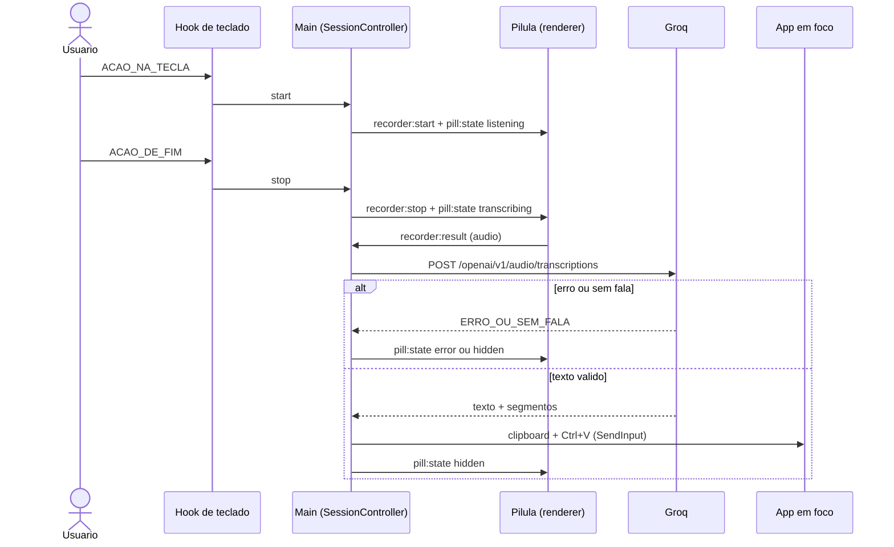
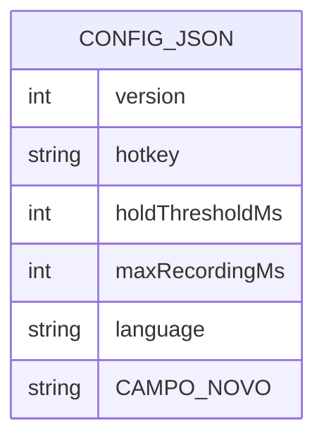
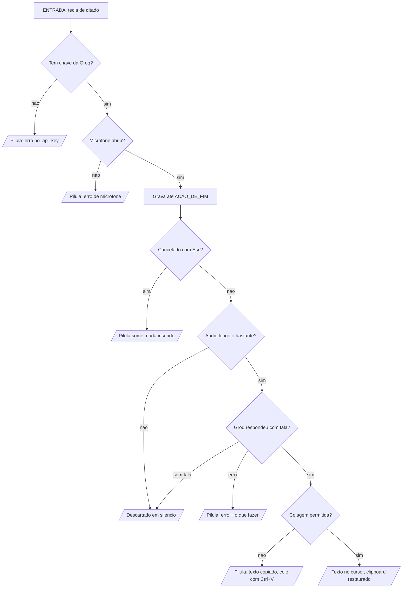

# <Nome da feature> — spec

> Criado: <DD/mmm/AAAA> · Autor: <nome> · Status: **proposta** | aprovada | implementada
> Origem: <pedido de quem, quando, com a frase original entre aspas quando houver>
> Fase: <N — a do roadmap do PRD> · Requisitos: <FR-ÁREA-NN, …>
> Contrato: SDD (`docs/spec/spec-driven-development.md`) · Decisões relacionadas: <ADR-NN, ADR-NN>
> Milestone: <M<N> quando aprovada, senão "a definir">

> **Nota do template (apague ao copiar):** a spec da Fase 1 (`ditado-por-voz.md`) é anterior a este
> template e mantém o formato original (§0–§15). Specs novas usam este formato. Processo, gate e
> *Definition of Done* em [`docs/templates/README.md`](README.md).

<Um parágrafo. O que a feature faz e para quem — sem jargão de implementação. Se não couber em um
parágrafo, a feature está grande demais para uma spec só.>

---

## 0. Constituição (gate — preencher ANTES de desenhar, reconferir DEPOIS)

| Decisão fixa | Esta feature respeita? | Nota |
| --- | --- | --- |
| ADR-01 — Electron + TypeScript estrito (CommonJS, `tsc`, sem bundler na Fase 1); outro runtime ou framework de interface exige ADR | sim / **não** | |
| ADR-02 — hook global com `uiohook-napi`, não `globalShortcut`; só a tecla configurada e o `Esc` são identificados, qualquer outra vira `other` antes de sair do hook | sim / **não** | |
| ADR-03 — inserção por clipboard + Ctrl+V via `SendInput` (`koffi`), com o clipboard restaurado e fallback quando o app em foco é elevado; o app nunca pede elevação para contornar UIPI | sim / **não** | |
| ADR-04 — Groq Whisper `large-v3-turbo`, áudio inteiro ao soltar; sem streaming antes da Fase 4 | sim / **não** | |
| ADR-05 — sem limpeza por IA na Fase 1; `Refiner` identidade como encaixe | sim / **não** | |
| ADR-06 — sem backend na Fase 1; o app não é distribuído com chave | sim / **não** | |
| ADR-07 — sala limpa em relação ao Typeless: nada de código, pseudocódigo, strings, constantes, nomes de canal, ícones, sons ou cores dele; o estudo de referência é só referência | sim / **não** | |
| C1 Privacidade por padrão — áudio nunca vai para disco; texto ditado, clipboard e teclas nunca vão para log | sim / **não** | |
| C2 Nunca roubar o foco — nada do Touch Speaker recebe foco durante o ditado | sim / **não** | |
| C3 Nunca digitar lixo — na dúvida entre inserir algo errado e não inserir nada, não insere e avisa | sim / **não** | |
| C4 Falha visível — todo erro chega à pessoa com mensagem clara; nada falha em silêncio | sim / **não** | |
| C5 Provedores trocáveis — transcrição e limpeza atrás de interface (`Transcriber`, `Refiner`); trocar provedor = adapter novo | sim / **não** | |
| C6 Sem segredo em app distribuído — chave só no `.env` (dev), `safeStorage` (uso pessoal) ou `backend/` (produto) | sim / **não** | |
| C7 Sala limpa — ver ADR-07 | sim / **não** | |
| C8 Escopo da fase — a spec não puxa funcionalidade de fase seguinte "porque era fácil" | sim / **não** | |
| Windows primeiro — nada de macOS/Linux/mobile antes da Fase 4 | sim / **não** | |
| Produto em pt-BR; todo texto de interface em `frontend/src/main/strings.ts` | sim / **não** | |
| `SessionController` é o único dono do estado da sessão | sim / **não** | |
| Código em `frontend/` é a fonte de fato; a feature rastreia ao PRD, ao SDD ou ao código — o estudo de referência não é normativo | sim / **não** | |
| Nenhum segredo (`GROQ_API_KEY`, conteúdo de `.env`) em doc, código novo ou diff | sim / **não** | |
| Sem dependência, provedor ou serviço novo sem ADR | sim / **não** | |

**Violação exige justificativa:**

| O que fura | Por que é necessário | Alternativa rejeitada e por quê | Aval |
| --- | --- | --- | --- |
| | | | Victor |

> Sem linha aqui e sem `[PRECISA ESCLARECER]` aberto, a spec pode ir ao gate. ADR proposta ainda não é
> decisão fixa — se a feature depende de uma, diga qual no §17.

### 0.1 Diagramas obrigatórios

Feature com **tela** ou com **fluxo** (mais de um passo, mais de um ator ou mais de um processo) entrega
**os quatro** diagramas abaixo. Texto corrido não substitui: diagrama é o único formato em que a
lacuna aparece antes do PR — ramo sem saída, estado da pílula sem desenho, campo de config sem default,
mensagem IPC que ninguém envia.

| # | Diagrama | Seção | Formato | Responde |
| --- | --- | --- | --- | --- |
| 1 | **Wireframe** da pílula ou do menu da bandeja, com os estados | §7.1 | bloco ASCII ou `mermaid` | onde cada coisa fica e o que muda por estado |
| 2 | **UML de sequência** | §8.1 | `mermaid sequenceDiagram` | quem chama quem (hook, main, pílula, Groq, app em foco), em que ordem, e onde a chamada falha |
| 3 | **ER** do modelo de dados | §9.1 | `mermaid erDiagram` | que campo do `config.json` (ou tabela SQLite, a partir da Fase 2) é dono de quê |
| 4 | **Fluxograma** do usuário | §11.1 | `mermaid flowchart TD` | as decisões, os erros e as saídas da jornada |

Regras:

- **Mermaid é o padrão** (renderiza no GitHub e no VS Code, é texto no diff e não vira imagem morta).
  ASCII só no wireframe, quando for mais legível que o mermaid.
- **N/A é permitido, em branco não.** Feature sem tela não tem wireframe — escreva
  `N/A — sem superfície de tela` na seção. Feature que não muda dado ainda desenha o ER **dos campos
  existentes que ela lê**: o desenho é o que prova que dá para reusar.
- O diagrama descreve **o desenho proposto**, não o código de hoje. O que existe hoje vai no §1, com
  âncora `frontend/src/<caminho>.ts:<linha>`.
- Se o fluxograma tem ramo que nenhum FR do §5 cobre, falta FR. Se um FR não aparece em ramo nenhum,
  ele é fantasma. O gate confere os dois sentidos.

---

## 1. O problema, na tela

<O que dói hoje, do ponto de vista de quem dita — na pílula, no app em foco, no texto que sai. Não comece
pela solução.>

Evidência no código — âncora obrigatória, formato `frontend/src/<caminho>.ts:<linha>` (ou
`pill.html:linha`, `pill.css:linha`). Sem a linha conferida, cite o arquivo e o símbolo
(`SessionController.start`, `DEFAULT_CONFIG`) — nunca uma linha inventada:

### 1.1 <sintoma>

<descrição + `frontend/src/main/session.ts:123`>

### 1.2 <sintoma>

<...>

> Se a investigação revelar problema que existe **independente** desta feature, escreva aqui e diga
> se é pré-requisito ou trabalho separado. Confira antes as pendências e os riscos já registrados no SDD
> (Apêndice B e §26) — o problema pode já ter `PEND-` ou `RISK-`.

---

## 2. Objetivo e não-objetivos

**Objetivo:** <uma frase, verificável>

**Não-objetivos** (o que esta feature explicitamente NÃO faz):

- <...> — <por quê>
- <...> — <por quê; o que é de fase seguinte entra aqui, com a fase (C8)>

### 2.1 Produto — a quem serve e como se mede

Engenharia responde *como fazer*; produto responde *se vale fazer*. Sem esta seção a spec vira lista
de tarefas com aparência de decisão.

| | |
| --- | --- |
| **Para quem** | <persona do PRD: dev multitarefa (Victor — Fase 1) · profissional que escreve muito (Fase 4)> |
| **Dor** | <a frase que a pessoa diria — não o recurso que falta> |
| **Elo do fluxo que fortalece** | <tecla · gravação · transcrição · inserção · pílula. Feature que não fortalece nenhum precisa justificar por que existe> |
| **Hipótese** | <acreditamos que <mudança> faz <persona> <comportamento>, e saberemos se der certo quando <sinal>. Diga se mexe numa das hipóteses H1–H4 do `PROJECT_CONTEXT.md`> |
| **Como se mede** | <evento e campo do log que dá o número (ex.: `dictation_done` com `total_ms` e `outcome`) — só metadados, nunca conteúdo (C1). "Não dá para medir ainda" é resposta válida, "não pensamos" não> |
| **Custo de não fazer** | <o que continua acontecendo se isto ficar para depois> |
| **Alcance × esforço** | <quanto do uso toca (todo ditado / só mãos livres / só um app / só erro) × <dias de trabalho> — a razão que ordena a fila> |

> Feature que muda o gesto (tecla, segurar × tocar, `Esc`) ou um texto da pílula também confere se o
> `README.md` e o `frontend/src/main/strings.ts` continuam verdadeiros.

---

## 3. Rastreabilidade

| Origem | Referência |
| --- | --- |
| PRD | `docs/PRD.md` → `FR-DICT-NN` ou `FR-<ÁREA>-NN` |
| SDD | `BR-NNN` (§6) · `RISK-NNN` (§26) · `PEND-NNN` (Apêndice B) · `AC-NNN` (Apêndice C) |
| Código atual | `frontend/src/<caminho>.ts:<linha>` |
| Estudo de referência (não normativo) | `docs/referencia/estudo-typeless.md` § <N> — ideia descrita com palavras próprias, nunca código (ADR-07) |
| Milestone anterior | `docs/milestones/M<N>-*.md` (quando existir) |

Se a feature **não** consta no PRD nem no SDD: dizer aqui, e prever linha no `CHANGELOG` + nota no
SDD no mesmo PR.

---

## 4. Atores e permissões

| Ator | O que pode | Como o código confere |
| --- | --- | --- |
| usuário | aciona a tecla de ditado, fala, usa o menu da bandeja, edita o `config.json` | o hook só distingue tecla configurada, `Esc` e `other` (`frontend/src/main/keyboard.ts`) |
| processo main | rede (Groq), clipboard, Win32 (`SendInput`), teclado global, arquivos em `%APPDATA%\Touch Speaker` | dono único do estado (`SessionController`); valida remetente, tipos e tamanho de todo IPC (`frontend/src/main/index.ts`) |
| renderer (pílula) | só o microfone, entre `recorder:start` e `recorder:stop`/`recorder:cancel`, e a interface | `contextIsolation`, `sandbox`, `nodeIntegration: false`; permissão de mídia só de áudio e só para a pílula (`setPermissionRequestHandler` em `frontend/src/main/index.ts`) |
| preload | expõe só `window.touchSpeaker`, com os canais de `src/shared/ipc.ts` | `contextBridge` (`frontend/src/preload/pill.ts`) |
| Groq | recebe o áudio e devolve o texto | `Authorization: Bearer` só no main; timeout e mapa de erros (`frontend/src/main/transcribe/groq.ts`) |
| app em foco | recebe o Ctrl+V sintético | detecção de elevação (UIPI) → fallback "Texto copiado" (`frontend/src/main/insert/win32.ts`, `insert/inserter.ts`) |

---

## 5. Requisitos funcionais

Formato **EARS** — `QUANDO <evento/condição> O SISTEMA DEVE <comportamento observável>`. Um
comportamento por linha, sem "e" escondendo dois requisitos. Numere `FR-<ÁREA>-NN` (área do PRD: `DICT`,
`CLEAN`, `VOCAB`, `HIST`, `SET`, `CTX`, `ASK`, `TRANS`, `ACC`; do SDD §0.2: `DS`) e aponte a origem (FR do PRD, BR ou PEND do
SDD).

| # | Requisito | Origem | Prioridade |
| --- | --- | --- | --- |
| FR-<ÁREA>-01 | QUANDO <...> O SISTEMA DEVE <...> | PRD FR-<ÁREA>-NN | P1 |
| FR-<ÁREA>-02 | QUANDO <...> O SISTEMA DEVE <...> | | P2 |
| FR-<ÁREA>-03 | ENQUANTO <estado da sessão> O SISTEMA DEVE <...> | | P2 |
| FR-<ÁREA>-04 | SE <condição de erro> ENTÃO O SISTEMA DEVE <...> | | P1 |

**Casos de borda** (o que a maioria esquece — responda cada um ou marque como fora de escopo):

- tecla acidental: toque curto sem fala, ou a tecla de ditado seguida de outra tecla em até 1 s (atalho —
  BR-003);
- foco muda durante a transcrição: o texto vai para a janela que estiver em foco (RISK-006);
- microfone ocupado ou sem permissão (`mic_unavailable`, `mic_denied`);
- sem rede, chave inválida ou limite da Groq (`network_error`, `invalid_api_key`, `rate_limited`);
- clipboard com imagem, e a pessoa copiando algo logo depois da colagem (BR-010);
- app de destino elevado (`paste_blocked`, BR-009);
- duas telas: a pílula aparece na tela onde está o mouse;
- `.env` ausente ou sem `GROQ_API_KEY` (`no_api_key`, BR-013);
- gravação no limite de 5 min (BR-011) e `Esc` chegando também ao app em foco (RISK-013).

> Ponto que não tem origem no PRD, no SDD ou no código e não foi decidido:
> `[PRECISA ESCLARECER: <a pergunta exata>]`. **Não escolha por conta própria.**

---

## 6. Requisitos não-funcionais

Marque N/A o que não se aplica — mas marque. Todo item aplicável precisa de **número** e de **como se
verifica**; NFR sem verificação é só documentação.

| Categoria | Requisito (com limiar) | Como se verifica |
| --- | --- | --- |
| Performance / latência | ex.: soltar → texto com p50 ≤ 1,5 s e p95 ≤ 3 s para falas ≤ 30 s (NFR-01); captura ≤ 300 ms após a tecla (NFR-02) | `total_ms` e `latency_ms` no log, 30 ditados |
| Consumo em repouso | ex.: continua ≤ 220 MB de memória privada e ~0% de CPU parado na bandeja (NFR-03) | Gerenciador de Tarefas, com o app parado |
| Privacidade (C1) | o que a feature lê (áudio, texto, clipboard, teclas), por quanto tempo fica em memória e o que **nunca** vai para disco ou log (NFR-04) | review + leitura do log depois do roteiro |
| Segurança Electron | `contextIsolation`, `sandbox`, sem `nodeIntegration`, preload mínimo, CSP de `pill.html` intacta; IPC novo validado no main (NFR-05) | review + teste do validador |
| Foco (C2) | a feature não dá foco nem clique à pílula (`focusable: false`, `showInactive`, `setIgnoreMouseEvents`) | roteiro: o cursor continua piscando no app em foco |
| Acessibilidade da pílula | `role="status"` e `aria-live="polite"` mantidos; contraste ≥ 4,5:1; respeita `prefers-reduced-motion` | review manual |
| Observabilidade | evento novo no log com nome e campos primitivos (tempos, tamanhos, códigos) — nunca conteúdo | review do `logger` e de um `main.log` real |
| Degradação | o que a pílula mostra quando a feature falha; o app nunca fecha nem falha em silêncio (C4) | roteiro de erro |
| i18n | N/A — produto em pt-BR; textos centralizados em `strings.ts` | — |
| Fuso horário | N/A — a interface não mostra data nem hora | — |

---

## 7. Telas e estados

**Onde monta:** <pílula — `frontend/src/renderer/pill.html`, `pill.ts`, `pill.css`, estados em
`frontend/src/shared/ipc.ts` (`PillStateName`), janela em `frontend/src/main/pill-window.ts` · ou bandeja —
`frontend/src/main/tray.ts`, ícone em `frontend/src/main/icon.ts`>
**Onde NÃO aparece:** <estados, modos (segurar × mãos livres), telas>

| Estado da pílula | O que aparece |
| --- | --- |
| `hidden` | <nada — a pílula some depois do fade> |
| `listening` | <segurando · mãos livres (com a dica) · últimos 30 s antes do limite> |
| `transcribing` | <enquanto a Groq responde> |
| `notice` | <aviso que não é erro — ex.: texto copiado para colar à mão> |
| `error` | <mensagem de `strings.ts` + o que a pessoa faz em seguida, nunca beco sem saída> |

**Interação:** <a pílula nunca recebe foco nem clique; a interação é a tecla de ditado, o `Esc` e o menu
da bandeja. Diga o que muda em cada um>

### 7.1 Wireframe — diagrama 1 de 4 (obrigatório; `N/A — sem superfície de tela` se não houver tela)

Baixa fidelidade de propósito: caixa, rótulo e hierarquia. Cor, sombra, espaçamento e sons saem de
`docs/DESIGN.md` e de `frontend/src/renderer/pill.css`, não da spec. Desenhe o estado **principal** e
mais o estado que tem maior chance de ser esquecido (erro ou aviso).

```text
┌─ pílula ──────────────────────────────────────────────────┐
│  ●  ▂▃▅▇▅▃▂   <rótulo>                       <cronômetro>  │
│               <dica>                                      │
└───────────────────────────────────────────────────────────┘

erro: <glifo de erro> + <mensagem de strings.ts>, por alguns segundos, depois some
```

Diga o que muda com duas telas ou com `pill.position: top-center` — ou declare que é o mesmo layout.

---

## 8. Arquitetura — onde isso encaixa

**Lados envolvidos:** processo main (`frontend/src/main/` — hook, sessão, transcrição, inserção, bandeja,
config, log) · preload (`frontend/src/preload/pill.ts`) · renderer da pílula (`frontend/src/renderer/`) ·
tipos compartilhados (`frontend/src/shared/ipc.ts`). Canal IPC novo mexe em três lugares que só o review
mantém em sincronia: `shared/ipc.ts`, `preload/pill.ts` e `renderer/global.d.ts`.

**Componente novo ou existente?** <e por quê — reuso é preferível>

**Lógica pura ou presa ao Electron?** <regra que dá para testar com `node:test` fica sem importar
`electron`, como `hotkey.ts`, `transcribe/filters.ts`, `config.ts` e `transcribe/groq.ts`>

**Provedor externo?** <atrás de `Transcriber` ou `Refiner` (C5); provedor novo = ADR + linha em
`docs/INTEGRATION.md`>

**Estado:** <quem é dono — só o `SessionController`; todo evento carrega `sessionId` (BR-014)>

**Configuração:** <a feature precisa de campo novo no `config.json`? default em `DEFAULT_CONFIG`, validação
em `normalizeConfig` (campo inválido cai no default com aviso no log — BR-012) e linha em
`docs/DATABASE.md`>

```text
<fluxo em texto, da tecla ao texto e de volta>
tecla → uiohook → HotkeyController → SessionController → recorder:start → pílula grava
      → recorder:result → GroqTranscriber → filtros → Refiner → TextInserter → app em foco
      → pill:state → pílula some
```

### 8.1 UML de sequência — diagrama 2 de 4 (obrigatório)

Um participante por processo ou sistema real (hook, main, pílula, Groq, app em foco) — não um por
função. Desenhe o caminho feliz **e** ao menos um `alt` de falha: sem chave, erro da Groq, sem fala,
colagem bloqueada.



---

## 9. Modelo de dados

**Onde vive:** `config.json` (`frontend/src/main/config.ts`: `DEFAULT_CONFIG`, `normalizeConfig`) ·
SQLite local (a partir da Fase 2, `database/local/`) · nenhum dado novo — <por quê>

**Muda o formato de dado persistido?** sim / **não** — <se sim, escreva também a spec de migração a partir
do `TEMPLATE-spec-migracao.md` (bump de `version` do `config.json` ou migration nova). Se não, diga qual
campo existente atende>

| Onde | Campo / coluna | Tipo | Default | Faixa válida e o que acontece se for inválido |
| --- | --- | --- | --- | --- |
| `config.json` | `<campo>` | | | <cai no default com `config_invalid_field` no log> |
| `<tabela>` (Fase 2) | `<coluna>` | | | |

- **Índices** (Fase 2): <quais consultas eles servem>
- **Unicidade / idempotência:** <o que impede duplicar>
- **Retenção:** <o que expira, quando, quem apaga; áudio nunca é persistido e o texto ditado só fica na
  máquina do usuário>
- **Privacidade:** <o que esta feature **nunca** grava em disco ou log (C1)>

### 9.1 ER — diagrama 3 de 4 (obrigatório, mudando dado ou não)

Entre os campos ou tabelas que esta feature **lê ou escreve** — inclusive os que já existem: o desenho é
o que prova que dá para reusar em vez de criar. Marque o novo com `%% novo`.



Diga embaixo, em uma linha por item: qual **índice** serve qual consulta do §11 (a partir da Fase 2) e o
que garante a **unicidade/idempotência** desenhada.

---

## 10. Contrato

**Canais IPC**

| Canal | Direção | Payload (sempre com `sessionId`) | Validação no main |
| --- | --- | --- | --- |
| `<canal>` | main → pílula / pílula → main | `<campos e tipos>` | <remetente, tipos, tamanho> |

**HTTP (provedor externo)**

| Método | URL | Autenticação | Retorno |
| --- | --- | --- | --- |
| `<método>` | `<url>` | `Authorization: Bearer <chave>` só no main | `<campos usados>` |

**Formato:** canais, payloads e chamadas registrados em `docs/API.md` (e o provedor em
`docs/INTEGRATION.md`) — fechar **antes** do código que os consome entrar em execução.

**Códigos de erro:** <código novo entra na união `ErrorCode` de `frontend/src/main/errors.ts`, com a
mensagem pt-BR em `strings.ts` e a linha na tabela "Códigos de erro" do `docs/API.md`; o log grava só o
código>

**Efeitos colaterais:** <mexe no clipboard? grava evento novo no log? muda o ícone da bandeja?>

**Compatibilidade:** <quebra canal ou payload existente? o renderer antigo e o main novo convivem durante
o desenvolvimento?>

---

## 11. Fluxo ponta a ponta

```text
1. usuário <ação na tecla>
2. hook classifica <tecla configurada / Esc / other> → HotkeyController decide <...>
3. SessionController <muda de estado> → recusa com <código> quando <...>
4. pílula <grava / mostra estado>
5. main <transcreve / filtra / refina / insere>
6. pílula <some / mostra aviso ou erro>
```

### 11.1 Fluxograma — diagrama 4 de 4 (obrigatório)

A jornada de quem dita, com as **decisões** e as **saídas**. Todo losango tem os dois ramos
desenhados, e todo ramo termina em estado da pílula ou em texto inserido — nunca no vazio. Os casos de
borda do §5 (toque acidental, sem chave, sem rede, sem fala, colagem bloqueada) aparecem aqui como
ramo, não como parágrafo.

Sem `<` e `>` dentro dos nós — angular quebra o parser do mermaid. Use NOME_EM_CAIXA_ALTA como
lacuna a preencher.



Confira contra o §5: ramo sem FR = FR faltando; FR sem ramo = FR fantasma.

---

## 12. Alternativas consideradas

| Alternativa | Por que foi rejeitada |
| --- | --- |
| <a óbvia que alguém vai perguntar> | <o custo real> |
| <a mais simples> | <o que ela não resolve> |

> Seção obrigatória. Spec sem alternativa rejeitada normalmente não considerou nenhuma.

---

## 13. Riscos

| Risco | Impacto | Mitigação |
| --- | --- | --- |
| | | |

> Se a feature toca um risco já registrado no SDD (`RISK-NNN`, §26), cite o ID e diga se ele piora, fica
> igual ou melhora.

---

## 14. Critérios de aceite

Numerados, observáveis, um por linha. Cada FR do §5 precisa aparecer em pelo menos um.

| # | Critério | Verifica |
| --- | --- | --- |
| 1 | DADO <estado> QUANDO <ação> ENTÃO <resultado observável> | FR-<ÁREA>-01 |
| 2 | DADO <...> QUANDO <...> ENTÃO <...> | FR-<ÁREA>-02 |
| 3 | DADO um toque acidental sem fala QUANDO a tecla é solta ENTÃO nada é inserido no app em foco | C3 |
| 4 | DADO <condição de erro> QUANDO <ação> ENTÃO a pílula mostra a mensagem de `strings.ts` e o app continua aberto | C4, NFR degradação |

**Testes previstos**

| Arquivo | O que cobre |
| --- | --- |
| `frontend/src/test/<módulo>.test.ts` | `node:test` + `node:assert/strict`, sem dependência extra; relógio e `fetch` injetados quando há tempo ou rede |
| Roteiro manual `V<N>` (nesta spec) | o que só se vê na pílula ou no app em foco, com o app aberto por `npm run dev` |

> Não há teste de interface nem CI: o que depende da pílula, do microfone ou do app em foco entra no
> roteiro manual, com o resultado anotado na spec.

---

## 15. Rollout

1. **Ordem:** <contrato em `docs/API.md` e `shared/ipc.ts` → main → preload → renderer → testes; ou o que
   for>
2. **Configuração nova:** <campo, default em `DEFAULT_CONFIG`, validação em `normalizeConfig` e a linha em
   `docs/DATABASE.md`; variável de ambiente nova vai para `docs/ENVIRONMENT.md` e para o `.env.example`,
   só com o nome>
3. **Dados:** <muda formato persistido? então a spec de migração define backup, ponto de não retorno e
   rollback>
4. **Distribuição:** <não há instalador nem auto-update antes da Fase 4 (ADR-06): a mudança chega a quem
   compila e abre o app por `npm run dev`>
5. **Rollback:** <reverter o commit basta? o `config.json` de quem já usa continua abrindo com a versão
   anterior?>

---

## 16. Impacto na documentação (mesmo PR)

- [ ] `docs/CHANGELOG.md` — o quê **e o porquê**
- [ ] SDD `docs/spec/spec-driven-development.md` § <...> (requisitos, regras, riscos, pendências)
- [ ] `docs/DECISIONS.md` — ADR nova? (dependência, provedor ou serviço novo = obrigatório)
- [ ] `docs/ENVIRONMENT.md` — variável ou configuração nova
- [ ] `docs/API.md` (canal, chamada HTTP ou código de erro mudou) / `docs/DATABASE.md` (`config.json` ou dado
      mudou)
- [ ] `docs/INTEGRATION.md` — se mexeu na integração com a Groq ou trouxe outro provedor
- [ ] `docs/DESIGN.md` — se mudou estado, texto, cor ou som da pílula ou da bandeja
- [ ] `README.md` — se mudou o gesto, um comando ou o "como rodar"
- [ ] `CLAUDE.md` — só se mudou decisão fixa ou fechou fase

---

## 17. Decisões em aberto

| # | Questão | Default proposto | Decide |
| --- | --- | --- | --- |
| D1 | | | Victor |
| D2 | | | Victor |

---

## 18. Anexo — tarefas (não há ferramenta de tarefas: elas vivem aqui e no doc-pai da milestone)

**M<N> — <título curto>**

*Objetivo:* <uma frase>

*Requisitos:* <lista corrida separada por ` · `>

*Resultados:* <o que existe depois que fecha>

Subtarefas:

1. T1 — <...> (FR-<ÁREA>-01, FR-<ÁREA>-02)
2. T2 — <...> (FR-<ÁREA>-03)
3. T3 — <...>
4. T4 — Documentação afetada (§16).
5. T5 — Testes + self-review.
